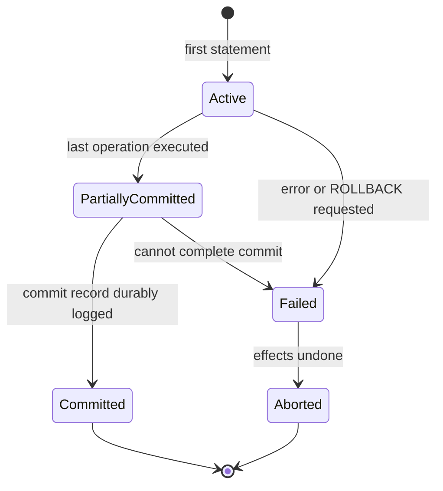
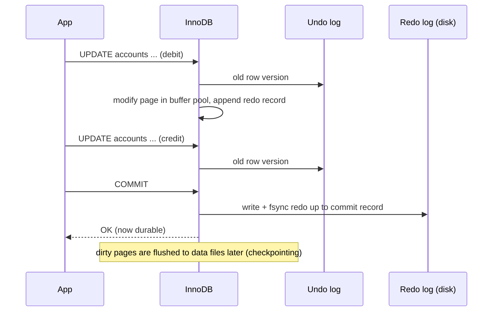

## Introduction

Moving $250 from one bank account to another looks like one action to the customer. To the database it is at least four writes: subtract 250 from account A, add 250 to account B, and append two ledger rows recording the movement. Now imagine the server loses power after the first write, or a second clerk updates account A at the same instant, or the second update violates a rule. Without help from the DBMS, money would vanish, be created out of nothing, or be recorded twice.

A **transaction** is the DBMS's answer: a sequence of operations that the system treats as **one logical unit of work**. The guarantees a transaction provides are summarized by the acronym **ACID**:

- **Atomicity** — all of the transaction's changes happen, or none do.
- **Consistency** — a transaction takes the database from one valid state to another valid state; integrity constraints hold at commit.
- **Isolation** — concurrent transactions do not see each other's intermediate states (to the degree the isolation level promises).
- **Durability** — once the DBMS reports a commit, the changes survive crashes.

This lesson defines each property precisely, shows the transaction **state model**, and demonstrates every property on the **bank** dataset in MySQL — a transfer that commits, one that rolls back, a constraint that refuses an overdraft, two sessions running at the same time, and the server settings behind durability. It is a foundation lesson: Module 8 ([The Transaction Lifecycle](/lessons/m08-transaction-lifecycle), [ACID in InnoDB](/lessons/m08-acid-in-innodb), [Isolation Levels](/lessons/m08-isolation-levels)) and Module 10 (redo, undo, crash recovery) go much deeper.

:::note[Dataset]
The **bank** dataset has 3 branches, 15 customers, 25 accounts and a 166-row append-only ledger (`transactions`). `accounts.balance` has `CHECK (balance >= 0)` and equals the latest `balance_after` in the ledger; transfers appear as `transfer_out`/`transfer_in` pairs sharing a `reference`. Account 7 is frozen and account 12 closed. Every output below was captured from a real MySQL server.
:::

## DBMS Theory

:::theory[Transactions and the ACID properties]
A **transaction** T is a finite sequence of read and write operations on database items, terminated by either **commit** (make all of T's effects permanent) or **abort/rollback** (undo all of T's effects). Formally the DBMS guarantees:

| Property | Definition | Who is responsible |
|---|---|---|
| **Atomicity** | Either all operations of T are reflected in the database, or none are. | The DBMS (recovery manager: undo logging) |
| **Consistency** | If the database satisfies all integrity constraints before T, and T executes alone and completely, it satisfies them after T. | The **application** writes correct transactions; the DBMS enforces declared constraints |
| **Isolation** | Even though transactions execute concurrently, each behaves as if it ran alone; the ideal is **serializability** — the outcome equals some serial order. | The DBMS (concurrency control: locking, MVCC), at the chosen isolation level |
| **Durability** | After T commits, its effects persist despite subsequent system failures. | The DBMS (recovery manager: write-ahead redo logging, flushing) |
:::

Consistency is the odd one out. Atomicity, isolation and durability are mechanisms the DBMS provides; consistency is a **goal** they serve. The DBMS can enforce *declared* constraints — `NOT NULL`, keys, foreign keys, `CHECK` — but not every business invariant. "A transfer must not change the total amount of money in the bank" is an invariant that only correctly written transactions maintain: a transaction that debits 250 and credits 25 commits happily if no declared rule forbids it.

### Transaction states



- **Active** — the transaction is executing reads and writes.
- **Partially committed** — the final operation has executed, but the outcome is not yet guaranteed to be durable (the commit record may still be in memory).
- **Committed** — the commit has been durably recorded; it can no longer be undone by a crash.
- **Failed** — normal execution cannot continue (an error, a deadlock, an explicit rollback, a crash).
- **Aborted** — all of the transaction's effects have been rolled back. The application may then *restart* the transaction (for transient failures such as deadlocks) or *kill* it (for logical errors).

Committed and aborted are the two **terminal** states. The essential promise is that, from the outside, a transaction is only ever observed as *never started* or *fully committed* — never in between.

### Schedules and serializability (preview)

When transactions run concurrently, their operations interleave into a **schedule**. A schedule is **serializable** if its effect equals that of some serial schedule (one transaction after another). Weaker isolation levels permit non-serializable schedules in exchange for concurrency, allowing anomalies such as dirty reads, non-repeatable reads, phantoms and lost updates. Module 8 ([Read Phenomena](/lessons/m08-read-phenomena), [Isolation Levels](/lessons/m08-isolation-levels)) treats these formally.

## Why It Exists

Before transaction processing systems, applications that updated shared files had to handle failures and concurrency themselves — and mostly could not. The failure modes are exactly the ones ACID rules out:

- **Partial updates (no atomicity).** A program debits account A, then crashes before crediting account B. The money is gone, and nothing in the files records that a transfer was in progress.
- **Constraint violations (no consistency enforcement).** Two programs each check "balance ≥ amount" and then withdraw; one of them overdraws the account because the check and the write are not protected together.
- **Interference (no isolation).** Two clerks read balance 500 at the same time, each adds a deposit of 100 and writes 600 back. One deposit is lost — the classic **lost update**.
- **Lost commits (no durability).** The program tells the customer "transfer complete", the operating system still has the write in its cache, the machine loses power, and the transfer never happened.

Transactions turn these from application problems into DBMS guarantees. Application code states the boundaries — `START TRANSACTION` … `COMMIT` — and the DBMS handles recovery and concurrency. This is one of the central reasons organizations use a DBMS rather than files at all (see [File Systems vs DBMS](/lessons/m01-file-systems-vs-dbms)).

The cost is real: logging, locking and flushing take time, and stronger isolation reduces concurrency. Much of database engineering — and the entire debate around distributed systems in [The CAP Theorem, PACELC and Their Relevance to MySQL](/lessons/m01-cap-theorem) — is about how much of ACID to pay for, and where.

## Internal Working

:::internals[How InnoDB implements each ACID property]
| Property | InnoDB mechanism |
|---|---|
| **Atomicity** | Every change first writes the *old* version of the row to the **undo log**. `ROLLBACK` (or recovery after a crash) applies the undo records in reverse. A failed **statement** is rolled back the same way, which gives statement-level atomicity even inside a larger transaction. |
| **Consistency** | Constraints (`PRIMARY KEY`, `UNIQUE`, `FOREIGN KEY`, `CHECK`, `NOT NULL`) are checked as rows are written; a violation fails the statement. InnoDB checks foreign keys immediately per row (not deferred to commit). |
| **Isolation** | **MVCC**: each row version carries the id of the transaction that wrote it; a consistent (non-locking) read reconstructs the version visible to its **read view** from undo records. Writers take **row locks** (record, gap and next-key locks) held until commit. Default level: `REPEATABLE READ`. |
| **Durability** | **Write-ahead logging**: changes are recorded in the **redo log** before modified pages are written. With `innodb_flush_log_at_trx_commit = 1` (the default) the redo log is written and flushed to disk at every commit. The **doublewrite buffer** protects against torn page writes. When binary logging is on, an internal **two-phase commit** (XA between the binary log and InnoDB) keeps both logs agreeing about which transactions committed, and `sync_binlog = 1` (default) flushes the binary log at commit. |
:::



Two consequences are worth internalizing:

1. **Commit is cheap in data-file terms but costs a disk flush.** The modified data pages stay in the buffer pool and are written later; the commit only waits for the *sequential* redo log flush. That is why throughput of small transactions is often bounded by the storage device's flush (fsync) latency, and why batching many changes in one transaction is faster than committing each separately.
2. **Crash recovery uses both logs.** On restart, InnoDB **redoes** logged changes that had not reached the data files (so committed work is not lost) and **undoes** changes of transactions that had not committed (so partial work disappears). The pair redo + undo is what makes "all or nothing, and permanent once committed" true across a power failure.

:::standard[Standard SQL vs MySQL]
Standard SQL starts a transaction implicitly with the first statement and ends it with `COMMIT` or `ROLLBACK`; `START TRANSACTION` is standard. MySQL runs in **autocommit mode** by default — every statement is its own transaction unless you issue `START TRANSACTION` (or `BEGIN`) or `SET autocommit = 0`. MySQL also performs **implicit commits** before and after most DDL statements (`CREATE`, `ALTER`, `DROP`, `TRUNCATE`, `RENAME` …); the standard allows DDL inside transactions and some systems (PostgreSQL) make DDL transactional. Transactional guarantees apply only to transactional engines — InnoDB — not to MyISAM or MEMORY tables.
:::

## MySQL Implementation

The tables involved in a transfer:

```sql run
SELECT account_id, customer_id, account_type, balance, status, version
FROM accounts WHERE account_id IN (1, 3, 7, 10)
ORDER BY account_id;
```

Note the **invariant** we want every transfer to preserve — the total money held by the bank:

```sql run
SELECT COUNT(*) AS accounts, SUM(balance) AS total_balance FROM accounts;
```

### A transfer that commits

Move 250.00 from account 3 to account 1, with both ledger rows, as one transaction:

```sql run
START TRANSACTION;
UPDATE accounts SET balance = balance - 250.00, version = version + 1 WHERE account_id = 3;
UPDATE accounts SET balance = balance + 250.00, version = version + 1 WHERE account_id = 1;
INSERT INTO transactions (account_id, txn_type, amount, balance_after, reference, created_at)
SELECT account_id, 'transfer_out', 250.00, balance, 'TRF-DEMO-1', '2024-12-31 10:00:00'
FROM accounts WHERE account_id = 3;
INSERT INTO transactions (account_id, txn_type, amount, balance_after, reference, created_at)
SELECT account_id, 'transfer_in', 250.00, balance, 'TRF-DEMO-1', '2024-12-31 10:00:00'
FROM accounts WHERE account_id = 1;
COMMIT;
SELECT account_id, balance, version FROM accounts WHERE account_id IN (1, 3) ORDER BY account_id;
```

Account 3 went down by 250.00 and account 1 up by 250.00; both `version` counters advanced. The ledger now has the matching pair:

```sql run
SELECT account_id, txn_type, amount, balance_after, reference
FROM transactions WHERE reference = 'TRF-DEMO-1' ORDER BY txn_type;
```

And the invariant holds — the total is unchanged:

```sql run
SELECT SUM(balance) AS total_balance FROM accounts;
```

### Atomicity: a transfer that is rolled back

```sql run
START TRANSACTION;
UPDATE accounts SET balance = balance - 1000.00 WHERE account_id = 3;
UPDATE accounts SET balance = balance + 1000.00 WHERE account_id = 1;
SELECT account_id, balance FROM accounts WHERE account_id IN (1, 3) ORDER BY account_id;
ROLLBACK;
SELECT account_id, balance FROM accounts WHERE account_id IN (1, 3) ORDER BY account_id;
```

Inside the transaction, the session sees its own uncommitted changes (the first SELECT). After `ROLLBACK`, InnoDB applied the undo records and both balances are back to their committed values (the second SELECT). No other session ever saw the intermediate state.

### Consistency: the constraint refuses an overdraft

Account 10 holds 348.43. A debit of 400.00 would make the balance negative, which `CHECK (balance >= 0)` forbids:

```sql run error
UPDATE accounts SET balance = balance - 400.00 WHERE account_id = 10;
```

The statement fails with error 3819 and changes nothing. The DBMS enforced a declared rule regardless of which application sent the statement.

## Syntax Breakdown

| Statement / variable | Meaning |
|---|---|
| `START TRANSACTION` | Begin a transaction; suspends autocommit until `COMMIT`/`ROLLBACK`. Options: `READ ONLY`, `READ WRITE`, `WITH CONSISTENT SNAPSHOT` (take the read view immediately instead of at the first read). |
| `BEGIN` / `BEGIN WORK` | Synonym for `START TRANSACTION` (outside stored programs, where `BEGIN` starts a compound statement). |
| `COMMIT [WORK]` | Make all changes permanent and release locks. |
| `ROLLBACK [WORK]` | Undo all changes since `START TRANSACTION` and release locks. |
| `SAVEPOINT s` / `ROLLBACK TO SAVEPOINT s` / `RELEASE SAVEPOINT s` | Partial rollback inside a transaction (see [Savepoints](/lessons/m08-savepoints)). |
| `SET autocommit = 0 \| 1` | Session setting. With 0, a transaction starts implicitly and lasts until `COMMIT`/`ROLLBACK`. Default 1. |
| `SET SESSION TRANSACTION ISOLATION LEVEL …` | `READ UNCOMMITTED`, `READ COMMITTED`, `REPEATABLE READ` (InnoDB default), `SERIALIZABLE`. |
| `SELECT … FOR UPDATE` / `FOR SHARE` | Locking read: lock the rows read until the transaction ends. Used to protect "check then write" logic. |
| `@@transaction_isolation`, `@@autocommit` | Inspect the current session's settings. |
| `@@innodb_flush_log_at_trx_commit` | Durability: 1 = write and flush redo at each commit (default, full ACID); 2 = write at commit, flush about once per second; 0 = write and flush about once per second. |
| `@@sync_binlog` | 1 = flush the binary log at each commit (default); 0 = leave it to the OS; N = every N commit groups. |

**Error behaviour inside a transaction.** In MySQL, most errors (constraint violations, duplicate keys, data errors) roll back **only the failing statement**, not the whole transaction; the transaction stays active and earlier statements remain pending. A **deadlock** (error 1213) rolls back the entire transaction. A **lock wait timeout** (error 1205) rolls back only the statement unless `innodb_rollback_on_timeout` is enabled. The application must therefore decide to `ROLLBACK` explicitly on error — see Common Mistakes.

## Practical Examples

**1. Statement-level atomicity.** A single `UPDATE` that touches several rows is atomic on its own. Debit 400.00 from accounts 1 and 10 in one statement — account 1 can afford it now, account 10 cannot:

```sql run error
UPDATE accounts SET balance = balance - 400.00 WHERE account_id IN (1, 10);
```

```sql run
SELECT account_id, balance FROM accounts WHERE account_id IN (1, 10) ORDER BY account_id;
```

Neither balance changed. InnoDB may already have modified account 1's row when the check on account 10 failed, but it undid that change before returning the error: a statement never leaves partial effects.

**2. The transfer as a stored procedure with an error handler.** Real systems wrap the transfer in one place so that every caller gets the same rules: both accounts must be active, rows are locked in a fixed order (to avoid deadlocks between opposite transfers), and **any** error rolls back the whole unit.

```sql run
CREATE PROCEDURE transfer_funds(IN p_from INT UNSIGNED, IN p_to INT UNSIGNED,
                                IN p_amount DECIMAL(14,2), IN p_ref VARCHAR(40), IN p_at DATETIME)
BEGIN
  DECLARE v_active INT;
  DECLARE EXIT HANDLER FOR SQLEXCEPTION
  BEGIN
    ROLLBACK;
    RESIGNAL;
  END;

  START TRANSACTION;
  -- lock both rows (in primary-key order) and check that both accounts are active
  SELECT COUNT(*) INTO v_active
  FROM accounts
  WHERE account_id IN (p_from, p_to) AND status = 'active'
  FOR UPDATE;
  IF v_active <> 2 THEN
    SIGNAL SQLSTATE '45000' SET MESSAGE_TEXT = 'Both accounts must exist and be active';
  END IF;

  UPDATE accounts SET balance = balance - p_amount, version = version + 1 WHERE account_id = p_from;
  UPDATE accounts SET balance = balance + p_amount, version = version + 1 WHERE account_id = p_to;
  INSERT INTO transactions (account_id, txn_type, amount, balance_after, reference, created_at)
    SELECT account_id, 'transfer_out', p_amount, balance, p_ref, p_at FROM accounts WHERE account_id = p_from;
  INSERT INTO transactions (account_id, txn_type, amount, balance_after, reference, created_at)
    SELECT account_id, 'transfer_in', p_amount, balance, p_ref, p_at FROM accounts WHERE account_id = p_to;
  COMMIT;
END;
```

A successful call:

```sql run
CALL transfer_funds(5, 6, 120.00, 'TRF-DEMO-2', '2024-12-31 11:00:00');
SELECT account_id, balance, version FROM accounts WHERE account_id IN (5, 6) ORDER BY account_id;
```

A call that violates the balance rule midway — the debit fails the CHECK constraint, the handler rolls back and re-raises the original error:

```sql run error
CALL transfer_funds(10, 11, 1000.00, 'TRF-DEMO-3', '2024-12-31 11:05:00');
```

A call involving the frozen account 7 — the procedure's own business rule signals an error:

```sql run error
CALL transfer_funds(6, 7, 10.00, 'TRF-DEMO-4', '2024-12-31 11:10:00');
```

Neither failed call left a trace:

```sql run
SELECT (SELECT COUNT(*) FROM transactions WHERE reference IN ('TRF-DEMO-3', 'TRF-DEMO-4')) AS ledger_rows_from_failed_calls,
       (SELECT balance FROM accounts WHERE account_id = 10) AS acct10_balance,
       (SELECT balance FROM accounts WHERE account_id = 6)  AS acct6_balance;
```

**3. Durability settings.** The settings that decide whether a commit survives a crash are server-wide; you can read them from any session:

```sql run
SELECT @@autocommit                     AS autocommit,
       @@transaction_isolation          AS isolation_level,
       @@innodb_flush_log_at_trx_commit AS flush_log_at_commit,
       @@sync_binlog                    AS sync_binlog,
       @@innodb_doublewrite             AS doublewrite;
```

On the capture server these are the durable defaults: autocommit on, `REPEATABLE-READ`, redo flushed at every commit, binary log synced at every commit, doublewrite on. Changing them requires `SET GLOBAL`, which the sandbox (rightly) forbids:

```sql
-- Display only: trades durability for throughput (up to ~1 s of commits can be lost on an OS crash or power failure)
SET GLOBAL innodb_flush_log_at_trx_commit = 2;
SET GLOBAL sync_binlog = 0;
```

:::version[Redo log configuration in 8.0.30+ and 8.4]
Since MySQL 8.0.30 the redo log size is controlled by a single variable, `innodb_redo_log_capacity`, and the redo files live in `#innodb_redo` in the data directory; the older `innodb_log_file_size` and `innodb_log_files_in_group` are deprecated. MySQL 8.4 LTS keeps this model. The ACID-related defaults shown above (`innodb_flush_log_at_trx_commit = 1`, `sync_binlog = 1`, `REPEATABLE READ`) are the same in 8.0 and 8.4.
:::

## Execution Walkthrough

### A transfer, step by step

```walkthrough
title: Transfer 75.00 from account 13 to account 14 — what each step changes
steps:
  - title: "1. Committed state before the transaction"
    explain: Both accounts belong to customer 8. These are the values every other session sees.
    sql: SELECT account_id, balance, version FROM accounts WHERE account_id IN (13, 14) ORDER BY account_id;
  - title: "2. Active — debit and credit inside the transaction"
    explain: >-
      After START TRANSACTION and both UPDATEs, this session sees its own changes. InnoDB has written undo
      records holding the old row versions and holds exclusive row locks on both rows. The transaction is
      deliberately rolled back at the end of this step so that the next step can show the outside view.
    sql: |
      START TRANSACTION;
      UPDATE accounts SET balance = balance - 75.00 WHERE account_id = 13;
      UPDATE accounts SET balance = balance + 75.00 WHERE account_id = 14;
      SELECT account_id, balance FROM accounts WHERE account_id IN (13, 14) ORDER BY account_id;
      ROLLBACK;
  - title: "3. Aborted — the undo log restored the committed values"
    explain: The rollback walked the undo records backwards. The committed state is exactly what it was in step 1.
    sql: SELECT account_id, balance, version FROM accounts WHERE account_id IN (13, 14) ORDER BY account_id;
  - title: "4. Committed — run the transfer for real through the procedure"
    explain: >-
      The procedure executes the whole unit and commits. At COMMIT, InnoDB flushed the redo log up to the
      commit record (innodb_flush_log_at_trx_commit = 1) before returning OK — from then on the transfer
      survives a crash.
    sql: |
      CALL transfer_funds(13, 14, 75.00, 'TRF-DEMO-5', '2024-12-31 12:00:00');
      SELECT account_id, balance, version FROM accounts WHERE account_id IN (13, 14) ORDER BY account_id;
  - title: "5. Consistency check after commit"
    explain: >-
      Two invariants hold: the ledger's latest balance_after equals each account's balance, and the transfer's
      two ledger rows have equal amounts.
    sql: |
      SELECT t.account_id, t.txn_type, t.amount, t.balance_after, a.balance,
             t.balance_after = a.balance AS ledger_matches
      FROM transactions AS t JOIN accounts AS a ON a.account_id = t.account_id
      WHERE t.reference = 'TRF-DEMO-5'
      ORDER BY t.account_id;
```

### Isolation: two sessions at once

The scenario below runs on a fresh copy of the bank dataset with two real connections. Session A starts a transfer out of account 1; session B, a teller posting a withdrawal, touches the same account before A commits.

```concurrency
title: A transfer and a withdrawal on the same account
description: Session A moves 100.00 from account 1 to account 2. Session B withdraws 50.00 from account 1 while A's transaction is still open.
steps:
  - session: A
    sql: START TRANSACTION; UPDATE accounts SET balance = balance - 100.00 WHERE account_id = 1;
    note: A has debited account 1 but not committed. InnoDB holds an exclusive lock on that row.
  - session: B
    sql: SELECT balance FROM accounts WHERE account_id = 1;
    note: B's plain SELECT is a consistent (non-locking) read. It sees the last committed balance, not A's uncommitted debit — no dirty read — and it does not wait.
  - session: B
    sql: UPDATE accounts SET balance = balance - 50.00 WHERE account_id = 1;
    expect: blocks
    note: B's UPDATE needs the same row lock A holds, so it waits. Without this lock, both could compute their new balance from the same old value and one change would be lost.
  - observe: locks
  - session: A
    sql: UPDATE accounts SET balance = balance + 100.00 WHERE account_id = 2; COMMIT;
    note: A credits account 2 and commits, releasing its locks. B's UPDATE now proceeds and applies its debit to the committed value A left behind.
  - session: B
    sql: SELECT account_id, balance FROM accounts WHERE account_id IN (1, 2) ORDER BY account_id;
    note: Both changes are present — account 1 lost 150.00 in total, account 2 gained 100.00. The result equals running A and then B serially.
```

Isolation in InnoDB is a combination of the two mechanisms you just saw: **MVCC** lets readers see a consistent committed snapshot without waiting, and **row locks** make conflicting writers queue up. The lock snapshot shows A's exclusive record lock (`X,REC_NOT_GAP`, granted) on account 1's primary-key entry and B's request for the same record waiting. Which anomalies remain possible at each isolation level — and how `REPEATABLE READ` in InnoDB differs from the SQL standard's definition — is the subject of [Isolation Levels](/lessons/m08-isolation-levels).

## Output

After the walkthrough, the database contains exactly the committed transfers (TRF-DEMO-1, TRF-DEMO-2 and TRF-DEMO-5) and nothing from the rolled-back or failed attempts. The best summary of whether ACID did its job is the bank-wide invariant, which no committed transfer may change:

```sql run
SELECT COUNT(*) AS accounts, SUM(balance) AS total_balance FROM accounts;
```

```sql run
SELECT reference, COUNT(*) AS ledger_rows,
       SUM(CASE WHEN txn_type = 'transfer_out' THEN amount END) AS out_amount,
       SUM(CASE WHEN txn_type = 'transfer_in'  THEN amount END) AS in_amount
FROM transactions
WHERE reference LIKE 'TRF-DEMO-%'
GROUP BY reference
ORDER BY reference;
```

The total balance is the same as before the first demo transfer, and every committed transfer has exactly two ledger rows with equal amounts. How to read these results: the invariant check validates **consistency** (which the application's code maintained, helped by declared constraints); the absence of TRF-DEMO-3 and TRF-DEMO-4 validates **atomicity**; the concurrency trace validated **isolation**; and **durability** is a property you verify by configuration (`innodb_flush_log_at_trx_commit = 1`, `sync_binlog = 1`) and by testing recovery — it cannot be observed from a single session's query results.

## Alternative Approaches

**Where to put the transaction logic.**

| Approach | How | Strengths | Weaknesses |
|---|---|---|---|
| Application-managed transaction | The service issues `START TRANSACTION`, the statements, then `COMMIT`/`ROLLBACK` (or uses its framework's `@Transactional` / `with conn.begin():`) | Logic lives with the rest of the code; easy to test and deploy | Every caller must get the boundaries and error handling right; more round trips while locks are held |
| Stored procedure (above) | One `CALL` executes the whole unit on the server | One round trip; rules enforced identically for every client; locks held briefly | Logic split between app and DB; harder versioning and testing (see [Database vs Application Logic](/lessons/m09-db-vs-app-logic)) |
| Single statement | Express the change as one statement (e.g. a multi-row `UPDATE … CASE`) | Statement atomicity is automatic | Rarely possible when several tables (accounts + ledger) are involved |

**Protecting check-then-act logic.** "Debit only if the balance is sufficient" can be done three ways inside a transaction:

1. **Declarative** — rely on `CHECK (balance >= 0)` and handle error 3819 (this lesson's approach).
2. **Pessimistic** — `SELECT balance … FOR UPDATE`, check in code, then `UPDATE`. The lock prevents another transaction from changing the balance between the check and the write.
3. **Optimistic** — read `balance, version` without locking; then `UPDATE … SET balance = …, version = version + 1 WHERE account_id = ? AND version = ?`. If zero rows were affected, someone else changed the row first: retry. The bank dataset's `version` column exists for this pattern ([Optimistic and Pessimistic Locking](/lessons/m08-optimistic-pessimistic)).

**Relaxing ACID deliberately.** Some workloads accept weaker guarantees: `innodb_flush_log_at_trx_commit = 2` on a replica that can be rebuilt, `READ COMMITTED` to reduce locking, or eventually consistent replicas for read scaling. These are explicit trade-offs, discussed in the CAP lesson.

## Performance Analysis

ACID has costs that follow directly from its mechanisms:

| Cost | Cause | Mitigation |
|---|---|---|
| Commit latency | Redo log flush (fsync) at every commit; binary log flush with `sync_binlog = 1` | Group commit (InnoDB and the binary log batch concurrent commits into one flush automatically); fast storage with power-loss-protected write caches; batching many small changes into one transaction |
| Lock waits | Writers hold row locks until commit | Short transactions; no user interaction or network calls inside a transaction; access rows in a consistent order |
| Undo growth | Long-running transactions keep old row versions alive for their read views | Avoid long transactions; monitor `information_schema.INNODB_TRX` for old transactions (Module 8) |
| Rollback cost | Undo must be applied row by row | Rollback of a huge transaction can take as long as the work itself — split bulk jobs into chunks |

:::performance[Theory vs measurement]
The relative cost of `innodb_flush_log_at_trx_commit = 1` versus 2 depends almost entirely on the storage device's flush latency and on concurrency (group commit amortizes flushes across sessions). On a laptop SSD, an NVMe drive with power-loss protection and a cloud network volume the numbers differ by orders of magnitude, which is why no figure is given here: measure with your own workload (for example with `mysqlslap` or `sysbench`) before relaxing durability. On the tiny bank dataset every transaction in this lesson completes in well under a millisecond, so durability settings would not be visible.
:::

One counter-intuitive consequence: **wrapping many inserts in one transaction is usually much faster than autocommitting each one**, because the commit flush is paid once instead of per row. The trade-off is that locks are held longer and a rollback undoes more work — so large batch jobs commit every few thousand rows.

## Best Practices

:::best-practice[Professional habits]
1. **Make transaction boundaries explicit** for every multi-statement unit of work. Do not rely on autocommit for anything that must be atomic.
2. **Always handle errors with an explicit `ROLLBACK`.** In MySQL a failed statement does not end the transaction; earlier statements remain pending until you commit or roll back.
3. **Keep transactions short.** No user think-time, HTTP calls or file I/O between `START TRANSACTION` and `COMMIT`. Long transactions hold locks, block purge and grow undo.
4. **Lock rows in a consistent order** (e.g. ascending primary key) when a transaction touches several rows that other transactions also touch, to reduce deadlocks — and **retry on error 1213** (deadlock), because InnoDB rolls back the whole victim transaction.
5. **Declare invariants as constraints** wherever possible (`CHECK`, `FOREIGN KEY`, `UNIQUE`) so consistency does not depend on every code path being correct.
6. **Never mix DDL into a business transaction** — DDL commits implicitly.
7. **Keep durable defaults on primaries** (`innodb_flush_log_at_trx_commit = 1`, `sync_binlog = 1`). Relax them only for rebuildable systems, and document the decision.
8. **Use InnoDB for all transactional data.** Writes to non-transactional tables (MyISAM, MEMORY) cannot be rolled back.
:::

## Common Mistakes

**Mistake 1 — assuming an error rolls back the transaction.**

```sql run error
START TRANSACTION;
UPDATE accounts SET balance = balance - 100.00 WHERE account_id = 1;   -- succeeds
UPDATE accounts SET balance = balance - 400.00 WHERE account_id = 10;  -- fails: CHECK constraint
SELECT account_id, balance FROM accounts WHERE account_id IN (1, 10) ORDER BY account_id;
ROLLBACK;
```

The second `UPDATE` failed, but the transaction was still active and the debit of account 1 was still pending — the SELECT inside the transaction shows it. Had the code issued `COMMIT` instead of `ROLLBACK` (for example, a script that ignores errors and commits at the end), half a transfer would have been made permanent. Always roll back on error; in stored procedures, use an `EXIT HANDLER` as shown above. After the explicit rollback, nothing changed:

```sql run
SELECT account_id, balance FROM accounts WHERE account_id IN (1, 10) ORDER BY account_id;
```

**Mistake 2 — DDL inside a transaction.**

```sql run
CREATE TABLE audit_note (id INT PRIMARY KEY, note VARCHAR(50));
START TRANSACTION;
INSERT INTO audit_note VALUES (1, 'inserted inside the transaction');
CREATE TABLE scratch_tmp (id INT);   -- DDL: implicit COMMIT happens here
ROLLBACK;                            -- nothing left to roll back
SELECT * FROM audit_note;
```

The row survived the `ROLLBACK`, because `CREATE TABLE` committed the open transaction before executing. The same applies to `ALTER TABLE`, `DROP`, `TRUNCATE`, `RENAME`, `CREATE INDEX` and many administrative statements. (`CREATE TEMPORARY TABLE` does not cause an implicit commit.)

**Mistake 3 — check-then-act without a lock.** Reading the balance with a plain `SELECT`, deciding in application code that the withdrawal is allowed, and then writing — two concurrent requests can both pass the check. Use `SELECT … FOR UPDATE`, an atomic conditional `UPDATE … WHERE balance >= ?`, a `CHECK` constraint, or optimistic versioning.

**Mistake 4 — autocommit in loops.** Inserting 100,000 ledger rows with autocommit on pays 100,000 commit flushes and gives no atomicity for the batch. Wrap logical batches in explicit transactions.

**Mistake 5 — treating "consistency" as automatic.** The DBMS will commit a transaction that debits 250.00 and credits 25.00 if no declared rule forbids it. Business invariants such as "transfers conserve money" must be implemented by correct transaction code and verified by reconciliation queries like the ones in the Output section.

## Industry Application

- **Payments and banking.** Every money movement is a transaction over balances and an append-only ledger (double-entry bookkeeping), exactly as in this lesson. Reconciliation jobs run invariant checks — debits equal credits, balances equal the ledger — continuously, because consistency is the application's responsibility.
- **E-commerce checkout.** Creating an order, reserving inventory and recording payment intent happen in one database transaction; calls to external payment providers happen *outside* it, coordinated with idempotency keys and status columns, because a remote call cannot be rolled back by the database.
- **Microservices and distributed workflows.** When one business operation spans several services, each with its own database, a single ACID transaction is no longer available. Teams use the **transactional outbox** pattern (write the business change and an outbox event in one local transaction) and **sagas** (a sequence of local transactions with compensating actions). Both rely on local ACID transactions as building blocks (Modules 12 and 13).
- **Operational tuning.** DBAs monitor long-running transactions (`information_schema.INNODB_TRX`), deadlock rates and history list length, and set durability per role: full durability on primaries, sometimes relaxed settings on replicas that can be rebuilt.
- **Backups and replication.** Consistent backups (`mysqldump --single-transaction`, MySQL Enterprise Backup, Percona XtraBackup) and replication both depend on transactional boundaries: a replica applies whole transactions, and a backup taken inside one consistent snapshot contains only committed transactions.

## Practice Exercises

All exercises use the **bank** dataset, freshly loaded for each attempt.

```exercise
id: ex1
title: The bank-wide invariant
difficulty: easy
concepts: [consistency, transactions]
prompt: |
  Return one row with two columns: `accounts` (the number of accounts) and `total_balance` (the sum of all
  balances). This is the invariant that every internal transfer must preserve.
hints:
  - "Two aggregates over the accounts table."
solution: |
  SELECT COUNT(*) AS accounts, SUM(balance) AS total_balance FROM accounts;
explanation: |
  Internal transfers move money between accounts and must leave `total_balance` unchanged; deposits,
  withdrawals, fees and interest legitimately change it. Reconciliation jobs record this number before and
  after batch processing to detect transfer bugs.
```

```exercise
id: ex2
title: Are all transfer pairs balanced?
difficulty: medium
concepts: [consistency, atomicity]
prompt: |
  Transfers are recorded as a `transfer_out` row and a `transfer_in` row sharing the same `reference`.
  For every reference that has at least one transfer row, return `reference`, `out_amount` (sum of
  transfer_out amounts), `in_amount` (sum of transfer_in amounts) and `balanced` (1 if the two are equal,
  otherwise 0).
hints:
  - "Filter to txn_type IN ('transfer_out', 'transfer_in') and GROUP BY reference."
  - "Use conditional aggregation: SUM(CASE WHEN txn_type = 'transfer_out' THEN amount ELSE 0 END)."
solution: |
  SELECT reference,
         SUM(CASE WHEN txn_type = 'transfer_out' THEN amount ELSE 0 END) AS out_amount,
         SUM(CASE WHEN txn_type = 'transfer_in'  THEN amount ELSE 0 END) AS in_amount,
         SUM(CASE WHEN txn_type = 'transfer_out' THEN amount ELSE 0 END)
           = SUM(CASE WHEN txn_type = 'transfer_in' THEN amount ELSE 0 END) AS balanced
  FROM transactions
  WHERE txn_type IN ('transfer_out', 'transfer_in')
  GROUP BY reference;
explanation: |
  Every pair is balanced in the dataset — the result of writing both ledger rows in the same atomic
  transaction. A transfer whose two halves were written in separate autocommitted statements could leave a
  reference with only one row after a crash; `ELSE 0` makes such a half-pair show `balanced = 0` instead of
  NULL.
```

```exercise
id: ex3
title: Make an atomic transfer
difficulty: medium
kind: dml
concepts: [atomicity, transactions]
prompt: |
  Transfer **250.00** from account **3** to account **4** as a single transaction:

  1. debit account 3 and credit account 4 (`version` may stay unchanged);
  2. insert a `transfer_out` ledger row for account 3 and a `transfer_in` row for account 4, both with
     `reference = 'TRF-EX3'`, `created_at = '2024-12-31 12:00:00'`, `amount = 250.00` and `balance_after`
     equal to the account's new balance;
  3. commit.
hints:
  - "START TRANSACTION; two UPDATEs; two INSERTs; COMMIT;"
  - "Compute balance_after with INSERT … SELECT account_id, 'transfer_out', 250.00, balance, … FROM accounts WHERE account_id = 3, after the UPDATE."
solution: |
  START TRANSACTION;
  UPDATE accounts SET balance = balance - 250.00 WHERE account_id = 3;
  UPDATE accounts SET balance = balance + 250.00 WHERE account_id = 4;
  INSERT INTO transactions (account_id, txn_type, amount, balance_after, reference, created_at)
    SELECT account_id, 'transfer_out', 250.00, balance, 'TRF-EX3', '2024-12-31 12:00:00' FROM accounts WHERE account_id = 3;
  INSERT INTO transactions (account_id, txn_type, amount, balance_after, reference, created_at)
    SELECT account_id, 'transfer_in', 250.00, balance, 'TRF-EX3', '2024-12-31 12:00:00' FROM accounts WHERE account_id = 4;
  COMMIT;
check: |
  SELECT 'balance' AS kind, account_id, balance AS amount FROM accounts WHERE account_id IN (3, 4)
  UNION ALL
  SELECT txn_type, account_id, balance_after FROM transactions WHERE reference = 'TRF-EX3';
explanation: |
  Reading the new balance with `INSERT … SELECT` after the UPDATE guarantees that `balance_after` matches the
  committed balance; typing the numbers by hand would be fragile under concurrency. In production you would
  also lock both rows first (`SELECT … FOR UPDATE` in primary-key order) and roll back on any error.
```

```exercise
id: ex4
title: Optimistic concurrency with the version column
difficulty: hard
kind: dml
concepts: [isolation, transactions, consistency]
prompt: |
  A mobile app read account **5** and account **6** when both had `version = 0`. Apply its transfer of
  **80.00** from account 5 to account 6 using **optimistic locking**: each UPDATE must only succeed if the
  row's `version` is still 0, and must increment `version`. Use one transaction. (No ledger rows are required
  for this exercise.)
hints:
  - "Add AND version = 0 to each UPDATE's WHERE clause and SET version = version + 1."
  - "In application code you would check that each UPDATE affected exactly 1 row, and ROLLBACK and retry otherwise."
solution: |
  START TRANSACTION;
  UPDATE accounts SET balance = balance - 80.00, version = version + 1 WHERE account_id = 5 AND version = 0;
  UPDATE accounts SET balance = balance + 80.00, version = version + 1 WHERE account_id = 6 AND version = 0;
  COMMIT;
check: |
  SELECT account_id, balance, version FROM accounts WHERE account_id IN (5, 6) ORDER BY account_id;
explanation: |
  The version predicate turns "nobody changed the row since I read it" into part of the write itself. If
  another transaction had already incremented the version, the UPDATE would match zero rows and the
  application would detect the conflict (rows affected = 0), roll back and retry with fresh data. No lock is
  held between the read and the write, which suits user-facing flows with think-time.
```

```exercise
id: ex5
title: Reconcile balances with the ledger
difficulty: challenge
concepts: [consistency, durability]
prompt: |
  For **every** account return `account_id`, `balance`, `ledger_balance` (the `balance_after` of that
  account's most recent ledger row — latest `created_at`, ties broken by the highest `txn_id`) and `matches`
  (1 if equal, otherwise 0).
hints:
  - "Rank each account's ledger rows with ROW_NUMBER() OVER (PARTITION BY account_id ORDER BY created_at DESC, txn_id DESC)."
  - "Keep rank 1 in a derived table or CTE and join it to accounts."
  - "Use a LEFT JOIN so an account without ledger rows would still appear (with NULL)."
solution: |
  WITH latest AS (
    SELECT account_id, balance_after,
           ROW_NUMBER() OVER (PARTITION BY account_id ORDER BY created_at DESC, txn_id DESC) AS rn
    FROM transactions
  )
  SELECT a.account_id, a.balance, l.balance_after AS ledger_balance,
         a.balance = l.balance_after AS matches
  FROM accounts AS a
  LEFT JOIN latest AS l ON l.account_id = a.account_id AND l.rn = 1;
explanation: |
  Every account matches: balances and ledger were always updated in the same transaction. This query is a
  standard post-incident check after a crash or a failover — committed work must be present (durability) and
  balances must agree with the ledger (consistency). An equivalent version uses a correlated subquery
  `ORDER BY created_at DESC, txn_id DESC LIMIT 1`.
```

```exercise
id: ex6
title: Crash in the middle of a transfer
difficulty: medium
kind: open
concepts: [atomicity, durability, transaction-states]
prompt: |
  A server running MySQL 8.4 with default settings loses power at three different moments of the transfer
  in this lesson: (a) after the debit UPDATE but before the credit UPDATE; (b) after all four statements but
  before COMMIT; (c) one millisecond after the client received "OK" for COMMIT.
  For each case, state the transaction's state at the time of the crash, what InnoDB recovery does on restart,
  and the resulting balances. Which ACID property is at work in each case?
solution: |
  (a) and (b): the transaction is **active** (or partially committed in (b) — the last operation ran but no
  commit record is durable). Some of its changes may already be in the redo log or even in data pages. On
  restart InnoDB replays the redo log to bring pages to the logged state, then finds the transaction without a
  commit record and **rolls it back using the undo log**. Result: both balances as before the transfer.
  Property: **atomicity** (all or nothing across a crash).

  (c): the transaction was **committed**: with innodb_flush_log_at_trx_commit = 1 the redo log was flushed up
  to the commit record before "OK" was returned (and with sync_binlog = 1 the binary log too, kept in agreement
  by the internal two-phase commit). The modified data pages may not have been written yet, but recovery
  **redoes** the logged changes. Result: the transfer is present. Property: **durability**.

  With innodb_flush_log_at_trx_commit = 2, case (c) survives a MySQL process crash but up to about one second
  of commits can be lost if the operating system or machine crashes — durability traded for throughput.
```

## Knowledge Assessment

```quiz
- id: q1
  question: "Which ACID property is primarily the application's responsibility rather than a mechanism provided by the DBMS?"
  options: ["Atomicity", "Consistency", "Isolation", "Durability"]
  answer: 1
  explanation: "The DBMS enforces declared constraints, but only correctly written transactions maintain business invariants such as 'transfers conserve money'. Atomicity (undo), isolation (locking/MVCC) and durability (redo, flushing) are DBMS mechanisms."
  concepts: [consistency, acid]
- id: q2
  question: "Inside `START TRANSACTION`, statement 1 succeeds and statement 2 fails with a CHECK constraint violation. What is the state in MySQL?"
  options:
    - "The whole transaction has been rolled back automatically"
    - "Statement 2 was rolled back; the transaction is still active and statement 1's change is pending until COMMIT or ROLLBACK"
    - "Both statements were committed"
    - "The session is disconnected"
  answer: 1
  explanation: "MySQL rolls back only the failing statement for most errors. The application must issue ROLLBACK. Exceptions: a deadlock (1213) rolls back the whole transaction; a lock wait timeout (1205) rolls back the statement unless innodb_rollback_on_timeout is ON."
  concepts: [atomicity, transactions]
- id: q3
  question: "What does the following print? `START TRANSACTION; INSERT INTO t VALUES (1); CREATE TABLE u (id INT); ROLLBACK; SELECT COUNT(*) FROM t;` (t was empty.)"
  options: ["0", "1", "An error", "NULL"]
  answer: 1
  explanation: "CREATE TABLE causes an implicit commit of the open transaction before it runs, so the insert is already committed when ROLLBACK executes."
  concepts: [transactions, autocommit]
- id: q4
  question: "With `innodb_flush_log_at_trx_commit = 1`, what must have happened before MySQL returns OK for COMMIT?"
  options:
    - "All modified data pages have been written to the tablespace files"
    - "The redo log has been written and flushed to disk up to the transaction's commit record"
    - "The transaction has been applied on all replicas"
    - "The undo log has been purged"
  answer: 1
  explanation: "Write-ahead logging: durability is guaranteed by the flushed redo log; data pages are written later by checkpointing. Replica application depends on replication mode, not this setting. Undo is purged later, when no read view needs it."
  concepts: [durability]
- id: q5
  type: multi
  question: "Session A has updated account 1 inside an open transaction. Under InnoDB's default isolation level, what happens in session B? (Select all that apply.)"
  options:
    - "A plain SELECT of account 1 returns the last committed balance without waiting"
    - "A plain SELECT of account 1 returns A's uncommitted balance"
    - "An UPDATE of account 1 waits until A commits or rolls back (or the lock wait times out)"
    - "An UPDATE of account 1 overwrites A's change immediately"
  answer: [0, 2]
  explanation: "Consistent reads use MVCC snapshots, so B neither sees uncommitted data (no dirty read) nor waits. Writers need the row's exclusive lock, which A holds until it ends, so B's UPDATE waits — preventing a lost update."
  concepts: [isolation]
- id: q6
  question: "In the transaction state model, when does a transaction move from 'partially committed' to 'committed'?"
  options:
    - "When its last statement has executed"
    - "When its commit record has been durably written to the log"
    - "When all its dirty pages are on disk"
    - "When the client disconnects"
  answer: 1
  explanation: "After the last operation the transaction is partially committed; it becomes committed once the commit is durable. Writing data pages is not required for commit, and disconnecting does not commit (an open transaction is rolled back on disconnect)."
  concepts: [transaction-states]
- id: q7
  question: "`UPDATE accounts SET balance = balance - 400 WHERE account_id IN (1, 10)` fails because account 10 would go negative. Account 1 could afford it. What happened to account 1?"
  options:
    - "It was debited, because rows are processed one at a time"
    - "It was not changed — a failed statement is rolled back as a whole"
    - "It was debited and the transaction is waiting for COMMIT"
    - "It depends on the order of rows in the table"
  answer: 1
  explanation: "Statement-level atomicity: InnoDB undoes the partial effects of a failed statement before returning the error, regardless of processing order."
  concepts: [atomicity]
- id: q8
  question: "Why do high-throughput systems often batch many inserts into one transaction instead of autocommitting each row?"
  options:
    - "Because autocommit is disabled in InnoDB"
    - "Because each commit pays a log flush; one commit per batch amortizes that cost — at the price of holding locks longer and larger rollbacks"
    - "Because a transaction skips constraint checks"
    - "Because transactions avoid writing to the redo log"
  answer: 1
  explanation: "The dominant per-transaction cost is the durable commit flush. Constraints are still checked and redo is still written; batching only reduces the number of commits."
  concepts: [durability, transactions]
```
