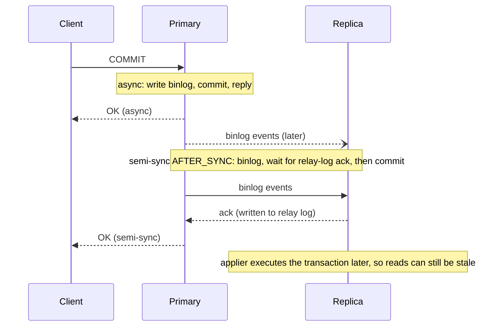

## Introduction

The moment you copy data to a second server — a read replica, a standby for failover, a node in another region — you have a **distributed database**, and you inherit a question that a single server never had to answer: *what happens when the copies cannot talk to each other?*

The **CAP theorem** gives the sharpest answer. When the network between replicas is **partitioned**, a system that keeps accepting requests on both sides must sometimes return data that is not the latest (giving up **consistency**), and a system that never returns stale data must refuse some requests (giving up **availability**). It cannot do both.

CAP is one of the most quoted and most misquoted results in computing. "Pick two of three" is the misquote. This lesson states it precisely, then adds **PACELC**, which captures the trade-off that matters most of the time — **latency versus consistency when there is no partition**. With those two lenses we place MySQL's replication options on the map:

- **asynchronous replication** — the classic primary with read replicas;
- **semi-synchronous replication** — the primary waits for a replica to acknowledge receipt;
- **Group Replication** (the engine of InnoDB Cluster) — a majority-based protocol.

Finally, we contrast **ACID** (the previous lesson, [ACID Properties and Transaction Fundamentals](/lessons/m01-acid-transactions)) with **BASE**, the design philosophy of many NoSQL systems.

The sandbox is a single MySQL server, so replication itself cannot run here. Instead, the runnable examples **simulate** the essential mechanics — a change log, a lagging replica, a read-your-writes check with GTID sets, a quorum vote — with ordinary tables, and the real replication commands are shown as display-only SQL. Replication setup and operation are taught in [Replication and High Availability](/lessons/m11-replication-ha) and [Read Replicas](/lessons/m12-read-replicas).

## DBMS Theory

:::theory[The CAP theorem, stated precisely]
Consider a data store replicated over several nodes connected by a network (Brewer's conjecture, 2000; proved by Gilbert and Lynch, 2002):

- **C — Consistency** means **linearizability**: every read returns the value of the most recent completed write, as if there were a single copy of the data and operations took effect atomically at some instant between their start and end.
- **A — Availability** means every request received by a **non-failing** node eventually receives a **non-error** response.
- **P — Partition tolerance** means the system continues to operate even if the network drops or delays an arbitrary number of messages between nodes.

**Theorem:** no system can guarantee both C and A in every execution in which a network partition occurs.

Proof idea: split the nodes into two groups that cannot communicate. A client writes x = 1 on side 1; another client reads x on side 2. To be available, side 2 must answer — but it cannot know about the write, so it returns the old value, violating linearizability. To be consistent, side 2 must refuse or wait indefinitely, violating availability.
:::

Read the theorem carefully — most popular summaries get at least one of these wrong:

1. **Partitions are not optional.** In any system whose nodes communicate over a network, partitions (lost messages, a failed switch, a GC pause long enough to look like a failure, a cloud availability-zone outage) *will* happen. So P is not something you "choose"; the real choice is **what to do when a partition happens**: remain consistent (CP: refuse some requests) or remain available (AP: serve possibly stale or conflicting data).
2. **CAP says nothing about normal operation.** When there is no partition, a system can be both consistent and available. CAP constrains behaviour *during* the partition only.
3. **CAP's C is not ACID's C.** CAP consistency is linearizability of a replicated register (a recency guarantee). ACID consistency means integrity constraints hold. They are different concepts that share a letter.
4. **CAP's A is very strong.** It requires *every* non-failing node to answer. A system that answers from the majority side and rejects requests on the minority side is not "available" in the CAP sense, even if users rarely notice.
5. **A single-node database is outside CAP.** A single MySQL server has no replicas to disagree; if it is unreachable it is simply down. Calling it "CA" only means "not distributed".

### PACELC

Daniel Abadi (2010, published 2012) observed that CAP ignores the trade-off designers face **all the time**: keeping replicas consistent requires coordination, and coordination costs **latency**. PACELC states:

> **if P**artition → choose **A** or **C**; **e**lse (normal operation) → choose **L**atency or **C**onsistency.

| Class | During a partition | Normal operation | Typical examples |
|---|---|---|---|
| PA/EL | Stay available | Prefer low latency (replicas may lag) | Dynamo-style stores (Cassandra, Riak) in default configurations; MySQL async replicas used for reads |
| PC/EC | Stay consistent | Pay latency for consistency | Spanner, consensus-based (Paxos/Raft) databases; MySQL Group Replication with strong read consistency |
| PA/EC | Stay available | Consistent when healthy | Some configurable systems (e.g. MongoDB with certain settings) |
| PC/EL | Stay consistent | Prefer latency | Rare; some systems with fast local reads that fence during partitions |

### Consistency models between "linearizable" and "eventual"

Real systems offer a spectrum: **linearizability** (strongest), **sequential consistency**, **causal consistency**, and the session guarantees **read-your-writes**, **monotonic reads** and **consistent prefix**, down to **eventual consistency** (if writes stop, all replicas eventually converge — with no bound on when). Many production designs keep the primary linearizable for writes and offer *session* guarantees on replicas, which is exactly what the simulations below implement.

### ACID versus BASE

**BASE** — *Basically Available, Soft state, Eventually consistent* (coined by Pritchett, 2008, as a counterpoint to ACID) — describes systems that favour availability and partition tolerance: they accept writes locally, propagate them asynchronously and reconcile conflicts later.

| | ACID | BASE |
|---|---|---|
| Unit of guarantee | Transaction | Individual operation, eventually |
| Consistency | Integrity constraints hold at commit; (with replication) strong reads on the primary | Replicas converge eventually; reads may be stale |
| Availability under partition | May reject or block requests | Keeps accepting requests |
| Conflict handling | Prevented (locks, MVCC, single primary) | Detected and resolved later (last-writer-wins, vector clocks, CRDTs, application merges) |
| Typical systems | MySQL/InnoDB, PostgreSQL, Spanner | Cassandra, DynamoDB (default reads), Riak, many caches |

The dichotomy is not absolute: MySQL with asynchronous read replicas is ACID on the primary and BASE-like on replicas; many "NoSQL" systems now offer transactions.

## Why It Exists

Replication exists for three reasons — **read scaling**, **high availability** and **disaster recovery** — and each one creates copies that can disagree:

- **Read scaling:** sending reads to replicas multiplies read capacity, but a replica that has not yet applied the latest write returns stale data. A user who just changed their address and immediately sees the old one has experienced a consistency anomaly.
- **High availability:** if the primary fails, a replica is promoted. If replication was asynchronous, transactions the old primary had committed but not yet shipped are **lost** — or, worse, they reappear when the old primary comes back, creating **split brain** (two primaries accepting conflicting writes).
- **Disaster recovery:** a replica in another region survives the loss of a data centre, but cross-region round trips (tens to hundreds of milliseconds) make synchronous coordination expensive, so DR replicas are usually asynchronous and therefore behind.

Without a framework like CAP and PACELC, teams discover these trade-offs during incidents: a failover that silently drops payments, a network blip that leaves two "primaries" taking orders, a dashboard that shows money that does not exist yet. The theorem's value is that it forces the decision *before* the incident — **for each piece of data, which matters more when the network fails: answering, or being right?** For an account balance, being right; for a product-recommendation list, answering.

## Internal Working

:::internals[How MySQL replication works — and where the trade-offs come from]
**Asynchronous replication (default).** On commit, the primary writes the transaction to its **binary log** and returns OK to the client. Each replica's **receiver (I/O) thread** pulls binary-log events into its **relay log**, and **applier (SQL) threads** — several in parallel by default since 8.0.27 — execute them. Transactions are identified by **GTIDs** (`source_uuid:sequence_number`), so a replica knows exactly which transactions it has executed (`gtid_executed`). The primary never waits for replicas: lowest commit latency (EL), but replicas lag, and a failover can lose the transactions not yet received (PA — both sides keep running if partitioned, and nothing prevents divergence except operational fencing).

**Semi-synchronous replication.** Implemented by plugins (`rpl_semi_sync_source` / `rpl_semi_sync_replica`). With the default wait point `AFTER_SYNC`, the primary writes the transaction to the binary log, then **waits until at least `rpl_semi_sync_source_wait_for_replica_count` replicas (default 1) acknowledge that they have written it to their relay log**, and only then commits in InnoDB and returns OK. Each commit pays a network round trip (EC-leaning: an acknowledged transaction exists on two machines, so failover to an acknowledging replica loses nothing). But if no acknowledgement arrives within `rpl_semi_sync_source_timeout` (default 10,000 ms), the primary **falls back to asynchronous** mode and keeps committing — it prefers availability (PA). Note that acknowledgement means *received*, not *applied*: reads on that replica can still be stale.

**Group Replication.** A group of servers runs a Paxos-based group communication system. Every read-write transaction is broadcast to the group, ordered consistently, and **certified** (conflict detection against concurrent transactions) on every member; it commits only after a **majority** of members has agreed on its place in the total order. In single-primary mode (the default) one member accepts writes. If a partition leaves a member in the **minority**, that side cannot reach agreement: its write transactions **block** rather than commit (CP). The majority side continues, and can elect a new primary. Reads on secondaries are governed by `group_replication_consistency` — from `EVENTUAL` (fast, possibly stale: EL) to `BEFORE`, `AFTER` and `BEFORE_AND_AFTER` (wait for the group: EC).
:::



:::standard[General theory vs MySQL specifics]
CAP, PACELC, linearizability, eventual consistency and BASE are general distributed-systems concepts. Binary-log replication, GTIDs, the semi-sync plugins and Group Replication (with its `group_replication_consistency` levels) are MySQL implementations. "Primary/replica" and "source/replica" are MySQL's current terms; MASTER/SLAVE syntax (`CHANGE MASTER TO`, `SHOW SLAVE STATUS`) was deprecated in 8.0 and **removed in MySQL 8.4**.
:::

## MySQL Implementation

### Inspecting the server's replication-related settings

A sandbox session can read (but not change) the variables that define a server's role:

```sql run
SELECT @@server_id               AS server_id,
       @@read_only               AS read_only,
       @@super_read_only         AS super_read_only,
       @@gtid_mode               AS gtid_mode,
       @@enforce_gtid_consistency AS enforce_gtid_consistency,
       @@binlog_format           AS binlog_format;
```

On the capture server — a single stand-alone instance — `read_only` and `super_read_only` are off (it accepts writes) and GTIDs are not enabled. A production replica would typically show `super_read_only = 1` (so not even administrators write to it by accident) and every member of a replication topology would show `gtid_mode = ON`. The captured warning 1287 is worth noticing too: the `binlog_format` variable itself is deprecated (since 8.0.34), because row-based logging — the default — is the format MySQL intends to keep.

### The real configuration (display only)

Setting up replication requires privileges the sandbox does not grant. The statements below are valid MySQL 8.4 syntax, shown for reference:

```sql
-- On a replica: point it at the source, using GTID auto-positioning (8.0.23+ syntax)
CHANGE REPLICATION SOURCE TO
  SOURCE_HOST = 'primary.db.internal',
  SOURCE_USER = 'repl',
  SOURCE_PASSWORD = '********',
  SOURCE_AUTO_POSITION = 1,
  SOURCE_SSL = 1;
START REPLICA;
SHOW REPLICA STATUS\G      -- Replica_IO_Running, Replica_SQL_Running, Seconds_Behind_Source, Executed_Gtid_Set
```

```sql
-- Semi-synchronous replication (MySQL 8.4 plugin and variable names)
INSTALL PLUGIN rpl_semi_sync_source SONAME 'semisync_source.so';     -- on the source
INSTALL PLUGIN rpl_semi_sync_replica SONAME 'semisync_replica.so';   -- on each replica
SET GLOBAL rpl_semi_sync_source_enabled = ON;
SET GLOBAL rpl_semi_sync_source_timeout = 10000;          -- ms before falling back to async
SET GLOBAL rpl_semi_sync_source_wait_for_replica_count = 1;
SET GLOBAL rpl_semi_sync_replica_enabled = ON;            -- on each replica
```

```sql
-- Group Replication: per-session read consistency on a secondary
SET SESSION group_replication_consistency = 'BEFORE';      -- wait until all preceding group transactions are applied
-- Read-your-writes from a replica, by GTID: block up to 1 s until this replica has executed the given set
SELECT WAIT_FOR_EXECUTED_GTID_SET('3e11fa47-71ca-11e1-9e33-c80aa9429562:1-1042', 1);
```

The session read-consistency variable exists on this server, so you can see its value:

```sql run
SHOW VARIABLES LIKE 'group_replication_consistency';
```

:::version[MySQL 8.0 vs 8.4]
MySQL 8.4 removed the old `MASTER`/`SLAVE` statements and variables — use `CHANGE REPLICATION SOURCE TO`, `START REPLICA`, `SHOW REPLICA STATUS`, `SHOW BINARY LOG STATUS` (which replaces `SHOW MASTER STATUS`), and the `rpl_semi_sync_source`/`rpl_semi_sync_replica` plugins instead of `rpl_semi_sync_master`/`slave`. MySQL 8.4 also changed the default of `group_replication_consistency` from `EVENTUAL` (the 8.0 default, which the capture above shows) to `BEFORE_ON_PRIMARY_FAILOVER`, so that after a failover the new primary does not serve reads until it has applied its backlog. Check the value on your own server.
:::

### GTID sets: how a client checks "has the replica seen my write?"

Every committed transaction gets a GTID; a server's `gtid_executed` is the set of GTIDs it has applied. Whether a replica has caught up with a given write is therefore a **set-containment** question, and MySQL's GTID functions are pure functions you can call anywhere:

```sql run
SELECT GTID_SUBSET('3e11fa47-71ca-11e1-9e33-c80aa9429562:1-1042',
                   '3e11fa47-71ca-11e1-9e33-c80aa9429562:1-1050') AS replica_has_my_write,
       GTID_SUBSET('3e11fa47-71ca-11e1-9e33-c80aa9429562:1-1042',
                   '3e11fa47-71ca-11e1-9e33-c80aa9429562:1-1037') AS lagging_replica_has_it,
       GTID_SUBTRACT('3e11fa47-71ca-11e1-9e33-c80aa9429562:1-1042',
                     '3e11fa47-71ca-11e1-9e33-c80aa9429562:1-1037') AS missing_on_lagging_replica;
```

The client's write was transaction 1042. A replica that has executed 1–1050 contains it; a replica at 1–1037 does not, and is missing transactions 1038–1042. Applications (or proxies such as MySQL Router and ProxySQL) use exactly this logic to route a user's next read either to a replica that has caught up or to the primary.

## Syntax Breakdown

| Setting / statement | Where | Effect on the trade-off |
|---|---|---|
| (default) asynchronous replication | source + replicas | Lowest commit latency; replicas lag; failover may lose recent commits — PA/EL |
| `rpl_semi_sync_source_enabled = ON` | source | Commit waits for ≥ 1 replica to acknowledge receipt — less data-loss risk, higher latency |
| `rpl_semi_sync_source_wait_point = AFTER_SYNC` (default) | source | "Lossless": the transaction becomes visible on the source only after a replica acknowledged it. `AFTER_COMMIT` acknowledges after the engine commit (others may already see a transaction that could be lost) |
| `rpl_semi_sync_source_timeout` (ms, default 10000) | source | After the timeout, fall back to async — availability over consistency |
| `rpl_semi_sync_source_wait_for_replica_count` (default 1) | source | Number of acknowledgements required |
| `super_read_only = ON` | replicas | Prevent accidental writes to replicas (a split-brain safeguard) |
| `replica_parallel_workers` (default 4 since 8.0.27) | replicas | Parallel appliers reduce lag |
| Group Replication, single-primary mode | all members | Majority agreement per transaction; minority side cannot commit — PC |
| `group_replication_consistency` | session/global | `EVENTUAL`, `BEFORE_ON_PRIMARY_FAILOVER`, `BEFORE`, `AFTER`, `BEFORE_AND_AFTER` — the EL↔EC dial for reads |
| `group_replication_unreachable_majority_timeout` | member | How long a minority member waits before leaving the group (0 = wait forever) |
| `WAIT_FOR_EXECUTED_GTID_SET(set, timeout)` | replica session | Block until the replica has applied `set` — read-your-writes on demand |
| `SHOW REPLICA STATUS` | replica | Health and lag (`Seconds_Behind_Source`, executed and retrieved GTID sets) |

## Practical Examples

The sandbox has one server, so the next examples **model** a primary and a replica with tables in your lab. The mechanics — an ordered change log (the binary log), a replica that has applied a prefix of it (`gtid_executed`), reads that may hit either copy — are faithful; only the network is imaginary.

**1. Set up the model.** `accounts` plays the primary. `repl_log` is its change log, numbered like GTID sequence numbers. `replica_accounts` is a replica that starts in sync, and `replica_state` records how far it has applied the log.

```sql run
CREATE TABLE repl_log (
  seq         INT PRIMARY KEY,                 -- like the GTID sequence number
  account_id  INT UNSIGNED NOT NULL,
  new_balance DECIMAL(14,2) NOT NULL
);
CREATE TABLE replica_accounts (account_id INT UNSIGNED PRIMARY KEY, balance DECIMAL(14,2) NOT NULL);
INSERT INTO replica_accounts SELECT account_id, balance FROM accounts;
CREATE TABLE replica_state (id TINYINT PRIMARY KEY, applied_seq INT NOT NULL);
INSERT INTO replica_state VALUES (1, 0);
SELECT COUNT(*) AS replica_rows, (SELECT applied_seq FROM replica_state) AS applied_seq FROM replica_accounts;
```

**2. Writes on the primary.** Three transactions commit on the primary. Each one also appends to the change log — in real MySQL, the binary log write is part of the commit.

```sql run
START TRANSACTION;
UPDATE accounts SET balance = balance - 200.00 WHERE account_id = 3;
UPDATE accounts SET balance = balance + 200.00 WHERE account_id = 4;
INSERT INTO repl_log SELECT 1, account_id, balance FROM accounts WHERE account_id = 3;
INSERT INTO repl_log SELECT 2, account_id, balance FROM accounts WHERE account_id = 4;
COMMIT;
START TRANSACTION;
UPDATE accounts SET balance = balance + 500.00 WHERE account_id = 1;
INSERT INTO repl_log SELECT 3, account_id, balance FROM accounts WHERE account_id = 1;
COMMIT;
SELECT seq, account_id, new_balance FROM repl_log ORDER BY seq;
```

**3. A stale read from the lagging replica.** The replica has applied nothing yet (applied_seq = 0). A customer who deposited 500 into account 1 and is routed to the replica sees the old balance — a violation of **read-your-writes**, though perfectly legal under eventual consistency:

```sql run
SELECT p.account_id, p.balance AS primary_balance, r.balance AS replica_balance,
       p.balance <> r.balance AS stale
FROM accounts AS p JOIN replica_accounts AS r ON r.account_id = p.account_id
WHERE p.account_id IN (1, 3, 4)
ORDER BY p.account_id;
```

**4. The replica applies a prefix of the log.** Appliers execute transactions **in log order**. Suppose the replica has applied up to sequence 2 (the first transaction) but not 3:

```sql run
UPDATE replica_accounts AS r
JOIN repl_log AS l ON l.account_id = r.account_id
SET r.balance = l.new_balance
WHERE l.seq <= 2;
UPDATE replica_state SET applied_seq = 2 WHERE id = 1;
SELECT p.account_id, p.balance AS primary_balance, r.balance AS replica_balance,
       p.balance <> r.balance AS stale
FROM accounts AS p JOIN replica_accounts AS r ON r.account_id = p.account_id
WHERE p.account_id IN (1, 3, 4)
ORDER BY p.account_id;
```

Accounts 3 and 4 are now current, and — importantly — they changed **together**: because the replica applies whole transactions in order, it never shows the debit without the credit. That is the **consistent prefix** guarantee that ordered, transactional replication gives you even when it lags. Account 1 is still stale.

**5. Read-your-writes routing.** The application remembers the sequence number of each session's last write (in MySQL: the GTID returned to the client via session tracking, or captured from `@@gtid_executed`). A read may go to the replica only if the replica has applied at least that much:

```sql run
CREATE TABLE client_sessions (session_name VARCHAR(20) PRIMARY KEY, last_write_seq INT NOT NULL);
INSERT INTO client_sessions VALUES ('teller-a', 2), ('mobile-b', 3), ('reporting', 0);
SELECT c.session_name, c.last_write_seq, s.applied_seq,
       CASE WHEN s.applied_seq >= c.last_write_seq THEN 'replica' ELSE 'primary' END AS route_reads_to
FROM client_sessions AS c CROSS JOIN replica_state AS s
ORDER BY c.session_name;
```

`mobile-b` made the deposit (sequence 3) and must read from the primary, or wait — the job `WAIT_FOR_EXECUTED_GTID_SET` does in real MySQL. The others can safely use the replica. This is a **session** consistency guarantee bought cheaply: most reads still go to replicas (EL), and only reads that would expose staleness to the writer pay for consistency.

## Execution Walkthrough

### A partition, step by step

Consider a five-member MySQL Group Replication cluster, or any majority-quorum system. The network splits it into a group of three and a group of two. Model the membership as a table and evaluate the quorum rule — *a side may commit only if it can reach a strict majority of the configured members*:

```walkthrough
title: "Partition of a 5-member group: who may keep accepting writes?"
steps:
  - title: "1. The healthy group"
    explain: >-
      Five members in two data centres. In single-primary mode, db1 is the primary. Every transaction needs
      agreement from a majority — at least 3 of 5 — before it commits.
    sql: |
      CREATE TABLE gr_members (member VARCHAR(10) PRIMARY KEY, dc VARCHAR(10) NOT NULL, side CHAR(1) NOT NULL, role VARCHAR(10) NOT NULL);
      INSERT INTO gr_members VALUES
        ('db1','east','X','PRIMARY'), ('db2','east','X','SECONDARY'), ('db3','east','X','SECONDARY'),
        ('db4','west','Y','SECONDARY'), ('db5','west','Y','SECONDARY');
      SELECT member, dc, role FROM gr_members ORDER BY member;
  - title: "2. The network partitions east from west"
    explain: >-
      Side X (east) can still reach 3 members, side Y (west) only 2. Each side evaluates the majority rule
      independently; the total membership (5) is fixed configuration, not something a side can redefine.
    sql: |
      SELECT side, COUNT(*) AS reachable_members,
             (SELECT COUNT(*) FROM gr_members) AS configured_members,
             COUNT(*) > (SELECT COUNT(*) FROM gr_members) / 2 AS has_quorum
      FROM gr_members
      GROUP BY side
      ORDER BY side;
  - title: "3. CP behaviour: the minority stops committing"
    explain: >-
      Side X has quorum and continues (and, if the primary had been on side Y, would elect a new primary).
      Side Y cannot get majority agreement, so write transactions there block until the partition heals or
      the members are expelled — it gives up availability to avoid divergence. This is what makes Group
      Replication a PC system. Asynchronous replication has no such rule: a replica promoted on side Y would
      accept writes while db1 still accepts writes on side X — split brain.
  - title: "4. Why not let both sides write?"
    explain: >-
      If both sides accepted writes, a withdrawal on each side could each pass the balance check against the
      same old value. After healing, the two histories conflict and no rule can recover the money already
      paid out twice. For balances, CP is the only acceptable choice; for, say, a shopping-cart or a
      "last seen" timestamp, an AP design with merge rules may be preferable.
```

### The latency side of PACELC

During normal operation, the simulation shows the difference between the replication modes in terms of *what a client may observe*:

| Mode | When the client receives OK | What a replica read can return right after OK | Data at risk if the primary dies right after OK |
|---|---|---|---|
| Asynchronous | After the local commit | Old value (replica may not have received the transaction) | Transactions not yet received by any replica |
| Semi-sync, `AFTER_SYNC` | After ≥ 1 replica has the transaction in its relay log | Possibly old value (received, not yet applied) | None on an acknowledging replica — unless the source had fallen back to async after a timeout |
| Group Replication, `EVENTUAL` reads | After majority agreement (certification) | Possibly old value on a secondary that has not applied it | None on the majority side |
| Group Replication, `BEFORE`/`AFTER` | As above (plus waits configured for reads or writes) | The latest value | None on the majority side |

Every step down the table buys consistency with latency — the "E… L or C" half of PACELC. Each commit or read in the stronger modes waits for at least one network round trip, which within a data centre is often a fraction of a millisecond and across regions can be tens of milliseconds or more; measure it in your environment rather than assuming a figure.

## Output

The final state of the simulation: the primary is current; the replica has applied the first transaction (sequences 1–2) atomically and in order but not the deposit (sequence 3); one session must read from the primary to see its own write. Confirm the replica's lag in log positions and which accounts are stale — the same information `SHOW REPLICA STATUS` and a GTID comparison give a real operator:

```sql run
SELECT (SELECT MAX(seq) FROM repl_log)                      AS primary_last_seq,
       (SELECT applied_seq FROM replica_state)              AS replica_applied_seq,
       (SELECT MAX(seq) FROM repl_log) - (SELECT applied_seq FROM replica_state) AS lag_in_transactions,
       (SELECT GROUP_CONCAT(p.account_id ORDER BY p.account_id)
        FROM accounts AS p JOIN replica_accounts AS r ON r.account_id = p.account_id
        WHERE p.balance <> r.balance)                       AS stale_accounts;
```

How to read real lag indicators:

- **`Seconds_Behind_Source`** in `SHOW REPLICA STATUS` estimates lag from timestamps in the events being applied. It can be misleading (0 when the receiver itself is behind, spikes during large transactions). It is a rough health signal.
- **GTID set difference** between source and replica (`GTID_SUBTRACT(source_executed, replica_executed)`) is exact: it lists the transactions the replica has not executed.
- **Heartbeat tables** (a timestamp written on the primary every second and read on the replica, as done by tools like pt-heartbeat) measure end-to-end lag as users experience it.

## Alternative Approaches

Different designs make different CAP/PACELC choices. Which one fits depends on the data, not on fashion.

| Design | Partition behaviour | Normal-operation latency | Consistency on reads | Typical use |
|---|---|---|---|---|
| Single MySQL primary + async replicas | Primary keeps writing; replicas serve stale reads; manual or tool-driven failover may lose recent commits | Lowest | Primary: strong; replicas: eventual (with consistent prefix) | Most web applications; read scaling |
| Primary + semi-sync replica(s) | Falls back to async after `rpl_semi_sync_source_timeout`, then behaves like async | +1 round trip per commit | As above | HA with minimal data loss inside a region |
| Group Replication / InnoDB Cluster (single-primary) | Majority side continues; minority blocks | Certification round trip per write transaction | Configurable from eventual to strong | HA with automatic failover and no split brain |
| InnoDB ClusterSet (async between clusters) | Each cluster CP internally; between regions async | Local-region latency | Cross-region replicas eventual | Multi-region DR |
| Dynamo-style stores (Cassandra) | Both sides accept writes; conflicts resolved later (last-writer-wins by default) | Low; tunable quorum per request | Tunable: ONE (eventual) … QUORUM / ALL | High write availability, time-series, carts |
| Consensus-based distributed SQL (Spanner, CockroachDB, TiDB) | Majority side continues | Consensus round trip per write | Strong (linearizable or serializable) | Global consistency at the cost of write latency |

**Application-level strategies** work with any of them: route reads that must be fresh to the primary; use read-your-writes tokens (GTIDs) as in Practical Example 5; design idempotent operations so that retries after a failover are safe; keep business invariants (like balances) on one strongly consistent store while caching or replicating derived data more loosely.

## Performance Analysis

The performance side of these choices is the "L" in PACELC:

- **Asynchronous replication** adds essentially nothing to commit latency on the primary (the binary log write and flush happen anyway with `sync_binlog = 1`), but replica lag grows whenever the applier cannot keep up — large transactions, schema changes, single-threaded workloads, or replicas with weaker hardware.
- **Semi-synchronous replication** adds at least one network round trip to every commit. Throughput of a single session drops accordingly; aggregate throughput suffers less because concurrent commits are acknowledged in groups.
- **Group Replication** adds a message round trip for group ordering and certification for every read-write transaction, plus conflict-check work; transactions that touch the same rows concurrently on different members (in multi-primary mode) can fail certification and must be retried. Large transactions are expensive to broadcast; MySQL can fragment big messages (`group_replication_communication_max_message_size`) and enforces `group_replication_transaction_size_limit`.
- **Strong read consistency** (`BEFORE`) makes reads wait until preceding transactions are applied locally — latency on reads instead of on writes.

:::performance[Theory vs measurement]
None of these costs can be measured in a single-server sandbox, and published numbers depend heavily on network latency, disks and workload. The reliable approach is to benchmark your own workload under each mode (e.g. with sysbench) and to monitor replica lag and commit latency (Performance Schema replication tables, `SHOW REPLICA STATUS`) in production (Module 11). The direction of each trade-off is certain; its magnitude is environment-specific.
:::

## Best Practices

:::best-practice[Professional habits]
1. **Decide per data class, before the incident:** for each kind of data, write down whether a partition should make the system refuse requests (CP) or serve possibly stale/conflicting data (AP). Money, inventory and identities usually need CP; feeds, recommendations and analytics can be AP.
2. **Never let two nodes accept writes for the same data without a quorum rule or fencing.** Use Group Replication / InnoDB Cluster, or failover tooling that fences the old primary (`super_read_only`, STONITH, VIP removal) before promoting a new one.
3. **Treat replica reads as eventually consistent** unless you add a guarantee: route the writer's own reads to the primary, use GTID-based waits, or use `group_replication_consistency = BEFORE` for the sessions that need it.
4. **Enable GTIDs** (`gtid_mode = ON`, `enforce_gtid_consistency = ON`) in every replicated topology — they make lag measurement, failover and read-your-writes checks exact.
5. **Prefer semi-sync `AFTER_SYNC`** (lossless) over `AFTER_COMMIT` when using semi-sync, and alert on fallbacks to async — a silent fallback turns your "no data loss" design into async replication.
6. **Monitor lag continuously** and set application-level staleness budgets (e.g. "replica reads are acceptable if lag < 2 s").
7. **Do not describe your system as "CA".** If it is distributed, partitions will happen; say what it does when they do.
:::

## Common Mistakes

**Mistake 1 — "pick any two of C, A and P".** Partition tolerance is not optional for a distributed system; the choice is how to behave *when* partitioned. A design document claiming "we chose CA" usually means the partition behaviour was never analysed.

**Mistake 2 — confusing CAP consistency with ACID consistency.** A replica serving a stale but internally valid balance violates CAP consistency (it is not the latest value) but not ACID consistency (all constraints hold). Conversely, a single server can violate an ACID business invariant without any replication at all.

**Mistake 3 — assuming semi-sync means replicas are up to date.** The acknowledgement says the replica *received* the transaction, not that it *applied* it, and after a timeout the source silently degrades to async. In the simulation's terms: semi-sync guarantees the log entry exists on the replica, not that `replica_accounts` reflects it.

**Mistake 4 — reading your own write from a replica.** The simulation's stale read is exactly what a user sees when the application writes to the primary and immediately reads from a load-balanced replica pool:

```sql run
-- The mobile session deposited into account 1 (seq 3) and now reads from the replica
SELECT r.balance AS balance_shown_to_user, p.balance AS actual_balance
FROM replica_accounts AS r JOIN accounts AS p ON p.account_id = r.account_id
WHERE r.account_id = 1;
```

The fix is routing (Practical Example 5) or waiting for the replica (`WAIT_FOR_EXECUTED_GTID_SET`).

**Mistake 5 — trusting `Seconds_Behind_Source = 0`.** It can read 0 while the receiver thread is disconnected or behind. Compare GTID sets or use a heartbeat.

**Mistake 6 — promoting an async replica without fencing the old primary.** If the old primary is merely partitioned, not dead, both accept writes. Every failover procedure must make the old primary read-only (or unreachable) first.

## Industry Application

- **Web applications on MySQL.** The dominant pattern is one primary for writes plus asynchronous replicas for reads, with a proxy (MySQL Router, ProxySQL) and application logic deciding which reads may be stale. Session stickiness or GTID tracking provides read-your-writes for the user who just wrote.
- **High availability.** InnoDB Cluster (Group Replication + MySQL Router + MySQL Shell) gives automatic failover without split brain inside a region; InnoDB ClusterSet adds asynchronous replicas of the whole cluster in other regions for disaster recovery. Managed services (Amazon RDS/Aurora, Google Cloud SQL, Azure Database for MySQL) offer similar trade-offs with their own replication layers; read their documentation for exactly what a commit acknowledgement guarantees.
- **Financial systems.** Ledgers and balances live on CP stores; derived views (statements, analytics, search) are fed asynchronously via change data capture (binary-log readers such as Debezium) and are explicitly allowed to lag.
- **Global consumer products.** Feeds, likes and view counters use AP stores or caches with eventual consistency, because a stale count is harmless and unavailability is not. Carts and sessions often use AP with merge rules.
- **Architecture reviews and interviews.** "What happens during a partition?" and "what does a user see right after writing?" are standard design-review questions. Precise answers in CAP/PACELC terms — and knowing the MySQL settings that implement them — distinguish senior engineers.

## Practice Exercises

These exercises use the **bank** dataset plus small simulation tables created by each exercise's setup.

```exercise
id: ex1
title: Which accounts are stale on the replica?
difficulty: easy
concepts: [replication, eventual-consistency]
setup: |
  CREATE TABLE replica_accounts (account_id INT UNSIGNED PRIMARY KEY, balance DECIMAL(14,2) NOT NULL);
  INSERT INTO replica_accounts SELECT account_id, balance FROM accounts;
  UPDATE accounts SET balance = balance + 100.00 WHERE account_id IN (2, 9);
  UPDATE accounts SET balance = balance - 50.00 WHERE account_id = 16;
prompt: |
  `accounts` is the primary and `replica_accounts` a lagging asynchronous replica. Return `account_id`,
  `primary_balance` and `replica_balance` for every account whose balance differs between the two.
hints:
  - "Join the two tables on account_id."
  - "Keep rows where the balances are not equal."
solution: |
  SELECT p.account_id, p.balance AS primary_balance, r.balance AS replica_balance
  FROM accounts AS p
  JOIN replica_accounts AS r ON r.account_id = p.account_id
  WHERE p.balance <> r.balance;
explanation: |
  Three accounts were written on the primary after the replica's last applied change. Under eventual
  consistency this is legal; a real operator would see the same set as the GTID difference between primary
  and replica.
```

```exercise
id: ex2
title: Replica lag in transactions
difficulty: medium
concepts: [replication, eventual-consistency]
setup: |
  CREATE TABLE source_log (seq INT PRIMARY KEY, committed_at DATETIME NOT NULL);
  INSERT INTO source_log VALUES (1,'2024-12-31 10:00:00'), (2,'2024-12-31 10:00:02'), (3,'2024-12-31 10:00:03'),
                                (4,'2024-12-31 10:00:07'), (5,'2024-12-31 10:00:08'), (6,'2024-12-31 10:00:11');
  CREATE TABLE replicas (replica VARCHAR(10) PRIMARY KEY, applied_seq INT NOT NULL);
  INSERT INTO replicas VALUES ('r1', 6), ('r2', 4), ('r3', 1);
prompt: |
  For each replica return `replica`, `lag_transactions` (last source sequence minus the replica's applied
  sequence) and `lag_seconds` — the number of seconds between the commit time of the replica's last applied
  transaction and the commit time of the source's last transaction.
hints:
  - "The source's last transaction is the row with MAX(seq)."
  - "Join replicas to source_log on applied_seq = seq to get the commit time of the last applied transaction."
  - "TIMESTAMPDIFF(SECOND, earlier, later) computes the difference."
solution: |
  SELECT r.replica,
         (SELECT MAX(seq) FROM source_log) - r.applied_seq AS lag_transactions,
         TIMESTAMPDIFF(SECOND, l.committed_at,
                       (SELECT committed_at FROM source_log ORDER BY seq DESC LIMIT 1)) AS lag_seconds
  FROM replicas AS r
  JOIN source_log AS l ON l.seq = r.applied_seq;
explanation: |
  Lag can be expressed in transactions (exact, like a GTID set difference) or in time (what users feel, like
  a heartbeat). They disagree in general: r2 is 2 transactions but 4 seconds behind, because commits are not
  evenly spaced. `Seconds_Behind_Source` approximates the time view using event timestamps.
```

```exercise
id: ex3
title: Route reads for read-your-writes
difficulty: medium
concepts: [eventual-consistency, replication]
setup: |
  CREATE TABLE replica_state (replica VARCHAR(10) PRIMARY KEY, applied_seq INT NOT NULL);
  INSERT INTO replica_state VALUES ('r1', 120), ('r2', 97);
  CREATE TABLE sessions (session_id INT PRIMARY KEY, last_write_seq INT NOT NULL);
  INSERT INTO sessions VALUES (1, 0), (2, 95), (3, 110), (4, 125);
prompt: |
  A session may read from a replica only if that replica has applied at least the session's
  `last_write_seq`. For every session return `session_id` and `route` — the name of the **most up-to-date
  replica that qualifies**, or `'primary'` if none does.
hints:
  - "For one session, the qualifying replicas are those with applied_seq >= last_write_seq."
  - "Pick the replica with the highest applied_seq among them (a correlated subquery with ORDER BY … LIMIT 1), and COALESCE to 'primary'."
solution: |
  SELECT s.session_id,
         COALESCE((SELECT r.replica FROM replica_state AS r
                   WHERE r.applied_seq >= s.last_write_seq
                   ORDER BY r.applied_seq DESC, r.replica
                   LIMIT 1), 'primary') AS route
  FROM sessions AS s;
explanation: |
  Sessions 1–3 can use r1 (session 1 never wrote, session 2 could also use r2), while session 4's last write
  (125) is newer than every replica, so it must read from the primary or wait. Picking the most up-to-date
  replica minimizes staleness for other data too; load-balancing among all qualifying replicas is a common
  alternative.
```

```exercise
id: ex4
title: Quorum after a partition
difficulty: hard
concepts: [quorum, group-replication, cap-theorem]
setup: |
  CREATE TABLE members (member VARCHAR(10) PRIMARY KEY, side CHAR(1) NOT NULL);
  INSERT INTO members VALUES ('m1','A'), ('m2','A'), ('m3','B'), ('m4','B'), ('m5','B'), ('m6','C'), ('m7','C');
prompt: |
  A 7-member group has been split by a network failure into sides A, B and C (members on the same side can
  talk to each other only). For each side return `side`, `members` (count) and `can_commit` (1 if the side
  holds a **strict majority of all configured members**, otherwise 0).
hints:
  - "Majority means more than half of the total number of members, not of the members on that side."
  - "COUNT(*) per side compared with (SELECT COUNT(*) FROM members) / 2."
solution: |
  SELECT side, COUNT(*) AS members,
         COUNT(*) > (SELECT COUNT(*) FROM members) / 2 AS can_commit
  FROM members
  GROUP BY side;
explanation: |
  No side has 4 of 7 members, so **no side can commit**: a three-way split makes a majority-based (CP) group
  unavailable for writes everywhere, even though every member is running. This is CAP in its purest form.
  Placing members in an odd number of failure domains (e.g. 3 data centres) makes such splits less likely to
  remove the majority.
```

```exercise
id: ex5
title: Reconcile a split brain
difficulty: challenge
concepts: [eventual-consistency, acid-vs-base, cap-theorem]
setup: |
  CREATE TABLE base_state (account_id INT PRIMARY KEY, balance DECIMAL(14,2) NOT NULL);
  CREATE TABLE node_a (account_id INT PRIMARY KEY, balance DECIMAL(14,2) NOT NULL);
  CREATE TABLE node_b (account_id INT PRIMARY KEY, balance DECIMAL(14,2) NOT NULL);
  INSERT INTO base_state VALUES (1, 500.00), (2, 800.00), (3, 120.00), (4, 60.00), (5, 900.00);
  INSERT INTO node_a     VALUES (1, 450.00), (2, 800.00), (3, 100.00), (4, 60.00), (5, 900.00);
  INSERT INTO node_b     VALUES (1, 500.00), (2, 750.00), (3, 20.00),  (4, 60.00), (5, 900.00);
prompt: |
  During a partition two nodes both accepted writes. `base_state` is the last state both agreed on. For every
  account return `account_id` and `resolution`:
  `'unchanged'` if neither node changed it, `'take_a'` if only node A changed it, `'take_b'` if only node B
  changed it, and `'conflict'` if both changed it.
hints:
  - "Join the three tables on account_id."
  - "A node 'changed' an account if its balance differs from base_state."
  - "Use a CASE expression testing the two 'changed' conditions."
solution: |
  SELECT b.account_id,
         CASE
           WHEN a.balance = b.balance AND n.balance = b.balance THEN 'unchanged'
           WHEN a.balance <> b.balance AND n.balance = b.balance THEN 'take_a'
           WHEN a.balance = b.balance AND n.balance <> b.balance THEN 'take_b'
           ELSE 'conflict'
         END AS resolution
  FROM base_state AS b
  JOIN node_a AS a ON a.account_id = b.account_id
  JOIN node_b AS n ON n.account_id = b.account_id;
explanation: |
  Account 3 is a true conflict: node A debited 20 and node B debited 100 from the same 120 balance. A
  last-writer-wins rule would silently lose one of the debits; adding both deltas (120 − 20 − 100 = 0) works
  here but would produce a negative balance with larger withdrawals — the CHECK constraint the two nodes each
  enforced locally cannot be enforced across a partition. This is why balances belong on CP systems, and why
  AP systems either restrict themselves to mergeable data types (counters, sets — CRDTs) or push conflict
  resolution to the application.
```

```exercise
id: ex6
title: Classify MySQL topologies with PACELC
difficulty: hard
kind: open
concepts: [pacelc, cap-theorem, semi-synchronous-replication, group-replication]
prompt: |
  Classify each topology in PACELC terms and justify briefly. For each, also state what a client can observe
  when reading from a replica/secondary immediately after a successful commit on the primary.

  1. One primary with two asynchronous replicas used for reads.
  2. One primary with one semi-synchronous replica (`AFTER_SYNC`, timeout 10 s).
  3. A three-member Group Replication cluster in single-primary mode with `group_replication_consistency = EVENTUAL`.
  4. The same cluster with `group_replication_consistency = BEFORE` for the reading sessions.
solution: |
  1. **PA/EL.** The primary never waits for replicas (low latency); during a partition the primary keeps
     committing and replicas keep serving stale reads; failover can lose commits not yet received. A replica
     read right after commit may return the old value.
  2. **Normal operation leans EC for durability** (each commit waits for a relay-log acknowledgement, so an
     acknowledged commit exists on two servers) but reads on the replica can still be stale because the
     transaction may not be applied yet. **During a partition PA**: after 10 s without acknowledgement the
     source falls back to async and continues. So: PA/EC-for-durability, EL-for-reads.
  3. **PC/EL.** Writes need majority agreement; a minority member cannot commit (CP during partitions). In
     normal operation a secondary may serve a read before applying the latest transaction (EVENTUAL), so reads
     can be stale — latency preferred for reads.
  4. **PC/EC.** Same partition behaviour; reads with BEFORE wait until all preceding transactions are applied
     locally, so they observe the latest committed data at the cost of read latency.
```

## Knowledge Assessment

```quiz
- id: q1
  question: "Which statement is the most accurate summary of the CAP theorem?"
  options:
    - "Every database can provide at most two of consistency, availability and partition tolerance at all times"
    - "When a network partition occurs, a replicated system cannot guarantee both linearizable consistency and availability of every non-failing node"
    - "Distributed databases cannot provide ACID transactions"
    - "Partition tolerance can be avoided by using fast networks"
  answer: 1
  explanation: "CAP constrains behaviour during a partition only; without a partition C and A are both possible. It says nothing about ACID transactions, and partitions cannot be engineered away in a networked system — they can only be made rarer."
  concepts: [cap-theorem]
- id: q2
  question: "The 'C' in CAP and the 'C' in ACID refer to:"
  options:
    - "The same concept"
    - "CAP: linearizability (reads see the latest write); ACID: integrity constraints and invariants hold after each transaction"
    - "CAP: integrity constraints; ACID: replication"
    - "CAP: commit; ACID: concurrency"
  answer: 1
  explanation: "They are different properties sharing a letter. A stale replica violates CAP-consistency while satisfying every integrity constraint."
  concepts: [cap-theorem, acid-vs-base]
- id: q3
  question: "With semi-synchronous replication (AFTER_SYNC) the source returns OK for a commit. What is guaranteed?"
  options:
    - "Every replica has applied the transaction"
    - "At least the configured number of replicas (default 1) has written the transaction to its relay log — unless the source had already fallen back to asynchronous mode"
    - "The transaction is visible in reads on all replicas"
    - "Nothing beyond asynchronous replication"
  answer: 1
  explanation: "The acknowledgement means received and logged, not applied, so replica reads can still be stale. After rpl_semi_sync_source_timeout without acknowledgements, the source degrades to async — which is why fallbacks should be monitored."
  concepts: [semi-synchronous-replication]
- id: q4
  question: "A 5-member Group Replication cluster is partitioned into groups of 3 and 2. What happens?"
  options:
    - "Both sides keep accepting writes and reconcile later"
    - "The 3-member side continues; the 2-member side cannot commit write transactions"
    - "Both sides stop until an administrator intervenes"
    - "The side containing the old primary always wins"
  answer: 1
  explanation: "Group Replication requires majority agreement (3 of 5). The minority blocks — CP behaviour. The majority continues and elects a primary if needed, regardless of where the old primary was."
  concepts: [group-replication, quorum]
- id: q5
  type: multi
  question: "Which statements about PACELC are correct? (Select all that apply.)"
  options:
    - "It adds a trade-off between latency and consistency during normal operation"
    - "MySQL asynchronous replicas used for reads are a typical EL choice"
    - "It replaces the need to consider partitions"
    - "Consensus-based systems such as Spanner are typically PC/EC"
  answer: [0, 1, 3]
  explanation: "PACELC extends CAP (the PA/PC part remains) with Else: Latency or Consistency. Async replicas favour latency with stale reads; consensus systems pay coordination latency for consistency in both cases."
  concepts: [pacelc]
- id: q6
  question: "A user updates their profile and the next page, read from a replica, shows the old data. Which guarantee is violated, and what is a standard fix in MySQL?"
  options:
    - "Atomicity; use a bigger transaction"
    - "Read-your-writes; route that session's reads to the primary or wait until the replica has executed the write's GTID (WAIT_FOR_EXECUTED_GTID_SET)"
    - "Durability; set sync_binlog = 1"
    - "Isolation; use SERIALIZABLE on the primary"
  answer: 1
  explanation: "The write committed atomically and durably on the primary; the replica simply had not applied it yet. Session-level routing or GTID-based waiting restores read-your-writes. Isolation level on the primary does not affect replica lag."
  concepts: [eventual-consistency, replication]
- id: q7
  question: "Why do asynchronous replicas never show a transfer's debit without its credit, even while lagging?"
  options:
    - "Because replicas use SERIALIZABLE isolation"
    - "Because the replica applies whole transactions in commit order, giving a consistent prefix of the primary's history"
    - "Because the primary waits for the replica"
    - "They can show half a transfer"
  answer: 1
  explanation: "Binary-log replication ships and applies complete transactions in order (parallel appliers preserve commit order by default via replica_preserve_commit_order), so a replica is behind but never inconsistent within a transaction."
  concepts: [replication, eventual-consistency]
- id: q8
  question: "Which characterizes BASE systems compared with ACID systems?"
  options:
    - "They forbid replication"
    - "They favour availability, accept soft (changing) state and converge eventually, resolving conflicts after the fact"
    - "They guarantee serializability"
    - "They require a single primary"
  answer: 1
  explanation: "Basically Available, Soft state, Eventually consistent: writes are accepted locally and propagated asynchronously, with conflict resolution later. Serializability and single-primary designs are typical of ACID/CP systems."
  concepts: [acid-vs-base]
```
