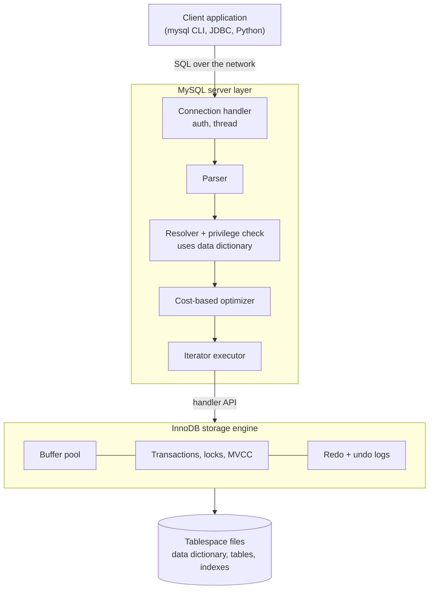

## Introduction

Every organisation you will work with — a hospital, a bank, a ride-sharing company, a university registrar, a research lab — runs on **recorded facts**: a patient's blood pressure at 09:14, a transfer of $250 from account 7 to account 12, a student's grade in CS-157A. Those recorded facts are **data**. The decisions the organisation makes — which ward needs more nurses, whether a transfer looks fraudulent, which students are at risk of failing — depend on **information** derived from that data.

This lesson answers four questions that underpin the rest of the course:

1. **What is the difference between data and information**, and why does the difference matter to a database engineer?
2. **What makes a pile of data a *database*** rather than just "some files"?
3. **What does a database management system (DBMS) actually do?** Which services does it provide that an application would otherwise have to build itself?
4. **What does all of that cost?** A DBMS is not free — in money, in operational effort, or in performance — and a professional must know when the cost is worth paying.

Throughout, we use **MySQL** — specifically MySQL 8.4 LTS — as the concrete DBMS. You will see MySQL's catalog describe itself, refuse invalid data, undo a half-finished change, and turn rows into answers. Every output on this page was captured from a real MySQL server, and every `run` block can be executed in your private lab.

:::note[Dataset]
The examples use the **shop** dataset: an online store with 25 customers, 30 products, 80 orders in calendar year 2024, 182 order line items, 76 payments and 45 reviews. You do not need to know SQL yet — each query is explained line by line, and the SQL itself is taught properly from [SELECT basics](/lessons/m03-select-basics) onwards.
:::

## DBMS Theory

:::theory[Data, information, database, DBMS]
- **Data** are recorded, uninterpreted facts: symbols with an agreed encoding but no context of use. `2024-10-16 16:55:00`, `VIP20`, `1891.97`.
- **Information** is data that has been **organised and interpreted in a context** so that it answers a question or supports a decision. "Order 2 was placed on 16 Oct 2024 by customer 19, used the VIP20 code, and was paid in full by card" is information; "November 2024 had the most orders of the year" is information derived by aggregating many data items.
- A **database** is a **logically coherent collection of related data**, designed, built and populated for a specific purpose and an intended group of users. Crucially, a database is **self-describing**: it stores not only the data but also a description of its structure (the **metadata**, kept in a **catalog** or **data dictionary**).
- A **database management system (DBMS)** is the software that lets users **define**, **construct**, **manipulate**, **share** and **protect** databases. A **database system** is the database plus the DBMS plus the applications that use them.
:::

These definitions follow the standard textbook treatment (Elmasri & Navathe; Silberschatz, Korth & Sudarshan). Three ideas in them deserve careful attention because the rest of the course builds on them.

### Information is relative to a question

The same data can yield different information for different users. A row in `orders` with `status = 'cancelled'` is, to a customer-service agent, a ticket to follow up on; to a finance analyst it is revenue that did not materialise; to a data scientist it is a positive label for a churn model. A database designer therefore never designs for "the data" in the abstract, but for the **questions** a community of users needs answered. That is why database design (Module 5) starts with requirements, not tables.

A useful (if informal) hierarchy, often called the **DIKW pyramid**, places *data → information → knowledge → wisdom*. A DBMS operates squarely at the first two levels: it stores data reliably and provides a language (SQL) to derive information. Knowledge (patterns, models) and wisdom (judgement) live in analysts, applications and machine-learning pipelines that sit on top of the database.

### Self-description and the catalog

A file of comma-separated values does not say what its columns mean, which values are legal, or how it relates to other files. That knowledge lives in the programs that read the file. A database, by contrast, stores its own **schema** — table names, column names, data types, keys, constraints, indexes, privileges — in the catalog. Any program, or any human with a SQL client, can ask the DBMS "what is in here?" without consulting source code. This property is what makes **program–data independence** possible (the subject of [Schemas and the three-schema architecture](/lessons/m01-schemas-three-schema-architecture)).

### What a DBMS does — the functional view

| Function | What it means | MySQL mechanism (examples) |
|---|---|---|
| **Data definition** | Declare structures, types and rules | DDL: `CREATE TABLE`, `ALTER TABLE`, constraints |
| **Data manipulation** | Insert, update, delete and **query** data declaratively | DML: `INSERT`, `UPDATE`, `DELETE`, `SELECT` |
| **Storage management** | Map logical tables to files, pages and indexes; manage memory caching | Storage engines (InnoDB), the buffer pool, tablespaces |
| **Query processing & optimization** | Choose an efficient way to execute a declarative request | Parser, cost-based optimizer, iterator executor |
| **Transaction management** | Group operations into atomic, isolated, durable units | InnoDB transactions, redo/undo logs, MVCC |
| **Concurrency control** | Let many users work at once without corrupting each other's work | Row locks, consistent snapshots |
| **Recovery** | Return to a consistent state after crashes | Redo log replay, undo rollback, doublewrite buffer |
| **Integrity enforcement** | Reject data that violates declared rules | `NOT NULL`, `PRIMARY KEY`, `UNIQUE`, `FOREIGN KEY`, `CHECK` |
| **Security & authorization** | Control who may see or change what | Accounts, privileges, roles, TLS |
| **Catalog / metadata management** | Store and expose the schema | The transactional data dictionary, `INFORMATION_SCHEMA` |
| **Utilities** | Backup, load, monitor, replicate | `mysqldump`, MySQL Shell dump utilities, binary log, replication |

Notice that these functions are largely **independent of the data model**. A document database or a graph database must also store data, process queries, manage concurrency and recover from crashes. What differs is the model the user sees (tables vs documents vs graphs) and the guarantees offered (you will compare models in [Relational vs non-relational databases](/lessons/m01-database-landscape)).

## Why It Exists

Before DBMSs, organisations stored data in **files owned by individual programs**. The payroll program had its own employee file; the HR program had another employee file with an overlapping but different layout. The consequences — duplicated data that drifts out of sync, programs that cannot answer new questions without new code, partial updates after a crash, two clerks overwriting each other's work, and no fine-grained security — are the subject of the next lesson, [File systems vs DBMS](/lessons/m01-file-systems-vs-dbms). Here it is enough to note *why* the DBMS emerged as a separate layer of software:

- **The same services were rebuilt in every application.** Every program that stored records had to implement file layouts, indexing, locking, crash handling and access control. Factoring these into a shared system means they are built once, built well, and tested by millions of users.
- **Data outlives applications.** A bank's customer data is decades older than its current mobile app. If the data's structure is buried in application code, every new application must reverse-engineer it. A DBMS keeps the structure with the data.
- **Questions change faster than programs.** In a file-based system, a new question ("which customers bought a laptop and left a one-star review?") means a new program. A DBMS with a declarative query language lets an analyst answer it in one statement, without the DBMS vendor or the original developers anticipating it.
- **Sharing requires arbitration.** As soon as two users touch the same data at the same time, someone must decide who goes first and what each one sees. That arbiter has to sit between the users and the data — which is exactly where a DBMS sits.

A short history makes the point concrete. In the 1960s, IBM's **IMS** (hierarchical model) and the **CODASYL** network model introduced shared, centrally managed databases, but programs still navigated record by record along pointers. In 1970 **Edgar F. Codd** proposed the **relational model**: data as mathematical relations, manipulated by set-oriented operations, with no exposed pointers. Research prototypes (IBM's **System R**, which produced SQL, and Berkeley's **Ingres**) proved it could be efficient, and commercial relational DBMSs followed (Oracle in 1979, IBM DB2 in 1983). **MySQL** was first released in 1995 by the Swedish company MySQL AB, became the "M" in the LAMP web stack, was acquired by Sun Microsystems in 2008 and by Oracle in 2010, and remains one of the most widely deployed open-source relational DBMSs.

## Internal Working

:::internals[The classic DBMS component architecture]
Textbook DBMS architecture divides the system into two halves:

- The **query processor** receives a request (a SQL statement), **parses** it into a tree, checks it against the catalog (do these tables and columns exist? does this user have privileges?), **optimizes** it into an execution plan by estimating the cost of alternatives, and **executes** that plan.
- The **storage manager** owns everything below: the **buffer manager** (caching disk pages in memory), the **file/space manager** (mapping tables and indexes to pages on disk), the **transaction manager** with its **lock manager** and **log manager** (for atomicity, isolation and durability), and the **recovery manager**, which uses the log after a crash.

The **catalog** is consulted by both halves: the query processor needs the schema to validate and plan; the storage manager needs to know which files and indexes belong to which table.
:::

**How MySQL maps onto this architecture.** MySQL splits responsibilities between a **server layer** and **pluggable storage engines**:

- The **server layer** (the `mysqld` process) handles connections and authentication, parses SQL, resolves names against the data dictionary, checks privileges, runs the cost-based optimizer, and executes the plan using an iterator-based executor. It is the same for every storage engine.
- A **storage engine** implements how rows are stored, indexed, locked, logged and recovered. The server calls it through an internal *handler* API ("open this table", "read the next row from this index", "write this row"). **InnoDB** is the default engine and the only one you should use for transactional data: it provides ACID transactions, row-level locking, MVCC, foreign keys and crash recovery. Other engines exist for special purposes (`MEMORY`, `CSV`, `ARCHIVE`, `MyISAM`, `BLACKHOLE`).
- Since **MySQL 8.0**, the catalog is a **transactional data dictionary** stored in InnoDB tables inside the `mysql` system schema. Earlier versions kept metadata partly in per-table `.frm` files, which could fall out of sync with the engine after a crash during DDL. `INFORMATION_SCHEMA` tables are now implemented as views over these dictionary tables.



The practical consequence of this split is that **some behaviour is server-level and some is engine-level**. SQL syntax, the optimizer, `CHECK` constraints, and privileges are server-level. Transactions, row locks, foreign keys and crash safety are engine-level — which is why a `ROLLBACK` cannot undo changes to a `MyISAM` or `CSV` table, a fact you will see demonstrated in the next lesson.

## MySQL Implementation

You can ask MySQL which storage engines this server offers and which ones support transactions. `SHOW ENGINES` reads the server's registry of engines:

```sql run
SHOW ENGINES;
```

Read the `Transactions`, `XA` and `Savepoints` columns: only **InnoDB** says `YES`, and its `Support` value is `DEFAULT`, meaning a `CREATE TABLE` without an `ENGINE=` clause creates an InnoDB table. (The exact list depends on how the server was built and configured; on this server `FEDERATED` is compiled in but disabled.)

Now look at the database itself through its catalog. Because a database is self-describing, the list of tables in your lab, with their storage engine, is just another query:

```sql run
SELECT TABLE_NAME, ENGINE, TABLE_COMMENT
FROM information_schema.TABLES
WHERE TABLE_SCHEMA = DATABASE()
ORDER BY TABLE_NAME;
```

`DATABASE()` returns the name of the current schema — your private lab — so the query lists exactly the seven shop tables. Every table uses InnoDB. Now look at **data**: a few raw rows from `orders`.

```sql run
SELECT order_id, customer_id, order_date, status, discount_code
FROM orders
ORDER BY order_id
LIMIT 5;
```

These are facts with structure but little meaning on their own. A single row tells you that order 2 was delivered; it says nothing about the business. Turn the same data into **information** by grouping and counting (the `GROUP BY` clause is taught in [GROUP BY and HAVING](/lessons/m03-group-by-having)):

```sql run
SELECT status, COUNT(*) AS orders
FROM orders
GROUP BY status
ORDER BY orders DESC, status;
```

Now the data answers a question: of the 80 orders, 45 were delivered, 14 are in transit, 8 were cancelled and 5 refunded. That is the transformation from data to information — performed by the DBMS, next to the data, in a single declarative statement.

Finally, see the DBMS **refuse** bad data. The shop schema declares that a review's rating must be between 1 and 5 (`chk_reviews_rating`). Try to insert a rating of 6:

```sql run error
INSERT INTO reviews (product_id, customer_id, rating, comment, created_at)
VALUES (1, 25, 6, 'Better than perfect!', '2024-12-31 10:00:00');
```

The rule lives in the database, not in any application. Every program — the web shop, a nightly import script, an analyst with a SQL client — is held to it.

## Syntax Breakdown

SQL statements are conventionally grouped by the DBMS function they serve. You will learn each group in detail later; here, map each one to the DBMS functions from the theory table.

| Category | Purpose | Representative statements | DBMS function served |
|---|---|---|---|
| **DDL** — Data Definition Language | Define and change structure | `CREATE TABLE`, `ALTER TABLE`, `DROP TABLE`, `CREATE INDEX`, `CREATE VIEW` | Data definition, catalog |
| **DML** — Data Manipulation Language | Read and change data | `SELECT`, `INSERT`, `UPDATE`, `DELETE` | Manipulation, query processing |
| **DCL** — Data Control Language | Grant and revoke rights | `CREATE USER`, `GRANT`, `REVOKE`, `CREATE ROLE` | Security & authorization |
| **TCL** — Transaction Control Language | Delimit transactions | `START TRANSACTION`, `COMMIT`, `ROLLBACK`, `SAVEPOINT` | Transaction management, recovery |
| **Administrative / introspection** | Inspect the server and catalog | `SHOW ENGINES`, `SHOW CREATE TABLE`, `SHOW VARIABLES`, queries on `information_schema` | Catalog, utilities |

The objects you query to see the catalog:

| Object | What it describes |
|---|---|
| `information_schema.SCHEMATA` | Schemas (databases) you can see |
| `information_schema.TABLES` | Tables and views: engine, row-count estimate, sizes, comments |
| `information_schema.COLUMNS` | Every column: data type, nullability, default, position |
| `information_schema.TABLE_CONSTRAINTS` | Primary keys, unique keys, foreign keys and check constraints |
| `information_schema.KEY_COLUMN_USAGE` | Which columns make up each key and what a foreign key references |
| `SHOW CREATE TABLE t` | The full DDL that would recreate table `t` |

:::standard[Standard SQL vs MySQL]
`INFORMATION_SCHEMA` is defined by the SQL standard (ISO/IEC 9075-11), so the core views such as `TABLES` and `COLUMNS` exist with the same names in PostgreSQL and SQL Server. MySQL adds extra columns (e.g. `ENGINE`, `TABLE_ROWS`) and extra views. `SHOW …` statements are **MySQL extensions** — convenient interactively, but use `INFORMATION_SCHEMA` in portable tooling. In MySQL the words *database* and *schema* are synonyms (`CREATE DATABASE` = `CREATE SCHEMA`); in PostgreSQL and SQL Server a database contains several schemas.
:::

## Practical Examples

**1. Metadata is data too.** The catalog can be queried with the same language as the data. Ask which columns of `customers` are optional (nullable) and what their types are:

```sql run
SELECT COLUMN_NAME, COLUMN_TYPE, IS_NULLABLE, COLUMN_KEY
FROM information_schema.COLUMNS
WHERE TABLE_SCHEMA = DATABASE() AND TABLE_NAME = 'customers'
ORDER BY ORDINAL_POSITION;
```

`COLUMN_KEY` shows `PRI` for the primary key column and `UNI` for the column with a unique index (`email`). Only `phone` and `loyalty_tier` accept NULL. A data engineer building a pipeline can read this instead of guessing from sample files.

**2. The full definition, as the DBMS stores it.** `SHOW CREATE TABLE` reconstructs the DDL from the data dictionary, including constraints:

```sql run
SHOW CREATE TABLE reviews;
```

The output shows the primary key, the unique key that allows at most one review per product per customer, two foreign keys, and the `CHECK` constraint you just violated. This is the database **describing its own rules**.

**3. From data to information, step up.** Monthly order volume for 2024 — the kind of number a manager actually asks for:

```sql run
SELECT MONTH(order_date) AS month_2024, COUNT(*) AS orders
FROM orders
GROUP BY MONTH(order_date)
ORDER BY month_2024;
```

November is the busiest month (12 orders) and January and October the quietest (3 each). Twelve rows of information summarise 80 rows of data.

**4. Atomicity: all or nothing.** A DBMS lets you group several changes into a **transaction**. Here we reduce the stock of product 5 and record a line item, then change our mind and roll back. Afterwards nothing has changed:

```sql run
START TRANSACTION;
UPDATE products SET stock_qty = stock_qty - 2 WHERE product_id = 5;
SELECT product_id, stock_qty FROM products WHERE product_id = 5;
ROLLBACK;
SELECT product_id, stock_qty FROM products WHERE product_id = 5;
```

Inside the transaction the stock reads 116; after `ROLLBACK` it is back to 118. The undo log of InnoDB recorded the old value and restored it. Transactions are covered in depth in [ACID and transactions](/lessons/m01-acid-transactions) and Module 8.

**5. Many users, one source of truth.** The DBMS keeps exactly one copy of each customer's email and enforces that no two customers share one. Attempting to create a second customer with an existing email fails:

```sql run error
INSERT INTO customers (first_name, last_name, email, city, state, signup_date)
VALUES ('Amara', 'Sharma', 'amara.sharma1@example.com', 'Austin', 'TX', '2024-12-01');
```

Error 1062 names the unique key `customers.uq_customers_email`. Whether the duplicate came from the web form, the mobile app or a CSV import, the database catches it.

## Execution Walkthrough

What happens between typing a query and seeing an answer? Trace one information-producing question through the DBMS: *"How many orders were delivered, and how much revenue did their line items bring in?"* Each step shows real intermediate data.

```walkthrough
title: From stored data to information — revenue of delivered orders
steps:
  - title: "1. Raw data — line items as stored"
    explain: >-
      The storage engine holds rows of order_items: one row per product per order, with the price actually
      charged. On its own this is data. The DBMS reads it through an index or a table scan in the storage
      engine (InnoDB) and passes rows upward to the executor.
    sql: SELECT order_id, product_id, quantity, unit_price FROM order_items ORDER BY order_id, product_id LIMIT 6;
  - title: "2. Context — attach each line item to its order's status"
    explain: >-
      Information needs context. Joining line items to orders attaches the order status to every item
      (joins are taught in Module 4). The optimizer chose the join order and access method; you only
      declared what you wanted.
    sql: |
      SELECT i.order_id, o.status, i.quantity * i.unit_price AS line_total
      FROM order_items AS i JOIN orders AS o ON o.order_id = i.order_id
      ORDER BY i.order_id, i.product_id
      LIMIT 6;
  - title: "3. Filter — keep only delivered orders"
    explain: >-
      The WHERE clause discards line items of orders that were cancelled, refunded or not yet delivered.
      The rows that remain are still data, but now relevant data.
    sql: |
      SELECT COUNT(*) AS delivered_line_items
      FROM order_items AS i JOIN orders AS o ON o.order_id = i.order_id
      WHERE o.status = 'delivered';
  - title: "4. Aggregate — the information"
    explain: >-
      Summing quantity × unit_price over the delivered line items yields one number that answers the
      business question. Only this single row crosses the network back to the client.
    sql: |
      SELECT COUNT(DISTINCT o.order_id) AS delivered_orders,
             SUM(i.quantity * i.unit_price) AS delivered_revenue
      FROM order_items AS i JOIN orders AS o ON o.order_id = i.order_id
      WHERE o.status = 'delivered';
```

Behind those four logical steps, the server performed the physical steps of the architecture diagram: the **connection handler** received the text; the **parser** built a syntax tree; the **resolver** checked that `order_items`, `orders` and their columns exist in the data dictionary and that your account may read them; the **optimizer** chose a join order and access paths; the **executor** pulled rows from **InnoDB**, which served pages from its **buffer pool** (reading from disk only on a cache miss). You can see the plan the optimizer chose:

```sql run
EXPLAIN FORMAT=TREE
SELECT SUM(i.quantity * i.unit_price)
FROM order_items AS i JOIN orders AS o ON o.order_id = i.order_id
WHERE o.status = 'delivered';
```

Read it bottom-up: the innermost lines are where rows are produced (a scan of `orders` filtered on status), the nested loop looks up the matching line items through an index on `order_items`, and the aggregate sits on top. You will learn to read plans fully in [EXPLAIN](/lessons/m07-explain); for now, notice that **you never told MySQL how to find the rows**. That separation — *what* (your SQL) from *how* (the DBMS's plan) — is the central service a DBMS provides.

## Output

The final step of the walkthrough returns a single row: 45 delivered orders, whose 108 line items add up to 43,251.75 in revenue. Compare that one row with the 182 rows of `order_items` and 80 rows of `orders` it was computed from — a reduction from hundreds of data items to two numbers of information. Two lessons follow from reading this output carefully:

- **Information depends on definitions.** "Revenue" here means the sum of `quantity × unit_price` over line items of *delivered* orders. Another analyst might include shipped orders, subtract refunds or use the `payments` table. The DBMS computes exactly what you define; agreeing on the definition is a human responsibility (data governance).
- **The answer is consistent.** The query read all rows from one consistent snapshot of the data (InnoDB's MVCC), so even if orders were being placed while it ran, it neither double-counted nor skipped rows mid-way. An application that downloaded the tables page by page could not guarantee that.

## Alternative Approaches

A DBMS is not the only way to keep data. Choosing well means knowing the alternatives and what each gives up.

| Approach | Good for | What you give up |
|---|---|---|
| **Spreadsheet** (Excel, Google Sheets) | One person or a small team, small data, ad hoc analysis | Types and constraints are weak; concurrent editing and auditing are limited; formulas are hard to test; scale is limited (Excel caps a sheet at 1,048,576 rows) |
| **Flat files** (CSV, JSON, logs) | Data exchange, append-only logs, archival | Integrity, concurrency control, atomic multi-file updates, indexing, access control below the file level |
| **Columnar files in a data lake** (Parquet on object storage) + a query engine (Spark, Trino) | Large-scale analytics over immutable data | Low-latency single-row updates and transactional OLTP; lake table formats (Iceberg, Delta) add some DBMS features back |
| **Embedded relational DBMS** (SQLite) | A single application on one device (mobile apps, desktop tools, test fixtures) | Network access, many concurrent writers, user management |
| **Client–server relational DBMS** (MySQL, PostgreSQL, SQL Server, Oracle) | Shared, concurrent, transactional data with integrity rules | Operational effort and overhead (next section) |
| **Non-relational DBMS** (key-value, document, wide-column, graph, time-series) | Specific access patterns at very large scale or with flexible structure | Some combination of joins, schema enforcement or multi-record transactions, depending on the product |

The rule of thumb used by experienced engineers: **if data is shared, long-lived, changed concurrently, or subject to rules, it belongs in a DBMS**. If it is private, short-lived, read-only or exchanged between systems, a file is often fine.

## Performance Analysis

A DBMS adds work that a program writing directly to a file would not do: parsing and optimizing each statement, checking privileges and constraints, writing **redo log** records before changing data, keeping **undo** records for rollback and MVCC, and acquiring locks. That overhead is the price of the guarantees. It is usually small relative to the cost of disk and network I/O, and the DBMS more than recovers it in two ways:

- **Caching.** InnoDB keeps frequently used pages in its **buffer pool** in memory; a working set that fits in memory is served without disk reads. The buffer pool size is a server setting (`innodb_buffer_pool_size`).
- **Access paths.** Indexes and the optimizer let the DBMS read a handful of pages to find one row among millions, which a naive file scan cannot do.

The most important single durability cost is the **flush of the redo log at commit**. Look at the relevant settings on this server:

```sql run
SELECT @@innodb_flush_log_at_trx_commit AS flush_at_commit,
       @@innodb_buffer_pool_size / 1024 / 1024 AS buffer_pool_mb,
       @@innodb_page_size AS page_size_bytes;
```

`innodb_flush_log_at_trx_commit = 1` (the default) means every commit writes and flushes the redo log to disk, so a committed transaction survives a power failure. Values 0 or 2 trade that guarantee for throughput. The 16 KB page is InnoDB's default unit of I/O and caching. The buffer pool size shown is this capture server's setting, not a recommendation — production servers typically devote a large share of RAM to it.

:::performance[Theory vs measurement]
For a conceptual lesson there is nothing meaningful to time: on the tiny shop dataset every query above completes in well under a millisecond. What matters is the qualitative model — a DBMS spends CPU and log I/O to buy correctness, and spends memory (buffer pool) and indexes to buy speed. Measurement techniques (`EXPLAIN ANALYZE`, the slow query log, Performance Schema) are taught in Modules 7 and 11.
:::

## Best Practices

:::best-practice[Working with a DBMS professionally]
1. **Let the DBMS enforce the rules it can enforce.** Declare `NOT NULL`, keys, foreign keys and `CHECK` constraints instead of relying only on application validation; the database is the last line of defence and the only one every client passes through.
2. **Keep one source of truth per fact.** Store each fact once and derive information with queries (or deliberately maintained, documented summary tables).
3. **Use InnoDB for application data.** Choose another engine only for a specific, understood reason.
4. **Treat the catalog as documentation.** Use meaningful table, column and constraint names and `COMMENT` clauses; tools and colleagues read `information_schema`.
5. **Define information precisely.** Write down what "revenue", "active customer" or "churned" means, and encode the definition in a reviewed query or view.
6. **Wrap multi-step changes in transactions.** Anything that must happen together (decrement stock *and* record the sale) belongs in one transaction.
7. **Budget for the DBMS's costs** — backups, upgrades, monitoring and a person responsible — before choosing to run one yourself (managed services reduce but do not remove this).
:::

## Common Mistakes

**Mistake 1 — treating the database as a dumb file store.** Teams sometimes create tables with no constraints and validate "in the app". Then a second application, a migration script or a manual fix inserts something the first app would have rejected. Here is a table with no rules accepting nonsense:

```sql run
CREATE TABLE product_import (
  sku   VARCHAR(20),
  price DECIMAL(10,2)
);
INSERT INTO product_import VALUES (NULL, -15.00), ('SKU-1001', 10.00), ('SKU-1001', 12.00);
SELECT * FROM product_import ORDER BY price;
```

A product with no SKU, a negative price, and two conflicting prices for the same SKU were all accepted. The correction is to state the rules in the schema:

```sql run error
CREATE TABLE product_import_v2 (
  sku   VARCHAR(20)   NOT NULL PRIMARY KEY,
  price DECIMAL(10,2) NOT NULL CHECK (price >= 0)
);
INSERT INTO product_import_v2 VALUES ('SKU-1001', -15.00);
```

The `CREATE TABLE` succeeds; the insert fails with error 3819 because the check constraint is violated.

:::version[CHECK constraints before 8.0.16]
MySQL parsed `CHECK` clauses for years but **silently ignored** them until **8.0.16**. Tutorials written for 5.7 may claim MySQL "does not support CHECK". In 8.4 they are enforced. If you inherit a schema created on 5.7, its `CHECK` clauses were discarded at creation time and must be re-added.
:::

**Mistake 2 — storing information instead of data.** A column `orders_count` on `customers`, hand-maintained by the application, *is information*, and it will drift from the true count as soon as one code path forgets to update it. Store the data (the orders) and compute the information. If you must store a derived value for performance, maintain it transactionally and verify it periodically.

**Mistake 3 — confusing the DBMS with the database.** "We use MySQL" names the DBMS; "the shop database" names the data. You can move the shop database to another DBMS (with effort) or run many databases on one MySQL server. Mixing the two up leads to bad conversations about backups ("is the server backed up?" is not the same as "can we restore the shop database to 09:00 yesterday?").

**Mistake 4 — assuming the DBMS is always the right tool.** Writing high-volume, never-queried debug logs row-by-row into a transactional table pays for durability and indexing you do not need. Append them to files or a log system and load summaries into the database.

## Industry Application

- **Operational systems (OLTP).** E-commerce checkouts, banking ledgers, booking systems and SaaS back ends run on relational DBMSs because they need atomic multi-row changes and integrity rules. MySQL has been used at very large scale by web companies (Meta, Uber, GitHub, Shopify, Booking.com and others have publicly described their MySQL fleets).
- **Analytics pipelines.** Data engineers extract data from operational DBMSs into warehouses and lakes, where it becomes information for dashboards and models. The catalog (`information_schema`) is what pipeline tools read to discover tables and columns automatically, and change-data-capture tools read MySQL's binary log to stream changes.
- **Machine learning.** Feature stores and training-data pipelines rely on the DBMS's consistency: a training snapshot taken from a consistent read is reproducible; one assembled from files changing underneath is not.
- **Regulated industries.** Healthcare and finance depend on the DBMS's security (fine-grained privileges), auditability and recoverability (point-in-time restore from backups plus binary logs) to meet legal obligations.
- **Cost decisions.** Teams weigh self-managed MySQL (control, licence-free Community Edition, but operational burden) against managed services such as Amazon RDS/Aurora, Google Cloud SQL, Azure Database for MySQL and Oracle's MySQL HeatWave, which take over patching, backups and failover in exchange for a monthly bill and less control.

:::industry[MySQL editions and licensing]
MySQL Community Edition is open source under the GPLv2; Oracle also sells MySQL Enterprise Edition (commercial licence with extra components such as Enterprise Backup, audit, firewall and support). **MySQL 8.4** is a **Long-Term Support (LTS)** release (first GA in April 2024); Oracle also ships short-lived **Innovation** releases (9.x) between LTS versions. MySQL 8.0 reached end of life in April 2026, so new deployments should target 8.4 LTS.
:::

## Practice Exercises

These exercises use SQL you have only seen in this lesson. Starter code is provided; the point is to connect each query to the DBMS concept it demonstrates.

```exercise
id: ex1
title: Ask the catalog which tables exist
difficulty: easy
concepts: [metadata-catalog, dbms-functions]
prompt: |
  Using `information_schema.TABLES`, list every table in your current schema.
  Return two columns, in this order: `TABLE_NAME` and `ENGINE`.
starter: |
  SELECT TABLE_NAME, ENGINE
  FROM information_schema.TABLES
  WHERE ...
hints:
  - "Every MySQL server has many schemas; you only want the current one."
  - "The function DATABASE() returns the current schema's name. Filter with WHERE TABLE_SCHEMA = DATABASE()."
solution: |
  SELECT TABLE_NAME, ENGINE
  FROM information_schema.TABLES
  WHERE TABLE_SCHEMA = DATABASE();
explanation: |
  The catalog is queryable with ordinary SQL because a database is self-describing. Without the
  `TABLE_SCHEMA` filter you would also see the system views of `information_schema` itself, which are not
  part of the shop database. Hard-coding a schema name would break in another lab, which is why
  `DATABASE()` is preferred.
```

```exercise
id: ex2
title: Which customer attributes are optional?
difficulty: easy
concepts: [metadata-catalog]
prompt: |
  Return the names of the columns of table `customers` that **allow NULL**. One column, `COLUMN_NAME`.
starter: |
  SELECT COLUMN_NAME
  FROM information_schema.COLUMNS
  WHERE TABLE_SCHEMA = DATABASE()
    AND TABLE_NAME = 'customers'
    AND ...
hints:
  - "information_schema.COLUMNS has an IS_NULLABLE column."
  - "Its values are the strings 'YES' and 'NO'."
solution: |
  SELECT COLUMN_NAME
  FROM information_schema.COLUMNS
  WHERE TABLE_SCHEMA = DATABASE()
    AND TABLE_NAME = 'customers'
    AND IS_NULLABLE = 'YES';
explanation: |
  `IS_NULLABLE` is a string column (`'YES'`/`'NO'`), not a boolean. Knowing which attributes are optional
  is information a data engineer needs before writing a pipeline: here only `phone` and `loyalty_tier`
  may be missing, so any report that counts phones must account for NULLs.
```

```exercise
id: ex3
title: Turn order data into information
difficulty: medium
concepts: [data-vs-information]
prompt: |
  The operations manager asks: *"How many orders used a discount code, and how many did not?"*
  Return two columns, `used_code` (1 if the order had a discount code, 0 otherwise) and `orders`
  (the number of orders in that group). One row per group.
starter: |
  SELECT discount_code IS NOT NULL AS used_code, COUNT(*) AS orders
  FROM orders
  GROUP BY ...
hints:
  - "`discount_code IS NOT NULL` evaluates to 1 or 0 in MySQL, so it can be used as a grouping value."
  - "Group by the same expression (or by its alias, used_code — MySQL allows aliases in GROUP BY)."
solution: |
  SELECT discount_code IS NOT NULL AS used_code, COUNT(*) AS orders
  FROM orders
  GROUP BY discount_code IS NOT NULL;
explanation: |
  80 rows of data become two rows of information. Grouping by `discount_code` itself would give one row per
  code plus a NULL group — a different question ("which codes?"). Deciding which question is being asked
  is the step that turns data into information.
```

```exercise
id: ex4
title: All or nothing — record a sale atomically
difficulty: hard
kind: dml
concepts: [dbms-functions, transactions]
prompt: |
  Customer 25 buys **3 units of product 5** in a new order. In **one transaction**:

  1. insert order **81** for customer 25 with `order_date` `'2024-12-30 10:00:00'` and status `'paid'`;
  2. insert the line item (order 81, product 5, quantity 3, unit_price 29.99);
  3. decrease product 5's `stock_qty` by 3;
  4. commit.

  The checker reads the new order, its line item and product 5's stock.
starter: |
  START TRANSACTION;
  -- your three statements here
  COMMIT;
hints:
  - "orders needs at least customer_id, order_date and status; the other columns allow NULL. Give order_id = 81 explicitly."
  - "Use UPDATE products SET stock_qty = stock_qty - 3 WHERE product_id = 5 so the change is relative to the current value."
solution: |
  START TRANSACTION;
  INSERT INTO orders (order_id, customer_id, order_date, status)
  VALUES (81, 25, '2024-12-30 10:00:00', 'paid');
  INSERT INTO order_items (order_id, product_id, quantity, unit_price)
  VALUES (81, 5, 3, 29.99);
  UPDATE products SET stock_qty = stock_qty - 3 WHERE product_id = 5;
  COMMIT;
check: |
  SELECT o.order_id, o.customer_id, o.status, i.product_id, i.quantity, i.unit_price, p.stock_qty
  FROM orders AS o
  JOIN order_items AS i ON i.order_id = o.order_id
  JOIN products AS p ON p.product_id = i.product_id
  WHERE o.order_id = 81;
explanation: |
  The order must be inserted before its line item, because the foreign key `fk_items_order` requires the
  parent order to exist. Wrapping the three changes in one transaction means that if the stock update failed
  (say, a CHECK on stock), `ROLLBACK` would remove the order and line item too — no half-recorded sale.
  Writing `stock_qty = 115` instead of `stock_qty - 3` gives the same result here but is a classic
  concurrency bug: it overwrites any change another session made in between.
```

```exercise
id: ex5
title: Does this project need a DBMS?
difficulty: challenge
kind: open
concepts: [dbms-costs, dbms-functions]
prompt: |
  A three-person research group collects sensor readings from 40 field stations. Each station uploads a
  CSV file every hour (about 3,600 rows per file). Two analysts compute weekly statistics in Python; a
  web dashboard shows the latest reading per station; a field technician sometimes corrects mislabelled
  station IDs by editing files by hand.

  Argue for or against putting this data in a DBMS such as MySQL. Name at least **three specific DBMS
  functions** that would (or would not) help, and at least **two costs** of introducing the DBMS.
solution: |
  **For a DBMS (most defensible answer).** The data is shared (analysts, dashboard, technician), long-lived,
  and corrected concurrently with reading — the profile where a DBMS pays off.

  - *Integrity enforcement*: a `stations` table with a primary key and a foreign key from `readings`
    makes a mislabelled station ID impossible to load, instead of silently creating a "new" station.
    `CHECK` constraints can reject physically impossible readings.
  - *Concurrency control and transactions*: the technician's correction (an `UPDATE` of a batch of rows)
    commits atomically; the dashboard never sees a half-corrected file, and two people cannot overwrite each
    other's edits.
  - *Query processing and indexing*: "latest reading per station" is an indexed lookup on
    `(station_id, reading_time)` rather than a scan of every file; weekly statistics become `GROUP BY`
    queries.
  - *Security and auditability*: technicians get `UPDATE` on readings but not `DROP`; analysts read-only.
  - *Recovery*: backups and point-in-time recovery replace "hope nobody deleted a file".

  **Costs.** Someone must install, secure, back up and upgrade the server (or pay for a managed service);
  ingestion code must convert CSV to inserts and handle rejected rows; the group must learn schema design
  and SQL. About 40 × 24 × 3,600 ≈ 3.5 million rows per day accumulate quickly, so retention or
  partitioning needs a plan (a time-series database is a reasonable alternative to evaluate).

  **Against.** If the files were truly immutable, never corrected, and analysed by one person, keeping
  them as Parquet files and querying them with a dataframe library or DuckDB could be cheaper. The hand
  corrections and the shared dashboard are what tip the balance toward a DBMS.
```

## Knowledge Assessment

```quiz
- id: q1
  question: "Which of the following is **information** rather than raw data?"
  options:
    - "The value 1891.97 stored in payments.amount"
    - "The string 'VIP20'"
    - "\"45 of the 80 orders in 2024 were delivered\""
    - "The timestamp 2024-10-16 16:55:00"
  answer: 2
  explanation: "Information is data organised and interpreted to answer a question — here an aggregate of many rows in a business context. The other options are isolated values with no context; they are data until someone interprets them (whose payment? which order?)."
  concepts: [data-vs-information]
- id: q2
  question: "What does it mean that a database is **self-describing**?"
  options:
    - "Every row contains a free-text description column"
    - "The database stores its own structure (metadata) in a catalog that can be queried"
    - "The DBMS automatically writes documentation for each table"
    - "Column names must describe their data type"
  answer: 1
  explanation: "The catalog (data dictionary) holds table, column, key and constraint definitions; in MySQL you query it through INFORMATION_SCHEMA or SHOW statements. No description column or auto-generated prose is required, and naming conventions are good practice, not what 'self-describing' means."
  concepts: [metadata-catalog, database]
- id: q3
  question: "In MySQL, which of these features are implemented by the **storage engine** rather than the server layer? (Select all that apply.)"
  type: multi
  options:
    - "Transactions and rollback"
    - "Parsing SQL text into a syntax tree"
    - "Row-level locking"
    - "Foreign key enforcement (in InnoDB)"
    - "Cost-based query optimization"
  answer: [0, 2, 3]
  explanation: "InnoDB implements transactions, row locks, MVCC, crash recovery and foreign keys. Parsing, name resolution, privilege checks and the optimizer are server-layer components shared by all engines — which is why ROLLBACK cannot undo changes to a non-transactional engine such as MyISAM or CSV."
  concepts: [mysql-architecture]
- id: q4
  question: "A team stores a customer's total number of orders in a customers.orders_count column, updated by the web app. A batch import adds orders directly in SQL. What is the most likely consequence?"
  options:
    - "MySQL updates orders_count automatically because it is derived from orders"
    - "orders_count silently becomes wrong for imported customers"
    - "The import fails with a foreign key error"
    - "Nothing — derived values are always consistent in a DBMS"
  answer: 1
  explanation: "A DBMS only enforces rules that are declared. orders_count is information maintained by one code path; any other path (the import) bypasses it, so the stored value drifts. A foreign key would not be violated, and MySQL does not infer derived columns (generated columns can only use values from the same row)."
  concepts: [data-vs-information, dbms-functions]
- id: q5
  question: "Which statement about MySQL's catalog in 8.0 and 8.4 is correct?"
  options:
    - "Table definitions are stored only in per-table .frm files"
    - "Metadata is held in a transactional data dictionary in InnoDB, and INFORMATION_SCHEMA tables are views over it"
    - "INFORMATION_SCHEMA is a MySQL-only feature with no equivalent in standard SQL"
    - "The catalog can only be read with SHOW statements"
  answer: 1
  explanation: "Since 8.0, MySQL stores metadata in data-dictionary tables in InnoDB; .frm files were removed. INFORMATION_SCHEMA is defined by the SQL standard (MySQL adds columns), and it is queried with SELECT; SHOW statements are a MySQL convenience."
  concepts: [metadata-catalog, mysql-architecture]
- id: q6
  question: "Which of these is a genuine **cost or limitation** of adopting a client–server DBMS?"
  options:
    - "It cannot store numeric data exactly"
    - "Only one user can read the data at a time"
    - "It requires operational work (backups, upgrades, monitoring, security) and adds per-statement overhead such as logging and parsing"
    - "Data must be duplicated in every application that uses it"
  answer: 2
  explanation: "The real costs are operational effort, licensing or service fees, learning, and runtime overhead for guarantees you may not need. DECIMAL stores numbers exactly, concurrency is a core DBMS service, and eliminating duplication across applications is a DBMS advantage, not a cost."
  concepts: [dbms-costs]
- id: q7
  question: "You run `START TRANSACTION; UPDATE products SET stock_qty = stock_qty - 2 WHERE product_id = 5; ROLLBACK;` on an InnoDB table. What is product 5's stock afterwards?"
  options:
    - "Two less than before"
    - "Unchanged"
    - "NULL"
    - "It depends on whether autocommit is ON"
  answer: 1
  explanation: "START TRANSACTION suspends autocommit until COMMIT or ROLLBACK, so the UPDATE is part of the transaction and ROLLBACK restores the old value from the undo log. Autocommit does not matter once a transaction has been explicitly started."
  concepts: [dbms-functions, transactions]
- id: q8
  question: "A product manager asks which SQL statement category is used to give an analyst read-only access to the orders table."
  options: ["DDL", "DML", "DCL", "TCL"]
  answer: 2
  explanation: "GRANT and REVOKE are Data Control Language. DDL defines structures (CREATE/ALTER), DML reads and changes data (SELECT/INSERT/UPDATE/DELETE), and TCL delimits transactions (COMMIT/ROLLBACK)."
  concepts: [dbms-functions]
```
