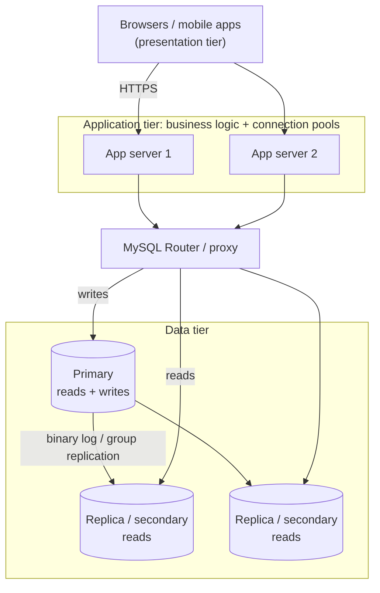

## Introduction

The previous lessons described *what* a DBMS does and *how it is organised internally*. This lesson asks **where it runs and how applications reach it**. That question has very practical consequences: how long a query takes to come back over the network, how many users the system can support, what happens when a machine fails, who is woken up at 3 a.m., and how much it costs.

You will learn the architectures that every database professional is expected to recognise:

- **Centralized** systems, where the database, the application and the users' terminals all depend on one machine.
- **Client–server** systems, where a database server process serves many clients over a network — the architecture MySQL was built for.
- **One-, two- and three-tier** application architectures, which decide where presentation, business logic and data live.
- **Distributed** databases — replicated, partitioned (sharded), and distributed-SQL — and the new problems distribution introduces.
- **Cloud-managed** database services, where a provider runs the DBMS for you.

For each, we look at where **MySQL 8.4** fits, and you will see real evidence from the MySQL server behind this lab: the connection you are using, the server's thread model, its replication-related settings, and a hand-built sharding experiment.

:::note[Dataset]
The examples use the **shop** dataset (25 customers, 80 orders, 182 line items). In this dataset, customers 2, 13, 23, 24 and 25 have never placed an order.
:::

## DBMS Theory

:::theory[Architectural dimensions]
A database system architecture can be described along three largely independent dimensions:

1. **Distribution of function** — where presentation, application (business) logic, and data management execute: on one machine (centralized) or split between clients and servers (client–server, n-tier).
2. **Distribution of data** — whether the database lives on one node, is **replicated** (full copies on several nodes), **partitioned/sharded** (each node holds a subset), or both.
3. **Ownership of operations** — self-managed on your hardware or VMs, or **managed** by a cloud provider (database-as-a-service).
:::

| Architecture | Function split | Data placement | Typical era / use |
|---|---|---|---|
| **Centralized** | Everything on one host; users on terminals or on the same machine | One node | Mainframes (1960s–80s); today embedded/single-user databases (SQLite in an app) |
| **Client–server** | DBMS server process; client programs connect over a network protocol | One node (server) | Since the late 1980s; MySQL, PostgreSQL, Oracle, SQL Server |
| **Two-tier** | Client application (UI + business logic) talks directly to the DB server | One node | Desktop line-of-business apps, BI tools, admin consoles |
| **Three-tier / n-tier** | Presentation (browser/mobile) → application server (business logic) → database server | One or more DB nodes | Web and mobile applications; microservices |
| **Distributed — replicated** | As above | Full copies on several nodes | High availability, read scaling, disaster recovery |
| **Distributed — partitioned (sharded)** | As above, plus a routing layer | Each node holds a subset of rows | Write scaling beyond one machine |
| **Distributed SQL** | DBMS itself spans nodes; one logical database | Partitioned + replicated, with distributed transactions | Google Spanner, CockroachDB, TiDB, YugabyteDB |
| **Cloud-managed** | Any of the above, run by a provider | Provider-managed storage and replicas | Amazon RDS/Aurora, Google Cloud SQL, Azure Database for MySQL, Oracle MySQL HeatWave |

Three theoretical properties are used to compare them:

- **Scalability** — *vertical* (bigger machine) versus *horizontal* (more machines). A single-node DBMS scales vertically; replication scales reads horizontally; partitioning scales writes horizontally.
- **Availability** — the fraction of time the system serves requests. Redundancy (replicas plus automatic failover) is the main tool; distribution introduces **partial failures** (one node or link fails while others work), which centralized systems never face.
- **Transparency** — how much of the distribution the application can ignore. *Location transparency* (the application does not know which node holds data), *replication transparency* (it does not know copies exist) and *fragmentation transparency* (it does not know data is partitioned) are the classical goals of distributed DBMS design. Each level of transparency the DBMS does not provide must be implemented by the application.

## Why It Exists

Each architecture is a response to the limits of the previous one.

- **Centralized** systems were the only option when computers were scarce. They are simple — one machine, one copy, no network partitions — but the single machine is a capacity ceiling and a single point of failure, and every user must be connected to it.
- **Client–server** emerged with cheap personal computers and local networks. Moving the user interface to the client and keeping a shared DBMS on a server let many users share one database without sharing one CPU, and let the server focus on data management. The price is the **network**: every request is a round trip.
- **Two-tier** client–server applications put business logic in the client. When the business rule changed, every desktop had to be updated, and every client needed database credentials and a direct connection. **Three-tier** architectures moved business logic to an **application server** that clients reach over HTTP. Now only the application servers hold database credentials, rules change in one place, and a **connection pool** in the application tier lets thousands of users share a few dozen database connections.
- **Distributed** databases exist because one machine eventually runs out — of CPU, memory, disk, network bandwidth, or reliability. Replication answers "what if the server dies?" and "too many reads"; sharding answers "too many writes" or "too much data for one machine"; geo-distribution answers "users on three continents".
- **Cloud-managed** services exist because running databases well is hard and repetitive: patching, backups, point-in-time recovery, failover, monitoring and storage growth are the same work everywhere, so providers automate it and sell it as a service.

## Internal Working

:::internals[What happens on a client–server connection to MySQL]
1. The client (the `mysql` CLI, a JDBC/Connector-J driver, `mysql-connector-python`, …) opens a **TCP connection** to the server (default port **3306**), or a Unix-domain socket / Windows named pipe when on the same host. MySQL also listens for the **X Protocol** (port 33060, used by MySQL Shell and the Document Store) and, optionally, a dedicated **administrative port** (33062 by default when enabled).
2. The server sends a handshake; the client and server negotiate capabilities and usually upgrade to **TLS**. The client authenticates with an authentication plugin — `caching_sha2_password` is the default in 8.0 and 8.4.
3. The server assigns the connection a **thread**. With the default `thread_handling = one-thread-per-connection`, each connection is served by its own OS thread (reused from a thread cache when possible); MySQL Enterprise's thread pool plugin can multiplex many connections onto fewer threads.
4. For each statement, the client sends a packet; the server parses, optimizes and executes it, and **streams result rows back** in packets. A statement costs at least one **network round trip**, however small the query.
5. Each connection has its own session state: current schema, session variables, temporary tables, an open transaction. That is why a connection is relatively expensive to create, and why application tiers keep **connection pools**.
:::

**Replication internals in one paragraph.** A MySQL **source** server records every committed change in its **binary log** (row-based by default). Each **replica** runs an I/O (receiver) thread that streams the source's binary log into a local **relay log**, and one or more applier (SQL) threads that replay the relay log. Replication is **asynchronous** by default: the source commits without waiting for replicas, so a replica may lag and a failover can lose the last transactions. **Semi-synchronous** replication makes the source wait until at least one replica has *received* the transaction. **Group Replication** goes further: members agree on the order of transactions through a Paxos-based group communication protocol, providing automatic failover with no lost committed transactions within the group. **InnoDB Cluster** packages Group Replication with **MySQL Router** (which routes application connections to the current primary or to secondaries) and **MySQL Shell** for administration; **InnoDB ClusterSet** links clusters across data centres for disaster recovery.



## MySQL Implementation

MySQL is a **client–server** DBMS: the `mysqld` server process manages the data, and every tool — including this platform — is a client. You can inspect your own connection. The following reads your session's row in the process list (only your own connections are visible to an unprivileged account):

```sql run
SELECT USER, COMMAND, STATE, INFO
FROM information_schema.PROCESSLIST
WHERE ID = CONNECTION_ID();
```

The `INFO` column is the statement you just sent; `STATE` shows the server executing it. The warning attached to the result is real and worth noticing: in 8.4 `INFORMATION_SCHEMA.PROCESSLIST` is deprecated in favour of `performance_schema.processlist` (which the sandbox does not let you read).

How is your connection carried? The session status variable `Ssl_version` reports the TLS protocol negotiated for *this* connection:

```sql run
SHOW SESSION STATUS LIKE 'Ssl_version';
```

On the capture server the connection was encrypted with TLS 1.3. (On your lab connection the value may differ.) In production, encrypted client–server connections are mandatory whenever the network is not fully trusted; `require_secure_transport = ON` makes the server refuse unencrypted ones.

Next, the server-side settings that shape client–server behaviour:

```sql run
SELECT @@port               AS classic_port,
       @@mysqlx_port        AS x_protocol_port,
       @@max_connections    AS max_connections,
       @@thread_handling    AS thread_handling,
       @@wait_timeout       AS idle_timeout_seconds;
```

`max_connections` caps simultaneous client connections; `wait_timeout` closes connections idle for that many seconds; `one-thread-per-connection` is the threading model described above. These are this capture server's values — production servers tune `max_connections` to their workload and rely on application-side pooling to stay well below it.

Finally, the settings that tell you whether this server could take part in a **replicated** architecture:

```sql run
SELECT @@server_id AS server_id,
       @@log_bin   AS binary_log_enabled,
       @@gtid_mode AS gtid_mode,
       @@read_only AS read_only;
```

A server that can act as a replication source needs the binary log enabled and a unique `server_id`. `gtid_mode` controls **global transaction identifiers**, which make failover and re-pointing replicas much simpler; production topologies (and InnoDB Cluster) use `gtid_mode = ON`. Replicas are usually set `read_only` (and `super_read_only`) so that applications cannot write to them by mistake.

## Syntax Breakdown

Architecture is mostly configuration rather than SQL, but a few statements and settings define it. Display-only, because the sandbox cannot change server topology:

```sql
-- Replica side (8.0.23+ syntax; required in 8.4): point this server at a source and start replicating
CHANGE REPLICATION SOURCE TO
  SOURCE_HOST = 'db-primary.internal',
  SOURCE_PORT = 3306,
  SOURCE_USER = 'repl',
  SOURCE_PASSWORD = '…',
  SOURCE_AUTO_POSITION = 1,          -- use GTIDs
  SOURCE_SSL = 1;
START REPLICA;
SHOW REPLICA STATUS\G
```

| Item | Kind | Role in the architecture |
|---|---|---|
| `port` / `bind_address` | Server variables | Where the server listens for client–server connections |
| `max_connections`, `wait_timeout` | Server variables | Capacity and hygiene of client connections |
| `require_secure_transport` | Server variable | Refuse unencrypted client connections |
| `server_id`, `log_bin`, `gtid_mode` | Server variables | Prerequisites for replication |
| `read_only`, `super_read_only` | Server variables | Protect replicas from writes |
| `CHANGE REPLICATION SOURCE TO … ; START REPLICA` | Statements | Configure asynchronous replication |
| `rpl_semi_sync_source_enabled` (plugin/component) | Server variable | Semi-synchronous replication |
| `group_replication_*` | Server variables | Group Replication membership and consistency |
| MySQL Shell `dba.createCluster()` | Admin API | Build an InnoDB Cluster |
| MySQL Router | Separate process | Route application connections to primary/secondaries |

:::version[Replication terminology: 8.0 vs 8.4]
MySQL 8.0.22–8.0.26 introduced `SOURCE`/`REPLICA` syntax (`SHOW REPLICA STATUS`, `CHANGE REPLICATION SOURCE TO`, `START REPLICA`) alongside the old `MASTER`/`SLAVE` forms. **MySQL 8.4 removed** the old statements (`SHOW SLAVE STATUS`, `CHANGE MASTER TO`, `START SLAVE`, `SHOW MASTER STATUS`); use the new forms, and `SHOW BINARY LOG STATUS` instead of `SHOW MASTER STATUS`:

```sql
SHOW BINARY LOG STATUS;   -- 8.4 (8.2+); replaces SHOW MASTER STATUS
SHOW REPLICA STATUS;      -- 8.0.22+; SHOW SLAVE STATUS was removed in 8.4
```

Also in 8.4: the `binlog_format` variable is deprecated (row-based logging is the future-proof choice), and `mysql_native_password` is no longer loaded by default, so very old client libraries may fail to connect.
:::

## Practical Examples

**1. Two-tier vs three-tier: where does the business rule live?** Rule: *an order can be cancelled only while it is pending or paid.* In a two-tier design, every client application implements it. Placing it in the database tier as a stored procedure is one way to centralise it for all clients:

```sql run
CREATE PROCEDURE cancel_order(IN p_order_id INT UNSIGNED)
BEGIN
  UPDATE orders
  SET status = 'cancelled'
  WHERE order_id = p_order_id AND status IN ('pending', 'paid');
  SELECT p_order_id AS order_id, ROW_COUNT() AS rows_cancelled;
END;

CALL cancel_order(4);
CALL cancel_order(2);
SELECT order_id, status FROM orders WHERE order_id IN (2, 4) ORDER BY order_id;
```

Order 4 was `paid` and is now cancelled (`rows_cancelled = 1`); order 2 was already delivered, so the rule refused it (`rows_cancelled = 0`). In a **three-tier** architecture, this rule would more commonly live in the application server's code, with the database enforcing invariants (keys, constraints) and the application tier enforcing workflow. Which tier should own which rule is discussed in [Database vs application logic](/lessons/m09-db-vs-app-logic).

**2. Round trips: the client–server tax.** Because each statement costs a network round trip, the classic **N+1 query** pattern — fetch a list, then issue one query per item — is cheap on a laptop (sub-millisecond loopback) and slow in production (0.5–2 ms per round trip inside a data centre, tens of milliseconds across regions). Compare five per-customer queries with one set-based query:

```sql run
-- N+1 style: one round trip per customer (shown for two of the five)
SELECT COUNT(*) AS orders FROM orders WHERE customer_id = 1;
SELECT COUNT(*) AS orders FROM orders WHERE customer_id = 2;
```

```sql run
-- Set-based: one round trip for all five customers
SELECT c.customer_id, COUNT(o.order_id) AS orders
FROM customers AS c
LEFT JOIN orders AS o ON o.customer_id = c.customer_id
WHERE c.customer_id BETWEEN 1 AND 5
GROUP BY c.customer_id
ORDER BY c.customer_id;
```

Same information, one round trip instead of five. The `LEFT JOIN` keeps customer 2, who has no orders, with a count of 0. In a three-tier application, ORMs make N+1 easy to write by accident; fixing it is one of the most common performance wins.

**3. Sharding by hand.** Horizontal partitioning across servers (sharding) is not something a single MySQL server does for you. To see what it asks of the application, simulate two shards as two tables, routing each customer's orders by `customer_id % 2`:

```sql run
CREATE TABLE orders_shard_0 LIKE orders;
CREATE TABLE orders_shard_1 LIKE orders;
INSERT INTO orders_shard_0 SELECT * FROM orders WHERE customer_id % 2 = 0;
INSERT INTO orders_shard_1 SELECT * FROM orders WHERE customer_id % 2 = 1;

SELECT 'shard_0' AS shard, COUNT(*) AS orders FROM orders_shard_0
UNION ALL
SELECT 'shard_1', COUNT(*) FROM orders_shard_1;
```

A query for one customer goes to one shard — the router computes the shard from the key:

```sql run
-- customer 7: 7 % 2 = 1 → shard 1 only
SELECT order_id, order_date, status
FROM orders_shard_1
WHERE customer_id = 7
ORDER BY order_id;
```

A query across customers must **scatter** to every shard and **gather** the results — and any aggregate must be recombined correctly:

```sql run
SELECT status, SUM(n) AS orders
FROM (
  SELECT status, COUNT(*) AS n FROM orders_shard_0 GROUP BY status
  UNION ALL
  SELECT status, COUNT(*) AS n FROM orders_shard_1 GROUP BY status
) AS per_shard
GROUP BY status
ORDER BY orders DESC, status;
```

The totals match the unsharded table (45 delivered, 14 shipped, …) only because counts can be summed. An average could **not** be recombined by averaging the per-shard averages, a cross-shard join requires moving data between machines, and a transaction touching both shards would need a distributed commit protocol. On real separate servers these become the hard problems of sharding; tools such as **Vitess** (used with MySQL at YouTube, Slack, GitHub and others) implement the routing, scatter-gather and resharding for you.

## Execution Walkthrough

Follow one request — "show customer 7 their orders" — through a three-tier, replicated MySQL deployment. The SQL steps run in your lab; the infrastructure steps are explained.

```walkthrough
title: One web request through a three-tier, replicated MySQL deployment
steps:
  - title: "1. Presentation tier"
    explain: >-
      The customer's browser sends an HTTPS request (GET /account/orders). The browser never talks to MySQL and
      holds no database credentials.
  - title: "2. Application tier — borrow a pooled connection"
    explain: >-
      The application server authenticates the user, then borrows an already-open connection from its pool
      (opening a new TCP + TLS + authentication handshake per request would add milliseconds). A read-only
      request can be sent to a replica through MySQL Router or a read/write-splitting proxy.
  - title: "3. Data tier — the query runs on the server"
    explain: >-
      The application sends one parameterised statement. The server parses, optimizes and executes it; InnoDB
      finds the rows through the index on orders.customer_id (idx_orders_customer).
    sql: |
      EXPLAIN FORMAT=TREE
      SELECT order_id, order_date, status FROM orders WHERE customer_id = 7 ORDER BY order_date;
  - title: "4. Rows stream back over the connection"
    explain: >-
      The result set is sent back to the application server in protocol packets, in one round trip.
    sql: SELECT order_id, order_date, status FROM orders WHERE customer_id = 7 ORDER BY order_date;
  - title: "5. A write goes to the primary"
    explain: >-
      When the customer cancels a paid order, the write must go to the primary, inside a transaction. On commit,
      the change is written to the binary log, from which replicas fetch and apply it — asynchronously by
      default, so a replica may briefly still show the old status (replication lag).
    sql: |
      START TRANSACTION;
      UPDATE orders SET status = 'cancelled' WHERE order_id = 58 AND customer_id = 7 AND status IN ('pending', 'paid');
      SELECT ROW_COUNT() AS rows_changed;
      COMMIT;
  - title: "6. Read-your-writes"
    explain: >-
      If the next page load reads from a lagging replica, the customer may not see their own cancellation. Common
      remedies: route a user's reads to the primary for a short time after they write, wait for the replica to
      catch up to the write's GTID (WAIT_FOR_EXECUTED_GTID_SET), or use Group Replication's consistency levels.
    sql: SELECT order_id, status FROM orders WHERE customer_id = 7 ORDER BY order_id;
```

## Output

Reading the walkthrough's outputs:

- **Step 3's plan** shows an index lookup on `orders` using `idx_orders_customer`, followed by a sort on `order_date`: the work happens on the database server, next to the data.
- **Step 4** returns customer 7's orders in one result set. However many rows are returned, it is one statement and one round trip for the application.
- **Step 5** reports `rows_changed`. Whether it is 1 or 0 depends on whether order 58 belongs to customer 7 and is still cancellable — the `WHERE` clause carries both the ownership check and the business rule, so the database refuses changes the application should not make. Check the captured value: it tells you which case applied in this dataset.
- **Step 6** shows the state the *primary* now holds. On a replica, the same query could briefly return the old status — the price of asynchronous replication.

## Alternative Approaches

How should a team deploy MySQL? The main options, from simplest to most distributed:

| Option | When it fits | Trade-offs |
|---|---|---|
| **Single server** (with backups) | Small to medium workloads; development | Simplest; a server failure means downtime until restore or rebuild |
| **Primary + async replicas** | Read scaling, reporting replicas, DR copy | Replication lag; manual or tool-assisted failover may lose recent transactions |
| **Semi-synchronous replication** | Reduce data loss on failover | Adds commit latency (wait for a replica acknowledgement) |
| **InnoDB Cluster** (Group Replication + Router + Shell) | Automatic failover with consistent membership, typically 3+ members | More nodes, network sensitivity, write throughput limited by group consensus |
| **Sharding** (application-level or Vitess) | Write volume or data size beyond one primary | Cross-shard queries/transactions, resharding, operational complexity |
| **Managed MySQL** (RDS, Cloud SQL, Azure, HeatWave) | Teams that prefer to buy operations | Less control (no `SUPER`, limited plugins/config), provider limits and pricing |
| **MySQL-compatible distributed SQL** (Aurora's distributed storage, TiDB, PlanetScale/Vitess) | Large scale with MySQL wire compatibility | Compatibility gaps, different performance characteristics, vendor dependence |
| **Embedded database** (SQLite) | Single-user / on-device | Not client–server; not for many concurrent writers |

**Where MySQL fits.** MySQL is fundamentally a **single-node, client–server relational DBMS**; on one primary it provides full ACID transactions. Everything distributed is **built around** that node: asynchronous/semi-synchronous replication and Group Replication for availability and read scaling, MySQL Router and proxies (ProxySQL) for routing, Vitess for sharding, and cloud services for managed operations. It is the classic data tier of the three-tier web architecture (the "M" in LAMP).

## Performance Analysis

Architecture determines the **floor** of latency and the **ceiling** of throughput before any query optimisation:

| Factor | Where it bites | Order of magnitude (typical, not measured here) |
|---|---|---|
| Network round trip, same host (socket/loopback) | Every statement | Tens of microseconds |
| Round trip within a data centre / availability zone | Every statement; chatty ORMs | ~0.1–1 ms |
| Round trip across regions | Cross-region replicas, geo-distributed apps | Tens to hundreds of ms |
| New connection (TCP + TLS + auth) | Apps without pooling | Several round trips; avoid per request |
| Commit with durable log flush | Every write transaction | Storage-latency bound; group commit batches concurrent commits |
| Semi-sync / group consensus | Every write transaction | Adds at least one network round trip to a replica/peer |
| Replication lag | Reads from replicas | Usually sub-second; grows with write bursts and long transactions |

Consequences for design:

- **Minimise round trips**: set-based queries instead of N+1 loops, batching, stored procedures for multi-statement workflows that would otherwise ping-pong.
- **Pool connections** in the application tier; size pools so that the total across all application servers stays well below `max_connections`.
- **Scale reads with replicas, writes with partitioning** — and do not shard before a single primary is genuinely saturated; vertical scaling (bigger instance, more memory for the buffer pool) is simpler and often sufficient.
- **Place the application next to its primary database.** A web server in another region turns every query into a long round trip.

:::performance[Theory vs measurement]
The latency figures above are typical ranges given for orientation, not measurements from this platform. The sandbox runs client and server on the same machine, so round trips here are tiny and would hide exactly the effect that matters in production. Measure your real network with tools such as `ping`, application tracing, and MySQL's statement latency in Performance Schema (Module 11).
:::

## Best Practices

:::best-practice[Architecting with MySQL]
1. **Use a three-tier design for user-facing applications**: browsers and mobile apps never connect to MySQL directly; only the application tier holds credentials.
2. **Pool connections** and keep transactions short; long transactions hold locks and inflate replication lag.
3. **Encrypt client–server traffic** (`require_secure_transport = ON`) and give each service its own account with least privilege.
4. **Plan for failure from day one**: tested backups and point-in-time recovery, at least one replica (or InnoDB Cluster) for production, and documented failover.
5. **Enable GTIDs and row-based binary logging** for replication and change-data-capture.
6. **Make replica reads explicit**: decide which queries tolerate lag and route only those to replicas.
7. **Exhaust vertical scaling, replicas, caching and query optimisation before sharding**; when you do shard, choose the shard key from the dominant access pattern and use proven tooling.
8. **On managed services, learn the provider's limits** (no `SUPER`, parameter groups instead of `SET GLOBAL`, maintenance windows, failover behaviour).
:::

## Common Mistakes

**Mistake 1 — N+1 queries hidden behind an ORM.** Looping over customers and querying orders for each turns one round trip into N. On a 1 ms network, 500 customers mean half a second of pure waiting. Use a join or an `IN (…)` list, as in Practical Example 2.

**Mistake 2 — counting with an inner join and losing zero rows.** The set-based rewrite must preserve customers with no orders. An inner join silently drops them:

```sql run
SELECT c.customer_id, COUNT(*) AS orders
FROM customers AS c
JOIN orders AS o ON o.customer_id = c.customer_id
WHERE c.customer_id BETWEEN 1 AND 5
GROUP BY c.customer_id
ORDER BY c.customer_id;
```

Customer 2 is missing. Use `LEFT JOIN` and `COUNT(o.order_id)` — `COUNT(*)` would count the NULL-extended row as 1 (see [Outer joins](/lessons/m04-outer-joins)).

**Mistake 3 — recombining shard aggregates incorrectly.** Averaging per-shard averages gives the wrong answer unless every shard has the same number of rows:

```sql run
SELECT
  (SELECT AVG(quantity) FROM order_items WHERE order_id IN (SELECT order_id FROM orders_shard_0)) AS avg_shard_0,
  (SELECT AVG(quantity) FROM order_items WHERE order_id IN (SELECT order_id FROM orders_shard_1)) AS avg_shard_1,
  (SELECT AVG(quantity) FROM order_items) AS true_avg;
```

The mean of `avg_shard_0` and `avg_shard_1` is not `true_avg` unless the shards hold equal numbers of line items. Gather `SUM` and `COUNT` from each shard and divide once.

**Mistake 4 — writing to a replica.** Applications that read their connection string from the wrong variable send writes to a replica; without `read_only`, the replica diverges silently and replication may later break. Set `super_read_only = ON` on replicas.

**Mistake 5 — assuming replicas are up to date.** Reading immediately after writing, from a replica, shows stale data. Route read-your-writes traffic to the primary or wait for the GTID.

**Mistake 6 — opening a connection per request.** Without pooling, every request pays the TCP + TLS + authentication handshake and the server may hit `max_connections` under load ("Too many connections", error 1040).

## Industry Application

- **Classic web stacks.** LAMP (Linux, Apache, MySQL, PHP) and its successors (Node.js, Django, Rails, Spring) are three-tier designs with MySQL as the data tier. WordPress, the most widely used CMS, runs on MySQL/MariaDB.
- **Large-scale MySQL.** Companies such as Meta, Uber, Shopify, GitHub, Booking.com and Slack have publicly described running large MySQL fleets with replication, automated failover and sharding (often via Vitess or in-house routing layers).
- **Managed cloud MySQL.** Amazon RDS for MySQL, Amazon Aurora MySQL-Compatible (which replaces MySQL's storage layer with a distributed, replicated storage service), Google Cloud SQL, Azure Database for MySQL – Flexible Server, and Oracle MySQL HeatWave (which adds an in-memory analytics engine). These take over patching, backups, replicas and failover, under a **shared-responsibility model**: the provider runs the infrastructure; you remain responsible for schema, queries, access control and cost.
- **Analytics architecture.** Operational MySQL databases feed warehouses through change-data-capture (binary-log readers such as Debezium) — the OLTP/OLAP split discussed in [OLTP vs OLAP](/lessons/m12-oltp-olap).
- **High availability and disaster recovery** designs (RPO/RTO targets, cross-region replicas, InnoDB ClusterSet) are core responsibilities of DBAs and DBREs; they are covered in [High availability and DR](/lessons/m12-ha-dr).

## Practice Exercises

```exercise
id: ex1
title: Route a lookup to the right shard
difficulty: easy
setup: |
  CREATE TABLE orders_shard_0 LIKE orders;
  CREATE TABLE orders_shard_1 LIKE orders;
  INSERT INTO orders_shard_0 SELECT * FROM orders WHERE customer_id % 2 = 0;
  INSERT INTO orders_shard_1 SELECT * FROM orders WHERE customer_id % 2 = 1;
concepts: [sharding]
prompt: |
  Orders are sharded by `customer_id % 2` into `orders_shard_0` and `orders_shard_1`. Acting as the routing
  layer, return the orders of **customer 10** by querying **only the correct shard**.
  Columns: `order_id`, `status`.
hints:
  - "Compute 10 % 2 to find the shard."
  - "10 % 2 = 0, so query orders_shard_0 WHERE customer_id = 10."
solution: |
  SELECT order_id, status FROM orders_shard_0 WHERE customer_id = 10;
explanation: |
  Single-key access is what sharding does well: the router computes the shard from the key and touches one
  server. Querying both shards with `UNION ALL` would return the same rows here but doubles the work — on real
  shards it means contacting every server for a request that needs one.
```

```exercise
id: ex2
title: Scatter-gather an aggregate correctly
difficulty: medium
setup: |
  CREATE TABLE orders_shard_0 LIKE orders;
  CREATE TABLE orders_shard_1 LIKE orders;
  INSERT INTO orders_shard_0 SELECT * FROM orders WHERE customer_id % 2 = 0;
  INSERT INTO orders_shard_1 SELECT * FROM orders WHERE customer_id % 2 = 1;
concepts: [sharding, distributed-databases]
prompt: |
  Using only the two shard tables, compute the number of orders per `status` across the whole shop.
  Columns: `status`, `orders`.
hints:
  - "Each shard can count its own rows per status; the results must then be combined."
  - "UNION ALL the per-shard results in a derived table, then GROUP BY status and SUM the counts."
solution: |
  SELECT status, SUM(n) AS orders
  FROM (
    SELECT status, COUNT(*) AS n FROM orders_shard_0 GROUP BY status
    UNION ALL
    SELECT status, COUNT(*) AS n FROM orders_shard_1 GROUP BY status
  ) AS per_shard
  GROUP BY status;
explanation: |
  Counts and sums are *decomposable*: partial results from each shard can be added. Using `UNION` instead of
  `UNION ALL` would be a bug — two shards with the same `(status, n)` pair would be merged into one row. An
  equally correct alternative is `UNION ALL` of the raw rows followed by one `GROUP BY`, which moves more data
  between shards and the coordinator.
```

```exercise
id: ex3
title: Replace N+1 queries with one round trip
difficulty: medium
concepts: [client-server, n-tier]
prompt: |
  An application page shows, for customers **1 to 6**, how many orders each has placed — including customers
  with none. Write **one** query. Columns: `customer_id`, `orders`.
hints:
  - "Start from customers so every customer appears, and LEFT JOIN orders."
  - "COUNT(o.order_id) counts only matched orders; COUNT(*) would count 1 for customers with no orders."
solution: |
  SELECT c.customer_id, COUNT(o.order_id) AS orders
  FROM customers AS c
  LEFT JOIN orders AS o ON o.customer_id = c.customer_id
  WHERE c.customer_id BETWEEN 1 AND 6
  GROUP BY c.customer_id;
explanation: |
  Six queries become one round trip. The classic mistakes are an inner join (customer 2, who has never ordered,
  disappears) and `COUNT(*)` with a left join (customer 2 shows 1 instead of 0).
```

```exercise
id: ex4
title: Centralise a business rule in the data tier
difficulty: hard
kind: dml
concepts: [n-tier, client-server]
prompt: |
  Create a stored procedure **`mark_shipped(IN p_order_id INT UNSIGNED)`** that sets an order's `status` to
  `'shipped'` and `shipped_at` to `'2024-12-31 12:00:00'`, but **only if** the order's current status is
  `'paid'`. Orders in any other status must be left untouched.
  The checker calls `mark_shipped(4)` (a paid order) and `mark_shipped(1)` (a cancelled order) and reads both orders.
starter: |
  CREATE PROCEDURE mark_shipped(IN p_order_id INT UNSIGNED)
  BEGIN
    -- your UPDATE here
  END;
hints:
  - "One UPDATE with both the key and the rule in the WHERE clause is enough."
  - "UPDATE orders SET status = 'shipped', shipped_at = '2024-12-31 12:00:00' WHERE order_id = p_order_id AND status = 'paid';"
solution: |
  CREATE PROCEDURE mark_shipped(IN p_order_id INT UNSIGNED)
  BEGIN
    UPDATE orders
    SET status = 'shipped', shipped_at = '2024-12-31 12:00:00'
    WHERE order_id = p_order_id AND status = 'paid';
  END;
check: |
  CALL mark_shipped(4);
  CALL mark_shipped(1);
  SELECT order_id, status, shipped_at FROM orders WHERE order_id IN (1, 4) ORDER BY order_id;
explanation: |
  Putting the rule in the `WHERE` clause makes the check and the change one atomic statement — there is no
  window in which another session could change the status between a check and an update. Whether such rules
  belong in stored procedures (data tier) or in application code (application tier) is an architectural
  choice: procedures centralise the rule for every client but are harder to version, test and scale out than
  application code. Module 9 discusses the trade-off.
```

```exercise
id: ex5
title: Architect a course-registration system
difficulty: challenge
kind: open
concepts: [n-tier, replication, cloud-managed-databases, mysql-deployment, distributed-databases]
prompt: |
  A state university system (about 480,000 students across 23 campuses) is replacing its course-registration
  system. Registration opens at 7:00 a.m. and traffic spikes about 50× for two hours; the rest of the term the
  load is light. Seats must never be oversold. Students on any campus use web and mobile apps; the registrar's
  office runs heavy reports; the system must survive the loss of one data centre.

  Propose an architecture: tiers, where MySQL fits, replication/HA design, whether to shard, whether to use a
  managed service, and how you would handle the 7:00 a.m. spike. Justify each choice and name its main risk.
solution: |
  **Tiers.** Three-tier: web/mobile clients → stateless application servers (auto-scaled for the spike) with
  connection pools → MySQL data tier. Clients never connect to MySQL.

  **Data tier.** One logical relational database (seat counts and enrollments demand ACID; "never oversell" is
  a single-row invariant enforced with `UPDATE sections SET seats_taken = seats_taken + 1 WHERE section_id = ?
  AND seats_taken < capacity` and checking the affected-row count, inside the enrollment transaction).
  480,000 students and a few million enrollments per term fit easily on one primary; sharding is not needed and
  would complicate cross-campus reports. Risk: the hottest sections become lock hot spots at 7:00 — mitigate with
  short transactions and, if necessary, a queue in the application tier that admits requests at a sustainable rate.

  **HA/DR.** InnoDB Cluster (three members across availability zones, MySQL Router in the app tier) for
  automatic failover without losing committed enrollments; an asynchronous replica or ClusterSet replica cluster
  in a second region for disaster recovery. Risk: group-replication write latency; keep members in the same region.

  **Reads.** Route catalog browsing to secondaries/replicas (lag tolerated) or cache it; route the student's own
  enrollment status to the primary (read-your-writes). Registrar reports run on a dedicated replica or a
  warehouse fed by CDC, never on the primary during registration.

  **Managed or not.** A managed MySQL service (or Aurora/HeatWave) is attractive for a university IT team:
  automated backups/PITR, patching, and easy temporary vertical scaling before registration. Risk: provider limits
  (no `SUPER`, failover behaviour) and cost; a self-managed InnoDB Cluster is the alternative if the team has DBA
  capacity.

  **Spike.** Pre-scale application servers and the database instance size before 7:00, warm the buffer pool,
  rate-limit and queue at the application tier, and load-test with production-like data beforehand.
```

## Knowledge Assessment

```quiz
- id: q1
  question: "In a three-tier web architecture, which tier holds the database credentials and usually the connection pool?"
  options: ["The browser (presentation tier)", "The application server tier", "The database server", "Each end user's mobile device"]
  answer: 1
  explanation: "Only application servers connect to MySQL; they hold credentials and pool connections. Browsers and mobile devices must never hold database credentials (that would be a two-tier design exposed to the internet), and the database server is the thing being connected to."
  concepts: [n-tier]
- id: q2
  question: "Why is the N+1 query pattern much slower in production than on a developer laptop?"
  options:
    - "Production MySQL servers parse SQL more slowly"
    - "Each statement costs a network round trip, which is far longer between machines than over loopback on one host"
    - "The query cache is disabled in production"
    - "Laptops use a different storage engine"
  answer: 1
  explanation: "Round-trip latency dominates many small queries: microseconds on loopback, around a millisecond or more across a network. Parsing speed is similar, the query cache was removed entirely in MySQL 8.0, and storage engines are the same."
  concepts: [client-server]
- id: q3
  question: "Which statements about MySQL replication are correct? (Select all that apply.)"
  type: multi
  options:
    - "Asynchronous replication is the default; a replica may lag behind the source"
    - "Replicas apply changes read from the source's binary log"
    - "Asynchronous replication guarantees no committed transaction is ever lost on failover"
    - "Group Replication uses a consensus protocol so members agree on transaction order"
  answer: [0, 1, 3]
  explanation: "By default the source commits without waiting for replicas, which pull and replay its binary log; a failover can therefore lose the most recent transactions. Group Replication uses a Paxos-based protocol to agree on order, which is what lets InnoDB Cluster fail over without losing committed transactions."
  concepts: [replication]
- id: q4
  question: "Orders are sharded by customer_id across 8 servers. Which query is the most expensive for this architecture?"
  options:
    - "All orders of customer 4711"
    - "Insert a new order for customer 12"
    - "Total revenue per product across all customers"
    - "Update the status of order 99 of customer 12"
  answer: 2
  explanation: "A query not keyed by the shard key must scatter to all 8 shards and gather and recombine the results. The other three operations each touch a single shard determined by customer_id."
  concepts: [sharding]
- id: q5
  question: "Which statement must you use on MySQL 8.4 to see a replica's replication status?"
  options: ["SHOW SLAVE STATUS", "SHOW REPLICA STATUS", "SHOW MASTER STATUS", "SELECT * FROM mysql.slave_status"]
  answer: 1
  explanation: "SHOW REPLICA STATUS (8.0.22+) is the only form in 8.4; SHOW SLAVE STATUS and SHOW MASTER STATUS were removed (the latter replaced by SHOW BINARY LOG STATUS). There is no mysql.slave_status table for this purpose."
  concepts: [replication, mysql-deployment]
- id: q6
  question: "A team moves to a managed MySQL service. Which responsibility does the team still own?"
  options:
    - "Applying operating-system patches to the database host"
    - "Replacing failed disks"
    - "Designing the schema, writing efficient queries and granting least-privilege access"
    - "Running the automated backup scheduler"
  answer: 2
  explanation: "Under the shared-responsibility model the provider runs hosts, storage, patching and automated backups; the customer remains responsible for data design, queries, access control and cost."
  concepts: [cloud-managed-databases]
- id: q7
  question: "Two shards report AVG(quantity) of 2.0 (over 100 line items) and 3.0 (over 300 line items). What is the correct overall average?"
  options: ["2.5", "2.75", "3.0", "It cannot be computed"]
  answer: 1
  explanation: "Recombine sums and counts: (2.0×100 + 3.0×300) / 400 = 1100 / 400 = 2.75. Averaging the two averages (2.5) is wrong because the shards hold different numbers of rows; nothing makes the result uncomputable if sums and counts are known."
  concepts: [sharding, distributed-databases]
- id: q8
  question: "Where does MySQL itself fit among these architectures?"
  options:
    - "It is a distributed SQL database that automatically shards tables across nodes"
    - "It is a single-node client–server relational DBMS, around which replication, Group Replication/InnoDB Cluster, routers, sharding tools and managed services build distributed architectures"
    - "It is an embedded library linked into applications like SQLite"
    - "It is a centralized mainframe system"
  answer: 1
  explanation: "A MySQL server is one node providing ACID transactions to clients over the network; high availability, read scaling and sharding are added around it (replication, InnoDB Cluster, Router, Vitess, cloud services). It does not shard automatically, and it is not embedded (the embedded server library was removed in 8.0)."
  concepts: [mysql-deployment]
```
