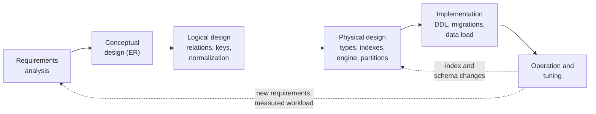
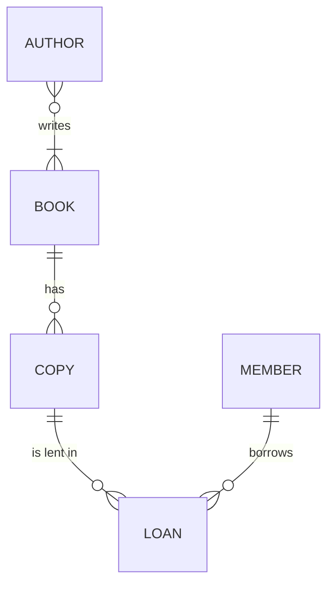

## Introduction

Every table you have queried so far was **designed** by someone. Somebody decided that a library keeps *copies* separately from *books*, that a loan belongs to a copy rather than to a book, that a book can have several authors, that `returned_at` may be NULL, that `loans.due_at` must not precede `loaned_at`, and that `loans` needs an index on `member_id`. Each of those decisions was made at a different level of abstraction, by asking a different kind of question:

- **What does the business need to remember?** ("A member borrows a physical copy and must return it by a due date.") — the **conceptual** level.
- **How is that expressed as relations, keys and constraints?** ("`loans(loan_id, copy_id → copies, member_id → members, loaned_at, due_at, returned_at)`.") — the **logical** level.
- **How is that stored and accessed efficiently in MySQL 8.4 with InnoDB?** ("`INT UNSIGNED` keys, a clustered primary key, secondary indexes on the foreign keys, `utf8mb4`.") — the **physical** level.

Database design is the disciplined process of moving from requirements through those three models, producing a reviewable **deliverable** at each step. This lesson gives you the map of that process — what each stage decides, which artefacts it produces, which mistakes it prevents — and shows how to read each layer back out of a running MySQL schema. It is also the map of this course: Modules 5 and 6 teach conceptual and logical design in depth, and Modules 2, 7, 10 and 12 teach the physical decisions.

:::note[Dataset]
The examples use the **library** dataset: books, authors (many-to-many through `book_authors`), members, physical copies and loans. Every output was captured from a real MySQL server.
:::

## DBMS Theory

:::theory[The three design models]
| Model | Answers | Expressed in | Independent of |
|---|---|---|---|
| **Conceptual** | *What* information must be represented: entities, attributes, relationships, cardinalities, business rules | Entity–Relationship (ER/EER) diagrams, UML class diagrams, a glossary | The data model (relational or not) and the DBMS |
| **Logical** | *How* it is structured in a chosen data model: relations, attributes, domains, primary/candidate/foreign keys, integrity constraints, normal form | Relational schema (R(A₁, …, Aₙ) with keys), or DDL without physical options | The specific DBMS product, storage and indexing |
| **Physical** | *How* it is stored and accessed: data types, storage engine, indexes, partitioning, character sets, tablespaces, denormalizations for performance | Product-specific DDL (`CREATE TABLE … ENGINE=InnoDB`), index and capacity plans | Nothing — it is bound to the DBMS and workload |
:::

The three models are not the same as the three levels of the ANSI/SPARC **three-schema architecture** (external, conceptual, internal), but they are closely related: the logical model becomes the DBMS's *conceptual schema*, the physical model its *internal schema*, and views designed for particular applications become *external schemas* (see [Schemas, Instances, Three-Schema Architecture and Data Independence](/lessons/m01-schemas-three-schema-architecture)). The separation is what makes **data independence** possible: you can change a physical decision (add an index) without changing the logical schema, and change the logical schema (split a table) while preserving external views.

### The design lifecycle



1. **Requirements analysis** — interviews, existing forms and reports, workflows, data volumes, query and transaction mix, retention and compliance rules. Deliverable: a requirements document, a glossary of business terms, and a list of the most important queries and transactions with expected frequencies.
2. **Conceptual design** — entities, attributes, relationships, cardinality and participation constraints, keys at the conceptual level. Deliverable: an ER diagram plus a data dictionary, reviewed with domain experts.
3. **Logical design** — map the ER model to relations (ER-to-relational mapping), choose primary keys, declare foreign keys, normalize (typically to 3NF/BCNF) and record integrity constraints. Deliverable: the relational schema with keys, functional dependencies and constraints.
4. **Physical design** — choose data types and character sets, storage engine, indexes driven by the workload, partitioning, and deliberate denormalizations. Deliverable: DDL scripts, an index plan with justification, capacity estimates.
5. **Implementation, operation and tuning** — migrations, data loading, monitoring; measured workload feeds back into physical (and sometimes logical) design.

The process is iterative, not a waterfall: logical design often reveals missing requirements, and physical measurements sometimes justify logical changes (a summary table, a split table). What matters is that each decision is made **at the right level** and **recorded**.

## Why It Exists

Schemas live far longer than the applications written against them. A table designed in an afternoon may serve dozens of services and analytics pipelines for a decade, and every flaw becomes progressively more expensive to fix as data and dependents accumulate. A design process exists to catch the expensive mistakes early, when they cost a whiteboard eraser instead of a multi-week migration.

What goes wrong without it is well documented:

- **Skipping conceptual design** produces schemas that mirror the first screen of the first application. Typical symptoms: one `books` table with a `copy_number` column (so a second copy duplicates the title, ISBN and authors), or `author1`, `author2`, `author3` columns (so a fourth author is impossible and "books by X" needs three predicates).
- **Skipping logical design** (keys, normalization, constraints) produces update, insertion and deletion anomalies (Module 6), orphaned rows, and duplicate entities with slightly different spellings — data-quality problems that no amount of application code fully repairs.
- **Mixing physical concerns into the conceptual stage** ("we'll denormalize because joins are slow") locks in premature optimizations before the workload is known, while **ignoring physical design** ships schemas with no indexes for the most frequent queries, or `VARCHAR(255)` everywhere and `FLOAT` for money.
- **Not producing deliverables** means nobody can review the design, new team members reverse-engineer intent from DDL, and decisions such as "a loan references a copy, not a book" are lost.

Separating the levels also separates **responsibilities**: business analysts and domain experts validate the conceptual model, data architects and engineers own the logical model, and DBAs or platform engineers own much of the physical model.

## Internal Working

:::internals[Where each design layer lives inside MySQL]
MySQL stores no conceptual model — ER diagrams live in modelling tools (MySQL Workbench, draw.io, ERwin, dbdiagram). What MySQL does store, in its **transactional data dictionary** (InnoDB tables in the `mysql` schema since MySQL 8.0, replacing the old `.frm` files), is the logical and physical design you declared in DDL:

| Design layer | Stored as | Exposed through `information_schema` |
|---|---|---|
| Logical: relations and attributes | Table and column definitions | `TABLES`, `COLUMNS` |
| Logical: keys | `PRIMARY KEY`, `UNIQUE` constraints | `TABLE_CONSTRAINTS`, `KEY_COLUMN_USAGE` |
| Logical: relationships | `FOREIGN KEY` constraints | `REFERENTIAL_CONSTRAINTS`, `KEY_COLUMN_USAGE` (`REFERENCED_TABLE_NAME`) |
| Logical: domain rules | `NOT NULL`, `ENUM`, `CHECK` (enforced since 8.0.16) | `COLUMNS.IS_NULLABLE`, `COLUMN_TYPE`, `CHECK_CONSTRAINTS` |
| Physical: types and storage | Data types, character set/collation, engine, row format | `COLUMNS.COLUMN_TYPE`, `TABLES.ENGINE`, `TABLES.ROW_FORMAT` |
| Physical: access paths | Indexes (InnoDB B+ trees) | `STATISTICS` |

Physically, every InnoDB table is a **clustered index** on its primary key (the rows are stored in primary-key order inside a B+ tree), and every secondary index stores the indexed columns plus the primary key. That is why choosing the primary key is both a logical decision (identity) and a physical one (storage order, size of every secondary index) — Module 7 and Module 10 return to this.
:::

`information_schema` is itself an application of the three-schema idea: it is a set of read-only **views** (an external schema) over the internal data dictionary tables, so tools can inspect a schema without depending on how MySQL stores its metadata.

:::standard[Standard SQL vs MySQL]
`INFORMATION_SCHEMA` is defined by the SQL standard, and the core views (`TABLES`, `COLUMNS`, `TABLE_CONSTRAINTS`, `KEY_COLUMN_USAGE`, `REFERENTIAL_CONSTRAINTS`, `CHECK_CONSTRAINTS`) exist in MySQL, PostgreSQL and SQL Server with similar columns. `STATISTICS` (index metadata), `ENGINE` and `ROW_FORMAT` are MySQL extensions — the standard deliberately leaves indexes and storage out, because they are physical.
:::

## MySQL Implementation

Start from the **conceptual model** of the library. In words: a *book* (title, ISBN, genre, year, publisher) is written by one or more *authors*; an author may write many books. The library owns one or more physical *copies* of a book, each in some condition. A *member* borrows a copy; each *loan* records when it was lent, when it is due and when (if) it was returned.



The **logical model** maps each entity to a relation and the many-to-many relationship to its own relation:

- Authors(**author_id**, name, birth_year, country)
- Books(**book_id**, isbn *(candidate key)*, title, genre, published_year, publisher)
- BookAuthors(**book_id** → Books, **author_id** → Authors, author_order)
- Copies(**copy_id**, book_id → Books, acquired_on, condition)
- Members(**member_id**, name, email *(candidate key)*, joined_on, membership)
- Loans(**loan_id**, copy_id → Copies, member_id → Members, loaned_at, due_at, returned_at) with the rule due_at ≥ loaned_at

The **physical model** is the DDL actually deployed. Read it back from the server:

```sql run
SHOW CREATE TABLE loans;
```

Every layer is visible in that one statement: the logical attributes and keys (`PRIMARY KEY`, two `FOREIGN KEY` clauses), a domain rule (`CHECK (due_at >= loaned_at)`), and physical choices (`int unsigned`, `date`, the secondary indexes `idx_loans_copy` and `idx_loans_member`, `ENGINE=InnoDB`, `utf8mb4`).

To see the logical model of the whole schema at once — every relationship — query the data dictionary:

```sql run
SELECT TABLE_NAME AS child_table, COLUMN_NAME AS fk_column,
       REFERENCED_TABLE_NAME AS parent_table, REFERENCED_COLUMN_NAME AS parent_column,
       CONSTRAINT_NAME
FROM information_schema.KEY_COLUMN_USAGE
WHERE TABLE_SCHEMA = DATABASE() AND REFERENCED_TABLE_NAME IS NOT NULL
ORDER BY child_table, fk_column;
```

Each row is one edge of the ER diagram, as it was finally implemented. Notice that the many-to-many `writes` relationship appears as **two** foreign keys out of `book_authors` — the ER-to-relational mapping rule for M:N relationships.

## Syntax Breakdown

The deliverables of each stage map to concrete artefacts — and, for the last two stages, to concrete MySQL syntax:

| Stage | Key decisions | Deliverable | MySQL constructs |
|---|---|---|---|
| Requirements | Scope, data to keep, queries/transactions and their frequency, volumes, retention, privacy | Requirements doc, glossary, workload list | — |
| Conceptual | Entities, attributes, relationships, cardinality (1:1, 1:N, M:N), participation, identifiers | ER/EER diagram, data dictionary | — (modelling tool) |
| Logical | Relations, primary/candidate/foreign keys, NULL policy, normal form, constraints | Relational schema, FD list, constraint list | `CREATE TABLE` columns, `PRIMARY KEY`, `UNIQUE`, `FOREIGN KEY … REFERENCES`, `NOT NULL`, `CHECK` |
| Physical | Exact types and sizes, character set/collation, engine, indexes, partitioning, denormalization, views | DDL scripts / migrations, index plan, capacity estimate | `INT UNSIGNED`, `DECIMAL(p,s)`, `VARCHAR(n)`, `ENGINE=InnoDB`, `CHARSET utf8mb4`, `CREATE INDEX`, `PARTITION BY`, `CREATE VIEW` |
| Operation | Monitoring, tuning, evolution | Runbooks, migration history | `ALTER TABLE` (online DDL), `ANALYZE TABLE`, `EXPLAIN` |

The most useful `information_schema` views for reading a design:

| View | Use it to see | Filter |
|---|---|---|
| `TABLES` | Relations, engine, row format, comments | `TABLE_SCHEMA = DATABASE()` |
| `COLUMNS` | Attributes, types, nullability, defaults, ordinal position | same |
| `TABLE_CONSTRAINTS` | PK / UNIQUE / FOREIGN KEY / CHECK constraints per table | same |
| `KEY_COLUMN_USAGE` | Which columns make up each key, and what each FK references | same |
| `REFERENTIAL_CONSTRAINTS` | `ON DELETE` / `ON UPDATE` rules of foreign keys | `CONSTRAINT_SCHEMA = DATABASE()` |
| `CHECK_CONSTRAINTS` | CHECK expressions | `CONSTRAINT_SCHEMA = DATABASE()` |
| `STATISTICS` | Indexes, their columns and order, uniqueness | `TABLE_SCHEMA = DATABASE()` |

:::version[MySQL 8.0 vs 8.4]
`CHECK` constraints are parsed **and enforced** since MySQL 8.0.16; earlier versions parsed and silently ignored them, so schemas designed for 5.7 may contain checks that never ran. MySQL 8.4 LTS keeps the 8.0 data dictionary and `information_schema` layout, so the queries in this lesson behave the same on 8.0.31+ and 8.4.
:::

## Practical Examples

**1. Reading the logical model: keys per table.**

```sql run
SELECT tc.TABLE_NAME, tc.CONSTRAINT_TYPE, tc.CONSTRAINT_NAME,
       GROUP_CONCAT(k.COLUMN_NAME ORDER BY k.ORDINAL_POSITION) AS key_columns
FROM information_schema.TABLE_CONSTRAINTS AS tc
JOIN information_schema.KEY_COLUMN_USAGE AS k
  ON k.CONSTRAINT_SCHEMA = tc.CONSTRAINT_SCHEMA
 AND k.TABLE_NAME = tc.TABLE_NAME
 AND k.CONSTRAINT_NAME = tc.CONSTRAINT_NAME
WHERE tc.TABLE_SCHEMA = DATABASE() AND tc.CONSTRAINT_TYPE IN ('PRIMARY KEY', 'UNIQUE')
GROUP BY tc.TABLE_NAME, tc.CONSTRAINT_TYPE, tc.CONSTRAINT_NAME
ORDER BY tc.TABLE_NAME, tc.CONSTRAINT_TYPE;
```

Primary keys are the identifiers chosen in logical design; `UNIQUE` constraints are the **alternate (candidate) keys** — `books.isbn` and `members.email`. `book_authors` has a composite primary key `(book_id, author_id)`, the standard key for an M:N junction relation. (See [Keys](/lessons/m01-keys).)

**2. Reading business rules: CHECK constraints and ENUM domains.**

```sql run
SELECT CONSTRAINT_NAME, CHECK_CLAUSE
FROM information_schema.CHECK_CONSTRAINTS
WHERE CONSTRAINT_SCHEMA = DATABASE()
ORDER BY CONSTRAINT_NAME;
```

```sql run
SELECT TABLE_NAME, COLUMN_NAME, COLUMN_TYPE, IS_NULLABLE
FROM information_schema.COLUMNS
WHERE TABLE_SCHEMA = DATABASE() AND DATA_TYPE = 'enum'
ORDER BY TABLE_NAME, COLUMN_NAME;
```

The requirement "a loan cannot be due before it starts" became `chk_loans_due`; "a copy is new, good, worn or damaged" and "membership is standard, student or premium" became `ENUM` domains. The server now rejects violations no matter which application writes the data:

```sql run error
INSERT INTO loans (loan_id, copy_id, member_id, loaned_at, due_at)
VALUES (9999, 1, 1, '2024-05-10', '2024-05-01');
```

**3. Reading the physical model: indexes.**

```sql run
SELECT TABLE_NAME, INDEX_NAME, NON_UNIQUE,
       GROUP_CONCAT(COLUMN_NAME ORDER BY SEQ_IN_INDEX) AS columns_in_order
FROM information_schema.STATISTICS
WHERE TABLE_SCHEMA = DATABASE()
GROUP BY TABLE_NAME, INDEX_NAME, NON_UNIQUE
ORDER BY TABLE_NAME, INDEX_NAME;
```

Every table has a `PRIMARY` index (InnoDB's clustered index), every `UNIQUE` constraint became a unique index, and every foreign-key column is indexed — InnoDB **requires** an index on the referencing columns and creates one automatically if none exists (that is why `book_authors` has `idx_book_authors_author`; its `book_id` foreign key is served by the leftmost column of the primary key). Indexes are purely physical: none of them changes what any query returns.

**4. Physical data independence, demonstrated.** The same logical relation can have different physical designs; queries are unaffected. Copy `loans` into a table without secondary indexes and compare:

```sql run
CREATE TABLE loans_no_idx AS SELECT * FROM loans;   -- copies columns and rows, not keys or indexes
ANALYZE TABLE loans_no_idx;
SELECT (SELECT COUNT(*) FROM loans WHERE member_id = 3)        AS with_index,
       (SELECT COUNT(*) FROM loans_no_idx WHERE member_id = 3) AS without_index;
```

Same answer. The plans differ:

```sql run
EXPLAIN FORMAT=TREE SELECT * FROM loans WHERE member_id = 3;
```

```sql run
EXPLAIN FORMAT=TREE SELECT * FROM loans_no_idx WHERE member_id = 3;
```

The first uses an index lookup on `idx_loans_member`; the second must scan every row and filter. Choosing indexes from the workload — "members look up their own loans constantly" — is a physical design decision that never touched the logical model. Note also what `CREATE TABLE … AS SELECT` did *not* copy: the primary key, foreign keys and CHECK constraint. It reproduced the instance but not the logical design — a common trap when cloning tables.

## Execution Walkthrough

Walk one requirement through all the stages: *"Members may place a reservation (hold) on a book; when a copy becomes available, the oldest active reservation is served first. A member cannot hold the same book twice at the same time."*

```walkthrough
title: From a requirement to a deployed, verified table
steps:
  - title: "1. Requirements → conceptual model"
    explain: >-
      Nouns become candidate entities or attributes; verbs become relationships. RESERVATION relates MEMBER and
      BOOK (not COPY — a member wants any copy of the title). Attributes: when it was placed and its status.
      Cardinality: a member makes 0..N reservations, a book receives 0..N reservations, so RESERVATION is an
      associative entity between two 1:N relationships. Rule: at most one active reservation per (member, book).
  - title: "2. Conceptual → logical model"
    explain: >-
      Map the entity to a relation with a surrogate key, two foreign keys and a status domain:
      Reservations(reservation_id, member_id → Members, book_id → Books, placed_at, status ∈ {active, fulfilled,
      cancelled}). "Oldest first" needs placed_at to be NOT NULL. "One active hold per member and book" is a
      conditional uniqueness rule — unique only among active rows — which a plain UNIQUE (member_id, book_id)
      would over-constrain, because it would forbid reserving the same book again next year.
  - title: "3. Logical → physical model (MySQL DDL)"
    explain: >-
      Choose types matching the referenced keys (INT UNSIGNED), an ENUM for status, DATETIME for placed_at, and
      InnoDB for foreign keys and transactions. The conditional uniqueness is implemented physically with a
      generated column that is non-NULL only for active rows, plus a UNIQUE index over it (UNIQUE allows many
      NULLs). An index on (book_id, status, placed_at) supports "oldest active reservation for this book".
    sql: |
      CREATE TABLE reservations (
        reservation_id INT UNSIGNED NOT NULL AUTO_INCREMENT PRIMARY KEY,
        member_id      INT UNSIGNED NOT NULL,
        book_id        INT UNSIGNED NOT NULL,
        placed_at      DATETIME NOT NULL,
        status         ENUM('active','fulfilled','cancelled') NOT NULL DEFAULT 'active',
        active_book_id INT UNSIGNED AS (CASE WHEN status = 'active' THEN book_id END) VIRTUAL,
        CONSTRAINT fk_res_member FOREIGN KEY (member_id) REFERENCES members (member_id),
        CONSTRAINT fk_res_book   FOREIGN KEY (book_id)   REFERENCES books (book_id),
        UNIQUE KEY uq_res_one_active (member_id, active_book_id),
        KEY idx_res_queue (book_id, status, placed_at)
      ) ENGINE=InnoDB;
  - title: "4. Verify the rules are enforced"
    explain: >-
      Insert two active holds by different members, a fulfilled old hold, and a new active hold by the same
      member for the same book — allowed, because only one of them is active.
    sql: |
      INSERT INTO reservations (member_id, book_id, placed_at, status) VALUES
        (1, 2, '2024-03-01 10:00:00', 'fulfilled'),
        (1, 2, '2024-06-01 09:00:00', 'active'),
        (5, 2, '2024-06-02 12:00:00', 'active');
      SELECT reservation_id, member_id, book_id, placed_at, status, active_book_id
      FROM reservations ORDER BY reservation_id;
  - title: "5. A violating write is rejected by the server"
    explain: >-
      A second active hold by member 1 on book 2 collides on (member_id, active_book_id) = (1, 2) and fails
      with a duplicate-key error. The business rule lives in the schema, not only in application code.
    sql: |
      INSERT INTO reservations (member_id, book_id, placed_at) VALUES (1, 2, '2024-06-03 08:00:00');
    expect: error
  - title: "6. The workload query uses the physical design"
    explain: >-
      "Next reservation to serve for book 2" reads the queue index in order and stops after one row.
    sql: |
      EXPLAIN FORMAT=TREE
      SELECT reservation_id, member_id FROM reservations
      WHERE book_id = 2 AND status = 'active'
      ORDER BY placed_at LIMIT 1;
```

## Output

The final state is a table whose logical rules (foreign keys, status domain, "one active hold per member and book") are enforced by MySQL, and whose physical design (the queue index) matches the most important query. Confirm the deliverable from the data dictionary — this is what a reviewer or a migration tool sees:

```sql run
SELECT COLUMN_NAME, COLUMN_TYPE, IS_NULLABLE, COLUMN_DEFAULT, EXTRA
FROM information_schema.COLUMNS
WHERE TABLE_SCHEMA = DATABASE() AND TABLE_NAME = 'reservations'
ORDER BY ORDINAL_POSITION;
```

Read it layer by layer: the column list and nullability are the logical model; `int unsigned`, the `enum(…)` definition, `auto_increment` and `VIRTUAL GENERATED` are physical choices; the generated column exists *only* to implement a logical rule that MySQL cannot declare directly (a partial unique constraint). Recording *why* that column exists — in a table comment, a migration message or the design document — is part of the deliverable; otherwise the next engineer will delete it as "unused".

## Alternative Approaches

**Design order.** The classic **top-down** approach (requirements → ER → relations → DDL) is what this lesson presents. Two alternatives are common in practice:

| Approach | How it works | When it fits | Risk |
|---|---|---|---|
| Top-down (ER first) | Model entities and relationships, then map and normalize | New systems, clear domain, many stakeholders | Slow start; diagrams can drift from the deployed DDL |
| Bottom-up (synthesis / normalization) | Collect attributes and functional dependencies from forms and reports, then decompose into normal forms (Module 6) | Replacing spreadsheets or legacy files; reports are the best requirements | Misses entities that no current report shows |
| Code-first (ORM migrations) | Developers define classes; the ORM generates DDL | Small teams, fast iteration | Logical design happens implicitly; constraints and indexes are often missing |
| Reverse engineering | Generate a model from an existing database (MySQL Workbench *Reverse Engineer*, or `information_schema` queries like those above) | Legacy systems, audits, onboarding | Recovers *what* exists, not *why* |

In mature teams these combine: a conceptual model agreed with the business, logical design reviewed by data engineers, and schema changes delivered as versioned migrations (Flyway, Liquibase, Alembic, Rails/Django migrations — Module 11), with the data dictionary queried in CI to check conventions.

**Implementing a rule.** The reservation rule above could also have been enforced by a trigger, by application code with a `SELECT … FOR UPDATE` check, or by moving active reservations to a separate table with a plain `UNIQUE (member_id, book_id)`. The generated-column approach was chosen because a declarative constraint is enforced for every writer and cannot race; the others are valid where declarative constraints cannot express the rule.

## Performance Analysis

Performance is overwhelmingly a **physical design** concern — but it is constrained by every earlier decision:

- **Conceptual and logical decisions set the floor.** If a loan referenced a *book* rather than a *copy*, no index could answer "which copy is overdue?". If authors were stored as a comma-separated string, "books by author X" could never use an index. Logical design decides which questions can be answered efficiently at all.
- **Physical decisions are driven by the workload.** The requirements stage should produce the list of critical queries and transactions with frequencies; each index must be justified by one of them. Indexes speed up reads that match them and slow down every insert, update and delete on the table, and consume buffer-pool memory.
- **The primary key is a physical decision with wide reach.** In InnoDB every secondary index entry contains the primary key, so a wide primary key (say, a 36-character UUID string) inflates every index; a random primary key scatters inserts across the clustered index.

The plans captured in Practical Example 4 show the mechanism: with `idx_loans_member`, MySQL looks up only the matching entries; without it, it scans every row of `loans_no_idx`. On 52 rows the difference is invisible.

:::performance[Theory vs measurement]
Physical design should be validated against **measured** workload, not intuition: `EXPLAIN ANALYZE` on the critical queries (Module 7), the slow query log and Performance Schema statement digests in production (Module 11). On a sample dataset of a few dozen rows, every design performs identically; capacity estimates (rows per year × row size × index overhead) are needed before the data exists.
:::

## Best Practices

:::best-practice[Professional habits]
1. **Make decisions at the right level.** Ask "what must be true?" (conceptual/logical) before "how fast is it?" (physical). Denormalize only with a measured reason and a documented plan for keeping copies consistent.
2. **Produce and keep deliverables.** An ER diagram and data dictionary reviewed with domain experts; a logical schema with keys and constraints; DDL in version control as migrations. Regenerate diagrams from the live schema periodically so they do not drift.
3. **Write the workload down early.** The top queries and transactions, with frequencies and latency targets, are inputs to physical design. Index for them — and only for them.
4. **Push rules into the schema.** Prefer `NOT NULL`, `UNIQUE`, `FOREIGN KEY` and `CHECK` over application-only validation; every application, script and ad-hoc fix then obeys them.
5. **Name constraints and indexes deliberately** (`fk_loans_member`, `uq_members_email`, `idx_res_queue`). Error messages and migration scripts refer to these names.
6. **Document non-obvious physical artefacts** (generated columns that implement rules, redundant columns maintained by triggers) with `COMMENT` clauses or in the migration history.
7. **Use `information_schema` for schema reviews and CI checks** — tables without primary keys, foreign-key columns without indexes, `FLOAT` money columns, missing `NOT NULL`.
:::

## Common Mistakes

**Mistake 1 — cloning a table and assuming the design came along.**

```sql run
SELECT TABLE_NAME, COUNT(*) AS constraints_declared
FROM information_schema.TABLE_CONSTRAINTS
WHERE TABLE_SCHEMA = DATABASE() AND TABLE_NAME IN ('loans', 'loans_no_idx')
GROUP BY TABLE_NAME
ORDER BY TABLE_NAME;
```

`loans_no_idx` does not even appear: `CREATE TABLE … AS SELECT` copied the instance and the column types, but none of the keys, foreign keys or checks. Use `CREATE TABLE new LIKE old` (which copies indexes, the primary key and CHECK constraints but **not** foreign keys) and then add the foreign keys explicitly, or reapply the original DDL.

**Mistake 2 — designing from the first screen.** A "loan" form that shows the book title tempts designers to put `title` into `loans`. The title belongs to the book (via the copy); copying it into every loan creates update anomalies when a title is corrected. Conceptual design asks *which entity does this fact describe?*

**Mistake 3 — repeating groups instead of relationships.** `books(author1, author2, author3)` is a physical shortcut for a many-to-many relationship. It caps the number of authors, wastes space and makes "books by X" unindexable. The junction relation `book_authors` is the correct logical design.

**Mistake 4 — relying on a CHECK that was never enforced.** Schemas migrated from MySQL 5.7 may contain CHECK clauses that were silently ignored there. After upgrading to 8.0.16+ they are enforced, and existing violating rows will make `ALTER TABLE` operations fail. Audit with a query before relying on them.

**Mistake 5 — premature physical design.** Choosing partitioning, sharding keys or denormalized summary tables before requirements and workload are known. These decisions are expensive to reverse and often address bottlenecks the system never has.

**Mistake 6 — physical choices that contradict the logical model.** A foreign-key column whose type differs from the referenced key (signed vs unsigned, different length or collation) cannot even be declared as a foreign key in InnoDB:

```sql run error
CREATE TABLE bad_holds (
  hold_id   INT PRIMARY KEY,
  member_id BIGINT NOT NULL,
  CONSTRAINT fk_bad_member FOREIGN KEY (member_id) REFERENCES members (member_id)
);
```

Column types in a relationship must match: `members.member_id` is `INT UNSIGNED`.

## Industry Application

- **Design reviews.** In most engineering organizations a new table or service database requires a design document — entities, relationships, keys, constraints, expected volume, top queries, indexes, retention — reviewed by senior engineers or a data-architecture group before the first migration is merged. That document is the conceptual + logical + physical deliverable set from this lesson.
- **Migrations as the physical record.** The deployed physical model is the cumulative result of versioned migrations. Teams treat migrations as code: reviewed, tested against production-sized copies, and run with online DDL or tools such as gh-ost and pt-online-schema-change for large tables (Modules 11 and 12).
- **Schema linting in CI.** Pipelines query `information_schema` to block merges that add tables without primary keys, foreign-key columns without indexes, or nullable columns in key positions.
- **Data catalogues and governance.** Data engineers maintain conceptual and logical models in catalogue tools, linked to the physical tables, so analysts know what `loans.returned_at IS NULL` *means* ("open loan") and which columns are personal data under GDPR/CCPA.
- **Analytics design.** Warehouses use the same lifecycle with different logical patterns — dimensional models (star schemas) rather than 3NF (Module 13) — and different physical choices (columnar storage, partitioning by date).

### Where this course fits in the lifecycle

| Lifecycle stage | Modules |
|---|---|
| Requirements and conceptual design | Module 5 — ER modelling ([Requirements Gathering](/lessons/m05-requirements-gathering) through [Design Case Study](/lessons/m05-design-case-study)) |
| Logical design | Module 1 (relational model, keys, integrity), Module 5 ([ER to Relational Mapping](/lessons/m05-er-to-relational)), Module 6 (normalization, [Anomalies](/lessons/m06-anomalies) to [Denormalization](/lessons/m06-denormalization)) |
| Physical design | Module 2 (data types, character sets, storage engines), Module 7 (indexing and query optimization), Module 10 (InnoDB internals), Module 12 (partitioning, sharding, large tables) |
| Implementation and querying | Modules 3–4 (SQL), Module 9 (views, procedures, triggers) |
| Operation | Module 8 (transactions), Module 11 (security, backups, monitoring, migrations), Module 12 (production architecture) |

## Practice Exercises

All exercises use the **library** dataset.

```exercise
id: ex1
title: List every relationship in the schema
difficulty: easy
concepts: [information-schema, logical-model]
prompt: |
  Using `information_schema.KEY_COLUMN_USAGE`, return one row per foreign-key column in the current schema with
  columns `child_table`, `fk_column`, `parent_table`, `parent_column`.
  Filter with `TABLE_SCHEMA = DATABASE()`.
hints:
  - "Foreign-key rows are the ones where REFERENCED_TABLE_NAME IS NOT NULL."
  - "Select TABLE_NAME, COLUMN_NAME, REFERENCED_TABLE_NAME, REFERENCED_COLUMN_NAME."
solution: |
  SELECT TABLE_NAME AS child_table, COLUMN_NAME AS fk_column,
         REFERENCED_TABLE_NAME AS parent_table, REFERENCED_COLUMN_NAME AS parent_column
  FROM information_schema.KEY_COLUMN_USAGE
  WHERE TABLE_SCHEMA = DATABASE() AND REFERENCED_TABLE_NAME IS NOT NULL;
explanation: |
  `KEY_COLUMN_USAGE` lists the columns of every key constraint; primary and unique keys have a NULL
  `REFERENCED_TABLE_NAME`. The five rows returned are exactly the relationship edges of the library ER diagram,
  with the M:N relationship appearing as the two foreign keys of `book_authors`.
```

```exercise
id: ex2
title: Find nullable columns
difficulty: easy
concepts: [information-schema, logical-model]
prompt: |
  Return `table_name` and `column_name` of every column in the current schema that **allows NULL**.
  These are the places where the logical design decided a value may be unknown or not applicable.
hints:
  - "information_schema.COLUMNS has an IS_NULLABLE column with values 'YES' or 'NO'."
solution: |
  SELECT TABLE_NAME AS table_name, COLUMN_NAME AS column_name
  FROM information_schema.COLUMNS
  WHERE TABLE_SCHEMA = DATABASE() AND IS_NULLABLE = 'YES';
explanation: |
  Only a few columns are nullable: an author's birth year and country (unknown), and `loans.returned_at`
  (not applicable while the loan is open). Every nullable column should have a documented meaning for NULL —
  `returned_at IS NULL` means "still on loan", which queries such as "open loans" rely on.
```

```exercise
id: ex3
title: Composite keys reveal junction relations
difficulty: medium
concepts: [information-schema, logical-model, conceptual-model]
prompt: |
  M:N relationships are mapped to relations whose primary key consists of several columns. Return
  `table_name` and `pk_columns` (the primary-key column names joined with commas in key order) for every table
  whose primary key has **more than one column**.
hints:
  - "Primary-key columns are in KEY_COLUMN_USAGE with CONSTRAINT_NAME = 'PRIMARY'."
  - "GROUP BY TABLE_NAME, then HAVING COUNT(*) > 1. Use GROUP_CONCAT(COLUMN_NAME ORDER BY ORDINAL_POSITION)."
solution: |
  SELECT TABLE_NAME AS table_name,
         GROUP_CONCAT(COLUMN_NAME ORDER BY ORDINAL_POSITION) AS pk_columns
  FROM information_schema.KEY_COLUMN_USAGE
  WHERE TABLE_SCHEMA = DATABASE() AND CONSTRAINT_NAME = 'PRIMARY'
  GROUP BY TABLE_NAME
  HAVING COUNT(*) > 1;
explanation: |
  `book_authors (book_id, author_id)` is the only one: the junction relation of the M:N `writes`
  relationship. Reverse-engineering tools use exactly this heuristic (composite PK made of foreign keys) to draw
  M:N relationships back into an ER diagram.
```

```exercise
id: ex4
title: Implement a logical design as MySQL DDL
difficulty: hard
kind: dml
concepts: [physical-model, logical-model]
prompt: |
  The logical model has a new relation **Fines(fine_id, loan_id → Loans, amount, issued_on, paid_on)** with
  these rules: every fine belongs to exactly one loan; `amount` is money and must be positive; `issued_on` is
  required; `paid_on` is unknown until paid; a loan has at most one fine.

  Create table `fines` with columns in this order and these exact types:
  `fine_id INT UNSIGNED` (primary key), `loan_id INT UNSIGNED`, `amount DECIMAL(8,2)`, `issued_on DATE`,
  `paid_on DATE`. Declare the foreign key, the uniqueness rule, NOT NULL where required and a CHECK for the
  amount.
hints:
  - "loan_id must match loans.loan_id exactly (INT UNSIGNED) for the foreign key to be accepted."
  - "'At most one fine per loan' is UNIQUE (loan_id). 'Positive amount' is CHECK (amount > 0)."
  - "Only paid_on is nullable."
solution: |
  CREATE TABLE fines (
    fine_id   INT UNSIGNED NOT NULL PRIMARY KEY,
    loan_id   INT UNSIGNED NOT NULL,
    amount    DECIMAL(8,2) NOT NULL,
    issued_on DATE NOT NULL,
    paid_on   DATE NULL,
    CONSTRAINT uq_fines_loan UNIQUE (loan_id),
    CONSTRAINT fk_fines_loan FOREIGN KEY (loan_id) REFERENCES loans (loan_id),
    CONSTRAINT chk_fines_amount CHECK (amount > 0)
  );
check: |
  SELECT c.COLUMN_NAME, c.COLUMN_TYPE, c.IS_NULLABLE,
         (SELECT GROUP_CONCAT(tc.CONSTRAINT_TYPE ORDER BY tc.CONSTRAINT_TYPE)
          FROM information_schema.TABLE_CONSTRAINTS tc
          WHERE tc.TABLE_SCHEMA = DATABASE() AND tc.TABLE_NAME = 'fines') AS constraint_types
  FROM information_schema.COLUMNS c
  WHERE c.TABLE_SCHEMA = DATABASE() AND c.TABLE_NAME = 'fines'
  ORDER BY c.ORDINAL_POSITION;
explanation: |
  The check compares column names, types, nullability and the set of constraint types (CHECK, FOREIGN KEY,
  PRIMARY KEY, UNIQUE) — not the constraint names. Using `INT` instead of `INT UNSIGNED` for `loan_id` makes
  the foreign key fail with an "incompatible" error; using `FLOAT` for money would pass the declaration but
  violate the design's exactness requirement. The UNIQUE constraint also gives InnoDB the index it needs for
  the foreign key, so no separate index is created.
```

```exercise
id: ex5
title: Foreign keys and the indexes that serve them
difficulty: challenge
concepts: [information-schema, physical-model]
prompt: |
  For every foreign-key column, show whether an index **starts with** that column. Return `child_table`,
  `fk_column` and `serving_index` (the name of an index whose first column — `SEQ_IN_INDEX = 1` — is the
  foreign-key column; if several, the alphabetically smallest; NULL if none).
hints:
  - "Start from KEY_COLUMN_USAGE rows with REFERENCED_TABLE_NAME IS NOT NULL."
  - "LEFT JOIN information_schema.STATISTICS on table name, column name and SEQ_IN_INDEX = 1."
  - "Group by the FK column and take MIN(INDEX_NAME)."
solution: |
  SELECT k.TABLE_NAME AS child_table, k.COLUMN_NAME AS fk_column, MIN(s.INDEX_NAME) AS serving_index
  FROM information_schema.KEY_COLUMN_USAGE AS k
  LEFT JOIN information_schema.STATISTICS AS s
    ON s.TABLE_SCHEMA = k.TABLE_SCHEMA AND s.TABLE_NAME = k.TABLE_NAME
   AND s.COLUMN_NAME = k.COLUMN_NAME AND s.SEQ_IN_INDEX = 1
  WHERE k.TABLE_SCHEMA = DATABASE() AND k.REFERENCED_TABLE_NAME IS NOT NULL
  GROUP BY k.TABLE_NAME, k.COLUMN_NAME;
explanation: |
  Every foreign key is served by an index — InnoDB guarantees it. `book_authors.book_id` is served by the
  `PRIMARY` index because `book_id` is the leftmost column of the composite primary key, so InnoDB did not need
  a separate index. This query is a typical CI lint: on schemas built with engines that do not auto-create such
  indexes, a NULL here flags a missing index that would make deletes on the parent table and joins slow.
```

```exercise
id: ex6
title: Design a feature through all three models
difficulty: hard
kind: open
concepts: [design-lifecycle, conceptual-model, logical-model, physical-model]
prompt: |
  The library wants **reading clubs**: a club has a name and a moderator (a member); members can join many
  clubs; each club reads one book per month, chosen in advance.

  Produce the three deliverables in compact form: (1) the conceptual model (entities, relationships,
  cardinalities); (2) the logical relations with keys and foreign keys; (3) the key physical decisions in MySQL,
  including at least two indexes justified by queries.
solution: |
  **Conceptual.** Entities: CLUB (name), MEMBER, BOOK. Relationships: MEMBER *moderates* CLUB (1:N — each club
  has exactly one moderator; a member may moderate several clubs); MEMBER *belongs to* CLUB (M:N, with
  attribute joined_on); CLUB *schedules* BOOK for a month (M:N with attribute month; at most one book per club
  per month).

  **Logical.**
  Clubs(**club_id**, name *(unique)*, moderator_id → Members)
  ClubMembers(**club_id** → Clubs, **member_id** → Members, joined_on)
  ClubSchedule(**club_id** → Clubs, **month**, book_id → Books) — the key (club_id, month) enforces one book per
  club per month.

  **Physical (MySQL 8.4/InnoDB).** `INT UNSIGNED` ids matching existing keys; `month` as `DATE` constrained to
  the first of the month with `CHECK (DAY(month) = 1)`; `name VARCHAR(100)` with a unique index; InnoDB for FKs.
  Indexes: ClubMembers PK (club_id, member_id) serves "members of a club"; a secondary index on
  ClubMembers(member_id) serves "clubs I belong to" (and the FK); ClubSchedule PK (club_id, month) serves "this
  club's schedule in order"; an index on ClubSchedule(book_id) serves "which clubs read this book" and the FK.
  Decide ON DELETE behaviour explicitly (e.g. RESTRICT for moderators, CASCADE from Clubs to ClubMembers).
```

## Knowledge Assessment

```quiz
- id: q1
  question: "In which design model do you decide that `loans` needs a secondary index on `member_id`?"
  options: ["Conceptual", "Logical", "Physical", "Requirements analysis"]
  answer: 2
  explanation: "Indexes are access paths — a physical decision driven by the workload. They do not change what the schema can represent (conceptual) or the relations and keys (logical). Requirements analysis supplies the workload that justifies the index but does not choose it."
  concepts: [physical-model]
- id: q2
  question: "A many-to-many relationship between BOOK and AUTHOR in the ER model becomes what in the logical relational model?"
  options:
    - "A comma-separated authors column in books"
    - "A separate relation whose primary key combines the keys of both participants, each a foreign key"
    - "A foreign key from authors to books"
    - "Nothing; M:N relationships cannot be represented relationally"
  answer: 1
  explanation: "M:N relationships map to a junction relation such as book_authors(book_id, author_id). A single foreign key can only represent 1:N, and a comma-separated list violates first normal form and cannot be indexed or constrained."
  concepts: [logical-model, conceptual-model]
- id: q3
  type: multi
  question: "Which items belong to the logical design deliverable? (Select all that apply.)"
  options:
    - "Primary and candidate keys of each relation"
    - "The choice of the InnoDB storage engine"
    - "Foreign keys and integrity constraints"
    - "The buffer pool size"
    - "The NULL policy of each attribute"
  answer: [0, 2, 4]
  explanation: "Keys, foreign keys, constraints and nullability define the relational schema. Storage engine and buffer pool size are physical/operational decisions bound to MySQL."
  concepts: [logical-model]
- id: q4
  question: "You add an index to `loans` and every existing query still returns the same rows, only faster. Which property is this?"
  options: ["Logical data independence", "Physical data independence", "Referential integrity", "Normalization"]
  answer: 1
  explanation: "Physical data independence means internal (storage/access) changes do not affect the logical schema or the results of queries. Logical independence concerns changes to the conceptual schema not affecting external views."
  concepts: [data-independence, physical-model]
- id: q5
  question: "`CREATE TABLE loans_copy AS SELECT * FROM loans` is run. What does loans_copy contain?"
  options:
    - "The rows, columns, primary key, foreign keys and CHECK constraints of loans"
    - "The rows and column definitions, but no primary key, foreign keys, indexes or CHECK constraints"
    - "Only the primary key and indexes, no rows"
    - "An updatable view of loans"
  answer: 1
  explanation: "CREATE TABLE … AS SELECT copies the result set (the instance) with column types derived from it. Keys, indexes, foreign keys and checks — the logical and physical design — are not copied. CREATE TABLE … LIKE copies the structure (without foreign keys) but no rows."
  concepts: [physical-model, logical-model]
- id: q6
  question: "Why is choosing an InnoDB primary key both a logical and a physical decision?"
  options:
    - "Because InnoDB requires every primary key to be an AUTO_INCREMENT integer"
    - "Because it defines tuple identity (logical) and also the clustered index order and the size of every secondary index entry (physical)"
    - "Because primary keys are stored outside the table"
    - "It is only a logical decision"
  answer: 1
  explanation: "InnoDB stores rows in a clustered B+ tree ordered by the primary key, and each secondary index entry contains the primary key. Any key type is allowed (AUTO_INCREMENT is optional), and the key is stored with the rows, not outside the table."
  concepts: [physical-model, logical-model]
- id: q7
  question: "A team designs a schema by copying the fields of the first application screen into one table. Which stage did they skip, and what is the typical consequence?"
  options:
    - "Physical design; slow queries"
    - "Conceptual design; facts about different entities stored together, causing redundancy and update anomalies"
    - "Implementation; the table cannot be created"
    - "Operation; no backups"
  answer: 1
  explanation: "Without identifying entities and relationships, facts like a book's title end up repeated in loans, producing anomalies (Module 6). Slow queries can follow, but the root problem is conceptual; the table can certainly be created."
  concepts: [conceptual-model, design-lifecycle]
- id: q8
  question: "Which statement about MySQL CHECK constraints is correct for MySQL 8.0.16+ and 8.4?"
  options:
    - "They are parsed but ignored"
    - "They are enforced on INSERT and UPDATE, and visible in information_schema.CHECK_CONSTRAINTS"
    - "They are enforced only for InnoDB tables with foreign keys"
    - "They require a trigger to work"
  answer: 1
  explanation: "Since 8.0.16 CHECK constraints are enforced and recorded in the data dictionary. Before 8.0.16 they were parsed and ignored — a trap for schemas migrated from 5.7. No trigger or foreign key is needed."
  concepts: [logical-model, information-schema]
```
