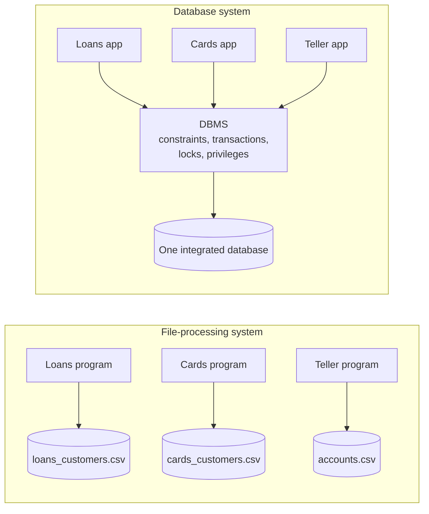

## Introduction

Imagine a small bank in 1975 — or a start-up in 2026 that keeps its data in CSV files and spreadsheets on a shared drive. The loans department has a file of customers. The cards department has its own file of customers. A COBOL (or Python) program reads the accounts file, subtracts an amount, and writes the file back. It works — until it doesn't:

- A customer changes their email with the cards department, and the loans department keeps sending statements to the old one.
- A new question ("total deposits per branch city") requires a programmer to write a new program that merges three files with different layouts.
- Someone's script writes a negative balance, or the same account number twice.
- The machine loses power after money has left one account but before it reached the other.
- Two tellers withdraw from the same account at the same moment and one withdrawal vanishes.
- Everyone who can open the file can read every column, including dates of birth.

These are the six classic problems of **file-processing systems**: **redundancy and inconsistency**, **data isolation**, **integrity problems**, **atomicity problems**, **concurrent-access anomalies** and **security problems**. Every database textbook lists them because they are exactly the problems a DBMS was invented to solve. In this lesson you will not just read the list: you will **reproduce each failure** on a real MySQL server, then watch the corresponding DBMS mechanism prevent it.

:::note[How we simulate "files" inside MySQL]
MySQL's `CSV` storage engine stores a table as a **plain comma-separated text file** on the server's disk. It supports no indexes, no keys and no transactions — in other words, it behaves much like an application writing a flat file. We use CSV-engine tables as stand-ins for "the files a program would keep", and ordinary InnoDB tables for "the same data managed by a DBMS". The comparison is deliberately unfair to the CSV engine: it exists for data exchange, not for application data.
:::

The examples use the **bank** dataset: 3 branches, 15 customers, 25 accounts (balance has `CHECK (balance >= 0)`) and a 166-row transaction ledger.

## DBMS Theory

:::theory[File-processing systems]
In a **file-processing system**, permanent records are stored in operating-system files and manipulated by **application programs**, each written for a specific task. The *structure* of each file (field order, types, delimiters, meaning) is encoded in the programs, not in the files. The operating system provides only **byte-level storage**, **naming** and **coarse permissions** (read/write per file, per user or group). It knows nothing about records, keys, relationships, transactions or business rules.
:::

The six problems follow almost mechanically from that definition. The table below is the map of this lesson.

| Problem | Root cause in a file system | DBMS mechanism that solves it | MySQL feature used in this lesson |
|---|---|---|---|
| **Redundancy and inconsistency** | Each application keeps its own copy of shared data | One shared, integrated database; each fact stored once; normalization | One `customers` table referenced by foreign keys |
| **Data isolation** | Data scattered across files with different formats; access requires custom programs | A common data model and a declarative query language over the whole database | One SQL query joining `accounts`, `customers`, `branches` |
| **Integrity problems** | Rules ("balance ≥ 0", "account numbers are unique") are buried in program code, enforced inconsistently | Declarative constraints stored in the catalog, enforced on every write | `PRIMARY KEY`, `UNIQUE`, `NOT NULL`, `CHECK`, `FOREIGN KEY` |
| **Atomicity problems** | A failure between two writes leaves a partial update | Transactions with all-or-nothing semantics, implemented by logging | `START TRANSACTION … COMMIT / ROLLBACK` on InnoDB |
| **Concurrent-access anomalies** | Concurrent read-modify-write cycles interleave; the OS offers only whole-file locks | Concurrency control: locking or multiversioning, isolation levels | Row locks, `SELECT … FOR UPDATE`, relative updates |
| **Security problems** | Permissions only at the granularity of whole files | Authorization on databases, tables, columns, rows (via views) and operations | `GRANT` on tables and columns, views |

Two more problems are often mentioned alongside these: **difficulty accessing data** (every new question needs a new program — closely related to isolation) and **lack of durability/recovery** (if the disk fails or a program crashes mid-write, the file may be corrupt). Both are addressed by the same DBMS services: a query language, and logging plus backups.

## Why It Exists

Each problem in the table is not hypothetical; each one has a recognisable modern incarnation.

- **Redundancy → inconsistency.** Customer records copied into a CRM, a billing system and a marketing spreadsheet disagree within weeks. The cost is not disk space (redundancy costs little storage today) but *trust*: which address is right?
- **Isolation → slow answers.** When data lives in separate files per department, every cross-department question becomes an engineering project, and "shadow IT" spreadsheets proliferate.
- **Integrity → bad data accumulates silently.** A rule enforced in one program is not enforced by the next program, by the import script, or by a person editing the file in a text editor. Bad data is discovered months later, in a report.
- **Atomicity → money appears or disappears.** Any operation that changes more than one record — a transfer, an order with line items and a stock decrement — can be interrupted halfway by a crash, a bug or a timeout.
- **Concurrency → lost updates.** The read-modify-write pattern (read balance, compute new balance in the program, write it back) is correct for one user and wrong for two. It is the single most common data-corruption bug in web applications even today, because developers who use a DBMS still sometimes write code as if it were a file.
- **Security → over-exposure.** If the HR file contains salaries and addresses, anyone who needs addresses can also read salaries. Privacy law (GDPR, CCPA, HIPAA) makes this a legal, not just an engineering, problem.

The DBMS answer is not "be more careful" but **centralisation with guarantees**: one system owns the data, every access goes through it, and it enforces rules that no individual program can bypass.

## Internal Working

:::internals[How a DBMS turns the six problems into mechanisms]
- **Catalog-stored constraints.** Constraints are part of the table definition in the data dictionary. On every `INSERT`/`UPDATE`/`DELETE`, the server evaluates `NOT NULL` and `CHECK` (MySQL does this in the server layer for every engine), and the storage engine checks uniqueness while inserting into the unique index. InnoDB checks foreign keys by looking up the referenced (or referencing) row through an index.
- **Write-ahead logging for atomicity and durability.** Before InnoDB changes a page in memory, it writes an **undo record** (the old values, in an undo log) and, as the change is made, a **redo record** (describing the change) to the redo log buffer. `ROLLBACK` applies undo records to restore old values. `COMMIT` makes the redo log durable on disk (with the default `innodb_flush_log_at_trx_commit = 1`), so after a crash the redo log is replayed and undo records roll back transactions that never committed.
- **Locking and MVCC for concurrency.** InnoDB locks **individual index records**, not whole files, so two sessions changing different accounts never wait for each other. A *locking read* (`SELECT … FOR UPDATE`) or an `UPDATE` takes an exclusive record lock; a second session wanting the same row waits until the first commits. Plain `SELECT`s read a consistent snapshot built from undo records and take no row locks.
- **Authorization checks in the server.** Every statement is checked against the grant tables (global, database, table, column and routine privileges) before execution.
:::

A file system offers none of this. The OS write path for a file is: the program builds a byte buffer, calls `write()`, and eventually the kernel flushes pages to disk. There is no undo information, no record-level lock, no notion of a rule. Advisory file locks (`flock`, `fcntl`) exist, but they lock **whole files or byte ranges**, and only programs that choose to honour them are affected.



## MySQL Implementation

First create two "department files" as CSV-engine tables. Each department keeps its own copy of customer contact data — the root of redundancy.

```sql run
CREATE TABLE loans_customers_file (
  customer_id INT          NOT NULL,
  full_name   VARCHAR(100) NOT NULL,
  email       VARCHAR(255) NOT NULL
) ENGINE=CSV;

CREATE TABLE cards_customers_file (
  customer_id INT          NOT NULL,
  full_name   VARCHAR(100) NOT NULL,
  email       VARCHAR(255) NOT NULL
) ENGINE=CSV;

INSERT INTO loans_customers_file SELECT customer_id, full_name, email FROM customers WHERE customer_id <= 3;
INSERT INTO cards_customers_file SELECT customer_id, full_name, email FROM customers WHERE customer_id <= 3;

SELECT TABLE_NAME, ENGINE
FROM information_schema.TABLES
WHERE TABLE_SCHEMA = DATABASE() AND TABLE_NAME LIKE '%file'
ORDER BY TABLE_NAME;
```

Both "files" now hold identical copies of customers 1–3. The catalog confirms they use the CSV engine — on disk each is literally a `.CSV` text file.

**Redundancy becomes inconsistency.** Customer 1 tells the cards department about a new email. The cards program updates its file; nobody tells the loans department:

```sql run
UPDATE cards_customers_file SET email = 'yuki.m@newmail.example' WHERE customer_id = 1;

SELECT l.customer_id, l.email AS loans_dept_email, c.email AS cards_dept_email
FROM loans_customers_file AS l
JOIN cards_customers_file AS c ON c.customer_id = l.customer_id
ORDER BY l.customer_id;
```

The two copies now disagree for customer 1. Which one is correct? Nothing in the data says. **The DBMS solution** is to store the fact once: the bank schema has a single `customers` table, and accounts *refer* to customers by key instead of copying their details. Updating the email there updates it for every application:

```sql run
SELECT a.account_id, a.account_type, c.full_name, c.email
FROM accounts AS a
JOIN customers AS c ON c.customer_id = a.customer_id
WHERE c.customer_id = 1
ORDER BY a.account_id;
```

Customer 1 owns two accounts, but their name and email are stored exactly once.

## Syntax Breakdown

The DBMS features used to fix each problem, with the syntax you will meet again in later modules:

| Problem | Statement / clause | What it does |
|---|---|---|
| Redundancy | `FOREIGN KEY (customer_id) REFERENCES customers (customer_id)` | Store a reference to the single copy, and forbid references to non-existent rows |
| Data isolation | `SELECT … FROM a JOIN b ON …` | Combine any tables in one declarative query |
| Integrity | `PRIMARY KEY (...)`, `UNIQUE (...)`, `NOT NULL`, `CHECK (expr)` | Declarative rules checked on every write |
| Atomicity | `START TRANSACTION; …; COMMIT;` / `ROLLBACK;` | Group statements so they take effect all together or not at all |
| Concurrency | `SELECT … FOR UPDATE`; `UPDATE t SET x = x - 50` | Lock rows you intend to change; compute new values inside the DBMS |
| Security | `GRANT SELECT (col1, col2) ON db.t TO user;` / `CREATE VIEW` | Column- and table-level privileges; views expose a restricted subset |

:::standard[Standard SQL vs MySQL]
Transactions, constraints, `GRANT` (including column privileges) and views are all standard SQL. `SELECT … FOR UPDATE` is not in the core standard for ordinary queries but is supported by MySQL, PostgreSQL and Oracle with the same meaning. The `ENGINE=` clause is a **MySQL extension**: other DBMSs do not have pluggable storage engines, and whether a table is transactional depends on that clause only in MySQL.
:::

## Practical Examples

**1. Data isolation — one question, one query.** "What is the total balance held at each branch city, and how many distinct customers bank there?" In a file system this needs a program that reads three files with three layouts and matches records by hand. In a DBMS it is one query over the integrated schema (joins are taught in [INNER JOIN](/lessons/m04-inner-join)):

```sql run
SELECT b.city,
       COUNT(DISTINCT a.customer_id) AS customers,
       COUNT(*)                      AS accounts,
       SUM(a.balance)                AS total_balance
FROM accounts AS a
JOIN branches AS b ON b.branch_id = a.branch_id
GROUP BY b.city
ORDER BY total_balance DESC;
```

**2. Integrity — a file accepts duplicates; a DBMS key does not.** The CSV engine cannot even *declare* a key:

```sql run error
CREATE TABLE accounts_file (
  account_id INT NOT NULL PRIMARY KEY,
  balance    DECIMAL(14,2) NOT NULL
) ENGINE=CSV;
```

Error 1069 ("max 0 keys allowed") — there is no index to enforce uniqueness. So create the "file" without a key and watch it accept two different balances for the same account number:

```sql run
CREATE TABLE accounts_file (
  account_id INT           NOT NULL,
  balance    DECIMAL(14,2) NOT NULL
) ENGINE=CSV;
INSERT INTO accounts_file VALUES (1, 492.57), (1, 9999.99);
SELECT account_id, balance FROM accounts_file ORDER BY balance;
```

What is account 1's balance? The "file" cannot say. The InnoDB `accounts` table has `PRIMARY KEY (account_id)`, so the same mistake is refused:

```sql run error
INSERT INTO accounts (account_id, customer_id, branch_id, account_type, balance, opened_at)
VALUES (1, 1, 2, 'checking', 9999.99, '2024-01-01 09:00:00');
```

**3. Integrity — referencing something that does not exist.** In a file system nothing prevents an account that points to customer 999, who does not exist. The DBMS checks the foreign key `fk_accounts_customer`:

```sql run error
INSERT INTO accounts (account_id, customer_id, branch_id, account_type, balance, opened_at)
VALUES (26, 999, 1, 'savings', 100.00, '2024-01-01 09:00:00');
```

**4. Security — expose only what a role needs.** A marketing analyst needs customer names and emails but must not see dates of birth or KYC status. A file-permission system can only grant the whole file. A DBMS can grant individual columns (display-only here, because the sandbox cannot create accounts or grant privileges):

```sql
-- Column-level privilege: marketing may read only these two columns
GRANT SELECT (customer_id, email) ON bank.customers TO 'marketing'@'%';
```

Or define a **view** that exposes the permitted subset and grant access to the view instead of the table. Views do run in the sandbox:

```sql run
CREATE VIEW customer_contacts AS
SELECT customer_id, full_name, email
FROM customers
WHERE kyc_verified = TRUE;

SELECT * FROM customer_contacts ORDER BY customer_id LIMIT 5;
```

The view hides `date_of_birth` entirely and even hides rows (unverified customers). Views as *external schemas* are the topic of [Schemas and the three-schema architecture](/lessons/m01-schemas-three-schema-architecture); privileges are covered in [Privileges and roles](/lessons/m11-privileges-roles).

## Execution Walkthrough

The most instructive comparison is **atomicity**. A transfer of $600 from account 1 to account 2 consists of two writes: credit account 2, debit account 1. Account 1 holds only $492.57, so the debit must fail. What happens to the credit that already ran? We run the identical sequence against a file-like CSV copy and against InnoDB.

```walkthrough
title: A failed transfer — CSV "file" vs InnoDB transaction
steps:
  - title: "1. Set up a CSV copy of the two accounts"
    explain: >-
      The CSV table gets the same CHECK (balance >= 0) as the real accounts table. CHECK constraints are
      evaluated by the MySQL server layer, so they work even on the CSV engine — but transactions are an
      engine feature, and CSV has none.
    sql: |
      CREATE TABLE accounts_csv (
        account_id INT NOT NULL,
        balance    DECIMAL(14,2) NOT NULL,
        CHECK (balance >= 0)
      ) ENGINE=CSV;
      INSERT INTO accounts_csv SELECT account_id, balance FROM accounts WHERE account_id IN (1, 2);
      SELECT 'csv' AS store, account_id, balance FROM accounts_csv
      UNION ALL
      SELECT 'innodb', account_id, balance FROM accounts WHERE account_id IN (1, 2)
      ORDER BY store, account_id;
  - title: "2. File-style transfer: credit succeeds, debit fails"
    explain: >-
      Inside a transaction, the credit to account 2 succeeds; the debit of account 1 violates the CHECK
      constraint (error 3819) because 492.57 − 600 < 0. The application reacts by issuing ROLLBACK —
      and MySQL warns (1196) that a non-transactional table could not be rolled back.
    expect: error
    sql: |
      START TRANSACTION;
      UPDATE accounts_csv SET balance = balance + 600 WHERE account_id = 2;
      UPDATE accounts_csv SET balance = balance - 600 WHERE account_id = 1;
      ROLLBACK;
  - title: "3. The CSV copy is left half-updated"
    explain: >-
      Account 2 kept the $600 credit, account 1 was never debited: $600 was created out of nothing.
      This is exactly the atomicity problem of file-processing systems.
    sql: SELECT account_id, balance FROM accounts_csv ORDER BY account_id;
  - title: "4. The same transfer on InnoDB"
    explain: >-
      Same statements, same failure, same ROLLBACK — but InnoDB recorded undo information for the
      credit and restores the old balance.
    expect: error
    sql: |
      START TRANSACTION;
      UPDATE accounts SET balance = balance + 600 WHERE account_id = 2;
      UPDATE accounts SET balance = balance - 600 WHERE account_id = 1;
      ROLLBACK;
  - title: "5. InnoDB: nothing happened"
    explain: >-
      Both balances are exactly as before. The transfer took effect completely or not at all — here,
      not at all.
    sql: SELECT account_id, balance FROM accounts WHERE account_id IN (1, 2) ORDER BY account_id;
```

Note the mechanism of step 4: when a statement fails inside an InnoDB transaction, MySQL rolls back **that statement** automatically but keeps the transaction open, so the earlier credit is still pending. It is the application's `ROLLBACK` (or a disconnect, or a crash followed by recovery) that undoes the whole transaction. Error handling in transactions is covered in [The transaction lifecycle](/lessons/m08-transaction-lifecycle).

**Concurrency.** The second classic failure needs two real sessions. Two tellers withdraw from account 1 at the same time — teller A $50, teller B $30 — using the file-style *read, compute in the program, write back* pattern:

```concurrency
title: Lost update with read-compute-write
description: Each teller reads the balance, computes the new balance in the application, and writes the computed value back. Autocommit is on, as in a naive application.
steps:
  - session: A
    sql: SELECT balance FROM accounts WHERE account_id = 1;
    note: Teller A reads 492.57 and computes 492.57 − 50 = 442.57 in the application.
  - session: B
    sql: SELECT balance FROM accounts WHERE account_id = 1;
    note: Teller B also reads 492.57 (A has not written yet) and computes 492.57 − 30 = 462.57.
  - session: A
    sql: UPDATE accounts SET balance = 442.57 WHERE account_id = 1;
    note: A writes its computed value.
  - session: B
    sql: UPDATE accounts SET balance = 462.57 WHERE account_id = 1;
    note: B overwrites it with a value computed from the stale read.
  - session: A
    sql: SELECT balance FROM accounts WHERE account_id = 1;
    note: The balance is 462.57. Teller A's $50 withdrawal has vanished — the customer got $80 in cash but was charged $30.
```

Nothing here is a DBMS bug: each statement did exactly what it said. The error is that the decision ("new balance = 442.57") was made **outside** the DBMS on data that was stale by the time it was written. The DBMS offers two fixes. Either compute the change inside the DBMS (`SET balance = balance - 50`, which reads and writes the row atomically under a row lock), or lock the row when reading it:

```concurrency
title: Preventing the lost update with SELECT ... FOR UPDATE
description: The same two withdrawals, but each teller reads with a locking read inside a transaction.
steps:
  - session: A
    sql: START TRANSACTION; SELECT balance FROM accounts WHERE account_id = 1 FOR UPDATE;
    note: A reads 492.57 and holds an exclusive lock on account 1's index record until it commits.
  - session: B
    sql: START TRANSACTION;
  - session: B
    sql: SELECT balance FROM accounts WHERE account_id = 1 FOR UPDATE;
    expect: blocks
    note: B asks for the same lock and must wait — it cannot read a balance that is about to change.
  - observe: locks
  - session: A
    sql: UPDATE accounts SET balance = balance - 50 WHERE account_id = 1; COMMIT;
    note: A writes 442.57 and commits, releasing the lock. B's locking read now completes and returns 442.57.
  - session: B
    sql: UPDATE accounts SET balance = balance - 30 WHERE account_id = 1; COMMIT;
  - session: A
    sql: SELECT balance FROM accounts WHERE account_id = 1;
    note: 492.57 − 50 − 30 = 412.57. Both withdrawals are reflected.
```

The `observe: locks` snapshot shows the InnoDB lock rows: session A holds an exclusive record lock on account 1's primary-key entry (`X,REC_NOT_GAP`, `GRANTED`) and session B's request for the same record is `WAITING`. Note that a file-level lock would have blocked *every* account; InnoDB blocked only the one row both tellers wanted.

## Output

Reading the results of the walkthrough and the two concurrency scenarios side by side:

- **Atomicity:** after the failed transfer, the CSV copy shows account 2 with $600 more than it started with and account 1 unchanged; InnoDB shows both accounts unchanged. The 1196 warning in step 2 is MySQL telling you, accurately, that it could not undo a non-transactional change.
- **Lost update:** the final balance of 462.57 is the signature of a lost update — it equals the starting balance minus only **one** of the two withdrawals.
- **Locking read:** the final balance of 412.57 reflects both withdrawals; session B's step shows that it completed only after A's commit.

Here is the state of the real `accounts` table and the CSV copy at the end of this lesson's main session, for reference:

```sql run
SELECT 'csv' AS store, account_id, balance FROM accounts_csv
UNION ALL
SELECT 'innodb', account_id, balance FROM accounts WHERE account_id IN (1, 2)
ORDER BY store, account_id;
```

(The concurrency scenarios ran in their own fresh labs, so they did not change this session's data.)

## Alternative Approaches

Not every file-based system needs to become a database, and not every DBMS feature must be used. Options, roughly from least to most "DBMS":

| Approach | Solves | Does not solve |
|---|---|---|
| **Disciplined files** — one owner per file, schema documented, atomic file replacement (write temp file, then rename) | Partial writes of a *single* file; some inconsistency by convention | Multi-file atomicity, concurrent writers, fine-grained security, integrity |
| **Append-only logs / event files** | Lost updates (nothing is overwritten); audit trail | Querying current state; integrity; needs compaction |
| **Embedded DBMS (SQLite)** | Atomicity, integrity, querying — for one application/process | Many concurrent writers across machines, user-level security |
| **Client–server DBMS (MySQL/InnoDB)** | All six problems | Costs operational effort; must be used correctly (e.g. avoid read-compute-write) |
| **Optimistic concurrency** in the application (a `version` column, `UPDATE … WHERE version = ?`) | Lost updates without holding locks while a user thinks | Needs retry logic; covered in [Optimistic and pessimistic concurrency](/lessons/m08-optimistic-pessimistic) |

For the lost-update problem specifically there are three DBMS-level fixes, each with a use: **relative updates** (`balance = balance - 50`) when the new value depends only on the old one; **locking reads** (`FOR UPDATE`) when the application must inspect the row before deciding; and **optimistic version checks** when the time between read and write is long (a user editing a form). The bank dataset's `accounts.version` column exists for the third pattern.

## Performance Analysis

The DBMS fixes are not free, and understanding their costs is part of using them well.

| Mechanism | Cost | How it scales |
|---|---|---|
| Integrity constraints | One index lookup per unique key / foreign key per written row; expression evaluation for `CHECK` | Logarithmic in table size (B+ tree lookups); negligible for most OLTP |
| Transactions (InnoDB) | Undo and redo log records for each change; a redo log flush at commit (default) | Per-commit flush cost dominates small transactions; batching many rows in one transaction amortises it |
| Row locks | Lock memory; waiting when sessions want the same rows | Contention, not table size, is the limit: a "hot row" (a single counter) serialises all writers |
| Views and privileges | Privilege checks at statement start; views are usually merged into the query | Negligible |

By contrast, the file-based approaches look cheaper only until the anomalies are counted: a reconciliation job to find inconsistent copies, manual repair after a partial write, customer-support time for lost updates. The cost does not disappear; it moves from the DBMS into people and code.

:::performance[Theory vs measurement]
This lesson's tables have a handful of rows, so timing them would be meaningless. The statements about cost are qualitative, based on how InnoDB works (index lookups, logging, record locks). How much each costs on real workloads — and how to measure lock waits — is covered in Modules 7, 8 and 10.
:::

## Best Practices

:::best-practice[Applying the lessons of file-based systems]
1. **One fact, one place.** Keep shared reference data (customers, products) in one table and reference it by key; never copy it into each consumer's tables "for convenience" without a defined synchronisation process.
2. **Declare every rule the DBMS can check** — primary keys on every table, `UNIQUE` for natural identifiers (email, ISBN), foreign keys for references, `CHECK` for value rules, `NOT NULL` where a value is required.
3. **Group related writes into a transaction** and roll back on any error. Never leave a multi-statement change in autocommit mode.
4. **Never read-compute-write without protection.** Use relative updates, `SELECT … FOR UPDATE`, or optimistic version checks.
5. **Keep transactions short.** Locks are held until commit; do not wait for user input or slow network calls inside a transaction.
6. **Use InnoDB for application data.** CSV, MEMORY and MyISAM tables silently ignore `ROLLBACK`.
7. **Grant the least privilege needed**, using views or column privileges for sensitive attributes.
:::

## Common Mistakes

**Mistake 1 — assuming ROLLBACK undoes everything.** If a table uses a non-transactional engine, `ROLLBACK` silently keeps its changes and only raises warning 1196. Check the engine of every table an application writes to:

```sql run
SELECT TABLE_NAME, ENGINE
FROM information_schema.TABLES
WHERE TABLE_SCHEMA = DATABASE() AND ENGINE <> 'InnoDB'
ORDER BY TABLE_NAME;
```

In this lab, the CSV "files" created for the demonstrations show up — exactly the tables a `ROLLBACK` cannot protect.

**Mistake 2 — validating only in the application.** Teams write "balance must not go negative" in the service code and then a support engineer runs a manual `UPDATE` in a SQL client. The `CHECK` constraint on `accounts` catches it regardless of who issues the statement:

```sql run error
UPDATE accounts SET balance = balance - 1000000 WHERE account_id = 3;
```

**Mistake 3 — computing new values in application code.** The lost-update scenario above. The corrected statement is relative, computed by the DBMS while it holds the row lock:

```sql run
UPDATE accounts SET balance = balance - 50 WHERE account_id = 1;
SELECT account_id, balance FROM accounts WHERE account_id = 1;
```

**Mistake 4 — "fixing" redundancy with a sync script.** Nightly jobs that copy customer emails from system A to system B shrink the inconsistency window but do not close it, and they fail silently. The structural fix is a single source of truth with references (or, between separate systems, change-data-capture with defined ownership of each attribute).

**Mistake 5 — using CSV/MEMORY tables for application data because they are "fast".** MEMORY tables lose all rows on server restart, and CSV tables have no indexes; both lack transactions. Their legitimate uses are data exchange (CSV) and scratch data you can rebuild (MEMORY).

## Industry Application

- **Banking and payments.** Ledgers record every movement as an append-only row and update balances in the same transaction, with `CHECK`-style invariants and locking reads; a nightly reconciliation verifies that balances equal the sum of ledger entries. The bank dataset follows this pattern: every account's `balance` equals the latest `balance_after` in `transactions`.
- **E-commerce inventory.** Overselling the last item is a lost-update problem. Shops decrement stock with `UPDATE products SET stock = stock - 1 WHERE id = ? AND stock > 0` and check the affected-row count, rather than reading stock into the application.
- **Data platforms replacing spreadsheets.** Analytics teams routinely migrate "the master spreadsheet" into a database table with constraints, because spreadsheets reproduce every file-system problem: copies emailed around, no transactions, cell-level edits without audit.
- **Data lakes.** Raw files in object storage (CSV, JSON, Parquet) have the classic file-system problems, which is why lakehouse table formats (Apache Iceberg, Delta Lake, Apache Hudi) add a transaction log, schema enforcement and atomic commits on top of files — re-inventing DBMS services in a new setting.
- **Compliance.** Column-level privileges, views and audit logs are how organisations restrict access to personal data to the people who need it.

## Practice Exercises

```exercise
id: ex1
title: Find duplicate account numbers in a "file"
difficulty: easy
setup: |
  CREATE TABLE accounts_export (account_id INT NOT NULL, balance DECIMAL(14,2) NOT NULL) ENGINE=CSV;
  INSERT INTO accounts_export VALUES (1, 492.57), (2, 4428.20), (2, 4400.00), (3, 10232.88), (4, 7946.37), (4, 7946.37), (4, 100.00);
concepts: [integrity, redundancy]
prompt: |
  A nightly export was loaded into the CSV-engine table `accounts_export`, which has no key.
  Return every `account_id` that appears more than once, together with how many times it appears.
  Columns: `account_id`, `copies`.
hints:
  - "Group the rows by account_id and count each group."
  - "Keep only groups whose count is greater than 1 — that is what HAVING COUNT(*) > 1 does."
solution: |
  SELECT account_id, COUNT(*) AS copies
  FROM accounts_export
  GROUP BY account_id
  HAVING COUNT(*) > 1;
explanation: |
  Without a primary key, nothing stopped the export from containing duplicates, including two *different*
  balances for account 2 — an inconsistency, not just a redundancy. Detecting this after the fact is the best
  a file system can do; a `PRIMARY KEY (account_id)` would have rejected the second row at load time.
```

```exercise
id: ex2
title: Detect inconsistent copies
difficulty: medium
setup: |
  CREATE TABLE loans_contacts (customer_id INT NOT NULL, email VARCHAR(255) NOT NULL) ENGINE=CSV;
  CREATE TABLE cards_contacts (customer_id INT NOT NULL, email VARCHAR(255) NOT NULL) ENGINE=CSV;
  INSERT INTO loans_contacts SELECT customer_id, email FROM customers;
  INSERT INTO cards_contacts SELECT customer_id, email FROM customers;
  UPDATE cards_contacts SET email = 'yuki.m@newmail.example' WHERE customer_id = 1;
  UPDATE loans_contacts SET email = 'hana.smith@work.example' WHERE customer_id = 3;
concepts: [redundancy]
prompt: |
  Two departments keep their own contact files, `loans_contacts` and `cards_contacts`. Find every
  customer whose email differs between the two files.
  Columns: `customer_id`, `loans_email`, `cards_email`.
hints:
  - "Join the two tables on customer_id."
  - "Keep only rows where the two email columns are not equal (`<>`)."
solution: |
  SELECT l.customer_id, l.email AS loans_email, c.email AS cards_email
  FROM loans_contacts AS l
  JOIN cards_contacts AS c ON c.customer_id = l.customer_id
  WHERE l.email <> c.email;
explanation: |
  Two customers have drifted: each department applied a different update to its own copy. Notice that the
  query can only show *that* the copies disagree, not which one is right — redundancy destroyed the
  information. In the integrated bank schema there is one `customers.email`, so the question never arises.
```

```exercise
id: ex3
title: An atomic transfer
difficulty: medium
kind: dml
concepts: [atomicity, transactions]
prompt: |
  Transfer **$250.00** from account **2** to account **1** so that both changes happen together or not at
  all. Use relative updates (compute the new balances inside the DBMS) and commit.
  The checker reads the balances of accounts 1 and 2.
starter: |
  START TRANSACTION;

  COMMIT;
hints:
  - "Two UPDATE statements: one subtracts 250 from account 2, one adds 250 to account 1."
  - "Write SET balance = balance - 250, not a literal balance you computed yourself."
solution: |
  START TRANSACTION;
  UPDATE accounts SET balance = balance - 250 WHERE account_id = 2;
  UPDATE accounts SET balance = balance + 250 WHERE account_id = 1;
  COMMIT;
check: |
  SELECT account_id, balance FROM accounts WHERE account_id IN (1, 2) ORDER BY account_id;
explanation: |
  Debiting first is a good habit: if the debit violates `CHECK (balance >= 0)`, the transaction can be
  rolled back before any credit happened. A production transfer would also insert the two ledger rows
  (`transfer_out` and `transfer_in`, sharing a reference) inside the same transaction, so balances and
  ledger can never disagree.
```

```exercise
id: ex4
title: Reconcile balances against the ledger
difficulty: hard
concepts: [integrity, redundancy]
prompt: |
  `accounts.balance` is deliberately redundant: it should always equal the `balance_after` of the account's
  most recent row in `transactions` (latest `created_at`, ties broken by the larger `txn_id`).
  Write a reconciliation query that returns, for **every** account, `account_id`, `balance` and
  `ledger_balance` (the latest `balance_after`).
hints:
  - "A scalar subquery in the SELECT list can look up one value per account."
  - "Inside it: SELECT t.balance_after FROM transactions t WHERE t.account_id = a.account_id ORDER BY t.created_at DESC, t.txn_id DESC LIMIT 1."
solution: |
  SELECT a.account_id,
         a.balance,
         (SELECT t.balance_after
          FROM transactions AS t
          WHERE t.account_id = a.account_id
          ORDER BY t.created_at DESC, t.txn_id DESC
          LIMIT 1) AS ledger_balance
  FROM accounts AS a;
explanation: |
  On the clean dataset all 25 accounts reconcile. This is *controlled* redundancy: the balance is stored for
  fast reads, and correctness is protected by updating balance and ledger in the same transaction and by
  running this check regularly. Contrast it with the uncontrolled redundancy of department files, where no
  transaction spans the copies. Correlated subqueries are covered in Module 4.
```

```exercise
id: ex5
title: Diagnose a spreadsheet-based system
difficulty: challenge
kind: open
concepts: [file-processing, redundancy, atomicity, concurrency-anomalies, security]
prompt: |
  A university's graduate office tracks teaching-assistant (TA) assignments in a shared spreadsheet.
  Each department has a copy with TA names, student IDs, emails, hours and pay rates. Payroll receives
  a monthly export. Two coordinators often edit the same sheet at once; last month a TA was paid twice
  and another was not paid at all, and a student worker could see every TA's pay rate.

  For **each** of the six file-system problems, give a concrete example from this scenario and the DBMS
  mechanism (with MySQL syntax where relevant) that would prevent it.
solution: |
  | Problem | Example in the scenario | DBMS fix |
  |---|---|---|
  | Redundancy/inconsistency | The same TA's email and pay rate appear in several department copies and differ | One `tas` table (one row per person) referenced by `assignments(ta_id, course_id, term, hours)` via `FOREIGN KEY` |
  | Data isolation | "Total TA hours per course across departments" requires merging differently laid-out sheets | One schema; a single `SELECT … JOIN … GROUP BY` |
  | Integrity | Hours entered as 400 instead of 40; a TA assigned twice to the same section | `CHECK (hours BETWEEN 1 AND 20)`; `PRIMARY KEY (ta_id, section_id)` or `UNIQUE`; `NOT NULL` on pay rate |
  | Atomicity | Moving a TA from one section to another is two edits; only one was saved → paid twice / not at all | `START TRANSACTION; DELETE …; INSERT …; COMMIT;` |
  | Concurrency | Two coordinators edit the same row; one overwrites the other | Row-level locking in InnoDB; `SELECT … FOR UPDATE` or an optimistic `version` column with `UPDATE … WHERE version = ?` |
  | Security | A student worker who needs names can also read pay rates | `GRANT SELECT (ta_id, name, email) ON grad.tas TO 'student_worker'`, or a view without pay columns |

  A strong answer also notes the costs (someone must run and back up the database, coordinators need a
  form-based application rather than a spreadsheet) and that the payroll export should be a query or a view
  over the single source of truth, not another copy maintained by hand.
```

## Knowledge Assessment

```quiz
- id: q1
  question: "Two departments each keep a file with customer addresses. One department updates an address; the other does not. Which pair of file-system problems does this illustrate?"
  options:
    - "Atomicity and durability"
    - "Redundancy and inconsistency"
    - "Concurrency and security"
    - "Data isolation and integrity"
  answer: 1
  explanation: "The same fact stored twice (redundancy) has diverged (inconsistency). Atomicity concerns partial multi-step updates, concurrency concerns simultaneous access, and isolation concerns data being hard to combine across formats — none is the core issue here."
  concepts: [redundancy]
- id: q2
  question: "A transfer credits account B, then the program crashes before debiting account A. Which DBMS mechanism prevents the resulting state?"
  options:
    - "A UNIQUE constraint on account numbers"
    - "A transaction with all-or-nothing semantics, implemented with undo/redo logging"
    - "A column-level GRANT"
    - "A view over the accounts table"
  answer: 1
  explanation: "Atomicity is provided by transactions: InnoDB's undo log lets it roll back the uncommitted credit, and crash recovery rolls back transactions that never committed. Constraints, privileges and views do not make two writes indivisible."
  concepts: [atomicity, transactions]
- id: q3
  question: "Account 1 has balance 500. Session A and session B each run `SELECT balance` (both see 500), then A runs `UPDATE accounts SET balance = 450 WHERE account_id = 1` and B runs `UPDATE accounts SET balance = 470 WHERE account_id = 1`, all in autocommit mode. What is the final balance?"
  options: ["420", "450", "470", "The second UPDATE fails with a lock error"]
  answer: 2
  explanation: "This is a lost update. Each session computed its new value from a stale read, and the last write wins: 470. The UPDATEs do not conflict at the DBMS level (A's autocommit releases its lock immediately), so no error occurs. Relative updates (balance = balance - 30) would give the correct 420."
  concepts: [concurrency-anomalies, lost-update]
- id: q4
  question: "Which statements about MySQL storage engines are true? (Select all that apply.)"
  type: multi
  options:
    - "ROLLBACK cannot undo changes made to a CSV or MyISAM table"
    - "CHECK constraints are enforced by the server layer, so they apply even to CSV-engine tables"
    - "CSV-engine tables support primary keys but not foreign keys"
    - "InnoDB locks individual index records rather than whole files"
  answer: [0, 1, 3]
  explanation: "Transactions are an engine feature, so non-transactional engines ignore ROLLBACK (warning 1196). CHECK is evaluated by the server for every engine. The CSV engine supports no indexes at all — declaring a primary key fails with error 1069. InnoDB uses record-level locks."
  concepts: [atomicity, integrity]
- id: q5
  question: "Why is validating 'balance ≥ 0' only in the application considered an integrity problem, even if the application code is correct?"
  options:
    - "Because application code runs slower than SQL"
    - "Because other programs, scripts and manual SQL bypass the application and can still write invalid data"
    - "Because MySQL ignores application-level validation"
    - "Because CHECK constraints are required by the SQL standard"
  answer: 1
  explanation: "Rules embedded in one program apply only to that program. A declarative constraint in the database applies to every client. Speed is not the issue, and MySQL is unaware of application validation rather than ignoring it."
  concepts: [integrity]
- id: q6
  question: "An analyst needs customers' names and emails but must not see their dates of birth. Which approach does a file system *not* support but a DBMS does?"
  options:
    - "Encrypting the whole file"
    - "Granting SELECT on specific columns, or on a view that excludes date_of_birth"
    - "Giving the analyst a copy of the file"
    - "Making the file read-only"
  answer: 1
  explanation: "File permissions apply to whole files (read, write, execute). A DBMS can grant privileges per column or expose a view. Encryption, copies and read-only flags still give access to every attribute in the file — and a copy creates redundancy."
  concepts: [security]
- id: q7
  question: "Which fix for the lost-update problem is most appropriate when the application must inspect the current balance and apply business logic before deciding how much to withdraw, all within a few milliseconds?"
  options:
    - "Use a CSV table"
    - "SELECT ... FOR UPDATE inside a transaction, then UPDATE and COMMIT"
    - "Run the UPDATE twice"
    - "Disable autocommit and never commit"
  answer: 1
  explanation: "A locking read holds an exclusive row lock until commit, so no other session can change the balance between the read and the write. Relative updates work when no inspection is needed; optimistic version checks suit long think-times. CSV tables have no transactions, and never committing holds locks forever."
  concepts: [concurrency-anomalies, lost-update]
```
