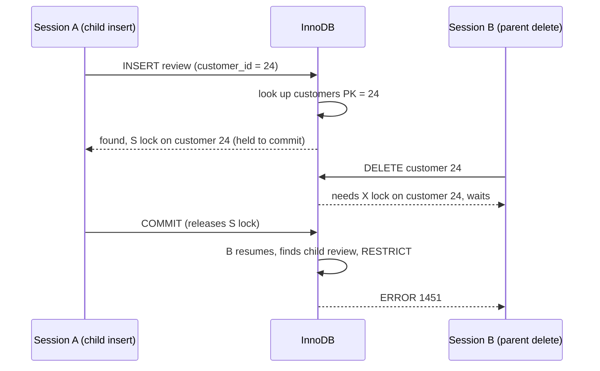

## Introduction

A database is only as useful as the trust people place in it. If an order can reference a customer who does not exist, if a product can have a negative price, if a review can carry a rating of 11, then every report built on that data is suspect, and every application must defend itself against garbage. **Integrity constraints** are the rules that define which database states are *valid*, declared once in the schema and enforced by the DBMS on every change, for every client.

This lesson covers the constraints of the relational model and their MySQL implementation:

- **Domain constraints** — each value must belong to its attribute's domain (type, range, allowed values, NOT NULL), and why MySQL's **strict SQL mode** is part of the answer.
- **Key constraints and entity integrity** — keys must be unique, and primary keys may not be NULL.
- **Referential integrity** — every foreign-key value must match an existing key, and what the DBMS should do when a referenced row is deleted or its key changes (**ON DELETE / ON UPDATE**: `RESTRICT`, `NO ACTION`, `CASCADE`, `SET NULL`, `SET DEFAULT`).
- **CHECK constraints** — arbitrary row-level conditions, enforced since MySQL 8.0.16, and their limitations.
- **How InnoDB enforces foreign keys internally** — the index lookups, the **shared lock** it takes on parent rows, and the fact that cascaded changes do **not** fire triggers.

Keys themselves were the subject of [the previous lesson](/lessons/m01-keys); here we focus on the guarantees built on them.

:::note[Dataset]
The examples use the **shop** dataset. Its schema already declares 8 foreign keys and 3 CHECK constraints (`chk_products_price`, `chk_items_qty`, `chk_reviews_rating`). Customers 2, 13, 23, 24 and 25 have never ordered, which makes them safe to delete in demonstrations.
:::

## DBMS Theory

:::theory[Classes of constraints]
Constraints on a relational database fall into three classes:

1. **Inherent (model-based) constraints** — implied by the relational model itself: a relation has no duplicate tuples; values are atomic.
2. **Schema-based (explicit) constraints** — declared in the DDL and enforced by the DBMS: **domain constraints**, **key constraints**, **entity integrity**, **referential integrity**, and general **CHECK** (semantic) constraints on a row.
3. **Application-based (semantic/business) constraints** — rules too complex to express declaratively in the DBMS (e.g. "an instructor teaches at most 12 credit hours per term", "a customer's total open orders may not exceed their credit limit"). They are enforced by triggers, stored procedures or application code.

A database **state is valid** if it satisfies all schema-based constraints. The DBMS's job is to reject any operation (INSERT, UPDATE, DELETE) that would produce an invalid state — or to compensate (e.g. a cascading delete) so that the result is valid.
:::

The schema-based constraints, formally:

| Constraint | Formal statement | Violated by |
|---|---|---|
| **Domain** | For every tuple t and attribute A: t[A] ∈ dom(A), or t[A] is NULL if A allows NULL | INSERT, UPDATE |
| **Key** | For a key K and distinct tuples t₁, t₂: t₁[K] ≠ t₂[K] | INSERT, UPDATE |
| **Entity integrity** | No primary-key attribute of any tuple is NULL | INSERT, UPDATE |
| **Referential integrity** | For every tuple t₂ in the referencing relation R₂: t₂[FK] is NULL, or there exists a tuple t₁ in the referenced relation R₁ with t₁[PK] = t₂[FK] | INSERT/UPDATE of R₂ (child); DELETE/UPDATE of R₁ (parent) |
| **CHECK (row semantic)** | A condition C(t) over one tuple's attributes is not FALSE | INSERT, UPDATE |

**Why entity integrity?** The primary key is how a tuple is identified. A NULL in it would mean "we do not know which entity this is", and two such tuples could not be distinguished — so the model forbids it outright.

**Referential actions.** Referential integrity can be broken from either side. Inserting or updating a **child** row with a non-existent parent key is simply rejected. But deleting a **parent** row (or changing its key) that children reference requires a decision, which the SQL standard expresses as a *referential action*:

| Action | On parent DELETE | On parent key UPDATE | Typical use |
|---|---|---|---|
| `RESTRICT` | Reject if children exist | Reject if children exist | Default safe choice for important relationships (orders → customer) |
| `NO ACTION` | Standard: reject if children still exist **at the end of the statement** (deferrable check) | Same | MySQL default; in InnoDB, identical to `RESTRICT` (checked immediately) |
| `CASCADE` | Delete the children too | Update the children's foreign-key values | Children that cannot exist without the parent (order → line items; wishlist → wishlist items) |
| `SET NULL` | Set the children's foreign key to NULL | Same | Optional relationships (product → category: the product survives without one) |
| `SET DEFAULT` | Set the children's foreign key to its default | Same | Standard SQL; **not supported by InnoDB** (see below) |

**NULLs in foreign keys.** Referential integrity allows a NULL foreign key: "this product has no category" is a legitimate, unknown-or-inapplicable reference. For composite foreign keys, the SQL standard defines `MATCH SIMPLE` (if any FK column is NULL, the constraint is satisfied), `MATCH PARTIAL` and `MATCH FULL`. InnoDB essentially implements `MATCH SIMPLE` semantics; avoid writing a `MATCH` clause in MySQL.

## Why It Exists

Every constraint in this lesson exists because the alternative — enforcing rules only in application code — fails in predictable ways:

- **Many writers.** The web shop, the mobile API, the admin panel, nightly imports, data-fix scripts and engineers at a SQL prompt all write to the same database. A rule in one code path is absent from the others. A constraint in the schema covers all of them.
- **Concurrency.** Application-level checks are race conditions waiting to happen: "check that the customer exists, then insert the order" is two steps, and another session can delete the customer in between. The DBMS checks and locks atomically (you will see the lock InnoDB takes below).
- **Orphans and dangling references.** Without referential integrity, deleting a customer leaves orders that point nowhere; reports that join orders to customers silently drop them; revenue "disappears".
- **Silent corruption.** Without domain enforcement, a value that does not fit can be truncated or clamped instead of rejected — a quantity of 300 stored as 255 — and nobody notices until an audit.
- **Documentation that cannot drift.** A constraint in the catalog is executable documentation: tools, colleagues and future you can read exactly which rules hold.

The cost — a little CPU per write, and the discipline of designing the rules — is small compared with discovering, months later, that a fraction of your data is invalid.

## Internal Working

:::internals[How MySQL enforces each constraint]
- **Domain (types, NOT NULL, ENUM).** The server converts each incoming value to the column type. In **strict SQL mode** (`STRICT_TRANS_TABLES`, part of the default `sql_mode`) a value that cannot be stored exactly — out of range, too long, not in the ENUM list, invalid date — raises an error and the statement is rolled back. Without strict mode, MySQL *adjusts* the value (clamps, truncates, uses `''` or `0`) and only issues a warning.
- **CHECK constraints** are evaluated by the **server layer** for every inserted or updated row, for every storage engine. A row is rejected only if the condition evaluates to **FALSE**; UNKNOWN (because of a NULL) passes. The expression must be deterministic and self-contained: built-in deterministic functions and literals over the row's own columns only — no subqueries, stored functions, user variables, `NOW()`/`CURDATE()`, `RAND()`, or `AUTO_INCREMENT` columns.
- **Keys and entity integrity** are enforced through the primary-key and unique **indexes**: InnoDB looks up the new value in each unique index during the insert (error 1062 on a match). Primary-key columns are always `NOT NULL`.
- **Foreign keys are enforced by InnoDB**, inside the storage engine, not by the server:
  - **Child INSERT/UPDATE:** InnoDB searches the parent's index for the referenced value. If found, it places a **shared (S) record lock** on the parent index record, held until the transaction ends, so no other transaction can delete that parent or change its key in the meantime. If not found: error 1452.
  - **Parent DELETE/key UPDATE:** InnoDB searches the child's foreign-key index (it creates one automatically if needed). With `RESTRICT`/`NO ACTION` and children present: error 1451. With `CASCADE`/`SET NULL`, it modifies the child rows **within the same transaction**, taking exclusive locks on them, recursively (up to 15 levels of cascading).
  - Checks are **immediate, row by row** — not deferred to the end of the statement or transaction. MySQL has no `DEFERRABLE` constraints.
  - Because the actions happen inside InnoDB, **cascaded changes do not activate triggers** on the child table.
- **`foreign_key_checks`.** Setting this session variable to 0 disables FK checking (used by dump/restore tools to load tables in any order). Re-enabling it does **not** re-validate rows inserted in the meantime.
:::



## MySQL Implementation

The shop schema's foreign keys and their referential actions are visible in `information_schema.REFERENTIAL_CONSTRAINTS`:

```sql run
SELECT CONSTRAINT_NAME, TABLE_NAME, REFERENCED_TABLE_NAME, UPDATE_RULE, DELETE_RULE
FROM information_schema.REFERENTIAL_CONSTRAINTS
WHERE CONSTRAINT_SCHEMA = DATABASE()
ORDER BY TABLE_NAME, CONSTRAINT_NAME;
```

Every rule is `NO ACTION` — the default when no action is written — which in InnoDB means "reject the parent change while children exist". The CHECK constraints and their conditions:

```sql run
SELECT tc.TABLE_NAME, cc.CONSTRAINT_NAME, cc.CHECK_CLAUSE, tc.ENFORCED
FROM information_schema.CHECK_CONSTRAINTS AS cc
JOIN information_schema.TABLE_CONSTRAINTS AS tc
  ON tc.CONSTRAINT_SCHEMA = cc.CONSTRAINT_SCHEMA AND tc.CONSTRAINT_NAME = cc.CONSTRAINT_NAME
WHERE cc.CONSTRAINT_SCHEMA = DATABASE()
ORDER BY tc.TABLE_NAME;
```

Now see each class of constraint reject an invalid state.

**Domain — value not representable in the type** (strict mode):

```sql run error
INSERT INTO order_items (order_id, product_id, quantity, unit_price) VALUES (1, 2, -1, 999.00);
```

`quantity` is `INT UNSIGNED`, so −1 is outside the domain (error 1264, out of range) — rejected before the `CHECK (quantity > 0)` even matters.

**Domain — NOT NULL:**

```sql run error
INSERT INTO customers (first_name, last_name, email, city, state, signup_date)
VALUES ('Lena', NULL, 'lena@example.com', 'Fresno', 'CA', '2024-12-01');
```

**Entity integrity and key constraint:**

```sql run error
INSERT INTO products (product_id, sku, name, price, cost, created_at)
VALUES (1, 'SKU-9999', 'Duplicate id', 10.00, 5.00, '2024-12-01 00:00:00');
```

**CHECK constraint:**

```sql run error
UPDATE products SET price = -5.00 WHERE product_id = 5;
```

**Referential integrity — child side** (no such product):

```sql run error
INSERT INTO order_items (order_id, product_id, quantity, unit_price) VALUES (1, 999, 1, 10.00);
```

**Referential integrity — parent side** (customer 1 has orders, rule `NO ACTION`):

```sql run error
DELETE FROM customers WHERE customer_id = 1;
```

Six different errors, six rules — and not a single line of application code involved.

## Syntax Breakdown

```sql
CREATE TABLE child (
  child_id   INT UNSIGNED NOT NULL AUTO_INCREMENT,
  parent_id  INT UNSIGNED NULL,                         -- nullable: optional relationship
  qty        INT UNSIGNED NOT NULL DEFAULT 1,           -- domain: type + NOT NULL + DEFAULT
  status     ENUM('new','done') NOT NULL,               -- domain: enumerated values
  PRIMARY KEY (child_id),                               -- key + entity integrity
  CONSTRAINT fk_child_parent
    FOREIGN KEY (parent_id) REFERENCES parent (parent_id)
    ON DELETE SET NULL                                  -- referential action on parent delete
    ON UPDATE CASCADE,                                  -- referential action on parent key change
  CONSTRAINT chk_child_qty CHECK (qty BETWEEN 1 AND 100)     -- row-level semantic constraint
);
```

| Element | Syntax | MySQL notes |
|---|---|---|
| NOT NULL | `col type NOT NULL` | Without strict mode, a missing value for a NOT NULL column without default becomes the type's implicit default with a warning |
| DEFAULT | `DEFAULT literal` or `DEFAULT (expression)` | Expression defaults (8.0.13+) must be in parentheses |
| ENUM / SET | `ENUM('a','b')` | MySQL extension; invalid values rejected in strict mode (error 1265) |
| CHECK | `[CONSTRAINT name] CHECK (expr) [[NOT] ENFORCED]` | Column- or table-level; `NOT ENFORCED` keeps it in the catalog without enforcing |
| FOREIGN KEY | `[CONSTRAINT name] FOREIGN KEY (cols) REFERENCES t (cols)` | Parent columns must have a PK/unique index; types must match |
| ON DELETE / ON UPDATE | `RESTRICT \| CASCADE \| SET NULL \| NO ACTION \| SET DEFAULT` | Default `NO ACTION` (= `RESTRICT` in InnoDB). `SET NULL` requires a nullable FK column (error 1830 otherwise). `SET DEFAULT` is not supported by InnoDB |
| Add / drop later | `ALTER TABLE t ADD CONSTRAINT …`, `ALTER TABLE t DROP CHECK name`, `DROP FOREIGN KEY name` | Adding a constraint validates existing rows (FKs unless `foreign_key_checks = 0`) |
| Disable FK checks | `SET SESSION foreign_key_checks = 0` | For bulk loads only; existing violations are not detected when re-enabled |

:::standard[Standard SQL vs MySQL]
Domain, key, foreign key, referential actions and CHECK constraints are standard SQL. Differences in MySQL: **no `CREATE DOMAIN` or `CREATE ASSERTION`** (multi-table constraints); **no deferrable constraints** (`DEFERRABLE INITIALLY DEFERRED`); `NO ACTION` is checked **immediately** rather than at end of statement; `SET DEFAULT` is not supported by InnoDB; foreign keys exist only for engines that support them (InnoDB, NDB) — on MyISAM the clause is parsed and ignored. `ENUM`/`SET` types and the `NOT ENFORCED` option are MySQL extensions (`NOT ENFORCED` is also in the standard's syntax but rarely implemented elsewhere).
:::

:::version[CHECK constraints in MySQL versions]
Before **8.0.16**, MySQL parsed `CHECK (…)` and silently discarded it. From 8.0.16 on — and in 8.4 — CHECK constraints are stored in the data dictionary, enforced, and listed in `information_schema.CHECK_CONSTRAINTS`. A schema migrated from 5.7 therefore has no CHECK constraints even if its original DDL contained them; re-add them explicitly.
:::

Two restrictions illustrated with real errors. A CHECK may not use non-deterministic functions:

```sql run error
CREATE TABLE promotions (
  promo_id  INT UNSIGNED PRIMARY KEY,
  starts_on DATE NOT NULL,
  CHECK (starts_on >= CURDATE())
);
```

And `SET NULL` cannot target a `NOT NULL` column:

```sql run error
CREATE TABLE product_badges (
  product_id INT UNSIGNED NOT NULL PRIMARY KEY,
  category_id INT UNSIGNED NOT NULL,
  CONSTRAINT fk_badge_category FOREIGN KEY (category_id) REFERENCES categories (category_id) ON DELETE SET NULL
);
```

## Practical Examples

Build a small extension of the shop — wishlists — whose relationships need different referential actions:

```sql run
CREATE TABLE wishlists (
  wishlist_id INT UNSIGNED NOT NULL PRIMARY KEY,
  customer_id INT UNSIGNED NOT NULL,
  name        VARCHAR(60)  NOT NULL,
  CONSTRAINT fk_wishlists_customer FOREIGN KEY (customer_id)
    REFERENCES customers (customer_id) ON DELETE CASCADE
);
CREATE TABLE wishlist_items (
  wishlist_id INT UNSIGNED NOT NULL,
  product_id  INT UNSIGNED NOT NULL,
  added_on    DATE NOT NULL,
  PRIMARY KEY (wishlist_id, product_id),
  CONSTRAINT fk_witems_wishlist FOREIGN KEY (wishlist_id)
    REFERENCES wishlists (wishlist_id) ON DELETE CASCADE,
  CONSTRAINT fk_witems_product FOREIGN KEY (product_id)
    REFERENCES products (product_id) ON DELETE RESTRICT
);
INSERT INTO wishlists VALUES (1, 24, 'Home office'), (2, 24, 'Gifts'), (3, 25, 'Coffee gear');
INSERT INTO wishlist_items VALUES
  (1, 1, '2024-11-02'), (1, 5, '2024-11-02'), (1, 6, '2024-11-03'),
  (2, 21, '2024-12-01'), (3, 14, '2024-12-05'), (3, 15, '2024-12-05');
SELECT w.customer_id, COUNT(DISTINCT w.wishlist_id) AS wishlists, COUNT(*) AS items
FROM wishlists AS w JOIN wishlist_items AS i ON i.wishlist_id = w.wishlist_id
GROUP BY w.customer_id
ORDER BY w.customer_id;
```

The design decisions: a wishlist cannot exist without its customer (**CASCADE**), an item cannot exist without its wishlist (**CASCADE**), but deleting a **product** that someone wishes for should be a deliberate decision, not a silent side effect (**RESTRICT**).

**1. CASCADE in action.** Customer 24 closes their account. One `DELETE` removes the customer, both wishlists and all their items — a two-level cascade:

```sql run
DELETE FROM customers WHERE customer_id = 24;
SELECT (SELECT COUNT(*) FROM customers WHERE customer_id = 24) AS customer_rows,
       (SELECT COUNT(*) FROM wishlists WHERE customer_id = 24) AS wishlist_rows,
       (SELECT COUNT(*) FROM wishlist_items WHERE wishlist_id IN (1, 2)) AS item_rows,
       (SELECT COUNT(*) FROM wishlist_items) AS items_remaining;
```

Only customer 25's two items remain.

**2. RESTRICT in action.** Product 14 is on customer 25's wishlist, so `fk_witems_product` forbids deleting it. It is also referenced by order line items under `NO ACTION`, and in the captured run that check fired first: the error names `fk_items_product`. Either constraint alone would have refused the delete.

```sql run error
DELETE FROM products WHERE product_id = 14;
```

**3. SET NULL for an optional relationship.** A table of featured products references a category, but a featured product should survive the deletion of its category:

```sql run
CREATE TABLE promo_categories (
  promo_category_id INT UNSIGNED NOT NULL PRIMARY KEY,
  label             VARCHAR(40)  NOT NULL
);
CREATE TABLE featured_products (
  product_id        INT UNSIGNED NOT NULL PRIMARY KEY,
  promo_category_id INT UNSIGNED NULL,
  CONSTRAINT fk_featured_product  FOREIGN KEY (product_id) REFERENCES products (product_id) ON DELETE CASCADE,
  CONSTRAINT fk_featured_promocat FOREIGN KEY (promo_category_id)
    REFERENCES promo_categories (promo_category_id) ON DELETE SET NULL
);
INSERT INTO promo_categories VALUES (1, 'Black Friday'), (2, 'Back to school');
INSERT INTO featured_products VALUES (1, 1), (2, 2), (6, 1);
DELETE FROM promo_categories WHERE promo_category_id = 1;
SELECT product_id, promo_category_id FROM featured_products ORDER BY product_id;
```

Products 1 and 6 keep their featured status but lose their (deleted) promotion category; product 2 is untouched.

**4. ON UPDATE CASCADE with a natural key.** Discount codes are natural keys that marketing occasionally renames. With `ON UPDATE CASCADE`, renaming the code updates every reference:

```sql run
CREATE TABLE promo_codes (
  code        VARCHAR(20) NOT NULL PRIMARY KEY,
  percent_off TINYINT UNSIGNED NOT NULL CHECK (percent_off BETWEEN 1 AND 90)
);
INSERT INTO promo_codes VALUES ('VIP20', 20), ('WELCOME10', 10);
CREATE TABLE promo_redemptions (
  order_id INT UNSIGNED NOT NULL PRIMARY KEY,
  code     VARCHAR(20)  NOT NULL,
  CONSTRAINT fk_redemption_order FOREIGN KEY (order_id) REFERENCES orders (order_id),
  CONSTRAINT fk_redemption_code  FOREIGN KEY (code) REFERENCES promo_codes (code) ON UPDATE CASCADE
);
INSERT INTO promo_redemptions VALUES (2, 'VIP20'), (3, 'WELCOME10'), (6, 'VIP20');
UPDATE promo_codes SET code = 'VIP25', percent_off = 25 WHERE code = 'VIP20';
SELECT r.order_id, r.code, p.percent_off
FROM promo_redemptions AS r JOIN promo_codes AS p ON p.code = r.code
ORDER BY r.order_id;
```

Both redemptions of `VIP20` now say `VIP25`. Without `ON UPDATE CASCADE`, the rename would have failed with error 1451 — which is often the *better* behaviour, and one reason surrogate keys are popular: they never need renaming.

**5. CHECK with NULL — UNKNOWN passes.** A CHECK rejects only rows for which the condition is FALSE:

```sql run
CREATE TABLE price_overrides (
  product_id INT UNSIGNED NOT NULL PRIMARY KEY,
  override_price DECIMAL(10,2) NULL,
  CONSTRAINT chk_override_positive CHECK (override_price > 0)
);
INSERT INTO price_overrides VALUES (1, 999.00), (2, NULL);
SELECT product_id, override_price, override_price > 0 AS condition_value
FROM price_overrides ORDER BY product_id;
```

Product 2's row was accepted because `NULL > 0` is UNKNOWN, not FALSE. If NULL should be forbidden too, add `NOT NULL` — a CHECK alone does not do it.

## Execution Walkthrough

How does InnoDB keep referential integrity correct when two transactions act at the same time? Session A inserts a review for customer 23 (who has no orders or reviews yet) and has not committed. Session B tries to delete customer 23.

```concurrency
title: Foreign-key check locks the parent row
description: Session A's child INSERT verifies customer 23 exists and locks that parent row in shared mode until A ends. Session B's DELETE of the same customer must wait.
steps:
  - session: A
    sql: START TRANSACTION; INSERT INTO reviews (product_id, customer_id, rating, comment, created_at) VALUES (5, 23, 4, 'Solid mouse', '2024-12-20 10:00:00');
    note: The FK check on fk_reviews_customer finds customer 23 and places a shared record lock on that row of customers' primary key.
  - session: B
    sql: DELETE FROM customers WHERE customer_id = 23;
    expect: blocks
    note: B needs an exclusive lock on the same customer row and waits behind A's shared lock.
  - observe: locks
  - session: A
    sql: COMMIT;
    note: The review is committed and A's locks are released. B wakes up, finds a child row in reviews, and fails with error 1451 under the NO ACTION rule.
  - session: B
    sql: SELECT COUNT(*) AS reviews_by_23 FROM reviews WHERE customer_id = 23;
    note: The committed review exists and still points to an existing customer — no orphan was created.
```

The lock snapshot shows session A holding an `S,REC_NOT_GAP` lock on `customers` (index `PRIMARY`, lock data `23`) — and a second one on `products` row 5, because the review's other foreign key was checked too — while session B is `WAITING` for an `X,REC_NOT_GAP` lock on customer 23. Without that shared lock, B could delete the customer between A's check and A's commit, and A's review would become an orphan — the classic check-then-act race that application-level checks cannot prevent.

Now trace the cascade from Practical Example 1 statement by statement, using a fresh customer:

```walkthrough
title: DELETE FROM customers WHERE customer_id = 25 — the cascade, step by step
steps:
  - title: "1. Before — the family of rows"
    explain: Customer 25 owns wishlist 3 with two items. These rows form a tree under the customer.
    sql: |
      SELECT 'customer' AS level, COUNT(*) AS n FROM customers WHERE customer_id = 25
      UNION ALL SELECT 'wishlists', COUNT(*) FROM wishlists WHERE customer_id = 25
      UNION ALL SELECT 'wishlist_items', COUNT(*) FROM wishlist_items WHERE wishlist_id IN (SELECT wishlist_id FROM wishlists WHERE customer_id = 25);
  - title: "2. Can the customer be deleted at all?"
    explain: >-
      InnoDB first checks every foreign key that references customers. orders and reviews use NO ACTION;
      customer 25 has no orders or reviews, so nothing blocks. wishlists uses CASCADE, so its rows will be deleted.
    sql: |
      SELECT (SELECT COUNT(*) FROM orders  WHERE customer_id = 25) AS orders,
             (SELECT COUNT(*) FROM reviews WHERE customer_id = 25) AS reviews;
  - title: "3. Delete — with cascades inside the same statement"
    explain: >-
      Deleting customer 25 deletes wishlist 3 (CASCADE), which in turn deletes its items (CASCADE). All three
      deletions are part of one statement and one transaction; if any level failed, the whole statement would be
      rolled back.
    sql: DELETE FROM customers WHERE customer_id = 25;
  - title: "4. After — no orphans anywhere"
    explain: >-
      An anti-join confirms no wishlist references a missing customer and no item references a missing wishlist.
    sql: |
      SELECT (SELECT COUNT(*) FROM wishlists w WHERE NOT EXISTS (SELECT 1 FROM customers c WHERE c.customer_id = w.customer_id)) AS orphan_wishlists,
             (SELECT COUNT(*) FROM wishlist_items i WHERE NOT EXISTS (SELECT 1 FROM wishlists w WHERE w.wishlist_id = i.wishlist_id)) AS orphan_items,
             (SELECT COUNT(*) FROM wishlist_items) AS items_left;
```

## Output

Reading the results:

- In the concurrency scenario, B's `DELETE` is marked as blocked and completes only after A's `COMMIT` — with error 1451, because by then a committed child row exists. The final query shows the review by customer 23 and, implicitly, that customer 23 still exists. Referential integrity held under concurrency.
- In the walkthrough, step 1 shows one customer, one wishlist and two items; step 3's single `DELETE` removes all four rows; step 4 reports zero orphans and zero remaining items (customer 24's items were already gone from Practical Example 1). That is a **two-level cascade** executed atomically.
- The `REFERENTIAL_CONSTRAINTS` query at the start of the lesson is the place to look before running any delete in an unfamiliar schema: it tells you which deletes will be refused and which will silently remove child rows.

## Alternative Approaches

Declarative constraints are the first choice, but some rules cannot be expressed that way, and sometimes teams deliberately choose otherwise.

| Approach | Use for | Pros | Cons |
|---|---|---|---|
| **Declarative constraints** (NOT NULL, keys, FK, CHECK) | Domain, key, referential, single-row rules | Enforced for every client, atomic with the change, visible in the catalog, optimizer-aware | Limited expressiveness: no multi-row or cross-table conditions (no assertions) |
| **Triggers** (`BEFORE INSERT/UPDATE` with `SIGNAL`) | Multi-row or cross-table rules ("no more than 5 wishlists per customer") | Still enforced inside the DBMS for every client | Hidden logic, harder to test; not fired by FK cascades; concurrency must be handled with locking reads ([Triggers](/lessons/m09-triggers)) |
| **Stored procedures as the only write path** | Complex workflows | Centralised rules | Every client must use them; bypassable by direct DML unless privileges forbid it |
| **Application-level validation** | User-friendly error messages, rules needing external data | Flexible, testable, close to the UI | Bypassed by other writers; race conditions; should complement, not replace, DB constraints |
| **Soft deletes** (`deleted_at` column) instead of DELETE + cascade | Retaining history, undo, audit | No data loss; references stay valid | Every query must filter deleted rows; unique keys must account for them |
| **No foreign keys** (enforced in application) | Some very large sharded deployments (cross-shard references cannot be FKs; online schema-change tools and FK interact awkwardly) | Avoids FK locking and cascade overhead; easier sharding | Orphans accumulate; requires periodic integrity audits |

The "no foreign keys" choice deserves a word of caution. Some large companies run MySQL without FKs for operational reasons, and you will hear this cited as best practice. It is a trade-off made at a particular scale and with compensating processes (integrity audits, careful deletion services). For most systems — and certainly while learning — declare the foreign keys.

## Performance Analysis

| Constraint | Cost per write | Notes |
|---|---|---|
| Type / NOT NULL / ENUM | Negligible | Value conversion happens anyway |
| CHECK | Expression evaluation per row | Usually negligible; avoid expensive expressions |
| PRIMARY KEY / UNIQUE | One index lookup per unique index (part of the insert) | The index also speeds up lookups |
| FK, child insert/update | One parent index lookup + shared lock on the parent record | The S lock can cause waits when many sessions insert children of the same hot parent while another session updates that parent |
| FK, parent delete/key update | One child index lookup per FK; cascades modify (and lock) every child row | Deleting a parent with millions of children in one statement is a huge transaction — delete children in batches first |
| FK indexes | Extra index on the child column (auto-created if missing) | Disk space and write cost, but also faster joins |

Practical consequences:

- **Bulk loads**: load parents before children, or set `foreign_key_checks = 0` for the session during a trusted restore (as `mysqldump` output does), then verify integrity with anti-join queries.
- **Large cascades**: a single `DELETE` that cascades to millions of rows generates huge undo/redo, holds many locks, and can stall replication. Delete in batches.
- **Hot parents**: if thousands of transactions per second insert children of the same parent row, any transaction that updates that parent's row (even a non-key column it locks with `FOR UPDATE`) will contend with the shared locks.

:::performance[Theory vs measurement]
These costs follow from how InnoDB enforces constraints (index lookups and record locks); on the shop dataset they are imperceptible. Lock contention is studied with real concurrent sessions in [Locking](/lessons/m08-locking) and measured with `EXPLAIN ANALYZE` and Performance Schema in Modules 7 and 11.
:::

## Best Practices

:::best-practice[Integrity in production schemas]
1. **Keep strict SQL mode on** (the default). Never run applications with an empty `sql_mode`.
2. **Declare NOT NULL by default**; allow NULL only where "unknown/inapplicable" is a real, documented state.
3. **Declare every foreign key**, name it (`fk_child_parent`), and choose the action deliberately: `RESTRICT`/`NO ACTION` for important history (orders, payments), `CASCADE` only for true existence dependencies (line items of a cart, items of a wishlist), `SET NULL` for optional links.
4. **Prefer surrogate keys for referenced tables** so `ON UPDATE CASCADE` is rarely needed.
5. **Use CHECK for row-level business rules** (ranges, cross-column comparisons like `shipped_at >= order_date`), and name the constraints so errors are self-explanatory.
6. **Treat `foreign_key_checks = 0` as a loaded weapon**: only in controlled restore/migration scripts, always followed by an integrity check.
7. **Audit integrity periodically** with anti-join queries, especially in systems that load data with checks disabled or have relationships that cannot be declared (cross-database, cross-shard).
8. **Never use `ON DELETE SET DEFAULT`** in MySQL — InnoDB does not implement it (see Common Mistakes).
:::

## Common Mistakes

**Mistake 1 — turning off strict mode "to make the error go away".** In a non-strict session, invalid values are silently adjusted:

```sql run
SET SESSION sql_mode = '';
CREATE TABLE import_staging (qty TINYINT UNSIGNED, code VARCHAR(3));
INSERT INTO import_staging VALUES (300, 'ABCDEF');
SHOW WARNINGS;
SELECT qty, code FROM import_staging;
SET SESSION sql_mode = DEFAULT;
```

300 became 255 and `'ABCDEF'` became `'ABC'` — with warnings nobody reads. In strict mode, both inserts would have failed. Fix the data or the column type, never the SQL mode.

**Mistake 2 — believing `foreign_key_checks = 1` re-validates data.** Disabling checks lets orphans in, and turning them back on does not find them:

```sql run
SET SESSION foreign_key_checks = 0;
INSERT INTO order_items (order_id, product_id, quantity, unit_price) VALUES (1, 999, 1, 10.00);
SET SESSION foreign_key_checks = 1;
SELECT i.order_id, i.product_id
FROM order_items AS i
LEFT JOIN products AS p ON p.product_id = i.product_id
WHERE p.product_id IS NULL;
```

The orphan line item referencing non-existent product 999 is now in the table, and MySQL raised no error when checks were re-enabled. Only an explicit audit query, like the anti-join above, finds it. Remove it before continuing:

```sql run
DELETE FROM order_items WHERE order_id = 1 AND product_id = 999;
```

**Mistake 3 — expecting `ON DELETE SET DEFAULT` to work.** The parser accepts it, but InnoDB does not implement it. On the capture server the table is created without even a warning — and the delete then behaves like `NO ACTION`:

```sql run
CREATE TABLE shelf_labels (
  label_id    INT UNSIGNED NOT NULL PRIMARY KEY,
  category_id INT UNSIGNED NULL DEFAULT 10,
  CONSTRAINT fk_label_category FOREIGN KEY (category_id) REFERENCES categories (category_id) ON DELETE SET DEFAULT
);
INSERT INTO categories (category_id, name, parent_id) VALUES (11, 'Clearance', NULL);
INSERT INTO shelf_labels VALUES (1, 11);
SELECT CONSTRAINT_NAME, DELETE_RULE FROM information_schema.REFERENTIAL_CONSTRAINTS
WHERE CONSTRAINT_SCHEMA = DATABASE() AND CONSTRAINT_NAME = 'fk_label_category';
```

```sql run error
DELETE FROM categories WHERE category_id = 11;
```

The catalog says `SET DEFAULT`, but deleting the category fails with error 1451 instead of resetting the label to category 10. Use `SET NULL`, or handle the reassignment explicitly in a transaction.

**Mistake 4 — relying on triggers to see cascaded changes.** An `AFTER DELETE` trigger on `wishlist_items` that writes an audit row will **not** fire when items are removed by a cascade from `wishlists` or `customers`, because InnoDB performs cascades below the SQL layer. If you need an audit trail of cascaded deletions, delete children explicitly (or audit at the parent level).

**Mistake 5 — CASCADE on business history.** `ON DELETE CASCADE` from customers to orders means a single mistaken `DELETE FROM customers WHERE …` erases years of orders, line items and payments. Use `RESTRICT` (or soft deletes) for relationships whose children are business records.

**Mistake 6 — a CHECK alone does not forbid NULL.** As Practical Example 5 showed, `CHECK (x > 0)` accepts NULL. Combine `NOT NULL` with the CHECK when the value is required.

## Industry Application

- **Financial systems** use RESTRICT foreign keys and CHECK constraints (`balance >= 0`, `amount > 0`, as in the bank dataset) as the last line of defence; regulators expect controls that do not depend on a single application.
- **E-commerce** uses CASCADE for ephemeral children (cart items, wishlist items, session data) and RESTRICT plus soft deletes for orders and payments, which must be retained for tax and legal reasons.
- **Data pipelines and migrations** disable FK checks while loading (as `mysqldump` and MySQL Shell's load utilities do) and then run integrity audits; data-quality frameworks (dbt tests such as `relationships` and `not_null`, Great Expectations) express the same constraints for warehouses, which often do not enforce them.
- **GDPR / right-to-erasure** implementations use carefully designed referential actions: personal data in a `customers` row is deleted or anonymised, while orders are retained with the customer reference set to an anonymised placeholder — a design decision that is made at the FK level.
- **Large-scale MySQL users** sometimes forgo FKs for sharding and online-schema-change reasons, and compensate with background consistency checkers — a conscious trade-off, documented and monitored.

## Practice Exercises

```exercise
id: ex1
title: What happens if I delete a parent?
difficulty: easy
concepts: [referential-actions, referential-integrity]
prompt: |
  List every foreign key in the current schema with the table it is defined on, the table it references, and
  its delete rule. Columns: `CONSTRAINT_NAME`, `TABLE_NAME`, `REFERENCED_TABLE_NAME`, `DELETE_RULE`.
hints:
  - "information_schema.REFERENTIAL_CONSTRAINTS has one row per foreign key, including UPDATE_RULE and DELETE_RULE."
  - "Filter on CONSTRAINT_SCHEMA = DATABASE()."
solution: |
  SELECT CONSTRAINT_NAME, TABLE_NAME, REFERENCED_TABLE_NAME, DELETE_RULE
  FROM information_schema.REFERENTIAL_CONSTRAINTS
  WHERE CONSTRAINT_SCHEMA = DATABASE();
explanation: |
  All eight foreign keys in the shop schema use `NO ACTION`, so deleting any referenced parent row fails while
  children exist — the safe default. Note that `KEY_COLUMN_USAGE` tells you the columns of each FK, but only
  `REFERENTIAL_CONSTRAINTS` holds the ON DELETE / ON UPDATE rules.
```

```exercise
id: ex2
title: Find orphaned rows
difficulty: medium
setup: |
  CREATE TABLE order_notes (
    note_id  INT UNSIGNED NOT NULL PRIMARY KEY,
    order_id INT UNSIGNED NOT NULL,
    note     VARCHAR(200) NOT NULL
  );
  INSERT INTO order_notes VALUES
    (1, 2, 'Leave at door'), (2, 81, 'Gift wrap'), (3, 5, 'Call first'),
    (4, 120, 'Fragile'), (5, 80, 'Back entrance'), (6, 95, 'Weekend delivery');
concepts: [referential-integrity]
prompt: |
  `order_notes` was created **without** a foreign key, and some notes reference orders that do not exist.
  Return every orphaned note. Columns: `note_id`, `order_id`.
hints:
  - "An orphan is a note with no matching row in orders — an anti-join."
  - "Use LEFT JOIN orders … WHERE orders.order_id IS NULL, or WHERE NOT EXISTS (SELECT 1 FROM orders …)."
solution: |
  SELECT n.note_id, n.order_id
  FROM order_notes AS n
  WHERE NOT EXISTS (SELECT 1 FROM orders AS o WHERE o.order_id = n.order_id);
explanation: |
  Orders 1–80 exist, so notes referencing 81, 120 and 95 are orphans. This is exactly the audit query you would
  run after a load with `foreign_key_checks = 0`, or in a system without declared FKs. Once the orphans are
  fixed, `ALTER TABLE order_notes ADD CONSTRAINT fk_notes_order FOREIGN KEY (order_id) REFERENCES orders (order_id)`
  would succeed; with orphans present it fails.
```

```exercise
id: ex3
title: A cross-column CHECK constraint
difficulty: medium
kind: dml
concepts: [check-constraints, domain-constraints]
prompt: |
  An order cannot be shipped before it was placed. Add a CHECK constraint named **`chk_orders_shipped_after_order`**
  to `orders` requiring that `shipped_at` is either NULL or not earlier than `order_date`.
  The checker reads the CHECK constraints defined on `orders`.
hints:
  - "ALTER TABLE orders ADD CONSTRAINT <name> CHECK (<condition>);"
  - "Think about NULL: a CHECK passes when the condition is UNKNOWN, so shipped_at >= order_date alone already accepts NULL — but writing shipped_at IS NULL OR … makes the intent explicit."
solution: |
  ALTER TABLE orders
    ADD CONSTRAINT chk_orders_shipped_after_order
    CHECK (shipped_at IS NULL OR shipped_at >= order_date);
check: |
  SELECT CONSTRAINT_NAME, ENFORCED
  FROM information_schema.TABLE_CONSTRAINTS
  WHERE TABLE_SCHEMA = DATABASE() AND TABLE_NAME = 'orders' AND CONSTRAINT_TYPE = 'CHECK';
explanation: |
  MySQL validates all existing rows when the constraint is added; it succeeds because every shipped order in the
  dataset was shipped after it was placed. Cross-column conditions on the same row are exactly what CHECK is for.
  A rule involving another table ("shipped_at must be after the payment's paid_at") cannot be a CHECK — it would
  need a trigger.
```

```exercise
id: ex4
title: Choose the right referential actions
difficulty: hard
kind: dml
concepts: [referential-actions, referential-integrity]
prompt: |
  Create two tables:

  - **`carts`**: `cart_id INT UNSIGNED` primary key, `customer_id INT UNSIGNED NOT NULL` referencing `customers` —
    a cart must disappear when its customer is deleted.
  - **`cart_items`**: `cart_id INT UNSIGNED NOT NULL` referencing `carts` (items disappear with their cart),
    `product_id INT UNSIGNED NOT NULL` referencing `products` (a product in someone's cart must **not** be deletable),
    `qty INT UNSIGNED NOT NULL` with a CHECK that it is between 1 and 10, and primary key `(cart_id, product_id)`.

  The checker inserts carts for customers 23 and 24 with some items, deletes customer 23, and counts what remains.
hints:
  - "carts → customers needs ON DELETE CASCADE; cart_items → carts needs ON DELETE CASCADE."
  - "cart_items → products should be ON DELETE RESTRICT (or the default NO ACTION). Types must be INT UNSIGNED to match the parent keys."
solution: |
  CREATE TABLE carts (
    cart_id     INT UNSIGNED NOT NULL PRIMARY KEY,
    customer_id INT UNSIGNED NOT NULL,
    CONSTRAINT fk_carts_customer FOREIGN KEY (customer_id)
      REFERENCES customers (customer_id) ON DELETE CASCADE
  );
  CREATE TABLE cart_items (
    cart_id    INT UNSIGNED NOT NULL,
    product_id INT UNSIGNED NOT NULL,
    qty        INT UNSIGNED NOT NULL,
    PRIMARY KEY (cart_id, product_id),
    CONSTRAINT fk_citems_cart FOREIGN KEY (cart_id) REFERENCES carts (cart_id) ON DELETE CASCADE,
    CONSTRAINT fk_citems_product FOREIGN KEY (product_id) REFERENCES products (product_id) ON DELETE RESTRICT,
    CONSTRAINT chk_citems_qty CHECK (qty BETWEEN 1 AND 10)
  );
check: |
  INSERT INTO carts VALUES (1, 23), (2, 24);
  INSERT INTO cart_items VALUES (1, 5, 2), (1, 6, 1), (2, 5, 3);
  DELETE FROM customers WHERE customer_id = 23;
  SELECT (SELECT COUNT(*) FROM carts) AS carts_left,
         (SELECT COUNT(*) FROM cart_items) AS items_left,
         (SELECT COUNT(*) FROM cart_items WHERE cart_id = 1) AS items_of_deleted_cart;
explanation: |
  Deleting customer 23 cascades to cart 1 and then to its two items, leaving one cart and one item. If either
  CASCADE is missing, the checker's DELETE fails with error 1451. The RESTRICT on products protects the catalog:
  `DELETE FROM products WHERE product_id = 5` would now fail while product 5 sits in a cart.
```

```exercise
id: ex5
title: Design the referential actions for a bank
difficulty: challenge
kind: open
concepts: [referential-actions, check-constraints, entity-integrity, referential-integrity]
prompt: |
  The bank schema has `branches`, `customers`, `accounts` (customer_id, branch_id) and `transactions`
  (account_id). Management also wants: `account_holders` for joint accounts (account_id, customer_id),
  `customer_documents` (scanned ID documents per customer), and `account_alerts` (per-account SMS alert
  settings).

  For each foreign key, choose ON DELETE and ON UPDATE actions and justify them. Add at least three CHECK
  constraints you would declare. Finally, explain how you would implement a GDPR erasure request for a customer
  whose accounts are closed but whose transactions must be kept for seven years.
solution: |
  **Referential actions**
  - `accounts.customer_id → customers`: **RESTRICT** — accounts are legal records; a customer with accounts must not
    vanish. `accounts.branch_id → branches`: **RESTRICT** — closing a branch requires explicitly moving accounts.
  - `transactions.account_id → accounts`: **RESTRICT** — the ledger is immutable history; never cascade.
  - `account_holders(account_id → accounts, customer_id → customers)`: **RESTRICT** on both; adding/removing a joint
    holder is an explicit, audited operation.
  - `customer_documents.customer_id → customers`: **CASCADE** — documents have no meaning without the customer and
    should be removed with them (subject to retention rules).
  - `account_alerts.account_id → accounts`: **CASCADE** — settings are pure dependants.
  - ON UPDATE: keys are surrogate integers that never change, so the default (NO ACTION) is fine everywhere.

  **CHECK constraints**: `accounts.balance >= 0` (already present); `transactions.amount > 0` (already present);
  `customers.date_of_birth <= '2010-12-31'`-style rules cannot use CURDATE(), so age checks belong in the
  application or a trigger; `accounts.status IN (...)` is covered by ENUM; `account_alerts.threshold_amount > 0`;
  a cross-column rule such as `closed_at IS NULL OR closed_at >= opened_at` if a `closed_at` column exists.

  **GDPR erasure**: you cannot delete the customer row (RESTRICT from accounts/transactions, and legal retention).
  Instead, in one transaction: delete `customer_documents` (or let the CASCADE remove them if the customer row were
  deleted — it is not), and **anonymise** the customer row (replace name, email, date of birth with placeholders or
  NULL where allowed, set a `erased_at` timestamp). Transactions keep their `account_id` references, so the ledger
  stays valid and auditable while the personal data is gone. After the retention period, a batch job deletes
  transactions, then accounts, then the anonymised customer, in child-to-parent order.
```

## Knowledge Assessment

```quiz
- id: q1
  question: "Which constraint says that no attribute of a primary key may be NULL?"
  options: ["Domain constraint", "Entity integrity", "Referential integrity", "CHECK constraint"]
  answer: 1
  explanation: "Entity integrity forbids NULL in primary keys so every tuple can be identified. Domain constraints restrict values to a type/range, referential integrity governs foreign keys, and a CHECK is a general row condition."
  concepts: [entity-integrity]
- id: q2
  question: "Orders reference customers with the default referential action. What happens on `DELETE FROM customers WHERE customer_id = 1` if customer 1 has orders?"
  options:
    - "The customer and all their orders are deleted"
    - "The orders' customer_id is set to NULL"
    - "The DELETE fails with error 1451"
    - "The customer is deleted and the orders become orphans"
  answer: 2
  explanation: "The default is NO ACTION, which InnoDB checks immediately, exactly like RESTRICT: the parent cannot be deleted while children exist. Deleting the orders would require CASCADE; setting NULL requires SET NULL (and a nullable column); orphans are what referential integrity prevents."
  concepts: [referential-actions]
- id: q3
  question: "Which statements about CHECK constraints in MySQL 8.4 are true? (Select all that apply.)"
  type: multi
  options:
    - "A row is rejected only if the condition evaluates to FALSE; UNKNOWN passes"
    - "A CHECK may contain a subquery on another table"
    - "CURDATE() and NOW() are not allowed in a CHECK expression"
    - "They are evaluated by the server layer, so they work for any storage engine"
    - "They were enforced in MySQL 5.7"
  answer: [0, 2, 3]
  explanation: "NULL makes the condition UNKNOWN, which passes. Subqueries and non-deterministic functions are disallowed (errors 3815/3814). CHECK is evaluated by the server for every engine. MySQL parsed but ignored CHECK before 8.0.16."
  concepts: [check-constraints]
- id: q4
  question: "Session A has inserted (but not committed) a review for customer 23. Session B runs `DELETE FROM customers WHERE customer_id = 23`. What happens?"
  options:
    - "B deletes the customer immediately; A's commit then fails"
    - "B waits, because A's foreign-key check holds a shared lock on customer 23's row; after A commits, B fails with error 1451"
    - "B succeeds and A's review becomes an orphan"
    - "Both sessions deadlock immediately"
  answer: 1
  explanation: "InnoDB's FK check on a child insert places an S record lock on the parent row until the transaction ends. B's DELETE needs an X lock and waits; once A commits, a child exists and the NO ACTION rule rejects the delete. No orphan is possible and no deadlock arises in this sequence."
  concepts: [foreign-key-locking, referential-integrity]
- id: q5
  question: "A migration script ran `SET foreign_key_checks = 0`, loaded data, and then ran `SET foreign_key_checks = 1`. What do you know about the loaded data?"
  options:
    - "MySQL validated all rows when checks were re-enabled"
    - "Nothing about referential integrity — orphans may exist and must be found with audit queries"
    - "Rows violating FKs were automatically deleted"
    - "The load failed if any row was invalid"
  answer: 1
  explanation: "Re-enabling foreign_key_checks does not re-check existing rows. Only explicit anti-join audits reveal orphans. MySQL never deletes rows to satisfy constraints."
  concepts: [referential-integrity]
- id: q6
  question: "Which referential action fits each relationship best? A wishlist's items when the wishlist is deleted; a product's optional promotion category when the category is deleted."
  options:
    - "CASCADE for items; SET NULL for the promotion category"
    - "RESTRICT for both"
    - "SET NULL for items; CASCADE for the promotion category"
    - "SET DEFAULT for both"
  answer: 0
  explanation: "Items cannot exist without their wishlist (existence dependency → CASCADE). The product survives without a promotion (optional relationship → SET NULL, which needs a nullable column). RESTRICT would block legitimate deletes, CASCADE on the category would delete featured products, and SET DEFAULT is not implemented by InnoDB."
  concepts: [referential-actions]
- id: q7
  question: "An AFTER DELETE trigger on wishlist_items writes an audit row. Customer 24 is deleted, and the deletion cascades through wishlists to wishlist_items. How many audit rows does the trigger write?"
  options:
    - "One per deleted item"
    - "None — cascaded foreign-key actions do not activate triggers"
    - "One per deleted wishlist"
    - "It depends on the isolation level"
  answer: 1
  explanation: "InnoDB performs cascades inside the storage engine, below the SQL layer where triggers run, so triggers on the child table are not fired by cascaded changes. Isolation level is irrelevant."
  concepts: [referential-actions]
- id: q8
  question: "A session with `sql_mode = ''` inserts 300 into a TINYINT UNSIGNED column. What is stored?"
  options: ["300", "An error is raised and nothing is stored", "255, with a warning", "NULL"]
  answer: 2
  explanation: "Without strict mode, MySQL clamps out-of-range values to the nearest representable value (255 for TINYINT UNSIGNED) and issues warning 1264. In the default strict mode the same insert fails with error 1264."
  concepts: [strict-sql-mode, domain-constraints]
```
