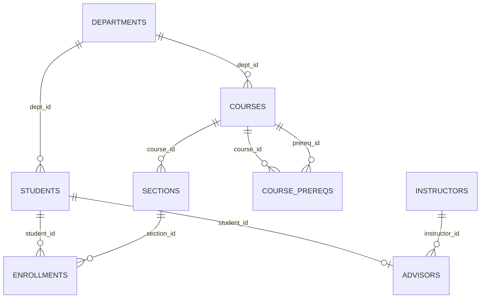

## Introduction

How does a database know that student **20230002** and the row with email **samuel.okafor@student.example.edu** are the same person? How does it stop two rows from claiming to be section 7? How does an enrollment "point to" a student without a pointer? The answer to all three is **keys**.

Keys are the relational model's mechanism for **identity** and **reference**. Because a relation contains only values — no hidden addresses, no record numbers — the only way to identify a tuple is by the values of some of its attributes, and the only way to connect tuples in different relations is by matching those values. Getting keys right is the single most important decision in table design: it determines what the database can guarantee, how tables join, and — in MySQL/InnoDB — how every table is physically organised on disk.

This lesson defines each kind of key precisely — **superkey**, **candidate key**, **primary key**, **alternate key**, **composite key** and **foreign key** — identifies them on the university schema, declares them in MySQL DDL (and shows the errors when they are violated), explains how **InnoDB** builds its storage around the primary key, and weighs **natural** against **surrogate** keys.

:::note[Dataset]
The examples use the **university** dataset: 5 departments, 12 instructors, 40 students, 15 courses with natural keys such as `'CS-157A'`, a `course_prereqs` graph, 24 sections, 146 enrollments and 30 advisor assignments.
:::

## DBMS Theory

:::theory[Keys, formally]
Let R be a relation schema with attribute set U.

- A **superkey** of R is a set of attributes S ⊆ U such that **no two distinct tuples** in **any valid state** r(R) agree on all attributes of S: for all t₁ ≠ t₂ in r, t₁[S] ≠ t₂[S]. Every relation has at least one superkey — U itself — because relations contain no duplicate tuples.
- A **candidate key** K is a **minimal** superkey: K is a superkey, and no proper subset of K is a superkey. (Uniqueness + irreducibility.)
- The **primary key** is the candidate key chosen by the designer as the principal identifier. Its attributes may not be NULL (**entity integrity**, next lesson).
- An **alternate key** is any candidate key not chosen as primary key. In SQL it is declared `UNIQUE` (and should be `NOT NULL`).
- A **composite key** is a key consisting of more than one attribute. "Composite" describes the key's size, not its role: a primary key, a candidate key or a foreign key can each be composite.
- A **foreign key** in relation R₂ is a set of attributes FK whose values must either match the values of a candidate key (usually the primary key) of some tuple in a referenced relation R₁, or be (wholly or partly) NULL. It represents a relationship and is enforced by **referential integrity**.
- Attributes that belong to at least one candidate key are **prime attributes**; the others are **non-prime** (a distinction used in normalization, Module 6).
:::

Three consequences of these definitions trip up even experienced practitioners:

1. **A key is a property of the schema, not of the current data.** The definition quantifies over *every valid state*. The fact that no two instructors currently share a name does not make `name` a key — the next hire may be another "Omar Kim". Data can **refute** a proposed key (find two rows that agree) but can never **prove** one. Keys come from the meaning of the data — the business rules.
2. **Minimality matters.** {student_id, name} is a superkey of `students` but not a candidate key, because {student_id} alone is already unique. Declaring a non-minimal set as the primary key lets the database accept two rows with the same `student_id` and different names.
3. **A relation can have several candidate keys.** `students` has two: {student_id} and {email}. Choosing one as primary does not make the other less of a key; it should still be declared (as `UNIQUE NOT NULL`) or the database stops enforcing it.

### The key hierarchy on the university schema

| Relation | Candidate keys | Primary key | Alternate keys | Foreign keys |
|---|---|---|---|---|
| `students` | {student_id}, {email} | student_id | email | dept_id → departments |
| `departments` | {dept_id}, {name} | dept_id | name | — |
| `courses` | {course_id} | course_id (natural key such as `'CS-157A'`) | — | dept_id → departments |
| `course_prereqs` | {course_id, prereq_id} | (course_id, prereq_id) — composite | — | course_id → courses, prereq_id → courses |
| `sections` | {section_id}; arguably {course_id, term, year, room} | section_id | (course_id, term, year, room) declared `UNIQUE` — but see *Common Mistakes* | course_id → courses, instructor_id → instructors |
| `enrollments` | {student_id, section_id} | (student_id, section_id) — composite | — | student_id → students, section_id → sections |
| `advisors` | {student_id} | student_id (one advisor per student) | — | student_id → students, instructor_id → instructors |

Notice `advisors`: its primary key is also a foreign key. That is how the schema says "each student has **at most one** advisor" — a 1:1-or-0 relationship from students — whereas `enrollments` uses a composite key to represent a many-to-many relationship between students and sections.



## Why It Exists

Without keys, three things go wrong at once.

- **Identity becomes ambiguous.** If two rows say "Samuel Okafor, Data Science", are they the same student entered twice or two students with the same name? A key makes the question decidable: same key value means same entity; different key values mean different entities.
- **Updates and deletes become dangerous.** `UPDATE students SET dept_id = 1 WHERE name = 'Samuel Okafor'` changes *every* Samuel Okafor. Only a key predicate (`WHERE student_id = 20230002`) is guaranteed to touch exactly one row.
- **Relationships cannot be represented.** The relational model has no pointers; an enrollment refers to a student by storing the student's key. If that key is not unique, the reference is ambiguous; if it can change freely, references break; if the referenced row can disappear, references dangle. Foreign keys, backed by referential integrity, close all three gaps.

Historically, navigational databases identified records by physical address or system-generated record IDs. Codd insisted that identification must be by **values the user can see and understand**, so that every fact in the database is accessible by naming a relation, a key value and an attribute — the *guaranteed access rule* (rule 2 of Codd's twelve rules, 1985).

## Internal Working

:::internals[How InnoDB uses keys]
- **The primary key is the clustered index.** An InnoDB table *is* a B+ tree ordered by its primary key; the leaf pages contain the complete rows. Looking a row up by primary key is a single B+ tree descent.
- **If there is no primary key**, InnoDB uses the first `UNIQUE` index whose columns are all `NOT NULL` as the clustered index. If there is none, it generates a hidden clustered index named `GEN_CLUST_INDEX` on a hidden 6-byte row ID (`DB_ROW_ID`) that increases monotonically; that ID is not visible to queries and is shared across all such tables on the server.
- **Secondary indexes store the primary key.** Each `UNIQUE` or ordinary index is a separate B+ tree whose leaf entries contain the indexed columns **plus the primary-key columns**, which act as the "pointer" back to the row. Consequence: a long primary key (say, a 36-character UUID string) is copied into **every** secondary index, making all of them larger.
- **Uniqueness is checked in the index.** When a row is inserted, InnoDB looks up the new key in the primary-key index and in each unique index; a match raises error 1062 (`ER_DUP_ENTRY`). Unique indexes allow multiple NULLs, because NULL is never equal to NULL.
- **Foreign keys need indexes on both sides.** The referenced columns must be the leftmost columns of an index (InnoDB in 8.4 requires a primary key or unique key, by default). On the child side, InnoDB **creates an index automatically** if no suitable one exists, so that checks and cascades on parent changes do not require a table scan. Each child insert or update does an index lookup in the parent; each parent delete or key update does an index lookup in the child.
- **Insert order and page splits.** With an ever-increasing key (`AUTO_INCREMENT`), new rows are appended at the right edge of the clustered B+ tree, filling pages sequentially. With random keys (random UUIDs), new rows land on random pages, causing page splits, half-empty pages and poor buffer-pool locality.
:::

These mechanics explain the standard MySQL advice: keep the primary key **short**, **stable** and preferably **monotonically increasing**.

## MySQL Implementation

Ask the catalog which keys the schema declares. Primary keys and unique keys appear in `TABLE_CONSTRAINTS`; their columns, in order, appear in `KEY_COLUMN_USAGE`:

```sql run
SELECT tc.TABLE_NAME, tc.CONSTRAINT_TYPE, tc.CONSTRAINT_NAME,
       GROUP_CONCAT(k.COLUMN_NAME ORDER BY k.ORDINAL_POSITION) AS key_columns
FROM information_schema.TABLE_CONSTRAINTS AS tc
JOIN information_schema.KEY_COLUMN_USAGE AS k
  ON  k.CONSTRAINT_SCHEMA = tc.CONSTRAINT_SCHEMA
  AND k.TABLE_NAME        = tc.TABLE_NAME
  AND k.CONSTRAINT_NAME   = tc.CONSTRAINT_NAME
WHERE tc.TABLE_SCHEMA = DATABASE()
  AND tc.CONSTRAINT_TYPE IN ('PRIMARY KEY', 'UNIQUE')
GROUP BY tc.TABLE_NAME, tc.CONSTRAINT_TYPE, tc.CONSTRAINT_NAME
ORDER BY tc.TABLE_NAME, tc.CONSTRAINT_TYPE;
```

Every table has a primary key; `departments`, `students` and `sections` also declare alternate keys as `UNIQUE`. `course_prereqs` and `enrollments` have composite primary keys.

The foreign keys, with the tables and columns they reference:

```sql run
SELECT TABLE_NAME, COLUMN_NAME, CONSTRAINT_NAME,
       REFERENCED_TABLE_NAME, REFERENCED_COLUMN_NAME
FROM information_schema.KEY_COLUMN_USAGE
WHERE TABLE_SCHEMA = DATABASE() AND REFERENCED_TABLE_NAME IS NOT NULL
ORDER BY TABLE_NAME, COLUMN_NAME;
```

`course_prereqs` references `courses` **twice** — once for the course and once for its prerequisite — a relation referencing itself through an intermediate table.

**Keys in action.** A primary key rejects a duplicate identity:

```sql run error
INSERT INTO students (student_id, name, email, dept_id, enrollment_year)
VALUES (20230002, 'Sam Okafor', 'sam.okafor@student.example.edu', 2, 2021);
```

An alternate key rejects a second student with an existing email, even with a new `student_id`:

```sql run error
INSERT INTO students (student_id, name, email, dept_id, enrollment_year)
VALUES (20250099, 'Samuel Okafor', 'samuel.okafor@student.example.edu', 2, 2025);
```

A composite key rejects enrolling the same student in the same section twice — while allowing each part to repeat on its own:

```sql run error
INSERT INTO enrollments (student_id, section_id, grade)
SELECT student_id, section_id, NULL FROM enrollments ORDER BY student_id, section_id LIMIT 1;
```

A foreign key rejects a reference to a section that does not exist:

```sql run error
INSERT INTO enrollments (student_id, section_id, grade) VALUES (20230002, 999, NULL);
```

## Syntax Breakdown

```sql
CREATE TABLE enrollment_audit (
  audit_id     BIGINT UNSIGNED NOT NULL AUTO_INCREMENT,   -- surrogate key
  student_id   INT UNSIGNED    NOT NULL,
  section_id   INT UNSIGNED    NOT NULL,
  action       ENUM('add','drop') NOT NULL,
  happened_at  DATETIME        NOT NULL,
  PRIMARY KEY (audit_id),                                 -- primary key (column- or table-level)
  UNIQUE KEY uq_audit_event (student_id, section_id, happened_at),   -- composite alternate key
  CONSTRAINT fk_audit_enrollment                          -- composite foreign key
    FOREIGN KEY (student_id, section_id)
    REFERENCES enrollments (student_id, section_id)
);
```

| Clause | Meaning | Notes |
|---|---|---|
| `col type PRIMARY KEY` | Column-level primary key | Only for single-column keys |
| `PRIMARY KEY (c1, c2, …)` | Table-level (possibly composite) primary key | Column order matters for the index: it is sorted by c1, then c2 |
| `NOT NULL` | Required for key columns | Primary-key columns without an explicit nullability become `NOT NULL` silently; an explicit `NULL` is an error (1171) |
| `UNIQUE [KEY] [name] (c1, …)` | Alternate (candidate) key, implemented as a unique index | Allows multiple NULLs; add `NOT NULL` to make it a true candidate key |
| `[CONSTRAINT name] FOREIGN KEY (c, …) REFERENCES parent (pc, …)` | Foreign key | Column count, order and types must match; parent columns must be indexed (PK/unique) |
| `ON DELETE … / ON UPDATE …` | Referential actions | `RESTRICT` / `NO ACTION` (default), `CASCADE`, `SET NULL`; next lesson |
| `AUTO_INCREMENT` | Generates increasing integer values for a surrogate key | One per table; must be indexed (normally the PK) |
| `DEFAULT (UUID_TO_BIN(UUID(), 1))` | Expression default generating a binary UUID | Expression defaults require 8.0.13+ |

:::standard[Standard SQL vs MySQL]
`PRIMARY KEY`, `UNIQUE`, `FOREIGN KEY … REFERENCES` and the referential actions are standard SQL. `AUTO_INCREMENT` is a **MySQL extension**; the standard (and PostgreSQL, Oracle, SQL Server) uses `GENERATED … AS IDENTITY` or sequences, which MySQL does not support. `UNIQUE KEY` / `KEY` as synonyms for indexes, and `UUID_TO_BIN`, are MySQL-specific. Like most DBMSs, MySQL allows **multiple NULLs** in a `UNIQUE` column (SQL Server is the notable exception, allowing only one unless a filtered index is used); SQL:2023 added `UNIQUE NULLS [NOT] DISTINCT` to make the choice explicit, and MySQL 8.4 does not support that clause.
:::

Entity integrity is built into the primary-key syntax. If you do not specify nullability, MySQL quietly makes primary-key columns `NOT NULL`; if you explicitly declare one `NULL`, it refuses:

```sql run error
CREATE TABLE office_hours (
  instructor_id INT UNSIGNED NULL,
  weekday       TINYINT UNSIGNED,
  PRIMARY KEY (instructor_id, weekday)
);
```

## Practical Examples

**1. Testing whether a set of attributes could be a key.** A query can **refute** a proposed key by finding duplicates. Compare the number of rows with the number of distinct value combinations:

```sql run
SELECT COUNT(*)                                AS sections,
       COUNT(DISTINCT section_id)              AS distinct_section_id,
       COUNT(DISTINCT course_id)               AS distinct_course_id,
       COUNT(DISTINCT course_id, term, year)   AS distinct_course_term_year
FROM sections;
```

`section_id` is unique (24 of 24) and is the declared primary key. `course_id` alone is not (several sections per course). `(course_id, term, year)` happens to be unique **in this state** — but it is not a key: nothing in the university's rules prevents a large course from running two sections in the same term. The data fails to refute it; the business rules do.

**2. Minimality — superkey vs candidate key.** `{student_id, email}` is unique, but so is each attribute alone:

```sql run
SELECT COUNT(*) AS students,
       COUNT(DISTINCT student_id)        AS by_id,
       COUNT(DISTINCT email)             AS by_email,
       COUNT(DISTINCT student_id, email) AS by_id_and_email
FROM students;
```

All three counts equal the number of students, so {student_id, email} is a superkey, while {student_id} and {email} are the two **candidate keys** (assuming the rule "each student has a unique university email"). Declaring `PRIMARY KEY (student_id, email)` would be a design bug: the database would then accept two rows with the same `student_id` and different emails.

**3. Natural vs surrogate keys side by side.** `courses` uses a **natural key** — `course_id` values like `'CS-157A'` that people already use in catalogs. Let us create a version of a table with a **surrogate key** generated by `AUTO_INCREMENT` and keep the natural identifier as an alternate key:

```sql run
CREATE TABLE rooms (
  room_pk   INT UNSIGNED NOT NULL AUTO_INCREMENT,
  building  VARCHAR(40)  NOT NULL,
  room_no   VARCHAR(10)  NOT NULL,
  seats     SMALLINT UNSIGNED NOT NULL,
  PRIMARY KEY (room_pk),
  UNIQUE KEY uq_rooms_natural (building, room_no)
);
INSERT INTO rooms (building, room_no, seats) VALUES
  ('Duncan Hall', '320', 30), ('MacQuarrie Hall', '112', 60), ('Boccardo Hall', '353', 40);
SELECT room_pk, building, room_no, seats FROM rooms ORDER BY room_pk;
```

The surrogate `room_pk` is short, meaningless and stable; the natural key `(building, room_no)` is still enforced, so the same physical room cannot be entered twice:

```sql run error
INSERT INTO rooms (building, room_no, seats) VALUES ('Duncan Hall', '320', 35);
```

**4. A UUID surrogate key.** When keys must be generated outside the database (by many services, offline clients, or before an insert), UUIDs are common. Store them as `BINARY(16)`, not `CHAR(36)`, and use the swap flag of `UUID_TO_BIN` so time-based (version 1) UUIDs from `UUID()` are stored in roughly increasing order:

```sql run
CREATE TABLE api_tokens (
  token_id   BINARY(16) NOT NULL DEFAULT (UUID_TO_BIN(UUID(), 1)),
  student_id INT UNSIGNED NOT NULL,
  PRIMARY KEY (token_id),
  CONSTRAINT fk_tokens_student FOREIGN KEY (student_id) REFERENCES students (student_id)
);
INSERT INTO api_tokens (student_id) VALUES (20230001), (20230002);
SELECT LENGTH(token_id) AS bytes_per_key, COUNT(*) AS tokens FROM api_tokens GROUP BY LENGTH(token_id);
```

Sixteen bytes per key instead of 36 characters (up to 144 bytes under `utf8mb4` in the index). The values themselves are random each run, so they are not shown; `BIN_TO_UUID(token_id, 1)` converts them back to text.

**5. A self-referencing foreign key.** A course's prerequisite is another course. Find each course with its prerequisites by joining `courses` to itself through `course_prereqs`:

```sql run
SELECT c.course_id, c.title, p.course_id AS prereq_id, p.title AS prereq_title
FROM course_prereqs AS cp
JOIN courses AS c ON c.course_id = cp.course_id
JOIN courses AS p ON p.course_id = cp.prereq_id
WHERE c.course_id LIKE 'CS-%'
ORDER BY c.course_id, p.course_id;
```

Both foreign keys of `course_prereqs` point to the same parent table; each row says "course X requires course Y".

## Execution Walkthrough

Identify the keys of the `advisors` relation step by step, the way a designer would — combining data checks (which can only refute) with business rules (which decide).

```walkthrough
title: Finding the keys of advisors(student_id, instructor_id)
steps:
  - title: "1. The relation and its attributes"
    explain: >-
      advisors records which instructor advises which student. U = {student_id, instructor_id}. U itself is
      always a superkey, because a relation has no duplicate tuples.
    sql: SELECT student_id, instructor_id FROM advisors ORDER BY student_id LIMIT 6;
  - title: "2. Test single attributes against the data"
    explain: >-
      student_id is unique in the current state; instructor_id is not (an instructor advises several students).
      So {instructor_id} is refuted as a key. {student_id} survives — the data cannot refute it.
    sql: |
      SELECT COUNT(*) AS rows_, COUNT(DISTINCT student_id) AS distinct_students,
             COUNT(DISTINCT instructor_id) AS distinct_instructors
      FROM advisors;
  - title: "3. Apply the business rule"
    explain: >-
      The university's rule is "each student has at most one advisor". That rule — not the data — makes
      {student_id} a candidate key. Because it is a single attribute, it is minimal, and {student_id,
      instructor_id} is merely a superkey.
  - title: "4. See how the schema declares it"
    explain: >-
      The primary key is student_id, and the same column is a foreign key to students. A second advisor for an
      already-advised student will be rejected.
    sql: |
      SELECT CONSTRAINT_NAME, COLUMN_NAME, REFERENCED_TABLE_NAME
      FROM information_schema.KEY_COLUMN_USAGE
      WHERE TABLE_SCHEMA = DATABASE() AND TABLE_NAME = 'advisors'
      ORDER BY CONSTRAINT_NAME;
  - title: "5. The key enforces the rule"
    explain: >-
      Trying to give an already-advised student a second advisor violates the primary key (error 1062). If the
      rule ever changes to allow co-advisors, the key — and therefore the schema — must change to
      PRIMARY KEY (student_id, instructor_id).
    expect: error
    sql: |
      INSERT INTO advisors (student_id, instructor_id)
      SELECT student_id, 1001 FROM advisors ORDER BY student_id LIMIT 1;
```

## Output

The walkthrough's outputs, read together:

- **Step 2** shows `student_id` distinct for every row and `instructor_id` far less distinct — data refuting one candidate and failing to refute the other.
- **Step 4** shows two constraints on the same column: `PRIMARY` (uniqueness and NOT NULL) and the foreign key to `students` (existence of the referenced student). The single column `student_id` is simultaneously the primary key of `advisors` and a foreign key — the standard way to model a one-to-zero-or-one relationship.
- **Step 5** fails with `Duplicate entry … for key 'advisors.PRIMARY'`: the key turned the business rule "at most one advisor per student" into something the DBMS enforces for every client.

## Alternative Approaches

The choice that generates the most debate is **natural vs surrogate primary keys**.

| | Natural key | Surrogate key |
|---|---|---|
| Definition | Attribute(s) with business meaning that identify the entity (ISBN, `course_id`, country code, email) | System-generated identifier with no business meaning (`AUTO_INCREMENT` integer, UUID) |
| Pros | Meaningful in queries and foreign keys (`WHERE course_id = 'CS-157A'` without a join); enforces real-world uniqueness directly; no extra column | Short and fixed-size; never changes; independent of business-rule changes; simple single-column foreign keys |
| Cons | May change (courses get renumbered, people change email), forcing cascading key updates; may be long or composite; "unique" real-world identifiers often are not (SSNs reused, ISBNs re-issued) | Meaningless — needs joins to show anything readable; does **not** by itself prevent duplicate entities |
| MySQL/InnoDB angle | Long or composite natural keys enlarge every secondary index; non-monotonic values cause page splits | `AUTO_INCREMENT` integers are ideal clustered keys; random UUIDs are not unless reordered |
| Good fits | Small, stable code tables (`jobs.job_id`, ISO country codes, `courses` if numbers never change); junction tables (composite key of two FKs) | Most entity tables (customers, orders, accounts), especially when natural identifiers can change |

The professional default is a **hybrid**: a surrogate primary key **plus** a `UNIQUE NOT NULL` constraint on the natural key. You get a stable, compact identifier for references *and* the guarantee that the same real-world entity is not stored twice. The university dataset shows both styles: `students` (surrogate-like numeric ID + unique email) and `courses` (natural key).

Other options worth knowing:

- **Composite natural keys for junction tables** (`enrollments (student_id, section_id)`) are usually better than adding a surrogate: the composite key enforces the "no duplicate enrollment" rule and supports the common lookup "sections of a student".
- **Generated invisible primary keys (GIPK)** — since MySQL 8.0.30, with `sql_generate_invisible_primary_key = ON`, MySQL adds an invisible `my_row_id BIGINT UNSIGNED AUTO_INCREMENT` primary key to any InnoDB table created without one. It is a safety net for replication and clustering, not a substitute for design (display only — changing this variable needs a privilege the sandbox does not have):

```sql
SET SESSION sql_generate_invisible_primary_key = ON;
CREATE TABLE raw_events (payload JSON);
SHOW CREATE TABLE raw_events;   -- shows `my_row_id` bigint unsigned NOT NULL AUTO_INCREMENT /*!80023 INVISIBLE */
```

## Performance Analysis

Key choices have measurable physical consequences in InnoDB:

| Choice | Effect |
|---|---|
| Short integer PK (`INT`/`BIGINT AUTO_INCREMENT`) | Small secondary indexes (4–8 bytes of PK per entry); sequential inserts at the right edge of the B+ tree; dense pages |
| Long natural PK (e.g. `VARCHAR(255)` email) | Every secondary index entry carries the full key; fewer entries per page; larger indexes in memory |
| Random UUID PK stored as `CHAR(36)` | Large keys (worst case) **and** random insert positions → page splits, fragmentation, poor cache locality |
| UUID as `BINARY(16)` with `UUID_TO_BIN(…, 1)` | 16-byte keys; time-ordered insert positions for version-1 UUIDs; a reasonable compromise when UUIDs are required |
| Composite PK `(a, b)` | Efficient lookups by `a` or by `(a, b)` (leftmost prefix); lookups by `b` alone need a secondary index |
| No PK | Hidden 6-byte row ID; no way to address rows efficiently in queries; row-based replication may have to scan tables to apply updates on replicas |
| Foreign keys | One parent index lookup per child insert/update, child index lookup per parent delete/key update; small cost, plus the automatically created child-side index |

:::performance[Theory vs measurement]
These effects follow from how InnoDB clusters rows and builds secondary indexes; they become visible with hundreds of thousands to millions of rows, not with 40 students. Index structures and measurement are covered in [Clustered and secondary indexes](/lessons/m07-clustered-secondary) and [EXPLAIN ANALYZE](/lessons/m07-explain-analyze).
:::

## Best Practices

:::best-practice[Designing keys]
1. **Every table gets a primary key.** Consider enabling `sql_require_primary_key` on servers so tables without one are rejected.
2. **Declare every candidate key.** The primary key enforces one; declare the others as `UNIQUE` on `NOT NULL` columns.
3. **Keep primary keys short, stable and immutable.** Prefer `INT UNSIGNED`/`BIGINT UNSIGNED AUTO_INCREMENT` for entity tables; never use a value that users can edit (names, emails) as the primary key.
4. **Use composite keys for junction tables**, ordered to match the most common lookup.
5. **Match foreign-key column types exactly** (same type, same `UNSIGNED`, same character set and collation for strings).
6. **Name constraints** (`uq_students_email`, `fk_enrollments_student`) so errors and migrations are self-explanatory.
7. **If you need UUIDs, store them as `BINARY(16)`** and consider time-ordered generation.
8. **Derive keys from business rules, and record those rules.** A key encodes a rule ("one advisor per student"); when the rule changes, the key must change.
:::

## Common Mistakes

**Mistake 1 — inferring a key from current data.** `(course_id, term, year)` is unique in today's `sections` data; declaring it a key would forbid a legitimate second section of a popular course next term. Always ask "can two different entities ever share these values?", not "do any currently share them?".

**Mistake 2 — a `UNIQUE` key over a nullable column is not a candidate key.** `sections` declares `UNIQUE (course_id, term, year, room)`, but `room` is nullable. Because NULL is never equal to NULL, two otherwise identical sections with no room assigned are both accepted:

```sql run
SELECT section_id, course_id, term, year, room FROM sections WHERE room IS NULL;
```

```sql run
INSERT INTO sections (section_id, course_id, term, year, instructor_id, room, capacity)
SELECT 99, course_id, term, year, instructor_id, room, capacity FROM sections WHERE room IS NULL;
SELECT section_id, course_id, term, year, room FROM sections WHERE room IS NULL ORDER BY section_id;
```

The "unique" offering now exists twice. A true candidate key needs `NOT NULL` on every column. (If NULL rooms must be allowed, decide what uniqueness really means — e.g. `(course_id, term, year, section_no)` with an explicit section number.)

**Mistake 3 — a non-minimal primary key.** `PRIMARY KEY (student_id, email)` looks safe but permits duplicate `student_id` values with different emails. Keys must be minimal.

**Mistake 4 — foreign-key type mismatch.** `students.student_id` is `INT UNSIGNED`; a referencing column declared `BIGINT` is incompatible:

```sql run error
CREATE TABLE scholarships (
  scholarship_id INT UNSIGNED NOT NULL PRIMARY KEY,
  student_id     BIGINT NOT NULL,
  CONSTRAINT fk_scholarship_student FOREIGN KEY (student_id) REFERENCES students (student_id)
);
```

Error 3780: the referencing and referenced columns must have compatible types (here, same integer type and the same signedness).

**Mistake 5 — referencing a column that is not a key.** A foreign key must reference a primary or unique key; `students.name` has no unique index:

```sql run error
CREATE TABLE awards (
  award_id     INT UNSIGNED NOT NULL PRIMARY KEY,
  student_name VARCHAR(80) NOT NULL,
  CONSTRAINT fk_award_student FOREIGN KEY (student_name) REFERENCES students (name)
);
```

Error 1822: missing index in the referenced table. Even if MySQL allowed it, referencing a non-unique attribute would make the reference ambiguous.

**Mistake 6 — declaring two primary keys.** A table has exactly one primary key; "two keys" means one primary and one alternate:

```sql run error
CREATE TABLE badges (badge_id INT PRIMARY KEY, badge_code VARCHAR(20) PRIMARY KEY);
```

## Industry Application

- **Identifier strategy is an architecture decision.** Companies standardise on integer `BIGINT` IDs, UUIDs, or time-ordered IDs (UUIDv7, ULID, Twitter's Snowflake-style 64-bit IDs) depending on whether IDs are generated centrally or by many services, whether they are exposed in URLs (sequential integers leak business volume and invite enumeration), and how they behave as clustered keys in InnoDB.
- **Sharding keys.** In sharded MySQL deployments, the shard key (e.g. `customer_id`) is usually a prefix of every primary key in the shard (`PRIMARY KEY (customer_id, order_id)`), so all of a customer's data lives together.
- **Data integration and master data management.** Merging customer records from several systems is largely the problem of reconciling different keys for the same entity; natural keys (email, tax ID) and surrogate mapping tables are the tools.
- **Replication and change-data-capture.** Row-based replication and CDC tools (Debezium, Kafka connectors) need a primary key to identify which row changed; tables without one are problematic or unsupported, which is why managed services and Group Replication require primary keys.
- **Data warehouses** use surrogate keys deliberately in dimension tables (to track history with slowly changing dimensions), while keeping the source system's natural key as an attribute.

## Practice Exercises

```exercise
id: ex1
title: List the primary-key columns
difficulty: easy
concepts: [primary-key, composite-key]
prompt: |
  Using `information_schema.KEY_COLUMN_USAGE`, list the primary-key columns of every table in the current schema.
  Columns: `TABLE_NAME`, `COLUMN_NAME`, `ORDINAL_POSITION`.
hints:
  - "In MySQL every primary-key constraint is named PRIMARY."
  - "Filter on TABLE_SCHEMA = DATABASE() AND CONSTRAINT_NAME = 'PRIMARY'."
solution: |
  SELECT TABLE_NAME, COLUMN_NAME, ORDINAL_POSITION
  FROM information_schema.KEY_COLUMN_USAGE
  WHERE TABLE_SCHEMA = DATABASE() AND CONSTRAINT_NAME = 'PRIMARY';
explanation: |
  Tables with more than one row in the result have composite primary keys (`course_prereqs`, `enrollments`).
  `ORDINAL_POSITION` gives the column order inside the key, which is also the sort order of InnoDB's clustered
  index for that table.
```

```exercise
id: ex2
title: Which tables have composite primary keys?
difficulty: medium
concepts: [composite-key, primary-key]
prompt: |
  Return each table whose primary key consists of **more than one column**, with the number of key columns.
  Columns: `TABLE_NAME`, `key_columns`.
hints:
  - "Start from the previous exercise's query and group by TABLE_NAME."
  - "Keep only groups with COUNT(*) > 1 using HAVING."
solution: |
  SELECT TABLE_NAME, COUNT(*) AS key_columns
  FROM information_schema.KEY_COLUMN_USAGE
  WHERE TABLE_SCHEMA = DATABASE() AND CONSTRAINT_NAME = 'PRIMARY'
  GROUP BY TABLE_NAME
  HAVING COUNT(*) > 1;
explanation: |
  Both composite-key tables are junction tables representing many-to-many relationships (students–sections,
  courses–courses). Their composite keys enforce "no duplicate pair" without a surrogate column.
```

```exercise
id: ex3
title: Find the alternate keys
difficulty: medium
concepts: [alternate-key, candidate-key]
prompt: |
  List every **alternate key** (a UNIQUE constraint, not the primary key) with its columns.
  Columns: `TABLE_NAME`, `CONSTRAINT_NAME`, `COLUMN_NAME`.
hints:
  - "information_schema.TABLE_CONSTRAINTS tells you the CONSTRAINT_TYPE (PRIMARY KEY, UNIQUE, FOREIGN KEY, CHECK)."
  - "Join it to KEY_COLUMN_USAGE on schema, table and constraint name, and keep CONSTRAINT_TYPE = 'UNIQUE'."
solution: |
  SELECT tc.TABLE_NAME, tc.CONSTRAINT_NAME, k.COLUMN_NAME
  FROM information_schema.TABLE_CONSTRAINTS AS tc
  JOIN information_schema.KEY_COLUMN_USAGE AS k
    ON  k.CONSTRAINT_SCHEMA = tc.CONSTRAINT_SCHEMA
    AND k.TABLE_NAME        = tc.TABLE_NAME
    AND k.CONSTRAINT_NAME   = tc.CONSTRAINT_NAME
  WHERE tc.TABLE_SCHEMA = DATABASE() AND tc.CONSTRAINT_TYPE = 'UNIQUE';
explanation: |
  The schema declares `uq_departments_name`, `uq_students_email` and the four-column `uq_sections_offering`.
  Whether each is a *true* candidate key also depends on its columns being NOT NULL — `uq_sections_offering`
  includes the nullable `room`, which is why it does not fully enforce uniqueness (Common Mistakes).
```

```exercise
id: ex4
title: Design the keys of a TA-assignment table
difficulty: hard
kind: dml
concepts: [surrogate-key, natural-key, foreign-key, composite-key]
prompt: |
  Create a table **`ta_assignments`** recording which student works as a teaching assistant in which section,
  with these columns: `assignment_id` (surrogate primary key, `INT UNSIGNED AUTO_INCREMENT`), `student_id`
  (`INT UNSIGNED NOT NULL`), `section_id` (`INT UNSIGNED NOT NULL`), `hours_per_week` (`TINYINT UNSIGNED NOT NULL`).

  Keys required: the surrogate primary key; a **composite alternate key** so the same student cannot be assigned
  to the same section twice; and **two foreign keys** (to `students` and to `sections`).
  The checker counts the constraints of each type on your table.
hints:
  - "PRIMARY KEY (assignment_id), UNIQUE (student_id, section_id)."
  - "FOREIGN KEY (student_id) REFERENCES students (student_id), and the same for sections. Column types must match the parent columns exactly (INT UNSIGNED)."
solution: |
  CREATE TABLE ta_assignments (
    assignment_id  INT UNSIGNED NOT NULL AUTO_INCREMENT,
    student_id     INT UNSIGNED NOT NULL,
    section_id     INT UNSIGNED NOT NULL,
    hours_per_week TINYINT UNSIGNED NOT NULL,
    PRIMARY KEY (assignment_id),
    UNIQUE KEY uq_ta_student_section (student_id, section_id),
    CONSTRAINT fk_ta_student FOREIGN KEY (student_id) REFERENCES students (student_id),
    CONSTRAINT fk_ta_section FOREIGN KEY (section_id) REFERENCES sections (section_id)
  );
check: |
  SELECT CONSTRAINT_TYPE, COUNT(*) AS constraints
  FROM information_schema.TABLE_CONSTRAINTS
  WHERE TABLE_SCHEMA = DATABASE() AND TABLE_NAME = 'ta_assignments'
  GROUP BY CONSTRAINT_TYPE
  ORDER BY CONSTRAINT_TYPE;
explanation: |
  This is the hybrid pattern: a compact surrogate key for references from other tables (e.g. timesheets) plus
  the natural composite key `(student_id, section_id)` enforced as UNIQUE. Without the UNIQUE constraint, the
  surrogate key would happily allow duplicate assignments. Note that the UNIQUE index on
  `(student_id, section_id)` also serves the foreign key on `student_id` (leftmost prefix), so InnoDB only
  creates an extra index for `section_id`.
```

```exercise
id: ex5
title: Choose keys for an airline schema
difficulty: challenge
kind: open
concepts: [candidate-key, primary-key, natural-key, surrogate-key, foreign-key]
prompt: |
  An airline stores: **airports** (IATA code like `SJC`, name, city); **flights** (a flight number like `UA 1234`
  operates every day on a route); **flight instances** (flight `UA 1234` on 2026-11-07, with an aircraft and a
  gate); **passengers** (name, passport number and country, email); and **bookings** (a passenger on a flight
  instance with a seat).

  For each relation, list the candidate keys, choose a primary key (natural or surrogate — justify), and list
  the foreign keys. Point out at least two places where a seemingly natural key is dangerous.
solution: |
  - **airports(iata_code PK, name, city, …)** — natural key: IATA codes are short, standardised and rarely
    change; a surrogate adds little. (Candidate keys: iata_code; also the ICAO code if stored.)
  - **flights(flight_id PK, carrier_code, flight_number, origin FK→airports, destination FK→airports,
    UNIQUE (carrier_code, flight_number))** — the natural key (carrier, number) is reused over the years and
    airlines renumber routes; a surrogate keeps history stable. Alternatively the natural key can be the PK
    if history is versioned separately.
  - **flight_instances(instance_id PK, flight_id FK, service_date, aircraft_id FK, gate,
    UNIQUE (flight_id, service_date))** — the composite natural key is a true candidate key (a flight operates
    at most once per day); a surrogate is convenient because bookings reference instances heavily.
  - **passengers(passenger_id PK, full_name, passport_no, passport_country, email,
    UNIQUE (passport_country, passport_no))** — surrogate PK. *Dangerous natural keys:* email (shared family
    addresses, changes over time) and passport number alone (unique only within the issuing country; passports
    are renewed with new numbers). Passport is a candidate key only together with the country, and only for the
    passport's validity period.
  - **bookings(booking_id PK, passenger_id FK, instance_id FK, seat, UNIQUE (instance_id, seat),
    UNIQUE (instance_id, passenger_id))** — two alternate keys encode two rules: a seat is sold once per flight
    instance, and a passenger holds at most one seat per instance. The airline's six-character record locator is
    another candidate key but is reused over time, so it should not be the primary key.

  Also dangerous: using `flight_number` alone (shared between carriers through codeshares) or seat alone.
```

## Knowledge Assessment

```quiz
- id: q1
  question: "In `students(student_id, name, email, dept_id, enrollment_year)`, student_id and email are each unique by business rule. Which statement is correct?"
  options:
    - "{student_id, email} is a candidate key"
    - "{student_id} and {email} are candidate keys; {student_id, email} is a superkey but not a candidate key"
    - "Only the primary key is a candidate key"
    - "{name} is a candidate key because no two students currently share a name"
  answer: 1
  explanation: "Candidate keys are minimal superkeys. {student_id, email} contains a smaller superkey, so it is not minimal. Choosing one candidate as primary does not stop the other from being a candidate key. Current data cannot make {name} a key — keys come from rules that hold for every valid state."
  concepts: [candidate-key, superkey]
- id: q2
  question: "A query shows that `(course_id, term, year)` has no duplicates in the current sections data. What can you conclude?"
  options:
    - "It is a candidate key and should be declared UNIQUE"
    - "Nothing definitive: data can refute a key but not prove it; whether it is a key depends on the business rules"
    - "It is the primary key"
    - "It is a foreign key"
  answer: 1
  explanation: "A key must hold in every valid state. If the university can run two sections of a course in one term, it is not a key, regardless of today's data."
  concepts: [candidate-key]
- id: q3
  question: "Which statements about InnoDB and primary keys are true? (Select all that apply.)"
  type: multi
  options:
    - "The table's rows are stored in a B+ tree ordered by the primary key (the clustered index)"
    - "Every secondary index entry contains the primary-key columns"
    - "Without a primary key or a NOT NULL unique key, InnoDB clusters on a hidden row ID"
    - "Random UUID primary keys produce sequential inserts at the end of the B+ tree"
  answer: [0, 1, 2]
  explanation: "InnoDB clusters on the PK, stores the PK in secondary indexes as the row locator, and falls back to a NOT NULL unique key or a hidden 6-byte row ID. Random UUIDs insert at random positions, causing page splits — monotonic keys append at the end."
  concepts: [clustered-index, primary-key]
- id: q4
  question: "`sections` has `UNIQUE (course_id, term, year, room)` and room is nullable. Two rows with the same course, term and year and room = NULL are inserted. What happens?"
  options:
    - "The second insert fails with a duplicate-entry error"
    - "Both are accepted, because NULL is not equal to NULL in a unique index"
    - "MySQL converts the NULLs to empty strings"
    - "The first row is overwritten"
  answer: 1
  explanation: "Unique indexes in MySQL allow multiple NULLs. A UNIQUE constraint is a true candidate key only if all its columns are NOT NULL."
  concepts: [alternate-key, candidate-key]
- id: q5
  question: "What is the most common professional choice for an entity table such as customers?"
  options:
    - "Natural primary key on email only"
    - "No primary key, to save space"
    - "Surrogate primary key (e.g. BIGINT AUTO_INCREMENT) plus UNIQUE NOT NULL on the natural identifier"
    - "Composite primary key of all columns"
  answer: 2
  explanation: "The hybrid gives a short, stable identifier for references and still prevents duplicate entities. Email changes and is long; omitting a PK harms InnoDB and replication; a key of all columns is not minimal and allows near-duplicates."
  concepts: [surrogate-key, natural-key]
- id: q6
  question: "Why does `CREATE TABLE … student_id BIGINT … FOREIGN KEY (student_id) REFERENCES students (student_id)` fail when students.student_id is INT UNSIGNED?"
  options:
    - "Foreign keys must reference the primary key by name"
    - "The referencing and referenced columns must have compatible types (same integer type and signedness)"
    - "BIGINT columns cannot be foreign keys"
    - "The child table needs an index first"
  answer: 1
  explanation: "Error 3780: types are incompatible. The FK may reference any primary or unique key; BIGINT columns can be foreign keys when the parent is BIGINT; InnoDB creates the child-side index automatically."
  concepts: [foreign-key]
- id: q7
  question: "In `advisors(student_id PK, instructor_id)`, student_id is also a foreign key to students. What relationship does this design express?"
  options:
    - "Each instructor advises exactly one student"
    - "Each student has at most one advisor; an instructor may advise many students"
    - "Many-to-many between students and instructors"
    - "Each student must have exactly two advisors"
  answer: 1
  explanation: "Because student_id is the primary key, it appears at most once — one advisor per student. instructor_id is not unique, so instructors advise many students. A many-to-many design would use a composite key (student_id, instructor_id)."
  concepts: [primary-key, foreign-key]
- id: q8
  question: "What does MySQL do with `CREATE TABLE t (a INT, b INT, PRIMARY KEY (a, b))`, where neither column specifies NULL or NOT NULL?"
  options:
    - "Rejects it because the key columns are nullable"
    - "Creates it and silently makes a and b NOT NULL"
    - "Creates it and allows NULL in a and b"
    - "Creates two primary keys"
  answer: 1
  explanation: "Primary-key columns are implicitly NOT NULL; SHOW CREATE TABLE shows `a int NOT NULL`. Only an explicit `a INT NULL` is rejected (error 1171). NULLs are never allowed in a primary key (entity integrity), and a table has exactly one primary key, which here is composite."
  concepts: [primary-key, composite-key]
```
