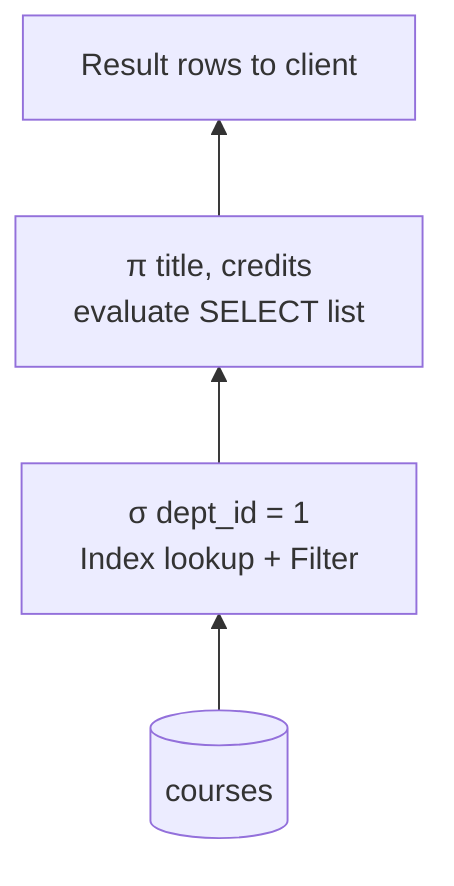

## Introduction

When you write `SELECT title FROM courses WHERE dept_id = 1`, you are not giving MySQL a procedure. You are describing a **result relation** in terms of the relations you already have. The mathematics behind that description is **relational algebra**: a small set of operators, each of which takes one or two relations as input and produces a new relation as output.

Relational algebra matters to a working engineer for three concrete reasons:

1. **It is the optimizer's internal language.** MySQL parses your SQL into a tree of operations — filter, project, join, union, deduplicate — that is essentially an algebra expression. The optimizer rewrites that tree using algebraic laws (for example, "filter before you join") before choosing access paths. When you read `EXPLAIN FORMAT=TREE`, you are reading a physical version of an algebra expression.
2. **It tells you precisely what a query means.** Questions like "does `UNION` remove duplicates?", "why does my `NOT IN` return nothing?" or "why did this join return 4,000 rows instead of 40?" have exact answers once you know which operator you are applying and whether it works on **sets** or **bags**.
3. **It is the vocabulary of database research, documentation and interviews.** Terms like *selection pushdown*, *projection*, *semi-join* and *anti-join* appear in the MySQL manual, in optimizer traces and in system design discussions.

This lesson covers the **unary operators** (selection σ, projection π, rename ρ), the **set operators** (union ∪, difference −, intersection ∩) and the **Cartesian product** ×. The next lesson, [Relational Algebra II — Joins and Division](/lessons/m01-relational-algebra-joins), builds joins, semi-joins, anti-joins and division out of these primitives and shows the equivalences the MySQL optimizer exploits.

:::note[Dataset]
The examples use the **university** dataset (15 courses, 5 departments, 12 instructors, 24 sections, 40 students) plus a few tiny tables created in the lesson so that results are small enough to check by eye. Every output below was captured from a real MySQL server.
:::

## DBMS Theory

:::theory[Relational algebra — the primitive operators]
A **relation** R over a schema R(A₁, …, Aₙ) is a **set** of tuples, each tuple assigning a value from the domain of Aᵢ to every attribute. Relational algebra (Codd, 1970–72) defines operators that map relations to relations. Six are **primitive** — none can be expressed with the others:

| Operator | Notation | Definition |
|---|---|---|
| Selection | σ<sub>θ</sub>(R) | { t ∈ R ∣ θ(t) is true } — keeps the tuples satisfying predicate θ |
| Projection | π<sub>A₁,…,Aₖ</sub>(R) | { t[A₁,…,Aₖ] ∣ t ∈ R } — keeps only the listed attributes (and, being a set, removes duplicate tuples) |
| Rename | ρ<sub>S(B₁,…,Bₙ)</sub>(R) | the same tuples as R, with the relation called S and/or the attributes called B₁,…,Bₙ |
| Union | R ∪ S | { t ∣ t ∈ R ∨ t ∈ S } — R and S must be **union-compatible** |
| Difference | R − S | { t ∣ t ∈ R ∧ t ∉ S } — union-compatible inputs |
| Cartesian product | R × S | { r ∘ s ∣ r ∈ R ∧ s ∈ S } — every tuple of R concatenated with every tuple of S |

**Union compatibility**: R and S have the same degree (number of attributes) and the i-th attributes of both have compatible domains.

**Derived operators** are shorthands defined from the primitives. Intersection is the first one: R ∩ S = R − (R − S). Joins and division (next lesson) are the others.
:::

Several properties follow directly from the definitions and are worth committing to memory:

- **Closure.** Every operator returns a relation, so the output of one operator can be the input of another. This is why expressions nest: π<sub>title</sub>(σ<sub>dept_id=1</sub>(Courses)). In SQL, closure is what allows a query to appear in the `FROM` clause as a derived table, in a CTE, or as an operand of `UNION`.
- **Selection is commutative and cascades.** σ<sub>θ₁∧θ₂</sub>(R) = σ<sub>θ₁</sub>(σ<sub>θ₂</sub>(R)) = σ<sub>θ₂</sub>(σ<sub>θ₁</sub>(R)). The order in which filters are applied does not change the result — only the cost.
- **Projection cascades.** π<sub>L₁</sub>(π<sub>L₂</sub>(R)) = π<sub>L₁</sub>(R) whenever L₁ ⊆ L₂.
- **Cardinality bounds.** |σ(R)| ≤ |R|; |π(R)| ≤ |R| (equal when the projected attributes contain a key); |R ∪ S| ≤ |R| + |S|; |R − S| ≤ |R|; |R × S| = |R| · |S|; degree(R × S) = degree(R) + degree(S).
- **Union and intersection are commutative and associative; difference is neither.** R − S ≠ S − R in general.

### Sets versus bags

Classical relational algebra is defined on **sets**: a relation cannot contain the same tuple twice, so projection and union implicitly remove duplicates. SQL deliberately departed from this and works on **bags (multisets)**: a table or query result *may* contain duplicate rows, and duplicates are removed only when you ask (`DISTINCT`, `UNION`, `INTERSECT`, `EXCEPT` without `ALL`). The reasons were practical — duplicate elimination costs a sort or a hash, and aggregates such as `SUM` need duplicates to be correct.

In **bag algebra**, each tuple t has a multiplicity. If t appears m times in R and n times in S:

| Bag operation | Multiplicity of t in the result | SQL |
|---|---|---|
| R ⊎ S (bag union) | m + n | `UNION ALL` |
| R ∩<sub>B</sub> S (bag intersection) | min(m, n) | `INTERSECT ALL` |
| R −<sub>B</sub> S (bag difference) | max(m − n, 0) | `EXCEPT ALL` |
| δ(R) (duplicate elimination) | 1 if m ≥ 1 | `DISTINCT` |

Set algebra is then bag algebra followed by δ. Several identities that hold for sets fail for bags — for example, R ∪ R = R for sets but R ⊎ R doubles every multiplicity — which is why the optimizer must know which semantics each SQL operator uses before rewriting it.

## Why It Exists

Before the relational model, programs navigated databases record by record: follow this pointer to the parent, iterate over the child set, test a field, follow the next pointer (the hierarchical IMS and CODASYL network models). Every query was a program that depended on the physical access paths. If the DBA added an index or reorganized storage, programs had to be rewritten.

Codd's proposal separated **what** from **how**. A query is a composition of operators on relations; how each operator is executed — table scan or index lookup, nested loop or hash — is chosen by the system. Relational algebra made three things possible that we now take for granted:

- **Physical data independence.** Because the algebra refers only to relations and attributes, storage can change without changing queries (see [Schemas, Instances, Three-Schema Architecture and Data Independence](/lessons/m01-schemas-three-schema-architecture)).
- **Query optimization.** Algebraic laws prove that two expressions always return the same result, so the system can mechanically replace an expensive expression with a cheap equivalent. Without a formal algebra there is nothing to reason with.
- **A yardstick for query languages.** A language is **relationally complete** if it can express every relational algebra query. SQL is relationally complete (and more: aggregation, ordering, recursion). The calculus lesson returns to this idea.

What goes wrong when engineers ignore the algebra is usually a semantics bug, not a syntax error: a `UNION` that silently drops legitimate duplicate payments, a projection that over-counts because duplicates were not removed, a missing join predicate that turns a join into a Cartesian product with millions of rows, or a `NOT IN` that returns nothing because the subquery contained one NULL. All of these appear in this lesson.

## Internal Working

:::internals[From SQL text to an operator tree]
MySQL processes a query in stages: the **parser** builds a syntax tree; the **resolver** binds names to tables and columns; the **optimizer** applies logical rewrites (constant propagation, predicate simplification, subquery transformations, outer-to-inner join conversion) and chooses access paths and join order; and since MySQL 8.0 the **executor** runs a tree of **iterators** (the Volcano model), each producing rows on demand for its parent.

The algebra operators map onto iterators roughly as follows:

| Algebra | MySQL iterator(s) you see in `EXPLAIN FORMAT=TREE` |
|---|---|
| σ<sub>θ</sub> | `Filter: (θ)`, or folded into the access path as `Index lookup` / `Index range scan` |
| π (bag) | no iterator — the executor evaluates only the SELECT-list expressions for each row |
| δ (`DISTINCT`) | a temporary table with a unique index (`Temporary table with deduplication`), or a sort/index-ordered scan that skips duplicates |
| ⊎ (`UNION ALL`) | `Append` over `Stream results` children — no temporary table |
| ∪ (`UNION`) | `Union materialize with deduplication` into a `<union temporary>` table |
| ∩, ∩<sub>B</sub> | `Intersect materialize …` into an `<intersect temporary>` table (8.0.31+) |
| −, −<sub>B</sub> | `Except materialize …` / `Except all materialize` into an `<except temporary>` table (8.0.31+) |
| × | a nested-loop join with no join condition (`Inner hash join (no condition)` or a nested loop) |
:::

Two internal points explain most performance differences between set and bag operators:

**Deduplication needs memory or a temporary table.** To remove duplicates the server must remember every distinct row it has seen. MySQL does this by inserting rows into an internal temporary table that has a unique key over all selected columns; an insert that collides is a duplicate and is discarded. The table lives in memory (the `TempTable` engine, sized by `temptable_max_ram`) and spills to disk when it grows too large. `UNION ALL` has no such table: the `Append` iterator simply reads its first child to the end, then its second child, streaming rows to the client.

**Intersection and difference count occurrences.** For `INTERSECT` and `EXCEPT`, MySQL materializes the left operand into a temporary table and then reads the right operand, marking or counting matching rows; the `ALL` variants keep a per-row counter so they can implement min(m, n) and max(m − n, 0). This is why both forms appear as a "materialize" step in the plan.



:::standard[Standard SQL vs MySQL]
`UNION [ALL | DISTINCT]`, `INTERSECT [ALL | DISTINCT]`, `EXCEPT [ALL | DISTINCT]`, `CROSS JOIN`, `DISTINCT` and derived tables are standard SQL. MySQL added `INTERSECT` and `EXCEPT` only in **8.0.31**; older versions needed `EXISTS`/`NOT EXISTS` rewrites. MySQL-specific: an `INNER JOIN` (or plain `JOIN`) **without** an `ON` clause is accepted and means a Cartesian product; standard SQL requires `ON`/`USING` for `INNER JOIN` and reserves the product for `CROSS JOIN`. The `TABLE t` statement (8.0.19+) is standard SQL shorthand for `SELECT * FROM t`.
:::

## MySQL Implementation

Every primitive operator has a direct SQL form. The table below is the "dictionary"; the rest of the section executes each line.

| Algebra | SQL (bag semantics unless noted) |
|---|---|
| σ<sub>θ</sub>(R) | `SELECT * FROM R WHERE θ` |
| π<sub>A,B</sub>(R) — set | `SELECT DISTINCT A, B FROM R` |
| π<sub>A,B</sub>(R) — bag | `SELECT A, B FROM R` |
| ρ<sub>S(X,Y)</sub>(R) | `SELECT a AS X, b AS Y FROM R AS S` |
| R ∪ S | `SELECT … FROM R UNION SELECT … FROM S` |
| R − S | `SELECT … FROM R EXCEPT SELECT … FROM S` |
| R ∩ S | `SELECT … FROM R INTERSECT SELECT … FROM S` |
| R × S | `SELECT * FROM R CROSS JOIN S` (or `FROM R, S`) |

### Selection σ

Selection keeps whole tuples that satisfy a predicate. In SQL the predicate goes in `WHERE`:

```sql run
-- σ dept_id = 1 ∧ credits = 3 (Courses)
SELECT * FROM courses
WHERE dept_id = 1 AND credits = 3
ORDER BY course_id;
```

The result has the same schema (all four attributes) as `courses` — selection never changes the degree, only the cardinality.

### Projection π: bag versus set

Projection keeps only some attributes. Here SQL's bag semantics shows up immediately:

```sql run
-- Bag projection: one output row per input row
SELECT dept_id FROM courses ORDER BY dept_id;
```

Fifteen rows, with the department numbers repeated. That is **not** π<sub>dept_id</sub>(Courses) in the set algebra — it is the bag projection. The set-theoretic projection needs `DISTINCT`:

```sql run
-- Set projection π dept_id (Courses)
SELECT DISTINCT dept_id FROM courses ORDER BY dept_id;
```

Five rows, one per department that offers a course. Projection onto a set of attributes that contains a key never produces duplicates, so `SELECT DISTINCT course_id, title FROM courses` and `SELECT course_id, title FROM courses` return the same rows — `DISTINCT` is redundant there (and the optimizer may skip the deduplication because `course_id` is the primary key).

### Rename ρ

Rename gives a relation or its attributes new names. In SQL, table aliases (`AS d`) rename relations and column aliases rename attributes:

```sql run
-- ρ Dept(code, dept_name) (π dept_id, name (Departments))
SELECT d.dept_id AS code, d.name AS dept_name
FROM departments AS d
ORDER BY code;
```

Rename looks cosmetic, but it is essential whenever the same relation appears twice in one expression (a self-product or self-join), because otherwise the attribute names would be ambiguous. You will see that in the Practical Examples.

### Union, intersection and difference

Create two small, union-compatible relations — members of two student clubs:

```sql run
CREATE TABLE club_chess    (name VARCHAR(20) PRIMARY KEY, major VARCHAR(20) NOT NULL);
CREATE TABLE club_robotics (name VARCHAR(20) PRIMARY KEY, major VARCHAR(20) NOT NULL);
INSERT INTO club_chess VALUES
  ('Ana', 'CS'), ('Ben', 'Math'), ('Chen', 'Data'), ('Dara', 'CS');
INSERT INTO club_robotics VALUES
  ('Ben', 'Math'), ('Chen', 'Data'), ('Eli', 'Physics'), ('Fay', 'CS');
SELECT 'chess' AS club, name, major FROM club_chess
UNION ALL
SELECT 'robotics', name, major FROM club_robotics
ORDER BY club, name;
```

Now the three set operators:

```sql run
-- Chess ∪ Robotics: everyone in at least one club
SELECT name, major FROM club_chess
UNION
SELECT name, major FROM club_robotics
ORDER BY name;
```

```sql run
-- Chess ∩ Robotics: members of both clubs
SELECT name, major FROM club_chess
INTERSECT
SELECT name, major FROM club_robotics
ORDER BY name;
```

```sql run
-- Chess − Robotics: chess members who are not in robotics
SELECT name, major FROM club_chess
EXCEPT
SELECT name, major FROM club_robotics
ORDER BY name;
```

Union returned six people (four plus four, minus the two who are in both), intersection returned Ben and Chen, and the difference returned Ana and Dara. Reversing the difference gives a different answer, because difference is not commutative:

```sql run
-- Robotics − Chess
SELECT name, major FROM club_robotics
EXCEPT
SELECT name, major FROM club_chess
ORDER BY name;
```

### Cartesian product ×

The product pairs every tuple of one relation with every tuple of the other:

```sql run
CREATE TABLE shirt_size  (size  VARCHAR(2)  PRIMARY KEY);
CREATE TABLE shirt_color (color VARCHAR(10) PRIMARY KEY);
INSERT INTO shirt_size  VALUES ('S'), ('M'), ('L');
INSERT INTO shirt_color VALUES ('navy'), ('white');
SELECT size, color
FROM shirt_size CROSS JOIN shirt_color
ORDER BY size, color;
```

Three sizes × two colours = six tuples, and the degree is 1 + 1 = 2. On its own the product is rarely what you want; its importance is that **a join is a product followed by a selection** (R ⋈<sub>θ</sub> S = σ<sub>θ</sub>(R × S)), which is the subject of the next lesson.

## Syntax Breakdown

| SQL construct | Algebra | Notes |
|---|---|---|
| `WHERE predicate` | σ | Predicate uses three-valued logic: rows where it is UNKNOWN (because of NULL) are discarded just like FALSE rows. |
| `SELECT col, …` | bag π | Also extends the algebra: `SELECT price * 1.1` computes new attributes (an *extended projection*). |
| `SELECT DISTINCT col, …` | δ(π) = set π | `DISTINCT` applies to the whole row, never to a single column. |
| `AS alias` (table) | ρ on the relation | Required to reference the same table twice. |
| `AS alias` (column) | ρ on attributes | Column aliases are visible in `ORDER BY` and `HAVING` but not in `WHERE` of the same query block. |
| `UNION` / `UNION DISTINCT` | ∪ | Removes duplicates from the combined result. `DISTINCT` is the default. |
| `UNION ALL` | ⊎ | Keeps duplicates (m + n); streams without a temporary table. |
| `INTERSECT [DISTINCT]` | ∩ | 8.0.31+. |
| `INTERSECT ALL` | ∩<sub>B</sub> | min(m, n) copies. 8.0.31+. |
| `EXCEPT [DISTINCT]` | − | 8.0.31+. Standard keyword; Oracle's `MINUS` is **not** accepted by MySQL. |
| `EXCEPT ALL` | −<sub>B</sub> | max(m − n, 0) copies. 8.0.31+. |
| `CROSS JOIN`, `FROM R, S` | × | `JOIN` without `ON` is the same in MySQL (extension). |
| `(SELECT …) AS dt` | closure | A derived table must have an alias in MySQL. |
| `TABLE t` | the relation t | 8.0.19+; usable as a set-operation operand: `TABLE a UNION TABLE b`. |

**Result column names and types.** In a set operation, the column names of the result come from the **first** operand; columns are matched **by position**, not by name. If the operands' types differ, MySQL computes a common type for each column (for example `INT` and `DECIMAL` produce `DECIMAL`, a number and a string produce a string).

**Precedence.** `INTERSECT` binds more tightly than `UNION` and `EXCEPT` (as in the SQL standard): `A UNION B INTERSECT C` means `A UNION (B INTERSECT C)`. `UNION` and `EXCEPT` have equal precedence and associate left to right. Use parentheses whenever you mix them.

**`ORDER BY` and `LIMIT`** at the end of a set operation apply to the **combined** result. To order or limit a single operand, parenthesize it.

```sql run
-- Precedence: INTERSECT is evaluated first, so this is Chess ∪ (Robotics ∩ {Eli})
SELECT name FROM club_chess
UNION
SELECT name FROM club_robotics
INTERSECT
SELECT 'Eli'
ORDER BY name;
```

Robotics ∩ {Eli} is {Eli}, and Chess ∪ {Eli} returns the four chess members plus Eli. If `UNION` were evaluated first, the result would be just Eli.

## Practical Examples

**1. Closure — nesting expressions.** π<sub>title</sub>(σ<sub>credits = 3</sub>(σ<sub>dept_id = 2</sub>(Courses))) written literally with derived tables, one per operator:

```sql run error
SELECT title
FROM (SELECT * FROM (SELECT * FROM courses WHERE dept_id = 2)
      WHERE credits = 3)
ORDER BY title;
```

That query fails: MySQL requires every derived table to have an alias (error 1248). Closure says the inner result *is* a relation; SQL additionally insists that every relation in `FROM` has a name — a mandatory ρ. The correct nested form, and the flattened form most people write, are:

```sql run
SELECT s2.title
FROM (SELECT * FROM (SELECT * FROM courses WHERE dept_id = 2) AS s1
      WHERE s1.credits = 3) AS s2
ORDER BY s2.title;
```

```sql run
SELECT title FROM courses
WHERE dept_id = 2 AND credits = 3
ORDER BY title;
```

The two produce the same four titles — the cascade law σ<sub>a</sub>(σ<sub>b</sub>(R)) = σ<sub>a ∧ b</sub>(R) in action. The optimizer merges derived tables like these into the outer query automatically (the `derived_merge` optimizer switch), so the nesting costs nothing.

**2. Union compatibility is positional.** SQL checks only the *number* of columns, not their meaning:

```sql run error
SELECT name, major FROM club_chess
UNION
SELECT name FROM club_robotics;
```

```sql run
-- Accepted, but semantically wrong: major is matched with name by position
SELECT name, major FROM club_chess
UNION
SELECT major, name FROM club_robotics
ORDER BY name;
```

The first query fails with error 1222 (different number of columns). The second runs and produces nonsense rows such as a person called "Physics" — SQL's notion of union compatibility (same degree, convertible types) is weaker than the algebra's (same attributes with the same domains). Always list columns in the same order in every operand, and never use `SELECT *` in set operations.

**3. Rename in a self-product.** Which pairs of courses from the *same department* carry *different* numbers of credits? The relation must appear twice, so both copies need distinct names:

```sql run
-- π c1.course_id, c2.course_id ( σ c1.dept_id = c2.dept_id ∧ c1.credits > c2.credits ( ρ c1(Courses) × ρ c2(Courses) ) )
SELECT c1.course_id AS more_credits, c2.course_id AS fewer_credits
FROM courses AS c1 CROSS JOIN courses AS c2
WHERE c1.dept_id = c2.dept_id
  AND c1.credits > c2.credits
ORDER BY more_credits, fewer_credits;
```

Only Computer Science has a course worth more credits than its siblings (CS-046, 4 credits). The product has 15 × 15 = 225 tuples; the selection keeps five.

**4. Bag operators on real data.** Which courses appear in the prerequisite graph, and how often?

```sql run
-- Bag union: every appearance, as dependent course or as prerequisite
SELECT course_id AS c FROM course_prereqs
UNION ALL
SELECT prereq_id FROM course_prereqs
ORDER BY c;
```

```sql run
-- Set union: each course once
SELECT course_id AS c FROM course_prereqs
UNION
SELECT prereq_id FROM course_prereqs
ORDER BY c;
```

`course_prereqs` has 10 rows, so the bag union has 20 rows; the set union collapses them to the distinct course ids. Neither is "right" in the abstract: if you want to *count* how central each course is, you need the bag (then `GROUP BY`); if you want the *list* of courses involved, you need the set.

**5. Bag intersection and difference.** Back to tiny relations, this time with duplicates and a NULL:

```sql run
CREATE TABLE bag_r (x INT);
CREATE TABLE bag_s (x INT);
INSERT INTO bag_r VALUES (1), (1), (1), (2), (3), (NULL);
INSERT INTO bag_s VALUES (1), (2), (2), (4), (NULL);
SELECT 'INTERSECT ALL' AS op, x FROM (SELECT x FROM bag_r INTERSECT ALL SELECT x FROM bag_s) AS t
UNION ALL
SELECT 'EXCEPT ALL', x FROM (SELECT x FROM bag_r EXCEPT ALL SELECT x FROM bag_s) AS t
UNION ALL
SELECT 'EXCEPT', x FROM (SELECT x FROM bag_r EXCEPT SELECT x FROM bag_s) AS t
ORDER BY op, x;
```

Read it against the multiplicity table in DBMS Theory. Value 1 appears 3 times in `bag_r` and once in `bag_s`: `INTERSECT ALL` keeps min(3, 1) = 1 copy and `EXCEPT ALL` keeps max(3 − 1, 0) = 2 copies. Value 2 appears once in R and twice in S, so it survives the intersection once and vanishes from the difference. Value 3 is only in R. And **NULL behaves like an ordinary value**: the NULL in R is "matched" by the NULL in S, so it is in the intersection and not in the differences. Set operators compare rows with "is not distinct from" semantics, not with `=` — a crucial difference from `WHERE x = y` and from `NOT IN`, as the Common Mistakes section shows.

## Execution Walkthrough

Trace the algebra expression π<sub>name</sub>(Chess − Robotics) ∪ π<sub>name</sub>(σ<sub>major = 'Physics'</sub>(Robotics)) — "chess-only members, plus physics majors in robotics" — one operator at a time.

```walkthrough
title: (Chess − Robotics) ∪ σ major='Physics' (Robotics), projected on name
steps:
  - title: "1. The input relations"
    explain: Both relations have the schema (name, major), so they are union-compatible. Each has four tuples.
    sql: |
      SELECT 'chess' AS rel, name, major FROM club_chess
      UNION ALL
      SELECT 'robotics', name, major FROM club_robotics
      ORDER BY rel, name;
  - title: "2. Difference: Chess − Robotics"
    explain: A tuple survives if it is in Chess and no identical tuple (same name AND same major) is in Robotics. Ben/Math and Chen/Data are removed.
    sql: |
      SELECT name, major FROM club_chess
      EXCEPT
      SELECT name, major FROM club_robotics
      ORDER BY name;
  - title: "3. Selection on the other branch"
    explain: σ keeps the robotics tuples whose major is Physics. The schema is unchanged; only the cardinality drops.
    sql: SELECT name, major FROM club_robotics WHERE major = 'Physics';
  - title: "4. Union and projection"
    explain: >-
      The two intermediate relations are union-compatible, so they can be combined. Projecting on name and
      using UNION (not UNION ALL) gives set semantics. Note the parentheses — they make the evaluation order
      explicit instead of relying on precedence rules.
    sql: |
      (SELECT name FROM club_chess EXCEPT SELECT name FROM club_robotics)
      UNION
      (SELECT name FROM club_robotics WHERE major = 'Physics')
      ORDER BY name;
  - title: "5. The physical plan"
    explain: >-
      EXPLAIN FORMAT=TREE shows the operator tree MySQL will execute. Each set operation becomes a
      materialize step into an internal temporary table, and the selection becomes a Filter (the tables are
      tiny, so the optimizer scans them).
    sql: |
      EXPLAIN FORMAT=TREE
      (SELECT name FROM club_chess EXCEPT SELECT name FROM club_robotics)
      UNION
      (SELECT name FROM club_robotics WHERE major = 'Physics');
```

Compare the plans of a bag union and a set union directly. The bag union has no temporary table — just an `Append` of two streams:

```sql run
EXPLAIN FORMAT=TREE
SELECT course_id FROM course_prereqs
UNION ALL
SELECT prereq_id FROM course_prereqs;
```

```sql run
EXPLAIN FORMAT=TREE
SELECT course_id FROM course_prereqs
UNION
SELECT prereq_id FROM course_prereqs;
```

The set union materializes both inputs into a `<union temporary>` table "with deduplication" and then scans that table. That extra step is the physical cost of δ.

Finally, selection with two conjuncts shows the cascade law implemented physically. `courses` has an index on `dept_id` (created for the foreign key):

```sql run
EXPLAIN FORMAT=TREE
SELECT * FROM courses WHERE dept_id = 1 AND credits = 3;
```

Read the plan bottom-up: the inner step evaluates σ<sub>dept_id = 1</sub> using the index, and the `Filter` above it evaluates σ<sub>credits = 3</sub> on the rows the index returns. The optimizer split one `WHERE` clause into two cascaded selections and chose which one to evaluate with an access path — exactly the freedom that σ<sub>θ₁∧θ₂</sub> = σ<sub>θ₂</sub>(σ<sub>θ₁</sub>) gives it.

## Output

The final output of the walkthrough is the set {Ana, Dara, Eli}: two chess members who are not in robotics, plus the physics major from robotics. Three points about reading set-operation output:

- **Column names come from the first operand.** The result column is called `name` because the first `SELECT` called it that; an alias in the second operand would be ignored.
- **Row order is not part of a relation.** A relation is a set, so it has no order; SQL results have an order only if you add `ORDER BY` at the end. Without it, `UNION` output typically comes back in the order the temporary table is scanned, which you must not rely on.
- **Duplicates tell you which semantics you used.** If a result contains repeated rows, you are looking at bag semantics; if you expected a set, add `DISTINCT` or switch `UNION ALL` to `UNION` — after checking that the duplicates are not meaningful.

A quick way to check a result's semantics is to compare `COUNT(*)` with `COUNT(DISTINCT …)` over it:

```sql run
SELECT COUNT(*) AS rows_in_bag, COUNT(DISTINCT c) AS distinct_courses
FROM (SELECT course_id AS c FROM course_prereqs
      UNION ALL
      SELECT prereq_id FROM course_prereqs) AS appearances;
```

## Alternative Approaches

Every derived operator — and even some primitives — can be written in several SQL forms. Knowing them matters for portability (pre-8.0.31 servers, other databases) and because they handle NULLs differently.

**Difference R − S** has four common forms:

```sql run
-- 1. EXCEPT (8.0.31+): set semantics, NULL-safe comparison of whole rows
SELECT instructor_id FROM instructors
EXCEPT
SELECT instructor_id FROM sections
ORDER BY instructor_id;
```

```sql run
-- 2. NOT EXISTS: anti-join, NULL-safe because it never compares with NULL in a NOT IN list
SELECT i.instructor_id FROM instructors AS i
WHERE NOT EXISTS (SELECT 1 FROM sections AS s WHERE s.instructor_id = i.instructor_id)
ORDER BY i.instructor_id;
```

```sql run
-- 3. LEFT JOIN … IS NULL: anti-join through an outer join
SELECT i.instructor_id
FROM instructors AS i LEFT JOIN sections AS s ON s.instructor_id = i.instructor_id
WHERE s.section_id IS NULL
ORDER BY i.instructor_id;
```

All three agree: instructor 1012 teaches no section. The fourth form, `NOT IN (subquery)`, is the dangerous one — see Common Mistakes.

**Intersection R ∩ S** can be written as `INTERSECT`, as `EXISTS`, as an inner join on all columns followed by `DISTINCT`, or with the algebraic identity R − (R − S):

```sql run
-- R ∩ S = R − (R − S), using only the primitive difference
SELECT name, major FROM club_chess
EXCEPT
(SELECT name, major FROM club_chess EXCEPT SELECT name, major FROM club_robotics)
ORDER BY name;
```

**Union** has no real alternative in a single query block, but `UNION ALL` + `GROUP BY` is a common pattern when you need both the set and the multiplicities.

| Form | Semantics | NULL handling | When to choose |
|---|---|---|---|
| `INTERSECT` / `EXCEPT` | set (or bag with `ALL`), whole rows | NULLs match NULLs | Clearest when comparing whole result rows; MySQL ≥ 8.0.31 |
| `[NOT] EXISTS` | semi-/anti-join, returns rows of R only | correlation predicate decides; no NOT IN trap | Need other columns of R; portable; usually best optimized (Module 7) |
| `LEFT JOIN … IS NULL` | anti-join | safe if you test a NOT NULL column of S | Familiar in older codebases; same plan as NOT EXISTS in modern MySQL |
| `NOT IN (subquery)` | anti-join only if the subquery has no NULLs | **returns nothing if any NULL** | Only with a provably NOT NULL subquery column |

For more on these forms in daily SQL, see [Set Operations — UNION, INTERSECT and EXCEPT](/lessons/m04-set-operations) and [EXISTS, IN and Anti-Joins](/lessons/m04-exists-in).

## Performance Analysis

Each operator has a characteristic cost that follows from its definition:

| Operator | Cost driver | What helps |
|---|---|---|
| σ | Rows examined to find the matching ones | An index on the filtered column turns a full scan into a lookup or range scan (Module 7) |
| bag π | Negligible — only fewer bytes to send | Covering indexes: if all projected columns are in one index, the base rows need not be read |
| δ / set π | Hashing or sorting every row into a temporary table | Projecting onto a key (no duplicates possible) lets the optimizer skip deduplication; an index on the projected columns allows a "loose" scan |
| ⊎ (`UNION ALL`) | Sum of the two inputs, streamed | Nothing extra to pay |
| ∪, ∩, − | Both inputs plus a temporary table with a unique index | Smaller inputs: filter each operand before combining |
| × | |R| · |S| rows produced | Almost always a bug unless one side is tiny; add the join predicate |

:::performance[Theory vs measurement]
The costs above are asymptotic expectations. On tables of this size every query here runs in well under a millisecond, so timings would tell you nothing; what you should look at is the plan *shape* — the presence of `<union temporary>`, `Filter` above `Index lookup`, or a join with no condition. In Module 7 ([EXPLAIN ANALYZE](/lessons/m07-explain-analyze)) you will measure actual row counts and timings on large generated tables.
:::

Two consequences are worth stating plainly:

- **`UNION` versus `UNION ALL` is a correctness decision first and a performance decision second.** When the operands cannot overlap (for example, rows from `orders_2023` and `orders_2024`, partitioned by a key), `UNION ALL` gives the same result without the deduplication cost. When they can overlap and duplicates are meaningful (two payments of the same amount on the same day), `UNION` silently destroys data.
- **Cartesian products explode.** A product of two 10,000-row tables has 100 million rows. An accidental product — a forgotten join predicate — is one of the most common causes of runaway queries in production. MySQL flags it in `EXPLAIN` with a join that has no condition.

## Best Practices

:::best-practice[Professional habits]
1. **Decide set or bag deliberately.** Before writing `UNION`, `DISTINCT` or `INTERSECT`, ask whether duplicates carry meaning. Default to `UNION ALL` when operands are disjoint by construction; use `UNION` when they may overlap and you want each row once.
2. **Never use `DISTINCT` to "fix" a query.** Unexpected duplicates usually mean a join multiplied rows (a missing predicate or a one-to-many relationship). Find the cause; `DISTINCT` hides it and costs a deduplication pass.
3. **List columns explicitly and in the same order in every operand** of a set operation. Never `SELECT *` there — a schema change can silently misalign columns.
4. **Parenthesize mixed set operations** instead of relying on `INTERSECT` precedence.
5. **Prefer `NOT EXISTS` or `EXCEPT` over `NOT IN`** for differences unless the subquery column is declared `NOT NULL`.
6. **Think in algebra when debugging.** Rewrite a misbehaving query as an expression tree — which σ, π, ⋈, ∪ is it? — and check each node's output separately, as the walkthrough did.
7. **Write `CROSS JOIN` when you really want a product**, so readers (and reviewers) know it is intentional.
:::

## Common Mistakes

**Mistake 1 — `NOT IN` with a NULL in the subquery.** "Which instructors teach no section?" One section has `instructor_id` NULL:

```sql run
-- Wrong: returns no rows at all
SELECT instructor_id FROM instructors
WHERE instructor_id NOT IN (SELECT instructor_id FROM sections)
ORDER BY instructor_id;
```

`x NOT IN (a, b, NULL)` means `x <> a AND x <> b AND x <> NULL`. The last comparison is UNKNOWN for every x, so the conjunction is never TRUE and no row passes the `WHERE`. This is three-valued logic, not a MySQL bug — every SQL database behaves this way. The fixes are `EXCEPT` or `NOT EXISTS` (shown in Alternative Approaches, both returning 1012) or filtering the NULLs out of the subquery:

```sql run
SELECT instructor_id FROM instructors
WHERE instructor_id NOT IN (SELECT instructor_id FROM sections WHERE instructor_id IS NOT NULL)
ORDER BY instructor_id;
```

**Mistake 2 — `UNION` where `UNION ALL` was needed.** Combining two lists of payment amounts with `UNION` collapses two genuinely different payments of the same amount into one. Ask "can two different real-world facts produce identical rows here?" If yes, you need `UNION ALL` (and usually a key column in the projection so the rows stay distinguishable).

**Mistake 3 — assuming `DISTINCT` applies to one column.**

```sql run
-- DISTINCT applies to the whole (dept_id, credits) row, not just dept_id
SELECT DISTINCT dept_id, credits FROM courses ORDER BY dept_id, credits;
```

Department 1 appears twice because (1, 3) and (1, 4) are different rows. `SELECT DISTINCT(dept_id), credits` is the same query — the parentheses are just grouping an expression, not a per-column operator.

**Mistake 4 — the accidental product.** Listing two tables without a join predicate:

```sql run
-- 5 departments × 12 instructors: every pair, matching or not
SELECT COUNT(*) AS pairs FROM departments, instructors;
```

The intended query needs `WHERE departments.dept_id = instructors.dept_id` (or `JOIN … ON`), which reduces the product to the 12 meaningful pairs. Explicit `JOIN … ON` syntax makes the missing predicate visible.

**Mistake 5 — using `MINUS`.** Oracle users often write `MINUS`; MySQL does not accept it:

```sql run error
SELECT instructor_id FROM instructors
MINUS
SELECT instructor_id FROM sections;
```

Use `EXCEPT` (8.0.31+) or `NOT EXISTS`.

## Industry Application

- **Query optimizers.** Every relational engine — MySQL, PostgreSQL, SQL Server, Oracle, and distributed SQL engines such as Spark SQL and Trino — represents queries internally as relational algebra trees and rewrites them with algebraic laws. Spark's Catalyst, for example, names its rules after the algebra (predicate pushdown, column pruning, constant folding). Knowing the algebra lets you read their plans.
- **Data reconciliation.** Data engineers compare a source table with a warehouse copy using `EXCEPT` in both directions: `source EXCEPT target` finds rows missing or different in the target, `target EXCEPT source` finds extra rows. Because `EXCEPT` compares whole rows with NULL-safe equality, it catches changed values that a key-only comparison would miss. Using `EXCEPT ALL` also catches duplicated loads.
- **Incremental ETL.** "New or changed rows since the last load" is a difference. "Customers active in both January and February" (retention) is an intersection. "All event sources merged into one stream" is a bag union of compatible projections — `UNION ALL`, never `UNION`, because events can legitimately repeat.
- **Access-control lists.** Effective permissions are often computed as (granted ∪ inherited) − revoked: a union followed by a difference, sometimes expressed directly in SQL views.
- **Test data generation.** A Cartesian product of small dimension tables (sizes × colours × regions) generates every combination for a product catalogue or a test matrix — one of the few legitimate uses of an unrestricted product.

## Practice Exercises

All exercises use the **university** dataset. Each is graded by comparing your result rows with the reference solution's.

```exercise
id: ex1
title: Buildings in use (set projection)
difficulty: easy
concepts: [projection, bag-semantics]
prompt: |
  Compute π<sub>building</sub>(Departments): the list of **distinct** buildings that house at least one
  department. Return one column, `building`.
hints:
  - "A plain SELECT building returns one row per department — bag semantics."
  - "Add DISTINCT to obtain the set projection."
solution: |
  SELECT DISTINCT building FROM departments;
explanation: |
  Five departments are housed in four buildings, because Data Science and Mathematics share MacQuarrie Hall.
  Without `DISTINCT`, MacQuarrie Hall appears twice — the bag projection. `GROUP BY building` produces the same
  set and is also accepted.
```

```exercise
id: ex2
title: Courses involved in the prerequisite graph
difficulty: easy
concepts: [union, set-operations]
prompt: |
  Return the set of course ids that appear in `course_prereqs` **either** as a dependent course (`course_id`)
  **or** as a prerequisite (`prereq_id`). One column, `course_id`; each course once.
hints:
  - "This is π course_id(CoursePrereqs) ∪ ρ(course_id)(π prereq_id(CoursePrereqs))."
  - "UNION (without ALL) removes duplicates; the result column takes its name from the first SELECT."
solution: |
  SELECT course_id FROM course_prereqs
  UNION
  SELECT prereq_id FROM course_prereqs;
explanation: |
  `UNION ALL` would return 20 rows with many repeats. The second operand's column is called `prereq_id`, but
  the result column is named after the first operand — matching is by position.
```

```exercise
id: ex3
title: Instructors with no teaching assignment (the NOT IN trap)
difficulty: medium
concepts: [difference, null-handling]
prompt: |
  Return `instructor_id` and `name` of every instructor who is not the instructor of any section.
  Be careful: one section has a NULL `instructor_id`.
hints:
  - "This is a difference: π instructor_id(Instructors) − π instructor_id(Sections), then fetch the names."
  - "NOT IN against a subquery that contains NULL returns no rows. Use NOT EXISTS, or EXCEPT inside an IN."
solution: |
  SELECT i.instructor_id, i.name
  FROM instructors AS i
  WHERE NOT EXISTS (SELECT 1 FROM sections AS s WHERE s.instructor_id = i.instructor_id);
explanation: |
  The answer is instructor 1012. `WHERE instructor_id NOT IN (SELECT instructor_id FROM sections)` returns
  nothing because the subquery's NULL makes every `NOT IN` test UNKNOWN. `NOT EXISTS` only evaluates
  `s.instructor_id = i.instructor_id`, which is UNKNOWN (and therefore "no match") for the NULL row — exactly
  the semantics of difference. An equivalent answer is
  `WHERE instructor_id IN (SELECT instructor_id FROM instructors EXCEPT SELECT instructor_id FROM sections)`.
```

```exercise
id: ex4
title: Students enrolled in both years
difficulty: medium
concepts: [intersection, set-operations]
prompt: |
  Return the `student_id` of every student who has at least one enrollment in a **2023** section **and** at
  least one enrollment in a **2024** section. One column, each student once.
hints:
  - "Build two relations — students with a 2023 enrollment, students with a 2024 enrollment — and intersect them."
  - "Each relation needs enrollments joined to sections (to get the year), projected on student_id."
solution: |
  SELECT e.student_id FROM enrollments AS e JOIN sections AS s ON s.section_id = e.section_id WHERE s.year = 2023
  INTERSECT
  SELECT e.student_id FROM enrollments AS e JOIN sections AS s ON s.section_id = e.section_id WHERE s.year = 2024;
explanation: |
  `INTERSECT` (distinct by default) returns each qualifying student once. A common wrong answer is a single
  query with `WHERE s.year = 2023 AND s.year = 2024`, which is always false for one row: the condition must
  hold for *different* enrollment rows, which is precisely what intersecting two relations expresses. Before
  8.0.31 you would write it with `EXISTS` or a self-join.
```

```exercise
id: ex5
title: How central is each course? (bag union + counting)
difficulty: hard
concepts: [bag-semantics, union, closure-property]
prompt: |
  For every course that appears in `course_prereqs` (as dependent or prerequisite), return `course_id` and
  `appearances` — the total number of times it appears in either column. Order is not graded.
hints:
  - "You need the multiplicities, so the union must keep duplicates."
  - "Use the UNION ALL result as a derived table (closure) and GROUP BY it."
solution: |
  SELECT c AS course_id, COUNT(*) AS appearances
  FROM (SELECT course_id AS c FROM course_prereqs
        UNION ALL
        SELECT prereq_id FROM course_prereqs) AS t
  GROUP BY c;
explanation: |
  With `UNION` instead of `UNION ALL`, every count would be 1 — a classic example of set semantics
  destroying information that the aggregate needs. CS-146 has the highest count because it is both a
  dependent course (it requires CS-046 and MATH-042) and a prerequisite of three courses.
```

```exercise
id: ex6
title: Compulsory pairs — a product with selection and rename
difficulty: challenge
concepts: [cartesian-product, rename, selection, difference]
prompt: |
  Return every pair (`course_a`, `course_b`) of **different** courses from the **Data Science** department
  (dept_id 2) such that `course_a < course_b` **and** neither course is a direct prerequisite of the other.
  Two columns: `course_a`, `course_b`.
hints:
  - "Start from ρ a(Courses) × ρ b(Courses), select dept 2 on both sides and a.course_id < b.course_id."
  - "Then remove pairs that appear in course_prereqs in either direction — a difference (EXCEPT) or NOT EXISTS."
  - "With EXCEPT, the second operand is the prerequisite pairs normalized so the smaller id comes first: LEAST(course_id, prereq_id), GREATEST(course_id, prereq_id)."
solution: |
  SELECT a.course_id AS course_a, b.course_id AS course_b
  FROM courses AS a CROSS JOIN courses AS b
  WHERE a.dept_id = 2 AND b.dept_id = 2 AND a.course_id < b.course_id
  EXCEPT
  SELECT LEAST(course_id, prereq_id), GREATEST(course_id, prereq_id) FROM course_prereqs;
explanation: |
  The four Data Science courses give 4 × 4 = 16 tuples in the product; the selection `a < b` keeps the 6
  unordered pairs; the difference removes the three pairs linked by a direct prerequisite (DATA-200→DATA-225,
  DATA-200→DATA-245, DATA-225→DATA-226), leaving three pairs. Without the rename (aliases a and b) the product
  could not be written at all. The `EXCEPT` operand works because pairs are compared as whole rows; a
  `NOT EXISTS` version with `(p.course_id, p.prereq_id) IN ((a.course_id, b.course_id), (b.course_id, a.course_id))`
  is equivalent.
```

```exercise
id: ex7
title: Translate between algebra and SQL
difficulty: medium
kind: open
concepts: [relational-algebra, closure-property, bag-semantics]
prompt: |
  1. Write a relational algebra expression for "titles of 4-credit courses that have at least one section in
     2024". Use only σ, π, ρ, ×, ∪, − (no join symbol).
  2. Translate it to SQL that returns a **set**.
  3. Explain one identity that holds in set algebra but fails under SQL's bag semantics.
solution: |
  1. π<sub>title</sub>( σ<sub>Courses.course_id = Sections.course_id ∧ credits = 4 ∧ year = 2024</sub>( Courses × Sections ) )
     (rename is needed only if attribute names clash; here the qualified names suffice).
  2. `SELECT DISTINCT c.title FROM courses AS c CROSS JOIN sections AS s WHERE c.course_id = s.course_id AND c.credits = 4 AND s.year = 2024;`
     `DISTINCT` is required because a course with two 2024 sections would otherwise appear twice.
  3. Idempotence of union: R ∪ R = R for sets, but `R UNION ALL R` doubles every row's multiplicity. Another:
     π<sub>A</sub>(R ∪ S) = π<sub>A</sub>(R) ∪ π<sub>A</sub>(S) holds for both, but
     π<sub>A</sub>(R − S) = π<sub>A</sub>(R) − π<sub>A</sub>(S) fails even for sets — projection does not distribute over difference.
```

## Knowledge Assessment

```quiz
- id: q1
  question: "Which set of operators is the standard minimal (primitive) set of relational algebra?"
  options:
    - "σ, π, ⋈, ∪, ∩, ÷"
    - "σ, π, ρ, ∪, −, ×"
    - "σ, π, ∪, ∩, −, ⋈"
    - "SELECT, FROM, WHERE, GROUP BY, HAVING, ORDER BY"
  answer: 1
  explanation: "Selection, projection, rename, union, difference and product cannot be expressed in terms of each other. Intersection (R − (R − S)), joins (σ over ×) and division are derived. SQL clauses are not algebra operators."
  concepts: [relational-algebra]
- id: q2
  question: "`SELECT dept_id FROM courses` returns 15 rows while `SELECT DISTINCT dept_id FROM courses` returns 5. Which statement is correct?"
  options:
    - "The first query is the relational algebra projection π dept_id(Courses)"
    - "The second query is the set projection; the first is a bag projection that keeps one row per input row"
    - "Both are set projections; the difference is caused by NULLs"
    - "DISTINCT changes the selection predicate"
  answer: 1
  explanation: "Classical algebra works on sets, so π removes duplicates. SQL keeps duplicates unless DISTINCT is specified. NULLs are not involved (dept_id is NOT NULL here), and DISTINCT has nothing to do with selection."
  concepts: [projection, bag-semantics]
- id: q3
  question: "Value 7 appears 4 times in R and once in S. How many times does it appear in `R EXCEPT ALL S` and in `R INTERSECT ALL S`?"
  options: ["0 and 1", "3 and 1", "3 and 4", "4 and 1"]
  answer: 1
  explanation: "Bag difference keeps max(m − n, 0) = 3 copies; bag intersection keeps min(m, n) = 1. Plain EXCEPT would return 0 copies of 7, since 7 is in S."
  concepts: [bag-semantics, set-operations]
- id: q4
  question: "`SELECT a FROM t WHERE a NOT IN (SELECT b FROM u)` returns no rows, although some values of a are clearly absent from u. What is the most likely cause?"
  options:
    - "u.b contains at least one NULL"
    - "t.a is not indexed"
    - "NOT IN only works with literal lists"
    - "MySQL evaluates NOT IN as INTERSECT"
  answer: 0
  explanation: "x NOT IN (…, NULL) expands to … AND x <> NULL, which is UNKNOWN, so no row is ever TRUE. Indexes do not change results, NOT IN does accept subqueries, and it is not evaluated as INTERSECT. Use NOT EXISTS or EXCEPT."
  concepts: [difference, null-handling]
- id: q5
  type: multi
  question: "Which statements about MySQL set operations are true? (Select all that apply.)"
  options:
    - "INTERSECT and EXCEPT are available from MySQL 8.0.31"
    - "Result column names are taken from the first operand"
    - "Operands are matched by column name, so column order does not matter"
    - "In `A UNION B INTERSECT C`, the INTERSECT is evaluated first"
    - "MySQL accepts MINUS as a synonym for EXCEPT"
  answer: [0, 1, 3]
  explanation: "INTERSECT/EXCEPT arrived in 8.0.31; names come from the first SELECT; INTERSECT has higher precedence. Columns are matched by position (a frequent source of silent bugs), and MINUS is Oracle syntax that MySQL rejects."
  concepts: [set-operations]
- id: q6
  question: "R has 8 tuples and degree 3; S has 5 tuples and degree 2. What are the cardinality and degree of R × S?"
  options: ["13 tuples, degree 5", "40 tuples, degree 6", "40 tuples, degree 5", "8 tuples, degree 5"]
  answer: 2
  explanation: "The product pairs every tuple of R with every tuple of S: 8 × 5 = 40 tuples, each with 3 + 2 = 5 attributes. 13 would be a bag union's maximum (which also requires equal degree); degrees are added, not multiplied."
  concepts: [cartesian-product]
- id: q7
  question: "EXPLAIN FORMAT=TREE for a `UNION` shows `Union materialize with deduplication`, but for `UNION ALL` it shows `Append`. What does this tell you?"
  options:
    - "UNION ALL is executed in parallel threads"
    - "UNION must store rows in a temporary table with a unique key to eliminate duplicates; UNION ALL streams each operand's rows without one"
    - "UNION ALL ignores the second operand when the first returns rows"
    - "Both use the same algorithm; only the label differs"
  answer: 1
  explanation: "Duplicate elimination requires remembering rows already produced, which MySQL does with an internal temporary table that has a unique index. Append simply concatenates the streams. Neither form is parallel, and UNION ALL always reads both operands."
  concepts: [set-operations, bag-semantics]
- id: q8
  question: "Why is the closure property important for SQL?"
  options:
    - "It guarantees that queries terminate"
    - "Because every operator returns a relation, query results can be used as inputs — derived tables, CTEs, subqueries and set-operation operands"
    - "It means tables are closed to concurrent writers during a query"
    - "It requires every relation to have a primary key"
  answer: 1
  explanation: "Closure means the output type equals the input type (a relation), so operators compose. Termination, locking and keys are unrelated concepts."
  concepts: [closure-property]
- id: q9
  question: "A reconciliation job runs `SELECT * FROM src EXCEPT SELECT * FROM dst` and reports no differences, yet dst received some rows twice. Why?"
  options:
    - "EXCEPT cannot compare NULLs"
    - "EXCEPT (distinct) has set semantics, so extra duplicate copies in dst are invisible; EXCEPT ALL in the other direction (dst EXCEPT ALL src) would reveal them"
    - "EXCEPT only compares the first column"
    - "The job should have used INTERSECT"
  answer: 1
  explanation: "Distinct EXCEPT eliminates duplicates on both sides, so multiplicities are not compared. Comparing dst EXCEPT ALL src exposes the extra copies. EXCEPT compares whole rows and treats NULLs as equal; INTERSECT would show common rows, not differences."
  concepts: [bag-semantics, difference]
```
