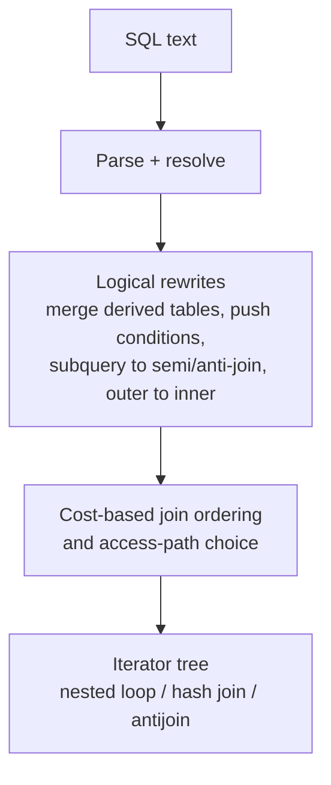

## Introduction

The previous lesson, [Relational Algebra I](/lessons/m01-relational-algebra-basics), defined six primitive operators. The Cartesian product was the odd one out: it is rarely useful on its own, because pairing every student with every department produces mostly meaningless tuples. What we almost always want is the subset of the product in which the tuples *belong together* — the student with **their** department, the enrollment with **its** section. That is a **join**, and joins are where relational queries get both their power and most of their cost.

This lesson builds the whole join family from the primitives:

- **θ-join, equi-join and natural join** — "product, then selection" in increasingly specific forms.
- **Outer joins** — joins that keep unmatched tuples by padding them with NULLs.
- **Semi-join and anti-join** — "rows of R that have / do not have a partner in S". They are what SQL's `EXISTS`, `IN`, `NOT EXISTS` and `NOT IN` compute, and MySQL has dedicated execution strategies for them.
- **Division** — "students who have taken *every* required course", the operator behind universal ("for all") questions.

Then it turns to **query trees** and the **algebraic equivalences** that make query optimization possible. You will watch MySQL 8 push selections below joins, reorder joins, merge derived tables, convert subqueries into semi-joins and anti-joins, and turn an outer join into an inner join — all visible in `EXPLAIN FORMAT=TREE`.

This is a theory lesson with real execution. The day-to-day SQL of joins is taught in Module 4 ([Inner Joins](/lessons/m04-inner-join), [Outer Joins](/lessons/m04-outer-joins), [EXISTS, IN and Anti-Joins](/lessons/m04-exists-in)) and their tuning in Module 7 ([Optimizing Joins](/lessons/m07-optimizing-joins)). Here the goal is to know exactly *which operator* a query is and *why* the optimizer may rewrite it.

:::note[Dataset]
The examples use the **university** dataset plus tiny tables (`emp`, `dept`, `band`, `took`, `required`) created in the lesson, so every result can be checked by eye. All outputs were captured from a real MySQL server.
:::

## DBMS Theory

:::theory[The join family as derived operators]
Let R(A₁…Aₙ) and S(B₁…Bₘ) be relations and θ a predicate over their attributes.

| Operator | Notation | Definition in terms of primitives |
|---|---|---|
| θ-join | R ⋈<sub>θ</sub> S | σ<sub>θ</sub>(R × S) |
| Equi-join | R ⋈<sub>R.a = S.b</sub> S | a θ-join whose θ is a conjunction of equalities |
| Natural join | R ⋈ S | π<sub>attrs(R) ∪ attrs(S)</sub>(σ<sub>R.C = S.C for every common attribute C</sub>(R × S)) — equate *all* same-named attributes and keep one copy of each |
| Left outer join | R ⟕<sub>θ</sub> S | (R ⋈<sub>θ</sub> S) ∪ ((R − π<sub>attrs(R)</sub>(R ⋈<sub>θ</sub> S)) × {(NULL, …, NULL)}) |
| Right outer join | R ⟖<sub>θ</sub> S | symmetric: keep unmatched S tuples |
| Full outer join | R ⟗<sub>θ</sub> S | (R ⟕<sub>θ</sub> S) ∪ (R ⟖<sub>θ</sub> S) |
| Semi-join | R ⋉<sub>θ</sub> S | π<sub>attrs(R)</sub>(R ⋈<sub>θ</sub> S) — R tuples that have at least one partner |
| Anti-join | R ▷<sub>θ</sub> S | R − (R ⋉<sub>θ</sub> S) — R tuples with no partner |
| Division | R(A, B) ÷ S(B) | π<sub>A</sub>(R) − π<sub>A</sub>((π<sub>A</sub>(R) × S) − R) |

**Division** answers universal questions: R ÷ S = { a ∣ ∀b ∈ S : (a, b) ∈ R } — the A-values that are paired in R with **every** B-value in S.
:::

The definitions encode facts you should be able to use without looking them up:

- **A join never produces a tuple that is not in the product.** It only *filters* the product. So |R ⋈ S| ≤ |R| · |S|, and the result can be larger than either input: a one-to-many join returns one row per "many" side tuple.
- **Semi-join and anti-join never duplicate R's tuples and never add S's attributes.** That is the essential difference between `WHERE EXISTS (…)` and an inner join: the join returns one row per matching *pair*, the semi-join one row per qualifying *R tuple*.
- **Outer joins are not associative in general** and do not commute with selections on the padded side. Inner joins are commutative and associative — which is what lets an optimizer reorder them freely.
- **Natural join is fragile by construction.** It equates every pair of same-named attributes, so adding a column such as `name` or `updated_at` to both tables silently changes its meaning.
- **Division is the dual of the semi-join.** Semi-join is "∃ a partner"; division is "∀ required values, a partner exists" — which in SQL becomes a double negation, "there is no required value without a partner".

### Query trees

A relational algebra expression is a tree: leaves are base relations, internal nodes are operators, and the root produces the result. "Students in 2024 Data Science sections" can be written

π<sub>name</sub>(σ<sub>dept_id = 2 ∧ year = 2024</sub>(Students ⋈ Enrollments ⋈ Sections ⋈ Courses))

— a **canonical** tree in which all selections sit on top of the joins. An equivalent tree pushes σ<sub>year = 2024</sub> down onto Sections and σ<sub>dept_id = 2</sub> onto Courses, so the joins see far fewer tuples. The optimizer's job is to find, among all equivalent trees, the one whose physical execution is cheapest.

### The equivalence rules optimizers use

| # | Rule | Name |
|---|---|---|
| 1 | σ<sub>θ₁∧θ₂</sub>(E) ≡ σ<sub>θ₁</sub>(σ<sub>θ₂</sub>(E)) | cascade of selection |
| 2 | σ<sub>θ</sub>(E₁ ⋈ E₂) ≡ σ<sub>θ</sub>(E₁) ⋈ E₂ if θ uses only E₁'s attributes | **selection pushdown** |
| 3 | σ<sub>θ</sub>(E₁ × E₂) ≡ E₁ ⋈<sub>θ</sub> E₂ | product + selection = join |
| 4 | E₁ ⋈ E₂ ≡ E₂ ⋈ E₁ | join commutativity |
| 5 | (E₁ ⋈ E₂) ⋈ E₃ ≡ E₁ ⋈ (E₂ ⋈ E₃) | join associativity → **join reordering** |
| 6 | π<sub>L</sub>(E₁ ⋈<sub>θ</sub> E₂) ≡ π<sub>L</sub>(π<sub>L₁</sub>(E₁) ⋈<sub>θ</sub> π<sub>L₂</sub>(E₂)) where Lᵢ keeps L's and θ's attributes of Eᵢ | projection pushdown |
| 7 | σ<sub>θ</sub>(E₁ ⟕ E₂) ≡ σ<sub>θ</sub>(E₁ ⋈ E₂) if θ rejects NULLs in E₂'s attributes | outer-to-inner conversion |
| 8 | R ⋉ S ≡ R ⋈ S when the join attributes are a key of S | semi-join to join |

Rules 4 and 5 hold for inner joins (with attribute order ignored); none of them can be applied blindly to outer joins, which is why outer joins constrain the optimizer.

## Why It Exists

Normalization (Module 6) deliberately splits information across relations so that each fact is stored once: a student's department *name* lives in `departments`, not in every student row. The price of that design is that almost every useful question needs to **recombine** relations — and the join is the operator that does it. Without a formal join:

- **Every query would be a product.** Writing σ over × by hand is correct but hides intent; worse, an execution engine that literally computed the product first would be hopeless (40 students × 146 enrollments × 24 sections × 15 courses is over two million combinations for a tiny dataset).
- **"Has / has not" and "for all" questions would have no clean expression.** Semi-joins, anti-joins and division give names and dedicated algorithms to the patterns behind "customers who ordered", "products never sold" and "suppliers who supply every part".
- **Optimizers would have nothing to reason with.** The equivalence rules are what turn a declarative query into an efficient plan. Selection pushdown alone routinely reduces intermediate results by orders of magnitude; choosing a good join order can make the difference between milliseconds and hours.

The cost of *not* understanding the algebra appears as bugs: duplicated rows from joining when a semi-join was meant, lost rows from a `WHERE` clause that silently turned a `LEFT JOIN` into an inner join, a natural join that matches on an unintended column, and division written as "at least one" instead of "all".

## Internal Working

:::internals[How MySQL executes joins, semi-joins and anti-joins]
**Join algorithms.** MySQL 8 executes joins as a left-deep pipeline of iterators:

- **Nested-loop join** — for each row of the outer input, look up matching rows in the inner input, ideally through an index (`Index lookup`, `Single-row index lookup` on a primary/unique key). Cost ≈ outer rows × cost of one lookup.
- **Hash join** (8.0.18+) — build an in-memory hash table on one input's join key, then probe it with each row of the other input. Used when there is no useful index for an equi-join; since 8.0.20 it also handles outer, semi- and anti-joins and has replaced the old block nested-loop algorithm. A join with no condition at all (a product) appears as `Inner hash join (no condition)`.

**Semi-join strategies.** For `IN (subquery)` and `EXISTS (subquery)` the optimizer can convert the subquery into a semi-join and execute it by **table pull-out** (convert to an ordinary join when the subquery side is unique on the join key — rule 8), **FirstMatch** (stop scanning the inner side at the first match), **LooseScan**, **materialization** into a deduplicated temporary table, or **duplicate weedout**.

**Anti-join** (8.0.17+). `NOT EXISTS` and `NOT IN` (when NULL semantics permit) are transformed into an anti-join, shown as `Nested loop antijoin` or `Hash antijoin`.

**Join ordering.** For inner joins the optimizer searches join orders (a greedy/exhaustive search bounded by `optimizer_search_depth`) using cost estimates from index statistics, and picks the order with the lowest estimated cost — regardless of the order you wrote the tables.
:::



**What MySQL does not have.** There is no `FULL OUTER JOIN` in MySQL (you emulate it with `UNION`), no `NATURAL FULL JOIN`, and no division operator in any SQL dialect — division is always expressed with `NOT EXISTS` or with grouping and counting.

:::standard[Standard SQL vs MySQL]
Standard: `INNER JOIN … ON`, `NATURAL JOIN`, `JOIN … USING (…)`, `LEFT/RIGHT/FULL [OUTER] JOIN`, `CROSS JOIN`, `[NOT] EXISTS`, `[NOT] IN (subquery)`. MySQL extensions: `JOIN` / `INNER JOIN` / `CROSS JOIN` may be used with or without `ON` (all three are synonyms in MySQL), and `STRAIGHT_JOIN` forces the written join order. MySQL **lacks** `FULL OUTER JOIN`. In MySQL, `FULL` is not a reserved word — so `a FULL JOIN b` parses `FULL` as a table alias for `a` (see Common Mistakes).
:::

## MySQL Implementation

Create two small relations with deliberately "dangling" tuples: an employee with no department and a department with no employees.

```sql run
CREATE TABLE dept (dept_id INT PRIMARY KEY, dname VARCHAR(10) NOT NULL);
CREATE TABLE emp  (eid INT PRIMARY KEY, name VARCHAR(10) NOT NULL,
                   dept_id INT NULL, salary INT NOT NULL);
INSERT INTO dept VALUES (10, 'Sales'), (20, 'Ops'), (30, 'Legal');
INSERT INTO emp  VALUES (1, 'Ada', 10, 5000), (2, 'Bo', 20, 7000),
                        (3, 'Cy', 20, 4000), (4, 'Di', NULL, 9000);
SELECT * FROM emp ORDER BY eid;
```

### Equi-join: Emp ⋈<sub>Emp.dept_id = Dept.dept_id</sub> Dept

```sql run
SELECT e.eid, e.name, e.dept_id, d.dept_id AS d_dept_id, d.dname
FROM emp AS e
JOIN dept AS d ON d.dept_id = e.dept_id
ORDER BY e.eid;
```

Three tuples. Di (NULL department) has no partner because `NULL = 10` is UNKNOWN, and Legal has no employee. The equi-join keeps both `dept_id` columns — they are equal in every row, but the algebra (and SQL) keeps them as two attributes.

### Natural join and USING

```sql run
SELECT * FROM emp NATURAL JOIN dept ORDER BY eid;
```

`NATURAL JOIN` found the only common attribute name, `dept_id`, joined on it and kept a single copy, placed first. `JOIN … USING (dept_id)` does the same with the column list written explicitly — the safer choice, as the Common Mistakes section shows.

### θ-join with a non-equality predicate

Salary bands are a classic θ-join: the predicate is a range, not an equality.

```sql run
CREATE TABLE band (band CHAR(2) PRIMARY KEY, lo INT NOT NULL, hi INT NOT NULL);
INSERT INTO band VALUES ('B1', 0, 4999), ('B2', 5000, 7999), ('B3', 8000, 99999);
-- Emp ⋈ (salary ≥ lo ∧ salary ≤ hi) Band
SELECT e.name, e.salary, b.band
FROM emp AS e
JOIN band AS b ON e.salary BETWEEN b.lo AND b.hi
ORDER BY e.eid;
```

### Outer joins

```sql run
-- Emp ⟕ Dept: every employee, department columns NULL-padded when there is no match
SELECT e.name, d.dname
FROM emp AS e LEFT JOIN dept AS d ON d.dept_id = e.dept_id
ORDER BY e.eid;
```

```sql run
-- Emp ⟖ Dept: every department, employee columns NULL-padded when there is none
SELECT e.name, d.dname
FROM emp AS e RIGHT JOIN dept AS d ON d.dept_id = e.dept_id
ORDER BY d.dept_id, e.eid;
```

MySQL has no `FULL OUTER JOIN`. Its definition, R ⟗ S = (R ⟕ S) ∪ (R ⟖ S), gives the standard emulation:

```sql run
-- Emp ⟗ Dept emulated as (left join) UNION (right join)
SELECT e.name, d.dname FROM emp AS e LEFT  JOIN dept AS d ON d.dept_id = e.dept_id
UNION
SELECT e.name, d.dname FROM emp AS e RIGHT JOIN dept AS d ON d.dept_id = e.dept_id
ORDER BY dname IS NULL, dname, name;
```

Five tuples: the three matches, Di with a NULL department, and Legal with a NULL employee. `UNION` (distinct) removes the matched tuples that both halves produce — which is correct here only because each output row contains a key-like value. When matched rows can legitimately repeat, use `UNION ALL` with the second half restricted to unmatched rows (`… RIGHT JOIN … WHERE e.eid IS NULL`), shown in Alternative Approaches.

### Semi-join and anti-join

```sql run
-- Dept ⋉ Emp: departments that have at least one employee
SELECT d.* FROM dept AS d
WHERE EXISTS (SELECT 1 FROM emp AS e WHERE e.dept_id = d.dept_id)
ORDER BY d.dept_id;
```

```sql run
-- Dept ▷ Emp: departments with no employee
SELECT d.* FROM dept AS d
WHERE NOT EXISTS (SELECT 1 FROM emp AS e WHERE e.dept_id = d.dept_id)
ORDER BY d.dept_id;
```

Compare the semi-join with the inner join on the same predicate: Ops has two employees, so the join returns Ops **twice**, while the semi-join returns it **once** and adds no `emp` columns.

```sql run
SELECT d.dept_id, d.dname FROM dept AS d JOIN emp AS e ON e.dept_id = d.dept_id
ORDER BY d.dept_id;
```

### Division

Which students have taken **every** required course?

```sql run
CREATE TABLE took     (student VARCHAR(10), course VARCHAR(10), PRIMARY KEY (student, course));
CREATE TABLE required (course VARCHAR(10) PRIMARY KEY);
INSERT INTO took VALUES
  ('Ana','DB'), ('Ana','OS'), ('Ana','ML'),
  ('Ben','DB'), ('Ben','ML'),
  ('Cara','DB'), ('Cara','OS'), ('Cara','ML'), ('Cara','AI'),
  ('Dev','OS');
INSERT INTO required VALUES ('DB'), ('ML');
-- Took ÷ Required: students s such that no required course is missing from s's courses
SELECT DISTINCT t.student
FROM took AS t
WHERE NOT EXISTS (
  SELECT 1 FROM required AS r
  WHERE NOT EXISTS (
    SELECT 1 FROM took AS t2
    WHERE t2.student = t.student AND t2.course = r.course))
ORDER BY t.student;
```

Read the double negation aloud: "students for whom there does **not exist** a required course that they have **not** taken". Logically, ∀r (took(s, r)) ≡ ¬∃r (¬took(s, r)). Ana, Ben and Cara qualify; Dev has taken neither DB nor ML. Cara has taken an extra course — division asks for "at least all", not "exactly".

## Syntax Breakdown

| SQL | Algebra | Notes |
|---|---|---|
| `R JOIN S ON θ` / `INNER JOIN` | R ⋈<sub>θ</sub> S | θ can be any predicate; equalities make it an equi-join. |
| `R JOIN S USING (c1, c2)` | equi-join on the listed common columns, one copy kept | Columns must exist with the same name in both. Coalesced columns come first in `SELECT *`. |
| `R NATURAL JOIN S` | R ⋈ S | Joins on **all** same-named columns. If there are none, it degenerates to a product. |
| `R CROSS JOIN S`, `R, S` | R × S | In MySQL, `JOIN` without `ON` is also a product. Comma has lower precedence than `JOIN` — mixing them can break `ON` references. |
| `R LEFT [OUTER] JOIN S ON θ` | R ⟕<sub>θ</sub> S | Unmatched R rows padded with NULLs. Conditions in `ON` decide matching; conditions in `WHERE` filter afterwards. |
| `R RIGHT [OUTER] JOIN S ON θ` | R ⟖<sub>θ</sub> S | MySQL internally rewrites it as a LEFT JOIN with the operands swapped. |
| `… UNION …` of LEFT and RIGHT joins | R ⟗<sub>θ</sub> S | No `FULL OUTER JOIN` in MySQL. |
| `WHERE EXISTS (SELECT … WHERE θ)` | R ⋉<sub>θ</sub> S | Also `WHERE a IN (SELECT b …)`. |
| `WHERE NOT EXISTS (…)` | R ▷<sub>θ</sub> S | `NOT IN` is equivalent only if neither side can be NULL. |
| `NOT EXISTS (… NOT EXISTS (…))` | R ÷ S | Or `GROUP BY … HAVING COUNT(DISTINCT …) = (SELECT COUNT(*) …)`. |
| `STRAIGHT_JOIN` | — | MySQL hint: join tables in the written order. Disables join reordering (rule 5) for that join. |

:::warning[ON versus WHERE in outer joins]
In `R LEFT JOIN S ON θ WHERE φ`, θ is part of the outer-join operator, while φ is a selection **above** it: σ<sub>φ</sub>(R ⟕<sub>θ</sub> S). If φ references S's columns and rejects NULLs (e.g. `S.status = 'active'`), the padded rows are filtered out and the outer join behaves as an inner join — rule 7. Put conditions on S that should affect *matching* in `ON`.
:::

## Practical Examples

**1. A four-way join and its query tree.** Students enrolled in a 2024 section of a Data Science (dept 2) course:

```sql run
SELECT DISTINCT s.student_id, s.name
FROM students AS s
JOIN enrollments AS e ON e.student_id = s.student_id
JOIN sections    AS sec ON sec.section_id = e.section_id
JOIN courses     AS c ON c.course_id = sec.course_id
WHERE c.dept_id = 2 AND sec.year = 2024
ORDER BY s.student_id;
```

Algebraically: δ(π<sub>student_id, name</sub>(σ<sub>dept_id=2 ∧ year=2024</sub>(Students ⋈ Enrollments ⋈ Sections ⋈ Courses))). `DISTINCT` is needed because a student enrolled in two qualifying sections would otherwise appear twice — the join returns one row per (student, enrollment) pair. Asking the question as a **semi-join** makes `DISTINCT` unnecessary:

```sql run
SELECT s.student_id, s.name
FROM students AS s
WHERE EXISTS (SELECT 1
              FROM enrollments AS e
              JOIN sections AS sec ON sec.section_id = e.section_id
              JOIN courses  AS c   ON c.course_id = sec.course_id
              WHERE e.student_id = s.student_id
                AND c.dept_id = 2 AND sec.year = 2024)
ORDER BY s.student_id;
```

Both return the same students — Students ⋉ (Enrollments ⋈ σ(Sections) ⋈ σ(Courses)).

**2. Anti-join on real data.** Students with no advisor (every fourth student, according to the dataset description):

```sql run
SELECT s.student_id, s.name
FROM students AS s
WHERE NOT EXISTS (SELECT 1 FROM advisors AS a WHERE a.student_id = s.student_id)
ORDER BY s.student_id;
```

**3. Division on real data.** Students who have taken every Mathematics (dept 3) course. The "took" relation must first be derived — π<sub>student_id, course_id</sub>(Enrollments ⋈ Sections) — and the divisor is π<sub>course_id</sub>(σ<sub>dept_id=3</sub>(Courses)):

```sql run
SELECT s.student_id, s.name
FROM students AS s
WHERE NOT EXISTS (
  SELECT 1 FROM courses AS c
  WHERE c.dept_id = 3
    AND NOT EXISTS (
      SELECT 1 FROM enrollments AS e
      JOIN sections AS sec ON sec.section_id = e.section_id
      WHERE e.student_id = s.student_id AND sec.course_id = c.course_id))
ORDER BY s.student_id;
```

Only students who have taken both MATH-042 and MATH-161A qualify.

**4. Selection pushdown, seen in the plan.** Write the selections on top of a derived table and let the optimizer move them:

```sql run
EXPLAIN FORMAT=TREE
SELECT t.name, d.name AS dept
FROM (SELECT * FROM students WHERE enrollment_year = 2023) AS t
JOIN departments AS d ON d.dept_id = t.dept_id
WHERE d.budget > 1000000;
```

Read the plan bottom-up. The derived table has disappeared (it was *merged* into the outer query), `d.budget > 1000000` is applied directly to the scan of `departments` before the join (rule 2), and `enrollment_year = 2023` is applied to the `students` rows right where they are fetched by the index lookup. No step ever materializes the full join.

## Execution Walkthrough

Trace how the optimizer transforms the four-way join from Practical Example 1, using the plan MySQL actually chose.

```walkthrough
title: Students in 2024 Data Science sections — from canonical tree to physical plan
steps:
  - title: "1. The canonical tree"
    explain: >-
      As written, the query is σ(dept_id = 2 ∧ year = 2024) on top of Students ⋈ Enrollments ⋈ Sections ⋈ Courses,
      joined in the order the tables appear. A naive engine would join everything and filter at the end.
      The sizes involved are shown here.
    sql: |
      SELECT (SELECT COUNT(*) FROM students) AS students,
             (SELECT COUNT(*) FROM enrollments) AS enrollments,
             (SELECT COUNT(*) FROM sections) AS sections,
             (SELECT COUNT(*) FROM courses) AS courses;
  - title: "2. Push selections down (rule 2)"
    explain: >-
      year = 2024 references only sections and dept_id = 2 only courses, so each selection can move below the
      joins onto its own relation. These are the two filtered leaves.
    sql: |
      SELECT 'sections, year = 2024' AS leaf, COUNT(*) AS rows_left FROM sections WHERE year = 2024
      UNION ALL
      SELECT 'courses, dept_id = 2', COUNT(*) FROM courses WHERE dept_id = 2;
  - title: "3. Reorder the joins (rules 4 and 5)"
    explain: >-
      Inner joins commute and associate, so the optimizer may start from whichever relation is cheapest.
      In the captured plan it starts from the 4 Data Science courses (an index lookup on dept_id = 2), finds
      each course's sections through the index that begins with course_id and filters them on year = 2024,
      then finds enrollments through the index on section_id, and finally fetches each student by primary
      key. Students — written first — is joined last. (The exact order is a cost decision; another server
      version or different statistics may start from the filtered sections instead. Both are valid trees.)
    sql: |
      EXPLAIN FORMAT=TREE
      SELECT DISTINCT s.student_id, s.name
      FROM students AS s
      JOIN enrollments AS e ON e.student_id = s.student_id
      JOIN sections    AS sec ON sec.section_id = e.section_id
      JOIN courses     AS c ON c.course_id = sec.course_id
      WHERE c.dept_id = 2 AND sec.year = 2024;
  - title: "4. Intermediate result before projection"
    explain: >-
      This is the join result just before π and δ: one row per qualifying enrollment. Notice that some
      students appear more than once — the reason the query needs DISTINCT (or a semi-join).
    sql: |
      SELECT s.student_id, s.name, sec.section_id, sec.course_id
      FROM sections AS sec
      JOIN courses AS c ON c.course_id = sec.course_id AND c.dept_id = 2
      JOIN enrollments AS e ON e.section_id = sec.section_id
      JOIN students AS s ON s.student_id = e.student_id
      WHERE sec.year = 2024
      ORDER BY s.student_id, sec.section_id;
```

The same equivalences explain what happens to subqueries. Watch the optimizer turn `EXISTS` into a join (rule 8: `advisors.student_id` is the primary key of `advisors`, so each student has at most one partner and the semi-join equals the join):

```sql run
EXPLAIN FORMAT=TREE
SELECT s.student_id FROM students AS s
WHERE EXISTS (SELECT 1 FROM advisors AS a WHERE a.student_id = s.student_id);
```

`NOT EXISTS` becomes an anti-join iterator:

```sql run
EXPLAIN FORMAT=TREE
SELECT s.student_id FROM students AS s
WHERE NOT EXISTS (SELECT 1 FROM advisors AS a WHERE a.student_id = s.student_id);
```

And a `LEFT JOIN` whose `WHERE` clause rejects NULLs on the right side is simplified to an inner join (rule 7) — the plan says `inner join`, not `left join`:

```sql run
EXPLAIN FORMAT=TREE
SELECT s.student_id, a.instructor_id
FROM students AS s LEFT JOIN advisors AS a ON a.student_id = s.student_id
WHERE a.instructor_id = 1001;
```

## Output

The final output of the walkthrough query is the deduplicated list of students from step 4. To read join results correctly, keep three questions in mind:

1. **What is one row?** In an inner join, one row is one *matching combination*. In a semi-join, it is one row of the outer relation. Getting this wrong is the source of most double-counting.
2. **Where did the NULLs come from?** In an outer join, a NULL in the padded side's columns can mean "no match" *or* "matched a row whose value is NULL". Test a NOT NULL column of the padded side (usually its primary key) to tell them apart.
3. **What did the optimizer change?** The result is defined by the algebra, not by the plan. The plan explains cost; if two equivalent trees give different results, one of them was not actually equivalent (typically an outer-join rewrite done by hand).

For the plans above: `Nested loop antijoin` means the anti-join was executed by probing a deduplicated, materialized copy of `advisors.student_id` for each student; `Single-row index lookup … using PRIMARY` means a primary-key lookup returning at most one row; and a `Filter` directly above a table or index access is a selection that was pushed down to that leaf.

## Alternative Approaches

**Semi-join:** `EXISTS`, `IN (subquery)`, `JOIN` + `DISTINCT`, or `JOIN` on a deduplicated derived table. Modern MySQL usually produces the same plan for `EXISTS` and `IN`; `JOIN` + `DISTINCT` does extra work (it builds all pairs, then deduplicates) and changes the meaning if you also select columns of the inner table.

**Anti-join:** `NOT EXISTS`, `LEFT JOIN … WHERE inner.pk IS NULL`, `NOT IN` (only with non-nullable columns), or `EXCEPT` on projected keys (8.0.31+).

```sql run
-- Dept ▷ Emp three ways; all return Legal
SELECT d.dname FROM dept AS d LEFT JOIN emp AS e ON e.dept_id = d.dept_id WHERE e.eid IS NULL
UNION ALL
SELECT d.dname FROM dept AS d WHERE d.dept_id IN (SELECT dept_id FROM dept EXCEPT SELECT dept_id FROM emp)
UNION ALL
SELECT d.dname FROM dept AS d WHERE NOT EXISTS (SELECT 1 FROM emp AS e WHERE e.dept_id = d.dept_id);
```

**Full outer join without double-counting:** keep all of the left join, then add only the unmatched rows of the right side.

```sql run
SELECT e.name, d.dname FROM emp AS e LEFT JOIN dept AS d ON d.dept_id = e.dept_id
UNION ALL
SELECT NULL, d.dname FROM dept AS d
WHERE NOT EXISTS (SELECT 1 FROM emp AS e WHERE e.dept_id = d.dept_id)
ORDER BY dname IS NULL, dname, name;
```

This version is correct even when matched rows legitimately repeat, and avoids `UNION`'s deduplication.

**Division by counting:** a student qualifies if the number of *distinct required courses* they have taken equals the number of required courses.

```sql run
SELECT t.student
FROM took AS t
JOIN required AS r ON r.course = t.course
GROUP BY t.student
HAVING COUNT(DISTINCT t.course) = (SELECT COUNT(*) FROM required)
ORDER BY t.student;
```

| Division form | Strengths | Pitfalls |
|---|---|---|
| Double `NOT EXISTS` | Direct translation of ∀; correct for an empty divisor (every candidate qualifies — vacuous truth) | Harder to read; correlated subqueries need indexes |
| `GROUP BY … HAVING COUNT(DISTINCT) = (SELECT COUNT(*) …)` | Easy to read; one pass with grouping; easy to change to "exactly" or "at least k" | Must join to the divisor first (or extra courses are counted); returns nothing for an empty divisor; needs `DISTINCT` if the dividend can contain duplicates |
| `EXCEPT`-based π<sub>A</sub>(R) − π<sub>A</sub>((π<sub>A</sub>(R) × S) − R) | Literal algebra | Verbose; builds a product |

## Performance Analysis

| Operator | Typical MySQL execution | Cost driver | What helps |
|---|---|---|---|
| Equi-join | Nested loop with index lookup, or hash join | Outer rows × lookup cost; or build + probe sizes | Index on the inner table's join column (InnoDB does *not* automatically index the referenced side, but it does require an index on foreign-key columns) |
| θ-join (range/inequality) | Nested loop; range scan on the inner side if indexed | Often close to \|R\| · \|S\| | Narrow ranges, an index on the range column, pre-filtering both sides |
| Outer join | Nested loop / hash outer join | As inner join, but the outer side's order is fixed | Same indexes; avoid needless outer joins (rule 7 helps automatically) |
| Semi-join | Table pull-out, FirstMatch, LooseScan, materialization, duplicate weedout | Can stop at first match | Index on the correlation column |
| Anti-join | Nested loop / hash antijoin | Must prove absence: inner side probed for each outer row | Index on the correlation column; NOT NULL columns so NOT IN can also be converted |
| Division | Two nested anti-joins, or grouping | \|candidates\| × \|divisor\| probes | Composite index on the dividend (student, course) |

:::performance[Theory vs measurement]
The plans in this lesson were captured on tiny tables, where the optimizer's cost numbers are close to meaningless and every query finishes in microseconds. What transfers to large tables is the plan *shape*: where filters sit, which table drives the join, whether a subquery became a semi-/anti-join. Module 7 ([Optimizing Joins](/lessons/m07-optimizing-joins) and [Optimizing Subqueries](/lessons/m07-optimizing-subqueries)) measures these on generated data with `EXPLAIN ANALYZE`.
:::

The single most important performance idea in this lesson is **selection pushdown combined with join reordering**. Join cost grows with the size of the inputs; filtering before joining shrinks them; starting the join pipeline from the most selective filtered relation shrinks every subsequent step. That is exactly what the walkthrough plan did — it began with the 4 Data Science courses rather than with all 40 students, and applied the year filter to each course's sections before touching any enrollment.

## Best Practices

:::best-practice[Professional habits]
1. **Use explicit `JOIN … ON`.** It keeps join predicates next to the join and makes a missing predicate (an accidental product) obvious. Avoid the comma join in new code.
2. **Prefer `USING` or `ON` over `NATURAL JOIN`.** A natural join's meaning changes when someone adds a same-named column to either table.
3. **Ask "one row per what?" before choosing join vs semi-join.** If you only need rows of R that have a partner, write `EXISTS`/`IN` — not `JOIN` + `DISTINCT`.
4. **Write anti-joins as `NOT EXISTS`** (or `LEFT JOIN … IS NULL` on the inner table's primary key). Use `NOT IN` only with non-nullable columns.
5. **Put matching conditions for the optional side of an outer join in `ON`,** and filters on the preserved side in `WHERE`.
6. **Index join columns on the inner side** — typically the foreign-key column of the "many" table and the primary key of the "one" table.
7. **Let the optimizer reorder.** Write the query for clarity; reach for `STRAIGHT_JOIN` or optimizer hints only after `EXPLAIN ANALYZE` proves a bad choice and fresh statistics (`ANALYZE TABLE`) do not fix it.
8. **For "for all" questions, write division explicitly** and test it against an empty divisor and an "extra values" case.
:::

## Common Mistakes

**Mistake 1 — `NATURAL JOIN` on an unintended column.** `students` and `departments` share **two** column names: `dept_id` and `name`.

```sql run
SELECT COUNT(*) AS natural_join_rows FROM students NATURAL JOIN departments;
```

```sql run
SELECT COUNT(*) AS using_rows FROM students JOIN departments USING (dept_id);
```

The natural join requires the student's name to equal the department's name, so it returns no rows. `USING (dept_id)` returns one row per student with a declared department.

**Mistake 2 — `FULL JOIN` in MySQL.** Because `FULL` is not reserved, MySQL reads it as an alias:

```sql run
-- Looks like a full outer join; actually "emp AS full INNER JOIN dept"
SELECT * FROM emp FULL JOIN dept USING (dept_id) ORDER BY eid;
```

Only the three matching rows come back — this is an inner join, with Di and Legal silently lost. The only hint is warning 4119 (*"Using FULL as unquoted identifier is deprecated"*), which most applications never read. Writing `FULL OUTER JOIN` at least fails loudly:

```sql run error
SELECT * FROM emp FULL OUTER JOIN dept USING (dept_id);
```

Use the `UNION` emulation shown above.

**Mistake 3 — a `WHERE` clause that cancels the outer join.**

```sql run
-- Intended: all employees, with their department if it is 'Ops'
SELECT e.name, d.dname
FROM emp AS e LEFT JOIN dept AS d ON d.dept_id = e.dept_id
WHERE d.dname = 'Ops'
ORDER BY e.eid;
```

```sql run
-- Correct: the condition belongs to the matching (ON), so non-Ops employees are kept with NULL
SELECT e.name, d.dname
FROM emp AS e LEFT JOIN dept AS d ON d.dept_id = e.dept_id AND d.dname = 'Ops'
ORDER BY e.eid;
```

The first query returns only Bo and Cy: the selection above the outer join removed every NULL-padded row (rule 7 — MySQL even converts it to an inner join). The second keeps all four employees.

**Mistake 4 — join instead of semi-join, then counting.**

```sql run
-- Wrong: counts (department, employee) pairs, not departments
SELECT COUNT(*) AS depts_with_staff FROM dept AS d JOIN emp AS e ON e.dept_id = d.dept_id;
```

```sql run
SELECT COUNT(*) AS depts_with_staff FROM dept AS d
WHERE EXISTS (SELECT 1 FROM emp AS e WHERE e.dept_id = d.dept_id);
```

Three pairs versus two departments.

**Mistake 5 — "all" written as "any".** `SELECT student FROM took WHERE course IN (SELECT course FROM required)` returns students who took *at least one* required course (a semi-join), not *all* of them (division). Dev would be excluded only because he took none; a student who took just DB would wrongly qualify.

## Industry Application

- **Reading execution plans.** Production query reviews are conversations in algebra: "the filter is not pushed into the derived table", "the semi-join was executed with materialization", "the optimizer picked the big table as the driving table". Engineers who can map `EXPLAIN` output back to σ, ⋈, ⋉ and ▷ diagnose slow queries faster.
- **Reconciliation and data quality.** Anti-joins find orphans ("order items whose product no longer exists", "payments without an order"); full outer joins compare two systems (CRM versus billing) and classify rows as only-left, only-right or both. In MySQL both are written with the patterns from this lesson.
- **Entitlements and compliance.** Division answers "which users have *all* required trainings", "which suppliers can deliver *every* part in this bill of materials", "which accounts have signed *every* mandatory agreement". The `GROUP BY … HAVING COUNT` form is the most common in production code; the double `NOT EXISTS` form is preferred when an empty requirement list must mean "everyone qualifies".
- **Distributed query engines.** Spark, Trino and cloud warehouses use the same equivalences plus extra ones (broadcast joins, semi-join reduction across nodes, dynamic partition pruning). The semi-join is particularly important there: shipping only the *keys* that have partners across the network is the classic distributed-join optimization.
- **ORMs.** ORM-generated SQL often uses `JOIN` + `DISTINCT` where `EXISTS` was meant, or `LEFT JOIN` + `WHERE` that silently becomes an inner join. Recognizing these patterns in logs is a routine performance and correctness task.

## Practice Exercises

All exercises use the **university** dataset unless they define their own tables.

```exercise
id: ex1
title: Sections with their course titles (equi-join)
difficulty: easy
concepts: [equi-join]
prompt: |
  Return `section_id`, `course_id` and the course `title` for every section offered in the **Fall 2024** term
  (`term = 'Fall'`, `year = 2024`).
hints:
  - "Sections ⋈ Courses on course_id, then select the term."
  - "JOIN courses AS c ON c.course_id = s.course_id, and filter term and year in WHERE."
solution: |
  SELECT s.section_id, s.course_id, c.title
  FROM sections AS s
  JOIN courses AS c ON c.course_id = s.course_id
  WHERE s.term = 'Fall' AND s.year = 2024;
explanation: |
  Every section references an existing course (a foreign key), so an inner join loses no sections.
  `JOIN courses USING (course_id)` works too; `NATURAL JOIN` happens to work here only because the two tables
  share no other column name — a fragile assumption.
```

```exercise
id: ex2
title: Students who took any Data Science course (semi-join)
difficulty: medium
concepts: [semi-join, equi-join]
prompt: |
  Return `student_id` and `name` of every student with at least one enrollment in a course of department 2
  (Data Science). Each student must appear **once**.
hints:
  - "This is Students ⋉ (Enrollments ⋈ Sections ⋈ σ dept_id = 2 (Courses))."
  - "Use WHERE EXISTS (…) with a correlated subquery, or IN (SELECT student_id …)."
solution: |
  SELECT s.student_id, s.name
  FROM students AS s
  WHERE EXISTS (SELECT 1
                FROM enrollments AS e
                JOIN sections AS sec ON sec.section_id = e.section_id
                JOIN courses AS c ON c.course_id = sec.course_id
                WHERE e.student_id = s.student_id AND c.dept_id = 2);
explanation: |
  A plain four-way join returns one row per qualifying enrollment, so students with several Data Science
  enrollments would repeat; `JOIN` + `DISTINCT` fixes that but does more work. The semi-join returns each
  student once by definition.
```

```exercise
id: ex3
title: Courses never offered (anti-join)
difficulty: medium
concepts: [anti-join, outer-join]
prompt: |
  Return `course_id` and `title` of every course that has **no** section at all.
hints:
  - "Courses ▷ Sections on course_id."
  - "NOT EXISTS (SELECT 1 FROM sections …) or LEFT JOIN sections … WHERE section_id IS NULL."
solution: |
  SELECT c.course_id, c.title
  FROM courses AS c
  WHERE NOT EXISTS (SELECT 1 FROM sections AS s WHERE s.course_id = c.course_id);
explanation: |
  The `LEFT JOIN … WHERE s.section_id IS NULL` form must test a column that cannot be NULL in a real match
  (the primary key `section_id`); testing `s.room IS NULL` would also return a course whose section simply
  has no room assigned.
```

```exercise
id: ex4
title: CRM vs billing reconciliation (full outer join)
difficulty: hard
concepts: [outer-join, full-outer-join]
setup: |
  CREATE TABLE crm_contacts (email VARCHAR(50) PRIMARY KEY, name VARCHAR(30) NOT NULL);
  CREATE TABLE billing_accounts (email VARCHAR(50) PRIMARY KEY, plan VARCHAR(10) NOT NULL);
  INSERT INTO crm_contacts VALUES ('a@x.com','Ann'), ('b@x.com','Bob'), ('c@x.com','Cai'), ('d@x.com','Dee');
  INSERT INTO billing_accounts VALUES ('b@x.com','pro'), ('c@x.com','free'), ('e@x.com','pro'), ('f@x.com','team');
prompt: |
  Two systems store customers by email. Produce the full outer join CRM ⟗ Billing on `email` with columns
  `email` (from whichever side has it), `name`, `plan` and `status`, where `status` is `'both'`, `'crm_only'`
  or `'billing_only'`. MySQL has no FULL OUTER JOIN.
hints:
  - "Combine a LEFT JOIN (all CRM rows) with the billing rows that have no CRM partner."
  - "COALESCE(c.email, b.email) gives the email from whichever side is present; CASE on which side IS NULL gives the status."
  - "UNION ALL with an anti-join on the second branch avoids duplicating the matched rows."
solution: |
  SELECT c.email, c.name, b.plan,
         CASE WHEN b.email IS NULL THEN 'crm_only' ELSE 'both' END AS status
  FROM crm_contacts AS c LEFT JOIN billing_accounts AS b ON b.email = c.email
  UNION ALL
  SELECT b.email, NULL, b.plan, 'billing_only'
  FROM billing_accounts AS b
  WHERE NOT EXISTS (SELECT 1 FROM crm_contacts AS c WHERE c.email = b.email);
explanation: |
  The left join produces the "both" and "crm_only" rows; the second branch adds the unmatched billing rows.
  Using `UNION` of a LEFT and a RIGHT join also works here because the rows contain the key, but the
  `UNION ALL` + anti-join form never relies on deduplication and is the one to use when matched rows can
  legitimately repeat. Writing `FULL JOIN` would silently run an inner join with `FULL` as an alias.
```

```exercise
id: ex5
title: Students who took every Mathematics course (division)
difficulty: challenge
concepts: [division, anti-join]
prompt: |
  Return `student_id` and `name` of every student who has an enrollment in **every** course of the
  Mathematics department (`dept_id = 3`). A course counts as taken if the student is enrolled in any of its
  sections.
hints:
  - "This is π student_id, course_id(Enrollments ⋈ Sections) ÷ π course_id(σ dept_id = 3 (Courses))."
  - "Double negation: students for whom there is no Mathematics course without a matching enrollment."
  - "Alternative: join to the Mathematics courses, GROUP BY student and compare COUNT(DISTINCT course_id) with the number of Mathematics courses."
solution: |
  SELECT s.student_id, s.name
  FROM students AS s
  WHERE NOT EXISTS (
    SELECT 1 FROM courses AS c
    WHERE c.dept_id = 3
      AND NOT EXISTS (
        SELECT 1
        FROM enrollments AS e
        JOIN sections AS sec ON sec.section_id = e.section_id
        WHERE e.student_id = s.student_id AND sec.course_id = c.course_id));
explanation: |
  The grouping form is
  `SELECT s.student_id, s.name FROM students s JOIN enrollments e ON … JOIN sections sec ON … JOIN courses c ON c.course_id = sec.course_id WHERE c.dept_id = 3 GROUP BY s.student_id, s.name HAVING COUNT(DISTINCT c.course_id) = (SELECT COUNT(*) FROM courses WHERE dept_id = 3)`.
  `COUNT(DISTINCT …)` matters: a student enrolled in two sections of MATH-161A must not count it twice.
  A frequent wrong answer uses `IN` and returns students who took *any* Mathematics course.
```

```exercise
id: ex6
title: Optimize a query tree by hand
difficulty: hard
kind: open
concepts: [query-trees, algebraic-equivalences]
prompt: |
  Consider: "names of instructors who taught a section of a 4-credit course in 2024".

  1. Write the canonical tree: σ on top of Instructors × Sections × Courses.
  2. Transform it step by step into an efficient tree, naming each equivalence rule you apply.
  3. Explain why the optimizer could *not* apply the same reordering freely if Sections were LEFT JOINed to
     Instructors.
solution: |
  1. π<sub>name</sub>(σ<sub>I.instructor_id = S.instructor_id ∧ S.course_id = C.course_id ∧ C.credits = 4 ∧ S.year = 2024</sub>(I × S × C)).
  2. Cascade the selection (rule 1) into four selections. Push σ<sub>credits = 4</sub> down onto C and
     σ<sub>year = 2024</sub> onto S (rule 2). Combine the remaining equality selections with the products into
     joins (rule 3): π<sub>name</sub>(I ⋈ (σ<sub>year=2024</sub>(S) ⋈ σ<sub>credits=4</sub>(C))). Use
     commutativity/associativity (rules 4–5) to start from the most selective filtered relation, e.g.
     σ(C) ⋈ σ(S), then ⋈ I via its primary key. Push projections down (rule 6): from S keep only
     instructor_id and course_id; from C only course_id; from I only instructor_id and name. Finally add δ
     (DISTINCT) if an instructor who taught two such sections should appear once.
  3. Outer joins are neither commutative nor freely associative with inner joins, and selections on the
     NULL-padded side cannot be pushed below the outer join without changing the result. The preserved side
     must be produced before the optimizer can decide which rows are unmatched, so the join order is
     constrained (unless a NULL-rejecting predicate lets MySQL convert it to an inner join — rule 7).
```

## Knowledge Assessment

```quiz
- id: q1
  question: "Which definition of the θ-join R ⋈θ S is correct?"
  options: ["π θ(R × S)", "σ θ(R × S)", "σ θ(R) × σ θ(S)", "(R ∪ S) − (R ∩ S)"]
  answer: 1
  explanation: "A θ-join is a selection on the Cartesian product. Projection does not filter tuples; applying θ separately to each side is impossible when θ relates attributes of both; the last option is the symmetric difference."
  concepts: [theta-join]
- id: q2
  question: "Dept has 3 rows; one department has 2 employees, one has 1, one has none. How many rows do `Dept JOIN Emp`, `Dept ⋉ Emp` (EXISTS) and `Dept ▷ Emp` (NOT EXISTS) return?"
  options: ["3, 2, 1", "3, 3, 0", "2, 2, 1", "3, 2, 0"]
  answer: 0
  explanation: "The join returns one row per matching pair (2 + 1 = 3). The semi-join returns each department with at least one partner once (2). The anti-join returns the department without employees (1)."
  concepts: [semi-join, anti-join, equi-join]
- id: q3
  question: "`students` and `departments` both have columns `dept_id` and `name`. What does `students NATURAL JOIN departments` join on?"
  options: ["dept_id only, because it is the foreign key", "dept_id and name", "Nothing — it is a Cartesian product", "The primary keys of both tables"]
  answer: 1
  explanation: "A natural join equates every pair of same-named columns, regardless of foreign keys. Here it requires student name = department name, which returns no rows. It degenerates into a product only when there are no common column names."
  concepts: [natural-join]
- id: q4
  question: "In MySQL, `SELECT * FROM a FULL JOIN b USING (id)` runs without error. What does it return?"
  options:
    - "A full outer join of a and b"
    - "An inner join of a (aliased as FULL) with b"
    - "A left outer join"
    - "A Cartesian product"
  answer: 1
  explanation: "FULL is not a reserved word in MySQL, so it is parsed as a table alias and JOIN … USING is an inner join. MySQL does not support FULL OUTER JOIN; `FULL OUTER JOIN` raises a syntax error."
  concepts: [outer-join]
- id: q5
  type: multi
  question: "Which equivalences may the MySQL optimizer apply to a query with only INNER joins? (Select all that apply.)"
  options:
    - "Push a selection that references only one table down to that table's access"
    - "Join the tables in a different order than written"
    - "Merge a derived table into the outer query"
    - "Move a WHERE condition on the right table of a LEFT JOIN into the ON clause without changing results"
  answer: [0, 1, 2]
  explanation: "Selection pushdown, join reordering (commutativity/associativity of inner joins) and derived-table merging are standard rewrites. Moving a condition from WHERE into a LEFT JOIN's ON clause changes the result (padded rows would be kept), and the question is about inner joins anyway."
  concepts: [algebraic-equivalences]
- id: q6
  question: "A query `R LEFT JOIN S ON … WHERE S.status = 'active'` shows an inner join in EXPLAIN. Why?"
  options:
    - "MySQL does not support LEFT JOIN with WHERE"
    - "The WHERE predicate rejects NULLs on S, so NULL-padded rows could never survive; the outer join is equivalent to an inner join and MySQL simplifies it"
    - "The statistics are stale"
    - "LEFT JOIN is always executed as an inner join"
  answer: 1
  explanation: "This is outer join simplification: σ θ(R ⟕ S) ≡ σ θ(R ⋈ S) when θ is NULL-rejecting on S. Statistics affect cost, not semantics."
  concepts: [outer-join, algebraic-equivalences]
- id: q7
  question: "Which SQL pattern correctly expresses the division Took(student, course) ÷ Required(course)?"
  options:
    - "SELECT student FROM took WHERE course IN (SELECT course FROM required)"
    - "SELECT student FROM took t WHERE NOT EXISTS (SELECT 1 FROM required r WHERE NOT EXISTS (SELECT 1 FROM took t2 WHERE t2.student = t.student AND t2.course = r.course))"
    - "SELECT student FROM took NATURAL JOIN required"
    - "SELECT student FROM took EXCEPT SELECT course FROM required"
  answer: 1
  explanation: "Division is ∀, written as ¬∃¬. The IN and NATURAL JOIN versions express ∃ (at least one required course). The EXCEPT version compares students with course names — not union-compatible in meaning."
  concepts: [division]
- id: q8
  question: "If the Required relation is empty, what do the double-NOT-EXISTS and the GROUP BY … HAVING COUNT(DISTINCT …) = (SELECT COUNT(*) FROM required) forms of division return?"
  options:
    - "Both return no students"
    - "Both return every student"
    - "NOT EXISTS returns every candidate student (vacuous truth); the counting form returns no students, because the join to the empty divisor leaves no groups"
    - "Both raise an error"
  answer: 2
  explanation: "∀ over an empty set is true, so the NOT EXISTS form returns every student in the outer query. The counting form first joins to Required, which yields no rows and hence no groups. Know which behaviour your business rule requires."
  concepts: [division]
- id: q9
  question: "`EXPLAIN FORMAT=TREE` for `SELECT … FROM students s WHERE EXISTS (SELECT 1 FROM advisors a WHERE a.student_id = s.student_id)` shows an ordinary nested loop inner join. Why is that a valid rewrite?"
  options:
    - "EXISTS is always identical to JOIN"
    - "advisors.student_id is advisors' primary key, so each student matches at most one advisor row and the semi-join equals the join (no duplicates can arise)"
    - "The optimizer ignores subqueries"
    - "Because students has more rows than advisors"
  answer: 1
  explanation: "R ⋉ S ≡ R ⋈ S (projected on R) when the join attribute is a key of S — table pull-out. Without that uniqueness a join could duplicate R rows, so EXISTS is not generally identical to JOIN; row counts do not justify the rewrite."
  concepts: [semi-join, algebraic-equivalences]
```
