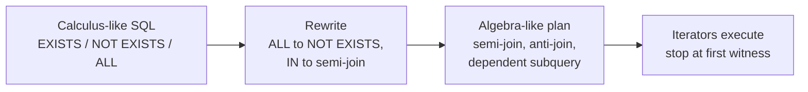

## Introduction

Relational algebra describes a query as a **composition of operations**: select these tuples, join with that relation, project these attributes. Relational **calculus** describes a query as a **condition**: "the set of all tuples *t* such that *t* is a course and there exists a section of *t* in 2024". It says nothing about operations or order at all — only what must be true of every tuple in the answer.

If that sounds like SQL, it is no coincidence. SQL's `SELECT … FROM … WHERE` block is, at its heart, tuple relational calculus with an English-like syntax:

- each alias in `FROM` is a **tuple variable** ranging over a relation;
- the `WHERE` clause is a **logical formula** over those variables;
- `EXISTS (…)` is the **existential quantifier** ∃, and `NOT EXISTS (…)` lets you express the **universal quantifier** ∀.

This lesson teaches both forms of relational calculus — **tuple relational calculus (TRC)** and **domain relational calculus (DRC)** — and then makes the connection to MySQL precise. You will translate calculus formulas to SQL and back, write "for all" queries with double negation, see why some formulas are **unsafe** (they would describe infinite answers), and learn **Codd's theorem**: safe calculus and relational algebra have exactly the same expressive power, the property known as **relational completeness**.

The practical payoff is fluency with the hardest class of everyday queries: those containing "every", "all", "only", "none" and "no other". These are where most wrong answers in production reports come from, and they become mechanical once you can write the formula first.

:::note[Dataset]
The examples use the **university** dataset: 5 departments, 12 instructors, 15 courses, 24 sections, 40 students and 146 enrollments (grade NULL for in-progress courses). Every output was captured from a real MySQL server.
:::

## DBMS Theory

:::theory[Tuple relational calculus (TRC)]
A TRC query has the form

> { t ∣ P(t) }

— "the set of tuples t for which formula P is true". Formulas are built from **atoms**:

- R(t) or t ∈ R — tuple variable t ranges over relation R;
- t.A θ s.B — compare attributes of two tuple variables (θ ∈ {=, ≠, <, ≤, >, ≥});
- t.A θ c — compare an attribute with a constant;

combined with the connectives ¬, ∧, ∨, → and the quantifiers **∃s (P)** ("there exists a tuple s such that P") and **∀s (P)** ("for every tuple s, P"). A variable is **bound** if a quantifier introduces it and **free** otherwise; in { t ∣ P(t) }, t must be the only free variable.

Useful identities: ∀s (P) ≡ ¬∃s (¬P); P → Q ≡ ¬P ∨ Q; ¬(P ∧ Q) ≡ ¬P ∨ ¬Q.
:::

:::theory[Domain relational calculus (DRC)]
DRC variables range over **attribute values** (domain elements), not whole tuples:

> { ⟨x₁, …, xₙ⟩ ∣ P(x₁, …, xₙ) }

Atoms are ⟨x₁, …, xₖ⟩ ∈ R ("this combination of values is a tuple of R") and comparisons x θ y, x θ c. The same connectives and quantifiers apply. DRC is the basis of **Query-By-Example (QBE)** (Zloof, IBM, 1977), whose grid interface survives in tools such as Microsoft Access.
:::

**The same query in three languages.** "Titles of 4-credit courses":

| Language | Expression |
|---|---|
| Relational algebra | π<sub>title</sub>(σ<sub>credits = 4</sub>(Courses)) |
| TRC | { t ∣ ∃c ∈ Courses (c.credits = 4 ∧ t.title = c.title) } |
| DRC | { ⟨n⟩ ∣ ∃i, d, k (⟨i, n, d, k⟩ ∈ Courses ∧ k = 4) } |

(Courses has the schema (course_id, title, dept_id, credits), so the DRC atom lists four variables in that order.) The TRC result tuple t has only the attribute `title`; the existential quantifier "hides" the course tuple from which it came — that is how projection is expressed in calculus.

### Safety

Calculus lets you write formulas whose answer is infinite. { t ∣ ¬(t ∈ Students) } asks for "every tuple that is not a student" — every possible tuple over every possible domain. Such a query cannot be evaluated and its answer would depend on the domains rather than on the database. A formula is **safe** (domain-independent) if its result contains only values that appear in the database or in the formula itself — the **active domain**. Syntactic safety rules ensure this, for example: every free variable must be restricted by a positive atom R(t); a negated subformula may only constrain variables that are already restricted; each disjunct must restrict the same variables.

### Codd's theorem and relational completeness

**Codd's theorem (1972):** safe TRC, safe DRC and relational algebra are equally expressive — every query in one can be translated into the other two. A query language is **relationally complete** if it can express every relational algebra query. SQL is relationally complete, and goes further: aggregation (γ), ordering, arithmetic and — since SQL:1999, MySQL 8.0 — **recursion** with `WITH RECURSIVE`. Recursion matters because classical algebra and calculus *cannot* express transitive closure ("all direct and indirect prerequisites of a course") for graphs of arbitrary depth.

## Why It Exists

Codd introduced the calculus as the **specification** of what a relational query language must be able to say, independent of any procedure. It served three purposes that still matter:

1. **A declarative target.** Users should state *what* they want; the system works out *how*. The calculus is the purest form of that idea — it has no operator order at all — and SQL inherited its shape. When the SQL committee designed `SELECT … FROM … WHERE EXISTS (…)`, it was writing TRC in English.
2. **A yardstick.** Algebra and calculus being equivalent gave a precise definition of "complete" query languages. Early languages that could not express, say, difference or universal quantification were demonstrably weaker.
3. **The bridge to optimization.** A calculus query says nothing about order, but Codd's reduction algorithm shows how to translate it into an algebra expression — which can then be rewritten and executed. Every SQL engine performs a version of this translation: the parser receives calculus-like SQL, and the optimizer produces an algebra-like operator tree.

Without the quantifier view, "for all" questions are hard to write correctly. Ask a room of developers for "departments in which **every** course has 3 credits" and many will write `WHERE credits = 3` — which returns departments with *at least one* 3-credit course. The calculus formula ∀c (c.dept_id = d.dept_id → c.credits = 3) makes the logic unambiguous, and the identity ∀ ≡ ¬∃¬ turns it mechanically into SQL.

## Internal Working

:::internals[How MySQL evaluates quantified subqueries]
A quantified predicate (`EXISTS`, `NOT EXISTS`, `IN`, `= ANY`, `<> ALL`, `> ALL` …) can be executed in two broad ways:

- **As a correlated subquery** — for each outer row, run the inner query with the outer values substituted, stopping as soon as the quantifier is decided: `EXISTS` stops at the first matching row (one witness proves ∃), `NOT EXISTS` stops at the first matching row too (one witness disproves ¬∃). EXPLAIN shows this as `Select #2 (subquery in condition; dependent)`, often with `Limit: 1 row(s)` — the "stop at the first witness" made visible.
- **As a join** — the optimizer converts `EXISTS`/`IN` into a **semi-join** (MySQL 8.0.16+ for `EXISTS`) and `NOT EXISTS`/`NOT IN` into an **anti-join** (8.0.17+), then uses join strategies (table pull-out, FirstMatch, materialization, hash or nested-loop anti-join). This is Codd's calculus-to-algebra reduction performed by a cost-based optimizer.

`ALL` and `ANY` are rewritten into the same shapes. `x = ALL (subquery)` becomes, internally, *"there is no row where x <> value"* — literally ∀ ≡ ¬∃¬ — and comparisons such as `x > ALL (subquery)` may be evaluated using the subquery's MIN/MAX, with extra checks so that the empty-subquery and NULL cases keep their quantifier semantics.
:::



**Three-valued logic changes the quantifiers.** Classical calculus has two truth values. SQL has three (TRUE, FALSE, UNKNOWN) because of NULL. `EXISTS` itself is always TRUE or FALSE — it only asks whether the subquery returns a row. But `IN`, `ANY` and `ALL` compare a value with each subquery value, and a single NULL comparison can make the whole quantified predicate UNKNOWN. This is the root of the `NOT IN` trap and of its `<> ALL` twin, both shown in Common Mistakes.

:::standard[Standard SQL vs MySQL]
`EXISTS`, `IN`, `ANY`/`SOME`, `ALL` with subqueries, and correlated subqueries are standard SQL and behave identically in MySQL, including the NULL semantics. The standard also defines `UNIQUE (subquery)` (true if the subquery has no duplicate rows) and the SQL:2003 boolean aggregates `EVERY`/`ANY`/`SOME` over a column — MySQL implements **neither**; use `NOT EXISTS`/`GROUP BY … HAVING` or `MIN(cond) = 1` / `MAX(cond) = 1` instead. `WITH RECURSIVE` (standard SQL:1999) is available from MySQL 8.0.
:::

## MySQL Implementation

The translation rules from TRC to SQL are short enough to memorize:

| TRC | SQL |
|---|---|
| free variable t ∈ R | `FROM R AS t` |
| t.A θ c, t.A θ s.B | `WHERE t.A θ c`, `t.A θ s.B` |
| ∧, ∨, ¬ | `AND`, `OR`, `NOT` |
| ∃s ∈ S (P) | `EXISTS (SELECT 1 FROM S AS s WHERE P)` |
| ¬∃s ∈ S (P) | `NOT EXISTS (SELECT 1 FROM S AS s WHERE P)` |
| ∀s ∈ S (P → Q) | `NOT EXISTS (SELECT 1 FROM S AS s WHERE P AND NOT Q)` |
| result attributes | the `SELECT` list |

**A selection.** { t ∣ t ∈ Instructors ∧ t.salary > 150000 }:

```sql run
SELECT t.* FROM instructors AS t
WHERE t.salary > 150000
ORDER BY t.instructor_id;
```

**An existential quantifier.** "Courses that have at least one section in 2024": { c ∣ c ∈ Courses ∧ ∃s ∈ Sections (s.course_id = c.course_id ∧ s.year = 2024) }:

```sql run
SELECT c.course_id, c.title
FROM courses AS c
WHERE EXISTS (SELECT 1 FROM sections AS s
              WHERE s.course_id = c.course_id AND s.year = 2024)
ORDER BY c.course_id;
```

The subquery's `SELECT 1` is irrelevant: `EXISTS` only asks whether at least one row satisfies the formula. `SELECT *` or `SELECT NULL` behave identically.

**A universal quantifier.** "Departments in which every course has 3 credits":

{ d ∣ d ∈ Departments ∧ ∀c ∈ Courses (c.dept_id = d.dept_id → c.credits = 3) }

Rewrite ∀ as ¬∃¬ and the implication as ¬P ∨ Q, so its negation becomes P ∧ ¬Q:

{ d ∣ d ∈ Departments ∧ ¬∃c ∈ Courses (c.dept_id = d.dept_id ∧ c.credits ≠ 3) }

```sql run
SELECT d.dept_id, d.name
FROM departments AS d
WHERE NOT EXISTS (SELECT 1 FROM courses AS c
                  WHERE c.dept_id = d.dept_id AND c.credits <> 3)
ORDER BY d.dept_id;
```

Computer Science (CS-046 has 4 credits) and Physics (PHYS-050 has 4 credits) are excluded; each has a counterexample.

**The same ∀ with `ALL`.** SQL offers a quantified comparison: `3 = ALL (subquery)` is TRUE when 3 equals every value the subquery returns.

```sql run
SELECT d.dept_id, d.name
FROM departments AS d
WHERE 3 = ALL (SELECT c.credits FROM courses AS c WHERE c.dept_id = d.dept_id)
ORDER BY d.dept_id;
```

**A DRC query.** Domain calculus names attribute values instead of tuples. { ⟨n, b⟩ ∣ ∃i, s, h (⟨i, n, 2, s, h⟩ ∈ Instructors) ∧ ∃d, nm, bu (⟨d, nm, b, bu⟩ ∈ Departments ∧ d = 2) } — "names of Data Science instructors with their department's building". In SQL every domain variable becomes a column reference, and shared variables become equalities:

```sql run
SELECT i.name AS n, d.building AS b
FROM instructors AS i, departments AS d
WHERE i.dept_id = 2 AND d.dept_id = 2
ORDER BY i.name;
```

## Syntax Breakdown

| SQL predicate | Quantifier meaning | Result when the subquery is empty | Effect of a NULL in the subquery |
|---|---|---|---|
| `EXISTS (subq)` | ∃ a row satisfying the subquery's WHERE | FALSE | None — EXISTS never compares values |
| `NOT EXISTS (subq)` | ¬∃ | TRUE | None |
| `x IN (subq)` | ∃v ∈ subq (x = v) | FALSE | No match found + a NULL present ⇒ UNKNOWN instead of FALSE |
| `x NOT IN (subq)` | ∀v ∈ subq (x ≠ v) | TRUE | Any NULL ⇒ never TRUE (FALSE or UNKNOWN) |
| `x θ ANY (subq)`, `x θ SOME (subq)` | ∃v (x θ v) | FALSE | As IN |
| `x θ ALL (subq)` | ∀v (x θ v) | **TRUE** (vacuous truth) | Any NULL ⇒ never TRUE |
| `x = ANY (subq)` | same as `x IN (subq)` | | |
| `x <> ALL (subq)` | same as `x NOT IN (subq)` | | |

Additional rules:

- **Correlation.** A subquery may reference columns of outer tuple variables (`c.course_id` inside the subquery on sections). These are the free variables of the quantified subformula. MySQL issues note 1276 (*"Field or reference … was resolved in SELECT #1"*) when it resolves such a reference — harmless, and a useful hint that the subquery is correlated.
- **Scope.** A tuple variable introduced inside a subquery is bound there and invisible outside — exactly like a variable bound by ∃.
- **`SELECT` list inside `EXISTS`.** Ignored. Write `SELECT 1` by convention.
- **`ANY` vs `SOME`.** Synonyms. `ALL` and `ANY` need a subquery (or, from 8.0.19, a `TABLE` statement), not a literal list.

## Practical Examples

**1. Vacuous truth — ∀ over an empty set.** "Instructors all of whose sections have a room assigned": ∀s ∈ Sections (s.instructor_id = i.instructor_id → s.room IS NOT NULL).

```sql run
SELECT i.instructor_id, i.name
FROM instructors AS i
WHERE NOT EXISTS (SELECT 1 FROM sections AS s
                  WHERE s.instructor_id = i.instructor_id AND s.room IS NULL)
ORDER BY i.instructor_id;
```

Eleven of twelve instructors qualify. Zara Berg (1007) is excluded because section 11 has no room. Elena Lin (1012) is **included** although she teaches no section at all: the implication's premise is never true for her, so the universal statement holds vacuously. Mathematically this is correct; whether it is what the business wants is a separate question. If "all" should imply "at least one", add an existential conjunct:

```sql run
SELECT i.instructor_id, i.name
FROM instructors AS i
WHERE EXISTS     (SELECT 1 FROM sections AS s WHERE s.instructor_id = i.instructor_id)
  AND NOT EXISTS (SELECT 1 FROM sections AS s
                  WHERE s.instructor_id = i.instructor_id AND s.room IS NULL)
ORDER BY i.instructor_id;
```

**2. `ALL` versus `MAX` on an empty set.** Quantified comparisons and aggregate rewrites disagree exactly at the empty set:

```sql run
SELECT 5 > ALL (SELECT credits FROM courses WHERE dept_id = 99)      AS all_over_empty,
       5 > (SELECT MAX(credits) FROM courses WHERE dept_id = 99)    AS max_over_empty,
       5 > ALL (SELECT credits FROM courses WHERE dept_id = 1)       AS all_over_cs,
       5 > (SELECT MAX(credits) FROM courses WHERE dept_id = 1)     AS max_over_cs;
```

Over the non-empty Computer Science courses both forms agree (1 = TRUE). Over the empty set, `> ALL` is TRUE (vacuous truth) while `> MAX(…)` compares with NULL and yields NULL (UNKNOWN). Rewriting one into the other by hand is only safe when the subquery is guaranteed non-empty and NULL-free; when the optimizer itself uses a MIN/MAX-based evaluation, it must preserve exactly these edge cases.

**3. Nested quantifiers: ∃ inside ∀.** "Students who have taken every prerequisite of DATA-226": ∀p ∈ CoursePrereqs (p.course_id = 'DATA-226' → ∃e ∈ Enrollments, ∃s ∈ Sections (e.student_id = t.student_id ∧ e.section_id = s.section_id ∧ s.course_id = p.prereq_id)).

```sql run
SELECT t.student_id, t.name
FROM students AS t
WHERE NOT EXISTS (
  SELECT 1 FROM course_prereqs AS p
  WHERE p.course_id = 'DATA-226'
    AND NOT EXISTS (
      SELECT 1 FROM enrollments AS e
      JOIN sections AS s ON s.section_id = e.section_id
      WHERE e.student_id = t.student_id AND s.course_id = p.prereq_id))
ORDER BY t.student_id;
```

This is relational division (previous lesson) written as calculus. DATA-226 has a single prerequisite (DATA-225), so the answer is the set of students who took DATA-225.

**4. Beyond calculus: recursion.** Classical algebra and calculus can follow the prerequisite graph only a *fixed* number of steps. "All direct and indirect prerequisites of CS-157B" needs transitive closure, which SQL provides with a recursive CTE (taught in [Recursive CTEs](/lessons/m04-recursive-ctes)):

```sql run
WITH RECURSIVE chain (course_id, depth) AS (
  SELECT prereq_id, 1 FROM course_prereqs WHERE course_id = 'CS-157B'
  UNION ALL
  SELECT p.prereq_id, c.depth + 1
  FROM course_prereqs AS p JOIN chain AS c ON p.course_id = c.course_id
)
SELECT course_id, depth FROM chain ORDER BY depth, course_id;
```

CS-157B requires CS-157A, which requires CS-146, which requires CS-046 and MATH-042 — four prerequisites over three levels. A non-recursive formula would need one quantifier per level and could not handle a deeper graph without being rewritten. This is the precise sense in which SQL is *more* than relationally complete.

## Execution Walkthrough

Trace the universal query "departments in which every course has 3 credits" from formula to plan to result.

```walkthrough
title: "{ d | d ∈ Departments ∧ ∀c ∈ Courses (c.dept_id = d.dept_id → c.credits = 3) }"
steps:
  - title: "1. The range of the free variable d"
    explain: The free tuple variable d ranges over Departments. Each of these five tuples is a candidate; the formula decides which survive.
    sql: SELECT dept_id, name FROM departments ORDER BY dept_id;
  - title: "2. Negate the universal statement"
    explain: >-
      ∀c (P → Q) is false exactly when some c makes P true and Q false. So we look for counterexamples:
      courses c with c.dept_id = d.dept_id and c.credits ≠ 3. This query lists every counterexample with
      the department it refutes.
    sql: |
      SELECT d.dept_id, c.course_id, c.credits
      FROM departments AS d JOIN courses AS c ON c.dept_id = d.dept_id
      WHERE c.credits <> 3
      ORDER BY d.dept_id, c.course_id;
  - title: "3. ¬∃ counterexample — the NOT EXISTS form"
    explain: >-
      A department satisfies ∀ if no counterexample exists. NOT EXISTS evaluates this per department and can
      stop at the first counterexample it finds.
    sql: |
      SELECT d.dept_id, d.name
      FROM departments AS d
      WHERE NOT EXISTS (SELECT 1 FROM courses AS c
                        WHERE c.dept_id = d.dept_id AND c.credits <> 3)
      ORDER BY d.dept_id;
  - title: "4. How MySQL executes the ALL form"
    explain: >-
      For `3 = ALL (…)`, the plan shows the quantifier rewritten as NOT (EXISTS a row with 3 <> credits): a
      dependent subquery that looks up the department's courses through the dept_id index, filters on
      `<cache>(3) <> c.credits`, and stops after one row (Limit 1) — one counterexample is enough to falsify ∀.
    sql: |
      EXPLAIN FORMAT=TREE
      SELECT d.dept_id FROM departments AS d
      WHERE 3 = ALL (SELECT c.credits FROM courses AS c WHERE c.dept_id = d.dept_id);
  - title: "5. How MySQL executes the NOT EXISTS form"
    explain: >-
      The NOT EXISTS version is eligible for the anti-join transformation, so it may be planned as a join
      (an antijoin iterator) rather than as a dependent subquery. Either plan computes the same relation;
      the optimizer picks the one it estimates to be cheaper.
    sql: |
      EXPLAIN FORMAT=TREE
      SELECT d.dept_id FROM departments AS d
      WHERE NOT EXISTS (SELECT 1 FROM courses AS c
                        WHERE c.dept_id = d.dept_id AND c.credits <> 3);
```

## Output

The answer to the walkthrough query is Data Science, Mathematics and Business. Reading a quantified result correctly means checking three things:

- **Who was excluded, and by which witness?** Step 2's counterexample list is the audit trail: Computer Science fails because of CS-046 and Physics because of PHYS-050. In production, keep a "why not" query next to every "for all" report — it is the fastest way to answer "why is department X missing?".
- **Who was included vacuously?** A candidate with *no* related rows satisfies every ∀ condition. In this dataset every department has courses, so nothing was included vacuously here — but the instructor example earlier included Elena Lin for exactly that reason.
- **Did NULLs participate?** If the quantified comparison used `IN`/`ANY`/`ALL` over a nullable column, some candidates may have been dropped because the predicate was UNKNOWN, not FALSE.

## Alternative Approaches

A universal query can be written in at least four ways in MySQL. All four below answer "departments in which every course has 3 credits":

```sql run
-- 1. NOT EXISTS (¬∃¬): the direct calculus translation
SELECT d.dept_id FROM departments AS d
WHERE NOT EXISTS (SELECT 1 FROM courses AS c WHERE c.dept_id = d.dept_id AND c.credits <> 3)
ORDER BY d.dept_id;
```

```sql run
-- 2. Aggregation: every course qualifies ⇔ the count of qualifying courses equals the count of courses
SELECT c.dept_id FROM courses AS c
GROUP BY c.dept_id
HAVING SUM(c.credits = 3) = COUNT(*)
ORDER BY c.dept_id;
```

```sql run
-- 3. MIN/MAX as boolean aggregates (EVERY(cond) ≈ MIN(cond) = 1)
SELECT c.dept_id FROM courses AS c
GROUP BY c.dept_id
HAVING MIN(c.credits = 3) = 1
ORDER BY c.dept_id;
```

```sql run
-- 4. Set difference: all departments minus departments with a counterexample
SELECT dept_id FROM departments
EXCEPT
SELECT dept_id FROM courses WHERE credits <> 3
ORDER BY dept_id;
```

| Form | Vacuous truth (candidate with no related rows) | NULL sensitivity | Notes |
|---|---|---|---|
| `NOT EXISTS` | Included | Counterexample predicate decides; write `c.credits <> 3 OR c.credits IS NULL` if NULL should count as a violation | Most general; usually converted to an anti-join |
| `GROUP BY … HAVING SUM(cond) = COUNT(*)` | **Excluded** (no group exists) | `cond` is NULL for NULL values: SUM skips them, COUNT(*) counts them, so NULLs act as violations | Easy to extend to "at least 80% of courses" |
| `HAVING MIN(cond) = 1` | Excluded | MIN ignores NULLs, so NULL values are silently treated as non-violations | Compact; the MySQL stand-in for standard `EVERY` |
| `EXCEPT` | Included (if the candidate comes from the outer relation) | `credits <> 3` ignores NULL rows | Literal algebra: R − (counterexamples) |
| `= ALL (subquery)` | Included | Any NULL in the subquery makes it never TRUE | Concise for single-column comparisons |

The table is the real lesson: the forms are *not* interchangeable at the edges. Decide what an empty group and a NULL should mean, then pick the form that implements that decision.

## Performance Analysis

Calculus is declarative, so it has no cost of its own — cost belongs to the plan the optimizer derives. What you can reason about is how each quantifier *can* be evaluated:

| Predicate | Best case | Worst case | What helps |
|---|---|---|---|
| `EXISTS` | One index probe per outer row, stopping at the first witness | Scans of the inner table per outer row when no index matches the correlation | Index on the correlated column(s); semi-join conversion |
| `NOT EXISTS` | One index probe per outer row (absence proven by an empty lookup) | Full inner scan per outer row | Same; anti-join conversion (8.0.17+) |
| Nested `NOT EXISTS` (∀∃) | Index probes at both levels | \|outer\| × \|divisor\| × inner cost | Composite index on the innermost correlation, e.g. (student_id, section_id) |
| `ALL`/`ANY` | Rewritten to MIN/MAX or to `NOT EXISTS` | Dependent subquery per outer row | NOT NULL columns allow more rewrites |
| `GROUP BY … HAVING` | One pass with grouping | Sorting or temporary table on large inputs | Index on the grouping column |

:::performance[Theory vs measurement]
On this 15-course dataset every form above runs in microseconds, so their relative speed cannot be observed. On large data the anti-join and grouping forms can differ substantially, and which wins depends on selectivity and indexes. Measure with `EXPLAIN ANALYZE` (see [Optimizing Subqueries](/lessons/m07-optimizing-subqueries)) rather than assuming that "joins are faster than subqueries" — modern MySQL often executes them identically.
:::

The most important performance property of `EXISTS`/`NOT EXISTS` is **early termination**: a single witness decides the quantifier. That is why `EXISTS (SELECT 1 …)` beats `(SELECT COUNT(*) …) > 0` for existence tests — the count must find *all* witnesses.

## Best Practices

:::best-practice[Professional habits]
1. **Write the formula first for any "every / all / only / no" requirement.** Put it in a code comment: `-- ∀ course c of d: c.credits = 3`. Then translate ∀ to `NOT EXISTS (… AND NOT …)`.
2. **Decide the empty case explicitly.** Should a candidate with no related rows qualify? Add `EXISTS (…)` if "all" must imply "at least one", or choose the `GROUP BY` form, which excludes empty candidates.
3. **Decide the NULL case explicitly.** In the counterexample predicate, write `col <> v OR col IS NULL` if an unknown value should count as a violation.
4. **Prefer `NOT EXISTS` over `NOT IN` and `<> ALL`** unless the subquery column is declared `NOT NULL`.
5. **Use `EXISTS` for existence tests**, never `COUNT(*) > 0`.
6. **Keep a "why not" query** that lists counterexamples next to every universal query in a report or data-quality check.
7. **Remember SQL goes beyond calculus.** For graph-shaped questions of unbounded depth, reach for `WITH RECURSIVE`, not ever-deeper self-joins.
:::

## Common Mistakes

**Mistake 1 — writing ∃ when the requirement is ∀.**

```sql run
-- Wrong: departments with AT LEAST ONE 3-credit course
SELECT DISTINCT d.dept_id
FROM departments AS d JOIN courses AS c ON c.dept_id = d.dept_id
WHERE c.credits = 3
ORDER BY d.dept_id;
```

This returns Computer Science too, because it has 3-credit courses besides CS-046. The filter `WHERE c.credits = 3` is applied row by row — it expresses ∃, never ∀. The correct ¬∃¬ form is in MySQL Implementation.

**Mistake 2 — `<> ALL` (or `NOT IN`) over a nullable column.** "Instructors who teach no section":

```sql run
-- Wrong: returns nothing, because one section has instructor_id NULL
SELECT instructor_id FROM instructors
WHERE instructor_id <> ALL (SELECT instructor_id FROM sections)
ORDER BY instructor_id;
```

`x <> ALL (…, NULL)` requires `x <> NULL`, which is UNKNOWN for every x. Use `NOT EXISTS`, which only asks whether a matching row exists:

```sql run
SELECT i.instructor_id FROM instructors AS i
WHERE NOT EXISTS (SELECT 1 FROM sections AS s WHERE s.instructor_id = i.instructor_id)
ORDER BY i.instructor_id;
```

**Mistake 3 — forgetting the correlation.** An `EXISTS` subquery that does not reference the outer variable is not a quantified condition about that tuple — it is a constant:

```sql run
-- Wrong: the subquery ignores c, so EXISTS is TRUE for every course
SELECT COUNT(*) AS courses_returned
FROM courses AS c
WHERE EXISTS (SELECT 1 FROM sections AS s WHERE s.year = 2024);
```

All 15 courses come back, because *some* section is in 2024. In calculus terms, the formula ∃s (s.year = 2024) has no free occurrence of c, so it is the same truth value for every candidate. The correlation `s.course_id = c.course_id` is what ties the witness to the tuple.

**Mistake 4 — trusting an `ALL`-to-`MAX` rewrite by hand.** Replacing `x > ALL (subq)` with `x > (SELECT MAX(…))` changes the answer when the subquery is empty (TRUE becomes NULL) — demonstrated in Practical Example 2.

**Mistake 5 — misreading vacuous truth as a bug.** Elena Lin "having all her sections in assigned rooms" is logically correct. If the report should exclude her, the requirement — not the logic — was incomplete; add the existential conjunct.

## Industry Application

- **Compliance and eligibility rules.** "Every mandatory control has a passing test", "the applicant has submitted all required documents", "no transaction in the batch exceeds the limit" — universal and negative-existential rules dominate regulated domains. Teams that write them as formulas first produce fewer audit findings.
- **Data-quality assertions.** A data-quality check is usually a ∀ statement ("every order has at least one item", "no payment references a missing order"). It is implemented as its counterexample query — `SELECT … WHERE NOT EXISTS (…)` — which must return zero rows; any row returned is the evidence for the alert. Tools such as dbt express tests exactly this way.
- **Authorization.** "The user holds every permission required by the action" is division over (user, permission) pairs; "the user holds no blocking role" is an anti-join. Both are written with `NOT EXISTS` in policy queries.
- **Datalog and logic-based engines.** Calculus lives on in Datalog (used in program analysis, security policy engines and some graph databases) and in the rule languages of business-rule engines. Datalog adds recursion to safe calculus — the same extension SQL makes with `WITH RECURSIVE`.
- **Interviews and design reviews.** "Find customers who bought every product in category X" and "find employees who earn more than everyone in department Y" are classic interview questions precisely because they test whether a candidate can handle ∀ and its edge cases.

## Practice Exercises

All exercises use the **university** dataset.

```exercise
id: ex1
title: From TRC to SQL
difficulty: easy
concepts: [tuple-relational-calculus]
prompt: |
  Translate { t.name, t.salary ∣ t ∈ Instructors ∧ t.dept_id = 1 ∧ t.salary > 150000 } into SQL.
  Return `name` and `salary`.
hints:
  - "The free tuple variable becomes a FROM alias; the formula becomes WHERE."
  - "SELECT t.name, t.salary FROM instructors AS t WHERE …"
solution: |
  SELECT t.name, t.salary
  FROM instructors AS t
  WHERE t.dept_id = 1 AND t.salary > 150000;
explanation: |
  There are no quantifiers, so the translation is a single SELECT-FROM-WHERE block. The two Computer Science
  instructors earning more than 150,000 are returned.
```

```exercise
id: ex2
title: Students with at least one failing grade (∃)
difficulty: easy
concepts: [quantifiers, exists]
prompt: |
  Return `student_id` and `name` of every student for whom there exists an enrollment with grade `'F'`.
  Each student once.
hints:
  - "{ s ∣ s ∈ Students ∧ ∃e ∈ Enrollments (e.student_id = s.student_id ∧ e.grade = 'F') }"
  - "Translate ∃ with EXISTS and correlate on student_id."
solution: |
  SELECT s.student_id, s.name
  FROM students AS s
  WHERE EXISTS (SELECT 1 FROM enrollments AS e
                WHERE e.student_id = s.student_id AND e.grade = 'F');
explanation: |
  `EXISTS` returns each student once no matter how many F grades they have. A join would return one row per
  failing enrollment unless you add `DISTINCT`.
```

```exercise
id: ex3
title: Departments where every course has 3 credits (the ∃-for-∀ trap)
difficulty: medium
concepts: [quantifiers, exists]
prompt: |
  Return `dept_id` and `name` of every department in which **every** course has exactly 3 credits.
  (Every department in the dataset offers at least one course.)
hints:
  - "∀c (c.dept_id = d.dept_id → c.credits = 3) ≡ ¬∃c (c.dept_id = d.dept_id ∧ c.credits ≠ 3)."
  - "WHERE NOT EXISTS (SELECT 1 FROM courses c WHERE c.dept_id = d.dept_id AND c.credits <> 3)."
solution: |
  SELECT d.dept_id, d.name
  FROM departments AS d
  WHERE NOT EXISTS (SELECT 1 FROM courses AS c
                    WHERE c.dept_id = d.dept_id AND c.credits <> 3);
explanation: |
  The common wrong answer — a join with `WHERE c.credits = 3` — returns every department that has *some*
  3-credit course, including Computer Science. `3 = ALL (SELECT credits …)` and
  `GROUP BY dept_id HAVING MIN(credits = 3) = 1` are correct alternatives here.
```

```exercise
id: ex4
title: Straight-A students (∀ with a non-vacuous guard)
difficulty: hard
concepts: [quantifiers, safety, exists]
prompt: |
  Return `student_id` and `name` of every student who has **at least one graded enrollment** (grade not NULL)
  and for whom **every** graded enrollment has grade `'A'` or `'A-'`. Enrollments with a NULL grade (in
  progress) are ignored.
hints:
  - "Two conditions: ∃ a graded enrollment, and ¬∃ a graded enrollment whose grade is not A/A-."
  - "In the counterexample subquery, require e.grade IS NOT NULL AND e.grade NOT IN ('A', 'A-')."
  - "Without the EXISTS guard, students with no graded enrollment (e.g. the newest student) would qualify vacuously."
solution: |
  SELECT s.student_id, s.name
  FROM students AS s
  WHERE EXISTS (SELECT 1 FROM enrollments AS e
                WHERE e.student_id = s.student_id AND e.grade IS NOT NULL)
    AND NOT EXISTS (SELECT 1 FROM enrollments AS e
                    WHERE e.student_id = s.student_id
                      AND e.grade IS NOT NULL
                      AND e.grade NOT IN ('A', 'A-'));
explanation: |
  Two students qualify. Dropping the `EXISTS` guard adds every student with no graded enrollment — the vacuous
  case. A grouping version is
  `… GROUP BY student_id HAVING COUNT(grade) > 0 AND SUM(grade NOT IN ('A','A-')) = 0`, where `COUNT(grade)`
  ignores NULL grades and `SUM` skips them because the comparison yields NULL.
```

```exercise
id: ex5
title: Courses whose prerequisites a student has completed (∀∃)
difficulty: challenge
concepts: [quantifiers, relational-calculus, exists]
prompt: |
  For student **20230009** (Nina Moradi), return the `course_id` of every course that **has at least one
  prerequisite** and for which she has an enrollment in **every** prerequisite course (any section, any grade).
hints:
  - "Candidate courses: those appearing in course_prereqs.course_id (the ∃ guard)."
  - "∀p ∈ CoursePrereqs (p.course_id = c.course_id → ∃ enrollment of 20230009 in a section of p.prereq_id)."
  - "Translate ∀ … ∃ as NOT EXISTS (… AND NOT EXISTS (…))."
solution: |
  SELECT c.course_id
  FROM courses AS c
  WHERE EXISTS (SELECT 1 FROM course_prereqs AS p0 WHERE p0.course_id = c.course_id)
    AND NOT EXISTS (
      SELECT 1 FROM course_prereqs AS p
      WHERE p.course_id = c.course_id
        AND NOT EXISTS (
          SELECT 1 FROM enrollments AS e
          JOIN sections AS s ON s.section_id = e.section_id
          WHERE e.student_id = 20230009 AND s.course_id = p.prereq_id));
explanation: |
  The only qualifying course is DATA-226, whose sole prerequisite DATA-225 she has taken. Without the
  existential guard, every course with **no** prerequisites (such as CS-046 or MATH-042) would qualify
  vacuously — "she has taken all zero prerequisites". This is the shape of real eligibility checks in course
  registration systems.
```

```exercise
id: ex6
title: Safety and completeness
difficulty: medium
kind: open
concepts: [safety, relational-completeness, domain-relational-calculus]
prompt: |
  1. Explain why { t ∣ ¬(t ∈ Enrollments) } is unsafe, and rewrite the intended question "(student, section)
     pairs in which the student is *not* enrolled" as a safe TRC expression and as SQL.
  2. Write a DRC expression for "names of students in the Data Science department (dept_id 2)".
  3. Is SQL relationally complete? Is it *more* than relationally complete? Give one example.
solution: |
  1. The formula describes every tuple of every possible domain that is not an enrollment — an infinite set
     that depends on the domains rather than the database. Restrict the free variables to the active domain:
     { t ∣ ∃s ∈ Students ∃c ∈ Sections (t.student_id = s.student_id ∧ t.section_id = c.section_id ∧
     ¬∃e ∈ Enrollments (e.student_id = s.student_id ∧ e.section_id = c.section_id)) }.
     SQL: `SELECT s.student_id, c.section_id FROM students s CROSS JOIN sections c WHERE NOT EXISTS (SELECT 1 FROM enrollments e WHERE e.student_id = s.student_id AND e.section_id = c.section_id);`
     SQL cannot express the unsafe version at all, because every variable must range over a FROM item.
  2. { ⟨n⟩ ∣ ∃i, e, d, y, k (⟨i, n, e, d, y, k⟩ ∈ Students ∧ d = 2) } with Students(student_id, name, email,
     dept_id, enrollment_year, total_credits).
  3. Yes: SQL can express every relational algebra query (σ, π, ρ, ∪, −, ×). It is more than complete: it
     adds aggregation and grouping, ordering, arithmetic, and recursion (`WITH RECURSIVE`), which can compute
     transitive closure — something no fixed algebra or calculus expression can do for graphs of arbitrary depth.
```

## Knowledge Assessment

```quiz
- id: q1
  question: "In the TRC query { t ∣ t ∈ Courses ∧ ∃s ∈ Sections (s.course_id = t.course_id ∧ s.year = 2024) }, which variables are free and which are bound?"
  options:
    - "t is free; s is bound by ∃"
    - "Both are free"
    - "s is free; t is bound"
    - "Both are bound"
  answer: 0
  explanation: "The result is described in terms of t, which must be the only free variable. s is introduced by the existential quantifier and is bound within its scope — like an alias inside an EXISTS subquery."
  concepts: [tuple-relational-calculus]
- id: q2
  question: "Which SQL pattern implements ∀c ∈ Courses (c.dept_id = d.dept_id → c.credits = 3)?"
  options:
    - "WHERE EXISTS (SELECT 1 FROM courses c WHERE c.dept_id = d.dept_id AND c.credits = 3)"
    - "WHERE NOT EXISTS (SELECT 1 FROM courses c WHERE c.dept_id = d.dept_id AND c.credits <> 3)"
    - "WHERE NOT EXISTS (SELECT 1 FROM courses c WHERE c.dept_id = d.dept_id AND c.credits = 3)"
    - "JOIN courses c ON c.dept_id = d.dept_id WHERE c.credits = 3"
  answer: 1
  explanation: "∀(P → Q) ≡ ¬∃(P ∧ ¬Q): no course of the department violates the condition. Option A and D express ∃ (at least one 3-credit course); option C says the department has no 3-credit course at all."
  concepts: [quantifiers, exists]
- id: q3
  question: "What does `SELECT 5 > ALL (SELECT credits FROM courses WHERE 1 = 0)` return?"
  options: ["0", "1", "NULL", "An error, because the subquery is empty"]
  answer: 1
  explanation: "A universal statement over an empty set is vacuously true, so > ALL over no rows is TRUE (1). Comparing with (SELECT MAX(...)) instead would give NULL, because MAX of an empty set is NULL."
  concepts: [quantifiers]
- id: q4
  question: "Why is { t ∣ ¬(t ∈ Students) } called unsafe?"
  options:
    - "It may deadlock"
    - "Its answer is infinite and depends on the domains, not on the database contents"
    - "It reveals private student data"
    - "It uses negation, which calculus forbids"
  answer: 1
  explanation: "Safe (domain-independent) formulas produce only values from the active domain. Negation itself is allowed when the negated variable is already restricted by a positive atom; here nothing restricts t."
  concepts: [safety]
- id: q5
  type: multi
  question: "Which statements are true? (Select all that apply.)"
  options:
    - "Safe TRC, safe DRC and relational algebra have the same expressive power"
    - "SQL can express queries that relational algebra cannot, such as transitive closure with WITH RECURSIVE"
    - "EXISTS returns UNKNOWN when the subquery returns a row containing NULL"
    - "x NOT IN (subquery) is equivalent to x <> ALL (subquery)"
  answer: [0, 1, 3]
  explanation: "Codd's theorem establishes the equivalence. Recursion goes beyond classical algebra and calculus. EXISTS only checks whether a row exists, so it is always TRUE or FALSE. NOT IN and <> ALL are defined identically, including their NULL behaviour."
  concepts: [relational-completeness, exists, quantifiers]
- id: q6
  question: "A report lists 'instructors all of whose sections have rooms' and includes an instructor who teaches no sections. What is happening?"
  options:
    - "A bug in NOT EXISTS"
    - "Vacuous truth: with no sections, the implication's premise is never true, so the universal condition holds; add an EXISTS guard if 'all' must imply 'at least one'"
    - "A NULL room was treated as assigned"
    - "The optimizer converted NOT EXISTS into an inner join"
  answer: 1
  explanation: "∀ over an empty set is true. NOT EXISTS is behaving correctly; the requirement needs an explicit ∃ conjunct. NULL rooms are counterexamples in that query, and optimizer rewrites never change results."
  concepts: [quantifiers, safety]
- id: q7
  question: "Which query is the DRC-style equivalent of 'names of instructors in department 2'?"
  options:
    - "{ ⟨n⟩ ∣ ∃i, d, s, h (⟨i, n, d, s, h⟩ ∈ Instructors ∧ d = 2) }"
    - "{ t ∣ t ∈ Instructors ∧ t.dept_id = 2 }"
    - "π name(Instructors) ∪ σ dept_id = 2(Instructors)"
    - "{ ⟨n⟩ ∣ ¬(⟨n⟩ ∈ Instructors) }"
  answer: 0
  explanation: "DRC variables range over attribute values; the other attributes are existentially quantified away. Option B is TRC (and returns whole tuples), C is wrong algebra (union of incompatible relations), and D is unsafe."
  concepts: [domain-relational-calculus]
- id: q8
  question: "`SELECT COUNT(*) FROM courses c WHERE EXISTS (SELECT 1 FROM sections s WHERE s.year = 2024)` returns 15 — every course. Why?"
  options:
    - "Every course has a 2024 section"
    - "The subquery is not correlated with c, so EXISTS has the same value for every course"
    - "EXISTS counts rows"
    - "MySQL ignores WHERE when EXISTS is used"
  answer: 1
  explanation: "Without the predicate s.course_id = c.course_id, the quantified formula has no free occurrence of c; it is TRUE (some 2024 section exists) for all candidates. Not every course has a 2024 section."
  concepts: [exists, quantifiers]
```
