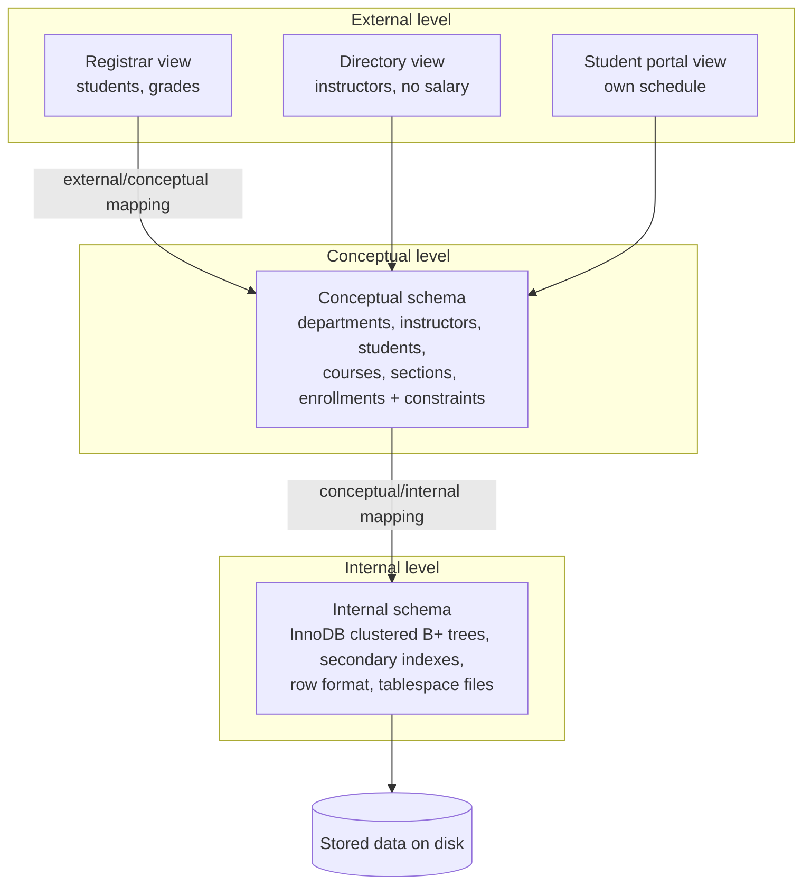

## Introduction

A university's database is used by very different people. The registrar thinks in terms of students, courses and grades. A department chair wants instructor workloads and budgets. A student-facing portal must show a student their own schedule — and nothing about anyone's salary. The DBA thinks about files, indexes, page sizes and disks. All of them work with **the same data**, yet each needs a different view of it, and each wants to be shielded from changes the others make.

That separation is not an accident; it is an architecture. In this lesson you will learn:

- the difference between a database's **schema** (its design, which changes rarely) and its **instance** or **state** (the data at a moment, which changes constantly);
- the **three-schema architecture** — **external**, **conceptual** and **internal** levels — proposed by the ANSI/SPARC study group in the 1970s, and still the standard way to reason about abstraction in a DBMS;
- **data independence**: the ability to change the schema at one level without rewriting what depends on the level above — **physical** data independence (easy, and MySQL delivers it well) and **logical** data independence (harder, partly your job);
- how MySQL implements these ideas: **views** as external schemas, **tables and constraints** as the conceptual schema, **InnoDB storage structures** as the internal schema, and the **data dictionary / `INFORMATION_SCHEMA`** as the catalog that describes all of them.

:::note[Dataset]
The examples use the **university** dataset: 5 departments, 12 instructors, 40 students, 15 courses with prerequisites, 24 sections, 146 enrollments and advisor assignments.
:::

## DBMS Theory

:::theory[Schema and instance]
- A **database schema** (the *intension*) is the **description** of the database: the record types (tables), their attributes and types, keys, constraints and relationships. It is specified when the database is designed and changes infrequently (**schema evolution**).
- A **database instance** or **state** (the *extension*) is the **data stored at a particular moment**. Every `INSERT`, `UPDATE` or `DELETE` moves the database from one state to another.
- A state is **valid** if it satisfies every constraint in the schema. One of the DBMS's jobs is to guarantee that every state it reaches is valid.
- The schema itself is stored in the **catalog** as metadata — so the schema is data too, but data *about* data, changed through DDL rather than DML.
:::

The distinction matters because the two change on completely different time scales and through different processes. An instance changes thousands of times per second in production; a schema change (adding a column, splitting a table) is a planned, reviewed **migration** that may require application changes. Confusing them leads to designs that encode data as structure — for example, one table per semester (`enrollments_fall2024`, `enrollments_spring2025`), which forces a schema change every term for what is really a change of state.

:::theory[The ANSI/SPARC three-schema architecture]
The architecture defines three levels of description, each with its own schema:

1. **External level** — a number of **external schemas** (user views). Each describes the part of the database a particular user group needs, in the form they need, and hides the rest.
2. **Conceptual level** — one **conceptual schema** describing the whole database for the whole community of users: entities, attributes, relationships, constraints, and data types — but **not** how they are stored.
3. **Internal level** — one **internal schema** describing **physical storage**: record layouts, file organisation, indexes, access paths, compression, placement on devices.

Between the levels are **mappings**: *external/conceptual* mappings define each user view in terms of the conceptual schema, and the *conceptual/internal* mapping defines how conceptual records are stored. The DBMS uses the mappings to translate a request against an external schema into operations on stored data, and to translate results back.
:::



:::theory[Data independence]
**Data independence** is the capacity to change the schema at one level without having to change the schema at the next higher level (and therefore without changing application programs written against it).

- **Physical data independence**: changing the **internal** schema — adding an index, reorganising files, changing compression or row format, moving data to faster storage, partitioning — without changing the conceptual schema or external schemas. Only the conceptual/internal mapping changes.
- **Logical data independence**: changing the **conceptual** schema — adding or removing attributes, splitting or merging tables, renaming things — without changing external schemas or programs. Only the external/conceptual mappings change.

Logical independence is harder to achieve because external schemas depend directly on the conceptual structures they name; physical independence is supported very well by relational DBMSs because SQL never mentions storage structures.
:::

## Why It Exists

Before this architecture, application programs encoded the **physical** layout of the data: record offsets, the order of fields, which file held which records, how to follow pointers in a hierarchical or network database. Any change to storage — reorganising a file for performance, adding an index, moving to a new disk — broke programs. Organisations froze their storage designs because the cost of changing every program was prohibitive.

The three-schema architecture, produced by the ANSI/X3/SPARC Study Group on DBMSs (interim report 1975, final report 1977–78), formalised the goal of separating **what the data means** from **how it is stored** and from **how each user sees it**. Codd's relational model (1970) made the goal practical: a relational query names relations and attributes, never storage, so the internal level can change freely.

The concrete benefits in a modern organisation:

- **Performance work without application changes.** A DBA adds an index, rebuilds a table, or changes a row format during a maintenance window; every query keeps returning the same results.
- **Security and simplicity per audience.** External schemas show each group only what it needs (no salaries in the student portal), and in a convenient shape (pre-joined, renamed, filtered).
- **Schema evolution with a buffer.** When the conceptual schema must change — a table is split, a column renamed — external views can be redefined to present the old shape, so existing reports and integrations keep working while they migrate.
- **A single source of truth.** Every external view is derived from one conceptual schema, so different audiences see consistent data, unlike separate files per department.

## Internal Working

:::internals[How MySQL realises the three levels]
- **Conceptual level → base tables and constraints.** `CREATE TABLE` statements with columns, data types, primary keys, foreign keys, `UNIQUE`, `NOT NULL` and `CHECK` constraints describe the logical structure. In practice, the conceptual schema of a MySQL database *is* its set of base tables.
- **External level → views (and privileges).** A view is a stored, named `SELECT`. MySQL stores its definition in the data dictionary; when a query references a view, the server either **merges** the view's definition into the query (algorithm `MERGE`, the default when possible) or **materializes** it into an internal temporary table (algorithm `TEMPTABLE`, required when the view uses aggregation, `DISTINCT`, `UNION`, `LIMIT` and similar constructs). Column- and table-level privileges complete the external schema by restricting what each account can see.
- **Internal level → InnoDB storage structures.** Each InnoDB table is stored as a **clustered B+ tree** ordered by the primary key, with the full row in the leaf pages; each secondary index is a separate B+ tree whose leaves contain the indexed columns plus the primary key. Pages are 16 KB by default; the **row format** (`DYNAMIC` by default) decides how long variable-length values are stored (inline or off-page). With `innodb_file_per_table=ON` (the default), each table lives in its own `.ibd` tablespace file.
- **Mappings.** The conceptual/internal mapping is maintained entirely by MySQL: the optimizer chooses indexes and access paths for every query. The external/conceptual mapping is the text of each view, which **you** maintain.
- **The catalog.** All three levels are described in the transactional **data dictionary** (InnoDB tables in the `mysql` schema, not directly readable). `INFORMATION_SCHEMA` exposes it through standard views: `TABLES`, `COLUMNS`, `VIEWS`, `STATISTICS` (indexes), `TABLE_CONSTRAINTS`, `KEY_COLUMN_USAGE`, `REFERENTIAL_CONSTRAINTS`, `CHECK_CONSTRAINTS`, `VIEW_TABLE_USAGE` and more. Since 8.0, many `INFORMATION_SCHEMA` statistics columns are cached (`information_schema_stats_expiry`, default 86400 seconds) — run `ANALYZE TABLE` to refresh them.
:::

One consequence of the view-merge mechanism deserves emphasis: **a view is not a copy of data.** Querying a merged view runs a query against the base tables; there is no separate storage to keep in sync. (Materialized views, which *do* store results, are not a MySQL feature; they are emulated with summary tables refreshed by jobs or triggers.)

## MySQL Implementation

**Schema vs instance.** The schema of `students` is a set of catalog rows; the instance is the set of data rows. Ask the catalog for the schema:

```sql run
SELECT COLUMN_NAME, COLUMN_TYPE, IS_NULLABLE, COLUMN_KEY, COLUMN_DEFAULT
FROM information_schema.COLUMNS
WHERE TABLE_SCHEMA = DATABASE() AND TABLE_NAME = 'students'
ORDER BY ORDINAL_POSITION;
```

And for a summary of the current instance:

```sql run
SELECT COUNT(*) AS students,
       COUNT(dept_id) AS declared_major,
       MIN(enrollment_year) AS earliest_cohort,
       MAX(enrollment_year) AS latest_cohort
FROM students;
```

Now change the **instance** with DML. The schema is untouched; the state moves on:

```sql run
INSERT INTO students (student_id, name, email, dept_id, enrollment_year)
VALUES (20250001, 'Priya Nair', 'priya.nair@student.example.edu', 2, 2025);

SELECT (SELECT COUNT(*) FROM students) AS students_now,
       (SELECT COUNT(*) FROM information_schema.COLUMNS
        WHERE TABLE_SCHEMA = DATABASE() AND TABLE_NAME = 'students') AS columns_in_schema;
```

There is one more student, and still six columns. Changing the **schema** requires DDL, and affects every row:

```sql run
ALTER TABLE students ADD COLUMN preferred_name VARCHAR(80) NULL AFTER name;

SELECT COUNT(*) AS columns_in_schema
FROM information_schema.COLUMNS
WHERE TABLE_SCHEMA = DATABASE() AND TABLE_NAME = 'students';
```

**An external schema.** The department-directory application must show instructors with their department and building, but never salary. Define a view:

```sql run
CREATE VIEW instructor_directory AS
SELECT i.instructor_id, i.name, d.name AS department, d.building
FROM instructors AS i
JOIN departments AS d ON d.dept_id = i.dept_id;

SELECT * FROM instructor_directory WHERE department = 'Data Science' ORDER BY instructor_id;
```

The directory application queries `instructor_directory` as if it were a table. It sees four columns, already joined and renamed; `salary` and `hired_on` do not exist in its world.

## Syntax Breakdown

| Level | MySQL object | Key statements | Catalog view |
|---|---|---|---|
| External | View | `CREATE [OR REPLACE] [ALGORITHM = {MERGE \| TEMPTABLE \| UNDEFINED}] [SQL SECURITY {DEFINER \| INVOKER}] VIEW name [(col, …)] AS select [WITH [CASCADED \| LOCAL] CHECK OPTION]` | `information_schema.VIEWS`, `VIEW_TABLE_USAGE` |
| External | Privileges on views/columns | `GRANT SELECT ON db.view TO …`, `GRANT SELECT (col) ON db.t TO …` | `information_schema.TABLE_PRIVILEGES`, `COLUMN_PRIVILEGES` |
| Conceptual | Base table, columns, constraints | `CREATE TABLE`, `ALTER TABLE … ADD/DROP/RENAME COLUMN`, `ADD CONSTRAINT` | `TABLES` (`TABLE_TYPE = 'BASE TABLE'`), `COLUMNS`, `TABLE_CONSTRAINTS`, `KEY_COLUMN_USAGE`, `CHECK_CONSTRAINTS` |
| Internal | Indexes, row format, partitioning, tablespace | `CREATE INDEX`, `ALTER TABLE … ROW_FORMAT=…`, `ALTER TABLE … PARTITION BY …`, `ALTER TABLE … ENGINE=InnoDB` (rebuild) | `STATISTICS`, `TABLES.ROW_FORMAT`, `PARTITIONS` |

The most important view options:

| Option | Meaning |
|---|---|
| `OR REPLACE` | Redefine an existing view in place — how you update an external/conceptual mapping without dropping dependents' privileges |
| `ALGORITHM` | `MERGE` rewrites queries against the base tables; `TEMPTABLE` materializes the view first; `UNDEFINED` (default) lets MySQL choose `MERGE` when possible |
| `SQL SECURITY DEFINER` (default) | The view runs with the privileges of its definer — so a user can be granted the view without being granted the base tables |
| `WITH CHECK OPTION` | For updatable views: rejects `INSERT`/`UPDATE` through the view that would produce rows the view cannot see |

:::standard[Standard SQL vs MySQL]
The SQL standard has no notion of "three schemas" as syntax; the architecture is a conceptual framework that DBMSs implement with views, tables and storage options. `CREATE VIEW`, `WITH CHECK OPTION` and `INFORMATION_SCHEMA` are standard. `ALGORITHM = …`, `SQL SECURITY` on views, the `ENGINE`/`ROW_FORMAT` table options and `SHOW` statements are **MySQL extensions**. In MySQL, *schema* and *database* are synonyms; note that "schema" also has the more general meaning of "database design" used throughout this lesson.
:::

## Practical Examples

**1. The catalog distinguishes the levels.** Base tables (conceptual) and views (external) are both listed in `information_schema.TABLES`, distinguished by `TABLE_TYPE`:

```sql run
SELECT TABLE_NAME, TABLE_TYPE, ENGINE
FROM information_schema.TABLES
WHERE TABLE_SCHEMA = DATABASE()
ORDER BY TABLE_TYPE, TABLE_NAME;
```

Views have no engine: they store no rows. `information_schema.VIEWS` holds each view's mapping — its defining query — and `VIEW_TABLE_USAGE` lists which base tables it depends on:

```sql run
SELECT TABLE_NAME AS view_name, IS_UPDATABLE, SECURITY_TYPE
FROM information_schema.VIEWS
WHERE TABLE_SCHEMA = DATABASE();

SELECT VIEW_NAME, TABLE_NAME AS depends_on
FROM information_schema.VIEW_TABLE_USAGE
WHERE VIEW_SCHEMA = DATABASE()
ORDER BY VIEW_NAME, TABLE_NAME;
```

`VIEW_TABLE_USAGE` is exactly the information you need before a conceptual-schema change: which external schemas will be affected?

**2. An external schema that aggregates.** The department chair's view shows workload per instructor — a different *shape* of the same data:

```sql run
CREATE VIEW instructor_workload AS
SELECT i.instructor_id, i.name, COUNT(s.section_id) AS sections_taught
FROM instructors AS i
LEFT JOIN sections AS s ON s.instructor_id = i.instructor_id
GROUP BY i.instructor_id, i.name;

SELECT * FROM instructor_workload ORDER BY sections_taught DESC, instructor_id LIMIT 5;
```

Because it uses `GROUP BY`, this view cannot be merged; MySQL materializes it with the `TEMPTABLE` algorithm, and it is not updatable.

**3. Physical data independence.** The registrar's application frequently runs "students from cohort 2023". Look at the plan, then change the **internal** schema by adding an index:

```sql run
EXPLAIN SELECT student_id, name FROM students WHERE enrollment_year = 2023 ORDER BY student_id;
```

```sql run
ALTER TABLE students ADD INDEX idx_students_year (enrollment_year);
ANALYZE TABLE students;
EXPLAIN SELECT student_id, name FROM students WHERE enrollment_year = 2023 ORDER BY student_id;
```

The plan changed from a full scan of the primary-key index (`type = index`, examining all 41 rows and filtering them) to an index lookup (`type = ref` on `idx_students_year`, estimated at 11 rows). The query text did not change, and neither did its result:

```sql run
SELECT student_id, name FROM students WHERE enrollment_year = 2023 ORDER BY student_id;
```

Other internal-level changes behave the same way — changing the row format, rebuilding the table, partitioning it:

```sql run
ALTER TABLE enrollments ROW_FORMAT = COMPACT;
SELECT TABLE_NAME, ROW_FORMAT
FROM information_schema.TABLES
WHERE TABLE_SCHEMA = DATABASE() AND TABLE_NAME IN ('enrollments', 'students')
ORDER BY TABLE_NAME;
```

`enrollments` now uses the older `COMPACT` row format while `students` keeps the default `DYNAMIC`. Not a single query or view needs to change.

**4. Logical data independence — and where it ends.** Now change the **conceptual** schema: the university decides that instructors have a *home* department distinct from courtesy appointments, and renames `instructors.dept_id` to `home_dept_id`:

```sql run
ALTER TABLE instructors RENAME COLUMN dept_id TO home_dept_id;
```

The directory view was defined in terms of `i.dept_id`. Query it:

```sql run error
SELECT * FROM instructor_directory WHERE department = 'Data Science' ORDER BY instructor_id;
```

Error 1054 — `Unknown column 'i.dept_id' in 'on clause'`: MySQL re-resolves the stored view definition against the conceptual schema on every use, and the column it names no longer exists. **Logical data independence is not automatic.** The external/conceptual mapping must be updated — but *only* the mapping, not the application. Redefine the view so that it presents exactly the same external schema:

```sql run
CREATE OR REPLACE VIEW instructor_directory AS
SELECT i.instructor_id, i.name, d.name AS department, d.building
FROM instructors AS i
JOIN departments AS d ON d.dept_id = i.home_dept_id;

SELECT * FROM instructor_directory WHERE department = 'Data Science' ORDER BY instructor_id;
```

The application's query is character-for-character identical to the one before the change, and it returns the same rows. That is logical data independence, delivered by the view layer with one statement of maintenance.

## Execution Walkthrough

How does MySQL execute a query written against an external schema? Trace the directory application's query through the mappings.

```walkthrough
title: SELECT * FROM instructor_directory WHERE department = 'Data Science'
steps:
  - title: "1. The external schema the application sees"
    explain: >-
      The application knows only the view's four columns. It does not know that the data comes from two tables,
      that a column was renamed, or that indexes exist.
    sql: SELECT COLUMN_NAME, DATA_TYPE FROM information_schema.COLUMNS WHERE TABLE_SCHEMA = DATABASE() AND TABLE_NAME = 'instructor_directory' ORDER BY ORDINAL_POSITION;
  - title: "2. The external/conceptual mapping"
    explain: >-
      The data dictionary stores the view's defining query. This text is the mapping from the external schema
      to the conceptual schema; it now refers to home_dept_id after the redefinition.
    sql: SELECT VIEW_DEFINITION FROM information_schema.VIEWS WHERE TABLE_SCHEMA = DATABASE() AND TABLE_NAME = 'instructor_directory';
  - title: "3. View merge — rewriting against the conceptual schema"
    explain: >-
      With the MERGE algorithm the server substitutes the view's definition into the query and pushes the
      predicate department = 'Data Science' down to d.name. EXPLAIN lists only base tables (d and i), never the
      view. Because d.name has a unique index, the optimizer reads that single departments row during
      optimization (type const) and the Note 1003 shows the rewritten query with d's columns replaced by
      constants and the join turned into i.home_dept_id = '2'.
    sql: |
      EXPLAIN SELECT * FROM instructor_directory WHERE department = 'Data Science';
      SHOW WARNINGS;
  - title: "4. Conceptual/internal mapping — access paths"
    explain: >-
      The optimizer, not the application, decides how to reach the rows. Here departments was already resolved
      to constants, so the executed plan is a single index lookup on instructors through the index that backs the
      foreign key (fk_instructors_dept). This mapping changes automatically when the internal schema changes.
    sql: EXPLAIN FORMAT=TREE SELECT * FROM instructor_directory WHERE department = 'Data Science';
  - title: "5. Result in the external shape"
    explain: The rows come back with the view's column names and nothing else.
    sql: SELECT * FROM instructor_directory WHERE department = 'Data Science' ORDER BY instructor_id;
```

Each step corresponds to one arrow in the architecture diagram: the application speaks the external schema; the view definition maps it to the conceptual schema; the optimizer maps that to the internal schema; InnoDB reads pages.

## Output

The final result lists the Data Science instructors with department and building — the same rows the application received before the column rename. Read the intermediate outputs as evidence of each mapping:

- **Step 2** shows the mapping text referencing `home_dept_id`: the external/conceptual mapping is the only thing that changed.
- **Step 3**'s `EXPLAIN` rows name `d` and `i` — the base tables — and the Note shows the rewritten query against `instructors` and `departments`, with the Data Science row of `departments` folded into constants (`'Data Science' AS department`, `'MacQuarrie Hall' AS building`). The view itself never appears in the plan because it was merged.
- **Step 4**'s tree is a single index lookup on `instructors` using `fk_instructors_dept`; if you dropped or added an index, this output would change while steps 1, 2 and 5 stayed the same — physical data independence.

## Alternative Approaches

Views are MySQL's main tool for external schemas, but not the only way to give each audience its own view of the data.

| Approach | How it provides an external view | Pros | Cons |
|---|---|---|---|
| **Database views** | Stored `SELECT` per audience; privileges on the view | Enforced in the DBMS for every client; single source of truth; no data copies | Mappings must be maintained when the conceptual schema changes; complex views can be slow or non-updatable |
| **Column/table privileges alone** | Grant only certain columns | Simple, enforced | Cannot rename, reshape, join or filter rows |
| **Stored procedures as an API** | Clients call procedures instead of touching tables | Strong encapsulation, can hide structure entirely | Logic in SQL dialect; harder to version and test (see [Database vs application logic](/lessons/m09-db-vs-app-logic)) |
| **Application/service layer (API, ORM models)** | A service exposes resources; only it talks to the database | Flexible, testable, versioned APIs | Not enforced for other database clients; "independence" relies on everyone using the service |
| **Separate copies** (replicas, warehouse marts) | Each audience gets a reshaped copy | Isolation of workloads, analytics-friendly shapes | Copies lag and must be kept consistent — the file-system problem in a new form |
| **Summary tables** (emulated materialized views) | Precomputed aggregates refreshed periodically | Fast reads for heavy aggregates | Staleness and refresh logic |

In practice, modern systems combine them: the **service layer** is the main external interface for applications, **views** serve analysts and integrations that use SQL directly, and **privileges** enforce the boundary.

## Performance Analysis

Each level has its own performance considerations:

- **External level (views).** A *merged* view costs essentially nothing: after rewriting, it is the same query you would have written by hand, and predicates are pushed into the base tables. A *materialized* (`TEMPTABLE`) view computes the whole view result into an internal temporary table **before** the outer `WHERE` is applied in many cases — e.g. selecting one instructor from `instructor_workload` may still aggregate all instructors. MySQL 8.0 can push some outer conditions into materialized derived tables (derived condition pushdown, 8.0.22+), but stacking aggregate views on aggregate views is a common source of slow queries. Check with `EXPLAIN`.
- **Conceptual level.** The logical design (normalisation, keys) determines how many joins queries need. That is the subject of Modules 5 and 6.
- **Internal level.** This is where performance is mostly decided — indexes, row format, page size, buffer pool, partitioning — and physical data independence means you can change it **after** observing the real workload, without touching applications. You saw one such change turn a full scan into an index lookup.
- **Catalog queries.** `INFORMATION_SCHEMA` queries in 8.0+ read the data dictionary through views and are much faster than in 5.7 (which opened table files). Statistics columns (`TABLE_ROWS`, `DATA_LENGTH`, `UPDATE_TIME`) are cached for `information_schema_stats_expiry` seconds, so they may be stale unless you run `ANALYZE TABLE`.

:::performance[Theory vs measurement]
On this small dataset all queries run in microseconds whichever plan is chosen. The plan *shape* (`ALL` vs `ref`, merged vs materialized) is what matters here; measuring the actual effect requires larger data and `EXPLAIN ANALYZE`, covered in [EXPLAIN ANALYZE](/lessons/m07-explain-analyze).
:::

## Best Practices

:::best-practice[Using the three levels deliberately]
1. **Never encode state as schema.** One `enrollments` table with a `term` column, not one table per term.
2. **Give each external audience a view** (or a service API) rather than direct access to base tables, and grant privileges on the view.
3. **Name views as contracts.** Treat a view's column list as an interface; changing it is a breaking change for its consumers.
4. **Check dependencies before conceptual changes.** Query `information_schema.VIEW_TABLE_USAGE` (and search application code) before renaming or dropping columns, and redefine affected views in the same migration.
5. **List columns explicitly in view definitions.** MySQL expands `SELECT *` in a view at creation time, so new base-table columns do not appear and dropped ones break the view; explicit lists make the contract visible.
6. **Tune at the internal level first.** Indexes, row formats and partitioning can be changed without touching applications; restructuring the conceptual schema for performance (denormalisation) is a last resort.
7. **Use `INFORMATION_SCHEMA`, not `SHOW`, in tooling** — it is standard, filterable and joinable.
:::

## Common Mistakes

**Mistake 1 — assuming views make schema changes free.** As you saw, renaming a column used by a view breaks it (error 1054 on the next query) until the view is redefined. Dropping a base table a view depends on has the same effect. Find views that are currently broken:

```sql run
ALTER TABLE departments RENAME COLUMN building TO building_name;
SELECT TABLE_NAME AS view_name
FROM information_schema.VIEWS
WHERE TABLE_SCHEMA = DATABASE()
ORDER BY view_name;
```

The catalog still lists `instructor_directory` as a view — the `ALTER` succeeded without any warning — but it now refers to a column that no longer exists. `CHECK TABLE` reports the problem explicitly (the message is that of error 1356, "references invalid table(s) or column(s)"):

```sql run
CHECK TABLE instructor_directory;
```

The fix is the same as before: `CREATE OR REPLACE VIEW` with the new column name, aliased back to `building` so consumers are unaffected:

```sql run
CREATE OR REPLACE VIEW instructor_directory AS
SELECT i.instructor_id, i.name, d.name AS department, d.building_name AS building
FROM instructors AS i
JOIN departments AS d ON d.dept_id = i.home_dept_id;
CHECK TABLE instructor_directory;
```

**Mistake 2 — `SELECT *` in a view.** The `*` is expanded when the view is created; a column added to the base table later does **not** appear in the view, which surprises people who expect the view to "follow" the table:

```sql run
CREATE VIEW course_list AS SELECT * FROM courses;
ALTER TABLE courses ADD COLUMN is_online BOOLEAN NOT NULL DEFAULT FALSE;
SELECT COLUMN_NAME FROM information_schema.COLUMNS
WHERE TABLE_SCHEMA = DATABASE() AND TABLE_NAME = 'course_list'
ORDER BY ORDINAL_POSITION;
```

`is_online` is missing from the view's columns. Explicit column lists avoid the ambiguity.

**Mistake 3 — confusing schema and instance in conversation.** "The schema changed" should mean DDL; "the data changed" means DML. Saying "the schema has 41 students" mixes levels and leads to wrong assumptions about deployment (a data change needs no migration; a schema change does).

**Mistake 4 — believing a view stores data.** Updating a base table is immediately visible through every merged view; there is nothing to refresh. Conversely, a view does not speed up a slow query by "caching" it.

**Mistake 5 — treating the internal level as fixed.** Teams sometimes redesign tables (a conceptual change, with migrations and application changes) to fix a performance problem that an index or a row-format change (an internal change, invisible to applications) would have solved.

## Industry Application

- **Schema migrations as code.** Teams manage conceptual-schema evolution with migration tools (Flyway, Liquibase, Alembic, Rails/Django migrations, `gh-ost` and `pt-online-schema-change` for large MySQL tables). The **expand–contract** pattern — add the new column, dual-write, migrate readers, then drop the old column — is a disciplined way of achieving logical independence over several deployments (see [Schema evolution](/lessons/m12-schema-evolution)).
- **Views as integration contracts.** Analytics and BI teams are often given a `reporting` set of views rather than base tables, so the application team can refactor its tables while keeping the reporting contract stable.
- **Security and privacy.** Views that exclude personal columns (or mask them) plus privileges on those views are a standard way to give support staff or analysts the access they need under privacy regulations.
- **DBA performance work.** Adding and dropping indexes, rebuilding fragmented tables, changing row formats, and partitioning large tables are routine operations precisely because physical data independence makes them invisible to applications. MySQL 8.0+ supports many of them as online DDL (`ALGORITHM=INPLACE` / `INSTANT`), so they can run without blocking writes.
- **Data catalogs and lineage.** Data-engineering tools (DataHub, Amundsen, dbt docs) crawl `INFORMATION_SCHEMA` to build searchable catalogs and lineage graphs (which views and tables depend on which).

## Practice Exercises

```exercise
id: ex1
title: Base tables vs views
difficulty: easy
setup: |
  CREATE VIEW cs_courses AS SELECT course_id, title, credits FROM courses WHERE dept_id = 1;
  CREATE VIEW current_sections AS SELECT section_id, course_id, room FROM sections WHERE year = 2024;
concepts: [information-schema, external-schema]
prompt: |
  Using the catalog, list every object in the current schema with its type, so that external schemas (views)
  can be told apart from the conceptual schema (base tables). Columns: `TABLE_NAME`, `TABLE_TYPE`.
hints:
  - "information_schema.TABLES lists both base tables and views."
  - "Filter on TABLE_SCHEMA = DATABASE()."
solution: |
  SELECT TABLE_NAME, TABLE_TYPE
  FROM information_schema.TABLES
  WHERE TABLE_SCHEMA = DATABASE();
explanation: |
  `TABLE_TYPE` is `BASE TABLE` for tables and `VIEW` for views. Views also have a NULL `ENGINE`, because they
  store no rows — they are mappings over the conceptual schema.
```

```exercise
id: ex2
title: Map every foreign key
difficulty: medium
concepts: [information-schema, conceptual-schema]
prompt: |
  A data engineer wants a list of every relationship in the conceptual schema. Using
  `information_schema.KEY_COLUMN_USAGE`, return each foreign-key column with the table and column it
  references. Columns: `TABLE_NAME`, `COLUMN_NAME`, `REFERENCED_TABLE_NAME`, `REFERENCED_COLUMN_NAME`.
hints:
  - "KEY_COLUMN_USAGE lists the columns of primary keys, unique keys and foreign keys."
  - "Only foreign-key rows have a non-NULL REFERENCED_TABLE_NAME. Remember to filter on TABLE_SCHEMA = DATABASE()."
solution: |
  SELECT TABLE_NAME, COLUMN_NAME, REFERENCED_TABLE_NAME, REFERENCED_COLUMN_NAME
  FROM information_schema.KEY_COLUMN_USAGE
  WHERE TABLE_SCHEMA = DATABASE()
    AND REFERENCED_TABLE_NAME IS NOT NULL;
explanation: |
  This is how ER-diagram generators and data-catalog tools reverse-engineer a schema: the catalog holds the
  relationships, not just the tables. Without the `IS NOT NULL` filter you would also get primary-key and
  unique-key columns. `information_schema.REFERENTIAL_CONSTRAINTS` adds each foreign key's ON DELETE /
  ON UPDATE rules.
```

```exercise
id: ex3
title: Build an external schema for the student portal
difficulty: medium
kind: dml
concepts: [external-schema, views]
prompt: |
  Create a view named **`student_schedule`** for the student portal with these columns, in this order:
  `student_id`, `course_id`, `title`, `term`, `year`, `grade`. It must contain one row per enrollment and
  must **not** expose instructor or salary data.
  The checker selects the rows for student `20230002` from your view.
hints:
  - "Join enrollments → sections (on section_id) → courses (on course_id)."
  - "CREATE VIEW student_schedule AS SELECT e.student_id, s.course_id, c.title, s.term, s.year, e.grade FROM …"
solution: |
  CREATE VIEW student_schedule AS
  SELECT e.student_id, s.course_id, c.title, s.term, s.year, e.grade
  FROM enrollments AS e
  JOIN sections AS s ON s.section_id = e.section_id
  JOIN courses  AS c ON c.course_id  = s.course_id;
check: |
  SELECT student_id, course_id, title, term, year, grade
  FROM student_schedule
  WHERE student_id = 20230002
  ORDER BY year, term, course_id;
explanation: |
  The view is an external schema: pre-joined, limited to what the portal needs, and free of sensitive
  columns. In production it would be paired with `GRANT SELECT ON university.student_schedule` for the portal's
  account (and row filtering by the logged-in student, done by the application or by a parameterised stored
  procedure, since MySQL has no built-in row-level security).
```

```exercise
id: ex4
title: Keep a contract stable through a conceptual change
difficulty: hard
kind: dml
setup: |
  CREATE VIEW course_catalog AS
  SELECT c.course_id, c.title, c.credits, d.name AS department
  FROM courses AS c JOIN departments AS d ON d.dept_id = c.dept_id;
concepts: [logical-data-independence, views]
prompt: |
  The view `course_catalog(course_id, title, credits, department)` is used by the public website. The
  curriculum committee wants the base column `courses.title` renamed to **`course_name`**.
  Perform the rename **and** keep `course_catalog` working with exactly the same four column names.
  The checker verifies that the base column was renamed and reads the view.
hints:
  - "ALTER TABLE courses RENAME COLUMN title TO course_name; — after this, querying the view fails because it still names c.title."
  - "Redefine the view with CREATE OR REPLACE VIEW, selecting c.course_name AS title."
solution: |
  ALTER TABLE courses RENAME COLUMN title TO course_name;
  CREATE OR REPLACE VIEW course_catalog AS
  SELECT c.course_id, c.course_name AS title, c.credits, d.name AS department
  FROM courses AS c JOIN departments AS d ON d.dept_id = c.dept_id;
check: |
  SELECT (SELECT COUNT(*) FROM information_schema.COLUMNS
          WHERE TABLE_SCHEMA = DATABASE() AND TABLE_NAME = 'courses' AND COLUMN_NAME = 'course_name') AS renamed,
         course_id, title, credits, department
  FROM course_catalog
  ORDER BY course_id;
explanation: |
  The conceptual schema changed; the external schema did not. This is logical data independence achieved by
  updating the external/conceptual mapping. Had the committee asked to rename `credits` instead, MySQL would
  have refused with error 3959, because the check constraint `chk_courses_credits` references that column:
  you would first drop the constraint, rename the column, and re-create the constraint on the new name — all
  in the same migration — and then redefine the view.
```

```exercise
id: ex5
title: Classify the change
difficulty: challenge
kind: open
concepts: [physical-data-independence, logical-data-independence, three-schema-architecture]
prompt: |
  For each change below, say which level of the three-schema architecture it affects (external, conceptual,
  internal), which kind of data independence protects applications (if any), and what — if anything — must be
  updated besides the change itself.

  1. Add a secondary index on `enrollments(section_id, grade)`.
  2. Split `students` into `students` (identity) and `student_contacts` (email, phone).
  3. Partition `enrollments` by year.
  4. Add a nullable column `pronouns` to `students`.
  5. Create a view for the advising office that shows each student's advisor name.
  6. Change `enrollments` to `ROW_FORMAT=COMPRESSED`.
solution: |
  1. **Internal.** Physical data independence: no query or view changes; the optimizer may choose the new
     index. Only consideration: write overhead and disk space.
  2. **Conceptual.** Logical data independence is *not* automatic: every view and query that reads
     `students.email` breaks. Create a view named for the old shape (e.g. rename the new base table and
     define a `students`-compatible view joining both parts), or update all consumers; check
     `VIEW_TABLE_USAGE` and application code.
  3. **Internal.** Physical data independence: queries are unchanged (partitioning is transparent to SQL),
     although MySQL requires every unique key, including the primary key, to include the partitioning column,
     which may force a conceptual change of the key — a real-world case where internal and conceptual levels
     interact.
  4. **Conceptual**, but *additive*: existing queries and views are unaffected if they list columns
     explicitly (`SELECT *` in application code may see an extra column; views created with `*` will not).
  5. **External.** A new external schema; no other level changes.
  6. **Internal.** Physical data independence: invisible to SQL; affects CPU and storage only.
```

## Knowledge Assessment

```quiz
- id: q1
  question: "Which statement correctly distinguishes a database schema from a database instance?"
  options:
    - "The schema is the data at a moment; the instance is the design"
    - "The schema is the description (structure, types, constraints) and changes rarely; the instance is the data stored at a moment and changes with every DML statement"
    - "The schema is stored on disk; the instance only in memory"
    - "They are synonyms in MySQL"
  answer: 1
  explanation: "Schema = intension (design), instance/state = extension (current data). Both are stored persistently. In MySQL 'schema' and 'database' are synonyms, but schema and instance are not."
  concepts: [schema-vs-instance]
- id: q2
  question: "A DBA adds an index and changes a table's row format. No application code changes and all queries return the same results. This demonstrates:"
  options:
    - "Logical data independence"
    - "Physical data independence"
    - "External schema evolution"
    - "Referential integrity"
  answer: 1
  explanation: "Changing the internal schema without affecting the conceptual or external schemas is physical data independence. Logical independence concerns changes to the conceptual schema; nothing external changed; referential integrity is about foreign keys."
  concepts: [physical-data-independence]
- id: q3
  question: "After `ALTER TABLE instructors RENAME COLUMN dept_id TO home_dept_id`, querying a view defined on `i.dept_id` fails with an unknown-column error. What does this show?"
  options:
    - "MySQL does not support views"
    - "Logical data independence is not automatic: the external/conceptual mapping (the view definition) must be updated"
    - "Physical data independence failed"
    - "The rename silently corrupted the data"
  answer: 1
  explanation: "The conceptual schema changed, so the mapping from the external schema must be redefined (CREATE OR REPLACE VIEW). Once it is, applications are unaffected. Storage (physical) did not change, and no data was corrupted."
  concepts: [logical-data-independence, views]
- id: q4
  question: "Which MySQL objects correspond to which level? (Select all correct pairings.)"
  type: multi
  options:
    - "View — external level"
    - "Base table with its constraints — conceptual level"
    - "Secondary index and row format — internal level"
    - "INFORMATION_SCHEMA — internal level only"
  answer: [0, 1, 2]
  explanation: "Views define user views, tables and constraints form the conceptual schema, and storage structures form the internal schema. INFORMATION_SCHEMA is the catalog interface that describes all three levels, not just the internal one."
  concepts: [three-schema-architecture, information-schema]
- id: q5
  question: "`CREATE VIEW v AS SELECT * FROM courses;` is created, then a column `is_online` is added to `courses`. What does `SELECT * FROM v` return?"
  options:
    - "All columns including is_online"
    - "The columns that existed when the view was created, without is_online"
    - "An error, because the view is now invalid"
    - "Only is_online"
  answer: 1
  explanation: "MySQL expands * when the view is created and stores the explicit column list. Added base columns do not appear, and the view stays valid (adding a column breaks nothing). Dropping or renaming a referenced column would break it."
  concepts: [views, external-schema]
- id: q6
  question: "Which INFORMATION_SCHEMA view should you query to find out which views depend on the `instructors` table before changing it?"
  options: ["STATISTICS", "VIEW_TABLE_USAGE", "COLUMNS", "PARTITIONS"]
  answer: 1
  explanation: "VIEW_TABLE_USAGE (MySQL 8.0.13+) lists, for each view, the tables it references. STATISTICS describes indexes, COLUMNS describes columns, and PARTITIONS describes partitions."
  concepts: [information-schema]
- id: q7
  question: "Why is a view that uses GROUP BY typically slower to filter than a simple join view?"
  options:
    - "Views with GROUP BY are stored on disk and must be refreshed"
    - "It cannot be merged into the outer query, so MySQL materializes it (TEMPTABLE), often computing the whole aggregate before applying outer filters"
    - "GROUP BY views ignore indexes on base tables"
    - "MySQL re-creates the view definition on every query"
  answer: 1
  explanation: "Aggregating views use the TEMPTABLE algorithm. Some predicates can be pushed down since 8.0.22, but materialization can still compute far more than needed. Views store no data, base-table indexes can still be used inside the materialization, and the definition is read from the data dictionary, not re-created."
  concepts: [views]
- id: q8
  question: "A team creates `enrollments_fall2024`, `enrollments_spring2025`, … one table per term. Which principle does this violate?"
  options:
    - "Physical data independence"
    - "It encodes instance information (the term) as schema, forcing a schema change every term"
    - "Entity integrity"
    - "Nothing; this is recommended for performance"
  answer: 1
  explanation: "The term is data and belongs in a column of one enrollments table. Encoding it in table names means DDL every term and queries that must UNION many tables. If size is the concern, partitioning (an internal-level change) achieves the physical separation without changing the conceptual schema."
  concepts: [schema-vs-instance]
```
