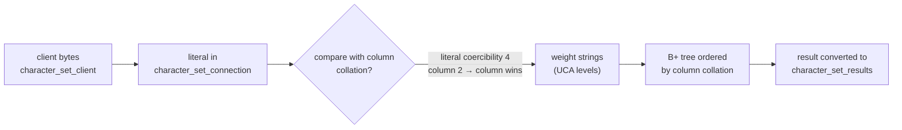

## Introduction

A string column stores **bytes**, but people think in **characters**, and businesses think in **rules**: "emails are case-insensitive", "`Müller` should sort next to `Mueller`… or should it?", "the product code `ab-1` is not the same as `AB-1`". Two MySQL concepts connect bytes to those rules:

- A **character set** (charset) is a set of characters plus an **encoding** that maps each character to bytes. It decides *which* characters a column can store — can it hold `é`, `ß`, `中`, `😀`? — and how many bytes each one costs.
- A **collation** is a set of rules for **comparing** strings in a character set. It decides whether `'a' = 'A'`, whether `'e' = 'é'`, whether `'abc' = 'abc '`, and in which order `ORDER BY` returns `apple`, `Apple` and `Äpfel`.

These decisions are not cosmetic. A collation determines what a `UNIQUE` index considers a duplicate, which rows a `WHERE` or `JOIN` matches, how `GROUP BY` and `DISTINCT` merge values, and whether an index can be used at all. Getting them wrong produces real incidents: emoji that cannot be saved, "duplicate" accounts that differ only by letter case, joins that fail with *Illegal mix of collations*, and queries that silently stop using an index.

This lesson builds on [String Data Types](/lessons/m02-string-types), which introduced the difference between length in characters and in bytes. Pattern matching itself (`LIKE`, `REGEXP`) is covered in [Pattern Matching](/lessons/m03-pattern-matching); here we look at how the collation changes what those operators match.

:::note[Dataset]
The examples use the **shop** dataset (all of whose tables use MySQL 8's defaults, `utf8mb4` with `utf8mb4_0900_ai_ci`) plus small tables created in the lab. Every output was captured from a real server.
:::

## DBMS Theory

:::theory[Repertoire, encoding, collation]
Three layers are involved in storing text:

1. **Character repertoire** — the abstract characters available (Unicode defines over 149,000).
2. **Encoding** — how a character becomes bytes. **UTF-8** encodes each Unicode code point in **1 to 4 bytes**: ASCII characters in 1, most European accented letters in 2, most CJK characters in 3, and characters outside the Basic Multilingual Plane — emoji, many historic scripts, some CJK extensions — in 4.
3. **Collation** — an equivalence relation (which strings are *equal*) and a total order (how strings *sort*) over the strings of a character set.

The **Unicode Collation Algorithm (UCA)** defines collation in levels. Each character maps to a sequence of **weights**:

| Level | Distinguishes | Example equal at lower levels |
|---|---|---|
| Primary | base letters | `a` = `A` = `á` |
| Secondary | accents (diacritics) | `a` = `A`, but `a` ≠ `á` |
| Tertiary | case and variants | `a` ≠ `A` |

A collation that compares only primary weights is **accent-insensitive and case-insensitive** (`_ai_ci`); comparing primary + secondary gives `_as_ci`; all three levels gives `_as_cs`. A **binary** collation ignores linguistic weights entirely and compares code points (`_bin`).
:::

Two properties of collations have direct relational consequences:

- **Equality defines key uniqueness.** A `UNIQUE` constraint means "no two rows are equal on these columns" — *under the column's collation*. With a case-insensitive collation, `Alice@x.com` and `alice@x.com` are the same key.
- **Order defines index structure.** A B+ tree index on a string column stores keys **sorted by the collation**. An index sorted by one collation can only answer equality and range questions asked *in that collation* (or a compatible one).

A third property is the **pad attribute**: whether trailing spaces are significant. `PAD SPACE` collations compare strings as if the shorter one were padded with spaces (`'a' = 'a '` is true); `NO PAD` collations treat trailing spaces as ordinary characters (`'a' = 'a '` is false). The SQL standard historically specified PAD SPACE semantics for fixed-length comparison; MySQL's UCA 9.0.0 collations (the `_0900_` family, including the default) are `NO PAD`.

:::standard[Standard SQL vs MySQL]
Standard SQL defines `CHARACTER SET` and `COLLATE` clauses and the idea of collation derivation (explicit vs implicit). MySQL implements these and extends them with: per-server/database/table/column defaults, the **introducer** syntax `_utf8mb4'text'`, `SET NAMES`, `CONVERT(expr USING charset)`, the numeric **coercibility** scheme that resolves conflicts, and its own charset names — notably the misleading `utf8`, which in MySQL means the 3-byte `utf8mb3` and cannot store all of Unicode.
:::

## Why It Exists

**Why not just store bytes?** Because the application must then decode, compare and sort text itself, and every client must agree on the encoding. When they do not, you get **mojibake**: a client sends UTF-8 bytes while the server believes they are Latin-1, the bytes `C3 A9` (UTF-8 for `é`) are stored as two Latin-1 characters `é`, and the corruption spreads into every report and export.

**Why more than one collation?** Because "equal" is a business decision:

- Logins and emails should usually match case-insensitively, so `ci`.
- Search boxes often should ignore accents (`resume` finds `résumé`), so `ai`.
- Product codes, tokens, file names, and anything compared by machines should match exactly, so `_bin` or `_as_cs`.
- Names should sort the way people in a given language expect — German, Swedish, Turkish and Spanish orderings differ — hence language-specific collations such as `utf8mb4_de_pb_0900_ai_ci` or `utf8mb4_tr_0900_ai_ci`.

**Why did MySQL need utf8mb4?** Early MySQL implemented "UTF-8" with at most **3 bytes per character**, covering only the Basic Multilingual Plane. When emoji and supplementary characters became common (mobile keyboards in the early 2010s), applications on `utf8` columns started failing on, or silently truncating, every message containing 😀. MySQL 5.5 added `utf8mb4` (real UTF-8, up to 4 bytes); MySQL 8.0 made it the default together with the modern `utf8mb4_0900_ai_ci` collation, and deprecated `utf8mb3`.

## Internal Working

:::internals[How MySQL stores, converts and compares text]
**Storage.** Every string column has a charset and collation recorded in the data dictionary. `VARCHAR(n)` limits the column to *n characters*; InnoDB stores the actual bytes plus a 1- or 2-byte length prefix. The maximum byte size of a `utf8mb4` value is *n* × 4, which matters for row-size and index-key limits: in the `DYNAMIC` row format an index key part can be at most 3072 bytes, so a fully indexed `utf8mb4` column can be at most `VARCHAR(768)`.

**Comparison by weight strings.** To compare two strings under a UCA collation, MySQL transforms each into a **weight string** — a byte sequence whose plain binary order equals the collation order — and compares those. For accent- and case-insensitive collations, `a`, `A` and `á` produce the same primary weights; case-sensitive collations append secondary and tertiary weights. You can inspect the transformation with `WEIGHT_STRING()`. Index keys are compared the same way, which is why the B+ tree is ordered by the collation.

**The connection pipeline.** Text arrives from the client in `character_set_client`, is converted to `character_set_connection` for evaluating literals, and is compared/stored in each column's own charset; results are converted to `character_set_results` before being sent back. `SET NAMES utf8mb4` sets all three. If the client's real encoding and the declared one disagree, MySQL converts the wrong bytes faithfully — that is how mojibake is born.

**Resolving a comparison's collation.** When an expression combines strings with different collations, MySQL picks one using **coercibility** (0 = explicit `COLLATE`, 1 = no collation, 2 = column, 3 = system constant, 4 = literal, 5 = numeric, 6 = NULL): the side with the *lower* value wins. If both sides have the same coercibility and different collations of the same Unicode charset, a `_bin` collation wins; otherwise MySQL cannot choose and raises **error 1267, Illegal mix of collations**.
:::



A practical consequence of weight-string comparison: an index can serve a predicate only if the predicate is evaluated **in the index's collation**. Force a different collation onto the *column* (`email COLLATE utf8mb4_bin = …`) and every key must be re-weighted, so the index order is useless for a lookup. You will see this in the plans below.

## MySQL Implementation

### What the server and your session use

```sql run
SHOW SESSION VARIABLES WHERE Variable_name IN
  ('character_set_server', 'collation_server', 'character_set_database', 'collation_database',
   'character_set_client', 'character_set_connection', 'character_set_results', 'collation_connection');
```

Everything is `utf8mb4` with `utf8mb4_0900_ai_ci` — the MySQL 8.x defaults. The two UTF-8 character sets:

```sql run
SHOW CHARACTER SET LIKE 'utf8%';
```

`Maxlen` is the maximum number of bytes per character: 3 for `utf8mb3`, 4 for `utf8mb4`. A few of the many `utf8mb4` collations, with their pad attribute:

```sql run
SHOW COLLATION WHERE Charset = 'utf8mb4' AND Collation IN
  ('utf8mb4_0900_ai_ci', 'utf8mb4_0900_as_ci', 'utf8mb4_0900_as_cs', 'utf8mb4_0900_bin',
   'utf8mb4_bin', 'utf8mb4_general_ci', 'utf8mb4_unicode_ci');
```

**Reading a collation name.** `utf8mb4` = charset; `0900` = based on UCA version 9.0.0 (older `unicode_ci` is UCA 4.0.0, `general_ci` is a simplified MySQL algorithm); an optional language code (`de_pb`, `tr`, `ja`…); then `ai`/`as` (accent-insensitive/-sensitive) and `ci`/`cs` (case-insensitive/-sensitive), or `bin` (binary).

### Bytes versus characters

```sql run
SELECT s, CHAR_LENGTH(s) AS characters, LENGTH(s) AS bytes, HEX(s) AS utf8_bytes
FROM (SELECT 'a' AS s UNION ALL SELECT 'é' UNION ALL SELECT '€' UNION ALL SELECT '😀') AS samples;
```

UTF-8 is variable-length: `a` takes 1 byte, `é` 2, `€` 3 and `😀` 4. The 4-byte emoji is exactly what `utf8mb3` cannot store.

### The same comparison under different collations

```sql run
SELECT 'a' = 'A'                                    AS ai_ci_case,
       'e' = 'é'                                    AS ai_ci_accent,
       'e' = 'é' COLLATE utf8mb4_0900_as_ci         AS as_ci_accent,
       'a' = 'A' COLLATE utf8mb4_0900_as_ci         AS as_ci_case,
       'a' = 'A' COLLATE utf8mb4_0900_as_cs         AS as_cs_case,
       'a' = 'A' COLLATE utf8mb4_bin                AS bin_case,
       'Straße' = 'Strasse'                         AS sharp_s,
       'a' = 'a '                                   AS no_pad_trailing,
       'a' = 'a ' COLLATE utf8mb4_general_ci        AS pad_space_trailing;
```

Unmarked literals use the connection collation `utf8mb4_0900_ai_ci`, which ignores case and accents and even treats `ß` as `ss`. Adding `COLLATE` changes the rule for that comparison only. The last two columns show the pad attribute: the default `NO PAD` collation considers `'a '` different from `'a'`; the older `PAD SPACE` collation `utf8mb4_general_ci` ignores the trailing space.

The weights behind this:

```sql run
SELECT HEX(WEIGHT_STRING('a' COLLATE utf8mb4_0900_ai_ci)) AS ai_ci_a,
       HEX(WEIGHT_STRING('A' COLLATE utf8mb4_0900_ai_ci)) AS ai_ci_A,
       HEX(WEIGHT_STRING('á' COLLATE utf8mb4_0900_ai_ci)) AS ai_ci_a_acute,
       HEX(WEIGHT_STRING('a' COLLATE utf8mb4_0900_as_cs)) AS as_cs_a,
       HEX(WEIGHT_STRING('A' COLLATE utf8mb4_0900_as_cs)) AS as_cs_A;
```

Under `_ai_ci` the three characters have **identical** weights (primary level only), so they are equal and sort together. Under `_as_cs` the primary weight is followed by secondary and tertiary weights, and `a` and `A` differ in the last (tertiary, case) weight.

## Syntax Breakdown

| Level | Syntax | Notes |
|---|---|---|
| Server | `character_set_server`, `collation_server` (option file) | Default for new databases. |
| Database | `CREATE DATABASE d CHARACTER SET utf8mb4 COLLATE utf8mb4_0900_ai_ci` | Default for new tables (see [Creating and Managing Databases](/lessons/m02-databases)). |
| Table | `CREATE TABLE t (…) DEFAULT CHARSET = utf8mb4 COLLATE = utf8mb4_0900_ai_ci` | Default for new columns. Changing it later does **not** convert existing columns. |
| Column | `name VARCHAR(50) CHARACTER SET utf8mb4 COLLATE utf8mb4_0900_as_cs` | What is actually used for storage and comparison. |
| Convert a table | `ALTER TABLE t CONVERT TO CHARACTER SET utf8mb4 COLLATE …` | Rewrites every string column (and the table default); rebuilds the table. |
| Expression | `expr COLLATE coll` | Explicit collation (coercibility 0) for one comparison, `ORDER BY` or `GROUP BY`. |
| Literal introducer | `_utf8mb4'text'`, `_latin1'text'`, `_binary'text'` | Declares the charset of a literal's bytes. |
| Conversion | `CONVERT(expr USING utf8mb4)`, `CAST(expr AS CHAR CHARACTER SET utf8mb4)` | Converts characters to another charset (not a reinterpretation of bytes). |
| Binary comparison | `CAST(expr AS BINARY)` | Byte-wise comparison. The older `BINARY expr` operator is deprecated since 8.0.27. |
| Session | `SET NAMES utf8mb4 [COLLATE …]` | Sets client, connection and results charsets. |
| Inspection | `SHOW CHARACTER SET`, `SHOW COLLATION`, `CHARSET(x)`, `COLLATION(x)`, `COERCIBILITY(x)`, `WEIGHT_STRING(x)`, `information_schema.COLUMNS` | |

### Choosing among the common utf8mb4 collations

| Collation | Case | Accents | Trailing spaces | Typical use |
|---|---|---|---|---|
| `utf8mb4_0900_ai_ci` (**default**) | insensitive | insensitive | significant (NO PAD) | General text, names, emails |
| `utf8mb4_0900_as_ci` | insensitive | sensitive | NO PAD | Text where `resume` ≠ `résumé` but case is irrelevant |
| `utf8mb4_0900_as_cs` | sensitive | sensitive | NO PAD | Case-sensitive text that still sorts linguistically (`apple`, `Apple`, `banana`) |
| `utf8mb4_0900_bin` | sensitive | sensitive | NO PAD | Exact code-point comparison: tokens, codes, hashes |
| `utf8mb4_bin` | sensitive | sensitive | ignored (PAD SPACE) | Legacy binary collation |
| `utf8mb4_general_ci` / `utf8mb4_unicode_ci` | insensitive | insensitive | ignored (PAD SPACE) | Legacy (pre-8.0 defaults); prefer the `0900` family |

:::version[utf8, utf8mb3 and 8.4]
In MySQL 8.0 and 8.4, `utf8` is an **alias for `utf8mb3`** (with a deprecation warning that it will become an alias for `utf8mb4` in a future release). `utf8mb3` and its collations are deprecated and print warnings when used. Since 8.0.30, `SHOW CREATE TABLE` and `information_schema` display `utf8mb3` rather than `utf8`. Never create new `utf8`/`utf8mb3` columns; the run block below shows the warnings you get.
:::

## Practical Examples

**1. utf8mb3 cannot store emoji.** Create a table the way many pre-8.0 tutorials did, with `CHARACTER SET utf8`:

```sql run
CREATE TABLE legacy_messages (
  id   INT PRIMARY KEY,
  body VARCHAR(100) CHARACTER SET utf8 NOT NULL
);
SHOW CREATE TABLE legacy_messages;
```

The warnings explain that `utf8` meant `utf8mb3`, and `SHOW CREATE TABLE` confirms it. Now a customer leaves a happy message:

```sql run error
INSERT INTO legacy_messages VALUES (1, 'Arrived early 😀');
```

Error 1366: the 4-byte character has no representation in `utf8mb3`. (In non-strict mode, older MySQL versions truncated the string at the emoji instead — losing data silently.) The fix is to convert the table:

```sql run
ALTER TABLE legacy_messages CONVERT TO CHARACTER SET utf8mb4 COLLATE utf8mb4_0900_ai_ci;
INSERT INTO legacy_messages VALUES (1, 'Arrived early 😀');
SELECT id, body, CHAR_LENGTH(body) AS characters, LENGTH(body) AS bytes FROM legacy_messages;
```

**2. Collation decides what a UNIQUE key considers a duplicate.** `customers.email` uses the default case-insensitive collation:

```sql run error
INSERT INTO customers (first_name, last_name, email, city, state, signup_date)
VALUES ('Amara', 'Sharma', 'AMARA.SHARMA1@EXAMPLE.COM', 'Austin', 'TX', '2024-12-01');
```

That is usually exactly what you want for emails (the domain part is case-insensitive by definition, and in practice so are mailbox names). For a column holding case-sensitive identifiers it would be a bug.

**3. Sorting and grouping depend on the collation.** Create a small word list and sort it three ways:

```sql run
CREATE TABLE words (w VARCHAR(20) NOT NULL);
INSERT INTO words VALUES ('apple'), ('Apple'), ('Banana'), ('banana'), ('Äpfel'),
                         ('zebra'), ('Zebra'), ('éclair'), ('eclair');
SELECT GROUP_CONCAT(w ORDER BY w, w COLLATE utf8mb4_bin SEPARATOR ' ')  AS ai_ci_order,
       GROUP_CONCAT(w ORDER BY w COLLATE utf8mb4_0900_as_cs SEPARATOR ' ') AS as_cs_order,
       GROUP_CONCAT(w ORDER BY w COLLATE utf8mb4_bin SEPARATOR ' ')     AS bin_order
FROM words;
```

The default collation keeps all forms of a letter together (the secondary sort key `w COLLATE utf8mb4_bin` only makes ties deterministic). `_as_cs` still sorts **linguistically** — `apple` before `Apple` before `banana` — but distinguishes them. `_bin` sorts by code point: every uppercase ASCII letter (`A`–`Z`, code points 65–90) before every lowercase one (97–122), and accented letters (code points above 127) after `z`. That is why `_as_cs` is usually a better choice than `_bin` for human-readable case-sensitive text.

Equality affects `DISTINCT` and `GROUP BY` the same way:

```sql run
SELECT COUNT(DISTINCT w)                               AS distinct_ai_ci,
       COUNT(DISTINCT w COLLATE utf8mb4_0900_as_ci)     AS distinct_as_ci,
       COUNT(DISTINCT w COLLATE utf8mb4_0900_as_cs)     AS distinct_as_cs
FROM words;
```

Nine rows; the number of "different" words depends entirely on the collation.

**4. LIKE follows the collation.** Under the default collation, `LIKE` is case- and accent-insensitive:

```sql run
SELECT w FROM words WHERE w LIKE 'a%' ORDER BY w, w COLLATE utf8mb4_bin;
```

`Äpfel` matches `'a%'`. To make the pattern case- and accent-sensitive, collate the comparison:

```sql run
SELECT w FROM words WHERE w LIKE 'a%' COLLATE utf8mb4_0900_as_cs ORDER BY w;
```

Note that `LIKE` never applies padding: `'a ' LIKE 'a'` is false even under a `PAD SPACE` collation.

**5. Language-specific rules.** UCA root collations treat dotless `ı` (Turkish) as a separate letter from `i`, and `İ` (capital I with dot) as `i` plus an accent, which the accent-insensitive default ignores:

```sql run
SELECT 'ı' = 'i' AS dotless_i, 'İ' = 'i' AS dotted_capital_i,
       'ı' = 'I' COLLATE utf8mb4_tr_0900_ai_ci AS turkish_dotless_vs_I;
```

Language-specific collations (`utf8mb4_tr_0900_ai_ci`, `utf8mb4_de_pb_0900_ai_ci`, `utf8mb4_sv_0900_ai_ci`, …) apply the tailored rules of that language. Use them for columns that are displayed and sorted for one locale.

## Execution Walkthrough

How does MySQL decide which collation to use when two strings meet? Let us trace the resolution rules with two tables whose `name` columns use different collations.

```walkthrough
title: Resolving a comparison between two collations
steps:
  - title: "1. Two tables, two collations"
    explain: >-
      vendors.name uses the 8.0 default utf8mb4_0900_ai_ci; legacy_vendors.name was created on an older
      server with utf8mb4_general_ci. Both are case-insensitive, but they are different collations.
    sql: |
      CREATE TABLE vendors        (name VARCHAR(30) COLLATE utf8mb4_0900_ai_ci NOT NULL);
      CREATE TABLE legacy_vendors (name VARCHAR(30) COLLATE utf8mb4_general_ci NOT NULL);
      INSERT INTO vendors VALUES ('Acme'), ('Globex'), ('Initech');
      INSERT INTO legacy_vendors VALUES ('ACME'), ('Umbrella'), ('initech');
      SELECT COLLATION(v.name) AS vendors_collation, COLLATION(l.name) AS legacy_collation
      FROM vendors v CROSS JOIN legacy_vendors l LIMIT 1;
  - title: "2. Coercibility of each operand"
    explain: >-
      Every string expression has a coercibility. Columns are 2 (implicit), literals 4, an explicit COLLATE
      clause 0. Lower wins. Two columns therefore tie at 2.
    sql: |
      SELECT COERCIBILITY(v.name) AS column_c,
             COERCIBILITY('Acme') AS literal_c,
             COERCIBILITY(v.name COLLATE utf8mb4_general_ci) AS explicit_c
      FROM vendors v LIMIT 1;
  - title: "3. Tie with different collations: error 1267"
    explain: >-
      Equal coercibility, different collations, neither is _bin: MySQL cannot choose and refuses the
      comparison instead of guessing.
    sql: SELECT v.name FROM vendors v JOIN legacy_vendors l ON v.name = l.name;
    expect: error
  - title: "4. Column vs literal: the column wins"
    explain: >-
      A literal (coercibility 4) gives way to the column (2). The comparison runs in the column's collation,
      so 'ACME' matches 'Acme' case-insensitively and no error occurs.
    sql: SELECT name FROM vendors WHERE name = 'ACME';
  - title: "5. Explicit COLLATE resolves the tie"
    explain: >-
      COLLATE has coercibility 0 and wins. The join now runs in utf8mb4_0900_ai_ci and matches Acme/ACME
      and Initech/initech.
    sql: |
      SELECT v.name AS vendor, l.name AS legacy_name
      FROM vendors v JOIN legacy_vendors l ON v.name = l.name COLLATE utf8mb4_0900_ai_ci
      ORDER BY v.name;
  - title: "6. The _bin tie-breaker"
    explain: >-
      If one side's collation is a _bin collation of the same character set, MySQL uses the binary
      collation instead of raising 1267. The comparison is now case-sensitive, so only exact matches pair up:
      Acme still matches Acme, but Initech no longer matches INITECH.
    sql: |
      CREATE TABLE vendor_codes (name VARCHAR(30) COLLATE utf8mb4_bin NOT NULL);
      INSERT INTO vendor_codes VALUES ('Acme'), ('INITECH');
      SELECT v.name, c.name AS code_name, COLLATION(c.name) AS code_collation
      FROM vendors v JOIN vendor_codes c ON v.name = c.name;
```

The rules, in order: (1) lower coercibility wins; (2) on a tie, if both collations belong to the same Unicode charset and one is `_bin`, the `_bin` collation wins; (3) on a tie between two different non-binary collations, error 1267. The same conflict in a `UNION` raises the related error 1271. Step 6 also shows how a binary collation can silently change semantics: no error, but "Initech" no longer matches "INITECH".

## Output

After the walkthrough, compare what the same join returns under the two candidate collations — the decision is a business decision, which is precisely why MySQL refuses to make it for you:

```sql run
SELECT 'utf8mb4_0900_ai_ci' AS evaluated_with, COUNT(*) AS matches
FROM vendors v JOIN legacy_vendors l ON v.name = l.name COLLATE utf8mb4_0900_ai_ci
UNION ALL
SELECT 'utf8mb4_0900_as_cs', COUNT(*)
FROM vendors v JOIN legacy_vendors l ON v.name COLLATE utf8mb4_0900_as_cs = l.name COLLATE utf8mb4_0900_as_cs;
```

How to read it: case-insensitively, two vendors exist in both systems; case-sensitively, none do. A data-integration job that "fixes" error 1267 by sprinkling `COLLATE` must choose deliberately — and the durable fix is to give both columns the same collation with `ALTER TABLE … CONVERT TO CHARACTER SET`.

## Alternative Approaches

Case-insensitive matching on a case-sensitive column, or vice versa, can be achieved several ways:

| Approach | Example | Index-friendly? | Notes |
|---|---|---|---|
| Choose the right column collation | `email VARCHAR(255) COLLATE utf8mb4_0900_ai_ci` | Yes | The best option when the rule is permanent |
| `COLLATE` on the literal side | `WHERE code = 'ab-1' COLLATE utf8mb4_0900_bin` | Partly (see Performance) | Changes the rule for one query |
| `COLLATE` on the column side | `WHERE code COLLATE utf8mb4_bin = 'ab-1'` | No | Every row must be re-weighted |
| `LOWER()` on both sides | `WHERE LOWER(code) = LOWER(?)` | Only with a functional index on `(LOWER(code))` | Portable, but casing rules differ by language |
| Generated column + index | `code_norm VARCHAR(20) AS (LOWER(code)) STORED, KEY (code_norm)` | Yes | Explicit normalized value; also enables a UNIQUE rule on it |
| Separate columns | `display_name` (as typed) + `search_name` (normalized) | Yes | Common in search-heavy applications |

For **accent-insensitive search in another database** (PostgreSQL), you would use an extension (`unaccent`) or ICU nondeterministic collations; MySQL's `_ai_` collations provide it natively, which is a genuine advantage for search features.

## Performance Analysis

**Index use with explicit COLLATE.** `customers.email` has a unique index in `utf8mb4_0900_ai_ci`. Compare three predicates:

```sql run
EXPLAIN SELECT customer_id FROM customers WHERE email = 'kwame.garcia2@example.com';
```

```sql run
EXPLAIN SELECT customer_id FROM customers WHERE email COLLATE utf8mb4_bin = 'kwame.garcia2@example.com';
```

```sql run
EXPLAIN SELECT customer_id FROM customers WHERE email = 'kwame.garcia2@example.com' COLLATE utf8mb4_bin;
```

- Same collation as the index: `const` access — one index lookup.
- `COLLATE` on the **column**: type `index` — a scan of every index entry (25 rows here, every row on a real table), with warning 1739 explaining that ref access is impossible "due to type or collation conversion".
- `COLLATE` on the **literal**: the optimizer can still use the case-insensitive index to find the (few) candidates that are equal case-insensitively — anything equal in binary is also equal ignoring case — and rechecks them in binary: type `range`, 1 row. Equality lookup (`ref`) is still not possible, as the warning says.

**Joins between columns of different character sets.** A legacy `utf8mb3` table joined to a `utf8mb4` one does not raise an error — MySQL converts the `utf8mb3` side to `utf8mb4` (a superset) — but an index on the converted side becomes unusable for lookups:

```sql run
CREATE TABLE legacy_newsletter (
  email VARCHAR(255) CHARACTER SET utf8mb3 COLLATE utf8mb3_general_ci NOT NULL,
  KEY idx_legacy_newsletter_email (email)
);
INSERT INTO legacy_newsletter SELECT email FROM customers;
ANALYZE TABLE legacy_newsletter;
EXPLAIN FORMAT=TREE
SELECT n.email FROM customers AS c JOIN legacy_newsletter AS n ON n.email = c.email
WHERE c.customer_id = 3;
```

Although we look up one customer, the plan reads the legacy table with an **index scan** and filters every entry, because `n.email` must be converted before it can be compared; warning 1739 says so. On a table of millions of rows this is the difference between a millisecond and seconds. The fix is to convert the legacy table so both columns share charset and collation.

**Other costs.**

- **Index size.** Index keys are sized for the maximum byte length: the `key_len` of 1022 in the first plan is 255 characters × 4 bytes + 2 length bytes. Over-sized `VARCHAR(255)` columns in `utf8mb4` inflate indexes and in-memory temporary tables; size columns realistically.
- **Comparison cost.** Binary collations compare bytes directly; UCA collations compute weights. The manual notes that the `0900` UCA collations are faster than the older `unicode_ci` ones. In practice, collation choice should be driven by semantics; the CPU difference matters only for very large sorts and grouping.
- **`LIKE 'prefix%'`** can use a range scan on an index in the same collation; `LIKE '%infix%'` cannot use the B+ tree order at all (see [Sargable Queries](/lessons/m07-sargable-queries)).

:::performance[Theory vs measurement]
The plans above show the access *method* chosen on a 25-row table — the elapsed time is meaningless at that size. On large tables, test the same queries with `EXPLAIN ANALYZE` to see the rows actually examined. Warning 1739 in `EXPLAIN` output is the reliable signal that a charset/collation conversion is preventing index use.
:::

## Best Practices

:::best-practice[Character sets and collations]
1. **Use `utf8mb4` everywhere** — server, databases, tables, columns and the client connection (`SET NAMES utf8mb4`, or the driver's `charset=utf8mb4`). Never create `utf8`/`utf8mb3` columns.
2. **Keep the default `utf8mb4_0900_ai_ci`** unless you have a reason; choose a different collation **per column** for specific semantics: `utf8mb4_0900_bin` (or `_as_cs`) for codes, tokens and case-sensitive identifiers; a language-specific collation for locale-sorted display columns.
3. **Make joined columns identical** in type, charset and collation — including foreign keys and columns joined across legacy and new tables.
4. **Put `COLLATE` on the literal, not the column**, when you must override a collation in a query, and prefer fixing the schema over per-query overrides.
5. **Remember that UNIQUE follows the collation.** Decide consciously whether `Alice` and `alice` are the same user.
6. **Plan migrations from utf8mb3**: `ALTER TABLE … CONVERT TO CHARACTER SET utf8mb4` rebuilds the table, may push indexed `VARCHAR` columns over key-length limits, and changes comparison semantics (and possibly uniqueness) if the collation changes. Test for new duplicate-key conflicts before running it in production.
7. **Do not store binary data (hashes, encrypted values, UUID bytes) in character columns** — use `BINARY`/`VARBINARY`, which have no charset and compare byte-wise.
:::

## Common Mistakes

**Mistake 1 — believing `utf8` is UTF-8.** Shown in Practical Example 1: it is the deprecated 3-byte `utf8mb3`, and emoji fail with error 1366.

**Mistake 2 — joining columns with different collations.**

```sql run error
SELECT v.name FROM vendors AS v WHERE v.name IN (SELECT name FROM legacy_vendors);
```

The same 1267 error appears for `IN` subqueries, `CASE` results, and `UNION`s that mix the columns. Fix the schema; use `COLLATE` as a stopgap.

**Mistake 3 — case-sensitive lookups by forcing the column's collation.** It works, but turns an index lookup into a full index scan (see Performance Analysis). Correct pattern for an occasional case-sensitive check on a case-insensitive column:

```sql run
SELECT customer_id, email FROM customers
WHERE email = 'Kwame.Garcia2@example.com'                                -- index lookup, case-insensitive
  AND email = 'Kwame.Garcia2@example.com' COLLATE utf8mb4_0900_bin;      -- exact recheck
```

No row is returned, because the stored email is lower-case: the first predicate uses the index, the second applies the exact rule to the candidates.

**Mistake 4 — assuming trailing spaces are ignored.** Under the default `NO PAD` collation they are significant for `=`, `UNIQUE` and `GROUP BY`; under legacy `PAD SPACE` collations they are not. Data migrated from a `utf8mb4_general_ci` table to a `0900` collation can therefore suddenly contain "duplicates" that differ only by trailing spaces — or, in the opposite direction, fail with duplicate-key errors. Trim input at the application boundary.

```sql run
SELECT 'SKU-1 ' = 'SKU-1'                              AS default_no_pad,
       'SKU-1 ' = 'SKU-1' COLLATE utf8mb4_general_ci   AS legacy_pad_space;
```

**Mistake 5 — fixing mojibake by changing the column charset.** If `é` is stored in the table, the *bytes* are already wrong (double-encoded). `ALTER TABLE … CONVERT TO` converts characters, so it faithfully preserves the garbage. Repairing double encoding requires converting through a binary representation (for example `CONVERT(CAST(CONVERT(col USING latin1) AS BINARY) USING utf8mb4)`) on a copy, verified row by row — and fixing the client's connection charset first.

## Industry Application

- **Global consumer applications** store user-generated content (names, reviews, chat) in `utf8mb4`. The `utf8` → `utf8mb4` migration was a multi-year project at many companies precisely because it rebuilds tables, changes index key sizes and can surface new duplicate keys.
- **Identity systems** typically keep `email` case-insensitive for lookup and uniqueness, while storing the address as the user typed it for display; usernames often get a normalized companion column (lower-cased, Unicode-normalized) with the UNIQUE constraint, to prevent look-alike account names.
- **Search features** rely on accent- and case-insensitive collations to match `cafe` with `Café` without extra infrastructure; larger systems move full-text search to Elasticsearch/OpenSearch, where analyzers play the role collations play in MySQL.
- **Data integration and ETL.** Pipelines that join MySQL tables created on different server versions routinely hit error 1267 (`utf8mb4_0900_ai_ci` vs `utf8mb4_general_ci` or `utf8mb4_unicode_ci`). Platform teams standardize server defaults and add CI checks that compare `information_schema.COLUMNS.COLLATION_NAME` across environments.
- **Multi-language catalogues** sort product names per market with language-specific collations, or store a per-locale sort key computed by the application with ICU, which offers more control than per-column collations.

## Practice Exercises

```exercise
id: ex1
title: How many different usernames?
difficulty: easy
setup: |
  CREATE TABLE signup_attempts (attempt_id INT PRIMARY KEY, username VARCHAR(30) NOT NULL);
  INSERT INTO signup_attempts VALUES
    (1, 'maria'), (2, 'Maria'), (3, 'MARIA'), (4, 'maría'), (5, 'jose'), (6, 'José'), (7, 'kim');
concepts: [collations, case-sensitivity, accent-sensitivity]
prompt: |
  Return **one row** with three columns in this order:

  1. `default_distinct` — number of distinct usernames under the column's default collation (`utf8mb4_0900_ai_ci`);
  2. `as_ci_distinct` — number of distinct usernames when accents matter but case does not;
  3. `exact_distinct` — number of distinct usernames when both case and accents matter.
hints:
  - "COUNT(DISTINCT expr) uses the collation of expr."
  - "Apply COLLATE utf8mb4_0900_as_ci and COLLATE utf8mb4_0900_as_cs (or utf8mb4_0900_bin) inside COUNT(DISTINCT …)."
solution: |
  SELECT COUNT(DISTINCT username)                               AS default_distinct,
         COUNT(DISTINCT username COLLATE utf8mb4_0900_as_ci)    AS as_ci_distinct,
         COUNT(DISTINCT username COLLATE utf8mb4_0900_as_cs)    AS exact_distinct
  FROM signup_attempts;
explanation: |
  Under the default accent- and case-insensitive collation, maria/Maria/MARIA/maría are one value and
  jose/José another (3 in total with kim). Accent-sensitive, case-insensitive separates maría and José (5).
  Fully sensitive gives 7. `utf8mb4_0900_bin` or `utf8mb4_bin` would also give 7 for the last column.
```

```exercise
id: ex2
title: Exact product code lookup
difficulty: medium
setup: |
  CREATE TABLE part_codes (
    part_id INT PRIMARY KEY,
    code    VARCHAR(20) NOT NULL,
    KEY idx_part_codes_code (code)
  );
  INSERT INTO part_codes VALUES (1, 'ab-100'), (2, 'AB-100'), (3, 'Ab-100'), (4, 'ab-101'), (5, 'áb-100');
concepts: [case-sensitivity, collation-index-impact]
prompt: |
  The `code` column uses the default case-insensitive collation, but codes are case-sensitive in the
  supplier's system. Return `part_id` and `code` for the rows whose code is **exactly** `AB-100`
  (same case, same accents). Order by `part_id`.
hints:
  - "A plain = comparison returns several rows because of the collation."
  - "Apply an accent- and case-sensitive collation to the literal: 'AB-100' COLLATE utf8mb4_0900_bin."
solution: |
  SELECT part_id, code
  FROM part_codes
  WHERE code = 'AB-100' COLLATE utf8mb4_0900_bin
  ORDER BY part_id;
orderMatters: true
explanation: |
  Without COLLATE, `code = 'AB-100'` matches parts 1, 2, 3 and 5. Collating the **literal** keeps the
  index usable for narrowing candidates (as shown in Performance Analysis), whereas `code COLLATE … = 'AB-100'`
  forces a full index scan. `utf8mb4_0900_as_cs` or `utf8mb4_bin` give the same answer here. The durable fix
  is to declare the column with a case-sensitive collation.
```

```exercise
id: ex3
title: Find case-insensitive collisions
difficulty: medium
setup: |
  CREATE TABLE import_users (
    import_id INT PRIMARY KEY,
    email     VARCHAR(100) COLLATE utf8mb4_0900_bin NOT NULL
  );
  INSERT INTO import_users VALUES
    (1, 'li.wei@example.com'), (2, 'Li.Wei@example.com'), (3, 'sam@example.com'),
    (4, 'SAM@EXAMPLE.COM'), (5, 'sam@example.com '), (6, 'noor@example.com');
concepts: [collations, case-sensitivity]
prompt: |
  The staging table stores emails with a binary collation. Before loading them into a table whose email column
  is `utf8mb4_0900_ai_ci` with a UNIQUE key, find the values that would collide. Return two columns:
  `email_ci` — the email in lower case — and `n` — how many staging rows share it under
  `utf8mb4_0900_ai_ci`, only for values that occur more than once. Order by `email_ci`.
hints:
  - "Group by the email collated with utf8mb4_0900_ai_ci and keep groups with COUNT(*) > 1 (HAVING)."
  - "Output LOWER(…) of the grouped expression so the displayed value is deterministic."
  - "Is 'sam@example.com ' (trailing space) equal to 'sam@example.com' under a NO PAD collation?"
solution: |
  SELECT LOWER(email COLLATE utf8mb4_0900_ai_ci) AS email_ci, COUNT(*) AS n
  FROM import_users
  GROUP BY LOWER(email COLLATE utf8mb4_0900_ai_ci)
  HAVING COUNT(*) > 1
  ORDER BY email_ci;
orderMatters: true
explanation: |
  `li.wei@…` and `Li.Wei@…` collide (2), as do `sam@…` and `SAM@…` (2). The value with a trailing space does
  **not** collide, because `utf8mb4_0900_ai_ci` is NO PAD — under a legacy PAD SPACE collation such as
  `utf8mb4_general_ci` it would, and the count for sam would be 3. Trimming input at the application boundary
  avoids this whole class of surprise.
```

```exercise
id: ex4
title: Upgrade a table to utf8mb4
difficulty: hard
kind: dml
setup: |
  CREATE TABLE product_questions (
    question_id INT PRIMARY KEY,
    product_id  INT UNSIGNED NOT NULL,
    question    VARCHAR(200) CHARACTER SET utf8mb3 COLLATE utf8mb3_general_ci NOT NULL
  ) DEFAULT CHARSET = utf8mb3;
  INSERT INTO product_questions VALUES (1, 12, 'Does it fit small ears?');
concepts: [utf8mb4, character-sets]
prompt: |
  Customers want to use emoji in product questions, but `product_questions` is still `utf8mb3`.
  Convert the table (its default and every text column) to `utf8mb4` with collation `utf8mb4_0900_ai_ci`, then
  insert question 2 for product 12 with the text `Battery life? 🔋`.
hints:
  - "One ALTER TABLE statement can convert the table default and all character columns."
  - "ALTER TABLE product_questions CONVERT TO CHARACTER SET utf8mb4 COLLATE utf8mb4_0900_ai_ci;"
solution: |
  ALTER TABLE product_questions CONVERT TO CHARACTER SET utf8mb4 COLLATE utf8mb4_0900_ai_ci;
  INSERT INTO product_questions VALUES (2, 12, 'Battery life? 🔋');
check: |
  SELECT c.COLUMN_NAME, c.CHARACTER_SET_NAME, c.COLLATION_NAME,
         (SELECT COUNT(*) FROM product_questions) AS questions,
         (SELECT CHAR_LENGTH(question) FROM product_questions WHERE question_id = 2) AS q2_chars
  FROM information_schema.COLUMNS AS c
  WHERE c.TABLE_SCHEMA = DATABASE() AND c.TABLE_NAME = 'product_questions' AND c.DATA_TYPE = 'varchar';
explanation: |
  `ALTER TABLE … DEFAULT CHARSET = utf8mb4` alone changes only the default for *future* columns; the existing
  `question` column would stay `utf8mb3` and the insert would still fail with error 1366. `CONVERT TO`
  rewrites the existing columns. On a large production table this is a table rebuild — plan it like any
  heavy DDL, and check that indexed VARCHAR columns still fit the 3072-byte key limit at 4 bytes per character.
```

```exercise
id: ex5
title: Reconcile two vendor lists
difficulty: challenge
setup: |
  CREATE TABLE erp_vendors (vendor_name VARCHAR(40) COLLATE utf8mb4_0900_ai_ci NOT NULL PRIMARY KEY);
  CREATE TABLE crm_vendors (vendor_name VARCHAR(40) COLLATE utf8mb4_unicode_ci NOT NULL PRIMARY KEY);
  INSERT INTO erp_vendors VALUES ('Acme Corp'), ('Globex'), ('Société Générale'), ('Umbrella');
  INSERT INTO crm_vendors VALUES ('ACME CORP'), ('Societe Generale'), ('Initech'), ('Umbrella ');
concepts: [collation-coercibility, collations]
prompt: |
  The ERP and CRM vendor tables use different collations, so a plain join fails with error 1267. Return the
  vendors present in **both** systems, comparing names case- and accent-insensitively with the ERP's collation
  `utf8mb4_0900_ai_ci` (where trailing spaces are significant). Return two columns, `erp_name` and `crm_name`,
  ordered by `erp_name`.
hints:
  - "Override the collation of one side of the join condition with COLLATE (coercibility 0 wins)."
  - "ON e.vendor_name = c.vendor_name COLLATE utf8mb4_0900_ai_ci"
  - "Under the NO PAD collation, does 'Umbrella ' match 'Umbrella'?"
solution: |
  SELECT e.vendor_name AS erp_name, c.vendor_name AS crm_name
  FROM erp_vendors AS e
  JOIN crm_vendors AS c ON e.vendor_name = c.vendor_name COLLATE utf8mb4_0900_ai_ci
  ORDER BY e.vendor_name;
orderMatters: true
explanation: |
  Acme Corp/ACME CORP and Société Générale/Societe Generale match under the accent- and case-insensitive
  collation. `Umbrella ` (trailing space) does not match, because `utf8mb4_0900_ai_ci` is NO PAD; comparing in
  the CRM's `utf8mb4_unicode_ci` (PAD SPACE) instead would match it too — the "right" answer depends on which
  rule the business adopts. Collating `e.vendor_name COLLATE utf8mb4_unicode_ci` would therefore return three
  rows. The durable fix is to convert both tables to the same collation and trim names on input.
```

```exercise
id: ex6
title: Pick collations for a user table
difficulty: medium
kind: open
concepts: [collations, utf8mb4, case-sensitivity]
prompt: |
  Choose a character set and collation for each column of `users` and justify each choice: `email`
  (login, must be unique), `display_name` (shown and sorted in a mostly US/European UI), `api_token`
  (random URL-safe string, compared exactly), `password_hash` (bcrypt/argon2 output), `country_code` (ISO
  3166 alpha-2).
solution: |
  - **email** — `VARCHAR(254) CHARACTER SET utf8mb4 COLLATE utf8mb4_0900_ai_ci` with a UNIQUE key: logins
    should not depend on case; accent-insensitivity is harmless for addresses that are almost always ASCII. Trim
    on input (NO PAD). Teams that must treat the local part as case-sensitive store a normalized copy instead.
  - **display_name** — `utf8mb4` (names contain accents, CJK and sometimes emoji) with
    `utf8mb4_0900_ai_ci` for friendly sorting/search, or a locale-specific collation if the UI is single-locale.
    No UNIQUE constraint.
  - **api_token** — exact comparison is mandatory (a case-insensitive token space is smaller and lookups must
    not match similar tokens): `VARCHAR(64) CHARACTER SET ascii COLLATE ascii_bin`, or `utf8mb4_0900_bin`.
    Better still, store only a hash of the token in `BINARY(32)`.
  - **password_hash** — opaque bytes/ASCII produced by the hashing library: `VARBINARY(255)` or
    `VARCHAR(255) CHARACTER SET ascii COLLATE ascii_bin`; never a case-insensitive collation.
  - **country_code** — `CHAR(2) CHARACTER SET ascii COLLATE ascii_general_ci` (1 byte per character, fixed
    width) or `utf8mb4` for uniformity; normalize to upper case on input.
```

## Knowledge Assessment

```quiz
- id: q1
  question: "A column is declared `VARCHAR(100) CHARACTER SET utf8` on MySQL 8.4. What does it store?"
  options:
    - "Any Unicode character, up to 4 bytes each"
    - "utf8mb3: characters of up to 3 bytes, so emoji are rejected"
    - "Only ASCII characters"
    - "utf8mb4, because utf8 became an alias for utf8mb4 in 8.0"
  answer: 1
  explanation: "In MySQL 8.0 and 8.4, utf8 is a deprecated alias for utf8mb3, which cannot store 4-byte characters such as emoji (error 1366 in strict mode). The alias is announced to change to utf8mb4 in a future release, but has not in 8.4."
  concepts: [utf8mb4, character-sets]
- id: q2
  question: "Under the default collation `utf8mb4_0900_ai_ci`, which comparisons return 1? (Select all that apply.)"
  type: multi
  options: ["'a' = 'A'", "'e' = 'é'", "'a' = 'a '", "'Straße' = 'Strasse'", "'ı' = 'i'"]
  answer: [0, 1, 3]
  explanation: "The default is accent- and case-insensitive (primary weights only), and UCA 9.0.0 expands ß to ss. It is NO PAD, so a trailing space makes the strings different. Dotless ı is a distinct base letter in the root UCA, so it does not equal i."
  concepts: [collations, case-sensitivity, accent-sensitivity]
- id: q3
  question: "Joining `a.name` (utf8mb4_0900_ai_ci) with `b.name` (utf8mb4_unicode_ci) fails with error 1267. Why?"
  options:
    - "The columns have different character sets"
    - "Both operands are columns with the same coercibility (implicit) but different non-binary collations, so MySQL cannot choose one"
    - "utf8mb4_unicode_ci is deprecated"
    - "Joins on string columns require a binary collation"
  answer: 1
  explanation: "Both columns have coercibility 2. Lower coercibility would win, a _bin collation of the same charset would win a tie, but two different non-binary collations tie with no winner — error 1267. The charsets are the same (utf8mb4); unicode_ci is a legacy but supported collation."
  concepts: [collation-coercibility]
- id: q4
  question: "`customers.email` has a unique index in `utf8mb4_0900_ai_ci`. Which predicate is the worst for index use?"
  options:
    - "email = 'x@example.com'"
    - "email = 'x@example.com' COLLATE utf8mb4_bin"
    - "email COLLATE utf8mb4_bin = 'x@example.com'"
    - "email LIKE 'x@%'"
  answer: 2
  explanation: "Applying COLLATE to the column means every index key must be re-weighted, so MySQL scans the whole index (type index, warning 1739). The plain equality is a const lookup; COLLATE on the literal still allows a range on the case-insensitive index plus a recheck; a prefix LIKE is a range scan."
  concepts: [collation-index-impact]
- id: q5
  question: "What does `SELECT CHAR_LENGTH('😀'), LENGTH('😀');` return with a utf8mb4 connection?"
  options: ["1, 1", "1, 4", "4, 4", "2, 4"]
  answer: 1
  explanation: "CHAR_LENGTH counts characters (1); LENGTH counts bytes, and this emoji takes 4 bytes in UTF-8. The distinction matters for VARCHAR limits (characters) versus row and index limits (bytes)."
  concepts: [character-sets, utf8mb4]
- id: q6
  question: "Which statement about `utf8mb4_bin` versus `utf8mb4_0900_as_cs` is correct?"
  options:
    - "They are identical"
    - "Both are case-sensitive, but utf8mb4_bin sorts by code point (all of A–Z before a–z) while as_cs sorts linguistically (apple, Apple, banana)"
    - "utf8mb4_bin is case-insensitive"
    - "utf8mb4_0900_as_cs ignores accents"
  answer: 1
  explanation: "Both distinguish case and accents, but _bin compares code points, giving uppercase-before-lowercase ordering and accented letters after z, while as_cs uses UCA weights. They also differ in pad attribute: utf8mb4_bin is PAD SPACE, the 0900 collations are NO PAD."
  concepts: [collations, case-sensitivity]
- id: q7
  question: "A table has `DEFAULT CHARSET=utf8mb3`. You run `ALTER TABLE t DEFAULT CHARSET = utf8mb4;`. What happens to the existing VARCHAR columns?"
  options:
    - "They are converted to utf8mb4"
    - "Nothing — only the default for future columns changes; use CONVERT TO CHARACTER SET to convert existing columns"
    - "The statement fails"
    - "They become binary columns"
  answer: 1
  explanation: "The table default applies to columns added later. ALTER TABLE … CONVERT TO CHARACTER SET utf8mb4 rewrites existing character columns (and rebuilds the table)."
  concepts: [character-sets, utf8mb4]
- id: q8
  question: "A UNIQUE key on `username` uses `utf8mb4_0900_ai_ci`. A user 'Zoë' exists. Which insert fails with error 1062?"
  options: ["'zoe'", "'Zoe2'", "'Zoë ' (with a trailing space)", "'Zoey'"]
  answer: 0
  explanation: "Accent- and case-insensitive equality makes 'zoe' equal to 'Zoë', so the unique index rejects it. With the NO PAD default, a trailing space makes 'Zoë ' a different value; 'Zoe2' and 'Zoey' differ at the primary level."
  concepts: [collations, accent-sensitivity]
```
