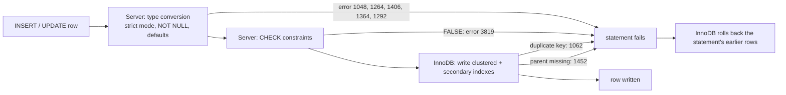

## Introduction

A **constraint** is a rule the database enforces on every change, no matter which application, script or person makes it. Module 1 introduced the theory — domain, entity and referential integrity — in [Integrity Constraints](/lessons/m01-integrity-constraints). This lesson is about the **MySQL implementation**: the exact syntax, how constraints are named and inspected, the order in which MySQL checks a row, what each violation looks like (with its error code, so you can handle it in application code), the MySQL-specific rules and pitfalls, and the SQL mode setting that decides whether invalid data is rejected or quietly "fixed".

The questions a professional must be able to answer:

- Which constraints does MySQL support, and which of them were **silently ignored** in older versions?
- When an `INSERT` violates several rules at once, which error do you get — and does part of the statement survive?
- What do errors 1048, 1062, 1364, 1406, 1452, 1451 and 3819 mean, and which ones should an application translate into a user-facing message?
- What are the requirements for a `FOREIGN KEY` in InnoDB, and what do `CASCADE`, `SET NULL`, `RESTRICT` and `NO ACTION` actually do?
- What is **strict mode**, and what happens without it?
- How should constraints be **named** so that errors, migrations and monitoring remain readable?

:::note[Dataset]
The examples use the **shop** dataset, which already declares many constraints: primary keys, `UNIQUE` keys on `customers.email` and `products.sku`, foreign keys such as `fk_orders_customer` and `fk_items_product`, and CHECK constraints `chk_products_price`, `chk_items_qty` and `chk_reviews_rating`. Every error below was produced by a real MySQL server.
:::

## DBMS Theory

:::theory[Constraints as declarative integrity]
A relational schema consists of relation schemas **plus integrity constraints**: predicates that every legal database state must satisfy. The DBMS checks them on every state change and rejects changes that would produce an illegal state. Because the rule is declared once, in the schema, it holds for every client — the alternative, validating in each application, is only as strong as the weakest code path.

The standard SQL constraint kinds and what they guarantee:

| Constraint | Integrity rule | Predicate |
|---|---|---|
| `NOT NULL` | Domain | the column always has a value |
| `CHECK (p)` | Domain / tuple | `p` is not FALSE for any row |
| `UNIQUE (cols)` | Key | no two rows agree on `cols` (rows with NULL in `cols` are exempt) |
| `PRIMARY KEY (cols)` | Entity | `UNIQUE` + `NOT NULL`; at most one per table |
| `FOREIGN KEY (cols) REFERENCES t(keys)` | Referential | every non-NULL value of `cols` exists in `t.keys` |
:::

Two theoretical properties matter for how MySQL behaves:

1. **Constraint checking time.** The standard allows constraints to be `DEFERRABLE` — checked at `COMMIT` instead of after each statement — so that, for example, two rows that reference each other can be inserted in either order. **MySQL does not support deferred constraints.** InnoDB checks `UNIQUE` and `FOREIGN KEY` constraints row by row as each row is written, and CHECK constraints are evaluated for each row before it is written. (Section *Execution Walkthrough* shows what that means in practice.)
2. **Statement atomicity.** The standard requires that a statement that violates a constraint has **no effect**. InnoDB honours this: if the fifth row of a multi-row `INSERT` fails, the four rows already written by that statement are rolled back. Non-transactional engines (MyISAM, MEMORY) cannot roll back, which is one reason the [Storage Engines](/lessons/m02-storage-engines) lesson recommends InnoDB.

:::standard[Standard SQL vs MySQL]
Standard and supported: `NOT NULL`, `UNIQUE`, `PRIMARY KEY`, `FOREIGN KEY … ON DELETE/ON UPDATE {CASCADE | SET NULL | RESTRICT | NO ACTION}`, named constraints with `CONSTRAINT name`, `CHECK` (enforced since **8.0.16**). Standard but **not supported**: `DEFERRABLE` / `INITIALLY DEFERRED`, `CREATE ASSERTION` (multi-table constraints), `MATCH FULL` / `MATCH PARTIAL` (parsed, not enforced). `SET DEFAULT` is accepted in the syntax but InnoDB does not implement it (shown below). MySQL extensions: `[NOT] ENFORCED` for CHECK constraints, the `foreign_key_checks` session switch, and `INSERT IGNORE`, which turns many constraint errors into warnings.
:::

## Why It Exists

Picture the shop without constraints. A bug in a new checkout service writes an order line with `quantity = 0` and `product_id = 999`, a product that does not exist. Nothing complains. Weeks later finance reports revenue from order lines joined to products: the bad line disappears from the inner join, and the totals no longer match the payment system. Somebody spends days reconciling. Then a second service, written by another team, inserts a customer whose email differs from an existing one only by letter case — and the "forgot my password" flow now emails the wrong person.

Constraints prevent this class of problem at the cheapest possible point: **at write time, inside the database, for every writer.** They also:

- **Document the model.** `FOREIGN KEY (customer_id) REFERENCES customers (customer_id)` is executable documentation that ER-diagram tools, ORMs and new team members read.
- **Give the optimizer facts.** A `NOT NULL` or `UNIQUE` declaration lets the optimizer eliminate impossible predicates and choose `const`/`eq_ref` access paths.
- **Make concurrency safe.** Two transactions racing to register the same email cannot both succeed when a `UNIQUE` index exists — something an application-level "check, then insert" can never guarantee without locking.

MySQL has a specific history that makes this lesson necessary: for most of its life, MySQL **parsed CHECK constraints and ignored them**, and with non-strict SQL modes it **altered invalid values** (truncating strings, clamping numbers, inventing zero dates) instead of rejecting them. Much legacy data and many outdated tutorials still reflect that era.

## Internal Working

:::internals[Where each constraint is enforced]
MySQL's server layer and the storage engine share the work:

1. **Server layer — value conversion and column rules.** When the server builds the row to insert, it converts each value to the column's type. Under strict mode an impossible conversion (string too long, number out of range, invalid date, invalid ENUM value) is an **error**; otherwise it is a **warning** and the value is adjusted. `NOT NULL` and missing-default checks happen here too.
2. **Server layer — CHECK constraints.** The server evaluates each **enforced** CHECK expression for the new row (MySQL treats CHECK as a table-level feature of the SQL layer, so it works for any engine). A row is rejected only if the expression is FALSE — UNKNOWN passes.
3. **Storage engine — UNIQUE / PRIMARY KEY.** InnoDB enforces uniqueness with its **indexes**: inserting into a unique B+ tree that already contains the key fails with a duplicate-key error. There is no separate "constraint object" — a UNIQUE constraint *is* a unique index.
4. **Storage engine — FOREIGN KEY.** InnoDB implements foreign keys itself. Inserting a child row triggers a lookup in the parent's referenced index (taking a shared lock on the parent row, so it cannot be deleted concurrently); deleting or updating a parent triggers a lookup in the child's index and, depending on the action, an error, a cascade or a SET NULL. Foreign key definitions live in the data dictionary; only InnoDB (and NDB) support them.
:::



Because the stages run in this order, a row that violates several rules reports the **first** stage that fails: a NULL in a `NOT NULL` column is reported before a CHECK violation, and a CHECK violation before a foreign key violation. You will verify this order in the walkthrough.

**Indexes created for you.** A `PRIMARY KEY` becomes InnoDB's clustered index. A `UNIQUE` constraint creates a unique secondary index. A `FOREIGN KEY` requires an index on the child columns (with the FK columns first); if none exists, InnoDB **creates one automatically**, named after the constraint, and you cannot drop it while the FK exists. The referenced columns in the parent must also be indexed — and in 8.4 they must form a `PRIMARY KEY` or `UNIQUE` key (see the version note under Syntax Breakdown).

## MySQL Implementation

Constraints can be declared **inline** with a column (short, but the name is chosen by MySQL) or as **table-level** clauses (required for multi-column constraints, and the place to give them names):

```sql run
CREATE TABLE warehouses (
  warehouse_id  SMALLINT UNSIGNED NOT NULL,
  code          CHAR(4)      NOT NULL,
  city          VARCHAR(60)  NOT NULL,
  capacity_m3   INT UNSIGNED NOT NULL,
  CONSTRAINT pk_warehouses        PRIMARY KEY (warehouse_id),
  CONSTRAINT uq_warehouses_code   UNIQUE (code),
  CONSTRAINT chk_warehouses_cap   CHECK (capacity_m3 BETWEEN 100 AND 1000000)
);
CREATE TABLE stock_levels (
  warehouse_id  SMALLINT UNSIGNED NOT NULL,
  product_id    INT UNSIGNED      NOT NULL,
  on_hand       INT               NOT NULL DEFAULT 0,
  reserved      INT               NOT NULL DEFAULT 0,
  CONSTRAINT pk_stock_levels PRIMARY KEY (warehouse_id, product_id),
  CONSTRAINT fk_stock_levels_warehouse FOREIGN KEY (warehouse_id)
      REFERENCES warehouses (warehouse_id) ON DELETE CASCADE,
  CONSTRAINT fk_stock_levels_product   FOREIGN KEY (product_id)
      REFERENCES products (product_id) ON DELETE RESTRICT,
  CONSTRAINT chk_stock_levels_nonneg   CHECK (on_hand >= 0 AND reserved >= 0),
  CONSTRAINT chk_stock_levels_reserved CHECK (reserved <= on_hand)
);
INSERT INTO warehouses VALUES (1, 'SJC1', 'San Jose', 50000), (2, 'AUS1', 'Austin', 32000);
INSERT INTO stock_levels VALUES (1, 1, 120, 20), (1, 5, 300, 0), (2, 1, 40, 40);
SELECT * FROM stock_levels ORDER BY warehouse_id, product_id;
```

Note the multi-column CHECK `reserved <= on_hand`: a CHECK constraint may compare columns of the **same row**. It cannot look at other rows or other tables.

The data dictionary lists every constraint and whether it is enforced:

```sql run
SELECT TABLE_NAME, CONSTRAINT_NAME, CONSTRAINT_TYPE, ENFORCED
FROM information_schema.TABLE_CONSTRAINTS
WHERE TABLE_SCHEMA = DATABASE() AND TABLE_NAME IN ('warehouses', 'stock_levels')
ORDER BY TABLE_NAME, CONSTRAINT_TYPE, CONSTRAINT_NAME;
```

`CONSTRAINT pk_warehouses PRIMARY KEY` was accepted, but the primary key is listed as `PRIMARY`: in MySQL **the primary key is always named `PRIMARY`**, whatever name you write. Foreign key details (actions, referenced table) are in `REFERENTIAL_CONSTRAINTS`, and CHECK expressions in `CHECK_CONSTRAINTS`:

```sql run
SELECT CONSTRAINT_NAME, TABLE_NAME, REFERENCED_TABLE_NAME, UPDATE_RULE, DELETE_RULE
FROM information_schema.REFERENTIAL_CONSTRAINTS
WHERE CONSTRAINT_SCHEMA = DATABASE() AND TABLE_NAME = 'stock_levels'
ORDER BY CONSTRAINT_NAME;
SELECT CONSTRAINT_NAME, CHECK_CLAUSE
FROM information_schema.CHECK_CONSTRAINTS
WHERE CONSTRAINT_SCHEMA = DATABASE() AND CONSTRAINT_NAME LIKE 'chk_stock%'
ORDER BY CONSTRAINT_NAME;
```

The FK `UPDATE_RULE` shows `NO ACTION` because no `ON UPDATE` clause was given; that is the default.

## Syntax Breakdown

| Clause | Where | Meaning and MySQL specifics |
|---|---|---|
| `NOT NULL` / `NULL` | column | Column may not / may hold NULL. Not a named constraint in MySQL (it is a column property, not listed in `TABLE_CONSTRAINTS`). |
| `[CONSTRAINT name] PRIMARY KEY (cols)` | column or table | One per table; columns become `NOT NULL`; the name is always `PRIMARY`. Becomes InnoDB's clustered index. |
| `[CONSTRAINT name] UNIQUE [KEY] (cols)` | column or table | Creates a unique index named `name` (inline: named after the column). Multiple NULLs allowed. |
| `[CONSTRAINT name] FOREIGN KEY (cols) REFERENCES parent (cols)` | table | InnoDB only. Inline `REFERENCES` on a column definition is **parsed and ignored** by MySQL — always use the table-level form. Auto name: `<table>_ibfk_<n>`. |
| `ON DELETE action`, `ON UPDATE action` | FK | `RESTRICT`, `NO ACTION` (default; in InnoDB identical to RESTRICT — checked immediately), `CASCADE`, `SET NULL`. `SET DEFAULT` is parsed but not implemented by InnoDB. |
| `[CONSTRAINT name] CHECK (expr) [[NOT] ENFORCED]` | column or table | Enforced since 8.0.16; earlier versions parsed and ignored it. Auto name: `<table>_chk_<n>`. Names are unique **per schema**. |
| `ALTER TABLE t ADD CONSTRAINT …` | — | Add any constraint later; existing rows are validated (the ALTER fails if any row violates it). |
| `ALTER TABLE t DROP PRIMARY KEY` / `DROP INDEX uq` / `DROP FOREIGN KEY fk` / `DROP CHECK chk` / `DROP CONSTRAINT name` | — | Remove a constraint (`DROP CONSTRAINT` works for any type since 8.0.19). |
| `ALTER TABLE t ALTER CHECK chk [NOT] ENFORCED` | — | Switch enforcement; turning it on validates existing rows. |
| `SET SESSION foreign_key_checks = 0` | session | Disable FK checking for this session (bulk loads, restores). Existing violations are **not** re-checked when re-enabled. |
| `sql_mode` (`STRICT_TRANS_TABLES`, `STRICT_ALL_TABLES`) | session/global | Whether invalid values are errors (strict) or adjusted with warnings. Strict is the default. |

### CHECK expression rules

A CHECK expression may use literals, operators, deterministic built-in functions and columns of the same row (including generated columns). It may **not** use: subqueries, stored functions or procedures, variables, non-deterministic functions (`NOW()`, `RAND()`, `UUID()`, `CURRENT_USER`…), or an `AUTO_INCREMENT` column; a column used in a foreign key's `SET NULL` or `ON UPDATE CASCADE` action cannot appear in a CHECK either (the action could invalidate the CHECK behind the server's back).

:::version[Foreign keys to non-unique keys: 8.0 vs 8.4]
MySQL 8.0 allows a foreign key to reference **any indexed column** of the parent, even a non-unique index or a prefix of an index — a non-standard extension that makes "which parent row?" ambiguous. MySQL 8.4 introduces the system variable `restrict_fk_on_non_standard_key`, **ON by default**, under which such a foreign key is rejected: the referenced columns must form a `PRIMARY KEY` or `UNIQUE` key, as the SQL standard requires. The 8.0.46 capture server accepts the definition below; on 8.4 it fails unless the variable is turned off (which is deprecated and meant only for migration).

```sql
CREATE TABLE parent (id INT PRIMARY KEY, code INT, KEY (code));
CREATE TABLE child  (id INT PRIMARY KEY, parent_code INT,
                     FOREIGN KEY (parent_code) REFERENCES parent (code));  -- 8.4: rejected by default
```
:::

## Practical Examples

**1. NOT NULL — error 1048.**

```sql run error
INSERT INTO warehouses VALUES (3, 'DEN1', NULL, 20000);
```

**2. A missing value with no default — error 1364.** Omitting a `NOT NULL` column that has no `DEFAULT` is a different error from supplying NULL:

```sql run error
INSERT INTO warehouses (warehouse_id, code, city) VALUES (3, 'DEN1', 'Denver');
```

**3. PRIMARY KEY — error 1062 on key `PRIMARY`.**

```sql run error
INSERT INTO warehouses VALUES (1, 'SEA1', 'Seattle', 20000);
```

**4. UNIQUE — error 1062 naming the constraint.** Collation matters: `customers.email` uses the default case-insensitive collation, so a value differing only in case is a duplicate (see [Character Sets and Collations](/lessons/m02-charsets-collations)):

```sql run error
UPDATE customers SET email = 'KWAME.GARCIA2@example.com' WHERE customer_id = 1;
```

**5. CHECK — error 3819 naming the constraint.**

```sql run error
INSERT INTO warehouses VALUES (3, 'DEN1', 'Denver', 50);
```

```sql run error
UPDATE stock_levels SET reserved = 500 WHERE warehouse_id = 1 AND product_id = 1;
```

The second statement violates `chk_stock_levels_reserved`, a rule that spans two columns. Constraint names in error messages are why naming matters: `chk_stock_levels_reserved is violated` tells an on-call engineer exactly which business rule failed; `stock_levels_chk_2` does not.

**6. FOREIGN KEY on the child side — error 1452.** Product 999 does not exist:

```sql run error
INSERT INTO stock_levels VALUES (1, 999, 10, 0);
```

**7. FOREIGN KEY on the parent side — error 1451 and the actions.** `fk_stock_levels_product` is `ON DELETE RESTRICT`, so a product with stock rows cannot be deleted. Product 5 is protected twice — by its stock row and by existing order lines through the shop's `fk_items_product` — and the error names whichever referencing foreign key InnoDB checked first; here it reports `fk_items_product`.

```sql run error
DELETE FROM products WHERE product_id = 5;
```

`fk_stock_levels_warehouse` is `ON DELETE CASCADE`: deleting a warehouse deletes its stock rows in the same statement:

```sql run
DELETE FROM warehouses WHERE warehouse_id = 2;
SELECT warehouse_id, product_id, on_hand FROM stock_levels ORDER BY warehouse_id, product_id;
```

`SET NULL` requires the child column to be nullable; declaring it on a `NOT NULL` column is rejected when the table is created:

```sql run error
CREATE TABLE bad_fk_set_null (
  id INT PRIMARY KEY,
  warehouse_id SMALLINT UNSIGNED NOT NULL,
  FOREIGN KEY (warehouse_id) REFERENCES warehouses (warehouse_id) ON DELETE SET NULL
);
```

And the referencing and referenced columns must have compatible types — same integer size and signedness, compatible string charsets:

```sql run error
CREATE TABLE bad_fk_types (
  id INT PRIMARY KEY,
  warehouse_id INT,                -- warehouses.warehouse_id is SMALLINT UNSIGNED
  FOREIGN KEY (warehouse_id) REFERENCES warehouses (warehouse_id)
);
```

**8. `SET DEFAULT` is accepted but behaves like `NO ACTION`.** The manual states that InnoDB does not support `SET DEFAULT`. On the capture server the definition is accepted and recorded, but deleting the parent is simply refused:

```sql run
CREATE TABLE fk_parent (id INT PRIMARY KEY);
CREATE TABLE fk_child  (id INT PRIMARY KEY, parent_id INT DEFAULT 0,
                        FOREIGN KEY (parent_id) REFERENCES fk_parent (id) ON DELETE SET DEFAULT);
INSERT INTO fk_parent VALUES (1);
INSERT INTO fk_child VALUES (10, 1);
```

```sql run error
DELETE FROM fk_parent WHERE id = 1;
```

**9. Schema-level protections.** Foreign keys also protect the parent *table*: you cannot drop it, truncate it, or drop the index a foreign key needs:

```sql run error
TRUNCATE TABLE customers;
```

```sql run error
ALTER TABLE orders DROP INDEX idx_orders_customer;
```

**10. CHECK … NOT ENFORCED and adding constraints to existing data.** A `NOT ENFORCED` CHECK is recorded but not evaluated — useful for documenting a rule while legacy data is cleaned, or for migrating schemas from other systems:

```sql run
ALTER TABLE products ADD CONSTRAINT chk_products_margin CHECK (price >= cost) NOT ENFORCED;
INSERT INTO products (sku, name, price, cost, created_at)
VALUES ('CLEAR-01', 'Clearance Cable', 4.00, 6.50, '2024-12-01 10:00:00');   -- sold below cost: accepted
SELECT CONSTRAINT_NAME, ENFORCED FROM information_schema.TABLE_CONSTRAINTS
WHERE TABLE_SCHEMA = DATABASE() AND TABLE_NAME = 'products' AND CONSTRAINT_TYPE = 'CHECK'
ORDER BY CONSTRAINT_NAME;
```

Switching it to `ENFORCED` validates **all existing rows**, and fails because of the row just inserted:

```sql run error
ALTER TABLE products ALTER CHECK chk_products_margin ENFORCED;
```

Find the offending rows first, fix or document them, then enforce:

```sql run
SELECT product_id, sku, price, cost FROM products WHERE NOT (price >= cost);
DELETE FROM products WHERE sku = 'CLEAR-01';
ALTER TABLE products ALTER CHECK chk_products_margin ENFORCED;
SELECT CONSTRAINT_NAME, ENFORCED FROM information_schema.TABLE_CONSTRAINTS
WHERE TABLE_SCHEMA = DATABASE() AND CONSTRAINT_NAME = 'chk_products_margin';
```

`WHERE NOT (price >= cost)` is the exact negation of the CHECK as the database evaluates it (it does not return rows where the expression is UNKNOWN, which the CHECK would accept too).

**11. CHECK expressions that are not allowed.**

```sql run error
CREATE TABLE bad_check_now (shipped DATE, CHECK (shipped <= CURRENT_DATE));
```

```sql run error
CREATE TABLE bad_check_dup (qty INT, CONSTRAINT chk_items_qty CHECK (qty > 0));
```

The first uses a non-deterministic function (a row valid today would become invalid tomorrow, which a constraint cannot express). The second reuses a CHECK name that already exists in the schema — the shop's `chk_items_qty` — because CHECK constraint names are unique per **schema**, not per table. This is a strong argument for including the table name in every constraint name.

### Strict SQL mode

The default `sql_mode` contains `STRICT_TRANS_TABLES`:

```sql run
SELECT @@SESSION.sql_mode;
```

Under strict mode an invalid value is an error. Turn strict mode off for this session and the same mistakes become **warnings**, with the values silently changed:

```sql run
SET SESSION sql_mode = '';
CREATE TABLE loose_warehouses LIKE warehouses;
INSERT INTO loose_warehouses (warehouse_id, code, city, capacity_m3)
VALUES (70000, 'TOOLONG', 'Phoenix', 5000),
       (2,     'PHX2',    NULL,      5000);
SELECT * FROM loose_warehouses ORDER BY warehouse_id;
SET SESSION sql_mode = DEFAULT;
```

Read the warnings under the result: the `SMALLINT UNSIGNED` id was clamped to its maximum (warning 1264), `'TOOLONG'` was truncated to four characters (1265), and the NULL city became the empty string (1048) — three data corruptions, one "successful" statement. Note what was **not** relaxed: CHECK constraints, UNIQUE and FOREIGN KEY violations are errors in every SQL mode; strict mode governs **value conversion**.

## Execution Walkthrough

Let us push rows into `order_items` — which has a composite primary key, two foreign keys and the CHECK `chk_items_qty (quantity > 0)` — and observe which stage of the pipeline rejects each one.

```walkthrough
title: One INSERT, five ways to fail, and the order of the checks
steps:
  - title: "1. The table's constraints and existing rows of order 1"
    explain: >-
      order_items has PRIMARY KEY (order_id, product_id), foreign keys to orders and products, quantity
      INT UNSIGNED NOT NULL and CHECK (quantity > 0). Order 1 currently has these lines.
    sql: SELECT order_id, product_id, quantity, unit_price FROM order_items WHERE order_id = 1 ORDER BY product_id;
  - title: "2. Server stage — NOT NULL (1048)"
    explain: >-
      This row violates almost everything: order 999 does not exist and quantity is NULL. The server rejects
      it while building the row, before any CHECK or index is consulted, so the error is about NULL.
    sql: INSERT INTO order_items VALUES (999, 1, NULL, 1.00);
    expect: error
  - title: "3. Server stage — type conversion under strict mode (1264)"
    explain: >-
      -1 cannot be stored in an UNSIGNED column. Under strict mode this conversion failure is an error; the
      CHECK and the foreign key are never reached.
    sql: INSERT INTO order_items VALUES (999, 1, -1, 1.00);
    expect: error
  - title: "4. Server stage — CHECK (3819)"
    explain: >-
      Quantity 0 is a valid UNSIGNED value, so conversion succeeds and the server evaluates CHECK (quantity > 0),
      which is FALSE. The missing order 999 is still not reported: CHECK runs before InnoDB sees the row.
    sql: INSERT INTO order_items VALUES (999, 1, 0, 1.00);
    expect: error
  - title: "5. Engine stage — FOREIGN KEY (1452)"
    explain: >-
      A legal quantity passes the server stages. InnoDB now writes the row and looks up product 999 in
      products' primary key; it is missing, so the write fails.
    sql: INSERT INTO order_items VALUES (1, 999, 1, 1.00);
    expect: error
  - title: "6. Engine stage — PRIMARY KEY (1062)"
    explain: >-
      Order 1 already contains product 5, so inserting (1, 5) again hits the clustered index's uniqueness.
    sql: INSERT INTO order_items VALUES (1, 5, 3, 29.99);
    expect: error
  - title: "7. Statement atomicity"
    explain: >-
      A two-row INSERT whose first row is valid (product 29) and whose second row is not (product 999). The
      first row is written, the second fails, and InnoDB rolls back the whole statement.
    sql: INSERT INTO order_items VALUES (1, 29, 1, 50.00), (1, 999, 1, 5.00);
    expect: error
  - title: "8. Nothing from the failed statement remains"
    explain: Order 1 has exactly the lines it had in step 1. The valid first row of step 7 was undone.
    sql: SELECT order_id, product_id, quantity, unit_price FROM order_items WHERE order_id = 1 ORDER BY product_id;
```

**Statement atomicity is not transaction atomicity.** A failed statement inside an explicit transaction undoes only *itself*; earlier successful statements of the transaction remain pending until you `COMMIT` or `ROLLBACK`:

```sql run
START TRANSACTION;
INSERT INTO order_items VALUES (2, 29, 1, 50.00);                    -- succeeds
INSERT IGNORE INTO order_items VALUES (2, 999, 1, 5.00);             -- FK error demoted to a warning
SELECT order_id, product_id FROM order_items WHERE order_id = 2 ORDER BY product_id;
ROLLBACK;
```

The first insert is still visible inside the transaction after the second statement's failure (here converted to a warning by `IGNORE`, so the block keeps running). In application code, a constraint error inside a transaction usually means: roll back the whole business operation, then report.

## Output

After the experiments, here is the full constraint inventory of the tables created in this lesson, as an operator would audit it:

```sql run
SELECT tc.TABLE_NAME, tc.CONSTRAINT_NAME, tc.CONSTRAINT_TYPE, tc.ENFORCED,
       GROUP_CONCAT(k.COLUMN_NAME ORDER BY k.ORDINAL_POSITION) AS columns_used
FROM information_schema.TABLE_CONSTRAINTS AS tc
LEFT JOIN information_schema.KEY_COLUMN_USAGE AS k
       ON k.CONSTRAINT_SCHEMA = tc.CONSTRAINT_SCHEMA
      AND k.TABLE_NAME = tc.TABLE_NAME
      AND k.CONSTRAINT_NAME = tc.CONSTRAINT_NAME
WHERE tc.TABLE_SCHEMA = DATABASE() AND tc.TABLE_NAME IN ('warehouses', 'stock_levels')
GROUP BY tc.TABLE_NAME, tc.CONSTRAINT_NAME, tc.CONSTRAINT_TYPE, tc.ENFORCED
ORDER BY tc.TABLE_NAME, tc.CONSTRAINT_TYPE, tc.CONSTRAINT_NAME;
```

How to read it: key constraints (PRIMARY KEY, UNIQUE, FOREIGN KEY) list their columns via `KEY_COLUMN_USAGE`; CHECK constraints have no key columns (their expression is in `CHECK_CONSTRAINTS`), so `columns_used` is NULL. `NOT NULL` does not appear at all, because MySQL stores it as a column attribute (`information_schema.COLUMNS.IS_NULLABLE`), not as a constraint.

## Alternative Approaches

| Approach | Strength | Weakness | Use when |
|---|---|---|---|
| Declarative constraints (this lesson) | Enforced for every writer, atomically, concurrency-safe | Limited to single-row (CHECK) and key/FK rules | Always, as the baseline |
| Application validation | Rich rules, friendly messages, early feedback | Bypassed by other services, scripts and ad-hoc SQL; races between check and write | In addition to constraints, for UX |
| Triggers (`BEFORE INSERT/UPDATE` + `SIGNAL`) | Can check other rows/tables, compute values | Hidden logic, per-row overhead, not fired by FK cascades | Cross-row rules that cannot be a constraint |
| Generated column + CHECK / UNIQUE | Enforce rules on derived values (e.g. unique lower-cased email, at most one "active" row via a nullable generated key) | Extra column | Uniqueness/validation on an expression |
| Lookup table + FK instead of ENUM or CHECK IN (…) | Values are data, can be added without DDL; carries attributes | A join to display labels | Domains that change or need metadata |
| Periodic data-quality queries | Detect violations of rules that cannot be enforced (cross-table aggregates) | Detection after the fact | Warehouses, rules spanning many rows |

A `UNIQUE` index on a generated column enforces "at most one primary address per customer" — a rule no plain constraint can express:

```sql run
CREATE TABLE customer_addresses (
  address_id   INT AUTO_INCREMENT PRIMARY KEY,
  customer_id  INT UNSIGNED NOT NULL,
  is_primary   BOOLEAN NOT NULL DEFAULT FALSE,
  primary_flag INT UNSIGNED AS (IF(is_primary, customer_id, NULL)) STORED,
  CONSTRAINT uq_customer_addresses_one_primary UNIQUE (primary_flag),
  CONSTRAINT fk_customer_addresses_customer FOREIGN KEY (customer_id) REFERENCES customers (customer_id)
);
INSERT INTO customer_addresses (customer_id, is_primary) VALUES (1, TRUE), (1, FALSE), (1, FALSE), (2, TRUE);
SELECT address_id, customer_id, is_primary, primary_flag FROM customer_addresses ORDER BY address_id;
```

```sql run error
INSERT INTO customer_addresses (customer_id, is_primary) VALUES (1, TRUE);
```

Non-primary addresses have `primary_flag` NULL, and multiple NULLs are allowed by a UNIQUE index (see [NULL Values and Three-Valued Logic](/lessons/m02-null-three-valued-logic)); a second primary address for customer 1 collides.

## Performance Analysis

- **NOT NULL and CHECK** are evaluated in memory on the row being written: negligible cost, a few comparisons per row.
- **UNIQUE / PRIMARY KEY** cost an index lookup per inserted or updated key — but the index usually has to be maintained anyway. A unique secondary index also cannot use InnoDB's change buffer (the uniqueness check needs the actual index page), so on very large tables with random keys unique indexes make inserts more I/O-bound than non-unique ones.
- **FOREIGN KEY** checks cost an index lookup in the parent per child insert/update (and a child-index lookup per parent delete/key update), plus **shared locks on parent rows**. Under heavy concurrent inserts of children of the same parent, those locks can contribute to lock waits and deadlocks (Module 8, [Locking](/lessons/m08-locking)). Cascades can touch many rows in one statement, and cascaded changes do **not** fire triggers on the child table.
- **Bulk loading.** Restores and large loads commonly run with `SET SESSION foreign_key_checks = 0` (and `unique_checks = 0`) to skip per-row lookups, accepting the responsibility that the data is already consistent — MySQL does not re-validate it when checks are turned back on.
- **Adding a constraint to a big table** validates every existing row (CHECK, FK) or builds an index (UNIQUE) — plan it like any large DDL (online DDL algorithms are covered in [Creating, Altering and Dropping Tables](/lessons/m02-tables-ddl)).

:::performance[Theory vs measurement]
These costs are qualitative consequences of how InnoDB enforces constraints. Whether FK checks matter for your workload depends on insert rate, parent-row contention and buffer-pool hit rates — measure with production-like concurrency before removing constraints "for performance". Most teams that remove foreign keys do it for operational reasons (sharding, online schema change tooling), not because a benchmark showed the lookups to be the bottleneck.
:::

## Best Practices

:::best-practice[Constraints in production MySQL]
1. **Declare everything you know**: `NOT NULL` by default, a primary key on every table, `UNIQUE` for every natural key, foreign keys for every reference, CHECK for domain rules.
2. **Name every constraint** with a convention that includes the table: `pk_<table>` (cosmetic in MySQL — it is always `PRIMARY`), `uq_<table>_<cols>`, `fk_<child>_<parent>` or `fk_<child>_<column>`, `chk_<table>_<rule>`. CHECK names are unique per schema; auto-generated names (`orders_ibfk_1`, `orders_chk_2`) are meaningless in an error log and differ between environments.
3. **Keep strict mode on** (`STRICT_TRANS_TABLES`, the default) in every environment, including developer laptops; never "fix" a migration by disabling it.
4. **Map error codes in the application**: 1062 → "already exists" (and read the key name), 1452 → "referenced item does not exist", 1451 → "item is still in use", 3819 → validation failed for rule *name*. Do not parse the message text; use the numeric code.
5. **Choose FK actions deliberately.** `RESTRICT`/`NO ACTION` for business entities (never cascade-delete orders or payments); `CASCADE` for pure composition (stock levels of a warehouse, line items of a draft); `SET NULL` for optional relationships.
6. **Write CHECKs that state how NULL is handled**, e.g. `CHECK (discount_pct IS NULL OR discount_pct BETWEEN 0 AND 100)` makes the intent explicit.
7. **Use `NOT ENFORCED` only as a migration step**, with a ticket to enforce it.
8. **Re-enable `foreign_key_checks` in the same script** that disabled it, and verify consistency with anti-join queries afterwards.
:::

## Common Mistakes

**Mistake 1 — inline `REFERENCES` on a column.** It looks like a foreign key, it is valid syntax, and MySQL silently ignores it:

```sql run
CREATE TABLE shipments (
  shipment_id INT PRIMARY KEY,
  order_id    INT UNSIGNED NOT NULL REFERENCES orders (order_id)    -- ignored!
);
INSERT INTO shipments VALUES (1, 99999);                                -- order 99999 does not exist
SELECT COUNT(*) AS fk_constraints_on_shipments
FROM information_schema.REFERENTIAL_CONSTRAINTS
WHERE CONSTRAINT_SCHEMA = DATABASE() AND TABLE_NAME = 'shipments';
```

The orphan row was accepted and no foreign key exists. Use the table-level `FOREIGN KEY (order_id) REFERENCES orders (order_id)` form.

**Mistake 2 — assuming CHECK constraints were enforced in old MySQL.** Before 8.0.16 a CHECK clause was parsed and discarded. Schemas migrated from 5.7 may contain data that violates CHECKs that "existed" in the original DDL; when you upgrade and re-add them, the `ALTER` fails (as in Practical Example 10). Audit with `WHERE NOT (condition)` queries first.

**Mistake 3 — reusing a CHECK name in another table.**

```sql run error
CREATE TABLE gift_cards (amount DECIMAL(10,2), CONSTRAINT chk_products_price CHECK (amount > 0));
```

**Mistake 4 — leaving `foreign_key_checks` off.** Rows inserted while it is off are never validated later:

```sql run
SET SESSION foreign_key_checks = 0;
INSERT INTO orders (customer_id, order_date, status) VALUES (4242, '2024-12-31 12:00:00', 'pending');
SET SESSION foreign_key_checks = 1;
SELECT o.order_id, o.customer_id
FROM orders AS o LEFT JOIN customers AS c ON c.customer_id = o.customer_id
WHERE c.customer_id IS NULL;
```

The anti-join finds the orphan that the disabled check let through. This query pattern is how you verify a bulk load.

**Mistake 5 — relying on non-strict mode "working".** A legacy server with an empty `sql_mode` accepts `'2024-02-30'`, out-of-range numbers and over-long strings with warnings most applications never read. Under the default strict mode they fail:

```sql run error
INSERT INTO customers (first_name, last_name, email, city, state, signup_date)
VALUES ('Ana', 'Ruiz', 'ana.ruiz@example.com', 'Fresno', 'CA', '2024-02-30');
```

**Mistake 6 — a CHECK that lets NULL through unintentionally.** `CHECK (rating BETWEEN 1 AND 5)` on a nullable column accepts NULL. If a rating is mandatory, the column must also be `NOT NULL` (as `reviews.rating` is in the shop schema).

## Industry Application

- **Error handling in services.** Production APIs catch driver exceptions and branch on the MySQL error number: a duplicate email (1062 on `uq_customers_email`) becomes HTTP 409 Conflict; a missing referenced resource (1452) becomes 422 or 404; a CHECK failure (3819) becomes 422 with the rule name. Idempotent APIs often rely on a `UNIQUE` "idempotency key" column and treat 1062 as "request already processed".
- **Schema migration tooling.** Tools like Flyway, Liquibase, Rails/Django migrations and online schema change tools (gh-ost, pt-online-schema-change) all interact with constraints. Online schema change tools copy data into a shadow table and have historically had limited or special handling for foreign keys, which is one reason some large MySQL shops do not use foreign keys at all and enforce relationships in the application instead — a conscious trade-off, compensated by data-quality jobs.
- **Sharded and distributed MySQL.** Foreign keys cannot span shards or servers. Platforms such as Vitess and many in-house sharding layers therefore restrict or omit FKs across shard boundaries, while keeping CHECK, NOT NULL and UNIQUE (within a shard) constraints.
- **Data warehouses and ELT.** Analytical databases (BigQuery, Snowflake, Redshift) often accept PRIMARY KEY/FOREIGN KEY declarations as *informational, not enforced* metadata — conceptually like MySQL's `NOT ENFORCED` CHECK. Pipelines loading from MySQL into them must not assume the warehouse will reject duplicates, so dedup and referential checks are explicit pipeline steps.
- **Regulated domains.** Banking ledgers use CHECK constraints such as `balance >= 0` (the bank dataset has one) and restrict deletes with `RESTRICT` foreign keys so that audit history cannot be orphaned.

## Practice Exercises

```exercise
id: ex1
title: Which rows would violate the rating rule?
difficulty: easy
setup: |
  CREATE TABLE review_import (
    import_id  INT PRIMARY KEY,
    product_id INT UNSIGNED NOT NULL,
    rating     INT NULL
  );
  INSERT INTO review_import VALUES (1, 1, 5), (2, 2, 0), (3, 3, NULL), (4, 4, 7), (5, 5, 3), (6, 6, -2);
concepts: [check-constraint]
prompt: |
  Before loading `review_import` into `reviews`, find the rows that `CHECK (rating BETWEEN 1 AND 5)` would
  **reject**. Return `import_id` and `rating`, ordered by `import_id`.
hints:
  - "A CHECK rejects a row only when its condition is FALSE."
  - "Negate the condition: WHERE NOT (rating BETWEEN 1 AND 5). What happens to the NULL row?"
solution: |
  SELECT import_id, rating
  FROM review_import
  WHERE NOT (rating BETWEEN 1 AND 5)
  ORDER BY import_id;
orderMatters: true
explanation: |
  `NOT (rating BETWEEN 1 AND 5)` is UNKNOWN for the NULL row, so it is not returned — which matches the CHECK,
  because a CHECK accepts UNKNOWN. (The real `reviews.rating` column is also NOT NULL, so that row would fail
  for a different reason, error 1048.) `WHERE rating < 1 OR rating > 5` is an equivalent filter.
```

```exercise
id: ex2
title: Find orphaned order lines
difficulty: medium
setup: |
  SET SESSION foreign_key_checks = 0;
  INSERT INTO order_items (order_id, product_id, quantity, unit_price) VALUES (500, 1, 1, 1299.00), (501, 2, 2, 999.00);
  SET SESSION foreign_key_checks = 1;
concepts: [foreign-key, constraints]
prompt: |
  Someone loaded data with `foreign_key_checks` disabled. Return the `order_id` and `product_id` of every
  `order_items` row whose `order_id` does not exist in `orders`, ordered by `order_id`, `product_id`.
hints:
  - "This is an anti-join: rows of order_items with no matching orders row."
  - "LEFT JOIN orders and keep rows where the orders side IS NULL — or use NOT EXISTS."
solution: |
  SELECT oi.order_id, oi.product_id
  FROM order_items AS oi
  LEFT JOIN orders AS o ON o.order_id = oi.order_id
  WHERE o.order_id IS NULL
  ORDER BY oi.order_id, oi.product_id;
orderMatters: true
explanation: |
  Re-enabling `foreign_key_checks` does not validate rows written while it was off, so this anti-join is the
  standard post-load verification. `WHERE NOT EXISTS (SELECT 1 FROM orders o WHERE o.order_id = oi.order_id)`
  is equivalent. Avoid `NOT IN (SELECT order_id FROM orders)` as a habit: it misbehaves if the subquery can
  return NULL.
```

```exercise
id: ex3
title: Create a well-constrained table
difficulty: medium
kind: dml
concepts: [constraint-naming, primary-key, unique, foreign-key, check-constraint]
prompt: |
  Create a table `promotions` with these columns and constraints, using **exactly** these constraint names:

  - `promo_id INT UNSIGNED NOT NULL`, primary key;
  - `code VARCHAR(20) NOT NULL`, unique — constraint `uq_promotions_code`;
  - `product_id INT UNSIGNED NULL`, foreign key to `products(product_id)` with `ON DELETE SET NULL` —
    constraint `fk_promotions_product`;
  - `discount_pct TINYINT UNSIGNED NOT NULL`, which must be between 1 and 90 — constraint
    `chk_promotions_discount`.
hints:
  - "Table-level clauses: CONSTRAINT name UNIQUE (code), CONSTRAINT name FOREIGN KEY (…) REFERENCES …, CONSTRAINT name CHECK (…)."
  - "ON DELETE SET NULL requires product_id to be nullable — it is."
solution: |
  CREATE TABLE promotions (
    promo_id     INT UNSIGNED     NOT NULL,
    code         VARCHAR(20)      NOT NULL,
    product_id   INT UNSIGNED     NULL,
    discount_pct TINYINT UNSIGNED NOT NULL,
    PRIMARY KEY (promo_id),
    CONSTRAINT uq_promotions_code UNIQUE (code),
    CONSTRAINT fk_promotions_product FOREIGN KEY (product_id)
        REFERENCES products (product_id) ON DELETE SET NULL,
    CONSTRAINT chk_promotions_discount CHECK (discount_pct BETWEEN 1 AND 90)
  );
check: |
  SELECT tc.CONSTRAINT_NAME, tc.CONSTRAINT_TYPE, rc.DELETE_RULE
  FROM information_schema.TABLE_CONSTRAINTS AS tc
  LEFT JOIN information_schema.REFERENTIAL_CONSTRAINTS AS rc
         ON rc.CONSTRAINT_SCHEMA = tc.CONSTRAINT_SCHEMA AND rc.CONSTRAINT_NAME = tc.CONSTRAINT_NAME
  WHERE tc.TABLE_SCHEMA = DATABASE() AND tc.TABLE_NAME = 'promotions'
  ORDER BY tc.CONSTRAINT_NAME;
explanation: |
  The check lists four constraints: `PRIMARY`, `chk_promotions_discount`, `fk_promotions_product` (with
  `SET NULL`) and `uq_promotions_code`. Writing `product_id … REFERENCES products(product_id)` inline would
  silently create no foreign key. Using the product type `INT UNSIGNED` matters: a signed `INT` would fail with
  error 3780 (incompatible columns).
```

```exercise
id: ex4
title: Enforce a rule on existing data
difficulty: hard
kind: dml
setup: |
  CREATE TABLE price_overrides (
    override_id INT PRIMARY KEY,
    product_id  INT UNSIGNED NOT NULL,
    new_price   DECIMAL(10,2) NOT NULL,
    valid_from  DATE NOT NULL,
    valid_to    DATE NULL
  );
  INSERT INTO price_overrides VALUES
    (1, 1, 1199.00, '2024-11-25', '2024-12-02'),
    (2, 5,   24.99, '2024-12-10', '2024-12-01'),
    (3, 6,   79.99, '2024-12-01', NULL),
    (4, 7,   -5.00, '2024-12-01', '2024-12-31');
concepts: [check-constraint, constraint-naming]
prompt: |
  Add two **enforced** CHECK constraints to `price_overrides`:

  - `chk_price_overrides_price`: `new_price` must be greater than 0;
  - `chk_price_overrides_dates`: `valid_to` must not be earlier than `valid_from` (an open-ended override
    with `valid_to` NULL is allowed).

  The existing data contains violations. Delete **only** the violating rows, then add both constraints.
hints:
  - "Adding an enforced CHECK validates existing rows; the ALTER fails while violators exist."
  - "Find violators with WHERE NOT (new_price > 0) OR NOT (valid_to >= valid_from)."
  - "Row 3 has valid_to NULL — the CHECK accepts it because the comparison is UNKNOWN, so do not delete it."
solution: |
  DELETE FROM price_overrides WHERE NOT (new_price > 0) OR NOT (valid_to >= valid_from);
  ALTER TABLE price_overrides
    ADD CONSTRAINT chk_price_overrides_price CHECK (new_price > 0),
    ADD CONSTRAINT chk_price_overrides_dates CHECK (valid_to >= valid_from);
check: |
  SELECT o.override_id, c.CONSTRAINT_NAME, c.ENFORCED
  FROM price_overrides AS o
  CROSS JOIN information_schema.TABLE_CONSTRAINTS AS c
  WHERE c.TABLE_SCHEMA = DATABASE() AND c.TABLE_NAME = 'price_overrides' AND c.CONSTRAINT_TYPE = 'CHECK'
  ORDER BY o.override_id, c.CONSTRAINT_NAME;
explanation: |
  Rows 2 (dates reversed) and 4 (negative price) violate the rules; rows 1 and 3 remain. The check shows each
  remaining row paired with both enforced constraints. `CHECK (valid_to IS NULL OR valid_to >= valid_from)` is
  an equally correct, more explicit way to write the date rule. Deleting `WHERE valid_to < valid_from OR
  valid_to IS NULL` would wrongly remove the open-ended row 3.
```

```exercise
id: ex5
title: Choosing foreign key actions for the shop
difficulty: challenge
kind: open
concepts: [foreign-key, constraints]
prompt: |
  For each relationship, choose `RESTRICT`/`NO ACTION`, `CASCADE` or `SET NULL` for `ON DELETE`, and justify:
  (a) `orders.customer_id → customers`, (b) `order_items.order_id → orders`, (c) `products.category_id →
  categories`, (d) `reviews.customer_id → customers` in a jurisdiction where a customer can demand erasure of
  personal data. Then explain one operational risk of `ON DELETE CASCADE` in MySQL.
solution: |
  **(a) RESTRICT.** Orders are financial records; deleting a customer must never silently delete their order
  history. Deactivate or anonymize customers instead.

  **(b) RESTRICT for placed orders** (orders are not deleted; they are cancelled or refunded). If the system
  has *draft* carts in a separate table, their lines can be `CASCADE` — they are pure composition.

  **(c) SET NULL** (the column is nullable, as for the gift card): removing a category should leave products
  uncategorized rather than delete them or block the reorganization. RESTRICT is also defensible if every
  product must be re-categorized explicitly.

  **(d)** Erasure usually means anonymizing the customer row (keep the key, wipe name/email), so the reviews
  stay valid with RESTRICT. If reviews must be deleted with the person, `CASCADE` on `reviews.customer_id`
  expresses that — but only after deciding that orders are retained under a legal basis and anonymized.

  **Risk of CASCADE:** one `DELETE` can remove a large, unexpected tree of rows (InnoDB follows cascades up to
  15 levels deep) in a single transaction, holding locks and generating undo/redo for every row, and the
  cascaded deletes do **not** fire triggers on the child tables, so audit triggers silently miss them. A
  mistaken delete of a parent is then a data-loss incident rather than an error message.
```

## Knowledge Assessment

```quiz
- id: q1
  question: "A row violates both `CHECK (quantity > 0)` and a FOREIGN KEY (its parent does not exist). Which error does MySQL report?"
  options: ["1452 (foreign key)", "3819 (check constraint)", "Both errors", "Whichever constraint was declared first"]
  answer: 1
  explanation: "The server evaluates CHECK constraints while preparing the row, before handing it to InnoDB, which performs FK and unique-key checks during the write. So the CHECK error (3819) is reported. Declaration order does not decide it, and MySQL reports only the first failure."
  concepts: [check-constraint, error-codes]
- id: q2
  question: "What does this column definition create in MySQL? `order_id INT UNSIGNED NOT NULL REFERENCES orders (order_id)`"
  options: ["A foreign key named order_id_fk", "A foreign key with an automatically generated name", "Nothing — inline REFERENCES is parsed and ignored", "A CHECK constraint"]
  answer: 2
  explanation: "MySQL accepts the inline column-level REFERENCES syntax but ignores it; only the table-level FOREIGN KEY (…) REFERENCES … clause creates a foreign key. This is a classic silent trap, verifiable via information_schema.REFERENTIAL_CONSTRAINTS."
  concepts: [foreign-key]
- id: q3
  question: "Which of these are errors in **every** SQL mode, i.e. not relaxed by disabling strict mode? (Select all that apply.)"
  type: multi
  options:
    - "Duplicate value in a UNIQUE column (1062)"
    - "String too long for a VARCHAR column (1406)"
    - "CHECK constraint violated (3819)"
    - "Child row with a non-existent parent (1452)"
    - "Out-of-range number for an INT column (1264)"
  answer: [0, 2, 3]
  explanation: "Strict mode controls value conversion: without it, too-long strings are truncated and out-of-range numbers clamped, with warnings. Key, CHECK and foreign key violations are constraint failures and remain errors regardless of sql_mode (INSERT IGNORE can demote some of them to warnings, which is a different mechanism)."
  concepts: [strict-mode, error-codes]
- id: q4
  question: "You add `CONSTRAINT chk_orders_dates CHECK (shipped_at >= order_date)` to `orders`. Many orders have `shipped_at` NULL. What happens?"
  options:
    - "The ALTER fails because NULL rows violate the CHECK"
    - "The ALTER succeeds; rows with NULL shipped_at pass because the expression is UNKNOWN"
    - "MySQL sets shipped_at to order_date for those rows"
    - "The constraint is created NOT ENFORCED automatically"
  answer: 1
  explanation: "A CHECK rejects only rows for which the expression is FALSE. NULL >= date is UNKNOWN, so unshipped orders are accepted. MySQL never modifies data to satisfy a CHECK, and enforcement is only off when you write NOT ENFORCED."
  concepts: [check-constraint]
- id: q5
  question: "In MySQL 8.4, which naming statement is true?"
  options:
    - "CHECK constraint names must be unique per table"
    - "A primary key declared as CONSTRAINT pk_orders PRIMARY KEY is reported as pk_orders"
    - "CHECK constraint names must be unique per schema, and the primary key is always named PRIMARY"
    - "Foreign keys cannot be named"
  answer: 2
  explanation: "CHECK names share a schema-wide namespace (error 3822 on reuse), so include the table name. The primary key's name is always PRIMARY regardless of what you write. Foreign keys can and should be named; otherwise MySQL generates <table>_ibfk_<n>."
  concepts: [constraint-naming]
- id: q6
  question: "A three-row INSERT into an InnoDB table fails on the third row with error 1062. How many of its rows remain in the table?"
  options: ["2", "0", "3", "It depends on autocommit"]
  answer: 1
  explanation: "InnoDB guarantees statement atomicity: a failing statement is rolled back entirely, whether or not it runs inside an explicit transaction. (With a non-transactional engine such as MyISAM the first two rows would remain.) Autocommit affects whether earlier statements are committed, not the atomicity of this one."
  concepts: [constraints, primary-key]
- id: q7
  question: "Which statement about foreign keys in InnoDB is correct?"
  options:
    - "ON DELETE NO ACTION defers the check until COMMIT"
    - "InnoDB automatically creates an index on the child's FK columns if none exists"
    - "Re-enabling foreign_key_checks validates rows inserted while it was off"
    - "A FOREIGN KEY on a MyISAM table is enforced by the server layer"
  answer: 1
  explanation: "InnoDB requires an index on the referencing columns and creates one if needed. NO ACTION is checked immediately in InnoDB (MySQL has no deferred constraints). Turning foreign_key_checks back on does not re-validate. MyISAM does not support foreign keys at all."
  concepts: [foreign-key]
- id: q8
  question: "An API inserts a user and receives MySQL error 1062 for key `users.uq_users_email`. What is the most appropriate response?"
  options:
    - "Retry the insert after a short delay"
    - "Return a conflict response such as HTTP 409: the email is already registered"
    - "Disable strict mode and retry"
    - "Return HTTP 500 because the database failed"
  answer: 1
  explanation: "1062 is a deterministic constraint violation, not a transient failure, so retrying is pointless; the key name identifies which business rule failed. Strict mode is irrelevant to uniqueness. Mapping constraint errors to client errors (4xx) rather than server errors is standard practice."
  concepts: [error-codes, unique]
```
