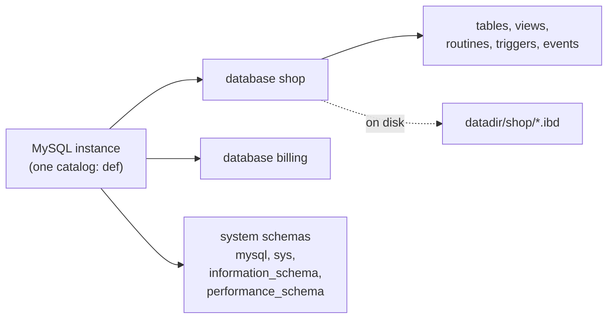

## Introduction

Every table lives in a **database**. In MySQL the word *database* means a named container of tables, views, stored routines, triggers and events — and `SCHEMA` is an exact synonym: `CREATE SCHEMA shop` and `CREATE DATABASE shop` are the same statement. A single MySQL server (an *instance*) typically holds many databases: one per application, per service, per tenant, or per environment on a development machine.

This lesson answers the practical questions you meet as soon as you have a server:

- How do I create a database with the right **character set and collation**, and what do its tables inherit from it?
- How do I see which databases exist, which one I am "in", and what each contains — using `SHOW` statements and the standard **`information_schema`**?
- What does `USE` actually do, and how do I query across databases?
- What happens on disk when I create or drop a database — the **data directory layout**?
- Why is `DROP DATABASE` one of the most dangerous statements in SQL?

:::note[What runs in the sandbox]
Each lab is itself a database — your private schema, shown as `your_lab` in results — and its account cannot create or drop databases or switch to another one. `CREATE DATABASE`, `ALTER DATABASE`, `DROP DATABASE` and `USE other_db` therefore appear as display-only blocks; run them on your own server ([Installing, Configuring and Connecting](/lessons/m02-install-connect)). Everything that *inspects* databases — `SHOW DATABASES`, `information_schema.SCHEMATA`, `DATABASE()`, `SHOW CREATE DATABASE` — runs here.
:::

## DBMS Theory

:::theory[Database, schema, catalog]
The SQL standard defines a three-level naming hierarchy: a **catalog** contains **schemas**, and a schema contains **schema objects** (tables, views, domains, routines…). A fully qualified table name is `catalog.schema.table`. A schema is a *namespace* plus an *owner*: two tables may have the same name if they are in different schemas. The standard also requires an **information schema** — a set of read-only views, in every catalog, that describe all objects (tables, columns, constraints, privileges) in a uniform, queryable way. This is the relational model's principle that **metadata is data** (Codd's rule 4: the catalog is stored and queried like ordinary relations).
:::

Products map the standard hierarchy differently, which is a frequent source of confusion when you move between systems:

| System | "Database" means | "Schema" means | Cross-container queries |
|---|---|---|---|
| **MySQL** | A schema — namespace of tables inside the server | Synonym of database | Yes: `SELECT … FROM db1.t JOIN db2.u` on the same server |
| PostgreSQL | A separate catalog with its own connections | A namespace *inside* a database (`public` by default) | Across schemas yes; across databases no (needs extensions) |
| SQL Server | A catalog with files and logs | A namespace inside a database (`dbo`) | Yes, with three-part names |
| Oracle | The whole instance's storage | A user's namespace | Yes, by schema prefix |

In MySQL there is exactly one catalog per server, named `def` (you will see it in `information_schema` as `CATALOG_NAME = 'def'`). So MySQL's two-part name `database.table` corresponds to the standard's `schema.table`.

**What a database is *not* in MySQL:**

- It is **not a unit of isolation for resources**. All databases on a server share the same buffer pool, redo log, binary log, threads and CPU. A heavy query in one database slows the others.
- It is **not a unit of transactions**. One transaction can modify tables in several databases atomically (all InnoDB), because transactions belong to sessions, not databases.
- It is **not a security boundary by itself**. Privileges can be granted per database (`GRANT SELECT ON shop.*`), which makes it a convenient unit for access control — but an account with global privileges sees everything.

## Why It Exists

Databases (schemas) exist to **separate namespaces and manage things as a group**:

- **Name isolation.** Two applications can each have a `users` table without collision.
- **Privileges by unit.** `GRANT ALL ON billing.* TO 'billing_app'@'%'` gives one service exactly its own tables. This is how the sandbox itself works: your lab account has privileges on one database only.
- **Defaults by unit.** A database carries a default character set, collation and encryption setting inherited by new tables.
- **Lifecycle by unit.** Backups (`mysqldump shop`), restores, migrations and deletion are naturally done per database.
- **Physical organisation.** Each database is a directory in the data directory, which makes per-database disk usage visible and lets operators place or move data.

Without this layer, everything would share one namespace: every table name would need a prefix (`billing_invoices`, `crm_invoices`), privileges would have to be granted table by table, and there would be no simple way to back up or remove one application's data.

What goes wrong when databases are misunderstood:

- Creating a database without specifying the character set on an old server (5.7 defaulted to `latin1`), then discovering that emoji and many non-Latin scripts cannot be stored.
- Running `DROP DATABASE` on the wrong server or with a mistyped name — there is no undo, and the statement drops every table, view, routine, trigger and event in it.
- Assuming that separate databases isolate workloads — then a reporting query in `analytics` saturates the buffer pool shared with `shop`.

## Internal Working

:::internals[Databases in the data dictionary and on disk]
**Metadata.** Since MySQL 8.0 every database is a row in the transactional **data dictionary** (internal InnoDB tables in the `mysql` system tablespace). The row records the name, default collation (which implies the character set), default encryption and the read-only flag. Before 8.0, these options lived in a `db.opt` text file inside the database directory; 8.0 removed `db.opt` and `.frm` files entirely. `information_schema.SCHEMATA` is a view over the dictionary.

**Directory.** `CREATE DATABASE shop` also creates a directory `shop/` inside the **data directory** (`@@datadir`, e.g. `/var/lib/mysql/`). With `innodb_file_per_table = ON` (the default), each InnoDB table gets its own **tablespace file** `shop/<table>.ibd`; partitions get one file per partition (`orders#p#p2024.ibd`). Non-InnoDB tables have their own files (MyISAM `.MYD`/`.MYI`, CSV `.CSV`) plus a `.sdi` file holding serialized dictionary information.

**Name encoding.** Database and table names map to directory and file names. Characters that are unsafe in file names are encoded: a database named `my-db` is stored as the directory `my@002ddb`. Because names become file names, their **case sensitivity depends on the file system and on `lower_case_table_names`**: 0 (default on Linux — names are case-sensitive), 1 (stored lowercase, compared case-insensitively — default on Windows), 2 (macOS — stored as given, compared in lowercase). Since 8.0 this variable can only be set when the data directory is **initialised**; changing it later prevents the server from starting.

**Atomic DROP.** `DROP DATABASE` removes all objects in the dictionary in one atomic DDL transaction, then deletes the files and the directory. If the server crashes midway, recovery completes or rolls back the dictionary change.
:::

A typical MySQL 8.4 data directory:

```text
/var/lib/mysql/
├── auto.cnf                 server_uuid of this instance
├── mysqld-auto.cnf          settings written by SET PERSIST (if any)
├── ibdata1                  InnoDB system tablespace (change buffer, legacy data)
├── mysql.ibd                data dictionary + mysql system schema tables
├── undo_001, undo_002       undo tablespaces
├── #innodb_redo/            redo log files (8.0.30+: #ib_redoN)
├── #innodb_temp/            session temporary tablespaces
├── #ib_16384_0.dblwr ...    doublewrite buffer files (8.0.20+)
├── binlog.000001 ...        binary log files + binlog.index
├── ca.pem, server-cert.pem  auto-generated TLS certificates
├── mysql/                   (directory for mysql schema non-dictionary files, e.g. general_log CSV)
├── performance_schema/      (metadata only — data is in memory)
├── sys/                     sys schema (views and routines)
└── shop/                    ← one directory per database
    ├── customers.ibd        one tablespace per InnoDB table
    ├── orders.ibd
    └── ...
```

`information_schema` has no directory: its tables are views computed from the data dictionary and server memory. The redo, undo, doublewrite and binary log files are explained in Module 10 ([Redo and Undo Logs](/lessons/m10-redo-undo)).



## MySQL Implementation

**Creating a database** (display-only — run on your own server):

```sql
CREATE DATABASE shop;                                   -- server defaults (utf8mb4 / utf8mb4_0900_ai_ci on 8.x)
CREATE DATABASE IF NOT EXISTS shop
  CHARACTER SET utf8mb4
  COLLATE utf8mb4_0900_ai_ci;                           -- explicit and idempotent: the professional form
CREATE SCHEMA billing DEFAULT CHARACTER SET utf8mb4 COLLATE utf8mb4_bin ENCRYPTION 'Y';  -- needs a keyring component
```

**Selecting a default database.** `USE shop;` makes `shop` the session's default database, so unqualified names (`customers`) resolve to `shop.customers`. It is a client/session convenience, not a transaction and not a permission. The `mysql` client also accepts the database as the last command-line argument (`mysql -u app -p shop`), and connectors take it as a connection parameter.

```sql
USE shop;
SELECT DATABASE();          -- 'shop'
```

In the lab, your session already has a default database — your private schema:

```sql run
SELECT DATABASE() AS current_database, SCHEMA() AS synonym;
```

**Listing databases.** `SHOW DATABASES` lists the databases *you are allowed to see* — not necessarily all databases on the server:

```sql run
SHOW DATABASES;
```

Your lab account sees three: `information_schema` (always visible to everyone, but each user sees only the objects they have privileges on), your own schema, and `performance_schema` (visible because the server grants limited read access to some of its tables to all users). The dozens of other lab schemas on the same server, and the `mysql` and `sys` system schemas, are invisible because this account has no privileges on them. On your own server, logged in as root, you would also see `mysql`, `sys` and every application database.

The same information, with the defaults of each database, comes from the standard `information_schema`:

```sql run
SELECT CATALOG_NAME, SCHEMA_NAME, DEFAULT_CHARACTER_SET_NAME, DEFAULT_COLLATION_NAME, DEFAULT_ENCRYPTION
FROM information_schema.SCHEMATA
ORDER BY SCHEMA_NAME;
```

Note `CATALOG_NAME = 'def'` (MySQL's single catalog) and that `information_schema` itself reports `utf8mb3` — the system views use the legacy 3-byte UTF-8 internally; your own databases use `utf8mb4`.

**Seeing the exact definition.** `SHOW CREATE DATABASE name` returns a statement that would recreate the database. In the lab you do not know your schema's real name, so build the statement from `DATABASE()` with a prepared statement (covered in [Prepared Statements and Dynamic SQL](/lessons/m09-prepared-dynamic-sql)):

```sql run
SET @stmt = CONCAT('SHOW CREATE DATABASE `', DATABASE(), '`');
PREPARE show_db FROM @stmt;
EXECUTE show_db;
DEALLOCATE PREPARE show_db;
```

The `/*!40100 … */` and `/*!80016 … */` wrappers are **versioned comments**, a MySQL extension: a server whose version is at least 4.01.00 (respectively 8.0.16) executes the text inside; older servers and other databases treat it as a comment. `mysqldump` uses them so dumps load on older versions.

## Syntax Breakdown

```sql
CREATE {DATABASE | SCHEMA} [IF NOT EXISTS] db_name
    [create_option] ...

create_option:
    [DEFAULT] CHARACTER SET [=] charset_name
  | [DEFAULT] COLLATE [=] collation_name
  | [DEFAULT] ENCRYPTION [=] {'Y' | 'N'}

ALTER {DATABASE | SCHEMA} [db_name]
    alter_option ...

alter_option:
    [DEFAULT] CHARACTER SET [=] charset_name
  | [DEFAULT] COLLATE [=] collation_name
  | [DEFAULT] ENCRYPTION [=] {'Y' | 'N'}
  | READ ONLY [=] {DEFAULT | 0 | 1}

DROP {DATABASE | SCHEMA} [IF EXISTS] db_name

USE db_name
```

| Element | Meaning | Notes |
|---|---|---|
| `DATABASE` / `SCHEMA` | Synonyms in MySQL | Standard SQL has `CREATE SCHEMA`; `CREATE DATABASE` is the MySQL (and common) form |
| `IF NOT EXISTS` / `IF EXISTS` | Do nothing (with a note-level warning) instead of failing if the database already exists / does not exist | Makes scripts idempotent; MySQL extension |
| `CHARACTER SET` | Default character set for new tables in the database | Implied by `COLLATE` if omitted. Default on 8.x: `utf8mb4` |
| `COLLATE` | Default collation for new tables | Default on 8.x: `utf8mb4_0900_ai_ci` (accent- and case-insensitive) |
| `ENCRYPTION` | Default encryption for new tablespaces (8.0.16+) | Requires a keyring component/plugin |
| `READ ONLY` | Rejects writes to all objects in the database (8.0.22+) | Useful during migrations or for archived data; `ALTER` only |
| `db_name` | Up to 64 characters; quote with backticks if it contains special characters or is a reserved word | Case sensitivity depends on `lower_case_table_names` |
| `DROP DATABASE` | Drops **every** object in the database and removes its directory | Returns the number of tables removed; requires `DROP` privilege on the database |

**Inspection tools:**

| Statement | What it shows | Standard? |
|---|---|---|
| `SELECT DATABASE()` | Current default database (NULL if none) | MySQL function |
| `SHOW DATABASES [LIKE 'pattern']` | Databases visible to you | MySQL |
| `SHOW CREATE DATABASE db` | The `CREATE DATABASE` statement | MySQL |
| `SHOW TABLES [FROM db]`, `SHOW FULL TABLES` | Tables (and views, with `FULL`) | MySQL |
| `SHOW TABLE STATUS` | Per-table engine, row estimate, sizes | MySQL |
| `information_schema.SCHEMATA` | Databases and their defaults | **Standard view** |
| `information_schema.TABLES`, `COLUMNS`, `STATISTICS`, `TABLE_CONSTRAINTS`, `KEY_COLUMN_USAGE`, `ROUTINES`, `VIEWS`, `TRIGGERS` | Every object, in queryable form | Standard (with MySQL-specific extra columns such as `ENGINE`) |

:::version[Database-level features by version]
- **8.0**: `db.opt` and `.frm` files removed (metadata in the data dictionary); `DROP DATABASE` is atomic; default character set changed from `latin1` to `utf8mb4`.
- **8.0.16**: `DEFAULT ENCRYPTION` option.
- **8.0.22**: `ALTER DATABASE … READ ONLY`.
- **8.4**: no change to the syntax above; the behaviour shown here applies to 8.4 LTS as well.
:::

## Practical Examples

**1. What a database contains.** `information_schema` lets you inventory a database with plain SQL. Count objects by type in your schema:

```sql run
SELECT 'tables'  AS object_type, COUNT(*) AS n FROM information_schema.TABLES  WHERE TABLE_SCHEMA = DATABASE() AND TABLE_TYPE = 'BASE TABLE'
UNION ALL
SELECT 'views',   COUNT(*) FROM information_schema.VIEWS   WHERE TABLE_SCHEMA = DATABASE()
UNION ALL
SELECT 'columns', COUNT(*) FROM information_schema.COLUMNS WHERE TABLE_SCHEMA = DATABASE()
UNION ALL
SELECT 'routines', COUNT(*) FROM information_schema.ROUTINES WHERE ROUTINE_SCHEMA = DATABASE()
UNION ALL
SELECT 'triggers', COUNT(*) FROM information_schema.TRIGGERS WHERE TRIGGER_SCHEMA = DATABASE();
```

The shop database has 7 base tables with 43 columns in total, and no views, routines or triggers yet.

**2. Column-level metadata.** The `COLUMNS` view describes every column — name, position, type, nullability, default, character set:

```sql run
SELECT ORDINAL_POSITION, COLUMN_NAME, COLUMN_TYPE, IS_NULLABLE, COLUMN_DEFAULT, CHARACTER_SET_NAME
FROM information_schema.COLUMNS
WHERE TABLE_SCHEMA = DATABASE() AND TABLE_NAME = 'customers'
ORDER BY ORDINAL_POSITION;
```

Every string column inherited `utf8mb4` from the table, which inherited it from the database. Numeric and date columns have no character set (NULL).

**3. How much space does each table use?** `information_schema.TABLES` reports the engine's size estimates (in bytes):

```sql run
SELECT TABLE_NAME,
       ENGINE,
       TABLE_ROWS                       AS approx_rows,
       DATA_LENGTH                      AS data_bytes,
       INDEX_LENGTH                     AS index_bytes,
       DATA_LENGTH + INDEX_LENGTH       AS total_bytes
FROM information_schema.TABLES
WHERE TABLE_SCHEMA = DATABASE()
ORDER BY total_bytes DESC, TABLE_NAME;
```

On this tiny dataset every value is a multiple of 16,384 — the InnoDB **page size** (`@@innodb_page_size`): even a 10-row table occupies at least one full 16 KB page for its clustered index, plus one page per secondary index. On real data this query is how DBAs find the largest tables in a database. (The numbers are estimates maintained by InnoDB statistics; `ANALYZE TABLE` refreshes them.)

**4. Inheritance of defaults: server → database → table → column.** A new table that does not specify a character set takes the database default; a column that does not specify one takes the table default:

```sql run
CREATE TABLE inherit_demo (
  plain_name   VARCHAR(20),
  binary_code  VARCHAR(20) COLLATE utf8mb4_bin
);
SELECT @@character_set_database AS db_charset, @@collation_database AS db_collation;
SELECT COLUMN_NAME, CHARACTER_SET_NAME, COLLATION_NAME
FROM information_schema.COLUMNS
WHERE TABLE_SCHEMA = DATABASE() AND TABLE_NAME = 'inherit_demo'
ORDER BY ORDINAL_POSITION;
```

`plain_name` inherited the database collation; `binary_code` overrode it at column level. The important consequence: **`ALTER DATABASE … CHARACTER SET` changes only the default for future tables** — it does not convert existing tables or columns. Converting existing data requires `ALTER TABLE … CONVERT TO CHARACTER SET` per table ([Character Sets and Collations](/lessons/m02-charsets-collations)).

**5. Names become file names: case sensitivity.** On Linux with `lower_case_table_names = 0`, table (and database) names are case-sensitive because file names are:

```sql run
SELECT @@lower_case_table_names AS lctn, @@lower_case_file_system AS case_insensitive_fs;
CREATE TABLE `Invoice` (id INT PRIMARY KEY);
```

```sql run error
SELECT * FROM invoice;
```

`Invoice` and `invoice` are different names here. The same script would work on Windows (`lower_case_table_names = 1`), which is why teams standardise on **lowercase names with underscores** — portable on every platform.

**6. Cross-database queries.** Any table on the server can be referenced as `database.table`, and a single query can join tables from several databases. Here the lab schema's tables are joined with the standard metadata views in `information_schema`:

```sql run
SELECT t.TABLE_NAME,
       COUNT(c.COLUMN_NAME) AS columns
FROM information_schema.TABLES  AS t
JOIN information_schema.COLUMNS AS c
  ON c.TABLE_SCHEMA = t.TABLE_SCHEMA AND c.TABLE_NAME = t.TABLE_NAME
WHERE t.TABLE_SCHEMA = DATABASE() AND t.TABLE_TYPE = 'BASE TABLE'
GROUP BY t.TABLE_NAME
ORDER BY columns DESC, t.TABLE_NAME;
```

On your own server you would write, for example, `SELECT … FROM shop.orders o JOIN crm.accounts a ON …` — possible because all databases live in the same instance and share one transaction manager.

## Execution Walkthrough

The full lifecycle of a database on your own server, with what happens internally at each step. The SQL in the steps shows the parts you can observe from the lab.

```walkthrough
title: Lifecycle of a database — create, use, inspect, alter, drop
steps:
  - title: "1. CREATE DATABASE shop CHARACTER SET utf8mb4 COLLATE utf8mb4_0900_ai_ci"
    explain: >-
      (Run on your own server.) MySQL checks the CREATE privilege, implicitly commits any open transaction,
      inserts a row into the data dictionary's schemata table with the default collation, and creates the
      directory datadir/shop/. No files are created inside it yet. With IF NOT EXISTS, an existing database
      produces only a note (warning code 1007) instead of error 1007.
  - title: "2. USE shop — set the session default"
    explain: >-
      USE only changes the session's default database; unqualified table names now resolve inside it.
      DATABASE() reports it. In the lab, the default database is already your private schema.
    sql: SELECT DATABASE() AS session_default_database;
  - title: "3. CREATE TABLE — the database fills up"
    explain: >-
      Each new InnoDB table adds dictionary rows and a file datadir/shop/<table>.ibd. information_schema
      immediately reflects the new object, because it is a view over the dictionary.
    sql: |
      CREATE TABLE lifecycle_demo (id INT PRIMARY KEY, note VARCHAR(30));
      SELECT TABLE_NAME, TABLE_TYPE, ENGINE, TABLE_COLLATION
      FROM information_schema.TABLES
      WHERE TABLE_SCHEMA = DATABASE() AND TABLE_NAME = 'lifecycle_demo';
  - title: "4. ALTER DATABASE shop COLLATE utf8mb4_bin"
    explain: >-
      (Run on your own server.) Only the dictionary row changes. Existing tables such as lifecycle_demo keep
      utf8mb4_0900_ai_ci; only tables created afterwards without an explicit collation get utf8mb4_bin.
  - title: "5. DROP DATABASE shop"
    explain: >-
      (Run on your own server — and be sure.) MySQL takes exclusive metadata locks on every object, removes all
      of them from the dictionary in one atomic DDL transaction, deletes the .ibd files and the directory, and
      reports how many tables were dropped. There is no undo; recovery means restoring a backup. If the dropped
      database was the session default, DATABASE() becomes NULL.
```

## Output

After step 3 the lab's `information_schema` shows `lifecycle_demo` as a `BASE TABLE` using InnoDB with the inherited collation `utf8mb4_0900_ai_ci`. On your own server, the corresponding outputs of the display-only steps are:

- `CREATE DATABASE` → `Query OK, 1 row affected`;
- `ALTER DATABASE` → `Query OK, 1 row affected`;
- `DROP DATABASE` → `Query OK, N rows affected`, where **N is the number of tables dropped** — a useful last sanity check in scripts and logs;
- `SHOW DATABASES` no longer lists the database, and its directory is gone from `@@datadir`.

When you read `SHOW DATABASES` output in any environment, remember it is filtered by your privileges: "the database isn't there" may mean "you cannot see it".

## Alternative Approaches

**How to divide data into databases** is a real design decision. The main patterns:

| Pattern | Description | Pros | Cons |
|---|---|---|---|
| **One database per application/service** | `shop`, `billing`, `crm` on one or several servers | Clear ownership and privileges; per-service backups | Cross-service joins couple services (avoid in microservices) |
| **Database per tenant** (multi-tenant SaaS) | `tenant_0001`, `tenant_0002`, … with identical schemas | Strong logical isolation, easy per-tenant backup/restore and deletion | Thousands of databases × tables = many files and dictionary entries; schema migrations must run N times |
| **Shared tables with a `tenant_id` column** | All tenants in one database | Simple migrations, efficient for many small tenants | Every query must filter by tenant (risk of data leaks); per-tenant restore is hard |
| **Database per environment** | `shop_dev`, `shop_test` on one dev server | Cheap | Easy to point a script at the wrong one; production should be on separate servers |
| **Separate instances** | Different `mysqld` processes or servers | True resource isolation (buffer pool, I/O) | More operational overhead |

**Inspecting metadata — `SHOW` vs `information_schema`.** `SHOW` statements are short and convenient interactively; `information_schema` is standard, can be filtered, joined and aggregated, and is what tools and scripts should use. For performance-related metadata (I/O, locks, memory), the **Performance Schema** and **sys** schema are the right sources (Module 11).

## Performance Analysis

A database is a namespace, so creating one costs almost nothing and the number of databases has little direct performance effect. Indirect effects matter:

- **Shared resources.** All databases share the buffer pool, redo log and CPU. Performance isolation requires separate instances (or resource groups for CPU), not separate databases.
- **Many tables.** Each InnoDB table is a file (with `innodb_file_per_table`) and a set of dictionary entries. Database-per-tenant designs with hundreds of thousands of tables increase memory for table definitions and open-file handles (`table_definition_cache`, `table_open_cache`, `open_files_limit`) and slow down operations that enumerate all tables (some backup tools, `information_schema` scans across all schemas).
- **`information_schema` queries.** In 8.0+ most `information_schema` tables are views over indexed dictionary tables and are fast when filtered by schema and table name. Dynamic statistics columns (`TABLE_ROWS`, `DATA_LENGTH`, `UPDATE_TIME`) are cached for `information_schema_stats_expiry` seconds (default 86,400 = one day) unless refreshed with `ANALYZE TABLE` — so sizes you read may be up to a day old.
- **`DROP DATABASE` on a big database** deletes many large files; on some file systems this causes an I/O stall. Large drops are often scheduled off-peak, or done table by table.

:::performance[Theory vs measurement]
These effects are expected from MySQL's architecture rather than measured here; the lab database has 7 small tables. On your own server, `SELECT TABLE_SCHEMA, COUNT(*), SUM(DATA_LENGTH + INDEX_LENGTH) FROM information_schema.TABLES GROUP BY TABLE_SCHEMA` gives the size and table count per database — the starting point for capacity planning.
:::

## Best Practices

:::best-practice[Managing databases]
1. **Always specify the character set and collation** in `CREATE DATABASE` (`utf8mb4` with an explicit collation), even though 8.x defaults are good — scripts may run on servers with different defaults.
2. **Use `IF NOT EXISTS` in setup scripts** so they are idempotent, but **never `DROP DATABASE IF EXISTS` in scripts that can reach production**.
3. **Name databases in lowercase with underscores** (`order_service`), avoiding hyphens and reserved words, so names are portable across `lower_case_table_names` settings and need no quoting.
4. **Grant privileges per database** to per-application accounts (`GRANT … ON shop.* TO 'shop_app'@'…'`), never `*.*` to applications.
5. **Do not rely on `USE` in application code or scripts that touch several databases**; qualify names (`billing.invoices`) or set the database in the connection parameters, so a script cannot run against the wrong database because of session state.
6. **Back up before dropping**, and protect production with process: separate credentials for production, `--safe-updates`-style client settings, peer review for destructive DDL.
7. **Treat `information_schema` as the API for metadata** in scripts and tools; parse `SHOW` output only interactively.
:::

## Common Mistakes

**Mistake 1 — expecting `ALTER DATABASE … CHARACTER SET` to convert existing data.** It changes the default for new tables only. Existing tables keep their character set; you must convert each table explicitly.

**Mistake 2 — relying on default case-insensitivity.** Code developed on Windows or macOS with `SELECT * FROM Customers` fails on Linux, as shown above with `Invoice`. Use lowercase names consistently.

**Mistake 3 — confusing "database" between products.** A PostgreSQL user expects databases to be fully separate (no cross-database joins, separate connections); in MySQL they are schemas inside one server. Conversely, a MySQL user moving to PostgreSQL should map MySQL databases to PostgreSQL *schemas*, not databases.

**Mistake 4 — dropping the wrong database.** `DROP DATABASE` is irreversible and drops everything inside. A classic incident is a script with `DROP DATABASE IF EXISTS app; CREATE DATABASE app;` meant for a test environment, run with production credentials. In the sandbox the statement is blocked — notice that the guard is not MySQL's error, but a protection of the platform:

```sql run error
DROP DATABASE IF EXISTS shop_test;
```

On a real server that statement would succeed silently (or with a note) and remove `shop_test` if it existed.

**Mistake 5 — assuming `SHOW DATABASES` shows everything.** It shows only databases on which you have some privilege (unless you have the global `SHOW DATABASES` privilege). If an expected database is missing, check privileges before assuming it does not exist.

**Mistake 6 — referencing a table without its database after changing context.** Unqualified names resolve against the *current* default database. Without one, MySQL fails with error 1046 *No database selected*; with the wrong one, you may silently read a same-named table from a different database.

## Industry Application

- **Microservices.** The "database per service" pattern gives each service its own MySQL database (often on a dedicated instance) and its own credentials; other services access the data only through the owning service's API. Cross-database joins are deliberately avoided.
- **Multi-tenant SaaS.** Companies choose between database-per-tenant (stronger isolation, easier GDPR deletion — drop one database) and shared schema with `tenant_id` (simpler operations at very large tenant counts), often mixing both: large customers get their own database or instance.
- **Environments and CI.** Test suites create a uniquely named database per test run (`CREATE DATABASE test_<build_id>`), run migrations, execute tests and drop it — exactly the isolation model the sandbox uses for your lab.
- **Metadata-driven tooling.** Schema-diff tools, data catalogs (e.g. for data governance), ORMs' migration generators and data-quality platforms read `information_schema` to discover tables, columns, keys and types automatically.
- **Data engineering.** Ingestion tools (Airbyte, Fivetran, Debezium) enumerate databases and tables through `information_schema` to decide what to replicate, and use the per-database privilege model to restrict what a replication account can read.

## Practice Exercises

```exercise
id: ex1
title: Visible databases and their defaults
difficulty: easy
concepts: [information-schema, default-charset]
prompt: |
  Using `information_schema.SCHEMATA`, list every database visible to you with columns `SCHEMA_NAME`,
  `DEFAULT_CHARACTER_SET_NAME` and `DEFAULT_COLLATION_NAME`.
hints:
  - "SCHEMATA has one row per visible database."
  - "Select the three columns; no filter is needed."
solution: |
  SELECT SCHEMA_NAME, DEFAULT_CHARACTER_SET_NAME, DEFAULT_COLLATION_NAME
  FROM information_schema.SCHEMATA;
explanation: |
  The result is filtered by your privileges, just like `SHOW DATABASES`. `information_schema` reports the
  legacy `utf8mb3` character set for itself; your lab schema uses `utf8mb4` with `utf8mb4_0900_ai_ci`, the
  MySQL 8.x defaults. A script that verifies new databases were created with the right defaults would use
  exactly this query with a `WHERE SCHEMA_NAME = …` filter.
```

```exercise
id: ex2
title: Nullable columns in the current database
difficulty: medium
concepts: [information-schema]
prompt: |
  List every **nullable** column in the current database. Return `TABLE_NAME` and `COLUMN_NAME`.
hints:
  - "information_schema.COLUMNS has IS_NULLABLE with the values 'YES' and 'NO'."
  - "Restrict to TABLE_SCHEMA = DATABASE() — otherwise you also get columns of information_schema itself."
solution: |
  SELECT TABLE_NAME, COLUMN_NAME
  FROM information_schema.COLUMNS
  WHERE TABLE_SCHEMA = DATABASE()
    AND IS_NULLABLE = 'YES';
explanation: |
  Data teams run this kind of query to audit schemas ("which columns can be NULL, and should they?").
  Forgetting the `TABLE_SCHEMA` filter is the classic mistake: `information_schema.COLUMNS` describes every
  column you can see, including those of the information_schema and performance_schema views. Hard-coding the
  database name instead of `DATABASE()` makes the query non-portable between environments.
```

```exercise
id: ex3
title: Table inventory with indexes
difficulty: hard
concepts: [information-schema, data-directory]
prompt: |
  For every base table in the current database, return:

  1. `table_name`
  2. `columns` — number of columns
  3. `indexes` — number of distinct indexes (including the primary key)

  Use `information_schema.COLUMNS` and `information_schema.STATISTICS` (one row per index **column**,
  with `INDEX_NAME`).
hints:
  - "Count columns and indexes in two separate grouped subqueries (or correlated scalar subqueries) to avoid multiplying rows."
  - "A composite index appears once per column in STATISTICS, so count DISTINCT INDEX_NAME."
  - "Join both results to information_schema.TABLES filtered on TABLE_SCHEMA = DATABASE() AND TABLE_TYPE = 'BASE TABLE'."
solution: |
  SELECT t.TABLE_NAME AS table_name,
         (SELECT COUNT(*) FROM information_schema.COLUMNS c
           WHERE c.TABLE_SCHEMA = t.TABLE_SCHEMA AND c.TABLE_NAME = t.TABLE_NAME) AS columns,
         (SELECT COUNT(DISTINCT s.INDEX_NAME) FROM information_schema.STATISTICS s
           WHERE s.TABLE_SCHEMA = t.TABLE_SCHEMA AND s.TABLE_NAME = t.TABLE_NAME) AS indexes
  FROM information_schema.TABLES t
  WHERE t.TABLE_SCHEMA = DATABASE() AND t.TABLE_TYPE = 'BASE TABLE';
explanation: |
  Joining COLUMNS and STATISTICS directly to TABLES and then counting would multiply rows (columns × index
  columns) and give inflated numbers — the classic "join fan-out" mistake. Scalar subqueries (or two
  pre-aggregated derived tables) avoid it. `COUNT(DISTINCT INDEX_NAME)` matters because `order_items` has a
  composite primary key that appears twice in STATISTICS. Each index (except in-memory ones) is a separate
  B+ tree inside the table's .ibd file.
```

```exercise
id: ex4
title: Write the provisioning script
difficulty: medium
kind: open
concepts: [create-database, default-charset, drop-database]
prompt: |
  Write a provisioning script (for your own server) that:

  1. creates a database `analytics` only if it does not exist, with `utf8mb4` and the collation
     `utf8mb4_0900_ai_ci`;
  2. verifies the defaults through `information_schema`;
  3. later makes the database read-only for a migration window, and then writable again.

  Also explain why the script should *not* start with `DROP DATABASE IF EXISTS analytics`.
solution: |
  ~~~sql
  CREATE DATABASE IF NOT EXISTS analytics
    CHARACTER SET utf8mb4
    COLLATE utf8mb4_0900_ai_ci;

  SELECT SCHEMA_NAME, DEFAULT_CHARACTER_SET_NAME, DEFAULT_COLLATION_NAME
  FROM information_schema.SCHEMATA
  WHERE SCHEMA_NAME = 'analytics';

  ALTER DATABASE analytics READ ONLY = 1;   -- 8.0.22+: writes to any object now fail
  -- … migration window …
  ALTER DATABASE analytics READ ONLY = 0;
  ~~~

  `IF NOT EXISTS` makes the script idempotent: re-running it is harmless. Starting with
  `DROP DATABASE IF EXISTS` makes it *destructive*: run against an environment that already holds data (or
  with production credentials by mistake), it silently deletes every table, view, routine, trigger and event
  in the database, with no undo. Destructive steps belong in separate, explicitly confirmed scripts.
  Note that if the database already existed with *different* defaults, `CREATE … IF NOT EXISTS` does not
  change them — which is why step 2 verifies.
```

```exercise
id: ex5
title: Database-per-tenant or shared schema?
difficulty: challenge
kind: open
concepts: [schema, data-directory, information-schema]
prompt: |
  A B2B SaaS product has 40 enterprise customers today and expects 5,000 small customers within two years.
  Each customer's data model has 60 tables. Compare **database-per-tenant** with **shared tables plus a
  `tenant_id` column** on one MySQL 8.4 server, considering: number of files and dictionary objects, schema
  migrations, per-tenant backup/restore and deletion (GDPR), noisy neighbours, and risk of data leaks.
  Recommend a design for the two-year horizon.
solution: |
  **Database-per-tenant.** 5,000 × 60 = 300,000 tables → about 300,000 `.ibd` files and millions of dictionary
  entries (columns, indexes). This strains `table_open_cache`, `table_definition_cache`, open-file limits,
  backup tools and any query that scans information_schema across schemas. Every migration must run 5,000
  times (and can partially fail). Advantages: logical isolation — a missing `WHERE tenant_id` cannot leak data;
  per-tenant restore (`mysqldump tenant_0042`) and deletion (`DROP DATABASE`) are trivial. Noisy neighbours are
  *not* solved: all databases share one buffer pool and I/O.

  **Shared tables with tenant_id.** 60 tables regardless of tenant count; one migration; efficient for many
  small tenants. Every primary/secondary key should start with `tenant_id` so per-tenant queries are index
  range scans. Risks: every query must filter by tenant (enforce in the data-access layer, use views or
  row-level checks in code reviews); per-tenant restore requires filtered exports; GDPR deletion is a large
  `DELETE … WHERE tenant_id = ?`.

  **Recommendation:** hybrid. Shared schema (tenant_id-leading keys) for the long tail of small customers;
  dedicated databases — or dedicated instances, which also solve noisy neighbours — for the large enterprise
  customers who need isolation, custom backup schedules or data residency. Plan tenant mobility (moving a tenant
  from shared to dedicated) from the start.
```

## Knowledge Assessment

```quiz
- id: q1
  question: "In MySQL, what is the difference between `CREATE DATABASE app` and `CREATE SCHEMA app`?"
  options: ["SCHEMA creates a namespace inside the current database", "None — they are synonyms", "DATABASE also creates a user", "SCHEMA is not supported"]
  answer: 1
  explanation: "In MySQL, DATABASE and SCHEMA are synonyms. The 'schema inside a database' model belongs to PostgreSQL and SQL Server. Neither statement creates users."
  concepts: [schema, create-database]
- id: q2
  question: "You run `ALTER DATABASE shop CHARACTER SET utf8mb4 COLLATE utf8mb4_bin;`. What happens to the existing table `shop.customers` (utf8mb4_0900_ai_ci)?"
  options:
    - "It is converted to utf8mb4_bin"
    - "Nothing — only tables created later inherit the new default"
    - "The statement fails because tables exist"
    - "Its columns become binary strings"
  answer: 1
  explanation: "Database defaults apply to future CREATE TABLE statements only. Existing tables must be converted with ALTER TABLE … CONVERT TO CHARACTER SET. The ALTER DATABASE succeeds."
  concepts: [default-charset]
- id: q3
  question: "Which statements about the MySQL 8.4 data directory are true? (Select all that apply.)"
  type: multi
  options:
    - "Each database corresponds to a subdirectory of the data directory"
    - "With innodb_file_per_table=ON, each InnoDB table has its own .ibd file"
    - "Each table also has a .frm file with its definition"
    - "information_schema has its own directory of table files"
  answer: [0, 1]
  explanation: "Databases are directories and file-per-table tablespaces are .ibd files. .frm files were removed in 8.0 (definitions live in the data dictionary), and information_schema consists of views computed from the dictionary, with no files of its own."
  concepts: [data-directory]
- id: q4
  question: "A user reports that `SHOW DATABASES` does not list the `billing` database, but the DBA insists it exists. What is the most likely explanation?"
  options:
    - "The database is corrupted"
    - "SHOW DATABASES lists only databases on which the user has some privilege"
    - "SHOW DATABASES lists only databases created in the current session"
    - "billing is a reserved word"
  answer: 1
  explanation: "Without the global SHOW DATABASES privilege, users see only databases they have privileges on. Corruption would show errors; SHOW DATABASES is not session-scoped; billing is not reserved."
  concepts: [information-schema]
- id: q5
  question: "Which query correctly counts the base tables in the current database?"
  options:
    - "SELECT COUNT(*) FROM information_schema.TABLES;"
    - "SELECT COUNT(*) FROM information_schema.TABLES WHERE TABLE_SCHEMA = DATABASE() AND TABLE_TYPE = 'BASE TABLE';"
    - "SELECT COUNT(*) FROM information_schema.SCHEMATA WHERE SCHEMA_NAME = DATABASE();"
    - "SHOW COUNT(*) TABLES;"
  answer: 1
  explanation: "information_schema.TABLES covers every visible schema, so filter by TABLE_SCHEMA, and by TABLE_TYPE to exclude views. SCHEMATA has one row per database, not per table. SHOW COUNT(*) TABLES is not valid syntax (SHOW COUNT(*) exists only for WARNINGS/ERRORS)."
  concepts: [information-schema]
- id: q6
  question: "On Linux with lower_case_table_names=0, a table was created as `Orders`. What does `SELECT * FROM orders` do?"
  options: ["Works, because SQL is case-insensitive", "Fails with error 1146 (table doesn't exist)", "Creates a new table orders", "Works but returns no rows"]
  answer: 1
  explanation: "Table names map to file names, which are case-sensitive on Linux when lower_case_table_names=0. SQL keywords are case-insensitive, but identifiers mapped to files are not. Use lowercase names for portability."
  concepts: [data-directory]
- id: q7
  question: "Why does a database not isolate performance between two applications on the same MySQL server?"
  options:
    - "Because databases share the same buffer pool, logs, threads and CPU"
    - "Because each database has its own buffer pool that is too small"
    - "Because cross-database queries are forbidden"
    - "Because databases are stored in the same .ibd file"
  answer: 0
  explanation: "A database is a namespace; all databases in an instance share server resources. Resource isolation needs separate instances (or resource groups for CPU). Cross-database queries are allowed, and each table has its own .ibd file."
  concepts: [schema]
- id: q8
  question: "`DROP DATABASE IF EXISTS archive;` on a real server returns `Query OK, 12 rows affected`. What does 12 mean?"
  options: ["12 rows were deleted from one table", "12 tables were dropped", "12 sessions were disconnected", "12 warnings were generated"]
  answer: 1
  explanation: "For DROP DATABASE, the affected-rows count is the number of tables removed. It is a useful sanity check: an unexpectedly large number means you probably dropped the wrong database — too late, which is why backups and safeguards matter."
  concepts: [drop-database]
```
