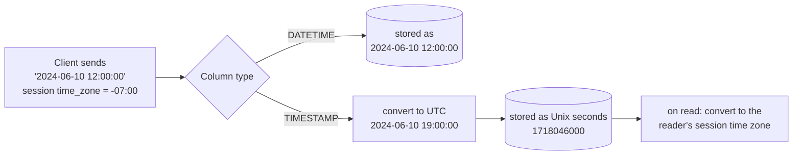

## Introduction

Time is the most error-prone kind of data in business systems. Orders are placed in one time zone and shipped from another; servers run in UTC while users read local time; daylight saving time makes some local times occur twice and others never; one table stores seconds, another milliseconds; and a column type chosen in 2010 stops working in January 2038.

MySQL has five temporal types:

| Type | Represents | Example |
|---|---|---|
| `DATE` | A calendar date, no time | `2024-06-10` |
| `TIME` | A time of day **or** an elapsed duration | `14:30:00`, `-12:30:00`, `838:59:59` |
| `DATETIME` | A date and time "as written" — no time zone attached | `2024-06-10 14:30:00.123` |
| `TIMESTAMP` | An **instant** in time, stored as UTC and converted to/from the session time zone | `2024-06-10 14:30:00` (in your time zone) |
| `YEAR` | A year | `2024` |

This lesson shows, with real outputs: the ranges and storage sizes; fractional seconds and the rounding they cause; the decisive difference between `DATETIME` and `TIMESTAMP` when the session time zone changes; the **2038 problem**; strict validation of impossible dates; and automatic initialization with `DEFAULT CURRENT_TIMESTAMP … ON UPDATE CURRENT_TIMESTAMP`. Date *functions* (`DATE_ADD`, `TIMESTAMPDIFF`, `DATE_FORMAT`, …) are covered in [Date and Time Functions](/lessons/m03-date-functions).

:::note[Deterministic clocks in this lesson]
Several examples use `NOW()`. To make captured outputs reproducible, they first fix the session clock with `SET SESSION timestamp = …` (a Unix time), a real MySQL feature used for testing and by replication. `SET SESSION timestamp = DEFAULT` restores the real clock.
:::

## DBMS Theory

:::theory[Instants, local date-times and durations]
Temporal data has three conceptually different kinds of value, and confusing them causes most time bugs:

- An **instant** (a point on the global timeline): "the payment was captured at 2024-06-10 12:00:00 UTC". The same instant is written differently in Tokyo and San José, but it is one moment.
- A **local date-time** (a reading of a wall clock or calendar, with no zone): "the store opens at 09:00", "the birthday is 1990-05-17", "the event starts 2025-03-09 02:30 local time". It is not a point on the timeline until a time zone is attached.
- A **duration / interval** (an amount of time): "2 hours 30 minutes", "3 months".

The SQL standard defines `DATE`, `TIME [WITH TIME ZONE]`, `TIMESTAMP [WITH TIME ZONE]` and `INTERVAL` types. Standard `TIMESTAMP` (without time zone) is a local date-time; `TIMESTAMP WITH TIME ZONE` carries an offset.
:::

MySQL's mapping onto these concepts is unusual and must be learned precisely:

| Concept | MySQL type | Comment |
|---|---|---|
| Local date | `DATE` | Standard |
| Local date-time | `DATETIME` | Equivalent to the standard's `TIMESTAMP WITHOUT TIME ZONE` |
| Instant | `TIMESTAMP` | **Not** the standard's TIMESTAMP: MySQL converts it to UTC on storage and back to the session time zone on retrieval, but does **not** store the offset |
| Time of day or duration | `TIME` | Range ±838:59:59 so it can hold durations; no time zone |
| Interval | — | No interval column type; `INTERVAL` exists only in expressions (`d + INTERVAL 1 DAY`) |
| Year | `YEAR` | MySQL extension |

MySQL has **no column type that stores a time zone or offset**. If the original zone matters (e.g. "what local time did the customer see?"), store it in a separate column (`VARCHAR(64)` holding an IANA name such as `America/Los_Angeles`).

## Why It Exists

Why distinct types rather than strings or integers?

- **Validation.** A `DATE` column rejects `2024-02-30`; a string column accepts it. Temporal types enforce the calendar.
- **Correct comparison and arithmetic.** `'2024-10-02' < '2024-9-30'` is true as strings but false as dates. Date arithmetic must know month lengths and leap years.
- **Compact, index-friendly storage.** A `DATETIME` takes 5 bytes versus 19+ for its text form, and sorts correctly in a B+ tree.
- **Time zone handling.** `TIMESTAMP` lets the server convert instants for each session automatically.

What goes wrong without care:

- Storing instants in `DATETIME` without a convention: rows written by servers in different time zones become incomparable.
- Storing birthdays in `TIMESTAMP`: a user in a different time zone sees the birthday shift by a day.
- Choosing `TIMESTAMP` for dates far in the future (subscription end dates, mortgage maturities) and hitting the **2038 limit**.
- Comparing `DATETIME(6)` values from one system with `DATETIME` values (whole seconds) from another, and missing matches because of rounding.

## Internal Working

:::internals[Storage formats]
Since MySQL 5.6.4 the temporal types use compact, byte-comparable binary formats:

| Type | Bytes (without fractional seconds) | Format |
|---|---|---|
| `YEAR` | 1 | year − 1900 |
| `DATE` | 3 | packed year × 16 × 32 + month × 32 + day |
| `TIME` | 3 | packed sign, hours, minutes, seconds |
| `DATETIME` | 5 | packed sign, year×13+month, day, hour, minute, second — **no time zone** |
| `TIMESTAMP` | 4 | **seconds since 1970-01-01 00:00:00 UTC** (unsigned 32-bit range used) |

**Fractional seconds** add storage depending on the precision *fsp* (0–6 digits): 0 bytes for fsp 0, 1 byte for 1–2, 2 bytes for 3–4, 3 bytes for 5–6. So `DATETIME(3)` is 7 bytes and `TIMESTAMP(6)` is 7 bytes.

**TIMESTAMP conversion.** On write, MySQL interprets the given value in the session's `time_zone`, converts it to UTC and stores the UTC seconds. On read, it converts the stored UTC seconds back to the *current* session time zone. `DATETIME` is stored and returned as given. `NOW()` and `CURRENT_TIMESTAMP` return the current instant expressed in the session time zone; `UTC_TIMESTAMP()` returns it in UTC.

**Session time zone.** `time_zone` can be `SYSTEM` (use the OS zone of the server, `@@system_time_zone`), a fixed offset such as `'+00:00'` or `'-07:00'`, or a named zone such as `'America/Los_Angeles'` — but **named zones only work if the time zone tables in the `mysql` schema have been loaded** (with `mysql_tzinfo_to_sql` on Linux). Fixed offsets do not know daylight saving time; named zones do.

**The 2038 problem.** The `TIMESTAMP` column range is `1970-01-01 00:00:01` to `2038-01-19 03:14:07` UTC — the range of a signed 32-bit count of seconds. Values outside it are rejected in strict mode. `DATETIME` covers `1000-01-01 00:00:00` to `9999-12-31 23:59:59`.
:::

| Type | Range | Bytes |
|---|---|---|
| `DATE` | 1000-01-01 … 9999-12-31 | 3 |
| `TIME[(fsp)]` | −838:59:59 … 838:59:59 | 3 + fsp bytes |
| `DATETIME[(fsp)]` | 1000-01-01 00:00:00 … 9999-12-31 23:59:59 | 5 + fsp bytes |
| `TIMESTAMP[(fsp)]` | 1970-01-01 00:00:01 … 2038-01-19 03:14:07 UTC | 4 + fsp bytes |
| `YEAR` | 1901 … 2155 (and 0000) | 1 |

(The "supported" range for DATE/DATETIME starts at year 1000; earlier values may work but are not guaranteed.)



## MySQL Implementation

Fix the session clock so the outputs are reproducible, and look at the current time in several forms:

```sql run
SET SESSION timestamp = 1718020800;           -- 2024-06-10 12:00:00 UTC
SET SESSION time_zone = '+00:00';
SELECT NOW()             AS now_session_tz,
       UTC_TIMESTAMP()   AS utc_now,
       CURDATE()         AS today,
       CURTIME()         AS time_now,
       NOW(3)            AS now_millis,
       UNIX_TIMESTAMP()  AS unix_seconds,
       @@SESSION.time_zone AS session_tz;
```

Now the key experiment. Store the **same literal** in a `DATETIME` and a `TIMESTAMP` column, then read it back from sessions in different time zones:

```sql run
CREATE TABLE tz_demo (
  id INT PRIMARY KEY,
  local_dt  DATETIME,
  instant   TIMESTAMP NULL
);
INSERT INTO tz_demo VALUES (1, '2024-06-10 12:00:00', '2024-06-10 12:00:00');
SELECT id, local_dt, instant, UNIX_TIMESTAMP(instant) AS utc_seconds FROM tz_demo;
```

Written in a UTC session, both columns show 12:00. Now switch the session to Pacific Daylight Time (UTC−7) and read the same row:

```sql run
SET SESSION time_zone = '-07:00';
SELECT id, local_dt, instant, UNIX_TIMESTAMP(instant) AS utc_seconds FROM tz_demo;
```

The `DATETIME` still says 12:00 — it is just a wall-clock reading. The `TIMESTAMP` now says 05:00 — the same instant expressed in UTC−7. `UNIX_TIMESTAMP()` proves it is the same instant: the stored seconds did not change. And for a session in India (UTC+5:30):

```sql run
SET SESSION time_zone = '+05:30';
SELECT id, local_dt, instant FROM tz_demo;
SET SESSION time_zone = '+00:00';
```

Same `DATETIME`, `TIMESTAMP` 17:30. **`TIMESTAMP` represents instants; `DATETIME` represents local date-times.** Use the type whose meaning matches the data.

## Syntax Breakdown

```sql
DATE
TIME[(fsp)]                     -- fsp = 0..6, default 0
DATETIME[(fsp)] [DEFAULT {CURRENT_TIMESTAMP[(fsp)] | literal}] [ON UPDATE CURRENT_TIMESTAMP[(fsp)]]
TIMESTAMP[(fsp)] [NULL | NOT NULL] [DEFAULT ...] [ON UPDATE CURRENT_TIMESTAMP[(fsp)]]
YEAR                            -- YEAR(4) display width deprecated; YEAR(2) removed (error 1818)
```

| Element | Meaning | Notes |
|---|---|---|
| `fsp` | Fractional-seconds precision, 0–6 digits | Values with more digits are **rounded** (not truncated) unless the `TIME_TRUNCATE_FRACTIONAL` SQL mode is set |
| `DEFAULT CURRENT_TIMESTAMP` | Initialise to the current time on INSERT when the column is omitted | Works for `TIMESTAMP` and `DATETIME`; synonyms `NOW()`, `LOCALTIME`, `LOCALTIMESTAMP` |
| `ON UPDATE CURRENT_TIMESTAMP` | Set to the current time whenever **any other column of the row actually changes** | Not triggered if an UPDATE leaves the row unchanged |
| fsp in defaults | `DATETIME(3) DEFAULT CURRENT_TIMESTAMP(3)` | The fsp of the column and of the default must match |
| `NULL` / `NOT NULL` on TIMESTAMP | With `explicit_defaults_for_timestamp = ON` (default, variable deprecated) TIMESTAMP behaves like other types: nullable unless declared NOT NULL, no implicit auto-initialization | With it OFF (legacy behaviour), the first TIMESTAMP column was implicitly `NOT NULL DEFAULT CURRENT_TIMESTAMP ON UPDATE CURRENT_TIMESTAMP` |
| Literals | `'2024-06-10'`, `'2024-06-10 12:00:00.5'`, `DATE '2024-06-10'`, `TIMESTAMP '2024-06-10 12:00:00'` | Standard typed literals are supported |
| Offsets in literals | `'2024-06-10 12:00:00+02:00'` (8.0.19+) | Converted to the session time zone on insert, for both DATETIME and TIMESTAMP; the offset itself is not stored |
| SQL modes | `NO_ZERO_DATE`, `NO_ZERO_IN_DATE`, strict mode | Default: zero dates and invalid dates are errors |

:::version[Deprecated and removed temporal syntax]
- `YEAR(2)` was removed in 8.0 (error 1818); `YEAR(4)` display width is deprecated — write `YEAR`.
- The `explicit_defaults_for_timestamp` system variable is deprecated; its default ON behaviour is the future behaviour, so do not rely on the legacy implicit TIMESTAMP defaults.
- Time zone offsets in datetime literals (`'…+02:00'`) require 8.0.19 or later.
:::

## Practical Examples

**1. Fractional seconds and rounding.** Insert the same value with microseconds into columns of different precision. `CAST(… AS CHAR)` shows exactly what MySQL returns:

```sql run
CREATE TABLE fsp_demo (d0 DATETIME, d3 DATETIME(3), d6 DATETIME(6), t3 TIME(3));
INSERT INTO fsp_demo VALUES ('2024-06-10 12:00:00.987654', '2024-06-10 12:00:00.987654',
                             '2024-06-10 12:00:00.987654', '10:00:00.9996');
SELECT CAST(d0 AS CHAR) AS dt_0,
       CAST(d3 AS CHAR) AS dt_3,
       CAST(d6 AS CHAR) AS dt_6,
       CAST(t3 AS CHAR) AS time_3
FROM fsp_demo;
```

`DATETIME` (fsp 0) **rounded** `.987654` up to the next second, `12:00:01`; `DATETIME(3)` rounded to `.988`; `DATETIME(6)` kept everything; `TIME(3)` rounded `.9996` up to `10:00:01.000`. Rounding can even change the date and year:

```sql run
INSERT INTO fsp_demo (d0) VALUES ('2024-12-31 23:59:59.5');
SELECT CAST(d0 AS CHAR) AS rounded_into_new_year FROM fsp_demo WHERE d3 IS NULL;
```

A New Year's Eve event at 23:59:59.5 is stored as 2025-01-01 00:00:00 — no warning. If your sources send milliseconds, declare `DATETIME(3)`/`TIMESTAMP(3)`; if you need truncation semantics, enable `TIME_TRUNCATE_FRACTIONAL`.

**2. Strict validation of impossible values.** The default SQL mode rejects invalid dates, zero dates and out-of-range times:

```sql run error
INSERT INTO tz_demo (id, local_dt) VALUES (7, '2024-02-30');
```

```sql run error
INSERT INTO tz_demo (id, local_dt) VALUES (8, '0000-00-00');
```

```sql run
CREATE TABLE misc_time (t TIME, y YEAR, d DATE);
INSERT INTO misc_time VALUES ('838:59:59', 2155, '1000-01-01'), ('-12:30:00', 24, '2024-02-29');
SELECT CAST(t AS CHAR) AS t, y, d FROM misc_time ORDER BY y;
```

`TIME` accepted 838:59:59 and a negative duration; `YEAR` accepted 2155 and converted the two-digit `24` to 2024 (two-digit years 70–99 become 1970–1999, 0–69 become 2000–2069); 2024-02-29 is valid because 2024 is a leap year. Out of range:

```sql run error
INSERT INTO misc_time (y) VALUES (1900);
```

**3. The 2038 limit.** The last representable TIMESTAMP second, and one second later:

```sql run
INSERT INTO tz_demo (id, instant) VALUES (3, '2038-01-19 03:14:07');
SELECT id, instant FROM tz_demo WHERE id = 3;
```

```sql run error
INSERT INTO tz_demo (id, instant) VALUES (4, '2038-01-19 03:14:08');
```

`DATETIME` has no such limit:

```sql run
INSERT INTO tz_demo (id, local_dt) VALUES (5, '9999-12-31 23:59:59');
SELECT id, local_dt FROM tz_demo WHERE id = 5;
```

The same lower-bound problem exists: `TIMESTAMP` cannot store dates before 1970 — no birthdays of people born in the 1960s.

**4. Automatic initialization and updating.** The standard audit-column pattern:

```sql run
CREATE TABLE audited_item (
  id          INT PRIMARY KEY,
  qty         INT NOT NULL,
  created_at  DATETIME(3) NOT NULL DEFAULT CURRENT_TIMESTAMP(3),
  updated_at  DATETIME(3) NOT NULL DEFAULT CURRENT_TIMESTAMP(3) ON UPDATE CURRENT_TIMESTAMP(3)
);
SET SESSION timestamp = 1718020800;            -- 12:00:00 UTC
INSERT INTO audited_item (id, qty) VALUES (1, 10);
SELECT id, qty, CAST(created_at AS CHAR) AS created_at, CAST(updated_at AS CHAR) AS updated_at FROM audited_item;
```

Both audit columns were filled from the (fixed) clock. One hour later, change the row:

```sql run
SET SESSION timestamp = 1718024400;            -- 13:00:00 UTC
UPDATE audited_item SET qty = 11 WHERE id = 1;
SELECT id, qty, CAST(created_at AS CHAR) AS created_at, CAST(updated_at AS CHAR) AS updated_at FROM audited_item;
```

`updated_at` moved to 13:00; `created_at` kept its value. An UPDATE that does not change any value does **not** touch `updated_at`:

```sql run
SET SESSION timestamp = 1718028000;            -- 14:00:00 UTC
UPDATE audited_item SET qty = 11 WHERE id = 1;  -- same value: "Changed: 0"
SELECT CAST(updated_at AS CHAR) AS updated_at FROM audited_item;
SET SESSION timestamp = DEFAULT;
```

`updated_at` still says 13:00 — the info line reported `Changed: 0`. This is correct behaviour but surprises people who expect "last touched" semantics.

**5. Offsets in literals (8.0.19+).** A literal with an explicit offset is converted to the session time zone before storing:

```sql run
SET SESSION time_zone = '+00:00';
INSERT INTO tz_demo (id, local_dt, instant) VALUES (2, '2024-06-10 12:00:00+02:00', '2024-06-10 12:00:00+02:00');
SELECT id, local_dt, instant FROM tz_demo WHERE id = 2;
```

Both columns now hold 10:00 (12:00 at UTC+2 = 10:00 UTC, the session zone). For `DATETIME` this means the original offset is lost — the stored value is only meaningful if everyone knows it was normalised to UTC.

**6. Realistic query: time to ship.** In the shop dataset, `orders.order_date` and `shipped_at` are `DATETIME`. Average hours from order to shipment for delivered orders:

```sql run
SELECT COUNT(*)                                                  AS delivered_orders,
       ROUND(AVG(TIMESTAMPDIFF(HOUR, order_date, shipped_at)), 1) AS avg_hours_to_ship,
       MIN(TIMESTAMPDIFF(HOUR, order_date, shipped_at))           AS fastest_hours,
       MAX(TIMESTAMPDIFF(HOUR, order_date, shipped_at))           AS slowest_hours
FROM orders
WHERE status = 'delivered';
```

This arithmetic is only meaningful because both columns follow the same convention (the same implicit time zone). Had they been written by systems in different zones, the result would be wrong by hours.

**7. Range predicates on date-times.** "Orders in March 2024" written as a half-open interval uses the index on `order_date` and includes every fraction of the last day:

```sql run
SELECT COUNT(*) AS march_orders
FROM orders
WHERE order_date >= '2024-03-01' AND order_date < '2024-04-01';
```

`BETWEEN '2024-03-01' AND '2024-03-31'` would silently exclude everything after 00:00:00 on March 31, and `WHERE MONTH(order_date) = 3` cannot use the index ([Sargable Queries](/lessons/m07-sargable-queries)).

## Execution Walkthrough

Trace one `TIMESTAMP` value through writes and reads in different session time zones.

```walkthrough
title: One instant, three time zones — TIMESTAMP vs DATETIME
steps:
  - title: "1. Write in a UTC−7 session"
    explain: >-
      The session is in Pacific Daylight Time. The literal 09:00 is interpreted in UTC−7. DATETIME stores
      09:00 as given; TIMESTAMP converts to UTC (16:00) and stores Unix seconds.
    sql: |
      SET SESSION time_zone = '-07:00';
      CREATE TABLE meeting (id INT PRIMARY KEY, local_start DATETIME, start_instant TIMESTAMP NULL);
      INSERT INTO meeting VALUES (1, '2024-06-10 09:00:00', '2024-06-10 09:00:00');
  - title: "2. Inspect the stored instant"
    explain: >-
      UNIX_TIMESTAMP returns the stored UTC seconds, independent of the session zone. Converting it with
      FROM_UNIXTIME in a UTC session would show 16:00.
    sql: SELECT id, UNIX_TIMESTAMP(start_instant) AS utc_seconds FROM meeting;
  - title: "3. Read in a UTC session"
    explain: The TIMESTAMP is shown as 16:00 UTC; the DATETIME still shows the wall-clock 09:00.
    sql: |
      SET SESSION time_zone = '+00:00';
      SELECT local_start, start_instant FROM meeting;
  - title: "4. Read in a UTC+9 session (Tokyo)"
    explain: >-
      The same instant is 01:00 the next day in Tokyo. The DATETIME is unchanged — if it was meant as an
      instant, a Tokyo user would now see the wrong meeting time.
    sql: |
      SET SESSION time_zone = '+09:00';
      SELECT local_start, start_instant FROM meeting;
  - title: "5. Named zones need time zone tables"
    explain: >-
      Fixed offsets ignore daylight saving time. Named zones handle DST but require the mysql time zone tables;
      on this server they are not loaded, so CONVERT_TZ with a named zone returns NULL while offsets work.
    sql: |
      SET SESSION time_zone = '+00:00';
      SELECT CONVERT_TZ('2024-06-10 16:00:00', '+00:00', '-07:00') AS with_offset,
             CONVERT_TZ('2024-06-10 16:00:00', 'UTC', 'America/Los_Angeles') AS with_named_zone;
```

## Output

The walkthrough's outputs summarise the semantics:

| Session time zone | `local_start` (DATETIME) | `start_instant` (TIMESTAMP) |
|---|---|---|
| −07:00 (writer) | 2024-06-10 09:00:00 | 2024-06-10 09:00:00 |
| +00:00 | 2024-06-10 09:00:00 | 2024-06-10 16:00:00 |
| +09:00 | 2024-06-10 09:00:00 | 2024-06-11 01:00:00 |

The `TIMESTAMP` always denotes the same instant (Unix seconds 1718035200); its *display* follows the reader. The `DATETIME` always displays the same wall-clock text; its *meaning* depends on a convention outside the database. The final step shows that this server lacks named time zone data: `CONVERT_TZ` with `'America/Los_Angeles'` returned NULL. On your own server, load the tables (`mysql_tzinfo_to_sql /usr/share/zoneinfo | mysql -u root mysql`) and named zones will work.

## Alternative Approaches

How to store instants — the three common strategies:

| Strategy | How | Pros | Cons |
|---|---|---|---|
| **`DATETIME` in UTC by convention** | Applications always write UTC (session `time_zone = '+00:00'`, or convert in code) | Range to 9999, no 2038 problem, values do not change with session settings, simple for analytics | Convention must be enforced everywhere; the database cannot tell UTC from local values |
| **`TIMESTAMP`** | Let MySQL convert per session | Automatic conversion, 4 bytes | 2038 limit, 1970 lower bound; results depend on each session's `time_zone` (pooled connections must set it consistently) |
| **Integer epoch** (`BIGINT` seconds or milliseconds) | Store Unix time | Unambiguous, language-neutral, no 2038 limit with BIGINT | Not human-readable; date functions need conversions (`FROM_UNIXTIME`) |

Most modern systems choose **`DATETIME(3)` or `DATETIME(6)` in UTC** for event times — especially anything that may extend beyond 2038 — and keep an IANA zone name in a separate column when local time matters. `TIMESTAMP` remains fine for short-lived technical columns (row modification times) if the 2038 horizon is acceptable and sessions consistently set `time_zone`.

For **local concepts** (birthdays, business dates, opening hours, contract dates) use `DATE`, `TIME` or `DATETIME` without conversion — never `TIMESTAMP`.

For **durations**, store an integer number of seconds/milliseconds (or minutes) rather than `TIME`, unless the value is a time of day: `TIME` is limited to ±838 hours and is awkward for arithmetic.

## Performance Analysis

- **Size.** `DATE` (3 bytes) < `TIMESTAMP` (4) < `DATETIME` (5); fractional seconds add 1–3 bytes. Differences are small per row but matter in indexes on very large tables (a composite index on `(customer_id, created_at)` is repeated for every row).
- **Index use.** Temporal values are stored in byte-comparable formats, so range scans (`created_at >= ? AND created_at < ?`) are efficient. Wrapping the column in a function (`DATE(created_at) = '2024-06-10'`, `YEAR(order_date) = 2024`) prevents index range scans unless you create a functional index ([Covering, Prefix and Functional Indexes](/lessons/m07-covering-prefix-functional)).
- **TIMESTAMP conversion cost.** Converting between UTC and the session zone costs a little CPU per value; with `time_zone = SYSTEM` MySQL may call operating-system time functions that take a global lock in some C libraries, which the manual warns can hurt scalability. Setting an explicit `time_zone` (e.g. `'+00:00'`) avoids that.
- **Implicit conversions.** Comparing a `DATETIME` column with a string literal is fine (the literal is converted once); comparing it with a number or with differently typed expressions can force per-row conversions.
- **Partitioning by time.** Large event tables are often partitioned by `RANGE` on a date column so old data can be dropped instantly ([Partitioning](/lessons/m12-partitioning)).

:::performance[Theory vs measurement]
The byte sizes above are documented storage requirements; the index effects are expected from B+ tree range scans and are demonstrated with `EXPLAIN` in Module 7. On the 80-row orders table, every query here is instant — use `EXPLAIN` rather than timings to compare a half-open range with a function-wrapped predicate.
:::

## Best Practices

:::best-practice[Temporal data done right]
1. **Decide per column: instant or local?** Instants → `DATETIME(n)` in UTC (or `TIMESTAMP` if 2038 is irrelevant); local dates/times → `DATE`/`TIME`/`DATETIME`.
2. **Standardise on UTC** for servers, connections (`time_zone = '+00:00'` in the connection settings or pool initialisation) and stored instants. Convert to local time at the edge (application or report).
3. **Store the user's time zone separately** (IANA name) when local time must be reconstructed.
4. **Choose the precision you receive.** If sources send milliseconds, use `(3)`; otherwise values are silently rounded, possibly into the next day.
5. **Never use `TIMESTAMP` for dates beyond 2038 or before 1970** (expiry dates, birthdays, historical data).
6. **Use half-open ranges** (`>= start AND < next_start`) for date-time filtering; avoid `BETWEEN` with DATETIME and functions on indexed columns.
7. **Keep strict mode and `NO_ZERO_DATE`** on; represent "unknown" with `NULL`, never `'0000-00-00'`.
8. **Load time zone tables** on servers that need named zones, and keep them updated (zone rules change).
9. **Use `DEFAULT CURRENT_TIMESTAMP(n) ON UPDATE CURRENT_TIMESTAMP(n)`** for audit columns, knowing that unchanged updates do not bump them.
:::

## Common Mistakes

**Mistake 1 — `BETWEEN` on a DATETIME column with dates only.** `order_date BETWEEN '2024-03-01' AND '2024-03-31'` means `<= '2024-03-31 00:00:00'` and misses orders placed during March 31:

```sql run
CREATE TABLE march_orders (id INT PRIMARY KEY, placed_at DATETIME NOT NULL);
INSERT INTO march_orders VALUES
  (1, '2024-03-01 08:00:00'), (2, '2024-03-15 12:30:00'),
  (3, '2024-03-31 00:00:00'), (4, '2024-03-31 18:45:00');
SELECT SUM(placed_at BETWEEN '2024-03-01' AND '2024-03-31')               AS between_count,
       SUM(placed_at >= '2024-03-01' AND placed_at < '2024-04-01')        AS half_open_count
FROM march_orders;
```

`BETWEEN` found 3 orders, the half-open range 4: the order placed at 18:45 on March 31 is lost, because `'2024-03-31'` is converted to `2024-03-31 00:00:00`. (On the shop dataset both forms happen to return 6, because no order was placed on March 31 — exactly why this bug survives testing.) Always use the half-open form.

**Mistake 2 — mixing time zones in DATETIME columns.** If one service writes local time and another UTC into the same `DATETIME` column, no query can fix it afterwards. Set the connection time zone explicitly in every application and ETL job.

**Mistake 3 — relying on `time_zone = SYSTEM`.** The server's OS zone can differ between environments (a laptop in PST, production in UTC), so `NOW()` and `TIMESTAMP` display differ. Set `time_zone` explicitly.

**Mistake 4 — zero dates as "unknown".** Legacy schemas used `'0000-00-00'`; strict mode rejects it (as shown above). Migrate such values to `NULL` before upgrading or tightening SQL modes.

**Mistake 5 — expecting `ON UPDATE CURRENT_TIMESTAMP` on every UPDATE.** It fires only when the row actually changes. If you need "last attempted", set the column explicitly.

**Mistake 6 — `TIMESTAMP` for a subscription end date.** A 15-year contract signed today ends after 2038 — the insert fails in strict mode, or in non-strict mode is stored as `0000-00-00 00:00:00` with a warning. Use `DATETIME` or `DATE`.

## Industry Application

- **Event and audit logging.** Event tables store `created_at DATETIME(6)` in UTC so that events from different services can be ordered and joined; distributed systems additionally store a monotonic sequence because clocks on different hosts drift.
- **Global products.** Calendars, booking and delivery systems store instants in UTC and the user's IANA zone separately, because "every Monday at 09:00 local time" cannot be expressed as fixed UTC instants across daylight-saving changes.
- **Finance.** Trading and payment systems need microsecond timestamps (`(6)`) and business dates (`DATE`) as separate concepts: a trade executed at 23:30 UTC may belong to the next business day in Tokyo.
- **Data engineering.** Pipelines partition data by event date in UTC; incremental loads use `updated_at` columns (the `ON UPDATE CURRENT_TIMESTAMP` pattern) as high-water marks — knowing that unchanged updates do not bump them, and that rows updated in the same second/millisecond need a tie-breaker.
- **The 2038 migration.** Organisations audit schemas for `TIMESTAMP` columns that can hold future dates and migrate them to `DATETIME` or `BIGINT`, well before 2038 — the same kind of preventive project as the Y2K remediation.

## Practice Exercises

```exercise
id: ex1
title: Pick the right temporal types
difficulty: easy
kind: dml
dataset: empty
concepts: [date-time-types, fractional-seconds]
prompt: |
  Create a table `flight` with these columns, in order:

  1. `flight_id` — `INT UNSIGNED`, not null, primary key
  2. `flight_date` — the local calendar date of departure
  3. `departs_utc` — the departure instant in UTC with **millisecond** precision, not limited by 2038
  4. `block_minutes` — scheduled duration in minutes as `SMALLINT UNSIGNED`
  5. `first_flown` — the year the route started (`YEAR`)

  The checker reads `COLUMN_NAME` and `COLUMN_TYPE`.
hints:
  - "Local date → DATE. An instant beyond 2038 with milliseconds → DATETIME(3)."
  - "Durations are best stored as integers; years as YEAR."
solution: |
  CREATE TABLE flight (
    flight_id     INT UNSIGNED NOT NULL PRIMARY KEY,
    flight_date   DATE,
    departs_utc   DATETIME(3),
    block_minutes SMALLINT UNSIGNED,
    first_flown   YEAR
  );
check: |
  SELECT COLUMN_NAME, COLUMN_TYPE
  FROM information_schema.COLUMNS
  WHERE TABLE_SCHEMA = DATABASE() AND TABLE_NAME = 'flight'
  ORDER BY ORDINAL_POSITION;
explanation: |
  `TIMESTAMP(3)` would also carry milliseconds, but it is limited to 2038 and converts with the session time
  zone; the prompt asked for an instant stored as UTC by convention and not limited by 2038 — `DATETIME(3)`.
  `flight_date` is a local concept (the date printed on the ticket), so it must never be converted between
  time zones. `TIME` could store durations up to 838 hours, but integer minutes are simpler to aggregate.
```

```exercise
id: ex2
title: Orders per month with a sargable range
difficulty: medium
dataset: shop
concepts: [date-time-types]
prompt: |
  Return the number of orders placed in **each month of Q2 2024** (April, May, June). Columns: `month_start`
  (a DATE: the first day of the month) and `orders`. Use a WHERE clause on `order_date` that an index on
  `order_date` could use (no functions applied to `order_date` in WHERE). Order by `month_start`.
hints:
  - "Filter with order_date >= '2024-04-01' AND order_date < '2024-07-01'."
  - "Group by the first day of the month: DATE_FORMAT(order_date, '%Y-%m-01') gives a string; wrap it in CAST(... AS DATE)."
solution: |
  SELECT CAST(DATE_FORMAT(order_date, '%Y-%m-01') AS DATE) AS month_start,
         COUNT(*) AS orders
  FROM orders
  WHERE order_date >= '2024-04-01' AND order_date < '2024-07-01'
  GROUP BY month_start
  ORDER BY month_start;
orderMatters: true
explanation: |
  Functions are fine in the SELECT list and GROUP BY — they are evaluated only for rows that pass the
  filter — but the WHERE clause must compare the bare column so the optimizer can use an index range scan.
  `WHERE QUARTER(order_date) = 2 AND YEAR(order_date) = 2024` returns the same rows but forces a full scan.
  `BETWEEN '2024-04-01' AND '2024-06-30'` would miss orders placed on June 30 after midnight.
```

```exercise
id: ex3
title: Convert local event times to UTC
difficulty: hard
kind: dml
dataset: empty
setup: |
  CREATE TABLE store_event (event_id INT PRIMARY KEY, store_offset CHAR(6) NOT NULL,
                            local_time DATETIME NOT NULL, utc_at DATETIME NULL);
  INSERT INTO store_event (event_id, store_offset, local_time) VALUES
    (1, '-07:00', '2024-06-10 09:00:00'),
    (2, '+01:00', '2024-06-10 17:30:00'),
    (3, '+09:00', '2024-06-11 01:15:00');
prompt: |
  Each row records a local wall-clock time and the store's UTC offset at that moment. Fill `utc_at` with
  the corresponding UTC date-time for every row.

  The checker reads `event_id` and `utc_at`.
hints:
  - "CONVERT_TZ(value, from_tz, to_tz) accepts offsets such as '-07:00'."
  - "UPDATE store_event SET utc_at = CONVERT_TZ(local_time, store_offset, '+00:00');"
solution: |
  UPDATE store_event SET utc_at = CONVERT_TZ(local_time, store_offset, '+00:00');
check: |
  SELECT event_id, utc_at FROM store_event ORDER BY event_id;
explanation: |
  09:00 at UTC−7 is 16:00 UTC; 17:30 at UTC+1 is 16:30 UTC; 01:15 on June 11 at UTC+9 is 16:15 UTC on June 10.
  Offsets work without the time zone tables. In real systems, store the IANA zone name rather than a fixed
  offset, because the offset of a zone changes with daylight saving time — but converting with named zones
  requires loaded time zone tables.
```

```exercise
id: ex4
title: Audit columns that really work
difficulty: medium
kind: dml
dataset: empty
setup: |
  CREATE TABLE ticket (ticket_id INT PRIMARY KEY, status VARCHAR(10) NOT NULL);
  INSERT INTO ticket VALUES (1, 'open');
prompt: |
  Add two columns to `ticket`:

  - `created_at` — `DATETIME(3)`, not null, defaulting to the current time with milliseconds
  - `updated_at` — `DATETIME(3)`, not null, defaulting to the current time with milliseconds **and**
    automatically set to the current time whenever the row changes

  The checker reads the column definitions from `information_schema.COLUMNS`.
hints:
  - "DEFAULT CURRENT_TIMESTAMP(3) — the fsp must match the column's fsp."
  - "ON UPDATE CURRENT_TIMESTAMP(3) for updated_at."
solution: |
  ALTER TABLE ticket
    ADD COLUMN created_at DATETIME(3) NOT NULL DEFAULT CURRENT_TIMESTAMP(3),
    ADD COLUMN updated_at DATETIME(3) NOT NULL DEFAULT CURRENT_TIMESTAMP(3) ON UPDATE CURRENT_TIMESTAMP(3);
check: |
  SELECT COLUMN_NAME, COLUMN_TYPE, IS_NULLABLE, COLUMN_DEFAULT, EXTRA
  FROM information_schema.COLUMNS
  WHERE TABLE_SCHEMA = DATABASE() AND TABLE_NAME = 'ticket' AND COLUMN_NAME IN ('created_at', 'updated_at')
  ORDER BY ORDINAL_POSITION;
explanation: |
  `DEFAULT CURRENT_TIMESTAMP` (without precision) on a `DATETIME(3)` column is an error — the precision of
  the column and of the default must match. Existing rows receive the current time when the columns are
  added. Remember that ON UPDATE fires only if some other column actually changes value.
```

```exercise
id: ex5
title: Review a schema for time bugs
difficulty: challenge
kind: open
concepts: [time-zones, timestamp-conversion, year-2038, fractional-seconds]
prompt: |
  A subscription service has this table, written by application servers in several regions whose
  connections use `time_zone = SYSTEM`:

  ~~~text
  CREATE TABLE subscription (
    id            INT PRIMARY KEY,
    user_birthday TIMESTAMP,
    started_at    DATETIME,
    renews_at     TIMESTAMP,
    ends_at       TIMESTAMP,          -- contracts last up to 20 years
    last_login    DATETIME            -- clients send milliseconds
  );
  ~~~

  Identify the problems and propose a corrected design and connection policy.
solution: |
  **Problems**
  - `user_birthday TIMESTAMP`: a birthday is a local date, not an instant; TIMESTAMP shifts it with the
    reader's time zone (it can display as the previous day) and cannot represent births before 1970.
  - `started_at DATETIME` written with `time_zone = SYSTEM` from servers in different regions: values are in
    different, unrecorded zones — incomparable.
  - `renews_at`/`ends_at TIMESTAMP`: 20-year contracts end after 2038-01-19 → inserts fail in strict mode.
    Their displayed values also depend on each session's zone.
  - `last_login DATETIME` without fsp: milliseconds are rounded to whole seconds (possibly into the next
    second/day), losing ordering between close events.
  - Connection policy `SYSTEM` makes results depend on host configuration and can hurt scalability.

  **Corrected design**
  ~~~sql
  CREATE TABLE subscription (
    id             BIGINT UNSIGNED PRIMARY KEY,
    user_birthday  DATE          NULL,
    user_time_zone VARCHAR(64)   NOT NULL,          -- IANA name, e.g. 'Asia/Kolkata'
    started_at     DATETIME(3)   NOT NULL,          -- UTC
    renews_at      DATETIME(3)   NULL,              -- UTC
    ends_at        DATETIME(3)   NULL,              -- UTC, no 2038 limit
    last_login     DATETIME(3)   NULL               -- UTC
  );
  ~~~
  **Policy:** every connection sets `time_zone = '+00:00'` (pool initialisation); applications convert to the
  user's zone for display using `user_time_zone`; load and maintain the MySQL time zone tables if SQL needs
  named-zone conversions; migrate existing data by converting each region's values with the region's zone.
```

## Knowledge Assessment

```quiz
- id: q1
  question: "A TIMESTAMP column was written as '2024-06-10 12:00:00' in a session with time_zone '+00:00'. What does a session with time_zone '-07:00' see?"
  options: ["2024-06-10 12:00:00", "2024-06-10 05:00:00", "2024-06-10 19:00:00", "NULL"]
  answer: 1
  explanation: "TIMESTAMP stores the instant in UTC and converts to the reader's session zone: 12:00 UTC is 05:00 at UTC−7. A DATETIME column would show 12:00 regardless. 19:00 would be the conversion in the wrong direction."
  concepts: [timestamp-conversion]
- id: q2
  question: "Which value can a TIMESTAMP column NOT store? (Select all that apply.)"
  type: multi
  options: ["2038-01-19 03:14:07 UTC", "2038-01-19 03:14:08 UTC", "1969-07-20 20:17:00 UTC", "2000-01-01 00:00:00 UTC"]
  answer: [1, 2]
  explanation: "TIMESTAMP covers 1970-01-01 00:00:01 to 2038-01-19 03:14:07 UTC (signed 32-bit seconds). One second past the limit and the 1969 Moon landing are both out of range. DATETIME covers years 1000–9999."
  concepts: [year-2038]
- id: q3
  question: "`INSERT INTO t (d) VALUES ('2024-06-10 12:00:00.987654')` where d is DATETIME (no fsp). What is stored?"
  options: ["2024-06-10 12:00:00", "2024-06-10 12:00:01", "2024-06-10 12:00:00.987654", "An error"]
  answer: 1
  explanation: "Fractional seconds beyond the column's precision are rounded, not truncated (unless TIME_TRUNCATE_FRACTIONAL is set), so .987654 rounds up to the next second. No error or warning is raised."
  concepts: [fractional-seconds]
- id: q4
  question: "Which type should store a customer's date of birth?"
  options: ["TIMESTAMP", "DATETIME", "DATE", "INT (Unix seconds)"]
  answer: 2
  explanation: "A birthday is a local calendar date with no time or zone. TIMESTAMP would shift with session time zones and cannot store dates before 1970; DATETIME adds a meaningless time; Unix seconds turn a date into an instant."
  concepts: [date-time-types]
- id: q5
  question: "A row's updated_at column is `DATETIME DEFAULT CURRENT_TIMESTAMP ON UPDATE CURRENT_TIMESTAMP`. You run `UPDATE t SET status = 'open' WHERE id = 1` and status was already 'open'. What happens to updated_at?"
  options: ["It is set to the current time", "It is unchanged, because no column value changed", "It becomes NULL", "The UPDATE fails"]
  answer: 1
  explanation: "ON UPDATE CURRENT_TIMESTAMP fires only when at least one other column actually changes; the UPDATE reports 'Changed: 0' and updated_at keeps its value."
  concepts: [auto-initialization]
- id: q6
  question: "Why does `CONVERT_TZ(ts, 'UTC', 'America/Los_Angeles')` return NULL on some servers?"
  options:
    - "Because CONVERT_TZ only works on TIMESTAMP columns"
    - "Because the named time zone tables in the mysql schema have not been loaded"
    - "Because Los Angeles is not a valid zone"
    - "Because strict mode forbids time zone conversion"
  answer: 1
  explanation: "Named zones require the mysql time zone tables (loaded with mysql_tzinfo_to_sql). Fixed offsets such as '-07:00' work without them but ignore daylight saving time."
  concepts: [time-zones]
- id: q7
  question: "Which predicate correctly selects all orders placed on 2024-03-31 from a DATETIME column and can use an index?"
  options:
    - "WHERE DATE(order_date) = '2024-03-31'"
    - "WHERE order_date = '2024-03-31'"
    - "WHERE order_date >= '2024-03-31' AND order_date < '2024-04-01'"
    - "WHERE order_date BETWEEN '2024-03-31' AND '2024-03-31'"
  answer: 2
  explanation: "The half-open range covers the whole day and is sargable. DATE(order_date) is correct but prevents an index range scan; = '2024-03-31' and the BETWEEN form match only midnight exactly."
  concepts: [date-time-types]
- id: q8
  question: "How many bytes does a DATETIME(3) value use?"
  options: ["5", "6", "7", "8"]
  answer: 2
  explanation: "DATETIME uses 5 bytes plus fractional-seconds storage: 1 byte for fsp 1–2, 2 bytes for 3–4, 3 bytes for 5–6. DATETIME(3) = 5 + 2 = 7 bytes."
  concepts: [fractional-seconds]
```
