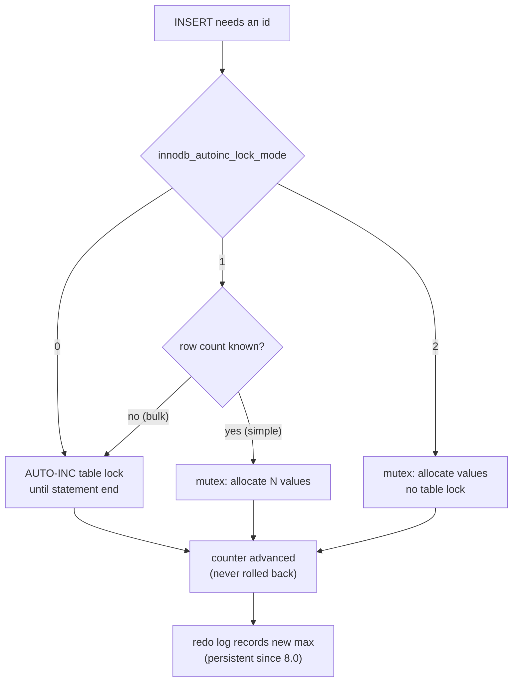

## Introduction

Most `INSERT` statements in a real application do not mention every column. A new support ticket is inserted with a subject and a customer; the database is expected to fill in the ticket number, the status `'open'`, the priority, the creation time and the due date. Two column properties make that possible:

- **`DEFAULT`** — the value a column receives when an `INSERT` does not supply one. It can be a literal (`'open'`), the current time (`CURRENT_TIMESTAMP`), or since MySQL 8.0.13 an arbitrary expression (`(CURRENT_DATE + INTERVAL 14 DAY)`, `(UUID_TO_BIN(UUID()))`).
- **`AUTO_INCREMENT`** — MySQL's mechanism for generating a new integer for each inserted row, almost always used for a **surrogate primary key**.

Both look trivial. Both carry engineering consequences that show up in production:

- Why does the `orders` table jump from order 1041 to 1043? (AUTO_INCREMENT values are **not transactional**, and gaps are normal.)
- After a restart, can a deleted order number be reused? (It could before MySQL 8.0; it cannot now.)
- How does the application learn the ID it just inserted, and what if it inserted ten rows at once? (`LAST_INSERT_ID()` returns the **first** generated value.)
- Why do the docs say a lock mode setting can break replication? (`innodb_autoinc_lock_mode` trades determinism for concurrency.)
- What happens when a `NOT NULL` column has no default and the INSERT omits it? (Error 1364 in strict mode — or a silently invented value without it.)

This lesson answers each of these with real executions. It assumes you can write a basic `CREATE TABLE` ([Creating, Altering and Dropping Tables](/lessons/m02-tables-ddl)); the full `INSERT` statement family is covered in [INSERT](/lessons/m03-insert).

:::note[Dataset and deterministic clocks]
The examples use the **shop** dataset plus small tables created in the lab. To make time-based defaults reproducible, several blocks pin the session clock with `SET SESSION timestamp = …` (a session variable that freezes `NOW()` and `CURRENT_TIMESTAMP` for your connection) and fix `time_zone`. Production code never does this; it is a teaching and testing technique.
:::

## DBMS Theory

:::theory[Defaults and generated keys in the relational model]
A **default** is part of a column's definition: it maps "no value supplied" to a value from the column's domain. In standard SQL the `<default clause>` may be a literal, a datetime value function (`CURRENT_DATE`, `CURRENT_TIMESTAMP`), a user function (`CURRENT_USER`) or `NULL`. A default is applied **only on insert** and only when the column is omitted or the keyword `DEFAULT` is written; it never overrides an explicit value, including an explicit NULL.

A **surrogate key** is an identifier with no business meaning, created by the system solely to identify a row (see [Keys](/lessons/m01-keys)). The relational model requires only that a key be **unique and stable**. It does not require keys to be consecutive, gap-free, or ordered by time. Systems exploit that freedom: they generate surrogate keys with a **sequence generator** that hands out increasing numbers *outside* transaction control, so that concurrent inserters never wait for each other's commits.
:::

The SQL:2003 standard defines two sequence-generator features: **identity columns** (`id INT GENERATED ALWAYS AS IDENTITY`) and **sequence objects** (`CREATE SEQUENCE`, `NEXT VALUE FOR seq`). PostgreSQL, Oracle and SQL Server implement them. **MySQL implements neither**; its equivalent is the column attribute `AUTO_INCREMENT`, a MySQL extension. (MariaDB, a MySQL fork, added `CREATE SEQUENCE` in 10.3.)

Why must a sequence generator be non-transactional? Suppose it were transactional: transaction T1 takes value 101 and has not committed; T2 wants the next value. If T1 might roll back and "return" 101, T2 cannot know whether to take 101 or 102 until T1 finishes — every inserter would serialize behind every other one. By making allocation **permanent the moment it happens**, the generator lets T2 take 102 immediately. The cost is that a rolled-back T1 leaves a **gap**. Every serious database makes this trade, and so gaps are a property of the design, not a defect.

Three formal consequences:

1. **Uniqueness is guaranteed** (when the column is a key), **density is not.** `MAX(id)` is not the row count.
2. **Allocation order is not commit order.** T1 can take 101, T2 can take 102 and commit first. A reader polling `WHERE id > last_seen_id` can therefore miss row 101 if it reads after T2 commits but before T1 commits — a classic bug in change-feed code.
3. **A default is a function of the insert, not of the row.** `CURRENT_TIMESTAMP` evaluates when the statement runs, and every row inserted by one statement receives the same value.

## Why It Exists

**Without defaults**, every application path that inserts into a table must know and repeat every column's "initial" value. When the business changes the initial ticket priority from 3 to 2, every code path must change — and the one that is forgotten creates inconsistent data. A default puts the rule in one place, next to the data. Defaults also make schema evolution possible: `ALTER TABLE … ADD COLUMN status … NOT NULL DEFAULT 'active'` gives every existing row a valid value in one step.

**Without AUTO_INCREMENT**, applications generate keys themselves, usually with the anti-pattern

```sql
SELECT MAX(id) + 1 FROM tickets;   -- then INSERT with that id
```

Two sessions running this at the same time read the same `MAX(id)` and both try to insert the same key: one fails with a duplicate-key error, or — if there is no unique constraint — the data is corrupted. Making it safe requires locking (`SELECT … FOR UPDATE` on the last row or a counter table), which **serializes all inserts** on that table. A built-in generator solves the problem with a short in-memory critical section instead of a transaction-long lock.

Alternatives exist — UUIDs generated by the application, time-ordered IDs such as Snowflake or ULID — and you will compare them under Alternative Approaches. AUTO_INCREMENT remains the default choice for single-primary MySQL because it is compact (4 or 8 bytes), monotonic (good for the clustered index) and free of coordination.

## Internal Working

:::internals[Where defaults live and how InnoDB allocates AUTO_INCREMENT values]
**Defaults.** Since MySQL 8.0 the **data dictionary** (InnoDB tables in the `mysql` schema) stores each column's default. A literal default is stored as a value; an expression default (`DEFAULT (expr)`) is stored as expression text and evaluated **for each row** at insert time. When `ALTER TABLE … ADD COLUMN` uses a literal default, InnoDB can add the column with `ALGORITHM=INSTANT`: the default is recorded in the dictionary and existing rows report it on read without being rewritten. An expression default cannot be added instantly (the expression would have to be evaluated per existing row).

**The AUTO_INCREMENT counter.** InnoDB keeps one counter per table in memory, protected by a lightweight mutex. Allocating a value means: take the mutex, read the counter, advance it, release the mutex. The allocation is never undone, even if the inserting statement or transaction later fails.

**Persistence (8.0 and later).** Each time the counter changes, InnoDB writes the new maximum to the **redo log**, and at each checkpoint saves it to the data dictionary. After a restart (normal or crash), the counter resumes from the persisted value. **Before 8.0**, the counter existed only in memory; on the first access after a restart InnoDB re-initialized it with the equivalent of `SELECT MAX(id) FROM t` — so if the highest rows had been deleted, their IDs were **handed out again**.

**Insert classes.** InnoDB distinguishes *simple inserts* (row count known in advance: single- and multi-row `INSERT … VALUES`), *bulk inserts* (row count unknown: `INSERT … SELECT`, `LOAD DATA`) and *mixed-mode inserts* (some rows specify the ID explicitly, or `INSERT … ON DUPLICATE KEY UPDATE`). How these are protected depends on `innodb_autoinc_lock_mode`.
:::

| `innodb_autoinc_lock_mode` | Name | Simple inserts | Bulk inserts | Values within one statement | Statement-based replication |
|---|---|---|---|---|---|
| `0` | traditional | table-level **AUTO-INC lock** held until the statement ends | AUTO-INC lock until statement end | consecutive | safe |
| `1` | consecutive (default before 8.0) | mutex only while allocating | AUTO-INC lock until statement end | consecutive | safe |
| `2` | interleaved (**default since 8.0**) | mutex only while allocating | mutex only; **no** table-level lock | may interleave with concurrent statements | **unsafe** for bulk inserts — use row-based logging |

The AUTO-INC lock is a special table-level lock (not a transaction lock: it is released at the end of the *statement*). In modes 0 and 1 it guarantees that an `INSERT … SELECT` gets one consecutive block of values, so that replaying the same statement on a replica produces the same IDs. Mode 2 removes the lock for maximal concurrency; then two concurrent `INSERT … SELECT` statements can receive interleaved values (one gets 1, 3, 5…, the other 2, 4, 6…). A replica replaying those statements one after the other would assign *different* IDs. That is why mode 2 became the default only in 8.0, when **row-based binary logging** (which ships the actual row values, IDs included) had become the default.



**Over-reservation for bulk inserts.** When the number of rows is unknown, the server asks InnoDB for values in growing batches (1, then 2, then 4, …). Values reserved but not used at the end of the statement are discarded — a source of gaps you will observe below.

## MySQL Implementation

### Defaults

Create a ticket table that uses each kind of default:

```sql run
SET SESSION time_zone = '+00:00';
SET SESSION timestamp = UNIX_TIMESTAMP('2024-06-01 09:30:00');   -- freeze the clock for reproducible output
CREATE TABLE support_tickets (
  ticket_id   INT UNSIGNED NOT NULL AUTO_INCREMENT PRIMARY KEY,
  customer_id INT UNSIGNED NOT NULL,
  subject     VARCHAR(120) NOT NULL,
  status      VARCHAR(12)  NOT NULL DEFAULT 'open',                         -- literal
  priority    TINYINT      NOT NULL DEFAULT 3,                              -- literal
  tags        JSON         NOT NULL DEFAULT (JSON_ARRAY()),                 -- expression (8.0.13+)
  created_at  DATETIME     NOT NULL DEFAULT CURRENT_TIMESTAMP,              -- current time
  updated_at  TIMESTAMP    NOT NULL DEFAULT CURRENT_TIMESTAMP
                                    ON UPDATE CURRENT_TIMESTAMP,            -- auto-update
  due_date    DATE         NOT NULL DEFAULT (CURRENT_DATE + INTERVAL 14 DAY),
  closed_at   DATETIME     NULL                                             -- implicit DEFAULT NULL
);
INSERT INTO support_tickets (customer_id, subject) VALUES (7, 'Wrong item delivered');
SELECT * FROM support_tickets;
```

Only two columns were supplied; the database filled in the other eight. Expression defaults must be written **in parentheses**; `CURRENT_TIMESTAMP` (and its synonyms `NOW()`, `LOCALTIME`, `LOCALTIMESTAMP`) is the one function allowed without parentheses, for `DATETIME` and `TIMESTAMP` columns.

You can request a default explicitly with the keyword `DEFAULT`, read a column's default with the `DEFAULT(col)` function, and an explicit `NULL` is **not** the same as omitting the column:

```sql run
INSERT INTO support_tickets (customer_id, subject, priority) VALUES (12, 'Refund status', DEFAULT);
SELECT ticket_id, priority, DEFAULT(priority) AS priority_default, DEFAULT(status) AS status_default
FROM support_tickets ORDER BY ticket_id;
```

The data dictionary shows how MySQL stored each default. `DEFAULT_GENERATED` in `EXTRA` marks defaults that are computed rather than literal:

```sql run
SELECT COLUMN_NAME, COLUMN_DEFAULT, IS_NULLABLE, EXTRA
FROM information_schema.COLUMNS
WHERE TABLE_SCHEMA = DATABASE() AND TABLE_NAME = 'support_tickets'
ORDER BY ORDINAL_POSITION;
```

### ON UPDATE CURRENT_TIMESTAMP

`updated_at` changes automatically when the row is updated — but only if some column **actually changes value**. Move the session clock forward and watch:

```sql run
SET SESSION timestamp = UNIX_TIMESTAMP('2024-06-01 10:00:00');
UPDATE support_tickets SET status = 'open' WHERE ticket_id = 1;          -- same value: no change
SELECT ticket_id, status, created_at, updated_at FROM support_tickets WHERE ticket_id = 1;
UPDATE support_tickets SET status = 'pending' WHERE ticket_id = 1;       -- real change
SELECT ticket_id, status, created_at, updated_at FROM support_tickets WHERE ticket_id = 1;
SET SESSION timestamp = DEFAULT;                                          -- unfreeze the clock
```

The first `UPDATE` matched one row but changed nothing (its affected-rows count is 0), so `updated_at` kept 09:30. The second changed `status`, and `updated_at` became 10:00, while `created_at` (no `ON UPDATE`) never moves.

### AUTO_INCREMENT basics

The shop dataset's tables use AUTO_INCREMENT keys. `SHOW CREATE TABLE` displays the counter's next value as the `AUTO_INCREMENT=` table option:

```sql run
SHOW CREATE TABLE customers;
```

Insert a customer without an ID and ask for the generated value:

```sql run
INSERT INTO customers (first_name, last_name, email, city, state, signup_date)
VALUES ('Mei', 'Tanaka', 'mei.tanaka@example.com', 'San Jose', 'CA', '2024-12-30');
SELECT LAST_INSERT_ID() AS new_customer_id;
```

`LAST_INSERT_ID()` returns the value generated **for this connection** by its most recent successful `INSERT`. Other sessions inserting at the same time do not affect it, so it is safe under concurrency — unlike `SELECT MAX(customer_id)`.

## Syntax Breakdown

| Clause / function | Meaning |
|---|---|
| `DEFAULT literal` | Constant default: `DEFAULT 'open'`, `DEFAULT 0`, `DEFAULT NULL`. |
| `DEFAULT (expr)` | Expression default (8.0.13+). May use built-in functions and operators, including non-deterministic ones (`UUID()`, `RAND()`); may not use subqueries, stored functions, variables, or refer to an `AUTO_INCREMENT` column. Required for `BLOB`, `TEXT`, `JSON` and geometry columns, which cannot take literal defaults. |
| `DEFAULT CURRENT_TIMESTAMP[(fsp)]` | Current date and time at insert, for `DATETIME`/`TIMESTAMP`. The fractional precision must match the column (`TIMESTAMP(3) DEFAULT CURRENT_TIMESTAMP(3)`). |
| `ON UPDATE CURRENT_TIMESTAMP[(fsp)]` | Set to the current time when an `UPDATE` changes any other column of the row. MySQL extension. |
| `INSERT … VALUES (DEFAULT)` / `INSERT … VALUES ()` | Use the default for a column / for every column. |
| `DEFAULT(col)` | Function returning the column's default value (error if the column has none). |
| `col INT AUTO_INCREMENT` | Generate a value when the inserted value is omitted, `NULL` or `0` (unless `NO_AUTO_VALUE_ON_ZERO` is set). Only one per table; it must be indexed (normally the primary key); integer types only (floating-point AUTO_INCREMENT is deprecated). |
| `AUTO_INCREMENT = N` (table option) | Set the next value in `CREATE TABLE` / `ALTER TABLE`. InnoDB never sets it below `MAX(col) + 1`. |
| `LAST_INSERT_ID()` | First value generated by this connection's most recent successful INSERT that generated one. |
| `LAST_INSERT_ID(expr)` | Returns `expr` and remembers it as the next `LAST_INSERT_ID()` value — used to emulate sequences. |
| `auto_increment_increment`, `auto_increment_offset` | Step and start of generated values (session or global). Used by multi-primary topologies so that servers never generate the same value. |
| `innodb_autoinc_lock_mode` | 0, 1 or 2 (default 2). Read-only at runtime — set in the option file, takes effect at startup. |

:::version[8.0 vs 8.4]
Everything in this lesson behaves the same in MySQL 8.0 (≥ 8.0.13 for expression defaults) and 8.4 LTS. Relevant history: the counter became persistent in **8.0.0**; the default `innodb_autoinc_lock_mode` changed from 1 to 2 in **8.0**; `explicit_defaults_for_timestamp` is `ON` by default since 8.0.2, so `TIMESTAMP` columns no longer receive `DEFAULT CURRENT_TIMESTAMP ON UPDATE CURRENT_TIMESTAMP` implicitly — you must write it, as above. The `binlog_format` variable is deprecated since 8.0.34; row-based logging is the default and the expected setting with lock mode 2.
:::

## Practical Examples

All AUTO_INCREMENT experiments use a small table so the IDs are easy to follow:

```sql run
CREATE TABLE coupons (
  coupon_id INT UNSIGNED NOT NULL AUTO_INCREMENT PRIMARY KEY,
  code      VARCHAR(20)  NOT NULL UNIQUE,
  pct       TINYINT      NOT NULL DEFAULT 10
);
INSERT INTO coupons (code) VALUES ('SPRING15');
SELECT * FROM coupons;
```

**1. Multi-row INSERT and LAST_INSERT_ID.** A three-row insert gets three consecutive values (a simple insert, so the count is known in advance). `LAST_INSERT_ID()` returns the **first** of them, not the last:

```sql run
INSERT INTO coupons (code) VALUES ('VIP20'), ('WELCOME10'), ('SUMMER5');
SELECT LAST_INSERT_ID() AS first_generated, ROW_COUNT() AS rows_inserted;
SELECT * FROM coupons ORDER BY coupon_id;
```

The IDs of the batch are `LAST_INSERT_ID()` through `LAST_INSERT_ID() + ROW_COUNT() - 1` — valid here because simple inserts receive consecutive values in every lock mode.

**2. A rolled-back transaction leaves a gap.**

```sql run
START TRANSACTION;
INSERT INTO coupons (code) VALUES ('FLASH50');
SELECT LAST_INSERT_ID() AS id_taken_inside_transaction;
ROLLBACK;
INSERT INTO coupons (code) VALUES ('AUTUMN10');
SELECT * FROM coupons ORDER BY coupon_id;
```

The rollback removed the row, but not the allocation: the value it used is gone for good and `AUTUMN10` received the next one.

**3. A failed INSERT also consumes a value.** A duplicate `code` is rejected by the UNIQUE index — *after* InnoDB has allocated an ID for the row:

```sql run error
INSERT INTO coupons (code) VALUES ('VIP20');
```

```sql run
INSERT INTO coupons (code) VALUES ('WINTER25');
SELECT * FROM coupons ORDER BY coupon_id;
```

**4. INSERT IGNORE and upserts consume values too.** `INSERT IGNORE` turns the duplicate-key error into a warning, and `INSERT … ON DUPLICATE KEY UPDATE` that ends up updating an existing row has still allocated an ID:

```sql run
INSERT IGNORE INTO coupons (code) VALUES ('VIP20');
INSERT INTO coupons (code, pct) VALUES ('SPRING15', 15) AS new ON DUPLICATE KEY UPDATE pct = new.pct;
INSERT INTO coupons (code) VALUES ('NEWYEAR30');
SELECT * FROM coupons ORDER BY coupon_id;
```

**5. Bulk inserts over-reserve.** `INSERT … SELECT` does not know how many rows it will insert, so values are reserved in growing batches; unused reservations are discarded at the end of the statement:

```sql run
CREATE TABLE coupon_archive (
  archive_id INT UNSIGNED NOT NULL AUTO_INCREMENT PRIMARY KEY,
  code       VARCHAR(20)  NOT NULL
);
INSERT INTO coupon_archive (code) SELECT code FROM coupons ORDER BY coupon_id LIMIT 5;
INSERT INTO coupon_archive (code) VALUES ('MANUAL');
SELECT * FROM coupon_archive ORDER BY archive_id;
```

Five rows were copied, but the next single-row insert did not get 6: the batches reserved more values than the statement used.

**6. Explicit values move the counter forward — and deletions never move it back.**

```sql run
INSERT INTO coupons (coupon_id, code) VALUES (100, 'EXPLICIT');   -- explicit id above the counter
INSERT INTO coupons (code) VALUES ('AFTER_EXPLICIT');            -- continues from 101
DELETE FROM coupons WHERE coupon_id >= 100;                       -- remove the top rows
INSERT INTO coupons (code) VALUES ('AFTER_DELETE');               -- 100 and 101 are not reused
SELECT coupon_id, code FROM coupons WHERE coupon_id >= 50 ORDER BY coupon_id;
```

In MySQL 5.7, a **server restart** at this point would have reset the counter to `MAX(coupon_id) + 1` and reused the deleted IDs. Since 8.0 the counter is persisted and survives restarts, so a deleted ID is never handed out again (unless you reset the counter yourself).

**7. Updating the key also moves the counter (8.0+).** If an `UPDATE` sets an AUTO_INCREMENT column to a value larger than the counter, InnoDB advances the counter (and persists it). In 5.7 the counter did not move, and a later insert failed with a duplicate key when it reached the updated value:

```sql run
UPDATE coupons SET coupon_id = 500 WHERE code = 'AFTER_DELETE';
INSERT INTO coupons (code) VALUES ('AFTER_UPDATE');
SELECT coupon_id, code FROM coupons WHERE coupon_id >= 100 ORDER BY coupon_id;
```

**8. Resetting the counter.** `TRUNCATE TABLE` (a DDL operation that recreates the table) resets the counter to 1. `ALTER TABLE … AUTO_INCREMENT = N` sets it, but InnoDB silently raises any value below `MAX(col) + 1`:

```sql run
ALTER TABLE coupon_archive AUTO_INCREMENT = 2;     -- too low: InnoDB uses MAX(archive_id) + 1 instead
INSERT INTO coupon_archive (code) VALUES ('AFTER_ALTER');
SELECT * FROM coupon_archive WHERE code IN ('MANUAL', 'AFTER_ALTER') ORDER BY archive_id;
TRUNCATE TABLE coupon_archive;
INSERT INTO coupon_archive (code) VALUES ('AFTER_TRUNCATE');
SELECT * FROM coupon_archive;
```

**9. Step and offset.** `auto_increment_increment` and `auto_increment_offset` change the arithmetic of generation — in this session only, here:

```sql run
SET SESSION auto_increment_increment = 10, auto_increment_offset = 3;
CREATE TABLE region_events (event_id INT UNSIGNED AUTO_INCREMENT PRIMARY KEY, note VARCHAR(20));
INSERT INTO region_events (note) VALUES ('a'), ('b'), ('c');
SELECT * FROM region_events ORDER BY event_id;
SET SESSION auto_increment_increment = DEFAULT, auto_increment_offset = DEFAULT;
```

With step 10 and offset 3, this server generates only IDs ending in 3. A second server configured with offset 4 would generate IDs ending in 4, and the two can never collide. MySQL Group Replication in multi-primary mode applies the same idea automatically.

**10. Where to read the counter — and a stale-statistics trap.** `information_schema.TABLES.AUTO_INCREMENT` is served from cached table statistics, which by default may be up to a day old (`information_schema_stats_expiry = 86400` seconds). Ask for fresh values in your session when you need them:

```sql run
SELECT AUTO_INCREMENT AS first_read
FROM information_schema.TABLES WHERE TABLE_SCHEMA = DATABASE() AND TABLE_NAME = 'region_events';
INSERT INTO region_events (note) VALUES ('d');
SELECT AUTO_INCREMENT AS after_insert_cached
FROM information_schema.TABLES WHERE TABLE_SCHEMA = DATABASE() AND TABLE_NAME = 'region_events';
SET SESSION information_schema_stats_expiry = 0;
SELECT AUTO_INCREMENT AS after_insert_fresh
FROM information_schema.TABLES WHERE TABLE_SCHEMA = DATABASE() AND TABLE_NAME = 'region_events';
```

The second read returned the same number as the first even though a row had been inserted in between: it came from the statistics cache filled by the first read. Only after disabling the cache for the session does the dictionary report the real next value. `SHOW CREATE TABLE` always shows the live counter.

## Execution Walkthrough

Two sessions insert into the same table at the same time. Session A's transaction will roll back. Watch that B is **not blocked** by A's uncommitted insert, that each session's `LAST_INSERT_ID()` is private, and how the gap appears.

```concurrency
title: Concurrent inserts, a rollback and the resulting gap
description: Session A inserts inside a transaction and later rolls back; session B inserts with autocommit in between.
setup: |
  CREATE TABLE web_orders (
    order_id INT UNSIGNED NOT NULL AUTO_INCREMENT PRIMARY KEY,
    channel  VARCHAR(10) NOT NULL
  );
  INSERT INTO web_orders (channel) VALUES ('web'), ('web');
steps:
  - session: A
    sql: START TRANSACTION; INSERT INTO web_orders (channel) VALUES ('app'); SELECT LAST_INSERT_ID() AS a_id;
    note: A's insert is allocated the next value immediately. The row is uncommitted and invisible to others, but the value is already consumed.
  - session: B
    sql: INSERT INTO web_orders (channel) VALUES ('web'); SELECT LAST_INSERT_ID() AS b_id;
    note: B is not blocked. In lock mode 2 (and 1) a simple insert holds the AUTO_INCREMENT mutex only while allocating, and InnoDB row locks on A's new row do not affect B's different row. B gets the value after A's.
  - session: A
    sql: SELECT LAST_INSERT_ID() AS a_id_again;
    note: LAST_INSERT_ID() is per connection. B's insert did not change A's value.
  - session: A
    sql: ROLLBACK;
    note: A's row disappears. Its AUTO_INCREMENT value is not returned to the counter.
  - session: B
    sql: SELECT * FROM web_orders ORDER BY order_id;
    note: The committed rows show the gap left by A. This is normal and harmless for a surrogate key.
```

**What the steps show, in sequence.**

1. **Allocation happens at insert time, not at commit.** A's ID was assigned while its transaction was still open.
2. **Allocation does not wait for transactions.** B inserted while A held an uncommitted row; with transactional allocation B would have had to wait for A's outcome.
3. **Allocation order ≠ commit order.** B committed before A finished, but holds the larger ID. Had A committed, a consumer that remembered "the last ID I processed" after reading B's row would skip A's row.
4. **Rollback cannot return the value**, because a later value (B's) has already been handed out; reusing A's value would also break the "monotonically increasing" property for anyone who saw it.

**The persistence story, which the sandbox cannot run** (restarting the server is an administrative action). In a terminal on your own server:

```sql
CREATE TABLE t (id INT AUTO_INCREMENT PRIMARY KEY, v INT);
INSERT INTO t (v) VALUES (1), (2), (3);   -- ids 1, 2, 3
DELETE FROM t WHERE id = 3;
-- restart mysqld (e.g. sudo systemctl restart mysql)
INSERT INTO t (v) VALUES (4);
SELECT id FROM t;                        -- MySQL 8.0/8.4: 1, 2, 4    MySQL 5.7: 1, 2, 3 (id 3 reused)
```

The 5.7 behaviour was a long-standing problem: an ID that had been referenced elsewhere (in an archive, a log, a cache or an external system) could suddenly identify a *different* row.

The lock mode is a server setting. You can read it from the sandbox, but changing it requires editing the option file and restarting:

```sql run
SELECT @@innodb_autoinc_lock_mode AS autoinc_lock_mode;
```

```sql
# my.cnf — only if you replicate with binlog_format=STATEMENT and need deterministic bulk-insert IDs
[mysqld]
innodb_autoinc_lock_mode = 1
```

## Output

After all the experiments, the `coupons` table is a compact record of every gap mechanism:

```sql run
SELECT coupon_id, code, pct FROM coupons ORDER BY coupon_id;
```

How to read it, from top to bottom: consecutive IDs from the single- and multi-row inserts; a hole where the rolled-back `FLASH50` was; a hole where the duplicate `VIP20` failed; two more holes consumed by `INSERT IGNORE` and by the upsert that updated `SPRING15` (whose `pct` is now 15); IDs 100–102 are gone (the explicit row and its successor were deleted, and the row that received 102 was later moved to 500 by the `UPDATE`), and `AFTER_UPDATE` continued from 501. None of these gaps indicates lost data — every committed row is present. Compare `MAX(coupon_id)` with `COUNT(*)`:

```sql run
SELECT COUNT(*) AS rows_present, MAX(coupon_id) AS highest_id, MAX(coupon_id) - COUNT(*) AS ids_not_in_table
FROM coupons;
```

## Alternative Approaches

| Approach | How | Strengths | Weaknesses |
|---|---|---|---|
| `AUTO_INCREMENT` `INT UNSIGNED` / `BIGINT UNSIGNED` | Database generates | 4–8 bytes; monotonic (appends to the clustered index); no coordination | Single-writer friendly; reveals volume (order #1043 tells competitors your order count); not unique across databases |
| UUID v4 in `BINARY(16)` | Application or `UUID_TO_BIN(UUID())` | Globally unique; generated anywhere (offline, client-side) | 16 bytes in every secondary index; random insert positions fragment the clustered index (see [JSON and Binary Data Types](/lessons/m02-json-binary-types)) |
| Time-ordered UUID (`UUID_TO_BIN(UUID(), 1)`, UUIDv7, ULID) | Application or expression default | Globally unique **and** roughly monotonic | 16 bytes; clock dependence |
| Snowflake-style 64-bit IDs | ID service (timestamp + worker id + sequence) | Fits `BIGINT`; roughly time-ordered; unique across shards | Needs a generator service and clock discipline |
| Sequence table + `LAST_INSERT_ID(expr)` | `UPDATE seq SET id = LAST_INSERT_ID(id + 1); SELECT LAST_INSERT_ID();` | One counter shared by several tables; allocation of blocks | A single hot row; extra round trip |
| Natural key | Business identifier (`sku`, ISO code) | No extra column | Business identifiers change and are often wide |

The sequence-table idiom shows the `LAST_INSERT_ID(expr)` form in action:

```sql run
CREATE TABLE invoice_number_seq (id BIGINT UNSIGNED NOT NULL);
INSERT INTO invoice_number_seq VALUES (2024000);
UPDATE invoice_number_seq SET id = LAST_INSERT_ID(id + 1);
SELECT LAST_INSERT_ID() AS next_invoice_number;
```

For **defaults**, the alternatives are setting the value in the application (flexible, but duplicated across code paths and bypassed by ad-hoc SQL), or a `BEFORE INSERT` trigger (can compute values from other columns or tables, at the cost of hidden logic and per-row overhead — see the triggers lesson in Module 9). A declarative `DEFAULT` is the simplest choice whenever the value does not depend on other rows.

## Performance Analysis

- **AUTO_INCREMENT and the clustered index.** InnoDB stores rows in primary-key order ([Clustered and Secondary Indexes](/lessons/m07-clustered-secondary)). Monotonic keys always insert at the right-most leaf page; InnoDB detects the sequential pattern and fills pages nearly completely before allocating the next one. Random keys (UUIDv4) insert all over the tree, causing page splits, half-empty pages and a larger working set that no longer fits in the buffer pool. This is the main performance reason AUTO_INCREMENT is the default surrogate key in MySQL.
- **Hot spot at the right edge.** The flip side: at very high insert concurrency all inserters contend for the same last page. This becomes visible only at thousands of inserts per second per table; it is why some very high-throughput systems deliberately spread inserts.
- **Lock mode and concurrency.** In modes 0 and 1, a long `INSERT … SELECT` holds the table-level AUTO-INC lock for its whole duration and blocks every other insert into that table. Mode 2 eliminates that wait. With row-based replication (the default) there is no reason to use another mode.
- **Counter exhaustion is a capacity problem, not a performance one.** A signed `INT` stops at 2,147,483,647, `INT UNSIGNED` at 4,294,967,295. At a sustained 1,000 inserts per second, a signed `INT` lasts about 25 days, an unsigned one about 50 days; `BIGINT UNSIGNED` (18,446,744,073,709,551,615) lasts effectively forever. Gaps (rollbacks, upserts, bulk over-reservation) consume the range faster than the row count suggests.
- **Expression defaults** cost one expression evaluation per inserted row — negligible for `CURRENT_DATE + INTERVAL 14 DAY`, measurable for heavy functions on bulk loads. Literal defaults cost nothing at insert time and allow `ALGORITHM=INSTANT` when adding columns to large tables.

:::performance[Theory vs measurement]
The statements above follow from how InnoDB stores and allocates; they are not benchmark numbers. On the tables in this lesson everything is instantaneous. To compare AUTO_INCREMENT and random UUID keys on your own hardware, load a few million rows of each into otherwise identical tables and compare insert throughput and `DATA_LENGTH`/`INDEX_LENGTH` in `information_schema.TABLES`.
:::

## Best Practices

:::best-practice[Defaults and generated keys]
1. **Use `BIGINT UNSIGNED AUTO_INCREMENT`** for tables that can grow without bound (orders, events, logs); `INT UNSIGNED` is fine for bounded reference data. Changing the key type of a large table later is a painful, table-rebuilding migration.
2. **Never assign meaning to AUTO_INCREMENT values.** Do not expect them to be gap-free, to equal row numbers, or to reflect commit order. If the business needs gap-free invoice numbers, generate them in a separate, serialized step at the moment of finalization.
3. **Get the new ID with `LAST_INSERT_ID()`** (or your driver's equivalent, such as `cursor.lastrowid`, which reads the same value from the protocol), never with `SELECT MAX(id)`.
4. **For multi-row inserts, remember `LAST_INSERT_ID()` is the first ID.** Compute the range only for simple inserts; for `INSERT … SELECT` re-read the rows by a natural key.
5. **Keep `innodb_autoinc_lock_mode = 2` with row-based replication**, the 8.x defaults.
6. **Write `NOT NULL DEFAULT …` together** for columns with a natural initial value (`status`, `created_at`, counters); leave columns without a default when the application must supply a value, so strict mode catches omissions (error 1364).
7. **Prefer literal defaults on columns added to large tables** — they qualify for `ALGORITHM=INSTANT`.
8. **Monitor headroom**: alert when `AUTO_INCREMENT` passes, say, 70% of the column type's maximum.
9. **Do not expose sequential IDs in public URLs** if volume or enumeration matters; add a random public identifier column instead.
:::

## Common Mistakes

**Mistake 1 — omitting a NOT NULL column that has no default.** In strict mode (the default) the row is rejected:

```sql run error
INSERT INTO support_tickets (subject) VALUES ('No customer given');
```

Without strict mode MySQL invents an **implicit default** (`0`, `''`, or the "zero" date) and merely warns — data corruption disguised as success:

```sql run
SET SESSION sql_mode = '';
CREATE TABLE loose_tickets (id INT PRIMARY KEY, customer_id INT NOT NULL, subject VARCHAR(50) NOT NULL);
INSERT INTO loose_tickets (id) VALUES (1);
SELECT * FROM loose_tickets;
SET SESSION sql_mode = DEFAULT;
```

**Mistake 2 — expression defaults without parentheses.** Only `CURRENT_TIMESTAMP` and its synonyms may appear bare; any other function or expression must be parenthesized:

```sql run error
CREATE TABLE bad_default (due DATE DEFAULT CURRENT_DATE + INTERVAL 7 DAY);
```

MySQL reports a plain syntax error (1064), which can be puzzling the first time. The fix is `DEFAULT (CURRENT_DATE + INTERVAL 7 DAY)`.

**Mistake 3 — an expression default that refers to the AUTO_INCREMENT column.** The generated value is not known when defaults are evaluated:

```sql run error
CREATE TABLE bad_ref (id INT AUTO_INCREMENT PRIMARY KEY, code VARCHAR(20) DEFAULT (CONCAT('T-', id)));
```

Compute such values in the application after `LAST_INSERT_ID()`, or with a generated column / trigger.

**Mistake 4 — AUTO_INCREMENT on a non-key column.** The column must be indexed (normally as the primary key):

```sql run error
CREATE TABLE bad_ai (id INT AUTO_INCREMENT, name VARCHAR(20));
```

**Mistake 5 — choosing a type that runs out.** When the counter reaches the type's maximum, the next generated value is the same maximum, and the insert fails with a duplicate-key error:

```sql run
CREATE TABLE tiny_ids (id TINYINT AUTO_INCREMENT PRIMARY KEY, note VARCHAR(10));
INSERT INTO tiny_ids VALUES (127, 'max');
```

```sql run error
INSERT INTO tiny_ids (note) VALUES ('next');
```

**Mistake 6 — reading `LAST_INSERT_ID()` after an insert that supplied an explicit ID.** The function only reports *generated* values; an insert with an explicit ID leaves it unchanged, so code that always reads it may pick up an older value from the same connection:

```sql run
INSERT INTO coupons (code) VALUES ('GENERATED');
SELECT LAST_INSERT_ID() AS after_generated;
INSERT INTO coupons (coupon_id, code) VALUES (900, 'EXPLICIT_900');
SELECT LAST_INSERT_ID() AS after_explicit_insert;
```

Also note: if a statement fails, the manual states that `LAST_INSERT_ID()` is left undefined, and rolling back a transaction does not restore its previous value. Read it immediately after a successful insert.

## Industry Application

- **ORMs and drivers.** Hibernate (`GenerationType.IDENTITY`), Django, Rails ActiveRecord and SQLAlchemy all rely on the generated-ID value returned by MySQL's protocol after each insert — the same value `LAST_INSERT_ID()` returns. Because the ID is known only after the insert executes, ORMs cannot batch-insert parent rows and then children without a round trip, which is one reason high-volume services pre-allocate IDs (sequence tables, Snowflake).
- **Replication and multi-primary.** MySQL Group Replication in multi-primary mode sets `auto_increment_increment` to the group size setting (default 7) and `auto_increment_offset` to the server ID so members never generate the same key. Classic circular replication setups used offset/step manually for the same reason.
- **Capacity monitoring.** Operations teams track AUTO_INCREMENT headroom per table (via `information_schema.TABLES` with fresh statistics, or monitoring tools that do the same). Running out of `INT` on a busy table is a well-known class of outage: inserts start failing with duplicate-key errors and the fix requires a table rebuild to `BIGINT`.
- **Audit columns.** Nearly every production schema has `created_at … DEFAULT CURRENT_TIMESTAMP` and `updated_at … ON UPDATE CURRENT_TIMESTAMP`. Change-data pipelines that extract "rows changed since X" by `updated_at` must remember that a no-op update does not bump it and that bulk loads with explicit values bypass it.
- **Public identifiers.** Many APIs keep an internal AUTO_INCREMENT primary key for joins and add a separate random or time-ordered public ID, so that URLs do not leak business volume or allow enumeration.

## Practice Exercises

```exercise
id: ex1
title: Insert a ticket using the defaults
difficulty: easy
kind: dml
setup: |
  CREATE TABLE tickets (
    ticket_id   INT UNSIGNED NOT NULL AUTO_INCREMENT PRIMARY KEY,
    customer_id INT UNSIGNED NOT NULL,
    subject     VARCHAR(120) NOT NULL,
    status      VARCHAR(12)  NOT NULL DEFAULT 'open',
    priority    TINYINT      NOT NULL DEFAULT 3
  );
concepts: [default-values]
prompt: |
  The `tickets` table has been created for you. Insert **one** ticket for customer `4` with the subject
  `Missing invoice`, letting the database supply the ticket number, the status and the priority.
hints:
  - "List only the columns you are supplying after the table name."
  - "INSERT INTO tickets (customer_id, subject) VALUES (…, …);"
solution: |
  INSERT INTO tickets (customer_id, subject) VALUES (4, 'Missing invoice');
check: |
  SELECT ticket_id, customer_id, subject, status, priority FROM tickets ORDER BY ticket_id;
explanation: |
  Omitting `ticket_id`, `status` and `priority` makes MySQL generate the AUTO_INCREMENT value (1) and apply the
  defaults `'open'` and `3`. `INSERT INTO tickets VALUES (NULL, 4, 'Missing invoice', DEFAULT, DEFAULT)` is
  equivalent but more fragile, because it depends on the column order of the table.
```

```exercise
id: ex2
title: How many IDs were lost?
difficulty: medium
setup: |
  CREATE TABLE signups (
    signup_id INT UNSIGNED NOT NULL AUTO_INCREMENT PRIMARY KEY,
    email     VARCHAR(100) NOT NULL UNIQUE
  );
  INSERT INTO signups (email) VALUES ('a@example.com'), ('b@example.com');
  INSERT IGNORE INTO signups (email) VALUES ('a@example.com');
  INSERT INTO signups (email) VALUES ('c@example.com');
  START TRANSACTION;
  INSERT INTO signups (email) VALUES ('d@example.com');
  ROLLBACK;
  INSERT INTO signups (email) VALUES ('e@example.com');
concepts: [autoinc-gaps, auto-increment]
prompt: |
  The `signups` table was filled by a script that included an ignored duplicate and a rolled-back
  transaction. Return **one row** with three columns in this order:

  1. `rows_present` — number of rows in the table
  2. `highest_id` — the largest `signup_id`
  3. `missing_ids` — how many IDs between 1 and `highest_id` do not appear in the table
hints:
  - "IDs start at 1, so the number of possible IDs up to the maximum is MAX(signup_id)."
  - "missing = MAX(signup_id) − COUNT(*)."
solution: |
  SELECT COUNT(*) AS rows_present,
         MAX(signup_id) AS highest_id,
         MAX(signup_id) - COUNT(*) AS missing_ids
  FROM signups;
explanation: |
  The ignored duplicate and the rolled-back insert each consumed one AUTO_INCREMENT value, so the table holds
  four rows but the highest ID is 6. A common wrong assumption is that `MAX(id)` equals the row count — it
  does only if no insert ever failed, was ignored or rolled back, and nothing was deleted.
```

```exercise
id: ex3
title: Header and lines with LAST_INSERT_ID
difficulty: medium
kind: dml
setup: |
  CREATE TABLE purchase_orders (
    po_id     INT UNSIGNED NOT NULL AUTO_INCREMENT PRIMARY KEY,
    supplier  VARCHAR(40)  NOT NULL
  ) AUTO_INCREMENT = 5000;
  CREATE TABLE purchase_order_lines (
    po_id     INT UNSIGNED NOT NULL,
    line_no   TINYINT UNSIGNED NOT NULL,
    sku       VARCHAR(20)  NOT NULL,
    PRIMARY KEY (po_id, line_no),
    FOREIGN KEY (po_id) REFERENCES purchase_orders (po_id)
  );
  INSERT INTO purchase_orders (supplier) VALUES ('Acme Parts');
concepts: [last-insert-id, auto-increment]
prompt: |
  One purchase order already exists. Create a **new** purchase order for supplier `Globex`, then insert two
  lines for it: line 1 with SKU `LAP-14` and line 2 with SKU `MSE-01`. Do not hard-code the new `po_id` —
  obtain it from the database right after inserting the header.
hints:
  - "After the header INSERT, LAST_INSERT_ID() returns the generated po_id for your connection."
  - "You can use LAST_INSERT_ID() directly in the VALUES list of the next INSERT."
  - "A multi-row INSERT of the two lines does not change LAST_INSERT_ID(), because po_id is supplied explicitly there."
solution: |
  INSERT INTO purchase_orders (supplier) VALUES ('Globex');
  INSERT INTO purchase_order_lines (po_id, line_no, sku)
  VALUES (LAST_INSERT_ID(), 1, 'LAP-14'), (LAST_INSERT_ID(), 2, 'MSE-01');
check: |
  SELECT o.po_id, o.supplier, l.line_no, l.sku
  FROM purchase_orders AS o
  LEFT JOIN purchase_order_lines AS l ON l.po_id = o.po_id
  ORDER BY o.po_id, l.line_no;
explanation: |
  The header receives 5001 because the table started at 5000 and one order exists. Storing the value in a
  variable (`SET @po = LAST_INSERT_ID();`) is equally correct and clearer when more statements follow.
  `SELECT MAX(po_id)` would work in this single-user lab but is wrong under concurrency: another session may
  insert an order between your two statements.
```

```exercise
id: ex4
title: Add audit timestamps to an existing table
difficulty: hard
kind: dml
setup: |
  CREATE TABLE suppliers (
    supplier_id INT UNSIGNED NOT NULL AUTO_INCREMENT PRIMARY KEY,
    name        VARCHAR(60)  NOT NULL
  );
  INSERT INTO suppliers (name) VALUES ('Acme Parts'), ('Globex');
concepts: [current-timestamp, default-values]
prompt: |
  Add two columns to `suppliers`:

  - `created_at DATETIME`, not nullable, defaulting to the current date and time at insert;
  - `updated_at DATETIME`, not nullable, defaulting to the current date and time **and** refreshed
    automatically whenever the row is updated.

  The existing rows must receive values automatically. (The grader compares the column definitions as
  reported by `information_schema.COLUMNS`.)
hints:
  - "ALTER TABLE … ADD COLUMN can add several columns separated by commas."
  - "Use DEFAULT CURRENT_TIMESTAMP, and for updated_at add ON UPDATE CURRENT_TIMESTAMP."
solution: |
  ALTER TABLE suppliers
    ADD COLUMN created_at DATETIME NOT NULL DEFAULT CURRENT_TIMESTAMP,
    ADD COLUMN updated_at DATETIME NOT NULL DEFAULT CURRENT_TIMESTAMP ON UPDATE CURRENT_TIMESTAMP;
check: |
  SELECT COLUMN_NAME, DATA_TYPE, IS_NULLABLE, COLUMN_DEFAULT, EXTRA
  FROM information_schema.COLUMNS
  WHERE TABLE_SCHEMA = DATABASE() AND TABLE_NAME = 'suppliers'
  ORDER BY ORDINAL_POSITION;
explanation: |
  Because the columns are `NOT NULL` with a default, the existing two rows are filled with the time of the
  `ALTER`. `NOW()` is accepted as a synonym and stored as `CURRENT_TIMESTAMP`. Forgetting `NOT NULL` leaves
  the columns nullable, and forgetting `ON UPDATE` gives an `updated_at` that never changes. Since
  `explicit_defaults_for_timestamp` is ON, even a `TIMESTAMP` column would not get these properties unless
  you write them.
```

```exercise
id: ex5
title: Lock mode, replication and a gap-free requirement
difficulty: challenge
kind: open
concepts: [autoinc-lock-mode, autoinc-gaps, surrogate-keys]
prompt: |
  (a) Explain why `innodb_autoinc_lock_mode = 2` can produce different AUTO_INCREMENT values on a replica than
  on the source when the binary log format is STATEMENT, and why it is safe with ROW.
  (b) The finance team demands invoice numbers with **no gaps**. Explain why `AUTO_INCREMENT` cannot
  guarantee that, and sketch a design that can, including its concurrency cost.
solution: |
  **(a)** In mode 2 InnoDB takes no table-level AUTO-INC lock for bulk inserts (`INSERT … SELECT`,
  `LOAD DATA`). Two such statements running concurrently on the source draw values from the counter in
  interleaved fashion, so each statement's rows receive a non-consecutive set of IDs whose exact pattern depends
  on thread timing. With statement-based logging the replica re-executes the *statements* one after another;
  each now receives a consecutive block, so the IDs differ from the source's — replica data silently diverges,
  and later statements referencing those IDs affect different rows. With row-based logging the binary log
  contains the actual row images, including the IDs generated on the source, and the replica simply applies
  them; generation is not repeated, so timing cannot matter.

  **(b)** AUTO_INCREMENT values are allocated outside transaction control: rollbacks, failed or ignored
  inserts, upserts and bulk over-reservation all consume values permanently, and allocation order differs from
  commit order. A gap-free design must allocate the number *inside* the same transaction that creates the
  invoice: keep a counter row (`invoice_counter(last_no)`), and in the transaction run
  `SELECT last_no FROM invoice_counter FOR UPDATE`, insert the invoice with `last_no + 1`, update the counter,
  commit. A rollback undoes both the invoice and the counter increment, so no number is lost. The cost is that
  the counter row is exclusively locked until commit, so invoice creation is serialized: throughput is bounded by
  one transaction at a time. That is acceptable for finalizing invoices (often done in a batch step), not for
  every order insert — keep AUTO_INCREMENT for the surrogate key and assign the legal invoice number separately.
```

## Knowledge Assessment

```quiz
- id: q1
  question: "A table's AUTO_INCREMENT key has values 1–10. A transaction inserts a row (gets 11) and rolls back. Another session then inserts a row. Which ID does it get in MySQL 8.4?"
  options: ["11", "12", "10", "It depends on whether the first transaction is still open"]
  answer: 1
  explanation: "AUTO_INCREMENT allocation is not transactional: once 11 is handed out it is never returned, even after the rollback. Reusing 11 would require waiting for transaction outcomes, which is exactly what sequence generators avoid. The outcome does not depend on timing once the rollback has happened."
  concepts: [autoinc-gaps, auto-increment]
- id: q2
  question: "`INSERT INTO t (name) VALUES ('a'), ('b'), ('c');` generates IDs 41, 42, 43. What does `SELECT LAST_INSERT_ID();` return right afterwards in the same session?"
  options: ["43", "41", "3", "NULL"]
  answer: 1
  explanation: "For a multi-row INSERT, LAST_INSERT_ID() returns the first generated value. 3 is ROW_COUNT(), and 43 is a common misconception (the 'last' in the name refers to the last INSERT statement, not the last row)."
  concepts: [last-insert-id]
- id: q3
  question: "Which statements about AUTO_INCREMENT in MySQL 8.0/8.4 are true? (Select all that apply.)"
  type: multi
  options:
    - "The counter value survives a server restart, so IDs of deleted rows are not reused"
    - "A failed INSERT (duplicate key on another unique column) can consume an AUTO_INCREMENT value"
    - "AUTO_INCREMENT values always reflect commit order"
    - "TRUNCATE TABLE resets the counter"
    - "ALTER TABLE … AUTO_INCREMENT = 1 on a non-empty InnoDB table makes the next ID 1"
  answer: [0, 1, 3]
  explanation: "Since 8.0 the counter is written to the redo log and the data dictionary, so it persists. Values are allocated before uniqueness checks, so a failed insert consumes one. Allocation order is not commit order. TRUNCATE recreates the table and resets the counter. InnoDB never sets the counter below MAX(col)+1."
  concepts: [auto-increment, autoinc-gaps]
- id: q4
  question: "Why did MySQL 8.0 change the default `innodb_autoinc_lock_mode` from 1 to 2?"
  options:
    - "Because mode 2 guarantees gap-free values"
    - "Because row-based binary logging became the default, making interleaved allocation for bulk inserts safe for replication while removing the table-level AUTO-INC lock"
    - "Because mode 1 does not support multi-row inserts"
    - "Because mode 2 makes the counter persistent"
  answer: 1
  explanation: "Mode 2 removes the statement-long AUTO-INC table lock for bulk inserts, improving concurrency, at the cost of interleaved values that statement-based replication cannot reproduce. With row-based logging the actual IDs are shipped, so this is safe. Mode 2 produces more gaps, not fewer; persistence is unrelated to the lock mode."
  concepts: [autoinc-lock-mode]
- id: q5
  question: "Which column definition is valid in MySQL 8.4?"
  options:
    - "due DATE DEFAULT CURRENT_DATE + INTERVAL 7 DAY"
    - "due DATE DEFAULT (CURRENT_DATE + INTERVAL 7 DAY)"
    - "code VARCHAR(20) DEFAULT (CONCAT('T-', id)) -- id is AUTO_INCREMENT"
    - "notes TEXT DEFAULT 'none'"
  answer: 1
  explanation: "Expression defaults must be parenthesized (8.0.13+). An expression default cannot reference an AUTO_INCREMENT column (error 3768). TEXT/BLOB/JSON columns accept only expression defaults, so it would have to be DEFAULT ('none')."
  concepts: [expression-defaults, default-values]
- id: q6
  question: "`updated_at` is declared `DEFAULT CURRENT_TIMESTAMP ON UPDATE CURRENT_TIMESTAMP`. An `UPDATE … SET status = 'open'` runs on a row whose status is already 'open'. What happens to `updated_at`?"
  options: ["It is set to the current time", "It stays unchanged", "It becomes NULL", "It is set to the time of the last INSERT"]
  answer: 1
  explanation: "ON UPDATE fires only when another column actually changes value. The row is matched but not changed (affected rows 0), so updated_at keeps its value — a detail that matters for change-data pipelines relying on updated_at."
  concepts: [current-timestamp]
- id: q7
  question: "With strict SQL mode disabled, `INSERT INTO t (id) VALUES (1)` omits a column `qty INT NOT NULL` that has no DEFAULT. What happens?"
  options:
    - "Error 1364"
    - "The row is inserted with qty = 0 and a warning"
    - "The row is inserted with qty = NULL"
    - "The column definition is changed to allow NULL"
  answer: 1
  explanation: "Without strict mode MySQL uses the data type's implicit default (0 for numbers, '' for strings, the zero date for dates) and issues warning 1364. Under strict mode — the default — the same statement fails with error 1364. NULL is impossible because the column is NOT NULL."
  concepts: [default-values]
- id: q8
  question: "Two application servers share one MySQL primary and must avoid duplicate order IDs. Which approach is correct?"
  options:
    - "Each server runs SELECT MAX(order_id) + 1 before inserting"
    - "Each server inserts without an ID and reads LAST_INSERT_ID() on its own connection"
    - "Each server reads information_schema.TABLES.AUTO_INCREMENT before inserting"
    - "Each server caches the last ID it saw and adds 1"
  answer: 1
  explanation: "LAST_INSERT_ID() is per connection and reflects the value generated for that connection, so concurrency cannot mix it up. MAX()+1 and cached counters race. information_schema AUTO_INCREMENT can be stale (cached statistics) and is a read-then-write race anyway."
  concepts: [last-insert-id, surrogate-keys]
```
