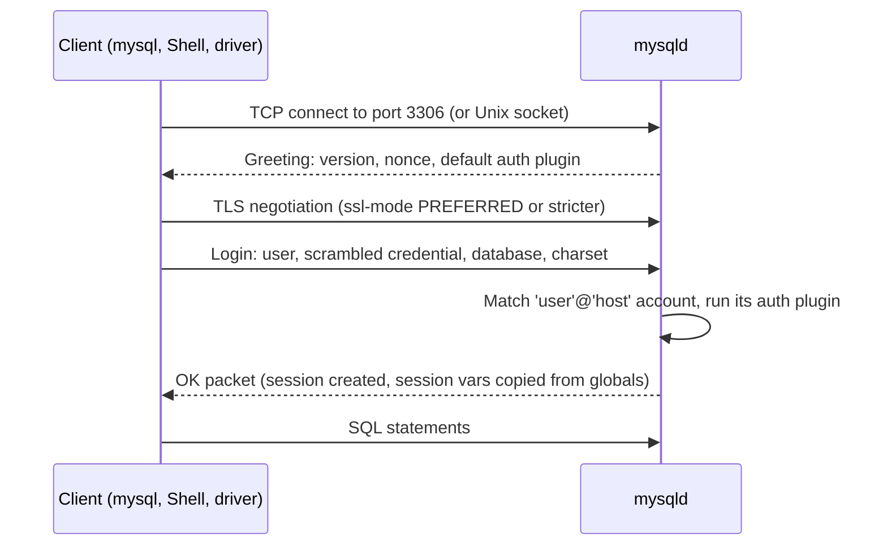

## Introduction

The labs on this platform give you a ready-made MySQL session in the browser. A professional, however, must be able to stand up a server, configure it and connect to it from any tool — on a laptop for development, in a container for CI, and on a cloud VM or managed service in production. This lesson covers that whole path:

1. **Installing** MySQL 8.4 LTS — with Docker (the recommended route for a development machine) or with native packages for Linux, macOS and Windows.
2. **Configuring** the server through **option files** (`my.cnf` / `my.ini`) and **system variables**, and understanding which settings can change at runtime.
3. **Connecting** with the `mysql` command-line client, **MySQL Shell** and **MySQL Workbench**, using the right **connection parameters** (host, port, socket, user, TLS mode).
4. **Authenticating** — what authentication plugins are, why `caching_sha2_password` is the default, and why old clients fail against 8.4.

Installation commands run on *your* machine, so they appear below as display-only blocks. Everything that can be observed from inside a session — the server version, your account, its authentication plugin, TLS status, system and status variables — is runnable here, and you should run the same statements on your own server once it is installed.

:::note[Run it locally too]
After installing MySQL locally, try every `sql run` block of this lesson in your own `mysql` session. Comparing your values (version, port, socket, buffer pool size) with the captured ones is the quickest way to understand how configuration differs between installations.
:::

## DBMS Theory

:::theory[Client/server separation, sessions and configuration]
In a client/server DBMS ([Database Architectures](/lessons/m01-database-architectures)) the **server** is a long-running process that owns the data files; **clients** connect over a network protocol, authenticate, and then exchange statements and results inside a **session**. Three general concepts follow:

- **Connection** — the transport (TCP socket, local IPC) plus protocol handshake and optional encryption.
- **Authentication and authorization** — *who are you?* (verify credentials) versus *what may you do?* (privileges). They are distinct steps; this lesson is about the first, Module 11 covers both in depth.
- **Configuration scope** — some parameters are fixed at server start (e.g. memory structures sized at boot), some can be changed for the whole server at runtime, and some belong to an individual session and can differ between concurrent clients.
:::

MySQL maps these ideas onto concrete mechanisms:

| Concept | MySQL mechanism |
|---|---|
| Server process | `mysqld` (a service: systemd unit `mysql`/`mysqld`, a Windows service, or a container's main process) |
| Transport | TCP (default port **3306**), Unix domain socket on Linux/macOS (e.g. `/var/run/mysqld/mysqld.sock`), named pipes/shared memory on Windows; X Protocol on port **33060** for MySQL Shell's document API |
| Account identity | `'user'@'host'` — the *host* part is part of the account name, so `'app'@'localhost'` and `'app'@'%'` are different accounts |
| Credential verification | **Authentication plugins** (`caching_sha2_password`, `auth_socket`, …) |
| Startup configuration | **Option files** and command-line options |
| Runtime configuration | **System variables** with GLOBAL and/or SESSION scope; `SET PERSIST` writes them to `mysqld-auto.cnf` |
| Runtime counters | **Status variables** (`SHOW STATUS`) — read-only measurements, not settings |

The distinction between **system variables** (settings that *control* behaviour) and **status variables** (counters that *report* what happened) is MySQL terminology worth memorising; many other DBMSs call both "parameters" or "statistics".

## Why It Exists

Why so many installation methods and configuration layers? Because the same server binary must serve very different environments:

- A **developer laptop** wants a disposable server that matches production's version exactly and can be reset in seconds — a container.
- A **production host** wants a server managed by the OS service manager, upgraded through a package repository, with configuration under version control — native packages plus an option file.
- **CI pipelines** want a server that starts from a known state for every test run — a container initialised from SQL scripts.
- **Managed services** (Amazon RDS, Cloud SQL, Azure) hide installation entirely but still expose system variables through "parameter groups".

And why option files *and* system variables *and* session settings? Because configuration has different lifetimes. A buffer pool size must be decided before memory is allocated (start-up), a connection limit may need raising during an incident (global, runtime), and one reporting query may need a bigger sort buffer without affecting thousands of other sessions (session).

What goes wrong without understanding this layer:

- *"I changed `my.cnf` and nothing happened"* — the server only reads option files at start-up, or the setting was in the wrong `[group]`, or a later file overrode it.
- *"`SET GLOBAL` worked yesterday and is gone today"* — global settings made with `SET GLOBAL` are lost at restart unless persisted.
- *"Access denied for user 'root'@'localhost'"* although the password is right — on Ubuntu the root account authenticates with the `auth_socket` plugin and ignores passwords; or you connected through a socket and matched a different account than through TCP.
- *"Authentication plugin 'caching_sha2_password' cannot be loaded"* — a client library too old for MySQL 8.x.

## Internal Working

:::internals[From mysqld start-up to an authenticated session]
**Start-up.** When `mysqld` starts it (1) reads option files in a fixed order and builds the effective option list (command-line options last, so they win); (2) initialises global system variables from compiled defaults overridden by those options; (3) reads `mysqld-auto.cnf` from the data directory — the file written by `SET PERSIST` — whose values override option files; (4) starts InnoDB (allocating the buffer pool, running crash recovery from the redo log if needed), opens the data dictionary, and (5) starts listening on the TCP port, the Unix socket, the X Protocol port and, if configured, an administrative port.

**First start (initialisation).** An empty data directory must first be initialised with `mysqld --initialize` (generates a random temporary root password written to the error log) or `--initialize-insecure` (root with no password — development only). Packages and the Docker image do this for you on first start.

**Connection handshake.** For each new connection the server (1) sends a greeting packet containing the server version, a random *nonce* and the default authentication plugin; (2) negotiates TLS if both sides agree (the default client setting `ssl-mode=PREFERRED` encrypts whenever the server supports it, and 8.x servers auto-generate certificates); (3) finds the matching account (`user` + most specific matching `host`) and runs that account's authentication plugin; (4) creates the **session**: a thread (one per connection by default) and a copy of all SESSION-scope variables, initialised from the current GLOBAL values.
:::



**`caching_sha2_password` in two paths.** The default plugin stores a salted SHA-256-based hash. On a *fast path* the server already has the account's credential in an in-memory cache and verifies a nonce-scrambled response without the password ever crossing the network. On the *full path* (first login after server start, or after the cache was flushed) the client must deliver the password itself, which the plugin only allows over a **secure channel** — TLS, a Unix socket, or RSA-encrypted with the server's public key. That is why some clients connecting without TLS fail on first login with an error asking for a secure connection, and why connectors offer an option such as `--get-server-public-key` / `allowPublicKeyRetrieval`.

**Session variables are copies.** Changing a GLOBAL variable affects only sessions that start *afterwards*; existing sessions keep their copy. Changing a SESSION variable affects only that connection and disappears when it closes.

## MySQL Implementation

Once connected, the first statements to run in *any* new environment identify the server and your session. In the sandbox the account is a per-lab user and the schema is your private lab schema, shown as `your_lab`:

```sql run
SELECT VERSION()       AS server_version,
       CURRENT_USER()  AS account_matched,
       USER()          AS login_as_sent,
       DATABASE()      AS default_schema;
```

`USER()` is what the client *sent* (user name and the host it connected from); `CURRENT_USER()` is the account row the server *matched* — they differ when, for example, a login is matched by a wildcard account such as `'app'@'%'`. Privileges come from `CURRENT_USER()`.

Where is the server listening? These are ordinary read-only system variables:

```sql run
SHOW VARIABLES
WHERE Variable_name IN ('port', 'socket', 'bind_address', 'mysqlx_port',
                        'admin_port', 'max_connections', 'require_secure_transport', 'tls_version');
```

`bind_address = 127.0.0.1` on the capture server means it accepts TCP connections only from the same machine; the official Docker image instead binds to all interfaces so the container port can be published. `require_secure_transport = OFF` means unencrypted connections are permitted; production servers commonly turn it ON.

Is *this* session encrypted? Session status variables answer that:

```sql run
SHOW SESSION STATUS WHERE Variable_name IN ('Ssl_version', 'Ssl_cipher');
```

A non-empty `Ssl_version` means the connection negotiated TLS even though nobody asked for it explicitly — the effect of the client default `ssl-mode=PREFERRED` and the certificates MySQL 8.x generates automatically at initialisation.

Which authentication plugin does your account use? `SHOW CREATE USER` for your own account reveals it (the credential hash is masked):

```sql run
SHOW CREATE USER CURRENT_USER();
```

The sandbox account uses `caching_sha2_password`, the default since 8.0, and also carries resource limits (`MAX_QUERIES_PER_HOUR`, `MAX_USER_CONNECTIONS`) — a real MySQL feature that the platform uses to protect the shared server.

## Syntax Breakdown

### Installing (display-only — run on your machine)

**Docker (recommended for development).** Pin the LTS tag; never rely on `latest`, which follows Innovation releases:

```bash
docker run -d --name mysql84 \
  -e MYSQL_ROOT_PASSWORD='change-me-locally' \
  -e MYSQL_DATABASE=shop \
  -p 3306:3306 \
  -v mysql84-data:/var/lib/mysql \
  -v "$PWD/conf.d":/etc/mysql/conf.d:ro \
  -v "$PWD/init":/docker-entrypoint-initdb.d:ro \
  mysql:8.4

docker logs -f mysql84                       # wait for "ready for connections"
docker exec -it mysql84 mysql -uroot -p      # client inside the container
mysql -h 127.0.0.1 -P 3306 -uroot -p         # client on the host, via the published port
```

| Option | Purpose |
|---|---|
| `mysql:8.4` | Official image, 8.4 LTS series (use an exact tag such as `8.4.x` for reproducible CI) |
| `MYSQL_ROOT_PASSWORD` | Required on first start (or `MYSQL_RANDOM_ROOT_PASSWORD=yes`); `MYSQL_DATABASE`, `MYSQL_USER`, `MYSQL_PASSWORD` create a schema and an application account |
| `-v mysql84-data:/var/lib/mysql` | Named volume for the data directory — without it, data dies with the container |
| `/etc/mysql/conf.d` | Extra option files (`*.cnf`) read by the image's `my.cnf` |
| `/docker-entrypoint-initdb.d` | `.sql`, `.sql.gz` and `.sh` files executed once, when the data directory is first initialised |
| `-p 3306:3306` | Publishes the port; connect from the host with `-h 127.0.0.1`, **not** `localhost` (see Common Mistakes) |

**Native packages.**

```bash
# Ubuntu/Debian: the distribution's own package may be an older series (Ubuntu 24.04 ships 8.0).
# For 8.4 LTS add Oracle's MySQL APT repository (mysql-apt-config package), choose "mysql-8.4-lts", then:
sudo apt update && sudo apt install mysql-server
sudo systemctl status mysql
sudo mysql                      # Ubuntu: root@localhost uses auth_socket — OS user root logs in without a password

# RHEL/Oracle Linux/Fedora: add Oracle's MySQL Yum repository, enable the 8.4 LTS channel, then:
sudo dnf install mysql-community-server
sudo systemctl start mysqld
sudo grep 'temporary password' /var/log/mysqld.log   # generated root password

# macOS: Oracle's DMG installer, or Homebrew
brew install mysql@8.4 && brew services start mysql@8.4

# Windows: Oracle's MSI package; MySQL Configurator (bundled since 8.3) sets up the service,
# port, root password and option file (my.ini).

# After any native install:
mysql_secure_installation       # set root password policy, remove anonymous users and the test schema
```

### Option files

On Linux and macOS, `mysqld` and the clients read these files **in order**; for the same option, the **last one read wins**:

| Order | File | Typical use |
|---|---|---|
| 1 | `/etc/my.cnf` | Global options |
| 2 | `/etc/mysql/my.cnf` | Global options (Debian/Ubuntu and the Docker image use this, with `!includedir` lines) |
| 3 | `SYSCONFDIR/my.cnf` | Compiled-in location |
| 4 | `$MYSQL_HOME/my.cnf` | Server-specific options |
| 5 | file given by `--defaults-extra-file` | Extra file |
| 6 | `~/.my.cnf` | User-specific client options |
| 7 | `~/.mylogin.cnf` | Obfuscated login paths created by `mysql_config_editor` (clients only) |
| after all | `DATADIR/mysqld-auto.cnf` | Values written by `SET PERSIST` (server only, JSON format) |

On Windows the server reads `my.ini`/`my.cnf` from the Windows directory, `C:\`, the installation directory and the data directory. Run `mysqld --verbose --help | grep -A1 'Default options'` to print the exact list for your build, and `my_print_defaults mysqld client` to see what a program would actually read.

Files are divided into **groups**; each program reads its own groups:

```ini
# /etc/mysql/conf.d/dev.cnf   (or a file mounted into the Docker image's conf.d)
[mysqld]                         # read by the server
innodb_buffer_pool_size = 1G     # static: needs a restart in older versions; resizable online since 5.7
max_connections         = 300
sql_mode                = "ONLY_FULL_GROUP_BY,STRICT_TRANS_TABLES,NO_ZERO_IN_DATE,NO_ZERO_DATE,ERROR_FOR_DIVISION_BY_ZERO,NO_ENGINE_SUBSTITUTION"
log_error               = /var/log/mysql/error.log
slow_query_log          = ON
long_query_time         = 0.5
require_secure_transport = ON

[client]                         # read by every client program (mysql, mysqldump, mysqladmin, ...)
port   = 3306
socket = /var/run/mysqld/mysqld.sock

[mysql]                          # read only by the mysql CLI
prompt = "\u@\h [\d]> "
auto-rehash = FALSE
```

Option names accept `-` or `_` interchangeably (`max-connections` = `max_connections`). An unknown option in `[mysqld]` makes the server **refuse to start** — always check the error log after editing.

### System variables

```sql
SET SESSION sort_buffer_size = 4194304;      -- this connection only (same as SET sort_buffer_size / SET @@sort_buffer_size)
SET GLOBAL  max_connections  = 500;          -- whole server, new sessions, lost at restart       [needs SYSTEM_VARIABLES_ADMIN]
SET PERSIST max_connections  = 500;          -- like GLOBAL and written to mysqld-auto.cnf          [sandbox: forbidden]
SET PERSIST_ONLY innodb_log_buffer_size = 67108864;  -- only written to mysqld-auto.cnf; for static variables
RESET PERSIST max_connections;               -- remove the persisted setting
SELECT @@GLOBAL.max_connections, @@SESSION.sort_buffer_size;
```

| Property | Values | Meaning |
|---|---|---|
| Scope | GLOBAL, SESSION, both | Where the value lives; both-scope variables are copied from GLOBAL into each new session |
| Dynamic | yes / no | Whether `SET` works at runtime; static (read-only) variables need an option file or `SET PERSIST_ONLY` plus restart |
| `@@name` | — | Reads the SESSION value if one exists, else the GLOBAL value |
| `SHOW [GLOBAL \| SESSION] VARIABLES [LIKE …]` | — | Lists variables (SESSION is the default) |
| `SHOW [GLOBAL \| SESSION] STATUS [LIKE …]` | — | Lists status counters (read-only) |

### Clients

```bash
# mysql CLI — connection parameters
mysql --host=127.0.0.1 --port=3306 --user=app --password shop          # TCP; prompts for password
mysql -h localhost -u app -p shop                                       # Unix socket (localhost is special!)
mysql --protocol=TCP -h localhost -u app -p                             # force TCP
mysql -h db.example.com -u app -p --ssl-mode=VERIFY_IDENTITY --ssl-ca=ca.pem
mysql_config_editor set --login-path=dev --host=127.0.0.1 --user=app --password
mysql --login-path=dev shop                                             # no password on the command line
mysql -u app -p shop < schema.sql                                       # batch mode
mysql -u app -p -e "SELECT COUNT(*) FROM orders" shop                   # one statement
```

```text
mysql> \s                 -- status: version, connection id, TLS cipher, charset, uptime
mysql> SELECT * FROM customers WHERE customer_id = 1\G     -- vertical output
mysql> source /path/to/script.sql
mysql> pager less -S      -- page wide results
mysql> \! clear           -- run a shell command
mysql> warnings           -- show warnings after every statement
mysql> help SELECT        -- server-side help
```

| Parameter | CLI option | Notes |
|---|---|---|
| Host | `-h`, `--host` | `localhost` → Unix socket on Linux/macOS; `127.0.0.1` → TCP |
| Port | `-P`, `--port` | Default 3306; ignored for socket connections |
| Socket | `-S`, `--socket` | Path to the Unix socket |
| User / password | `-u`, `-p` | `-p` with no value prompts; `-pSECRET` (no space) works but leaks into shell history and process lists |
| Default schema | last argument or `-D` | Equivalent to `USE db` after connecting |
| TLS | `--ssl-mode` | `DISABLED`, `PREFERRED` (default), `REQUIRED`, `VERIFY_CA`, `VERIFY_IDENTITY` |
| RSA key for full auth | `--get-server-public-key` | Lets `caching_sha2_password` work on non-TLS TCP connections |

**MySQL Shell** (`mysqlsh`) is the modern client and administration tool. It speaks both the classic protocol (port 3306) and the X Protocol (port 33060), has SQL, JavaScript and Python modes, and contains the administrative utilities (`util.checkForServerUpgrade()`, `util.dumpInstance()`, `util.loadDump()`, InnoDB Cluster setup through `dba.*`):

```bash
mysqlsh --sql app@127.0.0.1:3306/shop          # classic protocol, SQL mode
mysqlsh mysqlx://app@127.0.0.1:33060/shop      # X Protocol
```

```text
MySQL  127.0.0.1:3306 ssl  shop  SQL > \js
MySQL  127.0.0.1:3306 ssl  shop  JS > util.checkForServerUpgrade('root@prod-db:3306', {targetVersion: '8.4.0'})
MySQL  127.0.0.1:3306 ssl  shop  JS > \sql
```

**MySQL Workbench** is the official GUI: a connection manager, a SQL editor with result grids and visual `EXPLAIN`, a schema browser, EER (data-model) diagrams with forward/reverse engineering, user administration and dashboards. You create a *connection* with the same parameters — hostname, port, username, default schema and SSL settings — and can store the password in the OS keychain.

## Practical Examples

**1. Global versus session scope.** Change a session variable and compare it with the global value:

```sql run
SELECT @@SESSION.sort_buffer_size AS session_before, @@GLOBAL.sort_buffer_size AS global_value;
SET SESSION sort_buffer_size = 1048576;
SELECT @@SESSION.sort_buffer_size AS session_after,  @@GLOBAL.sort_buffer_size AS global_value;
```

Only this session's copy changed; every other connection still uses the global value. This is how you give one expensive reporting query more sort memory without raising memory use for the whole server.

**2. Not every variable has a session scope, and some are not dynamic at all.** The buffer pool is a single server-wide structure:

```sql run error
SET SESSION innodb_buffer_pool_size = 1073741824;
```

Error 1229 says it is a GLOBAL variable. The port is fixed when the server starts listening:

```sql run error
SET SESSION port = 3307;
```

Error 1238: `port` is read-only at runtime — it can only be changed in an option file (or with `SET PERSIST_ONLY`) followed by a restart. On your own server, `SET GLOBAL innodb_buffer_pool_size = …` *does* work because the buffer pool can be resized online (it is adjusted in chunks); the sandbox forbids all `SET GLOBAL` because the server is shared.

**3. Character set of the connection.** Clients announce their character set during the handshake. These session variables decide how bytes sent by the client are interpreted and how results are encoded:

```sql run
SELECT @@character_set_client     AS client_sends,
       @@character_set_connection AS literals_interpreted_as,
       @@character_set_results    AS results_sent_as,
       @@collation_connection     AS connection_collation;
```

The platform's driver connects with `utf8mb4`. A client configured with a different charset (an old application using `latin1`, for example) produces garbled characters ("mojibake") even if the tables are `utf8mb4` — the connection character set must match what the application actually sends. Details follow in [Character Sets and Collations](/lessons/m02-charsets-collations).

**4. Sizing at a glance.** A few global settings determine how much memory and how many connections a server can handle. Reading them is allowed for everyone:

```sql run
SELECT @@innodb_buffer_pool_size / 1024 / 1024 AS buffer_pool_mb,
       @@max_connections                        AS max_connections,
       @@wait_timeout                           AS idle_timeout_s,
       @@max_allowed_packet / 1024 / 1024       AS max_packet_mb;
```

The capture server runs with the compiled default buffer pool of 128 MB — fine for a laptop, far too small for a production server where it is commonly set to 50–75% of RAM on a dedicated host (Module 10, [Buffer Pool](/lessons/m10-buffer-pool)). `wait_timeout` is how long an idle connection survives before the server closes it — a frequent cause of "MySQL server has gone away" in applications that keep idle pooled connections longer than this.

**5. Status variables measure your session.** `Com_select` counts SELECT statements executed by this session:

```sql run
SHOW SESSION STATUS LIKE 'Com_select';
```

```sql run
SELECT 1; SELECT 2; SELECT 3;
SHOW SESSION STATUS LIKE 'Com_select';
```

The counter increased by three. Status variables have GLOBAL and SESSION views too: `SHOW GLOBAL STATUS LIKE 'Threads_connected'` on your own server tells you how many clients are connected right now — the first number to look at when an application reports "Too many connections".

## Execution Walkthrough

Here is what happens, layer by layer, when you type `mysql -h 127.0.0.1 -P 3306 -u app -p shop` on your machine. The steps with SQL show what you can observe from inside the session afterwards.

```walkthrough
title: Connecting with mysql -h 127.0.0.1 -P 3306 -u app -p shop
steps:
  - title: "1. Client reads its option files"
    explain: >-
      Before connecting, the mysql program reads the [client] and [mysql] groups of its option files
      (/etc/my.cnf, /etc/mysql/my.cnf, ~/.my.cnf, ~/.mylogin.cnf…). Command-line options override them.
      Because -h is 127.0.0.1 rather than localhost, the client uses TCP to port 3306.
  - title: "2. TCP connection and greeting"
    explain: >-
      mysqld accepts the connection on its listening socket and sends a greeting with its version and a
      random nonce. The server version you see in the greeting is the same string VERSION() returns.
    sql: SELECT VERSION() AS greeting_version, @@port AS listening_port;
  - title: "3. TLS negotiation"
    explain: >-
      With the default ssl-mode=PREFERRED the client upgrades to TLS if the server offers it. Afterwards the
      session status shows the negotiated protocol version and cipher.
    sql: SHOW SESSION STATUS WHERE Variable_name IN ('Ssl_version', 'Ssl_cipher');
  - title: "4. Account matching and authentication"
    explain: >-
      The server finds the most specific account matching the sent user name and the client's host, and runs
      that account's authentication plugin (here caching_sha2_password). Privileges are then taken from the
      matched account.
    sql: SELECT USER() AS sent, CURRENT_USER() AS matched;
  - title: "5. Session created"
    explain: >-
      A thread is assigned and every SESSION variable is initialised from its GLOBAL value. The default schema
      requested on the command line becomes DATABASE(). autocommit is ON by default, so each statement is its
      own transaction unless you start one explicitly.
    sql: SELECT DATABASE() AS default_schema, @@autocommit AS autocommit, @@transaction_isolation AS isolation;
```

If any step fails you get a characteristic error, which tells you where to look:

| Error | Step that failed | Typical cause |
|---|---|---|
| 2002 *Can't connect to local MySQL server through socket* | 1–2 (socket) | Server not running, or client and server disagree on the socket path; `localhost` used with a Docker container |
| 2003 *Can't connect to MySQL server on 'host:port'* | 2 (TCP) | Server down, wrong port, firewall, `bind_address` limited to 127.0.0.1 |
| 2026 *SSL connection error* | 3 | `--ssl-mode=VERIFY_IDENTITY` with a certificate that does not match the host name |
| 1045 *Access denied for user* | 4 | Wrong password, or a different `'user'@'host'` account matched than you expected |
| 2059 / 1251 *Authentication plugin … cannot be loaded* / *Client does not support authentication protocol* | 4 | Client library too old for `caching_sha2_password` (or the account uses `mysql_native_password`, disabled by default in 8.4) |
| 1049 *Unknown database* | 5 | The default schema named on the command line does not exist |

## Output

After a successful connection, the outputs of this lesson give you a complete "connection fingerprint": the server version, the account you were matched to and its authentication plugin, the TLS protocol and cipher, the listening port and socket, and the session's key settings. In the capture above, the session was authenticated with `caching_sha2_password`, encrypted with TLS (`Ssl_version` is shown in the walkthrough), and running with `autocommit = 1` and `REPEATABLE-READ` isolation.

In the `mysql` CLI on your own machine, the `\s` (status) command prints most of this in one go — current user, connection id, SSL cipher, server version, protocol, connection type (socket or TCP), character sets and uptime. Make it a habit to run `\s` whenever a connection behaves unexpectedly: most "it works in Workbench but not in my script" problems turn out to be two different connections (socket vs TCP, two different accounts, two different servers).

## Alternative Approaches

| Approach | Pros | Cons | Best for |
|---|---|---|---|
| **Docker `mysql:8.4`** | Exact version pinning, isolated, disposable, init scripts, same on every OS | Needs Docker; must remember volumes; connect via 127.0.0.1 | Development, CI, learning |
| **Native packages (APT/Yum repo)** | OS service integration, standard paths, simple upgrades | One version per host; distro packages may lag (Ubuntu 24.04 ships 8.0) | Dedicated servers and VMs |
| **Homebrew / DMG (macOS), MSI (Windows)** | Easy local install | Version drift between team members | Personal development |
| **Generic tarball (`.tar.xz`)** | Several versions side by side, no root needed | Manual init, service setup, upgrades | Testing upgrades, multiple versions |
| **Kubernetes operator** (e.g. MySQL Operator for Kubernetes) | Declarative clusters, automated failover | Operational complexity | Platform teams running MySQL on Kubernetes |
| **Managed service** (RDS, Cloud SQL, Azure, HeatWave) | No installation, backups/patching handled | Less control: no `SUPER`, parameter groups instead of `my.cnf`, provider-specific limits | Production when operations staff is limited |

For **clients**, the choice is about task: the `mysql` CLI for scripting and quick checks (available everywhere, including inside containers); MySQL Shell for administration, dumps, upgrades and clusters; Workbench (or third-party GUIs such as DBeaver or DataGrip) for visual exploration and modelling; language connectors (`mysql-connector-python`, PyMySQL, JDBC Connector/J) inside applications — usually behind a connection pool ([Connections and Connection Pooling](/lessons/m10-connections-pooling)).

## Performance Analysis

Installation and connection choices have measurable performance consequences, even though there is no query plan to analyse:

- **Connection cost.** Each new connection performs a TCP handshake, TLS negotiation and authentication, then creates a thread and copies session variables. For a short query this setup can cost more than the query itself, which is why applications use **connection pools** that keep authenticated sessions open. `caching_sha2_password`'s fast path (credential in the server's cache) avoids the expensive full authentication on repeated logins.
- **Socket vs TCP.** On the same host a Unix-socket connection avoids the TCP stack and is somewhat cheaper; across hosts TCP is the only option. Measure in your environment before optimising this.
- **TLS.** Encryption adds CPU work at handshake and per byte transferred. Modern CPUs make this small for typical OLTP traffic, and security requirements usually outweigh it — keep TLS on.
- **Defaults are not tuned.** A fresh install uses defaults sized for a small machine (the capture server shows a 128 MB buffer pool and 151 maximum connections). Variables such as `innodb_buffer_pool_size`, `innodb_redo_log_capacity` and `max_connections` must be set for the host. MySQL also offers `innodb_dedicated_server=ON`, which sizes the buffer pool and redo log automatically from the detected memory on hosts dedicated to MySQL.
- **Docker on macOS/Windows** runs MySQL inside a Linux VM; bind-mounted host directories for the data directory can be slow. Use a **named volume** for `/var/lib/mysql`.

:::performance[Theory vs measurement]
These are expected effects from how connections and memory work. Use status counters on your own server to measure: `Connections` (total connection attempts), `Threads_connected` / `Threads_running`, `Aborted_connects` (failed logins), and `Max_used_connections` compared with `max_connections`.
:::

## Best Practices

:::best-practice[Installing and connecting like a professional]
1. **Pin the version** everywhere: `mysql:8.4` (or an exact patch tag) in Docker, the 8.4 LTS channel in package repositories. Development, CI and production should run the same series.
2. **Keep configuration in version-controlled option files**, one concern per file in `conf.d/`. Use `SET PERSIST` only for deliberate runtime changes and review `mysqld-auto.cnf` — otherwise the real configuration lives in two places.
3. **Never put passwords on the command line or in shared scripts.** Use the prompt (`-p`), `mysql_config_editor` login paths, or a secrets manager; give `~/.my.cnf` files containing passwords mode `600`.
4. **Use application accounts, not root.** Create a least-privilege account per application (Module 11) and restrict its host part.
5. **Require TLS** for any connection that leaves the host (`require_secure_transport=ON`, clients with `ssl-mode=VERIFY_IDENTITY` in production).
6. **Use modern client libraries** that support `caching_sha2_password`; do not re-enable `mysql_native_password` on 8.4 just to accommodate an outdated driver — upgrade the driver (the plugin is gone in 9.0).
7. **Check the error log after every configuration change** (`@@log_error`); a typo in `[mysqld]` prevents start-up.
:::

## Common Mistakes

**Mistake 1 — `localhost` is not `127.0.0.1`.** On Linux and macOS, the MySQL clients treat the host name `localhost` specially and connect through the **Unix socket**, not TCP. With a Docker container whose port is published to the host, `mysql -h localhost` therefore fails with error 2002 (no socket on the host), while `mysql -h 127.0.0.1` works. Use `127.0.0.1` or `--protocol=TCP`.

**Mistake 2 — editing the option file and expecting immediate effect.** Option files are read at start-up only. Either restart the server or apply the change dynamically with `SET GLOBAL` (and also keep it in the file so it survives the next restart).

**Mistake 3 — trying to change a global setting per session.** As shown above, `SET SESSION innodb_buffer_pool_size` fails with 1229. Check the variable's scope in the manual's *Server System Variables* page before writing configuration code.

**Mistake 4 — leaving the session in a modified state.** Session variables persist for the whole connection. A pooled connection that one request switched to a different `sql_mode` will carry that mode into the next request. Even here, a session change triggers a warning:

```sql run
SET SESSION sql_mode = 'STRICT_TRANS_TABLES';
SELECT @@SESSION.sql_mode AS now_in_effect;
```

The warning (3135) explains that `NO_ZERO_DATE`, `NO_ZERO_IN_DATE` and `ERROR_FOR_DIVISION_BY_ZERO` should be used together with strict mode — by replacing the whole list you silently removed them and `ONLY_FULL_GROUP_BY`. Restore it with `DEFAULT`, which for a session variable means "copy the current global value":

```sql run
SET SESSION sql_mode = DEFAULT;
SELECT @@SESSION.sql_mode = @@GLOBAL.sql_mode AS restored;
```

**Mistake 5 — "Access denied" for root on Ubuntu.** Ubuntu's packages create `root@localhost` with the `auth_socket` plugin, which authenticates by the *operating-system user* of the connecting process and ignores passwords. `sudo mysql` works; `mysql -u root -p` as a normal user does not. Create a separate password-authenticated admin account rather than changing root's plugin.

**Mistake 6 — publishing MySQL to the internet.** A Docker `-p 3306:3306` on a cloud VM binds to all interfaces of the host. Bind to localhost (`-p 127.0.0.1:3306:3306`), use firewalls/security groups, and never use weak root passwords on reachable servers.

## Industry Application

- **Local development with Docker Compose.** Teams commit a `compose.yaml` with `mysql:8.4`, a `conf.d/` directory and `docker-entrypoint-initdb.d/` seed scripts so every developer and CI job gets the same server in seconds. Integration-test frameworks (Testcontainers) start a fresh MySQL container per test suite.
- **Configuration management.** On VMs, option files are deployed by Ansible/Chef/Puppet; on managed services they become parameter groups managed with Terraform. Drift between the file and `SET PERSIST`/`SET GLOBAL` changes is audited by comparing `SHOW GLOBAL VARIABLES` with the intended configuration.
- **Upgrade readiness.** Before moving a fleet from 8.0 to 8.4, DBAs run MySQL Shell's `util.checkForServerUpgrade()` against each server; it reports removed variables in option files, accounts using `mysql_native_password`, and other incompatibilities.
- **Secure connectivity.** Production applications connect over TLS with `VERIFY_IDENTITY`, credentials come from a secrets manager or IAM-based authentication (cloud providers offer token-based login plugins), and bastion hosts or private networking keep port 3306 off the public internet.
- **Data work.** Analysts connect from Python with SQLAlchemy URLs such as `mysql+pymysql://user@host:3306/shop?ssl_ca=…`; the parameters are exactly the ones in the table above.

## Practice Exercises

```exercise
id: ex1
title: Where is the server listening?
difficulty: easy
concepts: [system-variables, connection-parameters]
prompt: |
  Return one row with two columns, in this order: `classic_port` (the port of the classic MySQL protocol)
  and `x_port` (the port of the X Protocol used by MySQL Shell).
hints:
  - "Both are system variables; read them with @@name."
  - "The variables are named port and mysqlx_port."
solution: |
  SELECT @@port AS classic_port, @@mysqlx_port AS x_port;
explanation: |
  `@@port` (default 3306) serves the classic protocol used by the mysql CLI, Workbench and most connectors;
  `@@mysqlx_port` (default 33060) serves the X Protocol. Note that these values are the *server's*
  configuration — a client can still reach the server through a different port if a proxy, Docker port mapping
  or load balancer sits in between, which is why "which port do I connect to?" and "which port does mysqld
  listen on?" can have different answers.
```

```exercise
id: ex2
title: Session copy versus global value
difficulty: easy
concepts: [system-variables]
prompt: |
  In one script, set **this session's** `group_concat_max_len` to `4096`, then return one row with the columns
  `session_value` and `global_value` for that variable, in that order.
hints:
  - "SET SESSION name = value; changes only your connection."
  - "Read the two scopes with @@SESSION.name and @@GLOBAL.name."
solution: |
  SET SESSION group_concat_max_len = 4096;
  SELECT @@SESSION.group_concat_max_len AS session_value,
         @@GLOBAL.group_concat_max_len  AS global_value;
explanation: |
  The session value becomes 4096 while the global value keeps its default (1024). `group_concat_max_len` is a
  classic real-world example: `GROUP_CONCAT` results are silently truncated at this length (with a warning),
  and raising it per session for one export query is safer than changing it for the whole server.
```

```exercise
id: ex3
title: Is this connection encrypted?
difficulty: medium
concepts: [connection-parameters, authentication-plugins]
prompt: |
  Return the session status rows for `Ssl_version` and `Ssl_cipher` (columns `Variable_name`, `Value`,
  as `SHOW` returns them).
hints:
  - "Status variables are listed with SHOW SESSION STATUS."
  - "SHOW … STATUS accepts either LIKE 'pattern' or a WHERE clause on Variable_name."
solution: |
  SHOW SESSION STATUS WHERE Variable_name IN ('Ssl_version', 'Ssl_cipher');
explanation: |
  Non-empty values mean the session negotiated TLS. `SHOW SESSION STATUS LIKE 'Ssl_%'` would return many more
  rows (session and global TLS counters), so the WHERE form is more precise. In the mysql CLI, `\s` prints the
  cipher in its `SSL:` line. If `Ssl_cipher` is empty on a connection that crosses a network, fix the client
  configuration (`--ssl-mode=REQUIRED` or stricter) and consider `require_secure_transport=ON` on the server.
```

```exercise
id: ex4
title: Which variables reject session scope?
difficulty: medium
kind: open
concepts: [system-variables, option-files]
prompt: |
  For each of the following changes, state whether it can be done with `SET SESSION`, needs `SET GLOBAL`
  (or `SET PERSIST`), or requires editing an option file and restarting — and explain why in one sentence each:

  1. Give one reporting query a 16 MB sort buffer.
  2. Raise `max_connections` during an incident.
  3. Change the TCP port from 3306 to 3307.
  4. Grow the InnoDB buffer pool from 8 GB to 12 GB.
  5. Make all *future* sessions use `READ-COMMITTED` isolation by default.
solution: |
  1. **SET SESSION sort_buffer_size = 16777216** — the sort buffer is allocated per session (per sort), so a
     session value affects only that connection.
  2. **SET GLOBAL max_connections = …** (plus SET PERSIST or an option-file edit so it survives restart) — it is a
     server-wide limit; it has no session scope.
  3. **Option file (or SET PERSIST_ONLY) and restart** — `port` is read-only at runtime because the listening
     socket is opened at start-up (error 1238 if you try to SET it).
  4. **SET GLOBAL innodb_buffer_pool_size = …** — global only; resizable online since 5.7 (the resize proceeds
     in chunks in the background). Persist it too.
  5. **SET GLOBAL transaction_isolation = 'READ-COMMITTED'** (and persist) — new sessions copy the global value
     at connect time; existing sessions keep their own copy until they reconnect.
```

```exercise
id: ex5
title: Diagnose four failed connections
difficulty: challenge
kind: open
concepts: [connection-parameters, authentication-plugins, installation]
prompt: |
  A teammate runs `mysql:8.4` in Docker with `-p 3306:3306` and reports four problems. Explain the most likely
  cause and the fix for each.

  1. `mysql -h localhost -u root -p` → `ERROR 2002 (HY000): Can't connect to local MySQL server through socket '/tmp/mysql.sock'`
  2. A 2016-era PHP application → `The server requested authentication method unknown to the client [caching_sha2_password]`
  3. After `docker rm` and `docker run` again, all tables are gone.
  4. They added `innodb_buffer_pool_size=2G` under a `[client]` heading in a mounted `.cnf` file; `SELECT @@innodb_buffer_pool_size` still shows 128 MB.
solution: |
  1. **localhost means Unix socket.** The client looked for a socket on the host, but the server runs inside the
     container. Use `-h 127.0.0.1` (or `--protocol=TCP`) to reach the published TCP port, or run the client
     inside the container with `docker exec -it <name> mysql -uroot -p`.
  2. **Outdated client library.** The account uses `caching_sha2_password` (default since 8.0), which the old
     driver does not implement. Upgrade the driver/PHP extension (mysqlnd supports it in current PHP versions).
     Re-enabling `mysql_native_password` on 8.4 (`--mysql-native-password=ON` and altering the account) is only a
     temporary workaround and impossible on 9.x, where the plugin was removed.
  3. **No volume.** The data directory lived in the container's writable layer. Mount a named volume
     (`-v mysql84-data:/var/lib/mysql`) so data survives container replacement; also remember that
     `/docker-entrypoint-initdb.d` scripts only run when the data directory is empty.
  4. **Wrong option group.** `[client]` is read by client programs, not the server; the option belongs in
     `[mysqld]`. The container must also be restarted to re-read option files (or use
     `SET GLOBAL innodb_buffer_pool_size` for an online change). Check the error log and
     `SELECT @@innodb_buffer_pool_size` afterwards.
```

## Knowledge Assessment

```quiz
- id: q1
  question: "On Linux, `mysql -h localhost -u app -p` connects how?"
  options: ["Over TCP to 127.0.0.1:3306", "Through the Unix domain socket", "Over the X Protocol on port 33060", "Through a named pipe"]
  answer: 1
  explanation: "MySQL clients treat the host name localhost specially on Unix-like systems and use the Unix socket. Use 127.0.0.1 or --protocol=TCP for TCP. The X Protocol is used by MySQL Shell with mysqlx:// URIs; named pipes are a Windows transport."
  concepts: [connection-parameters]
- id: q2
  question: "You run `SET GLOBAL max_connections = 500;` and the server restarts that night. What is max_connections afterwards?"
  options:
    - "500, because SET GLOBAL writes to my.cnf"
    - "Whatever the option files (or mysqld-auto.cnf) or the compiled default specify — SET GLOBAL is not persisted"
    - "500, because global variables are stored in the data dictionary"
    - "0, until an administrator sets it again"
  answer: 1
  explanation: "SET GLOBAL changes only the running server. SET PERSIST would also write mysqld-auto.cnf; the server never edits my.cnf itself."
  concepts: [system-variables, option-files]
- id: q3
  question: "Which statements about system variables are true? (Select all that apply.)"
  type: multi
  options:
    - "A new session copies the current GLOBAL values of session-scope variables"
    - "Changing a GLOBAL value immediately changes the value in every existing session"
    - "Some variables, such as port, are read-only at runtime"
    - "@@name returns the session value when the variable has session scope"
  answer: [0, 2, 3]
  explanation: "Sessions copy globals at connect time and keep their copy, so a GLOBAL change affects only new sessions. Read-only variables need an option file (or SET PERSIST_ONLY) and restart. @@name without a scope prefix reads the session value if one exists."
  concepts: [system-variables]
- id: q4
  question: "A 2017 Python driver fails against MySQL 8.4 with an error about `caching_sha2_password`. What is the best fix?"
  options:
    - "Disable TLS on the server"
    - "Upgrade the driver to a version that supports caching_sha2_password"
    - "Grant the account SUPER"
    - "Switch the table engine to MyISAM"
  answer: 1
  explanation: "The account's authentication plugin is unsupported by the old driver. Upgrading is the durable fix. Switching the account to mysql_native_password works only on 8.4 after re-enabling the disabled plugin, and is impossible on 9.x. TLS, privileges and engines are unrelated to the authentication protocol."
  concepts: [authentication-plugins]
- id: q5
  question: "Two option files set `max_connections`: /etc/my.cnf says 200 and /etc/mysql/conf.d/app.cnf (included from /etc/mysql/my.cnf) says 400. Assuming default file order and no command-line option, what takes effect?"
  options: ["200, the first file read", "400, because later files override earlier ones", "The server refuses to start because of the conflict", "The smaller value, for safety"]
  answer: 1
  explanation: "Option files are read in a fixed order and the last value read for an option wins. /etc/my.cnf is read before /etc/mysql/my.cnf and its includes. Duplicates are not errors. A value persisted with SET PERSIST in mysqld-auto.cnf would override both."
  concepts: [option-files]
- id: q6
  question: "What is the difference between USER() and CURRENT_USER()?"
  options:
    - "They are synonyms"
    - "USER() is the user name and host the client sent; CURRENT_USER() is the account the server matched and whose privileges apply"
    - "USER() is the OS user; CURRENT_USER() is the MySQL user"
    - "CURRENT_USER() includes the password hash"
  answer: 1
  explanation: "Authentication matches the sent identity against 'user'@'host' accounts; the matched account (e.g. 'app'@'%') can differ from what was sent (app@10.0.0.7). Neither function returns OS users or credentials."
  concepts: [authentication-plugins, connection-parameters]
- id: q7
  question: "Your Docker container lost all data after being recreated. Which option was missing?"
  options: ["-p 3306:3306", "-e MYSQL_ROOT_PASSWORD", "-v <volume>:/var/lib/mysql", "--restart unless-stopped"]
  answer: 2
  explanation: "/var/lib/mysql is the data directory; without a volume it lives in the container's writable layer and is deleted with the container. Port publishing, the root password and restart policy do not affect data persistence."
  concepts: [installation]
- id: q8
  question: "Which tool would you use to check whether an 8.0 server is ready to be upgraded to 8.4?"
  options: ["MySQL Workbench's EER diagram editor", "MySQL Shell's util.checkForServerUpgrade()", "mysql_secure_installation", "SHOW ENGINES"]
  answer: 1
  explanation: "MySQL Shell's upgrade checker inspects configuration, accounts and schema objects for incompatibilities with the target version. The EER editor models schemas, mysql_secure_installation hardens a fresh install, and SHOW ENGINES lists engines."
  concepts: [mysql-client]
```
