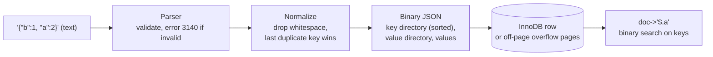

## Introduction

Not all data fits neatly into typed columns. Product attributes differ by category (a laptop has RAM and screen size, a T-shirt has size and fabric); API payloads and event properties evolve weekly; files such as images and PDFs are opaque bytes; and globally unique identifiers generated by applications are 128-bit numbers that are usually written as 36-character strings. MySQL offers three tools for these cases:

- **`JSON`** — a native type that validates JSON documents on write and stores them in an optimized **binary format** with fast path access (`doc->'$.price'`).
- **The `BLOB` family** (`TINYBLOB`, `BLOB`, `MEDIUMBLOB`, `LONGBLOB`) — raw binary large objects for bytes with no character interpretation.
- **`BINARY(16)`** — the compact, index-friendly representation for UUIDs, with `UUID_TO_BIN()` / `BIN_TO_UUID()` and a time-ordering option.

This lesson explains what each type guarantees, how MySQL stores it, and — just as important — when *not* to use it: JSON that should have been columns, files that should live in object storage, UUIDs stored as `CHAR(36)`. Advanced JSON features (JSON_TABLE, multi-valued indexes, generated columns over JSON) are developed further in [Working with JSON in MySQL](/lessons/m13-json).

:::note[Dataset]
The examples use demonstration tables alongside the **shop** dataset. UUID examples use fixed UUID strings so that outputs are reproducible; `UUID()` itself returns a new value on every call.
:::

## DBMS Theory

:::theory[Atomicity of values, semi-structured data and identifiers]
Codd's relational model asks that every attribute value be **atomic** with respect to the DBMS — first normal form (1NF). A JSON document is a nested structure of objects, arrays and scalars: storing one in a column is a deliberate exception, treating the document as a value of a complex domain. Modern SQL accepts this: SQL:2016 added JSON functions (`JSON_VALUE`, `JSON_QUERY`, `JSON_TABLE`, `IS JSON`), and SQL:2023 added a JSON data type.

**Semi-structured data** has a self-describing structure (keys travel with the values) that may vary from document to document. It trades schema enforcement for flexibility: the DBMS can still validate *syntax* (is this well-formed JSON?) and, with JSON Schema, *structure* — but not referential integrity between documents.

**Binary large objects** are values the DBMS stores but does not interpret: only their length and bytes matter.

**Surrogate identifiers** can be generated centrally (an auto-increment sequence) or in a decentralized way (UUIDs: 128-bit values with negligible collision probability, defined in RFC 4122 / RFC 9562). Decentralized generation lets clients, services and offline devices create ids without a round trip to the database.
:::

Two principles guide the use of these types:

1. **Use JSON for data that is genuinely variable or opaque to the database**, and real columns for data you filter, join, aggregate, constrain or reference. A value that appears in a `WHERE`, `JOIN` or foreign key belongs in a column (possibly a generated column extracted from the JSON).
2. **Store values in the representation that matches their meaning.** A UUID is a 128-bit number; its 36-character text form is a presentation format. A file is bytes; its storage location is a deployment decision.

| Standard SQL | MySQL |
|---|---|
| `JSON` data type (SQL:2023) | `JSON` since 5.7.8, binary storage |
| `IS JSON` predicate | `JSON_VALID()` function; the JSON column type itself rejects invalid text |
| `JSON_VALUE`, `JSON_QUERY` | `JSON_VALUE()` (8.0.21+), `JSON_EXTRACT()`, `->`, `->>` |
| `JSON_TABLE` | `JSON_TABLE()` (8.0.4+) |
| `BLOB` / `BINARY LARGE OBJECT` | `TINYBLOB`, `BLOB`, `MEDIUMBLOB`, `LONGBLOB` |
| UUID type | **None** — use `BINARY(16)` with `UUID_TO_BIN()`; PostgreSQL has a native `uuid` type |

## Why It Exists

**Why a native JSON type instead of `TEXT`?** A `TEXT` column accepts any string, so invalid JSON slips in and every read must parse the whole document to find one key. The JSON type:

- **validates** every document on insert and update — invalid JSON is an error, not a latent bug;
- **normalizes** it (removes insignificant whitespace, resolves duplicate keys) so equal documents compare equal;
- stores it in a **binary format with an index of keys and offsets**, so `doc->'$.price'` can jump to the value instead of parsing the text;
- supports **partial in-place updates** (`JSON_SET`, `JSON_REPLACE`, `JSON_REMOVE`) that can avoid rewriting the whole document and log only the change in the binary log.

**Why BLOBs?** Some data is bytes: thumbnails, PDFs, encrypted payloads, serialized models, compressed archives. Character types would try to validate and convert them according to a character set; binary types store them exactly.

**Why `BINARY(16)` for UUIDs?** A UUID as `CHAR(36)` in utf8mb4 occupies at least 36 bytes (and the column may reserve up to 144 bytes of row space), compares under a linguistic collation, and — being a primary key in InnoDB — is copied into every secondary index entry. `BINARY(16)` stores the same information in 16 bytes with byte comparison. With the time-ordering swap, version-1 UUIDs also insert roughly in key order, avoiding random B+ tree page splits.

What goes wrong without these choices: JSON blobs that become an untyped, unconstrained shadow schema; multi-gigabyte tables full of images that make backups, replication and buffer-pool usage miserable; random UUID primary keys that fragment the clustered index and bloat every index.

## Internal Working

:::internals[MySQL's binary JSON format and BLOB storage]
**Parsing and validation.** When a string is assigned to a JSON column (or cast with `CAST(… AS JSON)`), MySQL parses it. Malformed input raises error 3140 with the position of the problem. The parsed document is **normalized**: insignificant whitespace is discarded, and if an object contains duplicate keys, **the last value wins** (since 8.0.3).

**Binary format.** The document is serialized into MySQL's internal binary JSON format. An object is stored as: element count, total size, a sorted **key directory** (key offsets and lengths), a **value directory** (type tag plus either the value inline — for small scalars such as integers, booleans and null — or an offset to it), then the keys and values. Keys are kept in a defined order (by key length, then byte order), which allows binary search on lookup; therefore **the original key order is not preserved**. Arrays have a value directory too, so `$[5]` is found without scanning elements 0–4. Numbers keep their JSON type (integer, unsigned, double, and decimal when created from SQL decimals).

**Storage.** A JSON value is stored like a `LONGBLOB`: in the `DYNAMIC` row format, large documents go off-page into overflow pages with a 20-byte pointer in the row. Size is limited by `max_allowed_packet` (the server default is 64 MB). `JSON_STORAGE_SIZE()` reports the binary size of a value.

**Partial updates.** `UPDATE t SET doc = JSON_SET(doc, '$.price', 17.99)` can be performed **in place** when the new value fits in the space of the old one; with `binlog_row_value_options = PARTIAL_JSON`, row-based replication logs only the modified path instead of the whole document.

**BLOBs** use the same storage as TEXT (length prefix 1–4 bytes; off-page in DYNAMIC) but have no character set: comparison and sorting are by bytes. Sorting and grouping use only the first `max_sort_length` bytes. BLOB and TEXT columns cannot be fully indexed — only a prefix (`INDEX (col(32))`).

**UUID functions.** `UUID()` returns a version-1 (time-based) UUID as a 36-character string: `time_low-time_mid-time_hi_and_version-clock_seq-node`. `UUID_TO_BIN(uuid)` packs the 32 hex digits into 16 bytes; `UUID_TO_BIN(uuid, 1)` additionally **swaps the time-low and time-high groups**, putting the most slowly changing timestamp bits first, so successive version-1 UUIDs produce increasing binary values. `BIN_TO_UUID(bin, 1)` reverses the swap.
:::



## MySQL Implementation

Create a table with a JSON column and insert a document with messy formatting and a duplicate key:

```sql run
CREATE TABLE product_attr (
  product_id INT UNSIGNED PRIMARY KEY,
  attrs      JSON NOT NULL
);
INSERT INTO product_attr VALUES
  (1, '{ "color": "red",   "size": "M", "color": "blue" }'),
  (2, '{"sku":"P-2","price":19.99,"tags":["eco","new"],"dims":{"w":10,"h":20},"active":true}');
SELECT product_id, attrs, JSON_TYPE(attrs) AS json_type, JSON_STORAGE_SIZE(attrs) AS binary_bytes
FROM product_attr ORDER BY product_id;
```

Document 1 was normalized: whitespace removed and the duplicate `"color"` resolved to the **last** value, `"blue"`. Document 2 shows that keys come back in MySQL's storage order (`sku`, `dims`, `tags`, `price`, `active` — shortest keys first), not in the order written. Never rely on key order in a JSON object.

**Validation on write.** Invalid JSON is rejected with the position of the error:

```sql run error
INSERT INTO product_attr VALUES (3, '{"color": "green", }');
```

```sql run error
INSERT INTO product_attr VALUES (4, 'green');
```

**Path access.** `->` returns a JSON value (strings keep their quotes); `->>` returns the unquoted SQL string:

```sql run
SELECT attrs->'$.sku'          AS sku_json,
       attrs->>'$.sku'         AS sku_text,
       attrs->'$.price'        AS price,
       JSON_TYPE(attrs->'$.price') AS price_type,
       attrs->>'$.tags[0]'     AS first_tag,
       attrs->>'$.dims.w'      AS width,
       JSON_TYPE(attrs->'$.active') AS active_type
FROM product_attr WHERE product_id = 2;
```

`->` is shorthand for `JSON_EXTRACT(col, path)` and `->>` for `JSON_UNQUOTE(JSON_EXTRACT(col, path))`. Paths start at `$`; `.key` selects an object member, `[n]` an array element (0-based), `[*]` and `.*` all elements, and `**` any depth.

## Syntax Breakdown

```sql
col JSON [NOT NULL] [DEFAULT (json_expression)]          -- literal defaults are not allowed; expression defaults are (8.0.13+)
col {TINYBLOB | BLOB | MEDIUMBLOB | LONGBLOB}
col BINARY(16)                                           -- UUID storage

doc->'$.path'          doc->>'$.path'                    -- extract / extract and unquote
JSON_EXTRACT(doc, path[, path ...])    JSON_VALUE(doc, path [RETURNING type])
JSON_SET(doc, path, val[, ...])        JSON_INSERT(...)   JSON_REPLACE(...)   JSON_REMOVE(doc, path)
JSON_VALID(str)    JSON_TYPE(doc)    JSON_LENGTH(doc)    JSON_STORAGE_SIZE(doc)
JSON_SCHEMA_VALID(schema, doc)         JSON_SCHEMA_VALIDATION_REPORT(schema, doc)
JSON_OBJECT(k, v, ...)   JSON_ARRAY(v, ...)   JSON_ARRAYAGG(expr)   JSON_OBJECTAGG(k, v)
value MEMBER OF (json_array)    JSON_CONTAINS(doc, candidate[, path])    JSON_OVERLAPS(a, b)
JSON_TABLE(doc, path COLUMNS (...)) AS alias

UUID()    UUID_TO_BIN(str[, swap_flag])    BIN_TO_UUID(bin[, swap_flag])    IS_UUID(str)
```

| Element | Meaning | Notes |
|---|---|---|
| `JSON` | Validated, normalized, binary-stored document | Scalars (`42`, `"text"`, `true`, `null`), arrays and objects are all valid JSON values |
| `->`, `->>` | Path extraction operators | MySQL extensions (the standard uses `JSON_VALUE`/`JSON_QUERY`) |
| `JSON_SET` / `JSON_INSERT` / `JSON_REPLACE` | Set (insert or replace) / insert only if absent / replace only if present | Enable partial updates |
| `JSON_SCHEMA_VALID` | Validates against a JSON Schema (draft 4 subset) | Usable in `CHECK` constraints (8.0.17+) |
| `MEMBER OF`, `JSON_CONTAINS`, `JSON_OVERLAPS` | Array membership / containment / overlap tests | Can use multi-valued indexes ([Working with JSON](/lessons/m13-json)) |
| `TINYBLOB` … `LONGBLOB` | Up to 255 B, 64 KB, 16 MB, 4 GB | Binary; no character set; prefix-only indexes |
| `UUID_TO_BIN(u, 1)` | Text UUID → 16 bytes with time-part swap | 8.0+ |
| `BIN_TO_UUID(b, 1)` | 16 bytes → text, undoing the swap | Use the same flag as when converting |

:::standard[Standard SQL vs MySQL]
`JSON_TABLE`, `JSON_OBJECT`, `JSON_ARRAY`, `JSON_ARRAYAGG`, `JSON_OBJECTAGG` and `JSON_VALUE` follow SQL:2016 names (with MySQL-specific details). The `->`/`->>` operators, `JSON_SET`/`JSON_INSERT`/`JSON_REPLACE`/`JSON_REMOVE`, `JSON_STORAGE_SIZE`, `MEMBER OF` and `UUID_TO_BIN` are MySQL-specific. Other databases differ substantially: PostgreSQL has `json` (text) and `jsonb` (binary) types with `->`/`->>` operators of different semantics, and a native `uuid` type.
:::

## Practical Examples

**1. Equality of normalized documents.** Because JSON values are normalized and compared semantically, formatting and key order do not matter — but comparing with a plain string does:

```sql run
SELECT CAST('[3, 1, 2]' AS JSON)       = CAST('[3,1,2]' AS JSON)       AS same_array,
       CAST('{"a":1,"b":2}' AS JSON)   = CAST('{"b":2,"a":1}' AS JSON) AS same_object,
       CAST('[1, 2, 3]' AS JSON)       = CAST('[3, 2, 1]' AS JSON)     AS array_order_matters,
       '{"a":1}' = CAST('{"a":1}' AS JSON)                             AS string_vs_json;
```

Objects compare equal regardless of key order; arrays are ordered, so `[1,2,3]` ≠ `[3,2,1]`. A string literal compared with a JSON value is treated as a JSON *string* scalar — not parsed — so the last comparison is false. Cast explicitly.

**2. Partial update.** Change one attribute and add another without rewriting the document in application code:

```sql run
UPDATE product_attr
SET attrs = JSON_SET(attrs, '$.price', 17.99, '$.stock', 5)
WHERE product_id = 2;
SELECT attrs FROM product_attr WHERE product_id = 2;
```

`JSON_SET` replaced `price` and inserted `stock`. `JSON_INSERT` would only have added missing keys; `JSON_REPLACE` would only have changed existing ones.

**3. Querying inside documents.**

```sql run
SELECT product_id, attrs->>'$.sku' AS sku
FROM product_attr
WHERE 'eco' MEMBER OF (attrs->'$.tags')
  AND CAST(attrs->>'$.price' AS DECIMAL(10,2)) < 20.00;
```

This works, but on a large table it scans every document. Values you filter on frequently should be extracted into an indexed **generated column** or a **functional index** (`INDEX ((CAST(attrs->>'$.sku' AS CHAR(20)) COLLATE utf8mb4_bin))`), or a multi-valued index for arrays — covered in [Generated Columns](/lessons/m13-generated-columns) and [Working with JSON](/lessons/m13-json).

**4. Structural validation with JSON Schema.** Syntax validation is automatic; structure can be enforced with a `CHECK` constraint:

```sql run
CREATE TABLE product_spec (
  product_id INT UNSIGNED PRIMARY KEY,
  spec JSON NOT NULL,
  CONSTRAINT chk_spec_schema CHECK (JSON_SCHEMA_VALID(
    '{"type": "object",
      "required": ["sku"],
      "properties": {"sku":   {"type": "string"},
                     "price": {"type": "number", "minimum": 0}}}',
    spec))
);
INSERT INTO product_spec VALUES (1, '{"sku": "A-1", "price": 9.5}');
```

```sql run error
INSERT INTO product_spec VALUES (2, '{"sku": "A-2", "price": -1}');
```

```sql run error
INSERT INTO product_spec VALUES (3, '{"price": 4}');
```

A negative price and a missing `sku` both violate the schema (error 3819). This gives JSON columns a declarative contract similar to typed columns.

**5. JSON from relational data and back.** Build JSON from rows — useful for APIs — and shred JSON into rows with `JSON_TABLE`:

```sql run
SELECT JSON_OBJECT('customer_id', customer_id,
                   'name', CONCAT(first_name, ' ', last_name),
                   'tier', loyalty_tier) AS customer_json
FROM customers
ORDER BY customer_id
LIMIT 3;
```

```sql run
SELECT jt.sku, jt.qty
FROM JSON_TABLE('[{"sku": "A", "qty": 2}, {"sku": "B", "qty": 5}]',
                '$[*]' COLUMNS (sku VARCHAR(10) PATH '$.sku',
                                qty INT         PATH '$.qty')) AS jt;
```

Customer 3 has a NULL loyalty tier, which became JSON `null`. `JSON_TABLE` turns an array of objects into a relational row source that can be joined like a table.

**6. BLOBs hold bytes exactly.** Store the 8-byte PNG file signature and read it back:

```sql run
CREATE TABLE attachment (
  attachment_id INT UNSIGNED PRIMARY KEY,
  file_name     VARCHAR(255) NOT NULL,
  mime_type     VARCHAR(100) NOT NULL,
  content       MEDIUMBLOB   NOT NULL
);
INSERT INTO attachment VALUES (1, 'logo.png', 'image/png', x'89504E470D0A1A0A');
SELECT attachment_id, file_name, LENGTH(content) AS bytes, HEX(content) AS hex_content
FROM attachment;
```

`x'…'` is a hexadecimal (binary) literal. The bytes, including `0x0D 0x0A` (CR LF) and `0x1A`, are stored without any character-set conversion. Applications send real file contents through prepared-statement parameters, never by concatenating bytes into SQL.

**7. UUIDs as `BINARY(16)`.** Convert a version-1 UUID with and without the time swap:

```sql run
SELECT HEX(UUID_TO_BIN('6ccd780c-baba-1026-9564-5b8c656024db'))     AS plain_16_bytes,
       HEX(UUID_TO_BIN('6ccd780c-baba-1026-9564-5b8c656024db', 1))  AS swapped_16_bytes,
       BIN_TO_UUID(UUID_TO_BIN('6ccd780c-baba-1026-9564-5b8c656024db', 1), 1) AS round_trip,
       LENGTH(UUID_TO_BIN('6ccd780c-baba-1026-9564-5b8c656024db'))  AS bytes,
       IS_UUID('6ccd780c-baba-1026-9564-5b8c656024db')              AS valid_uuid;
```

The swapped form starts with `1026BABA` — the `time_hi_and_version` group (`1026`) and `time_mid` (`baba`) moved in front of `time_low` (`6ccd780c`). Round-tripping with the same flag restores the original text. Generating a new UUID returns a different value every time, so its output is not shown:

```sql run volatile
SELECT UUID() AS new_uuid, HEX(UUID_TO_BIN(UUID(), 1)) AS new_swapped;
```

## Execution Walkthrough

Why does the swap flag matter for a primary key? Version-1 UUIDs embed a timestamp, but its **low-order** bits come first in the text form. Three UUIDs generated one after another (simulated here with fixed values whose timestamps increase) sort differently as text and as swapped binary.

```walkthrough
title: Time-ordered UUID keys with UUID_TO_BIN(…, 1)
steps:
  - title: "1. Three version-1 UUIDs in generation order"
    explain: >-
      u1 is the oldest and u3 the newest. In each UUID the timestamp is split as time_low (first group),
      time_mid (second) and time_hi (third group, after the version digit 1). Here u1 has time_mid 0001 and
      u2/u3 have time_mid 0002, so the generation order is u1 < u2 < u3.
    sql: |
      CREATE TABLE uuid_gen (gen_order INT PRIMARY KEY, uuid_text CHAR(36) NOT NULL);
      INSERT INTO uuid_gen VALUES
        (1, 'ffffffff-0001-11ef-8000-00000000000a'),
        (2, '00000000-0002-11ef-8000-00000000000a'),
        (3, '00000001-0002-11ef-8000-00000000000a');
      SELECT gen_order, uuid_text FROM uuid_gen ORDER BY gen_order;
  - title: "2. Sorted as text (or as unswapped binary)"
    explain: >-
      Text order is driven by time_low, the fastest-changing part of the timestamp, so the newest UUIDs do
      not sort last. As an InnoDB primary key, inserts would land at scattered positions in the B+ tree.
    sql: SELECT gen_order, uuid_text FROM uuid_gen ORDER BY uuid_text;
  - title: "3. Sorted as swapped binary"
    explain: >-
      UUID_TO_BIN(…, 1) moves time_hi and time_mid to the front, so byte order equals generation order. New
      keys are appended at the right edge of the clustered index — like an AUTO_INCREMENT key.
    sql: |
      SELECT gen_order, HEX(UUID_TO_BIN(uuid_text, 1)) AS swapped_key
      FROM uuid_gen
      ORDER BY UUID_TO_BIN(uuid_text, 1);
  - title: "4. Store and read back"
    explain: >-
      A table keyed by BINARY(16) stores 16 bytes per key; BIN_TO_UUID(…, 1) presents the familiar text form
      to applications.
    sql: |
      CREATE TABLE device (device_id BINARY(16) PRIMARY KEY, label VARCHAR(20) NOT NULL);
      INSERT INTO device SELECT UUID_TO_BIN(uuid_text, 1), CONCAT('device-', gen_order) FROM uuid_gen;
      SELECT BIN_TO_UUID(device_id, 1) AS device_uuid, label, LENGTH(device_id) AS key_bytes
      FROM device ORDER BY device_id;
```

## Output

The walkthrough shows the decisive difference: ordered as text, the oldest UUID (`gen_order` 1, starting with `ffffffff`) sorts **last**; ordered by the swapped binary key, rows come back in generation order 1, 2, 3, and the `device` table — whose clustered index is ordered by `device_id` — returns them in that order too, with `key_bytes = 16`.

For an InnoDB table, the primary-key order *is* the physical order of rows in the clustered index. Monotonically increasing keys mean new rows are appended to the last leaf page; random keys mean each insert lands on a random page, causing page splits, half-empty pages and a working set that is the whole index. This applies to version-1 UUIDs with the swap; **version-4 (random) UUIDs** generated by many libraries have no time component, so the swap does not help — consider time-ordered UUID versions (version 7, RFC 9562) generated in the application, stored as `BINARY(16)` *without* the swap since their timestamp is already at the front.

## Alternative Approaches

**JSON vs columns vs EAV vs child tables** for variable attributes:

| Design | Pros | Cons | Use when |
|---|---|---|---|
| Typed columns | Types, constraints, indexes, FKs, compact | Schema changes for new attributes | Attributes are known and queried |
| `JSON` column | Flexible, one read gets everything, validated syntax, schema via CHECK | Weaker typing; indexing needs generated columns or functional/multi-valued indexes; no FKs inside | Attributes vary by row, are mostly read as a whole, or evolve quickly |
| Hybrid: columns + JSON | Hot fields typed and indexed, long tail in JSON | Discipline needed to promote fields | Most real product catalogs and event tables |
| EAV (entity, attribute, value rows) | Fully dynamic | Hard queries (pivoting), weak typing, poor performance | Rarely — JSON usually replaces it |
| Child table (1:N) | Fully relational, indexable | More joins | Repeating groups such as order lines, tags |

**Files: in the database or as references?**

| Approach | Pros | Cons |
|---|---|---|
| `BLOB` in MySQL | Transactional consistency with metadata; one backup; access control via SQL | Large tables and backups; buffer pool and replication carry file bytes; `max_allowed_packet` limits; expensive to serve over HTTP |
| Object storage (S3, GCS, Azure Blob) + reference row (`storage_key`, size, checksum, mime type) | Cheap, scalable, CDN-friendly; database stays small | Two systems: orphaned files or dangling references unless managed (write file first, then row; periodic reconciliation) |
| File system path + reference | Simple on one server | Does not scale or replicate; backup coordination |

The industry default is **object storage plus a metadata row**, with BLOBs reserved for small, transactional binary values (thumbnails of a few KB, encrypted secrets, signatures).

**UUID alternatives:** `BIGINT AUTO_INCREMENT` (smallest, fastest, but centrally generated and guessable); `CHAR(36)` UUIDs (readable, but 2–9× larger and collation-compared); `BINARY(16)` UUIDs (compact, decentralized); time-ordered ids such as UUIDv7, ULID or Snowflake-style 64-bit ids (decentralized and index-friendly).

## Performance Analysis

- **JSON reads.** Path lookups in binary JSON avoid reparsing, but selecting a JSON column still reads the entire document (possibly from off-page overflow pages). Extract frequently used scalars into generated columns; avoid `SELECT *` on wide JSON tables.
- **JSON filtering.** A predicate on `doc->>'$.x'` without a functional index or indexed generated column is evaluated for every row — a full scan. Multi-valued indexes accelerate `MEMBER OF`, `JSON_CONTAINS` and `JSON_OVERLAPS` on arrays.
- **JSON writes.** Rewriting a large document for a small change costs I/O and binary-log volume; partial updates with `JSON_SET`/`JSON_REPLACE`/`JSON_REMOVE` can be done in place, and `binlog_row_value_options = PARTIAL_JSON` reduces replication traffic.
- **Storage overhead.** Binary JSON stores keys in every document. Document 1 in this lesson needs 35 bytes of binary JSON for two short key/value pairs, and document 2 needs 112; repeated key names across millions of rows add up — typed columns store no per-row key names at all.
- **BLOBs.** Large BLOBs inflate backups, slow logical dumps, increase replication lag and pollute the buffer pool when read. Keeping them in a separate table (fetched only when needed) limits the damage.
- **UUID keys.** A `BINARY(16)` key is 4× an `INT` and 2× a `BIGINT`; every secondary index entry repeats it. Random (unordered) keys add page splits and lower buffer-pool locality; time-ordered binary keys behave much like auto-increment for insert patterns.

:::performance[Theory vs measurement]
The behaviours above follow from InnoDB's clustered-index design and MySQL's binary JSON format; they are expectations, not measurements from this lab (its tables are tiny). To measure on your own server, load 1 million rows keyed by random versus time-ordered `BINARY(16)` UUIDs and compare insert time and `DATA_LENGTH`/`INDEX_LENGTH` after `ANALYZE TABLE`.
:::

## Best Practices

:::best-practice[JSON, binary data and UUIDs]
1. **Model first, JSON second.** Put attributes you filter, join, aggregate, constrain or reference into typed columns; use JSON for the genuinely variable remainder.
2. **Validate structure** with `CHECK (JSON_SCHEMA_VALID(…))` for JSON columns that have an expected shape.
3. **Index JSON through generated columns or functional/multi-valued indexes**, never by hoping a scan is fast enough.
4. **Update JSON partially** with `JSON_SET`/`JSON_REPLACE`/`JSON_REMOVE` rather than rewriting whole documents.
5. **Do not rely on JSON key order or formatting** — MySQL normalizes documents; compare JSON with JSON (cast), not with strings.
6. **Keep large files out of the database**: store them in object storage and keep a metadata row with key, size, checksum and content type. Use BLOBs only for small binary values that must be transactional with their row.
7. **Store UUIDs as `BINARY(16)`** with `UUID_TO_BIN`/`BIN_TO_UUID`; use the swap flag for MySQL's version-1 `UUID()` values, and time-ordered UUIDs (v7) when generating ids in applications.
8. **Use the same conversion flag consistently** in every read and write path (wrap it in views or application helpers).
:::

## Common Mistakes

**Mistake 1 — giving a JSON column a literal default.** JSON (like BLOB and TEXT) cannot have a literal default:

```sql run error
CREATE TABLE settings_bad (prefs JSON NOT NULL DEFAULT '{}');
```

Use an expression default (8.0.13+):

```sql run
CREATE TABLE settings_ok (user_id INT PRIMARY KEY, prefs JSON NOT NULL DEFAULT (JSON_OBJECT()));
INSERT INTO settings_ok (user_id) VALUES (1);
SELECT user_id, prefs FROM settings_ok;
```

**Mistake 2 — comparing `->` results with strings.** `attrs->'$.sku' = 'P-2'` compares a JSON string with an SQL string — it happens to work for simple strings, but `->` keeps JSON typing (`"P-2"` with quotes when converted to text). Use `->>` for text comparisons and cast numbers explicitly (`CAST(attrs->>'$.price' AS DECIMAL(10,2))`).

**Mistake 3 — storing UUIDs as `CHAR(36)` primary keys.** They occupy at least 36 bytes in every index entry (and internal temporary tables or sort buffers may size a utf8mb4 `CHAR(36)` for up to 4 bytes per character), compare with a case-insensitive collation, and insert randomly. Compare the stored sizes:

```sql run
SELECT LENGTH('6ccd780c-baba-1026-9564-5b8c656024db')              AS char36_bytes,
       LENGTH(UUID_TO_BIN('6ccd780c-baba-1026-9564-5b8c656024db')) AS binary16_bytes;
```

**Mistake 4 — mixing swap flags.** Writing with `UUID_TO_BIN(u, 1)` and reading with `BIN_TO_UUID(b)` (flag 0) produces a *different*, valid-looking UUID — a silent data corruption in every API response. Centralize the conversion.

**Mistake 5 — JSON as a dumping ground.** Teams that put everything into one `data JSON` column lose types, constraints, foreign keys and efficient indexing, and end up re-implementing a schema in application code. Promote stable, queried fields to columns.

**Mistake 6 — BLOBs of hundreds of megabytes.** Inserts fail when a value exceeds `max_allowed_packet`, backups balloon, and replicas lag while shipping file bytes. Use object storage.

## Industry Application

- **E-commerce catalogs.** Common columns (sku, price, category, stock) are typed and indexed; category-specific attributes live in a JSON column validated by a per-category JSON Schema in the application or a CHECK constraint, with generated columns for the few attributes used in faceted search.
- **Event and audit logs.** Event tables store a fixed envelope (event id, type, actor, occurred_at) as columns and the payload as JSON. Schema evolution of the payload requires no DDL.
- **APIs.** `JSON_OBJECT`/`JSON_ARRAYAGG` build API responses directly in SQL for read-heavy endpoints; JSON columns store webhook payloads verbatim for replay and debugging.
- **Distributed id generation.** Mobile apps, microservices and multi-region systems generate ids without coordination (UUIDv7, ULID, Snowflake). Stored as `BINARY(16)` or `BIGINT`, they keep indexes compact and inserts mostly sequential.
- **Media platforms.** Images and videos live in object storage behind a CDN; MySQL stores the object key, dimensions, checksum and moderation status. Small binary artefacts (cryptographic signatures, encrypted tokens, perceptual hashes) are kept in `VARBINARY`/`BINARY` columns.
- **Data science.** JSON columns are flattened with `JSON_TABLE` or exported and normalized with pandas (`json_normalize`) for analysis; feature vectors and embeddings, once stored as JSON arrays or BLOBs, can use the `VECTOR` type introduced in MySQL 9.0 Innovation releases.

## Practice Exercises

```exercise
id: ex1
title: Validate before you load
difficulty: easy
concepts: [json-validation]
dataset: empty
setup: |
  CREATE TABLE raw_payload (id INT PRIMARY KEY, body TEXT NOT NULL);
  INSERT INTO raw_payload VALUES
    (1, '{"event": "signup", "user": 7}'),
    (2, '{"event": "login", user: 8}'),
    (3, '[1, 2, 3]'),
    (4, 'null'),
    (5, '{"event": "logout",}');
prompt: |
  The table `raw_payload` holds webhook bodies as TEXT. Return `id` and `is_valid` (1 if the body is
  valid JSON, else 0) for every row, ordered by `id`.
hints:
  - "JSON_VALID(str) returns 1 for valid JSON text and 0 otherwise."
  - "Remember that scalars such as null and arrays are valid JSON documents too."
solution: |
  SELECT id, JSON_VALID(body) AS is_valid FROM raw_payload ORDER BY id;
orderMatters: true
explanation: |
  Rows 2 (unquoted key) and 5 (trailing comma) are invalid; arrays and the scalar `null` are valid JSON.
  Running JSON_VALID before converting a TEXT column to JSON (`ALTER TABLE … MODIFY body JSON`) tells you which
  rows would make the ALTER fail with error 3140.
```

```exercise
id: ex2
title: Extract and filter JSON attributes
difficulty: medium
concepts: [json-type]
dataset: empty
setup: |
  CREATE TABLE gadget (gadget_id INT PRIMARY KEY, attrs JSON NOT NULL);
  INSERT INTO gadget VALUES
    (1, '{"brand": "Acme", "ram_gb": 16, "ports": ["usb-c", "hdmi"]}'),
    (2, '{"brand": "Zenit", "ram_gb": 8, "ports": ["usb-a"]}'),
    (3, '{"brand": "Acme", "ram_gb": 32, "ports": ["usb-c"]}'),
    (4, '{"brand": "Orbit", "ports": []}');
prompt: |
  Return `gadget_id`, `brand` (as plain text) and `ram_gb` (as an integer) for gadgets that have at least
  16 GB of RAM **and** a `usb-c` port.
hints:
  - "Use ->> to get unquoted text, and CAST(attrs->>'$.ram_gb' AS UNSIGNED) for the number."
  - "'usb-c' MEMBER OF (attrs->'$.ports') tests array membership."
solution: |
  SELECT gadget_id,
         attrs->>'$.brand'                    AS brand,
         CAST(attrs->>'$.ram_gb' AS UNSIGNED) AS ram_gb
  FROM gadget
  WHERE CAST(attrs->>'$.ram_gb' AS UNSIGNED) >= 16
    AND 'usb-c' MEMBER OF (attrs->'$.ports');
explanation: |
  Gadget 4 has no `ram_gb` key: the path returns NULL, so the comparison is UNKNOWN and the row is filtered
  out — missing keys behave like NULL columns. `attrs->'$.brand'` would return `"Acme"` with quotes.
  `JSON_CONTAINS(attrs->'$.ports', '"usb-c"')` is an equivalent membership test. On a large table both
  predicates would need indexes (a functional index on the RAM value, a multi-valued index on ports).
```

```exercise
id: ex3
title: Update a document in place
difficulty: medium
kind: dml
dataset: empty
setup: |
  CREATE TABLE user_pref (user_id INT PRIMARY KEY, prefs JSON NOT NULL);
  INSERT INTO user_pref VALUES (1, '{"theme": "light", "lang": "en"}'),
                               (2, '{"theme": "dark"}');
prompt: |
  For **every** user: set `theme` to `"dark"`, add `"beta": true` **only if** the key `beta` is missing,
  and remove the key `lang`. Use JSON modification functions (do not rewrite the documents as literals).

  The checker returns `user_id` and the resulting document.
hints:
  - "JSON_SET replaces or inserts; JSON_INSERT only inserts missing keys; JSON_REMOVE deletes a path."
  - "Functions can be nested: JSON_REMOVE(JSON_INSERT(JSON_SET(prefs, ...), ...), '$.lang')."
solution: |
  UPDATE user_pref
  SET prefs = JSON_REMOVE(JSON_INSERT(JSON_SET(prefs, '$.theme', 'dark'), '$.beta', TRUE), '$.lang');
check: |
  SELECT user_id, CAST(prefs AS CHAR) AS prefs FROM user_pref ORDER BY user_id;
explanation: |
  Both documents end as `{"beta": true, "theme": "dark"}` (in MySQL's normalized key order). JSON_REMOVE of a
  missing path is not an error. Note `TRUE` becomes the JSON boolean `true`; writing the string `'true'` would
  store a JSON string instead.
```

```exercise
id: ex4
title: Store UUIDs compactly
difficulty: hard
kind: dml
dataset: empty
setup: |
  CREATE TABLE session_text (session_uuid CHAR(36) PRIMARY KEY, user_id INT NOT NULL);
  INSERT INTO session_text VALUES
    ('3f2504e0-4f89-11d3-9a0c-0305e82c3301', 10),
    ('9b2c1d40-4f89-11d3-9a0c-0305e82c3301', 11),
    ('0a1b2c3d-5000-11d3-9a0c-0305e82c3301', 12);
prompt: |
  Create a table `session_bin` with columns `session_id BINARY(16) NOT NULL PRIMARY KEY` and
  `user_id INT NOT NULL`, and copy every row from `session_text`, converting the UUID with the
  **time-ordering swap**.

  The checker converts the keys back to text (with the swap) and lists them in **primary-key order**.
hints:
  - "UUID_TO_BIN(session_uuid, 1) converts with the swap."
  - "INSERT INTO session_bin SELECT UUID_TO_BIN(session_uuid, 1), user_id FROM session_text;"
solution: |
  CREATE TABLE session_bin (session_id BINARY(16) NOT NULL PRIMARY KEY, user_id INT NOT NULL);
  INSERT INTO session_bin SELECT UUID_TO_BIN(session_uuid, 1), user_id FROM session_text;
check: |
  SELECT BIN_TO_UUID(session_id, 1) AS session_uuid, user_id FROM session_bin ORDER BY session_id;
orderMatters: true
explanation: |
  In primary-key order the rows come out as users 10, 11, 12 — generation order — because the swapped key puts
  the time-high and time-mid fields first (`11d3-4f89`, `11d3-4f89`, `11d3-5000`), and only then time-low.
  Ordered as text, user 12's UUID (`0a1b…`) would come first. Converting without the swap and reading with
  the swap (or vice versa) would return wrong UUIDs, so the flag must be used consistently.
```

```exercise
id: ex5
title: Design storage for an insurance claims app
difficulty: challenge
kind: open
concepts: [files-vs-references, json-type, uuid-binary16, blob-types]
prompt: |
  A claims app lets customers submit a claim from a mobile app (possibly offline), with: a fixed set of
  fields (policy number, incident date, amount claimed), a variable questionnaire whose questions differ by
  claim type and change monthly, 1–20 photos of up to 10 MB each, and a 64-byte digital signature.
  Design the MySQL storage: tables, column types, where photos live, how ids are generated, and how the
  questionnaire is validated and queried. Justify each decision.
solution: |
  ~~~sql
  CREATE TABLE claim (
    claim_id        BINARY(16)    NOT NULL PRIMARY KEY,     -- UUIDv7 generated on the device (offline)
    policy_no       VARCHAR(20)   NOT NULL,
    claim_type      VARCHAR(30)   NOT NULL,
    incident_date   DATE          NOT NULL,
    amount_claimed  DECIMAL(12,2) NOT NULL CHECK (amount_claimed >= 0),
    questionnaire   JSON          NOT NULL,
    signature       BINARY(64)    NOT NULL,
    submitted_at    DATETIME(3)   NOT NULL,                -- UTC
    INDEX idx_claim_policy (policy_no),
    CONSTRAINT chk_questionnaire_obj CHECK (JSON_TYPE(questionnaire) = 'OBJECT')
  );
  CREATE TABLE claim_photo (
    claim_id     BINARY(16)   NOT NULL,
    photo_no     TINYINT UNSIGNED NOT NULL,
    storage_key  VARCHAR(512) NOT NULL,                    -- object-storage key
    bytes        INT UNSIGNED NOT NULL,
    sha256       BINARY(32)   NOT NULL,
    mime_type    VARCHAR(50)  NOT NULL,
    PRIMARY KEY (claim_id, photo_no),
    CONSTRAINT fk_photo_claim FOREIGN KEY (claim_id) REFERENCES claim (claim_id)
  );
  ~~~
  - **Ids:** devices create claims offline, so ids must be generated without the database → UUID. A
    time-ordered UUIDv7 stored as `BINARY(16)` keeps the clustered index append-mostly and every index small
    (no swap needed: v7 already starts with the timestamp).
  - **Fixed fields** are typed columns with constraints — they are filtered (policy, dates) and summed (amounts).
  - **Questionnaire:** variable and changing monthly → JSON, validated by the application against a versioned
    JSON Schema per claim type (or `JSON_SCHEMA_VALID` in a CHECK if one schema suffices); store the schema
    version inside the document. Answers that become important for reporting (e.g. "police_report_filed") are
    promoted to generated columns with indexes.
  - **Photos:** up to 200 MB per claim → object storage, uploaded first (pre-signed URLs), then referenced in
    `claim_photo` with size and checksum; a periodic job reconciles orphans. BLOBs would bloat backups,
    replication and the buffer pool.
  - **Signature:** small, binary, must be transactional with the claim → `BINARY(64)` in the row.
```

## Knowledge Assessment

```quiz
- id: q1
  question: "`INSERT INTO t (doc) VALUES ('{\"a\": 1, \"a\": 2}')` into a JSON column. What does `SELECT doc` return in MySQL 8.4?"
  options: ['{"a": 1}', '{"a": 2}', '{"a": [1, 2]}', "Error 3140: duplicate key"]
  answer: 1
  explanation: "Duplicate keys are not an error; during normalization the last value wins (since 8.0.3). MySQL does not merge duplicates into arrays."
  concepts: [json-validation, json-binary-storage]
- id: q2
  question: "Why might `SELECT doc FROM t` return the keys of an object in a different order than they were inserted?"
  options:
    - "Because JSON objects are converted to arrays"
    - "Because MySQL stores objects in a binary format with keys sorted (by length, then bytes) to allow binary search"
    - "Because of the collation of the column"
    - "Because InnoDB sorts rows by JSON keys"
  answer: 1
  explanation: "The binary JSON format keeps a sorted key directory for fast lookups, so the original key order is not preserved. JSON object semantics do not define key order, and collation does not apply to JSON documents."
  concepts: [json-binary-storage]
- id: q3
  question: "A row has attrs = '{\"sku\": \"P-2\"}'. What do `attrs->'$.sku'` and `attrs->>'$.sku'` return?"
  options: ['"P-2" and P-2', "P-2 and \"P-2\"", "Both P-2", "NULL and P-2"]
  answer: 0
  explanation: "-> returns a JSON value (a JSON string, shown with quotes); ->> unquotes it to a plain SQL string. Use ->> for text comparisons."
  concepts: [json-type]
- id: q4
  question: "Which statements about MySQL's JSON type are true? (Select all that apply.)"
  type: multi
  options:
    - "Invalid JSON is rejected on insert"
    - "A JSON column can have DEFAULT '{}'"
    - "JSON_SET can update part of a document without rewriting it in application code"
    - "A JSON column can be referenced by a foreign key inside the document"
    - "JSON_SCHEMA_VALID can be used in a CHECK constraint"
  answer: [0, 2, 4]
  explanation: "The JSON type validates on write, supports partial updates with JSON_SET/JSON_REPLACE/JSON_REMOVE, and JSON_SCHEMA_VALID works in CHECK constraints (8.0.17+). Literal defaults are not allowed (use DEFAULT (JSON_OBJECT())), and foreign keys cannot point into documents."
  concepts: [json-type, json-validation]
- id: q5
  question: "What does the second argument in `UUID_TO_BIN(uuid, 1)` do?"
  options:
    - "Generates a new random UUID"
    - "Swaps the time-low and time-high parts so version-1 UUIDs sort in generation order"
    - "Compresses the UUID to 8 bytes"
    - "Validates the UUID and returns 1 if valid"
  answer: 1
  explanation: "With swap_flag = 1, the time-high and time-mid groups are moved before time-low, making binary order follow the timestamp of version-1 UUIDs. The result is still 16 bytes. IS_UUID validates; UUID() generates."
  concepts: [uuid-binary16]
- id: q6
  question: "A team stores 5 MB user-uploaded PDFs in a LONGBLOB column of the users table. Which consequences are likely? (Select all that apply.)"
  type: multi
  options:
    - "Backups and replication carry all file bytes, growing large and slow"
    - "Reading user rows with SELECT * pulls file data through the buffer pool"
    - "Inserts larger than max_allowed_packet fail"
    - "The PDFs become searchable with B+ tree indexes"
  answer: [0, 1, 2]
  explanation: "Large BLOBs inflate backups and binary logs, pollute the buffer pool when selected and are limited by max_allowed_packet. BLOBs can only have prefix indexes, which do not make document contents searchable. Object storage with a reference row is the usual design."
  concepts: [blob-types, files-vs-references]
- id: q7
  question: "Why is BINARY(16) preferred over CHAR(36) for a UUID primary key in InnoDB?"
  options:
    - "BINARY(16) supports more distinct values"
    - "It stores the same 128 bits in 16 bytes with byte comparison, and the primary key is repeated in every secondary index"
    - "CHAR(36) cannot be a primary key"
    - "BINARY(16) generates UUIDs automatically"
  answer: 1
  explanation: "Both represent the same 128-bit value; BINARY(16) is less than half the size of the text form and compares bytes rather than using a collation. Because InnoDB secondary indexes store the primary key, the saving multiplies. CHAR(36) can be a primary key; neither generates values."
  concepts: [uuid-binary16]
- id: q8
  question: "`SELECT '{\"a\":1}' = CAST('{\"a\":1}' AS JSON);` returns 0. Why?"
  options:
    - "Because JSON comparison is case-sensitive"
    - "Because the string literal is treated as a JSON string scalar, not parsed as an object"
    - "Because whitespace differs"
    - "Because JSON values can never be compared"
  answer: 1
  explanation: "When an SQL string is compared with a JSON value, it is converted to a JSON string scalar rather than parsed. Cast both sides to JSON to compare documents; normalized documents then compare equal regardless of whitespace or key order."
  concepts: [json-type]
```
