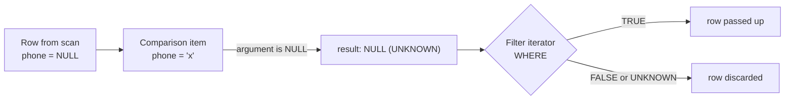

## Introduction

Real data is incomplete. A customer signs up without giving a phone number; an order has not shipped yet, so it has no ship date; a product that is a gift card belongs to no category. A relational table, however, is a rectangle: every row has a slot for every column. Something has to go into the slot when the fact is missing. In SQL that something is **NULL**.

NULL looks innocent, but it changes the rules of logic. The moment a column can be NULL, a simple comparison such as `phone = '+1-206-555-3615'` no longer has two possible outcomes. If `phone` is NULL, the database does not know whether the customer's phone is that number, so the comparison is neither true nor false — it is **UNKNOWN**. SQL therefore runs on **three-valued logic (3VL)**, and almost every surprising NULL bug in production — a report that "loses" rows, a filter that matches nothing, an `IF` that takes the wrong branch, a unique column that accepts duplicates — is a misunderstanding of 3VL.

This lesson answers the foundational questions:

- What does NULL *mean*, and why is it a **marker** rather than a value?
- What are the **truth tables** for `AND`, `OR` and `NOT` when one side is UNKNOWN — demonstrated with real queries?
- How do you test for NULL correctly (`IS NULL`, `IS UNKNOWN`, the null-safe `<=>`), and why does `= NULL` never work?
- What happens to NULL in **arithmetic** and **concatenation**?
- How do **constraints** — `NOT NULL`, `UNIQUE`, `CHECK`, `PRIMARY KEY` — treat NULL, and why do they not all agree?

Later, the lesson [NULL Handling Across Queries](/lessons/m03-null-handling) builds on this foundation and follows NULL through joins, aggregates, `GROUP BY`, `NOT IN` subqueries and `ORDER BY`. Here we concentrate on the logic itself and on what the table definition says about NULL.

:::note[Dataset]
The examples use the **shop** dataset. In `customers`, `phone` is NULL for every 5th customer and `loyalty_tier` is NULL for some; in `orders`, `shipped_at` is NULL until an order ships and `discount_code` is NULL for orders that used no code; `products.category_id` is NULL for the gift card. Every output below was captured from a real MySQL server.
:::

## DBMS Theory

:::theory[NULL is a marker, not a value]
E. F. Codd's **Rule 3** for relational systems ("systematic treatment of null values") requires a representation of *missing information* that is distinct from every regular value — distinct from zero, from the empty string and from any other value of the column's domain — and that is handled the same way regardless of data type. SQL implements this with a single marker, **NULL**.

NULL is not a member of any domain. It is not "a special number" or "a special string"; it says *there is no value here*. Consequently a comparison that involves NULL cannot be decided: `NULL = 5` might be true or false depending on the missing value, and `NULL = NULL` compares two unknowns that may or may not be the same. SQL gives every such comparison the third truth value **UNKNOWN**.
:::

Codd later distinguished two kinds of missing information: **applicable but unknown** ("this customer has a phone, but we do not know it") and **inapplicable** ("a gift card has no category"). He proposed two different marks (and therefore a four-valued logic) to keep them apart. SQL never adopted that: it has **one NULL** for both meanings. The database cannot tell *why* a value is missing — your schema documentation and application logic must. This is one reason experienced designers keep nullable columns to a minimum and document what NULL means for each one.

### The three truth values

The logic SQL uses is **Kleene's strong three-valued logic**. Think of UNKNOWN as "could be TRUE or FALSE — we do not know which". An operator returns a definite result only if the result would be the same whichever value UNKNOWN stands for.

**NOT**

| p | NOT p |
|---|---|
| TRUE | FALSE |
| FALSE | TRUE |
| UNKNOWN | UNKNOWN |

**AND** — FALSE dominates: if either side is FALSE, the conjunction is FALSE no matter what the unknown is.

| AND | TRUE | FALSE | UNKNOWN |
|---|---|---|---|
| **TRUE** | TRUE | FALSE | UNKNOWN |
| **FALSE** | FALSE | FALSE | FALSE |
| **UNKNOWN** | UNKNOWN | FALSE | UNKNOWN |

**OR** — TRUE dominates: if either side is TRUE, the disjunction is TRUE no matter what the unknown is.

| OR | TRUE | FALSE | UNKNOWN |
|---|---|---|---|
| **TRUE** | TRUE | TRUE | TRUE |
| **FALSE** | TRUE | FALSE | UNKNOWN |
| **UNKNOWN** | TRUE | UNKNOWN | UNKNOWN |

A useful way to remember the tables: order the values FALSE < UNKNOWN < TRUE. Then `AND` is the **minimum** of its operands, `OR` is the **maximum**, and `NOT` flips the order (UNKNOWN stays in the middle).

### Consequences that break two-valued intuition

1. **The law of the excluded middle fails.** In Boolean logic `p OR NOT p` is always TRUE. In 3VL, if `p` is UNKNOWN then `NOT p` is UNKNOWN and `p OR NOT p` is UNKNOWN. So `WHERE phone = 'x' OR phone <> 'x'` does **not** return every row — it misses the rows where `phone` is NULL.
2. **Comparison is not reflexive.** `x = x` is UNKNOWN when `x` is NULL. NULL is not equal to itself.
3. **Different SQL clauses treat UNKNOWN differently.** This asymmetry is the single most important rule in this lesson:

| Context | Keeps / accepts the row when the condition is… | UNKNOWN is treated like… |
|---|---|---|
| `WHERE`, `HAVING`, `ON`, `CASE WHEN` | TRUE only | FALSE (row rejected / branch skipped) |
| `CHECK` constraint | not FALSE (TRUE or UNKNOWN) | TRUE (row accepted) |

Filters are *"prove it is true"*; constraints are *"reject only what is provably false"*. Both rules are mandated by the SQL standard, and MySQL follows them.

:::standard[Standard SQL vs MySQL]
The SQL:1999 standard defines a `BOOLEAN` type whose values are TRUE, FALSE and UNKNOWN, and the predicates `IS [NOT] TRUE/FALSE/UNKNOWN` and `IS [NOT] DISTINCT FROM` (null-safe comparison). **MySQL has no real Boolean type**: `BOOLEAN` is a synonym for `TINYINT(1)`, TRUE is the integer 1, FALSE is 0, and **UNKNOWN is represented by NULL**. MySQL supports `IS [NOT] TRUE/FALSE/UNKNOWN`, but not `IS [NOT] DISTINCT FROM`; instead it offers the **MySQL-specific** null-safe equality operator `<=>`. `ISNULL(expr)` and `IFNULL()` are also MySQL extensions; `COALESCE` and `NULLIF` are standard.
:::

## Why It Exists

Every alternative to NULL has been tried, and each causes worse problems:

- **Sentinel values** — storing `-1` for an unknown quantity, `''` for an unknown phone, `'1900-01-01'` for an unknown date. Sentinels are *real values* of the domain, so the database happily computes with them: `AVG(quantity)` includes the −1s, `MIN(signup_date)` reports 1900, `ORDER BY` puts fake dates first, and every query must remember the convention. Worse, conventions differ between teams (`0`, `-1`, `9999`), and a sentinel can collide with a legitimate value (a temperature of −1 °C is real).
- **Flag columns** — `phone VARCHAR(20) NOT NULL` plus `phone_known BOOLEAN`. This is honest but doubles the columns, and nothing stops a row from having `phone_known = FALSE` and a phone number at the same time unless you add constraints.
- **Splitting tables** — moving optional attributes into a separate table (`customer_phones(customer_id, phone)`) so that "missing" is simply "no row". This is the purist relational answer (and a good design for optional *multi-valued* attributes), but it forces a join for every read.

NULL gives the database a **uniform, type-independent** representation of "no value" that aggregates skip, comparisons refuse to decide on, and constraints can reason about. The price is 3VL. The price is worth paying only if every developer understands it — which is why this lesson exists.

What goes wrong when 3VL is ignored is rarely an error message. It is a **silently wrong answer**: a `WHERE` clause quietly drops the NULL rows, and the report is short by exactly the number of incomplete records. Silent wrongness is the most expensive kind of bug, because nobody knows to look for it.

## Internal Working

:::internals[How MySQL represents and evaluates NULL]
**In the server (SQL layer).** Every expression node (`Item`) in MySQL's parsed expression tree carries a `null_value` flag next to its result. A comparison item such as `phone = 'x'` first evaluates both arguments; if either sets `null_value`, the comparison returns NULL (UNKNOWN) without comparing anything. `AND`/`OR` items implement the Kleene tables with short-circuiting: `AND` stops at the first FALSE operand and returns 0 even if another operand is NULL; `OR` stops at the first TRUE operand. The `Filter` iterator that implements `WHERE` passes a row up the plan only when the condition evaluates to a non-NULL, non-zero value — UNKNOWN rows are discarded exactly like FALSE rows.

**In InnoDB (storage layer).** In the `COMPACT` and `DYNAMIC` row formats (`DYNAMIC` is the default), each record header contains a **NULL bitmap** with one bit per nullable column, rounded up to whole bytes. A NULL column is recorded only by its bit — it occupies **no space** in the data part of the record, even for fixed-width types such as `INT` or `CHAR(10)`. Columns declared `NOT NULL` have no bit at all. (The legacy `REDUNDANT` format stored fixed-width NULL columns at full width.)

**In indexes.** Secondary B+ tree indexes store NULL keys like any other key; MySQL sorts NULL **before** all non-NULL values, so `col IS NULL` is an ordinary index lookup (`ref` access) and `col = ? OR col IS NULL` has a dedicated `ref_or_null` access method. A `UNIQUE` index does not treat two NULL keys as duplicates, because NULL is not equal to NULL — so it admits any number of NULLs.
:::



The optimizer also exploits `NOT NULL` declarations. If a column is declared `NOT NULL`, the predicate `col IS NULL` can never be true, and MySQL proves this at optimization time — you will see *"Impossible WHERE"* in a plan below. Declaring columns `NOT NULL` is therefore not only a data-quality rule; it gives the optimizer facts it can use.

## MySQL Implementation

### The truth tables, executed

The following query cross-joins the three truth values with themselves and evaluates `AND` and `OR` for every combination. MySQL displays TRUE as `1`, FALSE as `0` and UNKNOWN as `NULL`:

```sql run
WITH v(p) AS (SELECT TRUE UNION ALL SELECT FALSE UNION ALL SELECT NULL)
SELECT a.p        AS p,
       b.p        AS q,
       a.p AND b.p AS p_and_q,
       a.p OR  b.p AS p_or_q
FROM v AS a CROSS JOIN v AS b
ORDER BY a.p IS NULL, a.p DESC, b.p IS NULL, b.p DESC;
```

Read the nine rows against the tables in the theory section: `0 AND NULL` is `0` (FALSE dominates `AND`), `1 OR NULL` is `1` (TRUE dominates `OR`), and every other combination involving NULL is NULL. `NOT` and the excluded middle:

```sql run
WITH v(p) AS (SELECT TRUE UNION ALL SELECT FALSE UNION ALL SELECT NULL)
SELECT p,
       NOT p          AS not_p,
       p OR NOT p     AS excluded_middle,
       p AND NOT p    AS contradiction
FROM v
ORDER BY p IS NULL, p DESC;
```

For TRUE and FALSE, `p OR NOT p` is 1 and `p AND NOT p` is 0 — classical logic. For UNKNOWN both are NULL: three-valued logic has no excluded middle.

### Comparisons with NULL

Every ordinary comparison operator returns NULL if either operand is NULL — including NULL compared with itself:

```sql run
SELECT NULL = NULL      AS eq,
       NULL <> NULL     AS ne,
       NULL < 1         AS lt,
       NULL = 0         AS eq_zero,
       NULL = ''        AS eq_empty,
       NULL <=> NULL    AS null_safe_eq,
       1 <=> NULL       AS null_safe_one,
       NULL IS NULL     AS is_null,
       ISNULL(NULL)     AS isnull_fn;
```

`<=>` is the **null-safe equality** operator: it never returns NULL. It returns 1 if both operands are equal *or both are NULL*, and 0 otherwise. `IS NULL` is the standard predicate for testing the marker.

### Testing truth values: IS [NOT] TRUE / FALSE / UNKNOWN

`IS UNKNOWN` asks "did this condition evaluate to UNKNOWN?" and, like `IS NULL`, always returns 1 or 0. These predicates turn a three-valued result into a two-valued one, which is exactly what you need to write filters that behave predictably:

```sql run
WITH v(p) AS (SELECT TRUE UNION ALL SELECT FALSE UNION ALL SELECT NULL)
SELECT p,
       p IS TRUE        AS is_true,
       p IS FALSE       AS is_false,
       p IS UNKNOWN     AS is_unknown,
       p IS NOT TRUE    AS is_not_true,
       p IS NOT UNKNOWN AS is_not_unknown
FROM v
ORDER BY p IS NULL, p DESC;
```

Note the last two columns: `p IS NOT TRUE` is 1 for both FALSE **and** UNKNOWN — the precise complement of what `WHERE p` keeps. `IS UNKNOWN` on a Boolean expression is equivalent to `IS NULL` in MySQL, because UNKNOWN *is* NULL here.

### What this does to a real filter

Count customers by phone, the wrong way and the right way:

```sql run
SELECT (SELECT COUNT(*) FROM customers)                         AS all_customers,
       (SELECT COUNT(*) FROM customers WHERE phone = NULL)      AS eq_null,
       (SELECT COUNT(*) FROM customers WHERE phone IS NULL)     AS is_null,
       (SELECT COUNT(*) FROM customers WHERE phone IS NOT NULL) AS is_not_null;
```

`phone = NULL` is UNKNOWN for **every** row — even rows whose phone is missing — so it matches nothing. `IS NULL` and `IS NOT NULL` partition the table exactly.

## Syntax Breakdown

| Operator / predicate | Standard? | Returns | Meaning |
|---|---|---|---|
| `expr IS NULL` | Standard | 1 / 0 | `expr` is the NULL marker |
| `expr IS NOT NULL` | Standard | 1 / 0 | `expr` has a value |
| `a = b`, `<>`, `<`, `>`, `<=`, `>=` | Standard | 1 / 0 / NULL | NULL if either side is NULL |
| `a <=> b` | **MySQL** | 1 / 0 | Null-safe equality: NULLs compare equal to each other (standard spelling: `a IS NOT DISTINCT FROM b`, unsupported in MySQL) |
| `NOT (a <=> b)` | **MySQL** idiom | 1 / 0 | Null-safe inequality ("is distinct from") |
| `p IS [NOT] TRUE` | Standard | 1 / 0 | Truth test that never returns UNKNOWN |
| `p IS [NOT] FALSE` | Standard | 1 / 0 | As above |
| `p IS [NOT] UNKNOWN` | Standard | 1 / 0 | `p` evaluated to UNKNOWN (NULL in MySQL) |
| `ISNULL(expr)` | **MySQL** | 1 / 0 | Function form of `expr IS NULL` |
| `COALESCE(a, b, …)` | Standard | first non-NULL argument | Replace NULL with a default (taught in [Conditional Expressions](/lessons/m03-conditional-expressions)) |
| `NULLIF(a, b)` | Standard | NULL if `a = b`, else `a` | Turn a sentinel back into NULL |
| `col … NULL` / `NOT NULL` in `CREATE TABLE` | Standard | — | Column may / may not hold NULL; the default is `NULL` (nullable) unless the column is part of the primary key |

:::warning[MySQL's `NOT` binds differently from what you might expect]
`NOT a = b` is parsed as `NOT (a = b)` in MySQL's default SQL mode (the `HIGH_NOT_PRECEDENCE` mode changes that to `(NOT a) = b`), and `NOT` binds more tightly than `AND`/`OR`. Always parenthesize: write `NOT (discount_code <=> 'VIP20')`, never rely on precedence when NULLs are involved.
:::

## Practical Examples

**1. NULL in arithmetic.** Any arithmetic operator with a NULL operand returns NULL — the result of computing with an unknown value is unknown:

```sql run
SELECT 10 + NULL        AS plus,
       10 * NULL        AS times,
       NULL - NULL      AS minus_self,
       NULL / 0         AS null_div_zero,
       ABS(NULL)        AS abs_null,
       GREATEST(5, NULL, 9) AS greatest_with_null;
```

`NULL - NULL` is not 0 (two unknowns need not be equal), and even `GREATEST` returns NULL as soon as one argument is NULL in MySQL 8.x.

**2. Division by zero is NULL too — in a SELECT.** MySQL returns NULL for `x / 0` and, because `ERROR_FOR_DIVISION_BY_ZERO` is part of the default SQL mode, records a warning:

```sql run
SELECT 1 / 0 AS one_over_zero, MOD(7, 0) AS mod_zero;
```

In an `INSERT` or `UPDATE` under strict mode the same expression is an **error** (shown under Common Mistakes). This is a MySQL-specific behaviour: standard SQL and most other databases raise an error for division by zero in every context.

**3. NULL in string concatenation.** `CONCAT` returns NULL if any argument is NULL — a classic source of blank labels in reports. `CONCAT_WS` (concatenate with separator, MySQL) skips NULL arguments, and `COALESCE` substitutes a placeholder:

```sql run
SELECT customer_id,
       phone,
       CONCAT(first_name, ' ', last_name, ' / ', phone)              AS concat_label,
       CONCAT_WS(' / ', CONCAT(first_name, ' ', last_name), phone)   AS concat_ws_label,
       CONCAT(first_name, ' ', last_name, ' / ', COALESCE(phone, 'no phone')) AS coalesce_label
FROM customers
WHERE customer_id BETWEEN 4 AND 6
ORDER BY customer_id;
```

Customer 5 has no phone, so `CONCAT` erased the whole label, including the name we *do* know.

:::standard[Oracle's empty string]
In MySQL, PostgreSQL and SQL Server the empty string `''` is a real value, different from NULL (`NULL = ''` is UNKNOWN, as you saw above). **Oracle Database treats `''` as NULL.** Code ported between them that relies on either behaviour breaks. In MySQL, decide deliberately whether "no phone" is NULL (unknown) or `''` (known to be empty) and enforce it.
:::

**4. The excluded middle on real data.** Ask "orders that used VIP20, plus orders that did not":

```sql run
SELECT (SELECT COUNT(*) FROM orders)                                   AS all_orders,
       (SELECT COUNT(*) FROM orders WHERE discount_code = 'VIP20')     AS vip20,
       (SELECT COUNT(*) FROM orders WHERE discount_code <> 'VIP20')    AS not_vip20,
       (SELECT COUNT(*) FROM orders
         WHERE discount_code = 'VIP20' OR discount_code <> 'VIP20')    AS vip20_or_not;
```

`vip20 + not_vip20` is 44, and the "tautology" `= OR <>` also returns 44 instead of 80: the 36 orders with no code are UNKNOWN on both sides of the `OR`.

**5. Constraints and NULL.** Create a small table that exercises all the column-level rules at once:

```sql run
CREATE TABLE employee_badges (
  badge_id      INT          PRIMARY KEY,          -- nullability not stated
  holder_name   VARCHAR(60)  NOT NULL,
  employee_code VARCHAR(10)  NULL UNIQUE,
  clearance     TINYINT      NULL CHECK (clearance BETWEEN 1 AND 5)
);
INSERT INTO employee_badges VALUES
  (1, 'Visitor A', NULL,   NULL),
  (2, 'Visitor B', NULL,   NULL),
  (3, 'Ana Ruiz',  'E-101', 3);
SELECT * FROM employee_badges ORDER BY badge_id;
```

Two rows have `employee_code` NULL, yet the `UNIQUE` constraint accepted both: NULL is not equal to NULL, so the two NULLs are not duplicates. Both visitors also have `clearance` NULL, and the `CHECK (clearance BETWEEN 1 AND 5)` accepted them: `NULL BETWEEN 1 AND 5` is UNKNOWN, and a CHECK rejects only FALSE. A real duplicate code, by contrast, is rejected:

```sql run error
INSERT INTO employee_badges VALUES (4, 'Ben Okoye', 'E-101', 2);
```

And so is a provably false clearance:

```sql run error
INSERT INTO employee_badges VALUES (5, 'Cy Park', 'E-102', 9);
```

If NULL must not slip through a CHECK, say so explicitly — either declare the column `NOT NULL`, or write the condition so that NULL makes it FALSE, e.g. `CHECK (clearance IS NOT NULL AND clearance BETWEEN 1 AND 5)`. The full constraint toolbox is the subject of [Constraints in MySQL](/lessons/m02-constraints-mysql).

**6. Primary keys are never NULL.** Entity integrity (see [Integrity Constraints](/lessons/m01-integrity-constraints)) requires every row to be identifiable, so primary key columns cannot hold NULL. MySQL silently makes a primary key column `NOT NULL` if you leave nullability unspecified — `badge_id` above was declared without `NOT NULL`. Look at what `SHOW CREATE TABLE` reports for `badge_id` and `employee_code`:

```sql run
SHOW CREATE TABLE employee_badges;
```

`employee_code` is shown as `DEFAULT NULL` — a nullable column whose implicit default is NULL — while the primary key and `holder_name` are `NOT NULL` with no default.

## Execution Walkthrough

The marketing team asks: *"How many orders did **not** use the WELCOME10 code?"* An analyst writes `WHERE discount_code <> 'WELCOME10'`. Let us trace, row by row, how the filter evaluates and why the answer is wrong.

```walkthrough
title: SELECT COUNT(*) FROM orders WHERE discount_code <> 'WELCOME10'
steps:
  - title: "1. FROM — the input rows (first 12 orders)"
    explain: >-
      The scan produces all 80 orders. Here are the first twelve. Some have a code, some have NULL —
      meaning "no code was used", which the business considers a perfectly definite fact, even though SQL
      stores it as the unknown marker.
    sql: |
      SELECT order_id, discount_code FROM orders WHERE order_id <= 12 ORDER BY order_id;
  - title: "2. Evaluate the predicate for each row"
    explain: >-
      The filter evaluates discount_code <> 'WELCOME10'. For rows with a code the result is 1 or 0. For rows
      with NULL the comparison item sees a NULL argument and returns NULL (UNKNOWN) without comparing. The
      truth_value column labels each outcome using IS TRUE / IS FALSE.
    sql: |
      SELECT order_id, discount_code,
             discount_code <> 'WELCOME10' AS predicate,
             CASE WHEN (discount_code <> 'WELCOME10') IS TRUE  THEN 'TRUE'
                  WHEN (discount_code <> 'WELCOME10') IS FALSE THEN 'FALSE'
                  ELSE 'UNKNOWN' END       AS truth_value
      FROM orders WHERE order_id <= 12 ORDER BY order_id;
  - title: "3. WHERE keeps only TRUE"
    explain: >-
      The filter iterator passes up only rows whose predicate is TRUE. FALSE rows (the WELCOME10 orders) and
      UNKNOWN rows (no code at all) are both discarded. Counting the three outcomes over all 80 orders shows
      how many rows fell into the UNKNOWN bucket.
    sql: |
      SELECT SUM((discount_code <> 'WELCOME10') IS TRUE)    AS true_rows,
             SUM((discount_code <> 'WELCOME10') IS FALSE)   AS false_rows,
             SUM((discount_code <> 'WELCOME10') IS UNKNOWN) AS unknown_rows
      FROM orders;
  - title: "4. The analyst's (wrong) result"
    explain: >-
      The aggregate counts only the TRUE rows. The orders without any code — which certainly did not use
      WELCOME10 — are missing from the answer.
    sql: |
      SELECT COUNT(*) AS not_welcome10_wrong FROM orders WHERE discount_code <> 'WELCOME10';
  - title: "5. The corrected filter"
    explain: >-
      NOT (discount_code <=> 'WELCOME10') is two-valued: <=> returns 0 for NULL vs 'WELCOME10', so NOT makes
      it 1, and the no-code orders are kept. The explicit form discount_code <> 'WELCOME10' OR discount_code
      IS NULL gives the same answer and is portable to other databases.
    sql: |
      SELECT COUNT(*) AS not_welcome10_null_safe FROM orders WHERE NOT (discount_code <=> 'WELCOME10');
```

The arithmetic of the trace: TRUE rows + FALSE rows + UNKNOWN rows = 80. The wrong query returned only the TRUE bucket; the corrected query returns TRUE + UNKNOWN.

**How the optimizer uses NULL information.** For a column declared `NOT NULL`, `IS NULL` is provably false, so MySQL does not even touch the table:

```sql run
EXPLAIN SELECT * FROM customers WHERE email IS NULL;
```

The `Extra` column reports *Impossible WHERE*. For a nullable column with an index, `IS NULL` is an ordinary index lookup. Add an index on `phone` in the lab and look at the plan:

```sql run
CREATE INDEX idx_customers_phone ON customers (phone);
ANALYZE TABLE customers;
EXPLAIN SELECT customer_id FROM customers WHERE phone IS NULL;
```

The access type is `ref` on `idx_customers_phone`: NULL keys are stored in the index (at the start of the key order), so finding them is a lookup, not a scan.

## Output

The walkthrough produced two answers to the same business question: 29 orders with the naive `<>` filter and 65 with the null-safe filter. The difference, 36, is exactly the number of orders whose `discount_code` is NULL:

```sql run
SELECT COUNT(*)                                          AS all_orders,
       SUM(discount_code = 'WELCOME10')                  AS used_welcome10,
       SUM(discount_code IS NULL)                        AS no_code,
       SUM(NOT (discount_code <=> 'WELCOME10'))          AS did_not_use_welcome10
FROM orders;
```

How to read it: `used_welcome10 + did_not_use_welcome10 = all_orders` — the null-safe predicate partitions the table into two complementary groups, which is what the business question assumed. With plain `=`/`<>` the table splits into **three** groups (TRUE, FALSE, UNKNOWN), and any report that adds up only two of them is short.

## Alternative Approaches

There are several correct ways to express a NULL-aware condition. Choose based on portability, readability and index use:

| Goal | Option | Notes |
|---|---|---|
| "a differs from b, NULLs count as values" | `NOT (a <=> b)` | Concise; MySQL-only |
| | `a <> b OR a IS NULL OR b IS NULL` … | Portable but easy to get wrong (it treats NULL vs NULL as different) |
| | `a IS DISTINCT FROM b` | Standard SQL (PostgreSQL, SQL Server 2022+); **not** available in MySQL |
| "value is missing" | `col IS NULL` | Standard, index-friendly (`ref` / `ref_or_null`) |
| | `ISNULL(col)` | MySQL function; same meaning, less portable |
| | `COALESCE(col, 'x') = 'x'` | Avoid: not sargable, and confuses a real `'x'` with NULL |
| "treat missing as a default in output" | `COALESCE(col, default)` | Standard; use in the SELECT list, not to hide NULLs in filters |
| "never have to think about NULL here" | Declare the column `NOT NULL` (with a `DEFAULT` if appropriate) | The best option when the attribute is always known |
| "optional attribute" | Move it to a separate 1:0..1 table | Purist design: "missing" becomes "no row"; costs a join |

```sql run
-- Three equivalent ways to find orders that have not shipped
SELECT (SELECT COUNT(*) FROM orders WHERE shipped_at IS NULL)              AS is_null,
       (SELECT COUNT(*) FROM orders WHERE ISNULL(shipped_at))              AS isnull_fn,
       (SELECT COUNT(*) FROM orders WHERE shipped_at <=> NULL)             AS null_safe;
```

All three return the same count; `IS NULL` is the one every SQL reader and every database understands.

## Performance Analysis

NULL handling has three performance dimensions:

1. **Storage.** In InnoDB's `DYNAMIC`/`COMPACT` formats a NULL costs one bit in the record header and nothing in the data area. A nullable column adds that bit (rounded up per 8 nullable columns) to *every* row, even when the value is present. This is negligible for most tables; it is not a reason to avoid NULL where it is semantically correct.
2. **Index access.** `col IS NULL` and `col = ? OR col IS NULL` can use a B+ tree index (`ref`, `ref_or_null`). Rewrites that wrap the column in a function — `COALESCE(col, 0) = 0`, `IFNULL(col, '') = ''` — hide the column from the optimizer and force a scan of every row (see [Sargable Queries](/lessons/m07-sargable-queries)).
3. **Optimizer knowledge.** A `NOT NULL` declaration lets the optimizer remove impossible predicates (you saw *Impossible WHERE*), simplify outer joins into inner joins when a `WHERE` clause rejects NULL-extended rows, and transform `NOT IN` subqueries into efficient anti-joins. With nullable columns some of these transformations are not valid, because a NULL in the subquery changes the answer to UNKNOWN.

:::performance[Theory vs measurement]
On the 25-row customers table every one of these queries runs in microseconds — the point of the `EXPLAIN` output above is the **access type**, not the time. On a large table, the difference between `phone IS NULL` (index lookup over the matching entries) and `COALESCE(phone, '') = ''` (full scan) grows linearly with table size. Measure on realistic data with `EXPLAIN ANALYZE` ([EXPLAIN ANALYZE](/lessons/m07-explain-analyze)).
:::

## Best Practices

:::best-practice[Professional habits for NULL]
1. **Default to `NOT NULL`.** Make a column nullable only when "unknown / not applicable" is a legitimate state, and write down what NULL means for that column (unknown? not applicable? not yet?).
2. **Never compare with `= NULL` or `<> NULL`.** Use `IS NULL` / `IS NOT NULL`. Treat `= NULL` in code review as a bug.
3. **Use `NOT (a <=> b)` for change detection** and null-safe joins in MySQL; use `IS DISTINCT FROM` in databases that support it.
4. **When negating a condition on a nullable column, decide where the NULL rows belong** and say so in the SQL: `col <> 'x' OR col IS NULL`.
5. **Make CHECK constraints NULL-proof** when NULL should not pass: add `NOT NULL` or `col IS NOT NULL AND …`.
6. **Do not use sentinels** (`-1`, `''`, `'1900-01-01'`) to avoid NULL. If you inherit them, convert with `NULLIF(col, -1)` when reading.
7. **Use `CONCAT_WS` or `COALESCE`** when building display strings from optional parts.
8. **Keep `ERROR_FOR_DIVISION_BY_ZERO` and strict mode enabled** (both are defaults) so arithmetic on bad data fails loudly on write.
:::

## Common Mistakes

**Mistake 1 — `= NULL`.** It is not an error, which is what makes it dangerous; it simply returns nothing:

```sql run
SELECT COUNT(*) AS customers_with_no_phone_WRONG FROM customers WHERE phone = NULL;
```

```sql run
SELECT COUNT(*) AS customers_with_no_phone FROM customers WHERE phone IS NULL;
```

**Mistake 2 — inserting NULL into a `NOT NULL` column.** Under strict mode (the default) MySQL rejects the row with error 1048:

```sql run error
INSERT INTO employee_badges VALUES (6, NULL, 'E-103', 1);
```

**Mistake 3 — trying to make a primary key column nullable.** Explicitly declaring `NULL` on a primary key column is an error (1171), because entity integrity forbids it:

```sql run error
CREATE TABLE bad_pk (id INT NULL PRIMARY KEY);
```

**Mistake 4 — dividing by zero on write.** The SELECT above returned NULL with a warning; in an `INSERT` or `UPDATE` under strict mode the same arithmetic aborts the statement with error 1365:

```sql run error
UPDATE products SET cost = cost / 0 WHERE product_id = 1;
```

**Mistake 5 — assuming `NOT IN` handles NULL.** `2 NOT IN (1, NULL)` means `2 <> 1 AND 2 <> NULL`, i.e. `TRUE AND UNKNOWN` = UNKNOWN:

```sql run
SELECT 2 IN (1, NULL) AS in_list, 1 IN (1, NULL) AS found, 2 NOT IN (1, NULL) AS not_in_list;
```

A `NOT IN (subquery)` whose subquery returns even one NULL therefore matches **no rows at all**. This trap and its fix (`NOT EXISTS`) are covered in [EXISTS, IN and NOT IN](/lessons/m04-exists-in).

**Mistake 6 — `CONCAT` with an optional column** wipes out the whole string (Practical Example 3). Use `CONCAT_WS` or `COALESCE`.

## Industry Application

- **Data quality gates.** ETL and ELT pipelines assert NULL rates before publishing a table: "`email` must have 0 NULLs", "`shipped_at` may be NULL only when `status IN ('pending','paid','cancelled')`". Tools such as dbt express these as `not_null` tests; underneath they are `WHERE col IS NULL` queries. A NULL rate that jumps overnight is one of the most common signals of a broken upstream system.
- **Change data capture and auditing.** Detecting which columns changed between an old and a new row version must treat NULL→value and value→NULL as changes. Using `<>` misses them; production CDC code in MySQL uses `NOT (old <=> new)`.
- **Schema reviews.** Many engineering teams require a justification for every nullable column in a pull request that adds a table, because every nullable column multiplies the cases application code must handle, and NULL-related bugs rarely raise errors.
- **Portability between engines.** Teams migrating between MySQL, PostgreSQL, SQL Server and Oracle hit NULL differences constantly: Oracle's `'' IS NULL`, SQL Server's unique constraints that allow only **one** NULL (MySQL and PostgreSQL allow many; PostgreSQL 15+ and SQL:2023 add `NULLS NOT DISTINCT` to forbid duplicates of NULL), sort placement of NULLs (`NULLS FIRST/LAST` exists in PostgreSQL and Oracle but not MySQL), and `IS DISTINCT FROM` support.
- **Machine learning feature pipelines.** Missingness is often *informative* ("no phone on file" correlates with churn). Data scientists extract it explicitly (`phone IS NULL AS has_no_phone`) before imputing values; imputing first with `COALESCE` destroys the signal.

## Practice Exercises

These exercises use only `SELECT`, `WHERE` and `COUNT`/`SUM`, which you can use before studying Module 3 in depth. Every exercise is graded by comparing your result with the reference solution on a fresh copy of the dataset.

```exercise
id: ex1
title: Orders without a discount code
difficulty: easy
concepts: [is-null, null]
prompt: |
  Return **one row with one column** named `no_code`: the number of orders that did not use any
  discount code (their `discount_code` is NULL).
hints:
  - "Which predicate tests for the NULL marker? It is not `=`."
  - "Use `WHERE discount_code IS NULL` and `COUNT(*)`."
solution: |
  SELECT COUNT(*) AS no_code FROM orders WHERE discount_code IS NULL;
explanation: |
  `discount_code = NULL` would return 0, because the comparison is UNKNOWN for every row and `WHERE` keeps
  only TRUE. `COUNT(*) - COUNT(discount_code)` is an equivalent answer without a WHERE clause.
```

```exercise
id: ex2
title: Orders that did not use VIP20
difficulty: medium
concepts: [three-valued-logic, null-safe-equality]
prompt: |
  Return **one row with one column** named `not_vip20`: the number of orders that did **not** use the
  discount code `VIP20`. Orders that used no code at all certainly did not use VIP20 and must be counted.
hints:
  - "`discount_code <> 'VIP20'` is UNKNOWN for orders with no code, and WHERE drops UNKNOWN rows."
  - "Either add `OR discount_code IS NULL`, or use the null-safe operator: `NOT (discount_code <=> 'VIP20')`."
solution: |
  SELECT COUNT(*) AS not_vip20 FROM orders WHERE NOT (discount_code <=> 'VIP20');
explanation: |
  The typical wrong answer, `WHERE discount_code <> 'VIP20'`, counts only orders that have *some other*
  code. `discount_code <> 'VIP20' OR discount_code IS NULL` is the portable equivalent of the null-safe form.
  `(discount_code = 'VIP20') IS NOT TRUE` is a third correct spelling: it is 1 for FALSE and for UNKNOWN.
```

```exercise
id: ex3
title: Contact labels that survive missing phones
difficulty: medium
concepts: [null-arithmetic, null]
prompt: |
  For customers 1 to 10, return two columns in this order:

  1. `customer_id`
  2. `label` — the first name, a space, the last name, the text ` - `, and the phone number; when the phone
     is NULL use the text `no phone` instead of the number. Example: `Grace Smith - no phone`.

  Order by `customer_id`.
hints:
  - "`CONCAT` returns NULL if any argument is NULL."
  - "Replace the phone with `COALESCE(phone, 'no phone')` inside the CONCAT."
solution: |
  SELECT customer_id,
         CONCAT(first_name, ' ', last_name, ' - ', COALESCE(phone, 'no phone')) AS label
  FROM customers
  WHERE customer_id BETWEEN 1 AND 10
  ORDER BY customer_id;
orderMatters: true
explanation: |
  Without `COALESCE`, customers 5 and 10 get a NULL label. `CONCAT_WS(' - ', CONCAT(first_name, ' ', last_name), phone)`
  avoids the NULL but produces `Grace Smith` without the placeholder, which does not match the specification.
```

```exercise
id: ex4
title: A three-bucket loyalty report
difficulty: hard
concepts: [truth-tables, three-valued-logic, is-null]
prompt: |
  For the predicate `loyalty_tier = 'gold'`, count how many customers fall into each truth value.
  Return **one row** with three columns in this order: `is_true`, `is_false`, `is_unknown`.
  The three numbers must add up to the number of customers.
hints:
  - "`IS TRUE`, `IS FALSE` and `IS UNKNOWN` turn a three-valued result into 1 or 0."
  - "`SUM(boolean_expression)` counts the rows where it is 1."
  - "Parenthesize the comparison: `(loyalty_tier = 'gold') IS UNKNOWN`."
solution: |
  SELECT SUM((loyalty_tier = 'gold') IS TRUE)    AS is_true,
         SUM((loyalty_tier = 'gold') IS FALSE)   AS is_false,
         SUM((loyalty_tier = 'gold') IS UNKNOWN) AS is_unknown
  FROM customers;
explanation: |
  Each customer lands in exactly one bucket. `SUM(loyalty_tier = 'gold')` alone gives the TRUE count, but
  `SUM(loyalty_tier <> 'gold')` does not give the FALSE + UNKNOWN count — it ignores the NULL results.
  `is_unknown` equals the number of customers whose tier is NULL; `SUM(loyalty_tier IS NULL)` is an
  equivalent expression for the last column.
```

```exercise
id: ex5
title: Price rules with open-ended bounds
difficulty: challenge
concepts: [three-valued-logic, null, is-null]
setup: |
  CREATE TABLE price_rules (
    rule_id   INT PRIMARY KEY,
    rule_name VARCHAR(40) NOT NULL,
    min_price DECIMAL(10,2) NULL,   -- NULL = no lower bound
    max_price DECIMAL(10,2) NULL    -- NULL = no upper bound
  );
  INSERT INTO price_rules VALUES
    (1, 'budget',        NULL,   50.00),
    (2, 'mid-range',     50.00, 200.00),
    (3, 'premium',      200.00,   NULL),
    (4, 'everything',     NULL,   NULL),
    (5, 'under-100',      NULL,  100.00),
    (6, 'broken-rule',  300.00, 100.00);
prompt: |
  In the `price_rules` table (created for you), a NULL bound means "unbounded". Return the `rule_id` and
  `rule_name` of every rule that applies to a product priced **129.99**, i.e. `min_price <= 129.99` (or no
  lower bound) **and** `129.99 <= max_price` (or no upper bound). Order by `rule_id`.
hints:
  - "`129.99 BETWEEN min_price AND max_price` is UNKNOWN whenever a bound is NULL, so WHERE drops those rules."
  - "Handle each bound separately: `(min_price IS NULL OR min_price <= 129.99)`."
  - "Combine the two bound conditions with AND."
solution: |
  SELECT rule_id, rule_name
  FROM price_rules
  WHERE (min_price IS NULL OR min_price <= 129.99)
    AND (max_price IS NULL OR 129.99 <= max_price)
  ORDER BY rule_id;
orderMatters: true
explanation: |
  The naive `WHERE 129.99 BETWEEN min_price AND max_price` returns only the mid-range rule: every rule with a
  NULL bound evaluates to UNKNOWN (or FALSE) and disappears. `COALESCE(min_price, 0) <= 129.99 AND
  129.99 <= COALESCE(max_price, 99999999.99)` also works but embeds magic numbers. The rule `broken-rule`
  (min > max) can never match; a `CHECK (min_price IS NULL OR max_price IS NULL OR min_price <= max_price)`
  would have prevented it — note that this CHECK is written to accept NULL bounds deliberately.
```

```exercise
id: ex6
title: NULL or sentinel for an end date?
difficulty: medium
kind: open
concepts: [null, null-constraints]
prompt: |
  A table `employment(employee_id, start_date, end_date)` records job assignments. A colleague proposes
  `end_date DATE NOT NULL DEFAULT '9999-12-31'` for current assignments instead of a nullable `end_date`.
  Give one argument for each design, explain how the choice affects the query "assignments active on a given
  date", and state which you would pick and why.
solution: |
  **Nullable `end_date` (NULL = still active).** Semantically honest: the end is genuinely not known yet.
  Aggregates such as `MAX(end_date)` are not polluted by a fake date. But every range query must handle the NULL:
  `WHERE start_date <= :d AND (end_date IS NULL OR end_date >= :d)`, and forgetting the `IS NULL` branch
  silently drops every current employee.

  **Sentinel `'9999-12-31'`.** The predicate becomes a simple, index-friendly range,
  `WHERE start_date <= :d AND end_date >= :d`, with no 3VL trap, and `end_date` can be part of a composite
  index without NULL handling. This pattern is common in data warehouses (slowly changing dimensions type 2).
  The costs: a fake value that must be documented, excluded from statistics (`MAX(end_date)` is meaningless),
  and never displayed to users.

  A reasonable choice: in an OLTP schema prefer NULL plus a view or helper predicate that encapsulates the
  `IS NULL OR` logic; in an analytical dimension table the sentinel is a defensible, widely understood
  convention. Either way, document it and enforce it (`NOT NULL` with the sentinel, or a CHECK such as
  `end_date IS NULL OR end_date >= start_date`).
```

## Knowledge Assessment

```quiz
- id: q1
  question: "What does `SELECT NULL AND FALSE, NULL AND TRUE, NULL OR TRUE;` return in MySQL?"
  options: ["NULL, NULL, NULL", "0, NULL, 1", "0, 0, 1", "NULL, 1, 1"]
  answer: 1
  explanation: "Kleene logic: FALSE dominates AND (the result is FALSE whatever the unknown is), TRUE dominates OR. Only NULL AND TRUE is undecided, so it is NULL. 'All NULL' is the common misconception that any NULL operand makes the result NULL — true for arithmetic and comparisons, not for AND/OR."
  concepts: [truth-tables, three-valued-logic]
- id: q2
  question: "A table has 100 rows; column `region` is NULL in 10 rows and 'EU' in 30 rows. How many rows does `WHERE region = 'EU' OR region <> 'EU'` return?"
  options: ["100", "90", "30", "70"]
  answer: 1
  explanation: "For the 10 NULL rows both comparisons are UNKNOWN, and UNKNOWN OR UNKNOWN is UNKNOWN, which WHERE rejects. The excluded middle does not hold in 3VL, so the 'tautology' returns 90, not 100. 30 and 70 are each one half of the condition."
  concepts: [three-valued-logic]
- id: q3
  question: "Which expressions return 1 when both `a` and `b` are NULL? (Select all that apply.)"
  type: multi
  options: ["a = b", "a <=> b", "a IS NULL AND b IS NULL", "(a = b) IS UNKNOWN", "NOT (a <> b)"]
  answer: [1, 2, 3]
  explanation: "a <=> b is null-safe equality and returns 1 for two NULLs. The explicit IS NULL test returns 1. (a = b) is UNKNOWN, so (a = b) IS UNKNOWN returns 1. a = b returns NULL, and NOT (a <> b) is NOT NULL = NULL."
  concepts: [null-safe-equality, is-null, truth-tables]
- id: q4
  question: "A column `qty INT NULL` has `CHECK (qty > 0)`. Which INSERT values are accepted?"
  options: ["Only positive numbers", "Positive numbers and NULL", "Positive numbers, 0 and NULL", "Only NULL"]
  answer: 1
  explanation: "A CHECK constraint rejects a row only when its condition is FALSE. For NULL, qty > 0 is UNKNOWN, so the row is accepted. 0 makes the condition FALSE and is rejected (error 3819). To reject NULL as well, declare the column NOT NULL."
  concepts: [null-constraints, three-valued-logic]
- id: q5
  question: "A `UNIQUE` index exists on the nullable column `employee_code`. What happens when three rows are inserted with `employee_code` NULL in MySQL 8.4?"
  options:
    - "The second insert fails with a duplicate-key error"
    - "All three inserts succeed, because NULL is not equal to NULL"
    - "MySQL converts the NULLs to empty strings to keep them unique"
    - "The index silently becomes non-unique"
  answer: 1
  explanation: "Uniqueness is checked with equality, and two NULLs are never equal, so InnoDB's UNIQUE index admits any number of NULLs. SQL Server behaves differently (one NULL only), which is a common portability surprise; MySQL has no NULLS NOT DISTINCT option."
  concepts: [null-constraints]
- id: q6
  question: "What does `SELECT CONCAT('Order ', NULL), CONCAT_WS('-', 'A', NULL, 'B'), 5 + NULL;` return?"
  options: ["'Order ', 'A--B', 5", "NULL, 'A-B', NULL", "NULL, NULL, NULL", "'Order NULL', 'A-NULL-B', 5"]
  answer: 1
  explanation: "CONCAT returns NULL if any argument is NULL; CONCAT_WS skips NULL arguments (it does not add an empty element, so there is no double separator); arithmetic with NULL yields NULL. NULL is never converted to the text 'NULL' or to 0."
  concepts: [null-arithmetic]
- id: q7
  question: "Why does `EXPLAIN SELECT * FROM customers WHERE email IS NULL` report 'Impossible WHERE' in the shop schema?"
  options:
    - "Because the email index does not store NULLs"
    - "Because email is declared NOT NULL, so the predicate can never be true and the optimizer skips the table"
    - "Because IS NULL is not sargable"
    - "Because the table statistics are out of date"
  answer: 1
  explanation: "The optimizer uses the NOT NULL declaration as a fact. InnoDB indexes do store NULL keys (IS NULL on a nullable indexed column is a ref lookup), and IS NULL is sargable. Statistics play no role in this proof."
  concepts: [is-null, null-constraints]
- id: q8
  question: "In MySQL, how is the SQL truth value UNKNOWN represented?"
  options: ["As a special BOOLEAN value distinct from NULL", "As NULL", "As -1", "As 0"]
  answer: 1
  explanation: "MySQL's BOOLEAN is TINYINT(1): TRUE is 1, FALSE is 0, and UNKNOWN is NULL. That is why IS UNKNOWN and IS NULL agree on Boolean expressions. Standard SQL defines a real BOOLEAN type with UNKNOWN, but MySQL does not implement it."
  concepts: [three-valued-logic]
- id: q9
  question: "An analyst needs orders whose `status` changed between two snapshot tables, where either snapshot may hold NULL. Which condition is correct in MySQL?"
  options: ["old.status <> new.status", "NOT (old.status <=> new.status)", "old.status != new.status OR old.status IS NULL", "COALESCE(old.status, '') <> COALESCE(new.status, '')"]
  answer: 1
  explanation: "NOT (a <=> b) is null-safe inequality: it is 1 for value→NULL, NULL→value and value→other value, and 0 for NULL→NULL. Plain <> misses changes involving NULL; the OR variant reports NULL→NULL as a change; COALESCE with '' confuses a real empty string with NULL and prevents index use."
  concepts: [null-safe-equality]
```
