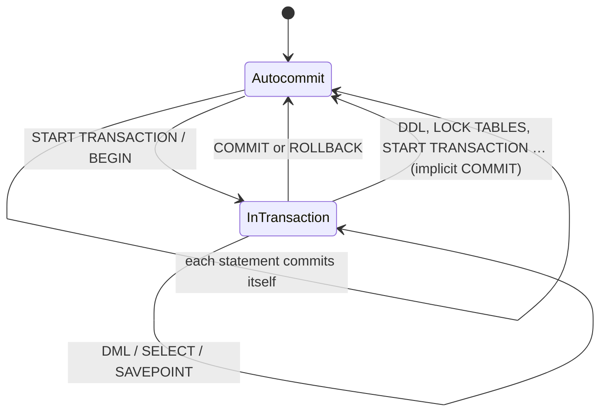

## Introduction

SQL is one language, but its statements do very different jobs. Some describe the **structure** of data (`CREATE TABLE`), some change the **contents** (`INSERT`, `UPDATE`, `DELETE`), some **ask questions** (`SELECT`), some control **who may do what** (`GRANT`, `REVOKE`), and some control **transactions** (`START TRANSACTION`, `COMMIT`, `ROLLBACK`). The conventional names for these groups are:

| Category | Stands for | Typical statements |
|---|---|---|
| **DDL** | Data Definition Language | `CREATE`, `ALTER`, `DROP`, `TRUNCATE`, `RENAME` |
| **DML** | Data Manipulation Language | `INSERT`, `UPDATE`, `DELETE`, `REPLACE` (and in many texts `SELECT`) |
| **DQL** | Data Query Language | `SELECT`, `TABLE`, `VALUES` (`WITH … SELECT`) |
| **DCL** | Data Control Language | `GRANT`, `REVOKE` (MySQL also: `CREATE USER`, roles) |
| **TCL** | Transaction Control Language | `START TRANSACTION`/`BEGIN`, `COMMIT`, `ROLLBACK`, `SAVEPOINT`, `SET autocommit` |

The labels themselves are textbook vocabulary, not keywords. What makes them worth a lesson is that the category of a statement predicts **how it behaves inside a transaction**. The single most important fact here, which surprises nearly everyone the first time: in MySQL, **a DDL statement silently commits your open transaction**, and you cannot roll DDL back. A migration script that mixes `INSERT` and `ALTER TABLE` inside one "transaction" is not atomic at all.

This lesson also introduces a skill you will use for the rest of the course: recognising when a piece of SQL is **standard** (portable to PostgreSQL, SQL Server, Oracle…) and when it is a **MySQL extension** or a MySQL-specific interpretation.

:::note[Dataset]
The examples use the **shop** dataset but create their own small tables, so the dataset stays intact for later blocks. Your lab is a private schema (shown as `your_lab`); you have full privileges inside it, but account-management statements are disabled, so DCL appears here as display-only examples.
:::

## DBMS Theory

:::theory[Data definition vs data manipulation]
Relational theory separates the **schema** (intension: relation names, attributes, domains, constraints) from the **instance** (extension: the set of tuples currently stored). A DBMS needs two kinds of language accordingly — Codd's 1970s systems and the ANSI/SPARC architecture call them the **data definition language** and the **data manipulation language**. The DDL changes the catalog (metadata); the DML reads and changes the data that conforms to it.

Two further concerns cut across both: **authorization** (which users may execute which statements on which objects) and **transaction control** (grouping statements into atomic, isolated units — [ACID Transactions](/lessons/m01-acid-transactions)). Hence the five-way split used in most courses.
:::

**How the SQL standard classifies statements.** The ISO/IEC 9075 standard does not use the words DQL, DCL or TCL. It groups statements by function: *SQL-schema statements* (definition and access control: `CREATE`, `ALTER`, `DROP`, `GRANT`, `REVOKE`), *SQL-data statements* (`SELECT`, `INSERT`, `UPDATE`, `DELETE`, `MERGE`, cursor operations), *SQL-transaction statements* (`START TRANSACTION`, `COMMIT`, `ROLLBACK`, `SAVEPOINT`, `SET TRANSACTION`), plus connection, session, control-flow and diagnostics statements. Notice that the standard places `GRANT` next to `CREATE` (both change the schema's metadata) and `SELECT` next to `INSERT` (both operate on data).

**How the MySQL manual classifies them.** The MySQL Reference Manual's *SQL Statements* chapter has sections for Data Definition Statements, Data Manipulation Statements (which **includes `SELECT`**, `TABLE`, `VALUES`, `WITH`), Transactional and Locking Statements, Replication Statements, Prepared Statements, Compound Statements, Database Administration Statements (account management — `CREATE USER`, `GRANT`, `REVOKE`, roles — as well as `SET`, `SHOW`, table maintenance) and Utility Statements (`DESCRIBE`, `EXPLAIN`, `HELP`, `USE`).

So "DQL" is a teaching convention that singles out read-only queries; whether `SELECT` "is DML" depends on whose taxonomy you use. In interviews and documentation, say what you mean: *"read-only queries"* versus *"statements that modify data"*.

**Why categories matter formally.** A transaction is a unit of work over the *data*. Changing the *schema* in the middle of a transaction raises hard questions — can other transactions see the new column before you commit? What does a rollback of `DROP TABLE` mean for a concurrent reader? Systems answer differently: PostgreSQL makes most DDL **transactional** (it can be rolled back); MySQL and Oracle **commit implicitly** around DDL. MySQL 8.0 added **atomic DDL** — each DDL statement either completes fully or has no effect — which is weaker than transactional DDL.

## Why It Exists

The categories exist because the statements have different **audiences, risks and lifecycles**:

- **DDL** is executed rarely, by developers and DBAs, through reviewed migrations. It can lock tables, rebuild them and destroy data (`DROP`, `TRUNCATE`). It changes what every application query sees.
- **DML** is executed constantly by applications, inside transactions, under concurrency control. Its correctness is about business rules and isolation.
- **DQL** dominates the workload of most systems (reads typically far outnumber writes) and is where indexing and optimization pay off.
- **DCL** is security administration — executed by administrators, audited, and ideally managed as code.
- **TCL** defines the boundaries of atomicity; getting it wrong means partial updates.

Knowing the category tells you, before running a statement: *Can I undo it? Will it end my transaction? Does it need special privileges? Will it block other sessions? Should it go through a migration review?*

What goes wrong without this knowledge:

- A developer opens a transaction, inserts rows, runs a `CREATE TABLE` for a helper table, hits an error and issues `ROLLBACK` — and the inserts stay, because the `CREATE TABLE` committed them.
- Someone "empties a table safely inside a transaction" with `TRUNCATE` — it cannot be rolled back.
- A migration tool assumes "run the whole file in one transaction" gives all-or-nothing behaviour, as it does on PostgreSQL; on MySQL a failure halfway leaves the schema half-migrated.

## Internal Working

:::internals[How MySQL processes each category]
**Classification in the server.** After parsing, every statement has an internal command type (`SQLCOM_SELECT`, `SQLCOM_INSERT`, `SQLCOM_CREATE_TABLE`, …). The server keeps per-command flags that say, among other things, whether the command **causes an implicit commit** before and/or after it executes. You can see the command types counted in the `Com_*` status variables (`Com_select`, `Com_insert`, `Com_create_table`, …).

**DML / DQL** run inside the current InnoDB transaction. With `autocommit = 1` (the default) each statement is its own transaction, committed automatically when it succeeds. Inside `START TRANSACTION … COMMIT` InnoDB records undo information for every change, so `ROLLBACK` can restore the before-images.

**DDL** changes the **data dictionary**, which since 8.0 is stored in InnoDB tables. MySQL processes a DDL statement roughly as: (1) implicitly **commit** any active transaction in the session; (2) acquire an exclusive **metadata lock (MDL)** on the affected objects (waiting for transactions that are using them); (3) perform the change — update dictionary tables, create or rebuild tablespace files, update the binary log — as **one internal atomic transaction** with a DDL log that lets crash recovery finish or undo it; (4) implicitly commit again. Because of step (1), DDL cannot be part of a user transaction; because of step (3), it is atomic.

**DCL** (`GRANT`, `CREATE USER`, …) updates the grant tables in the `mysql` schema and the in-memory privilege cache; account-management statements also commit implicitly and are atomic since 8.0.

**TCL** statements manipulate the session's transaction state: `START TRANSACTION` begins a transaction (committing any active one first!), `SAVEPOINT` marks a point in InnoDB's undo log, `ROLLBACK TO SAVEPOINT` undoes back to it, `COMMIT` makes changes durable (writing the redo log and binary log), `ROLLBACK` applies undo records.
:::



**Statements that cause an implicit commit** (the full list is in the manual page referenced above) include: all DDL on tables, views, databases, routines, triggers, events and indexes (`CREATE`, `ALTER`, `DROP`, `RENAME`, `TRUNCATE`); account management (`CREATE USER`, `GRANT`, `REVOKE`, `SET PASSWORD`, …); `LOCK TABLES` and `UNLOCK TABLES` (when tables are locked); `START TRANSACTION`/`BEGIN` themselves; `SET autocommit = 1` when it was 0; table maintenance (`ANALYZE`, `CHECK`, `OPTIMIZE`, `REPAIR TABLE`); `LOAD DATA` for some engines; and replication control statements. Notable **exceptions**: `CREATE TEMPORARY TABLE` and `DROP TEMPORARY TABLE` do *not* commit (but they are not rolled back either).

## MySQL Implementation

Create a small audit table for the experiments:

```sql run
CREATE TABLE audit_log (
  id  INT PRIMARY KEY,
  msg VARCHAR(40) NOT NULL
);
SHOW SESSION STATUS LIKE 'Com_create_table';
```

`Com_create_table` counts `CREATE TABLE` statements executed by this session — the server's internal classification made visible. Now the experiment every MySQL developer should run once. Open a transaction, insert a row, run a DDL statement, then roll back:

```sql run
START TRANSACTION;
INSERT INTO audit_log VALUES (1, 'inserted inside the transaction');
CREATE TABLE helper (x INT);          -- DDL: implicit COMMIT happens here
ROLLBACK;                              -- nothing left to roll back
SELECT * FROM audit_log;
```

The row survived the `ROLLBACK`. `CREATE TABLE helper` committed the open transaction before executing, so the subsequent `ROLLBACK` had nothing to undo. No error, no warning — the behaviour is documented, not reported.

Compare with a purely DML transaction:

```sql run
START TRANSACTION;
INSERT INTO audit_log VALUES (2, 'will be rolled back');
UPDATE audit_log SET msg = 'changed' WHERE id = 1;
ROLLBACK;
SELECT * FROM audit_log;
```

Both the insert of row 2 and the update of row 1 were undone: DML is fully transactional in InnoDB.

## Syntax Breakdown

| Category | MySQL statements | Transactional? | Implicit commit? | Standard SQL? |
|---|---|---|---|---|
| DDL | `CREATE/ALTER/DROP {DATABASE, TABLE, INDEX, VIEW, PROCEDURE, FUNCTION, TRIGGER, EVENT}`, `RENAME TABLE`, `TRUNCATE TABLE` | No — **atomic per statement** since 8.0, never part of a user transaction | Yes, before and after | `CREATE/ALTER/DROP` are standard; `RENAME TABLE`, `CREATE DATABASE` and the `ENGINE=` options are MySQL; `TRUNCATE` is standard since SQL:2008 |
| DML | `INSERT`, `UPDATE`, `DELETE`, `REPLACE`, `INSERT … ON DUPLICATE KEY UPDATE`, `LOAD DATA` | Yes (InnoDB) | No | `INSERT/UPDATE/DELETE` standard; `REPLACE`, `ON DUPLICATE KEY UPDATE`, multi-table `UPDATE/DELETE` syntax and `LOAD DATA` are MySQL; standard `MERGE` is **not** supported |
| DQL | `SELECT`, `WITH`, `TABLE t`, `VALUES ROW(…)` | Reads a consistent snapshot inside a transaction | No | `SELECT`, `WITH`, `VALUES` are standard; `LIMIT` is MySQL (the standard `FETCH FIRST` is **not** supported); `TABLE t` is standard shorthand MySQL supports since 8.0.19 |
| DCL | `GRANT`, `REVOKE`, `CREATE/ALTER/DROP USER`, `CREATE ROLE`, `SET DEFAULT ROLE`, `SET PASSWORD` | No — atomic since 8.0 | Yes | `GRANT/REVOKE/roles` standard; user management is implementation-defined |
| TCL | `START TRANSACTION [READ ONLY \| WITH CONSISTENT SNAPSHOT]`, `BEGIN`, `COMMIT`, `ROLLBACK`, `SAVEPOINT`, `ROLLBACK TO SAVEPOINT`, `RELEASE SAVEPOINT`, `SET TRANSACTION`, `SET autocommit` | Controls transactions | `START TRANSACTION`/`BEGIN` commit an active transaction | Mostly standard; `BEGIN` and `autocommit` are MySQL |
| Other (MySQL) | `SHOW`, `DESCRIBE`, `EXPLAIN`, `USE`, `SET @var`, `SET SESSION`, `ANALYZE/OPTIMIZE TABLE`, `LOCK TABLES` | — | Some (`LOCK TABLES`, table maintenance) | MySQL-specific utility/administration statements |

DCL examples are shown display-only because the sandbox does not allow account management (Module 11 covers it in depth):

```sql
CREATE USER 'report_reader'@'10.0.%' IDENTIFIED BY 'a-long-random-secret';
GRANT SELECT ON shop.* TO 'report_reader'@'10.0.%';
REVOKE SELECT ON shop.payments FROM 'report_reader'@'10.0.%';   -- fails: no table-level grant to revoke
CREATE ROLE 'app_rw';
GRANT SELECT, INSERT, UPDATE, DELETE ON shop.* TO 'app_rw';
GRANT 'app_rw' TO 'app'@'%';
```

What you *can* run is the read side of DCL — your own privileges:

```sql run
SHOW GRANTS;
```

`USAGE ON *.*` means "can connect, no global privileges"; the second line gives all privileges on your lab schema only. (`REVOKE SELECT ON shop.payments` in the display block above would fail on a real server because privileges granted at the schema level cannot be revoked for a single table — MySQL privileges are not subtractive.)

## Practical Examples

**1. `TRUNCATE` is DDL, `DELETE` is DML.** Both remove all rows, but they belong to different categories and behave differently:

```sql run
CREATE TABLE scratch_rows (id INT PRIMARY KEY);
INSERT INTO scratch_rows VALUES (1), (2), (3);

START TRANSACTION;
DELETE FROM scratch_rows;            -- DML: undoable
ROLLBACK;
SELECT COUNT(*) AS after_delete_rollback FROM scratch_rows;
```

```sql run
START TRANSACTION;
TRUNCATE TABLE scratch_rows;         -- DDL: implicit commit, drops and recreates the table
ROLLBACK;
SELECT COUNT(*) AS after_truncate_rollback FROM scratch_rows;
```

The `DELETE` was rolled back (3 rows); the `TRUNCATE` was not (0 rows). [Creating, Altering and Dropping Tables](/lessons/m02-tables-ddl) compares `DROP`, `TRUNCATE` and `DELETE` in detail.

**2. Savepoints — partial rollback inside a transaction.**

```sql run
START TRANSACTION;
INSERT INTO audit_log VALUES (10, 'step 1');
SAVEPOINT after_step_1;
INSERT INTO audit_log VALUES (11, 'step 2 - will be undone');
ROLLBACK TO SAVEPOINT after_step_1;
INSERT INTO audit_log VALUES (12, 'step 2 retried');
COMMIT;
SELECT * FROM audit_log WHERE id >= 10 ORDER BY id;
```

Row 11 was undone, rows 10 and 12 were committed. Savepoints are TCL statements implemented on top of InnoDB's undo log ([Savepoints](/lessons/m08-savepoints)).

**3. `autocommit` — the session default for TCL.** With `autocommit = 0`, every DML statement implicitly *starts* a transaction that lasts until `COMMIT` or `ROLLBACK`:

```sql run
SET SESSION autocommit = 0;
INSERT INTO audit_log VALUES (20, 'not committed yet');
ROLLBACK;
SET SESSION autocommit = 1;
SELECT COUNT(*) AS row_20_exists FROM audit_log WHERE id = 20;
```

**4. `START TRANSACTION` commits the previous transaction.** Nested transactions do not exist in MySQL; a second `START TRANSACTION` commits the first:

```sql run
START TRANSACTION;
INSERT INTO audit_log VALUES (30, 'first transaction');
START TRANSACTION;                    -- implicit COMMIT of the first transaction
ROLLBACK;                             -- rolls back the (empty) second one
SELECT COUNT(*) AS row_30_exists FROM audit_log WHERE id = 30;
```

**5. Temporary tables are the exception.** `CREATE TEMPORARY TABLE` does not commit, so the insert below *is* rolled back — but the temporary table itself survives, and MySQL warns about it:

```sql run
START TRANSACTION;
INSERT INTO audit_log VALUES (40, 'should disappear');
CREATE TEMPORARY TABLE tmp_work (x INT);
ROLLBACK;
SELECT COUNT(*) AS row_40_exists FROM audit_log WHERE id = 40;
```

The warning (1751, *"The creation of some temporary tables could not be rolled back"*) confirms that the temporary table was not undone even though the insert was.

**6. Atomic DDL.** Since 8.0 a single DDL statement either fully succeeds or has no effect. Dropping two tables where one does not exist used to drop the first and then fail; now nothing is dropped:

```sql run error
DROP TABLE scratch_rows, table_that_does_not_exist;
```

```sql run
SELECT TABLE_NAME FROM information_schema.TABLES
WHERE TABLE_SCHEMA = DATABASE() AND TABLE_NAME = 'scratch_rows';
```

`scratch_rows` still exists. Atomic is not the same as transactional: the statement is all-or-nothing on its own, but you still cannot group it with other statements and roll the group back.

## Execution Walkthrough

Trace a typical "migration plus data fix" script and observe what is committed when. The table `price_change` stands in for an application table.

```walkthrough
title: A mixed DML + DDL script inside one transaction
steps:
  - title: "1. Setup — a table with two rows"
    explain: Autocommit is ON, so the setup is committed statement by statement.
    sql: |
      CREATE TABLE price_change (sku VARCHAR(10) PRIMARY KEY, new_price DECIMAL(8,2));
      INSERT INTO price_change VALUES ('A-1', 10.00), ('B-2', 20.00);
      SELECT * FROM price_change ORDER BY sku;
  - title: "2. START TRANSACTION and a DML change"
    explain: >-
      The UPDATE is executed inside an explicit transaction; InnoDB keeps the old value in the undo log.
      Inside this session the change is visible; other sessions would still see 10.00.
    sql: |
      START TRANSACTION;
      UPDATE price_change SET new_price = 11.00 WHERE sku = 'A-1';
      SELECT * FROM price_change ORDER BY sku;
  - title: "3. A DDL statement in the middle"
    explain: >-
      ALTER TABLE first commits the open transaction (the UPDATE is now permanent and visible to everyone),
      then takes an exclusive metadata lock and changes the table definition atomically, then commits again.
    sql: ALTER TABLE price_change ADD COLUMN reason VARCHAR(30) NULL;
  - title: "4. More DML, then an attempted ROLLBACK"
    explain: >-
      After the DDL, autocommit is still ON and no transaction is open, so this UPDATE commits immediately.
      The ROLLBACK has nothing to undo.
    sql: |
      UPDATE price_change SET new_price = 21.00, reason = 'supplier' WHERE sku = 'B-2';
      ROLLBACK;
  - title: "5. What actually happened"
    explain: >-
      Every change survived: the first UPDATE (committed implicitly by ALTER TABLE), the new column, and the
      second UPDATE (autocommitted). The script was never atomic.
    sql: SELECT * FROM price_change ORDER BY sku;
```

The lesson for migration scripts: **put DDL in separate steps from DML**, make every step idempotent or reversible with an explicit "down" migration, and never rely on `ROLLBACK` to undo a script that contains DDL.

## Output

The final state of the walkthrough shows both price changes and the new `reason` column populated for `B-2` only. Read it as a timeline of commits:

| Statement | Committed by |
|---|---|
| Setup `CREATE` / `INSERT` | autocommit |
| `UPDATE … 'A-1'` | the implicit commit **before** `ALTER TABLE` |
| `ALTER TABLE … ADD COLUMN` | its own atomic DDL transaction |
| `UPDATE … 'B-2'` | autocommit (no transaction was open any more) |
| `ROLLBACK` | nothing to roll back |

When you review a script, annotate it the same way: for each statement, *who commits it?* If the answer is ever "an implicit commit", the script is not atomic.

## Alternative Approaches

**Making schema changes safe without transactional DDL.** Because MySQL cannot roll back DDL, teams use other techniques to get "all-or-nothing" behaviour:

| Technique | How it works | When to use it |
|---|---|---|
| **Separate migrations per DDL statement** | Each migration contains one DDL change; tools (Flyway, Liquibase, Rails/Django migrations) record which ran | Default for application schema evolution ([Schema Migrations](/lessons/m11-migrations-versioning)) |
| **Expand / contract** | Add new structures first (expand), migrate data and code, remove old ones later (contract) | Zero-downtime changes in production |
| **Build-and-swap** | Create `t_new`, fill it, then `RENAME TABLE t TO t_old, t_new TO t` — one atomic rename | Rebuilding or reloading a table completely |
| **Online schema-change tools** | `gh-ost`, `pt-online-schema-change` copy the table in the background and swap at the end | Very large tables where native online DDL is not enough |
| **Compensating "down" scripts** | Every migration has an explicit reverse script | When a migration must be undone after it committed |

**DELETE vs TRUNCATE vs DROP + CREATE** for emptying a table: `DELETE` is transactional, fires triggers and can be filtered, but is slow for large tables and leaves undo/redo work; `TRUNCATE` is fast and resets `AUTO_INCREMENT` but commits and cannot be rolled back; `DROP` + `CREATE` loses grants on the table and dependent metadata. Choose by whether you need atomicity with other changes.

**Portable vs MySQL-specific DML.** For an "insert or update" (upsert), MySQL offers `INSERT … ON DUPLICATE KEY UPDATE` and `REPLACE`; the standard uses `MERGE`, which MySQL does not support. PostgreSQL uses `INSERT … ON CONFLICT`. Portable code must either branch per database or use an ORM that generates the right dialect.

## Performance Analysis

The categories have very different cost profiles:

- **DQL/DML cost** is dominated by the rows read and written, and by index use — the subject of Module 7. They take row locks (writes) or read MVCC snapshots (reads) and run concurrently with other sessions.
- **DDL cost** depends on the *algorithm* MySQL can use: `INSTANT` (metadata-only, e.g. adding a column in 8.0.29+ at any position), `INPLACE` (rebuild or index build without blocking writes for most of the time) or `COPY` (full table copy, blocks writes). [Creating, Altering and Dropping Tables](/lessons/m02-tables-ddl) shows how to request and verify the algorithm.
- **Metadata locks are the hidden cost of DDL.** Every DDL statement needs an exclusive MDL on the table. If a long-running transaction has read the table, the DDL waits — and every new query on that table queues *behind* the waiting DDL. A harmless-looking `ALTER TABLE` on a busy table can therefore stall an application even when the change itself is instant. Production DDL runs with a short `lock_wait_timeout` and is retried.
- **`TRUNCATE` vs `DELETE`.** `TRUNCATE` drops and recreates the tablespace (constant-ish cost); `DELETE` of all rows writes undo and redo for every row and leaves purge work for InnoDB — on a large table, orders of magnitude more I/O.
- **Commit frequency.** Each autocommitted DML statement is a separate commit, and each commit must flush the redo log (with the default `innodb_flush_log_at_trx_commit = 1`). Bulk loads that commit every row are much slower than batching thousands of rows per transaction.

:::performance[Theory vs measurement]
These are qualitative expectations derived from how MySQL implements each category. Use `Com_*` status counters to see which categories dominate a workload (`SHOW GLOBAL STATUS LIKE 'Com_%'` on your own server), and the Performance Schema's metadata-lock tables (Module 11 monitoring) to diagnose DDL waits.
:::

## Best Practices

:::best-practice[Working with statement categories]
1. **Never mix DDL and DML in one transaction** and expect atomicity. Separate them into distinct, ordered migration steps.
2. **Treat every DDL statement as a commit point.** When reviewing code, mark implicit commits explicitly — including `TRUNCATE`, `LOCK TABLES`, `START TRANSACTION` and `ANALYZE TABLE`.
3. **Use explicit transactions for multi-statement DML** (`START TRANSACTION … COMMIT`) rather than toggling `autocommit`, and keep transactions short.
4. **Prefer `DELETE` when you need to undo or filter, `TRUNCATE` when you need speed** and accept that it cannot be rolled back.
5. **Manage DCL as code.** Keep `CREATE USER`/`GRANT` statements in version-controlled scripts; do not hand-edit privileges on production servers.
6. **Know your dialect.** Mark MySQL-only constructs (`REPLACE`, `ON DUPLICATE KEY UPDATE`, `LIMIT`, backtick quoting) in code that might need to run on another database, and avoid MySQL-specific interpretations that the SQL mode can change (`||`, double quotes).
7. **Run production DDL with guards**: `SET SESSION lock_wait_timeout = 5;` before the statement, explicit `ALGORITHM=INSTANT`/`INPLACE` and `LOCK=NONE` where possible, so the statement fails fast instead of blocking traffic.
:::

## Common Mistakes

**Mistake 1 — expecting ROLLBACK to undo DDL.** Shown above: the implicit commit makes the preceding DML permanent and the DDL itself irreversible. Here is the same mistake with `DROP TABLE`:

```sql run
CREATE TABLE important_copy AS SELECT customer_id, email FROM customers;
START TRANSACTION;
DROP TABLE important_copy;
ROLLBACK;
SELECT COUNT(*) AS tables_named_important_copy
FROM information_schema.TABLES
WHERE TABLE_SCHEMA = DATABASE() AND TABLE_NAME = 'important_copy';
```

The table is gone for good. The only "undo" for a committed `DROP` is a backup ([Backups](/lessons/m11-backups)).

**Mistake 2 — using `||` for string concatenation.** In standard SQL `||` concatenates strings; in MySQL's default SQL mode it is a (deprecated) synonym for logical `OR`:

```sql run
SELECT 'Ada' || ' Lovelace' AS what_you_expected;
```

The result is `0`: both strings were converted to numbers (0) and OR-ed, with warnings explaining the conversion and the deprecation. Use `CONCAT('Ada', ' Lovelace')`, or enable the `PIPES_AS_CONCAT` SQL mode if you need standard behaviour for portability:

```sql run
SET SESSION sql_mode = CONCAT(@@SESSION.sql_mode, ',PIPES_AS_CONCAT');
SELECT 'Ada' || ' Lovelace' AS with_pipes_as_concat, CONCAT('Ada', ' Lovelace') AS portable_in_mysql;
SET SESSION sql_mode = DEFAULT;
```

**Mistake 3 — double quotes for identifiers.** Standard SQL quotes identifiers with `"…"`; MySQL by default treats `"…"` as a **string literal** and uses backticks for identifiers. `SELECT "email" FROM customers` returns the literal text `email` for every row instead of the column:

```sql run
SELECT "email" AS double_quoted, `email` AS backtick_quoted
FROM customers ORDER BY customer_id LIMIT 3;
```

The `ANSI_QUOTES` SQL mode switches to standard behaviour, but then every string literal written with double quotes breaks. Use single quotes for strings and backticks (or no quotes) for identifiers.

**Mistake 4 — standard syntax MySQL does not support.** The standard row-limiting clause `FETCH FIRST n ROWS ONLY` is a syntax error in MySQL; use `LIMIT`:

```sql run error
SELECT order_id FROM orders ORDER BY order_id FETCH FIRST 3 ROWS ONLY;
```

```sql run
SELECT order_id FROM orders ORDER BY order_id LIMIT 3;
```

Other standard features missing from MySQL 8.4 include `MERGE`, `FULL OUTER JOIN`, and the aggregate `FILTER` clause; `INTERSECT` and `EXCEPT` were only added in 8.0.31.

**Mistake 5 — thinking `CREATE TEMPORARY TABLE` is safe to roll back.** It does not commit, but it is not undone either (warning 1751). Clean up temporary tables explicitly with `DROP TEMPORARY TABLE`.

## Industry Application

- **Migration pipelines.** Schema changes go through migration tools that run each DDL step separately and record progress in a history table. Teams that move from PostgreSQL (transactional DDL) to MySQL must restructure migrations precisely because of implicit commits.
- **Change management and access control.** In regulated environments (finance, healthcare), DDL and DCL are executed only by deployment pipelines or DBAs, after review; application accounts get DML and DQL privileges only. Categories map directly to privilege sets: `SELECT` (read-only analysts), `SELECT, INSERT, UPDATE, DELETE` (applications), `CREATE, ALTER, DROP, INDEX` (migration account).
- **Auditing.** Audit plugins and binary-log analysis classify events by statement type — "who ran DDL on production last week?" is a standard compliance question.
- **Replication and CDC.** Change-data-capture tools (Debezium, cloud DMS services) stream DML row events from the binary log and handle DDL events separately, because a schema change requires updating downstream schemas.
- **Data engineering.** Analytical workloads are almost pure DQL; ELT jobs mix bulk DML (`INSERT … SELECT`) with DDL for staging tables, and the implicit-commit rules decide whether a failed job leaves partial data behind.

## Practice Exercises

```exercise
id: ex1
title: Commit one transaction, roll back another
difficulty: easy
kind: dml
dataset: empty
concepts: [dml, tcl]
setup: |
  CREATE TABLE notes (id INT PRIMARY KEY, txt VARCHAR(20));
prompt: |
  Insert the rows `(1, 'alpha')` and `(2, 'beta')` into `notes` **in a single transaction** using explicit
  transaction-control statements, and commit it. Then, in a **second** transaction, change the text of
  row 2 to `'BETA'` and **roll back** that second transaction.

  The checker reads the final contents of `notes`.
hints:
  - "Use START TRANSACTION … COMMIT for the first part."
  - "The second part is START TRANSACTION; UPDATE …; ROLLBACK;"
solution: |
  START TRANSACTION;
  INSERT INTO notes VALUES (1, 'alpha'), (2, 'beta');
  COMMIT;
  START TRANSACTION;
  UPDATE notes SET txt = 'BETA' WHERE id = 2;
  ROLLBACK;
check: |
  SELECT id, txt FROM notes ORDER BY id;
explanation: |
  The committed transaction made both rows durable; the rolled-back UPDATE left row 2 as `'beta'`. Writing
  the inserts without START TRANSACTION would give the same final rows (autocommit), but would not make the
  two inserts atomic — if the second failed, the first would remain.
```

```exercise
id: ex2
title: Where did the implicit commit happen?
difficulty: medium
kind: dml
dataset: empty
concepts: [implicit-commit, ddl]
setup: |
  CREATE TABLE inventory (sku VARCHAR(10) PRIMARY KEY, qty INT NOT NULL);
  INSERT INTO inventory VALUES ('X', 5), ('Y', 7);
prompt: |
  Run **exactly** this script (copy it), then make no further changes:

  ~~~text
  START TRANSACTION;
  UPDATE inventory SET qty = qty - 1 WHERE sku = 'X';
  CREATE INDEX idx_qty ON inventory (qty);
  UPDATE inventory SET qty = qty - 1 WHERE sku = 'Y';
  ROLLBACK;
  ~~~

  The checker reads the table. Before you run it, predict the final quantities of X and Y.
starter: |
  START TRANSACTION;
  UPDATE inventory SET qty = qty - 1 WHERE sku = 'X';
  CREATE INDEX idx_qty ON inventory (qty);
  UPDATE inventory SET qty = qty - 1 WHERE sku = 'Y';
  ROLLBACK;
hints:
  - "CREATE INDEX is DDL. What does DDL do to an open transaction?"
  - "After the implicit commit, is a transaction still open when the second UPDATE runs?"
solution: |
  START TRANSACTION;
  UPDATE inventory SET qty = qty - 1 WHERE sku = 'X';
  CREATE INDEX idx_qty ON inventory (qty);
  UPDATE inventory SET qty = qty - 1 WHERE sku = 'Y';
  ROLLBACK;
check: |
  SELECT sku, qty FROM inventory ORDER BY sku;
explanation: |
  Final state: X = 4, Y = 6. `CREATE INDEX` implicitly committed the first UPDATE. Afterwards no transaction
  was open and autocommit was ON, so the second UPDATE committed by itself. The ROLLBACK undid nothing.
  Many people predict X = 5, Y = 7 (everything rolled back) or X = 4, Y = 7 (only the second update undone).
```

```exercise
id: ex3
title: An atomic reload with TRUNCATE avoided
difficulty: hard
kind: dml
dataset: empty
concepts: [dml, tcl, implicit-commit]
setup: |
  CREATE TABLE daily_totals (day DATE PRIMARY KEY, total DECIMAL(10,2) NOT NULL);
  INSERT INTO daily_totals VALUES ('2024-06-01', 100.00), ('2024-06-02', 80.00);
prompt: |
  A nightly job must **replace** the entire contents of `daily_totals` with these three rows:
  `('2024-06-01', 110.00)`, `('2024-06-02', 85.00)`, `('2024-06-03', 90.00)`.
  Readers must never see an empty or half-loaded table, so the replacement must be **one transaction**
  that could be rolled back if anything failed. Write the script (ending with COMMIT).
hints:
  - "TRUNCATE would commit implicitly and cannot be rolled back — so it cannot be part of the transaction."
  - "Use DELETE (DML) and INSERT inside START TRANSACTION … COMMIT."
solution: |
  START TRANSACTION;
  DELETE FROM daily_totals;
  INSERT INTO daily_totals VALUES
    ('2024-06-01', 110.00), ('2024-06-02', 85.00), ('2024-06-03', 90.00);
  COMMIT;
check: |
  SELECT day, total FROM daily_totals ORDER BY day;
explanation: |
  Because DELETE and INSERT are both DML, they form one atomic transaction: concurrent readers (under MVCC)
  keep seeing the old rows until COMMIT, then see all new rows. A script using `TRUNCATE` produces the same
  final rows but would expose an empty table between the TRUNCATE and the inserts and could not be rolled
  back. For very large tables the professional alternative is build-and-swap: load `daily_totals_new`, then
  `RENAME TABLE daily_totals TO daily_totals_old, daily_totals_new TO daily_totals` (one atomic DDL).
```

```exercise
id: ex4
title: Portable or MySQL-only?
difficulty: medium
kind: open
concepts: [sql-dialect]
prompt: |
  For each statement, say whether it is standard SQL that MySQL supports, a MySQL extension, or standard
  SQL that MySQL does **not** support — and give the MySQL or portable alternative where relevant.

  1. `SELECT * FROM orders ORDER BY order_date DESC LIMIT 10;`
  2. `INSERT INTO t (id, v) VALUES (1, 'a') ON DUPLICATE KEY UPDATE v = 'a';`
  3. `MERGE INTO t USING s ON t.id = s.id WHEN MATCHED THEN UPDATE SET v = s.v;`
  4. `SELECT first_name || ' ' || last_name FROM customers;`
  5. `START TRANSACTION; … COMMIT;`
  6. `RENAME TABLE a TO b;`
solution: |
  1. **MySQL extension** (also in PostgreSQL/SQLite). Standard: `FETCH FIRST 10 ROWS ONLY`, which MySQL does
     not support.
  2. **MySQL extension** (upsert). Standard equivalent is `MERGE`; PostgreSQL uses `ON CONFLICT … DO UPDATE`.
  3. **Standard SQL not supported by MySQL.** Use `INSERT … ON DUPLICATE KEY UPDATE`, or separate
     `UPDATE … JOIN` and `INSERT … SELECT … WHERE NOT EXISTS` statements in one transaction.
  4. **Standard syntax, different meaning in MySQL by default:** `||` is a deprecated logical OR unless
     `PIPES_AS_CONCAT` is set, so it returns 0. Use `CONCAT(first_name, ' ', last_name)` (or `CONCAT_WS(' ', …)`).
  5. **Standard** TCL (MySQL also accepts the non-standard `BEGIN`).
  6. **MySQL extension.** Standard-ish alternative: `ALTER TABLE a RENAME TO b` (MySQL supports this too); the
     MySQL `RENAME TABLE` form can rename several tables atomically in one statement.
```

```exercise
id: ex5
title: Review a migration script
difficulty: challenge
kind: open
concepts: [implicit-commit, ddl, dml, tcl]
prompt: |
  A teammate submits this migration, claiming it is safe "because it runs in a transaction":

  ~~~text
  START TRANSACTION;
  ALTER TABLE customers ADD COLUMN segment VARCHAR(20) NULL;
  UPDATE customers SET segment = 'vip' WHERE loyalty_tier = 'gold';
  UPDATE customers SET segment = 'standard' WHERE segment IS NULL;
  ALTER TABLE customers MODIFY segment VARCHAR(20) NOT NULL;
  COMMIT;
  ~~~

  Explain exactly what happens if the second UPDATE fails halfway (e.g. lock wait timeout), what state the
  table is left in, and rewrite the change as a safe sequence of steps.
solution: |
  **What actually happens.** `START TRANSACTION` opens a transaction, but `ALTER TABLE … ADD COLUMN` commits it
  immediately (nothing to commit yet) and runs as its own atomic DDL. With autocommit ON, each UPDATE then
  commits on its own. If the second UPDATE fails, InnoDB rolls back *that statement only*; the new column
  exists, the `vip` values are committed, the remaining rows have NULL, and the final `ALTER … NOT NULL` never
  runs (or, if the script continues, fails because NULLs remain — under strict mode). `COMMIT` is meaningless.

  **Safe sequence (expand/contract):**
  1. Migration 1 (DDL, alone): `ALTER TABLE customers ADD COLUMN segment VARCHAR(20) NULL, ALGORITHM=INSTANT;`
  2. Migration 2 (DML, one transaction or batched transactions for big tables):
     `START TRANSACTION; UPDATE … 'vip' …; UPDATE … 'standard' WHERE segment IS NULL; COMMIT;` — idempotent, so it
     can simply be re-run after a failure.
  3. Deploy application code that always writes `segment`.
  4. Migration 3 (DDL, alone, after verifying `SELECT COUNT(*) … WHERE segment IS NULL` = 0):
     `ALTER TABLE customers MODIFY segment VARCHAR(20) NOT NULL;`
  Each step is either atomic DDL or a real DML transaction, and each can be retried or reverted independently.
```

## Knowledge Assessment

```quiz
- id: q1
  question: "Which category does `TRUNCATE TABLE orders_archive` belong to in MySQL, and what is the consequence?"
  options:
    - "DML — it can be rolled back like DELETE"
    - "DDL — it implicitly commits and cannot be rolled back"
    - "TCL — it ends the current transaction without committing"
    - "DCL — it requires the GRANT OPTION privilege"
  answer: 1
  explanation: "TRUNCATE drops and recreates the table internally, so MySQL treats it as DDL: it commits any open transaction and is not undoable. DELETE is the DML alternative that can be rolled back. It is not TCL or DCL."
  concepts: [ddl, implicit-commit]
- id: q2
  question: "Session state: autocommit=1. You run `START TRANSACTION; INSERT …; CREATE TABLE t2 (x INT); ROLLBACK;` What happened to the INSERT?"
  options: ["Rolled back", "Committed by the CREATE TABLE", "Still pending in an open transaction", "Rejected with an error"]
  answer: 1
  explanation: "CREATE TABLE causes an implicit commit before it executes, making the INSERT permanent. The ROLLBACK then has nothing to undo. No error is raised."
  concepts: [implicit-commit]
- id: q3
  question: "Which statements cause an implicit commit in MySQL 8.4? (Select all that apply.)"
  type: multi
  options: ["ALTER TABLE", "CREATE TEMPORARY TABLE", "START TRANSACTION while a transaction is open", "GRANT", "UPDATE"]
  answer: [0, 2, 3]
  explanation: "DDL (ALTER TABLE), account management (GRANT) and START TRANSACTION/BEGIN commit implicitly. CREATE TEMPORARY TABLE is an explicit exception — it does not commit (though it is not rolled back either). UPDATE is ordinary transactional DML."
  concepts: [implicit-commit, tcl]
- id: q4
  question: "What does 'atomic DDL' (MySQL 8.0+) guarantee?"
  options:
    - "DDL statements can be rolled back with ROLLBACK"
    - "Each DDL statement either completes entirely or has no effect, even after a crash"
    - "DDL statements never block other sessions"
    - "Several DDL statements in one transaction commit together"
  answer: 1
  explanation: "Atomic DDL makes a single statement all-or-nothing (e.g. DROP TABLE a, missing drops nothing). It is not transactional: DDL still commits implicitly and cannot be rolled back or grouped. It still takes metadata locks that can block."
  concepts: [ddl]
- id: q5
  question: "In MySQL's default SQL mode, what does `SELECT 'a' || 'b';` return?"
  options: ["'ab'", "0, with warnings", "NULL", "A syntax error"]
  answer: 1
  explanation: "Without PIPES_AS_CONCAT, || is a deprecated synonym for OR. Both strings convert to the number 0 (with 'Truncated incorrect DOUBLE value' warnings), and 0 OR 0 is 0. Use CONCAT for strings."
  concepts: [sql-dialect]
- id: q6
  question: "According to the MySQL Reference Manual's own organisation, where is SELECT documented?"
  options: ["Under Data Definition Statements", "Under Data Manipulation Statements", "Under Utility Statements", "In a separate Data Query Language chapter"]
  answer: 1
  explanation: "The MySQL manual lists SELECT, TABLE, VALUES and WITH under Data Manipulation Statements. 'DQL' is a textbook convention; the manual has no DQL chapter. Utility statements are DESCRIBE, EXPLAIN, HELP, USE."
  concepts: [sql-categories]
- id: q7
  question: "Which standard SQL features are NOT supported by MySQL 8.4? (Select all that apply.)"
  type: multi
  options: ["MERGE", "FETCH FIRST n ROWS ONLY", "WITH (common table expressions)", "FULL OUTER JOIN"]
  answer: [0, 1, 3]
  explanation: "MySQL lacks MERGE (use INSERT … ON DUPLICATE KEY UPDATE), FETCH FIRST (use LIMIT) and FULL OUTER JOIN (emulate with a UNION of left and right joins). CTEs with WITH have been supported since 8.0."
  concepts: [sql-dialect]
- id: q8
  question: "A deployment job needs to replace all rows of a reporting table so readers never see it empty. Which approach is correct in MySQL?"
  options:
    - "START TRANSACTION; TRUNCATE …; INSERT …; COMMIT;"
    - "START TRANSACTION; DELETE FROM …; INSERT …; COMMIT;"
    - "SET autocommit=0; TRUNCATE …; INSERT …; ROLLBACK;"
    - "DROP TABLE …; CREATE TABLE …; INSERT …;"
  answer: 1
  explanation: "DELETE and INSERT are DML, so they form one atomic transaction and MVCC readers see the old rows until COMMIT. TRUNCATE commits implicitly, exposing an empty table, regardless of START TRANSACTION or autocommit. DROP/CREATE has the same problem and loses table-level metadata."
  concepts: [dml, implicit-commit]
```
