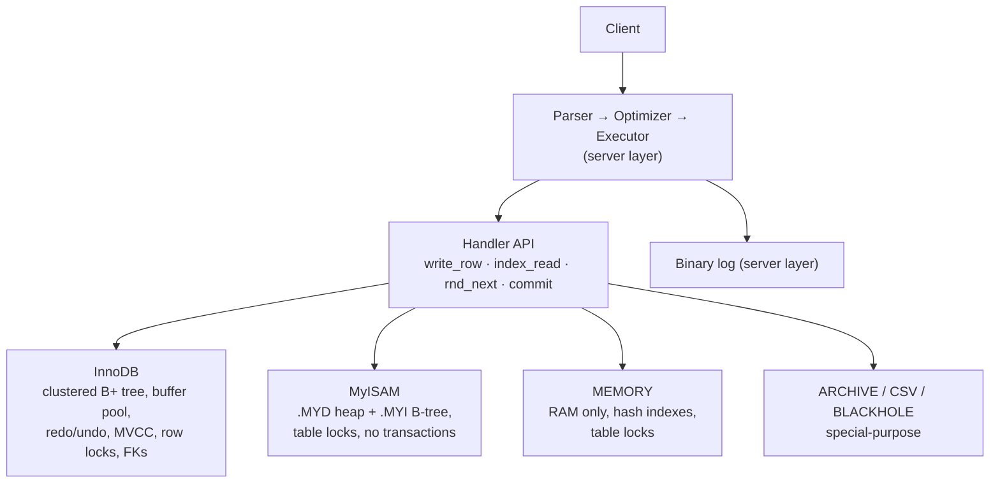

## Introduction

When you run `CREATE TABLE`, MySQL makes a decision you may never have noticed: which **storage engine** will hold the table's data. The storage engine is the component that actually writes rows to disk (or memory), reads them back, maintains indexes, and — depending on the engine — provides transactions, locking and crash recovery. Everything above it — parsing SQL, optimizing, executing joins, enforcing privileges — is shared by all engines.

This split is unusual. PostgreSQL, Oracle and SQL Server each have essentially one storage layer. MySQL was designed with a **pluggable storage engine architecture**: different tables in the same database, even in the same query, can be managed by different engines with radically different properties. Historically this was MySQL's signature feature; today it is mostly a story of convergence — **InnoDB** has been the default since MySQL 5.5 and is the right choice for virtually every table — but the architecture still shapes MySQL's behaviour, its error messages, and the vocabulary used in every other lesson (buffer pool, redo log, row locks).

This lesson answers:

- What exactly is the boundary between the **server layer** and a **storage engine**?
- What can each available engine do, and what does each one refuse to do — demonstrated with real errors?
- Why is InnoDB the default, and what goes wrong with a non-transactional engine such as MyISAM or MEMORY?
- What is **table-level locking**, and why did it make MyISAM unsuitable for concurrent workloads?
- How do you choose, inspect and change an engine (`ENGINE=`, `SHOW ENGINES`, `ALTER TABLE … ENGINE=`)?

The overview of MySQL's layered architecture was introduced in [What Is MySQL?](/lessons/m02-what-is-mysql); InnoDB's internals (buffer pool, redo and undo logs, page structure) are taught in depth in Module 10, and transactions and locking in Module 8.

:::note[Dataset]
The examples use the **shop** dataset — all of its tables are InnoDB — plus small tables created with other engines in your lab. The sandbox can create MyISAM, MEMORY, CSV, ARCHIVE and BLACKHOLE tables; every output below was captured on a real server.
:::

## DBMS Theory

:::theory[The storage manager in a DBMS architecture]
Classic DBMS architecture separates a **query processor** (parser, optimizer, executor) from a **storage manager**, which itself contains a file/access-method manager (how records and indexes are laid out), a **buffer manager** (which pages are cached in memory), a **transaction manager** with **concurrency control** (locks or multiversioning) and a **recovery manager** (logging, so that committed work survives crashes and uncommitted work is undone). The ACID properties are delivered almost entirely by the storage manager.

In MySQL the storage manager is not one component but a **plug-in interface**: the server's executor calls a fixed set of handler methods (open a table, read the next row, read by index key, write a row, update, delete, start/commit a transaction) and each engine implements them in its own way. Whether a table is transactional, how it locks and whether it survives a crash therefore depends on the **engine**, not on MySQL as a whole.
:::

The theoretical capabilities you should evaluate for any storage layer:

| Property | Question | Why it matters |
|---|---|---|
| Atomicity | Can a failed statement or transaction be undone? | Partial writes corrupt business invariants |
| Durability / crash recovery | After a power loss, are committed changes present and uncommitted ones gone? | Without it, crashes lose data or leave tables corrupt |
| Concurrency control granularity | Does a writer lock a row, a page or the whole table? | Determines how many sessions can work at once |
| Isolation for readers | Do readers block writers (and vice versa)? | MVCC lets reads proceed without locks |
| Referential integrity | Are foreign keys enforced? | See [Constraints in MySQL](/lessons/m02-constraints-mysql) |
| Access methods | B+ tree, hash, none? Clustered or heap? | Determines which queries can be fast |

:::standard[Standard SQL vs MySQL]
The SQL standard says nothing about storage engines: tables simply have the transactional and integrity behaviour the standard specifies. `ENGINE=…` in `CREATE TABLE`, `SHOW ENGINES` and the per-table choice of a non-transactional engine are **MySQL extensions**. Choosing a non-transactional engine means opting out of standard behaviour — a `ROLLBACK` that does not roll back, a constraint failure that leaves half a statement applied.
:::

## Why It Exists

MySQL's original engine (ISAM, then **MyISAM**) was fast for read-mostly web workloads but had no transactions and locked whole tables. Rather than rewrite the core, MySQL defined a handler API so that other engines could be plugged in: **InnoDB** (developed by Innobase Oy, added in 2001) brought transactions, row-level locking and crash recovery; **MEMORY** offered RAM-only tables; **ARCHIVE** compressed write-once data; **CSV** exposed text files as tables; **NDB** became MySQL Cluster; third parties built engines such as MyRocks (RocksDB-based, write-optimized; used in Percona Server and MariaDB).

The benefits of the design:

- **Specialization.** Different access patterns get different physical designs without changing SQL.
- **Evolution.** The server could adopt a better engine (InnoDB) as default without breaking applications — MySQL 5.5 (2010) did exactly that.
- **Ecosystem.** Vendors could innovate at the storage layer while reusing MySQL's parser, optimizer, replication and protocol.

The costs, which pushed MySQL to converge on one engine:

- Features that cross the boundary (transactions, foreign keys, crash-safe replication metadata, the data dictionary) only work if **every** participating engine supports them. Mixing engines in one transaction silently weakens guarantees.
- Since MySQL 8.0 the **data dictionary** itself is stored in InnoDB tables, and the system tables in the `mysql` schema are InnoDB; MyISAM is no longer needed by the server at all.

## Internal Working

:::internals[The server/engine boundary]
The **server layer** (shared by all engines): connection handling and authentication, the SQL parser, the optimizer, the executor (iterators: joins, sorting, grouping, aggregation), the data dictionary, the binary log used for replication, and evaluation of expressions and CHECK constraints. The **storage engine** (per table): physical row format, index structures, caching, row/table locking, transactions, undo/redo, crash recovery, and — in InnoDB — foreign keys.

The executor talks to an engine through a **handler** object per open table, with calls such as `rnd_next()` (next row of a scan), `index_read_map()` (position on a key), `index_next()`, `write_row()`, `update_row()`, `delete_row()`, and transaction hooks for commit and rollback. The optimizer asks the engine for statistics (`records_in_range()`, row estimates) and capabilities (can it scan an index in order? does it support hash lookups only?). A condition such as `WHERE id = 5` is evaluated by the server; the engine only knows it was asked for "the row with key 5".
:::



**InnoDB in one paragraph** (details in Modules 8 and 10). Rows are stored inside the **clustered index** (a B+ tree ordered by the primary key); secondary indexes store the primary key as the row pointer. Pages (16 KB by default) are cached in the **buffer pool**. Every change is first recorded in the **redo log** (write-ahead logging), so committed transactions survive crashes; before-images go to **undo logs**, which serve both rollback and **MVCC** — readers see a consistent snapshot without taking locks. Writers take **row-level locks** (record, gap and next-key locks) inside the index. A **doublewrite buffer** protects against torn page writes. InnoDB enforces **foreign keys** itself.

**MyISAM in one paragraph.** Each table has a data file (`.MYD`, rows in insertion order — a heap) and an index file (`.MYI`, B-trees whose leaves point to row offsets). Only index blocks are cached by MySQL (the *key cache*); data pages rely on the operating system cache. There are no transactions and no undo/redo: a crash in the middle of a write can leave the table marked as crashed, requiring `REPAIR TABLE`. Concurrency control is a **table-level read/write lock**: any number of readers, or one writer, at a time (with an exception allowing *concurrent inserts* at the end of the data file). MyISAM keeps an exact row count in its header, which is why `COUNT(*)` without `WHERE` is instant.

**MEMORY in one paragraph.** Rows live only in RAM, in fixed-length format (no `BLOB`/`TEXT`), with **hash** indexes by default (B-tree optional). The table *definition* survives a restart; the *data* does not. Locking is table-level, and the maximum size per table is fixed when it is created from `max_heap_table_size`.

## MySQL Implementation

### Which engines does this server offer?

```sql run
SHOW ENGINES;
```

`Support` is `DEFAULT` for the engine used when `CREATE TABLE` names none, `YES` for available engines and `NO` for engines compiled in but disabled (FEDERATED is disabled by default). Only InnoDB answers `YES` for transactions, XA and savepoints. The same information is queryable:

```sql run
SELECT ENGINE, SUPPORT, TRANSACTIONS, SAVEPOINTS
FROM information_schema.ENGINES
ORDER BY SUPPORT = 'DEFAULT' DESC, ENGINE;
```

### The ENGINE clause

```sql run
SELECT @@default_storage_engine AS default_engine;
CREATE TABLE engine_demo_innodb (id INT PRIMARY KEY, note VARCHAR(20)) ENGINE = InnoDB;
CREATE TABLE engine_demo_myisam (id INT PRIMARY KEY, note VARCHAR(20)) ENGINE = MyISAM;
CREATE TABLE engine_demo_memory (id INT PRIMARY KEY, note VARCHAR(20)) ENGINE = MEMORY;
SELECT TABLE_NAME, ENGINE, ROW_FORMAT
FROM information_schema.TABLES
WHERE TABLE_SCHEMA = DATABASE() AND TABLE_NAME LIKE 'engine_demo%'
ORDER BY TABLE_NAME;
```

The shop tables were created with `ENGINE=InnoDB`; you can check any table with `SHOW CREATE TABLE` or `SHOW TABLE STATUS`. To change an existing table's engine, `ALTER TABLE … ENGINE = …` copies the data into a new table of the target engine:

```sql run
ALTER TABLE engine_demo_myisam ENGINE = InnoDB;
SELECT TABLE_NAME, ENGINE FROM information_schema.TABLES
WHERE TABLE_SCHEMA = DATABASE() AND TABLE_NAME = 'engine_demo_myisam';
```

### Transactions: InnoDB versus a non-transactional engine

Insert into an InnoDB table and a MEMORY table **in the same transaction**, then roll back:

```sql run
START TRANSACTION;
INSERT INTO engine_demo_innodb VALUES (1, 'innodb row');
INSERT INTO engine_demo_memory VALUES (1, 'memory row');
ROLLBACK;
SELECT 'InnoDB' AS engine, COUNT(*) AS rows_after_rollback FROM engine_demo_innodb
UNION ALL
SELECT 'MEMORY', COUNT(*) FROM engine_demo_memory;
```

The `ROLLBACK` produced warning 1196 — *Some non-transactional changed tables couldn't be rolled back* — and the MEMORY row survived while the InnoDB row was undone. A business operation that spans both tables is now half-applied. The same happens with MyISAM.

## Syntax Breakdown

| Syntax | Meaning |
|---|---|
| `CREATE TABLE t (…) ENGINE = name` | Create the table in the named engine (`InnoDB`, `MyISAM`, `MEMORY`, `CSV`, `ARCHIVE`, `BLACKHOLE`, `MRG_MYISAM`, …). |
| `ALTER TABLE t ENGINE = name` | Rebuild the table in another engine (a full copy; fails if the target engine cannot represent the table — e.g. `TEXT` columns into MEMORY). `ALTER TABLE t ENGINE = InnoDB` on an InnoDB table is a common way to rebuild/defragment it. |
| `default_storage_engine` | Engine used when `ENGINE` is omitted (default `InnoDB`). Settable per session. |
| `default_tmp_storage_engine` | Engine for user-created `CREATE TEMPORARY TABLE` without `ENGINE` (default `InnoDB`). |
| `internal_tmp_mem_storage_engine` | Engine for the optimizer's in-memory internal temporary tables (default `TempTable` since 8.0). |
| `SHOW ENGINES`, `information_schema.ENGINES` | Available engines and their capabilities. |
| `SHOW TABLE STATUS`, `information_schema.TABLES.ENGINE` | Engine of each table. |
| `NO_ENGINE_SUBSTITUTION` (SQL mode, default on) | If the requested engine is unavailable, fail (error 1286) instead of silently substituting the default engine. |
| `disabled_storage_engines` (server option) | Lets administrators forbid creating tables in listed engines, e.g. `MyISAM,MEMORY,ARCHIVE`. |
| `max_heap_table_size` | Maximum size of a MEMORY table, fixed when the table is created or altered. |

:::version[8.0 and 8.4]
The engine landscape is the same in 8.0 and 8.4 LTS: InnoDB is the default; MyISAM, MEMORY, CSV, ARCHIVE, BLACKHOLE and MERGE remain available; FEDERATED is compiled in but disabled; NDB is part of the separate MySQL NDB Cluster distribution. Since 8.0 MyISAM tables store their metadata in serialized dictionary information (`.sdi`) files instead of `.frm` files, and the server's own system tables are all InnoDB. 8.4 changed several InnoDB defaults (for example `innodb_adaptive_hash_index=OFF` and `innodb_change_buffering=none`), which are discussed in the InnoDB internals module.
:::

## Practical Examples

**1. MEMORY: fast, volatile, limited.** MEMORY indexes are **hash** indexes by default:

```sql run
CREATE TABLE session_cache (
  session_id CHAR(32)    NOT NULL PRIMARY KEY,
  user_id    INT         NOT NULL,
  KEY idx_session_cache_user (user_id)
) ENGINE = MEMORY;
INSERT INTO session_cache VALUES (MD5('s1'), 7), (MD5('s2'), 12), (MD5('s3'), 7);
SHOW INDEX FROM session_cache;
```

A hash index answers equality but not ranges or ordering:

```sql run
EXPLAIN SELECT session_id FROM session_cache WHERE user_id = 7;
```

```sql run
EXPLAIN SELECT session_id FROM session_cache WHERE user_id > 7;
```

Equality uses `ref` on the hash index; the range predicate cannot use it and scans the table (`ALL`). (`KEY … USING BTREE` would give a MEMORY table an ordered index.) MEMORY also refuses variable-length large objects:

```sql run error
CREATE TABLE memory_notes (id INT PRIMARY KEY, body TEXT) ENGINE = MEMORY;
```

And its size is capped by `max_heap_table_size` **at creation time**. Shrink the limit for this session, create a table and overfill it:

```sql run
SET SESSION max_heap_table_size = 16384;    -- the minimum, 16 KB, for this session only
CREATE TABLE tiny_cache (id INT PRIMARY KEY, payload CHAR(100) NOT NULL) ENGINE = MEMORY;
SET SESSION max_heap_table_size = DEFAULT;
```

```sql run error
INSERT INTO tiny_cache
WITH RECURSIVE seq(n) AS (SELECT 1 UNION ALL SELECT n + 1 FROM seq WHERE n < 1000)
SELECT n, 'x' FROM seq;
```

```sql run
SELECT COUNT(*) AS rows_left_behind FROM tiny_cache;
```

Error 1114, *The table is full* — and look at the count: the rows inserted before the table filled up **remain**. On a non-transactional engine a failed statement cannot be undone; on InnoDB the whole `INSERT … SELECT` would have been rolled back.

**2. CSV: a table that is a text file.** Each CSV table is a comma-separated file in the data directory — readable by spreadsheets and scripts, which is the point. The price: no indexes and no NULLs.

```sql run error
CREATE TABLE export_orders_bad (order_id INT, status VARCHAR(12)) ENGINE = CSV;
```

```sql run error
CREATE TABLE export_orders_bad2 (order_id INT NOT NULL, status VARCHAR(12) NOT NULL, KEY (order_id)) ENGINE = CSV;
```

```sql run
CREATE TABLE export_orders (order_id INT NOT NULL, status VARCHAR(12) NOT NULL, total DECIMAL(10,2) NOT NULL) ENGINE = CSV;
INSERT INTO export_orders
SELECT o.order_id, o.status, SUM(oi.quantity * oi.unit_price)
FROM orders AS o JOIN order_items AS oi ON oi.order_id = o.order_id
WHERE o.order_id <= 5
GROUP BY o.order_id, o.status;
SELECT * FROM export_orders ORDER BY order_id;
```

On disk this table is a file `export_orders.CSV` containing lines such as `1,"delivered",…`. Every query reads the whole file (there are no indexes), and a file edited by hand while the server is running can confuse the engine. It is an interchange format, not a working table.

**3. ARCHIVE: compressed, append-only.** ARCHIVE compresses rows (zlib) as they are inserted and supports only `INSERT` and `SELECT`:

```sql run
SET SESSION cte_max_recursion_depth = 100000;
CREATE TABLE access_log_innodb  (id INT NOT NULL, line VARCHAR(100) NOT NULL) ENGINE = InnoDB;
CREATE TABLE access_log_archive (id INT NOT NULL, line VARCHAR(100) NOT NULL) ENGINE = ARCHIVE;
INSERT INTO access_log_innodb
WITH RECURSIVE seq(n) AS (SELECT 1 UNION ALL SELECT n + 1 FROM seq WHERE n < 50000)
SELECT n, CONCAT('GET /products/', n % 30, ' 200 OK user-agent=Mozilla/5.0') FROM seq;
INSERT INTO access_log_archive SELECT id, line FROM access_log_innodb;
ANALYZE TABLE access_log_innodb;
SET SESSION information_schema_stats_expiry = 0;
SELECT TABLE_NAME, ENGINE, ROW_FORMAT, DATA_LENGTH
FROM information_schema.TABLES
WHERE TABLE_SCHEMA = DATABASE() AND TABLE_NAME LIKE 'access_log_%'
ORDER BY TABLE_NAME;
```

The same 50,000 highly repetitive log lines occupy far fewer bytes in the compressed ARCHIVE table than in InnoDB's uncompressed pages (InnoDB's figure also includes free space reserved in its 16 KB pages). Now try to correct a row:

```sql run error
UPDATE access_log_archive SET line = 'redacted' WHERE id = 1;
```

```sql run error
DELETE FROM access_log_archive WHERE id = 1;
```

Error 1031: the engine simply does not implement those handler calls. ARCHIVE allows at most one index, on an `AUTO_INCREMENT` column; every other query is a full decompressing scan.

**4. BLACKHOLE: accepts everything, stores nothing.**

```sql run
CREATE TABLE audit_sink (event_id INT, detail VARCHAR(50)) ENGINE = BLACKHOLE;
INSERT INTO audit_sink VALUES (1, 'login'), (2, 'logout');
SELECT COUNT(*) AS rows_stored FROM audit_sink;
```

Writes succeed and vanish. The statement still reaches the **binary log**, which is the engine's real use: a relay server in a replication topology can receive and forward changes without storing them.

**5. MyISAM: silently ignored foreign keys and a stored row count.**

```sql run
CREATE TABLE legacy_order_notes (
  note_id  INT PRIMARY KEY,
  order_id INT UNSIGNED NOT NULL,
  note     VARCHAR(100) NOT NULL,
  FOREIGN KEY (order_id) REFERENCES orders (order_id)
) ENGINE = MyISAM;
INSERT INTO legacy_order_notes VALUES (1, 99999, 'order does not exist');
SHOW CREATE TABLE legacy_order_notes;
```

No error, no warning, no foreign key: MyISAM does not support foreign keys, so the clause is discarded and the orphan row is accepted. The flip side of MyISAM's simplicity is its exact row counter:

```sql run
EXPLAIN SELECT COUNT(*) FROM legacy_order_notes;
```

```sql run
EXPLAIN SELECT COUNT(*) FROM orders;
```

For MyISAM the count is read from table metadata (*Select tables optimized away*). For InnoDB the optimizer must scan an index — it chose the small secondary index `idx_orders_customer` — because under MVCC different transactions may see different row counts (see [Aggregate Functions](/lessons/m03-aggregate-functions)).

**6. Engine substitution.** With the default `NO_ENGINE_SUBSTITUTION`, asking for an unavailable engine fails:

```sql run error
CREATE TABLE remote_orders (id INT) ENGINE = FEDERATED;
```

Without it, MySQL silently creates the table in the default engine and only warns — a table that is not what the DDL says:

```sql run
SET SESSION sql_mode = '';
CREATE TABLE remote_orders (id INT) ENGINE = FEDERATED;
SELECT ENGINE FROM information_schema.TABLES WHERE TABLE_SCHEMA = DATABASE() AND TABLE_NAME = 'remote_orders';
SET SESSION sql_mode = DEFAULT;
```

## Execution Walkthrough

The decisive practical difference between MyISAM and InnoDB is **concurrency**. In both scenarios below, session A runs an `UPDATE` that takes about five seconds (simulated with `SLEEP(5)` inside the statement — think of a slow update touching many rows). While it runs, session B tries to read and write a *different* row.

First, MyISAM:

```concurrency
title: MyISAM — one slow writer blocks every reader of the table
description: A slow UPDATE of row 1 holds MyISAM's table-level write lock; B only wants row 2.
setup: |
  CREATE TABLE page_hits_myisam (page_id INT PRIMARY KEY, hits INT NOT NULL) ENGINE = MyISAM;
  INSERT INTO page_hits_myisam VALUES (1, 100), (2, 200);
steps:
  - session: A
    sql: UPDATE page_hits_myisam SET hits = hits + 1 + SLEEP(5) WHERE page_id = 1;
    expect: blocks
    note: A's UPDATE is still running after the observation window (it sleeps 5 s). For its whole duration it holds a WRITE lock on the entire MyISAM table.
  - session: B
    sql: SELECT hits FROM page_hits_myisam WHERE page_id = 2;
    expect: blocks
    note: B reads a different row, yet it waits — a table-level write lock excludes all readers. Every web request reading this table would queue here.
  - session: C
    sql: DO SLEEP(1);
    note: Session C just lets time pass while A finishes.
  - session: C
    sql: DO SLEEP(1);
    note: By now A has finished, released the table lock, and B's SELECT has completed.
  - session: B
    sql: SELECT page_id, hits FROM page_hits_myisam ORDER BY page_id;
    note: Both statements completed; B was delayed for most of A's run time.
```

Now the same workload on InnoDB:

```concurrency
title: InnoDB — row locks and MVCC let B proceed immediately
description: The same slow UPDATE of row 1; B reads and then updates row 2.
setup: |
  CREATE TABLE page_hits_innodb (page_id INT PRIMARY KEY, hits INT NOT NULL) ENGINE = InnoDB;
  INSERT INTO page_hits_innodb VALUES (1, 100), (2, 200);
steps:
  - session: A
    sql: UPDATE page_hits_innodb SET hits = hits + 1 + SLEEP(5) WHERE page_id = 1;
    expect: blocks
    note: A is still running. InnoDB locks only the index record it is changing (page_id = 1).
  - observe: locks
  - session: B
    sql: SELECT hits FROM page_hits_innodb WHERE page_id = 2;
    note: Returns immediately. A plain SELECT is a consistent (MVCC) read that takes no row locks, and row 2 is not locked anyway.
  - session: B
    sql: UPDATE page_hits_innodb SET hits = hits + 1 WHERE page_id = 2;
    note: Also immediate. B locks row 2; A holds row 1. Two writers work on the same table at the same time.
  - session: C
    sql: DO SLEEP(1);
    note: Wait for A to finish.
  - session: C
    sql: DO SLEEP(1);
  - session: B
    sql: SELECT page_id, hits FROM page_hits_innodb ORDER BY page_id;
    note: Both updates are applied.
```

Read the captured lock snapshot: while A runs, InnoDB holds an intention-exclusive (`IX`) lock on the table — which conflicts with nothing at row level — and an exclusive record lock (`X,REC_NOT_GAP`) on the single index record `page_id = 1`. That is the entire footprint of A's write. MyISAM's footprint was the whole table.

**Why this decided the industry's choice.** A web application performs many small reads and writes concurrently. Under MyISAM, every write serializes all access to the table; a single slow `UPDATE` or a long report query (which holds a read lock that blocks writers) stalls the application. Under InnoDB, readers never wait for writers (MVCC), and writers wait only for writers of the *same rows*. The locking protocols themselves — record, gap and next-key locks, deadlocks — are the subject of [Locking in InnoDB](/lessons/m08-locking).

## Output

A final inventory of the tables created in this lesson, as you would audit a schema for non-InnoDB tables before a migration:

```sql run
SELECT TABLE_NAME, ENGINE, ROW_FORMAT, TABLE_ROWS
FROM information_schema.TABLES
WHERE TABLE_SCHEMA = DATABASE() AND ENGINE <> 'InnoDB'
ORDER BY ENGINE, TABLE_NAME;
```

How to read it: every row here is a table that cannot participate in transactions, has no crash recovery (MEMORY loses its data on restart by design; MyISAM, CSV and ARCHIVE may need repair after a crash) and, apart from MyISAM's B-trees, has limited indexing. `TABLE_ROWS` is exact for MyISAM, MEMORY and ARCHIVE; BLACKHOLE reports 0 because it stores nothing. In a production schema the expected result of this query is **empty**.

## Alternative Approaches

What people historically used other engines for, and what to use today:

| Historical use | Engine | Modern approach | Why |
|---|---|---|---|
| Read-heavy web tables, fast `COUNT(*)` | MyISAM | InnoDB (+ summary/counter tables if exact counts are hot) | Crash safety, row locks, MVCC |
| Full-text search | MyISAM | InnoDB `FULLTEXT` indexes (since 5.6), or a search engine | InnoDB has full-text since 5.6 |
| Cache / session store | MEMORY | Redis/Memcached, or InnoDB with a large buffer pool | Durability options, no table locks |
| Internal temporary tables | MEMORY | `TempTable` engine (automatic since 8.0) | Supports variable-length rows efficiently |
| Compressed historical data | ARCHIVE | InnoDB with `ROW_FORMAT=COMPRESSED` or page compression, partitioning, or export to a warehouse / object storage (Parquet) | Indexes, updates for corrections, transactions |
| Data exchange with files | CSV | `SELECT … INTO OUTFILE` / `LOAD DATA`, or ETL tools | Proper quoting, no live-file corruption |
| Replication relay / filtering | BLACKHOLE | Still a niche option; most topologies use direct replicas | — |
| Write-heavy, space-efficient storage | MyRocks (Percona Server, MariaDB) | Consider for very write-heavy workloads on those distributions | LSM tree: compact, fewer write amplifications; not in Oracle MySQL |

## Performance Analysis

Engine choice changes the **cost model** of almost every operation:

| Operation | InnoDB | MyISAM | MEMORY |
|---|---|---|---|
| Primary-key lookup | B+ tree descent in the clustered index (row is in the leaf) | B-tree descent in `.MYI`, then a seek into `.MYD` | Hash lookup (constant time) |
| Secondary-index lookup | Secondary B+ tree → primary key → clustered index | B-tree → row offset | Hash (equality only) |
| Range scan / ORDER BY via index | Yes | Yes | Not with hash indexes |
| `COUNT(*)` without WHERE | Index scan (MVCC) | Instant (stored count) | Instant |
| Concurrent writes to different rows | Proceed in parallel (row locks) | Serialized (table lock) | Serialized (table lock) |
| Reads during a write | Proceed (MVCC snapshot) | Wait | Wait |
| Commit durability | Redo log flush per commit (configurable) | None (no transactions) | None (volatile) |
| Crash recovery | Automatic redo/undo | `REPAIR TABLE`, possible data loss | Data lost by design |

:::performance[Theory vs measurement]
The table describes structural behaviour. Single-threaded micro-benchmarks sometimes show MyISAM or MEMORY faster for simple reads, because they skip MVCC and transactional bookkeeping; under realistic concurrency and with writes, table-level locking usually dominates and InnoDB wins. InnoDB's per-commit durability cost is governed by `innodb_flush_log_at_trx_commit` and `sync_binlog`, covered with the redo log in Module 8. Never choose an engine on a single-threaded benchmark; test with production-like concurrency.
:::

**Storage footprint.** InnoDB pages reserve free space for future inserts and carry per-row transaction metadata (transaction id and roll pointer), so InnoDB tables are larger than MyISAM or ARCHIVE for the same data — Practical Example 3 showed how dramatic the difference can be for compressible data. InnoDB's own compression (`ROW_FORMAT=COMPRESSED`) narrows the gap at a CPU cost.

## Best Practices

:::best-practice[Choosing and governing storage engines]
1. **Use InnoDB for every table** unless you can name a specific requirement it cannot meet. It is the only engine in Oracle MySQL with transactions, MVCC, row-level locking, crash recovery and foreign keys.
2. **Always write `ENGINE=InnoDB` explicitly** in DDL that is part of migrations, so a server with a different default cannot change it.
3. **Keep `NO_ENGINE_SUBSTITUTION` enabled** (the default) so a missing engine is an error, not a silent substitution.
4. **Forbid legacy engines in production** with `disabled_storage_engines = "MyISAM,MEMORY,ARCHIVE,CSV,BLACKHOLE"` (adjust to your needs) in the option file.
5. **Audit for non-InnoDB tables** before upgrades and replication changes using `information_schema.TABLES WHERE ENGINE <> 'InnoDB'`, and convert them with `ALTER TABLE … ENGINE=InnoDB` (check for `FULLTEXT`, very wide rows, and code that relies on MyISAM-specific behaviour first).
6. **Never mix engines inside one transaction.** A rollback cannot undo non-transactional changes, and replication of mixed transactions is fragile.
7. **Use MEMORY/ARCHIVE/CSV only for disposable or derived data** that can be rebuilt from an InnoDB source of truth.
:::

## Common Mistakes

**Mistake 1 — expecting `ROLLBACK` to undo a MyISAM or MEMORY change.** Shown above: warning 1196 and the change stays. Applications ported from older schemas sometimes "use transactions" for years without noticing that some tables were never transactional.

**Mistake 2 — believing a foreign key exists on a MyISAM table.** Practical Example 5: the clause is accepted and silently ignored. `information_schema.REFERENTIAL_CONSTRAINTS` is the source of truth.

**Mistake 3 — converting a table to MEMORY "for speed".** Two obstacles appear immediately. A table that takes part in foreign keys cannot leave InnoDB at all (error 3776), because no other engine can enforce them:

```sql run error
ALTER TABLE products ENGINE = MEMORY;
```

And a table with `TEXT`/`BLOB` columns cannot become a MEMORY table (error 1163):

```sql run error
ALTER TABLE engine_demo_innodb ADD COLUMN body TEXT, ENGINE = MEMORY;
```

**Mistake 4 — updating or deleting ARCHIVE rows.** Error 1031 (Practical Example 3). If corrections are ever possible — and with personal data, deletion requests make them likely — ARCHIVE is the wrong choice.

**Mistake 5 — CSV tables with nullable columns or indexes.** Errors 1178 and 1069 (Practical Example 2).

**Mistake 6 — relying on engine substitution.** With `NO_ENGINE_SUBSTITUTION` removed, a typo or missing plug-in produces an InnoDB table plus a warning that scripts rarely check (Practical Example 6). The DDL in your repository then lies about the table.

## Industry Application

- **Modern MySQL fleets are InnoDB-only.** Managed services push in the same direction: Amazon RDS and Aurora MySQL, Google Cloud SQL and Azure Database for MySQL all build their durability, backup and failover features around InnoDB (Aurora replaces InnoDB's storage layer with a distributed one while keeping the engine interface), and their documentation recommends InnoDB for all tables.
- **MyISAM migrations.** Many organizations ran MyISAM-to-InnoDB projects in the 2010s: inventory non-InnoDB tables, replace MyISAM `FULLTEXT` with InnoDB `FULLTEXT` or a search service, convert with online schema change tools, then set `disabled_storage_engines`. Motivations were crash safety (no more `REPAIR TABLE` after outages), concurrency (no table locks) and consistent backups without locking.
- **Backups and replication depend on the engine.** Hot physical backups (MySQL Enterprise Backup, Percona XtraBackup) and consistent logical dumps (`mysqldump --single-transaction`) rely on InnoDB's MVCC; non-transactional tables require locking during the backup. Crash-safe replication metadata has been stored in InnoDB tables since 5.6/8.0 for the same reason.
- **Alternative engines where they shine.** Facebook developed MyRocks (RocksDB under MySQL) to reduce storage and write amplification for very large, write-heavy datasets; it ships in Percona Server and MariaDB. NDB powers MySQL Cluster for telecom-style, in-memory, shared-nothing workloads. These are specialist choices made with deep engine expertise.

## Practice Exercises

```exercise
id: ex1
title: Which engines support transactions?
difficulty: easy
concepts: [storage-engines, innodb]
prompt: |
  Using `information_schema.ENGINES`, return the names of the engines on this server that **support
  transactions**. One column, `engine`, ordered alphabetically.
hints:
  - "information_schema.ENGINES has a TRANSACTIONS column with YES/NO (NULL for disabled engines)."
  - "SELECT ENGINE AS engine FROM information_schema.ENGINES WHERE TRANSACTIONS = 'YES' …"
solution: |
  SELECT ENGINE AS engine
  FROM information_schema.ENGINES
  WHERE TRANSACTIONS = 'YES'
  ORDER BY ENGINE;
orderMatters: true
explanation: |
  Only InnoDB qualifies on a standard Oracle MySQL server. `SHOW ENGINES` shows the same information but cannot
  be filtered with WHERE on the Transactions column in the same flexible way (it supports `LIKE` on the engine
  name only).
```

```exercise
id: ex2
title: Audit the schema for non-InnoDB tables
difficulty: medium
setup: |
  CREATE TABLE legacy_sessions (id INT PRIMARY KEY, data VARCHAR(100)) ENGINE = MEMORY;
  CREATE TABLE legacy_counters (name VARCHAR(30) PRIMARY KEY, n INT) ENGINE = MyISAM;
  CREATE TABLE legacy_export (id INT NOT NULL, v VARCHAR(10) NOT NULL) ENGINE = CSV;
concepts: [storage-engines, engine-clause]
prompt: |
  Before an upgrade, list every table in **your** schema (`DATABASE()`) that does not use InnoDB.
  Return `table_name` and `engine`, ordered by `table_name`.
hints:
  - "information_schema.TABLES has TABLE_SCHEMA, TABLE_NAME, ENGINE and TABLE_TYPE."
  - "Filter TABLE_SCHEMA = DATABASE() and ENGINE <> 'InnoDB'. Views have ENGINE NULL — should they appear?"
solution: |
  SELECT TABLE_NAME AS table_name, ENGINE AS engine
  FROM information_schema.TABLES
  WHERE TABLE_SCHEMA = DATABASE()
    AND TABLE_TYPE = 'BASE TABLE'
    AND ENGINE <> 'InnoDB'
  ORDER BY TABLE_NAME;
orderMatters: true
explanation: |
  The three legacy tables appear; the shop tables are InnoDB. `ENGINE <> 'InnoDB'` already excludes views
  (their ENGINE is NULL, and `NULL <> 'InnoDB'` is UNKNOWN), but stating `TABLE_TYPE = 'BASE TABLE'` makes the
  intent explicit. In production, run the query across all schemas except the system ones
  (`mysql`, `sys`, `information_schema`, `performance_schema`).
```

```exercise
id: ex3
title: Convert legacy tables to InnoDB
difficulty: medium
kind: dml
setup: |
  CREATE TABLE legacy_wishlist (customer_id INT UNSIGNED NOT NULL, product_id INT UNSIGNED NOT NULL,
                                PRIMARY KEY (customer_id, product_id)) ENGINE = MyISAM;
  INSERT INTO legacy_wishlist VALUES (1, 5), (1, 12), (4, 20);
  CREATE TABLE legacy_banner_cache (slot VARCHAR(20) PRIMARY KEY, html VARCHAR(500) NOT NULL) ENGINE = MEMORY;
  INSERT INTO legacy_banner_cache VALUES ('home', '<b>Sale</b>');
concepts: [engine-clause, innodb]
prompt: |
  Convert both `legacy_wishlist` (MyISAM) and `legacy_banner_cache` (MEMORY) to InnoDB, keeping their data.
hints:
  - "ALTER TABLE … ENGINE = InnoDB rebuilds a table in another engine and copies the rows."
  - "Run one ALTER per table."
solution: |
  ALTER TABLE legacy_wishlist ENGINE = InnoDB;
  ALTER TABLE legacy_banner_cache ENGINE = InnoDB;
check: |
  SELECT t.TABLE_NAME, t.ENGINE,
         (SELECT COUNT(*) FROM legacy_wishlist) AS wishlist_rows,
         (SELECT COUNT(*) FROM legacy_banner_cache) AS banner_rows
  FROM information_schema.TABLES AS t
  WHERE t.TABLE_SCHEMA = DATABASE() AND t.TABLE_NAME LIKE 'legacy\_%'
  ORDER BY t.TABLE_NAME;
explanation: |
  `ALTER TABLE … ENGINE=InnoDB` creates an InnoDB copy, moves the rows and swaps the tables. After the
  conversion the wishlist could also get the foreign keys MyISAM could never enforce (to customers and
  products). On a large production table this is a full table copy — use an online schema change approach and
  check for MyISAM-specific features (e.g. FULLTEXT on very old versions) beforehand.
```

```exercise
id: ex4
title: Prove that MEMORY ignores ROLLBACK
difficulty: hard
kind: dml
setup: |
  CREATE TABLE cart_events_memory (event_id INT PRIMARY KEY, kind VARCHAR(10) NOT NULL) ENGINE = MEMORY;
  CREATE TABLE cart_events_innodb (event_id INT PRIMARY KEY, kind VARCHAR(10) NOT NULL) ENGINE = InnoDB;
concepts: [memory-engine, innodb, storage-engines]
prompt: |
  In **one transaction**, insert the event `(1, 'add')` into **both** `cart_events_memory` and
  `cart_events_innodb`, then roll the transaction back. (The grader then counts the rows left in each table.)
hints:
  - "START TRANSACTION; … two INSERTs …; ROLLBACK;"
  - "Expect warning 1196 on the ROLLBACK."
solution: |
  START TRANSACTION;
  INSERT INTO cart_events_memory VALUES (1, 'add');
  INSERT INTO cart_events_innodb VALUES (1, 'add');
  ROLLBACK;
check: |
  SELECT (SELECT COUNT(*) FROM cart_events_memory) AS memory_rows,
         (SELECT COUNT(*) FROM cart_events_innodb) AS innodb_rows;
explanation: |
  The check returns memory_rows = 1 and innodb_rows = 0: InnoDB undid its insert using undo logs, while MEMORY
  has no undo mechanism and keeps the row (warning 1196). If the two inserts represented one business event,
  the database is now inconsistent — the reason to keep every table that participates in transactions on InnoDB.
```

```exercise
id: ex5
title: Engine choice review
difficulty: challenge
kind: open
concepts: [storage-engines, table-locking, innodb, myisam]
prompt: |
  A colleague proposes three tables for a new analytics feature: (a) `click_events` — 50 million inserts per
  day, never updated, queried by date range for dashboards — on **ARCHIVE** "because it is compressed";
  (b) `rate_limits` — per-API-key counters updated thousands of times per second — on **MEMORY** "because it is
  in RAM"; (c) `daily_rollups` — a few thousand rows rebuilt nightly, read by dashboards — on **MyISAM**
  "because COUNT(*) is instant". Review each proposal: identify the concrete failure modes and recommend an
  alternative.
solution: |
  **(a) ARCHIVE for click_events.** Compression is real, but ARCHIVE allows no index except on an
  AUTO_INCREMENT column, so every date-range dashboard query decompresses and scans all rows — on billions of
  rows this is unusable. It also cannot UPDATE or DELETE, so retention (dropping old data) and privacy deletion
  requests are impossible except by rebuilding the table, and it is not transactional or crash-safe.
  Recommendation: InnoDB with a primary key that clusters by time (e.g. `(event_date, event_id)`), RANGE
  partitioning by day or month so old data is dropped with `ALTER TABLE … DROP PARTITION`, optional InnoDB
  compression, and long-term history exported to a columnar warehouse.

  **(b) MEMORY for rate_limits.** MEMORY uses table-level locks, so thousands of concurrent updates serialize
  on one lock — the opposite of what high-frequency counters need. Data disappears on restart (acceptable for
  rate limits, perhaps), the table size is capped by max_heap_table_size (error 1114 when full), and there is
  no replication-safe crash behaviour. Recommendation: InnoDB (row-level locks; hot rows stay in the buffer
  pool, so it is effectively in RAM anyway) or, more typically, an in-memory store such as Redis with atomic
  INCR and TTLs.

  **(c) MyISAM for daily_rollups.** For a few thousand rows, COUNT(*) is trivially cheap in InnoDB too. MyISAM
  would add table-level locks (the nightly rebuild blocks every dashboard read), no atomic rebuild (a failed
  load leaves a half-filled table visible to users), and crash-repair risk. Recommendation: InnoDB; rebuild
  into a staging table and swap atomically with `RENAME TABLE daily_rollups TO old, staging TO daily_rollups`,
  or rebuild inside a transaction so readers keep seeing the previous snapshot via MVCC.
```

## Knowledge Assessment

```quiz
- id: q1
  question: "In MySQL's architecture, which of these is the responsibility of the storage engine rather than the server layer?"
  options: ["Parsing SQL", "Choosing the join order", "Row-level locking and crash recovery", "Writing the binary log"]
  answer: 2
  explanation: "Parsing, optimization (including join order) and the binary log belong to the shared server layer. Physical storage, indexes, locking, transactions, undo/redo and crash recovery are implemented by each engine — which is why a MyISAM table and an InnoDB table in the same database behave so differently."
  concepts: [pluggable-architecture]
- id: q2
  question: "A transaction inserts one row into an InnoDB table and one into a MyISAM table, then executes ROLLBACK. What is the result?"
  options:
    - "Both rows are removed"
    - "The InnoDB row is removed; the MyISAM row remains and MySQL issues warning 1196"
    - "Both rows remain"
    - "The ROLLBACK fails with an error because engines are mixed"
  answer: 1
  explanation: "InnoDB undoes its change with undo logs. MyISAM has no transactions, so its change cannot be undone; MySQL warns 'Some non-transactional changed tables couldn't be rolled back' but does not raise an error."
  concepts: [myisam, innodb, storage-engines]
- id: q3
  question: "Why does a slow UPDATE on a MyISAM table delay a SELECT of a different row in the same table, while the same scenario on InnoDB does not?"
  options:
    - "MyISAM does not support indexes"
    - "MyISAM uses table-level read/write locks, so a writer excludes all readers; InnoDB locks only the changed rows and serves reads from MVCC snapshots"
    - "InnoDB executes UPDATEs in the background"
    - "MyISAM stores all rows on one page"
  answer: 1
  explanation: "MyISAM's concurrency control is a table lock: one writer or many readers. InnoDB takes row locks for writes and uses consistent non-locking reads (MVCC) for plain SELECTs, so readers and writers of different rows do not wait for each other."
  concepts: [table-locking, myisam, innodb]
- id: q4
  question: "Which statements about the MEMORY engine are true? (Select all that apply.)"
  type: multi
  options:
    - "Its indexes are hash indexes by default, so range predicates cannot use them"
    - "Table data survives a server restart"
    - "TEXT and BLOB columns are not supported"
    - "A failed multi-row INSERT is rolled back atomically"
    - "Its maximum size is limited by max_heap_table_size at creation time"
  answer: [0, 2, 4]
  explanation: "MEMORY uses hash indexes by default (BTREE is optional), rejects TEXT/BLOB (error 1163) and is capped by max_heap_table_size. The definition survives a restart but the data does not, and being non-transactional it cannot undo the rows already inserted when a statement fails (e.g. error 1114, table full)."
  concepts: [memory-engine]
- id: q5
  question: "You run `CREATE TABLE t (id INT, name VARCHAR(20)) ENGINE=CSV;`. What happens?"
  options:
    - "The table is created with an index on id"
    - "Error 1178: the CSV engine does not support nullable columns"
    - "The table is created and NULLs are stored as empty strings"
    - "MySQL silently uses InnoDB instead"
  answer: 1
  explanation: "CSV requires every column to be NOT NULL and supports no indexes (error 1069 if you declare one). Engine substitution only happens when the requested engine is unavailable and NO_ENGINE_SUBSTITUTION is off."
  concepts: [csv-engine]
- id: q6
  question: "Why can MyISAM answer `SELECT COUNT(*) FROM t` (no WHERE) instantly while InnoDB scans an index?"
  options:
    - "InnoDB tables do not have primary keys"
    - "MyISAM stores an exact row count in table metadata; InnoDB cannot, because concurrent transactions may legitimately see different row counts under MVCC"
    - "InnoDB disables the row count for security reasons"
    - "MyISAM caches query results"
  answer: 1
  explanation: "Without transactions there is one true row count, which MyISAM maintains. Under MVCC each transaction's snapshot can contain a different number of rows, so InnoDB counts the entries visible to the current read view (usually via the smallest index)."
  concepts: [myisam, innodb]
- id: q7
  question: "With the default SQL mode, `CREATE TABLE t (id INT) ENGINE=FEDERATED;` on a server where FEDERATED is disabled:"
  options:
    - "Creates an InnoDB table with a warning"
    - "Fails with error 1286 (unknown storage engine), because NO_ENGINE_SUBSTITUTION is enabled"
    - "Creates a FEDERATED table that cannot be queried"
    - "Enables FEDERATED automatically"
  answer: 1
  explanation: "NO_ENGINE_SUBSTITUTION is part of the default sql_mode, so an unavailable engine is an error. Only if that mode is removed does MySQL substitute the default engine and issue warnings 1286 and 1266."
  concepts: [engine-clause]
- id: q8
  question: "Which is the best justification for InnoDB being the default engine?"
  options:
    - "It uses the least disk space of all engines"
    - "It is the only engine in Oracle MySQL that combines ACID transactions, crash recovery, row-level locking with MVCC and foreign keys"
    - "It is the only engine that supports indexes"
    - "It keeps all data in memory"
  answer: 1
  explanation: "InnoDB's value is correctness under concurrency and failure. It is not the most compact (ARCHIVE and compressed formats are smaller), MyISAM and MEMORY have indexes too, and InnoDB is disk-based with a buffer-pool cache."
  concepts: [innodb, storage-engines]
```
