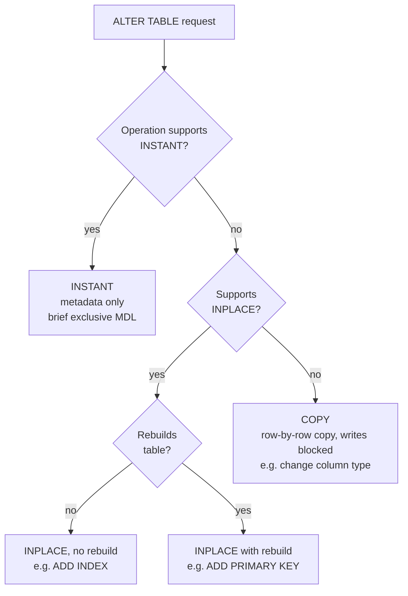

## Introduction

A table is where a relation becomes physical. `CREATE TABLE` turns a design — attributes, domains, keys, constraints from Module 1 and the design modules — into a structure that MySQL stores, indexes and protects. Real tables then **evolve**: columns are added, types widened, indexes created, tables renamed or emptied. In production, every such change raises questions that a textbook rarely asks:

- Exactly what did MySQL create? (Not what you typed — what it *stored*, with all defaults filled in.)
- Will this `ALTER TABLE` take a millisecond, or rebuild a 500 GB table for six hours while blocking writes?
- Should I empty this table with `DELETE`, `TRUNCATE` or `DROP` + `CREATE`, and what does each one break?
- How do I swap a freshly built table into place without readers ever seeing a missing table?

This lesson covers `CREATE TABLE` (column definitions and table options), `SHOW CREATE TABLE`, `ALTER TABLE` with MySQL's **online DDL algorithms** (`INSTANT`, `INPLACE`, `COPY`), `RENAME TABLE`, and the trio `DROP` / `TRUNCATE` / `DELETE`. Data types get their own lessons next (numeric, string, date/time, JSON/binary); constraints, defaults and `AUTO_INCREMENT` are covered in depth in chapter 4 of this module.

:::note[Dataset]
The examples use the **shop** dataset. To avoid damaging tables that later blocks rely on, the experiments run on copies (`CREATE TABLE … LIKE …`) and small new tables.
:::

## DBMS Theory

:::theory[Relation schema and its physical realisation]
A **relation schema** R(A₁: D₁, …, Aₙ: Dₙ) names a relation, its attributes and each attribute's **domain**, together with integrity constraints: keys, referential constraints and domain constraints ([The Relational Model](/lessons/m01-relational-model), [Integrity Constraints](/lessons/m01-integrity-constraints)). In SQL, `CREATE TABLE` declares exactly this: column names (attributes), data types (domains), `NOT NULL`, `PRIMARY KEY`, `UNIQUE`, `FOREIGN KEY` and `CHECK` (constraints).

Two properties of the relational model shape how DDL should be used:

- **Schema and instance are separate.** DDL changes the schema; existing data must remain valid under the new schema, or the change must fail (or transform the data).
- **Order is not significant.** Attributes and tuples are unordered in the model. SQL tables have an ordinal column position (used by `SELECT *` and positional `INSERT`), which is a practical convenience, not a relational property — code should never depend on it.
:::

**Schema evolution** is the general problem of changing a schema while data and applications exist. A DBMS can implement a schema change in three fundamentally different ways:

1. **Metadata-only change** — only the catalog changes; existing rows are interpreted under the new schema lazily (e.g. "a column added later has its default value for old rows").
2. **In-place reorganisation** — the system builds new structures (an index, a rebuilt table) alongside the old ones while still serving queries, then switches.
3. **Copy** — create a new table with the new schema, copy every row, swap, drop the old table; writes are blocked during the copy.

MySQL exposes exactly these three strategies as `ALGORITHM=INSTANT`, `ALGORITHM=INPLACE` and `ALGORITHM=COPY`. Which one is possible depends on the operation — knowing that table is a core MySQL operational skill.

## Why It Exists

Precise DDL exists because the **table definition is a contract** between the database and every application, report and pipeline that uses it. The data types decide what can be stored and how much space it takes; `NOT NULL` and keys decide which bad data is impossible; table options decide the engine, character set and physical row format. A vague definition (everything `VARCHAR(255) NULL`, no keys) pushes all validation into application code — where it is inevitably inconsistent across applications.

Online DDL exists because **tables must change while the system runs**. Before MySQL 5.6, almost every `ALTER TABLE` copied the table and blocked writes for the whole duration; large companies built external tools (`pt-online-schema-change`, `gh-ost`) to work around it. MySQL 5.6 introduced in-place operations, and 8.0 added instant ones (`ADD COLUMN` instantly since 8.0.12, at any position and `DROP COLUMN` instantly since 8.0.29).

The `DROP` / `TRUNCATE` / `DELETE` distinction exists because "remove data" has different meanings: remove *the table itself*, remove *all rows fast*, or remove *some rows transactionally*. Choosing the wrong one causes outages (a `DELETE` of 100 million rows that runs for hours and bloats the undo log) or data loss (a `TRUNCATE` that cannot be rolled back).

## Internal Working

:::internals[What InnoDB does for CREATE, ALTER, TRUNCATE and DROP]
**CREATE TABLE.** MySQL writes the table definition into the data dictionary, and InnoDB creates a file-per-table tablespace `<db>/<table>.ibd` containing the **clustered index** (the B+ tree ordered by the primary key, whose leaf pages hold the full rows) and one B+ tree per secondary index. If you define no primary key, InnoDB uses the first `UNIQUE NOT NULL` index, or else creates a hidden 6-byte `DB_ROW_ID` column — invisible to SQL and useless for your queries. (MySQL 8.0.30+ can instead generate a visible-on-request primary key; see Syntax Breakdown.)

**ALTER TABLE algorithms.**

- **INSTANT** changes only the data dictionary. For an instantly added column, InnoDB records the column and its default in metadata; existing rows are not touched and are interpreted using a **row version** recorded in each row's header. Instant operations still need a brief exclusive metadata lock (MDL). A table can accumulate at most 64 row versions from instant ADD/DROP COLUMN before the next such operation requires a rebuild.
- **INPLACE** avoids the server-level row copy. Some INPLACE operations **rebuild** the table inside InnoDB (e.g. adding a primary key or changing row format) and some do **not** (e.g. adding a secondary index: InnoDB scans the clustered index, sorts the keys and bulk-loads the new B+ tree). Concurrent DML is usually allowed (`LOCK=NONE`); InnoDB buffers concurrent changes in an **online alter log** (bounded by `innodb_online_alter_log_max_size`) and applies them at the end. An exclusive MDL is needed briefly at the start and the end.
- **COPY** creates a temporary table with the new definition, copies rows through the SQL layer (converting each value), then swaps. Concurrent writes are blocked (`LOCK=SHARED` at best); the affected-rows count equals the number of rows copied.

**TRUNCATE TABLE** is internally "drop and recreate": InnoDB discards the old tablespace and creates an empty one with the same definition, then resets `AUTO_INCREMENT`. It does not delete rows one by one, does not fire `DELETE` triggers, and is DDL (implicit commit).

**DELETE** is DML: for each matching row InnoDB delete-marks the record, writes undo (so the delete can be rolled back and MVCC readers can still see the row) and redo; a background **purge** thread later physically removes delete-marked records. The file does not shrink.

**DROP TABLE** removes the dictionary entries and deletes the `.ibd` file; the space returns to the operating system.
:::



When you do not specify `ALGORITHM`, MySQL picks the cheapest one the operation supports (INSTANT, then INPLACE, then COPY). Specifying it explicitly turns the choice into an **assertion**: if the requested algorithm is not possible, the statement fails immediately instead of silently falling back to a slow copy.

## MySQL Implementation

A realistic table definition, combining column definitions and table options:

```sql run
CREATE TABLE supplier (
  supplier_id   INT UNSIGNED  NOT NULL AUTO_INCREMENT,
  name          VARCHAR(100)  NOT NULL,
  country_code  CHAR(2)       NOT NULL DEFAULT 'US',
  email         VARCHAR(255)  NULL,
  rating        TINYINT UNSIGNED NULL COMMENT '1-5, NULL = not rated yet',
  is_active     BOOLEAN       NOT NULL DEFAULT TRUE,
  created_at    DATETIME      NOT NULL DEFAULT CURRENT_TIMESTAMP,
  PRIMARY KEY (supplier_id),
  UNIQUE KEY uq_supplier_email (email),
  CONSTRAINT chk_supplier_rating CHECK (rating BETWEEN 1 AND 5)
) ENGINE = InnoDB
  DEFAULT CHARSET = utf8mb4
  COLLATE = utf8mb4_0900_ai_ci
  COMMENT = 'Product suppliers';
```

Now read back what MySQL actually stored. `SHOW CREATE TABLE` returns the **canonical** definition — normalised spelling, implied defaults made explicit:

```sql run
SHOW CREATE TABLE supplier;
```

Notice the normalisation: `BOOLEAN` became `tinyint(1)` (BOOLEAN is only an alias), `NULL` columns show `DEFAULT NULL`, and the definition includes the engine, character set and collation even if you had omitted them. `SHOW CREATE TABLE` is the authoritative answer to "what is this table?" — use it, not the migration file someone thinks was applied.

`DESCRIBE` (or `SHOW COLUMNS`) gives a compact column overview:

```sql run
DESCRIBE supplier;
```

`Key` shows `PRI` for primary-key columns, `UNI` for the first column of a unique index and `MUL` for columns that start a non-unique index; `Extra` shows `auto_increment` and `DEFAULT_GENERATED` (a default that is an expression such as `CURRENT_TIMESTAMP`).

## Syntax Breakdown

### CREATE TABLE

```sql
CREATE [TEMPORARY] TABLE [IF NOT EXISTS] tbl_name (
    col_name data_type [NOT NULL | NULL] [DEFAULT {literal | (expr)}]
             [VISIBLE | INVISIBLE] [AUTO_INCREMENT] [UNIQUE [KEY]] [[PRIMARY] KEY]
             [COMMENT 'string'] [COLLATE collation_name]
             [GENERATED ALWAYS AS (expr) [VIRTUAL | STORED]]
             [CHECK (expr)] [REFERENCES ...],
    ...
    [CONSTRAINT [name]] PRIMARY KEY (col, ...),
    [CONSTRAINT [name]] UNIQUE [KEY] [index_name] (col, ...),
    {INDEX | KEY} [index_name] (col, ...),
    [CONSTRAINT [name]] FOREIGN KEY (col, ...) REFERENCES tbl (col, ...) [ON DELETE ...] [ON UPDATE ...],
    [CONSTRAINT [name]] CHECK (expr)
) [table_option ...];

CREATE TABLE new_tbl LIKE old_tbl;                  -- copy the definition (incl. indexes), no rows
CREATE TABLE new_tbl [AS] SELECT ...;               -- copy rows; columns from the SELECT, NO indexes/keys
```

| Column-definition element | Meaning | Notes |
|---|---|---|
| `data_type` | Domain of the column | Next four lessons |
| `NOT NULL` / `NULL` | Whether NULL is allowed | Default is `NULL` — always state it explicitly |
| `DEFAULT literal` / `DEFAULT (expr)` | Value used when an INSERT omits the column | Expression defaults in parentheses since 8.0.13 ([DEFAULT Values and AUTO_INCREMENT](/lessons/m02-defaults-auto-increment)) |
| `AUTO_INCREMENT` | Generate increasing integers | One per table, must be indexed |
| `INVISIBLE` | Hidden from `SELECT *` and positional `INSERT` (8.0.23+) | Useful for adding columns without breaking `SELECT *` code |
| `COMMENT` | Documentation stored in the dictionary | Visible in `information_schema.COLUMNS` |
| `COLLATE` / `CHARACTER SET` | Per-column override of table defaults | [Character Sets and Collations](/lessons/m02-charsets-collations) |
| Inline `PRIMARY KEY`, `UNIQUE`, `CHECK` | Column-level constraint shorthand | Table-level form needed for multi-column keys and for naming constraints |
| `REFERENCES` *inline* | **Parsed and ignored** by MySQL (no FK is created) | Always use the table-level `FOREIGN KEY … REFERENCES` form |

| Table option | Meaning | Default (8.4) |
|---|---|---|
| `ENGINE` | Storage engine | `InnoDB` (`@@default_storage_engine`) |
| `DEFAULT CHARSET`, `COLLATE` | Defaults for string columns | Database defaults |
| `ROW_FORMAT` | `DYNAMIC`, `COMPACT`, `REDUNDANT`, `COMPRESSED` | `DYNAMIC` (`@@innodb_default_row_format`) |
| `KEY_BLOCK_SIZE` | Compressed page size (with `ROW_FORMAT=COMPRESSED`) | — |
| `AUTO_INCREMENT = n` | Starting value | 1 |
| `COMMENT` | Table documentation | — |
| `STATS_PERSISTENT`, `STATS_AUTO_RECALC`, `STATS_SAMPLE_PAGES` | Optimizer statistics behaviour | Server defaults (Module 7) |
| `TABLESPACE`, `DATA DIRECTORY` | Physical placement | file-per-table in the database directory |
| `PARTITION BY …` | Partitioning ([Partitioning](/lessons/m12-partitioning)) | none |

:::version[Primary-key enforcement and generated invisible primary keys]
MySQL 8.0.30+ (and 8.4) can automatically add an invisible primary key column `my_row_id BIGINT UNSIGNED NOT NULL AUTO_INCREMENT INVISIBLE` to InnoDB tables created without one, when `sql_generate_invisible_primary_key = ON`. Separately, `sql_require_primary_key = ON` makes `CREATE TABLE` without a primary key fail. Both are commonly enabled on managed services and replication setups; setting them requires administrative privileges, so in the sandbox they are display-only:

```sql
SET SESSION sql_generate_invisible_primary_key = ON;   -- 8.0.30+
CREATE TABLE events_raw (payload JSON);                -- gets my_row_id as invisible PK
SHOW CREATE TABLE events_raw;
SET SESSION sql_require_primary_key = ON;
CREATE TABLE no_pk (a INT);                            -- ERROR 3750: table without primary key
```
:::

### ALTER TABLE

```sql
ALTER TABLE tbl_name
    alter_option [, alter_option] ...
    [, ALGORITHM = {DEFAULT | INSTANT | INPLACE | COPY}]
    [, LOCK = {DEFAULT | NONE | SHARED | EXCLUSIVE}];

alter_option:
    ADD [COLUMN] col_name column_definition [FIRST | AFTER col_name]
  | DROP [COLUMN] col_name
  | MODIFY [COLUMN] col_name column_definition [FIRST | AFTER col_name]   -- redefine, keep name
  | CHANGE [COLUMN] old_name new_name column_definition                   -- rename and redefine
  | RENAME COLUMN old_name TO new_name
  | ALTER [COLUMN] col_name {SET DEFAULT ... | DROP DEFAULT | SET {VISIBLE | INVISIBLE}}
  | ADD {INDEX | KEY | UNIQUE | PRIMARY KEY | FOREIGN KEY | CHECK} ...
  | DROP {INDEX name | PRIMARY KEY | FOREIGN KEY name | CHECK name}
  | RENAME {INDEX | KEY} old TO new
  | RENAME [TO | AS] new_tbl_name
  | ENGINE = ... | ROW_FORMAT = ... | COMMENT = ... | AUTO_INCREMENT = ...
  | CONVERT TO CHARACTER SET charset [COLLATE collation]
  | FORCE                                                                  -- rebuild
```

| Operation (InnoDB, 8.0.29+ / 8.4) | INSTANT | INPLACE | Rebuilds | Concurrent DML |
|---|---|---|---|---|
| Add column (any position) | **Yes** (default) | Yes | No (instant) | Yes |
| Drop column | **Yes** (default) | Yes | Yes if INPLACE | Yes |
| Rename column | **Yes** | Yes | No | Yes |
| Set / drop column default | **Yes** | Yes | No | Yes |
| Extend `VARCHAR` within the same length-byte size (≤ 255 bytes, or both > 255) | No | **Yes** | No | Yes |
| Extend `VARCHAR` across the 255-byte boundary | No | No | — | **COPY** only |
| Change column data type (e.g. `INT` → `BIGINT`, shorten `VARCHAR`) | No | No | — | **COPY** only (writes blocked) |
| Add secondary index | No | **Yes** | No | Yes |
| Drop index, rename index | **Yes** | Yes | No | Yes |
| Add primary key | No | Yes | **Yes** | Yes |
| Change row format, `ENGINE=InnoDB` (null rebuild), `FORCE` | No | Yes | **Yes** | Yes |
| `CONVERT TO CHARACTER SET` | No | No | — | **COPY** |
| Rename table | **Yes** | Yes | No | Yes |

(Exact rules have more cases — the *Online DDL Operations* page is the reference. When in doubt, request the algorithm you want and let MySQL refuse.)

### RENAME, DROP, TRUNCATE

```sql
RENAME TABLE old1 TO new1 [, old2 TO new2] ...;        -- atomic, can swap tables
DROP [TEMPORARY] TABLE [IF EXISTS] t1 [, t2] ... [RESTRICT | CASCADE];   -- RESTRICT/CASCADE are parsed, do nothing
TRUNCATE [TABLE] t;
```

## Practical Examples

**1. Instant, in-place and copy — observed.** Work on a copy of `customers`. `CREATE TABLE … LIKE` copies the full definition including indexes (but not foreign keys); `INSERT … SELECT` copies the rows:

```sql run
CREATE TABLE customers_copy LIKE customers;
INSERT INTO customers_copy SELECT * FROM customers;
```

Adding a column is instant — note `Records: 0` in the result info: no row was touched.

```sql run
ALTER TABLE customers_copy ADD COLUMN notes VARCHAR(200) NULL AFTER email, ALGORITHM = INSTANT;
```

Adding a secondary index cannot be instant (a B+ tree must be built), but runs in place and allows concurrent writes:

```sql run
ALTER TABLE customers_copy ADD INDEX idx_city (city), ALGORITHM = INPLACE, LOCK = NONE;
```

Asking for `INSTANT` on an operation that cannot be instant fails *immediately* — this is the safety value of specifying the algorithm:

```sql run error
ALTER TABLE customers_copy MODIFY phone VARCHAR(30) NULL, ALGORITHM = INSTANT;
```

Widening `phone` from `VARCHAR(20)` to `VARCHAR(30)` keeps the maximum byte length (30 × 4 bytes in utf8mb4 = 120) below 256, so the 1-byte length prefix stays the same and InnoDB can do it in place:

```sql run
ALTER TABLE customers_copy MODIFY phone VARCHAR(30) NULL, ALGORITHM = INPLACE, LOCK = NONE;
```

Widening `city` from `VARCHAR(60)` (240 bytes) to `VARCHAR(100)` (400 bytes) crosses the 255-byte boundary: every row's length prefix must grow from 1 to 2 bytes, which requires copying the table. MySQL refuses `INPLACE`:

```sql run error
ALTER TABLE customers_copy MODIFY city VARCHAR(100) NOT NULL, ALGORITHM = INPLACE;
```

And `COPY` cannot allow concurrent writes:

```sql run error
ALTER TABLE customers_copy MODIFY city VARCHAR(100) NOT NULL, ALGORITHM = COPY, LOCK = NONE;
```

When you accept the copy, the info line reports one record per copied row — the tell-tale sign of a table copy:

```sql run
ALTER TABLE customers_copy MODIFY city VARCHAR(100) NOT NULL, ALGORITHM = COPY;
```

On 25 rows this is instantaneous; on 500 million rows it would block writes for hours. That is why production teams always check the algorithm before running DDL.

**2. ALTER validates existing data.** A change that would make existing rows invalid fails (in strict mode) and leaves the table unchanged:

```sql run error
ALTER TABLE customers_copy MODIFY phone VARCHAR(10) NULL;
```

Phone numbers like `+1-587-555-2291` are longer than 10 characters, so the copy hits error 1265 at the first such row and the whole statement is rolled back (atomic DDL).

**3. CREATE TABLE … AS SELECT loses keys.** CTAS copies data and derives column types, but not indexes, keys or `AUTO_INCREMENT`:

```sql run
CREATE TABLE customer_emails AS
SELECT customer_id, email FROM customers WHERE customer_id <= 3;
SHOW CREATE TABLE customer_emails;
```

There is no primary key and no unique index on `email` — a copy made this way is a heap of rows. Use `CREATE TABLE … LIKE` followed by `INSERT … SELECT` when you need an exact structural copy, or define the keys in the CTAS statement itself (`CREATE TABLE t (PRIMARY KEY (customer_id)) AS SELECT …`).

**4. Invisible columns.** An invisible column is ignored by `SELECT *` and by `INSERT` without a column list, so it can be added without breaking legacy code that relies on column positions:

```sql run
ALTER TABLE supplier ADD COLUMN internal_score INT NULL INVISIBLE;
INSERT INTO supplier (name, email, created_at) VALUES ('Acme Parts', 'sales@acme.example', '2024-05-01 09:00:00');
SELECT * FROM supplier;
SELECT supplier_id, name, internal_score FROM supplier;
```

**5. DELETE vs TRUNCATE and AUTO_INCREMENT.**

```sql run
CREATE TABLE ticket (id INT AUTO_INCREMENT PRIMARY KEY, subject VARCHAR(40) NOT NULL);
INSERT INTO ticket (subject) VALUES ('a'), ('b'), ('c');
DELETE FROM ticket;
INSERT INTO ticket (subject) VALUES ('after delete');
SELECT * FROM ticket;
```

After `DELETE`, the counter continues (the new row gets id 4).

```sql run
TRUNCATE TABLE ticket;
INSERT INTO ticket (subject) VALUES ('after truncate');
SELECT * FROM ticket;
```

After `TRUNCATE`, the table is recreated and the counter restarts at 1.

**6. TRUNCATE refuses tables referenced by foreign keys.** Because it bypasses row-by-row deletion, TRUNCATE cannot check whether child rows exist, so InnoDB forbids it on a parent table:

```sql run error
TRUNCATE TABLE customers;
```

`DELETE FROM customers` would also fail here, but row by row, through the foreign key check — the error would name the violated constraint for a specific row.

**7. Atomic swap with RENAME TABLE.** Build a replacement table offline, then swap it in with one atomic statement:

```sql run
CREATE TABLE supplier_new LIKE supplier;
INSERT INTO supplier_new SELECT * FROM supplier;
RENAME TABLE supplier TO supplier_old, supplier_new TO supplier;
SELECT TABLE_NAME FROM information_schema.TABLES
WHERE TABLE_SCHEMA = DATABASE() AND TABLE_NAME LIKE 'supplier%'
ORDER BY TABLE_NAME;
```

Both renames happen atomically under one metadata lock: no session can observe a moment where `supplier` does not exist. (Note that `SELECT *` and a column-less `INSERT` both skip the invisible column, so its values were *not* copied — with invisible columns, always list columns explicitly when copying.)

## Execution Walkthrough

Follow a table through a typical lifecycle and observe the catalog after each step.

```walkthrough
title: The life of a table — CREATE, ALTER (three algorithms), RENAME, TRUNCATE, DROP
steps:
  - title: "1. CREATE TABLE"
    explain: >-
      The dictionary records the definition; InnoDB creates an empty .ibd file containing an empty clustered
      index (one root page).
    sql: |
      CREATE TABLE shipment (
        shipment_id INT UNSIGNED NOT NULL AUTO_INCREMENT PRIMARY KEY,
        order_id    INT UNSIGNED NOT NULL,
        carrier     VARCHAR(20)  NOT NULL
      );
      INSERT INTO shipment (order_id, carrier) VALUES (1, 'UPS'), (2, 'FedEx'), (3, 'UPS');
      SELECT COLUMN_NAME, COLUMN_TYPE, IS_NULLABLE FROM information_schema.COLUMNS
      WHERE TABLE_SCHEMA = DATABASE() AND TABLE_NAME = 'shipment' ORDER BY ORDINAL_POSITION;
  - title: "2. ALTER … ADD COLUMN (INSTANT)"
    explain: >-
      Only metadata changes. Existing rows are not rewritten; when read, they report the default (NULL)
      for the new column.
    sql: |
      ALTER TABLE shipment ADD COLUMN tracking_no VARCHAR(40) NULL, ALGORITHM = INSTANT;
      SELECT * FROM shipment ORDER BY shipment_id;
  - title: "3. ALTER … ADD INDEX (INPLACE)"
    explain: >-
      InnoDB scans the clustered index, sorts (carrier, shipment_id) pairs and bulk-builds a new B+ tree,
      while concurrent DML would be logged and applied at the end.
    sql: |
      ALTER TABLE shipment ADD INDEX idx_carrier (carrier), ALGORITHM = INPLACE, LOCK = NONE;
      SELECT INDEX_NAME, COLUMN_NAME, NON_UNIQUE FROM information_schema.STATISTICS
      WHERE TABLE_SCHEMA = DATABASE() AND TABLE_NAME = 'shipment' ORDER BY INDEX_NAME, SEQ_IN_INDEX;
  - title: "4. ALTER … MODIFY type (COPY)"
    explain: >-
      Changing order_id from INT UNSIGNED to BIGINT UNSIGNED changes the stored format of every row, so MySQL
      copies the table: the info line reports one record per row copied.
    sql: ALTER TABLE shipment MODIFY order_id BIGINT UNSIGNED NOT NULL, ALGORITHM = COPY;
  - title: "5. RENAME TABLE"
    explain: A metadata-only, atomic change; the .ibd file is renamed with it.
    sql: |
      RENAME TABLE shipment TO shipments;
      SHOW TABLES LIKE 'shipment%';
  - title: "6. TRUNCATE, then DROP"
    explain: >-
      TRUNCATE recreates an empty tablespace (and resets AUTO_INCREMENT); DROP removes the table and its file.
      Both are DDL, commit implicitly and cannot be rolled back.
    sql: |
      TRUNCATE TABLE shipments;
      SELECT COUNT(*) AS rows_after_truncate FROM shipments;
      DROP TABLE shipments;
      SELECT COUNT(*) AS tables_left FROM information_schema.TABLES
      WHERE TABLE_SCHEMA = DATABASE() AND TABLE_NAME LIKE 'shipment%';
```

## Output

Reading the walkthrough outputs as a DBA would:

- After step 2, the three existing rows show `tracking_no = NULL` although no row was rewritten — the instant column's default is supplied from metadata.
- After step 3, `information_schema.STATISTICS` lists two indexes: `PRIMARY` (unique, `NON_UNIQUE = 0`) and `idx_carrier` (`NON_UNIQUE = 1`).
- Step 4's info line reports `Records: 3` — three rows copied, the signature of `ALGORITHM=COPY`. Instant and in-place steps report `Records: 0`.
- After step 6, no table named `shipment…` remains.

For any DDL you run in production, record three things: the algorithm used (explicit in the statement), the `Records:` count, and the duration. Together they tell you whether the operation was as cheap as you planned.

## Alternative Approaches

**Changing large tables.**

| Approach | How | Pros | Cons |
|---|---|---|---|
| Native online DDL (`INSTANT`/`INPLACE`) | `ALTER TABLE … ALGORITHM=…, LOCK=NONE` | Built in, no extra tooling, instant where supported | INPLACE rebuilds still consume I/O and the online log can overflow on busy tables; on replicas the ALTER replays serially and causes lag |
| `gh-ost` / `pt-online-schema-change` | Create a shadow table, copy rows in chunks, replay changes (binlog or triggers), atomic rename | Throttling, pause/resume, works for COPY-only changes without blocking writes | External tool, extra load, needs care with foreign keys |
| Expand/contract migration | Add new column/table, backfill in batches, switch code, drop old | No long locks at all; reversible | Multiple deployments |
| Build-and-swap | Build `t_new` completely, `RENAME TABLE t TO t_old, t_new TO t` | Atomic switch; good for full reloads | Must stop or replay writes made to `t` during the build |

**Removing data.**

| Need | Use | Why |
|---|---|---|
| Remove some rows, transactionally | `DELETE … WHERE` | Undoable, fires triggers, respects FKs; batch large deletes (`LIMIT 10000` in a loop) |
| Remove all rows quickly, no rollback needed, no FK parents | `TRUNCATE` | Constant time, reclaims space, resets `AUTO_INCREMENT` |
| Remove the table entirely | `DROP TABLE` | Removes definition, data, indexes, triggers, table privileges |
| Remove old time-based data routinely | `ALTER TABLE … DROP PARTITION` | Drops a whole partition's file instantly ([Partitioning](/lessons/m12-partitioning)) |

## Performance Analysis

| Operation | Cost driver | Blocking |
|---|---|---|
| `CREATE TABLE` | Constant (dictionary + file creation) | Brief |
| `ALTER … INSTANT` | Constant (metadata) | Brief exclusive MDL — but it must *wait* for running transactions on the table |
| `ALTER … INPLACE` (no rebuild, e.g. ADD INDEX) | Scan + sort + build: O(n log n) in rows | MDL briefly at start/end; DML allowed during the build |
| `ALTER … INPLACE` (rebuild) | Rewrites all rows and indexes | As above, but more I/O and temporary disk space ≈ table size |
| `ALTER … COPY` | Rewrites all rows through the SQL layer | Writes blocked for the whole duration |
| `TRUNCATE` | ~Constant (drop + recreate tablespace) | Exclusive MDL |
| `DELETE` (all rows) | Per row: undo + redo + later purge; O(n) | Row locks; long transaction; undo grows |
| `DROP TABLE` | File deletion (can stall I/O for very large files on some file systems) | Exclusive MDL |

Two production realities deserve emphasis:

1. **Metadata-lock queues.** Even an instant DDL needs an exclusive MDL. If a long-running transaction has touched the table, the ALTER waits — and every new query on that table queues behind the waiting ALTER. A "zero-cost" instant change can therefore cause an outage on a busy table. Mitigation: `SET SESSION lock_wait_timeout = 3;` before the DDL, retry with backoff, and kill or wait out long transactions first.
2. **Replication lag.** A DDL statement runs on the source and then again on each replica. A one-hour INPLACE rebuild becomes a one-hour stall in the replica's applier (Module 11).

:::performance[Theory vs measurement]
The costs above are qualitative and come from how InnoDB implements each algorithm. The observable signals in this lesson are the `Records:` count in the statement info and the algorithm errors (1845/1846). On real tables, measure duration and watch progress through the Performance Schema stage events (`stage/innodb/alter table%`), available on your own server.
:::

## Best Practices

:::best-practice[DDL habits that prevent incidents]
1. **Always specify `ALGORITHM` (and `LOCK`) for production DDL**, so MySQL refuses an unexpectedly expensive operation instead of silently copying a large table.
2. **Set `lock_wait_timeout` low** (a few seconds) in the session that runs DDL, and retry, so a waiting ALTER never queues the whole application behind it.
3. **Declare every column explicitly `NOT NULL` or `NULL`**, give every InnoDB table an explicit primary key (narrow, immutable — usually an `INT`/`BIGINT` surrogate), and name constraints (`CONSTRAINT fk_orders_customer …`) so errors and migrations are readable.
4. **Use table-level `FOREIGN KEY … REFERENCES`**, never the inline column `REFERENCES` shorthand, which MySQL ignores.
5. **Use `SHOW CREATE TABLE` as the source of truth** when diagnosing and when writing migrations; check it after every change.
6. **Never write code that depends on column order** (`SELECT *` in application code, `INSERT INTO t VALUES (…)` without a column list). Use explicit column lists; invisible columns help when legacy code cannot be changed.
7. **Pick the right data-removal tool**: `DELETE` in batches for selective deletes, `TRUNCATE` for staging tables, partitions for time-based retention.
8. **Plan type changes early.** Changing a column type is a COPY operation; choosing `BIGINT` for a fast-growing key up front avoids a painful migration later.
:::

## Common Mistakes

**Mistake 1 — the inline `REFERENCES` trap.** MySQL parses an inline column-level `REFERENCES` clause and **ignores it**:

```sql run
CREATE TABLE review_flag (
  flag_id   INT PRIMARY KEY,
  review_id INT UNSIGNED NOT NULL REFERENCES reviews (review_id)   -- inline: silently ignored
);
SELECT COUNT(*) AS foreign_keys
FROM information_schema.TABLE_CONSTRAINTS
WHERE TABLE_SCHEMA = DATABASE() AND TABLE_NAME = 'review_flag' AND CONSTRAINT_TYPE = 'FOREIGN KEY';
```

Zero foreign keys. The correct form is the table-level constraint:

```sql run
CREATE TABLE review_flag_ok (
  flag_id   INT PRIMARY KEY,
  review_id INT UNSIGNED NOT NULL,
  CONSTRAINT fk_flag_review FOREIGN KEY (review_id) REFERENCES reviews (review_id)
);
SELECT CONSTRAINT_NAME, CONSTRAINT_TYPE
FROM information_schema.TABLE_CONSTRAINTS
WHERE TABLE_SCHEMA = DATABASE() AND TABLE_NAME = 'review_flag_ok'
ORDER BY CONSTRAINT_TYPE;
```

**Mistake 2 — copying a table with CTAS and assuming it has the same keys.** Shown above: `CREATE TABLE … AS SELECT` creates no primary key and no indexes. Queries against the copy do full scans and duplicates are not prevented.

**Mistake 3 — "a quick ALTER" on a big table.** Running `ALTER TABLE orders MODIFY order_id BIGINT …` without an algorithm clause is accepted and silently uses COPY, blocking writes for the duration. Request `ALGORITHM=INPLACE` first; if MySQL refuses, plan a tool-based or expand/contract migration.

**Mistake 4 — `DROP TABLE IF EXISTS` hiding typos.** `IF EXISTS` converts "unknown table" into a note, so a misspelled name silently drops nothing (and the real table survives when you thought it was gone):

```sql run
DROP TABLE IF EXISTS custmers_copy;
```

The note `1051 Unknown table` is easy to miss in scripts. Check affected tables afterwards, or omit `IF EXISTS` where the table must exist.

**Mistake 5 — expecting `TRUNCATE` to behave like `DELETE`.** It cannot be rolled back, does not fire `ON DELETE` triggers, resets `AUTO_INCREMENT`, and is refused on tables referenced by foreign keys.

**Mistake 6 — using `MODIFY` and forgetting attributes.** `MODIFY col new_type` replaces the **entire** column definition. `ALTER TABLE t MODIFY email VARCHAR(320);` silently drops a previous `NOT NULL`, `DEFAULT` and `COMMENT` unless you repeat them. Copy the full column definition from `SHOW CREATE TABLE` and edit it.

## Industry Application

- **Migration frameworks** (Flyway, Liquibase, Alembic, Rails, Django) store each DDL change as a versioned file; CI applies them to a fresh database and compares `SHOW CREATE TABLE` output (or `information_schema`) with the expected schema to detect drift.
- **Large-scale schema changes.** Companies with very large MySQL fleets run DDL through automated systems that choose between native online DDL and tools such as `gh-ost`, throttle on replication lag, and perform the final cut-over with an atomic rename during low traffic.
- **Schema review.** Pull requests that touch DDL get a database review: types sized for growth, explicit `NOT NULL`, named constraints, primary key present, and an explicit algorithm. Managed MySQL services often enforce `sql_require_primary_key` or generated invisible primary keys because replication and some cluster technologies need a primary key on every table.
- **Data engineering.** Staging tables are emptied with `TRUNCATE` between loads; final tables are reloaded with build-and-swap (`RENAME TABLE`) so dashboards never read a half-loaded table; retention is handled with partition drops rather than giant `DELETE`s.
- **Data retention and privacy.** GDPR erasure is implemented with targeted `DELETE`s (transactional, auditable), while bulk expiry of old data uses partitions — the choice follows directly from the DROP/TRUNCATE/DELETE trade-offs.

## Practice Exercises

```exercise
id: ex1
title: Create a well-defined table
difficulty: easy
kind: dml
dataset: empty
concepts: [create-table, column-definition]
prompt: |
  Create a table `warehouse` with exactly these columns, in this order:

  - `warehouse_id` — `INT UNSIGNED`, not null, auto-increment, primary key
  - `code` — `CHAR(4)`, not null, unique
  - `city` — `VARCHAR(60)`, not null
  - `capacity_m3` — `INT UNSIGNED`, nullable

  The checker inspects `information_schema.COLUMNS` (name, type, nullability, key).
hints:
  - "COLUMN_TYPE must match exactly: int unsigned, char(4), varchar(60), int unsigned."
  - "UNIQUE on code produces COLUMN_KEY = 'UNI'; the primary key produces 'PRI'."
solution: |
  CREATE TABLE warehouse (
    warehouse_id INT UNSIGNED NOT NULL AUTO_INCREMENT,
    code         CHAR(4)      NOT NULL,
    city         VARCHAR(60)  NOT NULL,
    capacity_m3  INT UNSIGNED NULL,
    PRIMARY KEY (warehouse_id),
    UNIQUE KEY uq_warehouse_code (code)
  );
check: |
  SELECT COLUMN_NAME, COLUMN_TYPE, IS_NULLABLE, COLUMN_KEY, EXTRA
  FROM information_schema.COLUMNS
  WHERE TABLE_SCHEMA = DATABASE() AND TABLE_NAME = 'warehouse'
  ORDER BY ORDINAL_POSITION;
explanation: |
  Checking the catalog rather than trusting the statement is exactly how CI pipelines verify migrations. A
  frequent mistake is forgetting `NOT NULL` on `city` (columns are nullable by default) or writing
  `INT(10) UNSIGNED` — the display width is deprecated and is not shown in 8.x `COLUMN_TYPE` (see
  [Numeric Data Types](/lessons/m02-numeric-types)), so it does not change the result here, but it is noise.
```

```exercise
id: ex2
title: Evolve the table online
difficulty: medium
kind: dml
dataset: empty
concepts: [alter-table, online-ddl]
setup: |
  CREATE TABLE warehouse (
    warehouse_id INT UNSIGNED NOT NULL AUTO_INCREMENT PRIMARY KEY,
    code CHAR(4) NOT NULL UNIQUE,
    city VARCHAR(60) NOT NULL
  );
  INSERT INTO warehouse (code, city) VALUES ('SJC1', 'San Jose'), ('OAK1', 'Oakland');
prompt: |
  Make these changes to `warehouse`, each with an **explicit algorithm** that MySQL accepts:

  1. Add a nullable column `opened_on DATE` **after** `city`, instantly.
  2. Add a non-unique index named `idx_city` on `city`, in place without blocking writes.
  3. Rename column `code` to `site_code` instantly.

  The checker reads the column list and the index list.
hints:
  - "ADD COLUMN … AFTER city, ALGORITHM = INSTANT"
  - "ADD INDEX idx_city (city), ALGORITHM = INPLACE, LOCK = NONE"
  - "RENAME COLUMN code TO site_code, ALGORITHM = INSTANT"
solution: |
  ALTER TABLE warehouse ADD COLUMN opened_on DATE NULL AFTER city, ALGORITHM = INSTANT;
  ALTER TABLE warehouse ADD INDEX idx_city (city), ALGORITHM = INPLACE, LOCK = NONE;
  ALTER TABLE warehouse RENAME COLUMN code TO site_code, ALGORITHM = INSTANT;
check: |
  SELECT 'column' AS kind, COLUMN_NAME AS name, ORDINAL_POSITION AS pos
  FROM information_schema.COLUMNS
  WHERE TABLE_SCHEMA = DATABASE() AND TABLE_NAME = 'warehouse'
  UNION ALL
  SELECT DISTINCT 'index', INDEX_NAME, NULL
  FROM information_schema.STATISTICS
  WHERE TABLE_SCHEMA = DATABASE() AND TABLE_NAME = 'warehouse';
explanation: |
  Adding a column at any position and renaming a column are instant in 8.0.29+/8.4. An index cannot be
  instant because a new B+ tree has to be built, but INPLACE with LOCK=NONE allows concurrent DML. Note that
  the unique index created by `UNIQUE` on `code` keeps its original name `code` after the column rename —
  MySQL renames the column inside the index but not the index itself. Name indexes explicitly to avoid this
  confusion.
```

```exercise
id: ex3
title: Fix the CTAS copy
difficulty: hard
kind: dml
concepts: [create-table, table-options]
prompt: |
  Create a table `product_archive` that has **the same structure as `products`** (all columns, the primary
  key and every index) and contains only the **inactive** products (`is_active = 0`).

  The checker compares the index list and the row ids of `product_archive`.
hints:
  - "CREATE TABLE … AS SELECT would copy the rows but not the keys."
  - "CREATE TABLE product_archive LIKE products copies the definition including indexes; then INSERT … SELECT."
solution: |
  CREATE TABLE product_archive LIKE products;
  INSERT INTO product_archive SELECT * FROM products WHERE is_active = 0;
check: |
  SELECT 'index' AS kind, INDEX_NAME AS v
  FROM information_schema.STATISTICS
  WHERE TABLE_SCHEMA = DATABASE() AND TABLE_NAME = 'product_archive'
  UNION ALL
  SELECT 'row', CAST(product_id AS CHAR) FROM product_archive;
explanation: |
  `CREATE TABLE … LIKE` copies columns, indexes (including PRIMARY and UNIQUE) and table options — but not
  foreign keys, which you must add separately if the archive needs them (archives often deliberately have
  none, so archived rows survive deletion of their parents). A CTAS copy would contain the right row, but the
  check would show no indexes at all.
```

```exercise
id: ex4
title: Empty a staging table correctly
difficulty: medium
kind: dml
dataset: empty
concepts: [drop-truncate-delete]
setup: |
  CREATE TABLE stg_import (id INT AUTO_INCREMENT PRIMARY KEY, payload VARCHAR(50) NOT NULL);
  INSERT INTO stg_import (payload) VALUES ('old 1'), ('old 2'), ('old 3');
prompt: |
  A nightly job reuses `stg_import`. Empty it **so that numbering restarts at 1**, then insert the two new
  rows `'new A'` and `'new B'` (in that order, letting `id` be generated).

  The checker reads all rows.
hints:
  - "Which removal statement resets AUTO_INCREMENT?"
  - "TRUNCATE TABLE recreates the table; DELETE keeps the counter."
solution: |
  TRUNCATE TABLE stg_import;
  INSERT INTO stg_import (payload) VALUES ('new A'), ('new B');
check: |
  SELECT id, payload FROM stg_import ORDER BY id;
explanation: |
  After `TRUNCATE` the new rows get ids 1 and 2. With `DELETE FROM stg_import` they would get 4 and 5.
  TRUNCATE is the right tool for a staging table: it is fast regardless of size and reclaims space — but
  remember it commits implicitly and cannot be rolled back, and it is refused if another table's foreign key
  references `stg_import`. (`DELETE` followed by `ALTER TABLE stg_import AUTO_INCREMENT = 1` also works, more
  slowly.)
```

```exercise
id: ex5
title: Plan a production migration
difficulty: challenge
kind: open
concepts: [online-ddl, alter-table, rename-table]
prompt: |
  The `orders` table in production has 400 million rows and receives 2,000 writes per second. You must:

  1. add a nullable column `channel VARCHAR(20)`;
  2. add an index on `(customer_id, order_date)`;
  3. change `order_id` from `INT UNSIGNED` to `BIGINT UNSIGNED` because ids are approaching 4.29 billion.

  For each change, state which algorithm MySQL 8.4 can use, whether writes are blocked, and how you would
  run it safely. Mention metadata locks and replicas.
solution: |
  1. **ADD COLUMN** → `ALGORITHM=INSTANT` (8.0.29+ at any position). Metadata only, but it needs a brief
     exclusive metadata lock: run with `SET SESSION lock_wait_timeout = 3`, retry on timeout, and make sure no
     long transaction holds the table. Replicas apply it instantly too.
  2. **ADD INDEX** → `ALGORITHM=INPLACE, LOCK=NONE`. Writes continue; InnoDB builds the B+ tree and buffers
     concurrent changes in the online alter log — size `innodb_online_alter_log_max_size` for 2,000 writes/s
     over the build duration, and ensure temporary disk space. The build costs heavy I/O on the source, then
     replays on each replica (single-threaded for that statement), causing replication lag — schedule
     off-peak, or use `gh-ost`, which throttles on lag.
  3. **INT → BIGINT** is a data-type change → **COPY only**, which would block writes for hours: not acceptable
     natively. Options: `gh-ost`/`pt-online-schema-change` (shadow table with the new type, chunked copy,
     change replay, atomic rename cut-over); or expand/contract (new `BIGINT` column, backfill in batches,
     switch code, swap). Foreign keys referencing `orders.order_id` (e.g. `order_items`, `payments`) must be
     changed consistently — plan those tables too.

  General: test each statement on a production-sized copy, specify `ALGORITHM`/`LOCK` explicitly so MySQL
  refuses surprises, monitor replication lag and MDL waits, and have a rollback plan (for 1 and 2, `DROP
  COLUMN`/`DROP INDEX` are instant).
```

## Knowledge Assessment

```quiz
- id: q1
  question: "You run `ALTER TABLE big ADD INDEX idx_a (a), ALGORITHM=INSTANT;`. What happens?"
  options:
    - "The index is created instantly from metadata"
    - "MySQL silently falls back to INPLACE"
    - "The statement fails because adding an index cannot be instant"
    - "The index is created but marked invisible"
  answer: 2
  explanation: "Building a B+ tree requires reading the data, so INSTANT is not supported; an explicit ALGORITHM is an assertion, and MySQL refuses instead of falling back. Without the clause MySQL would choose INPLACE automatically."
  concepts: [online-ddl]
- id: q2
  question: "Which operations can run with ALGORITHM=INSTANT in MySQL 8.4? (Select all that apply.)"
  type: multi
  options: ["ADD COLUMN at any position", "Change INT to BIGINT", "RENAME COLUMN", "Add a secondary index", "Set a column DEFAULT"]
  answer: [0, 2, 4]
  explanation: "Adding columns (any position since 8.0.29), renaming columns and changing defaults are metadata-only. Changing a data type requires COPY; adding an index requires building a B+ tree (INPLACE)."
  concepts: [online-ddl, alter-table]
- id: q3
  question: "An ALTER TABLE on a 1-million-row table finishes with the info `Records: 1000000  Duplicates: 0  Warnings: 0`. What does this tell you?"
  options:
    - "The operation was INSTANT"
    - "The table was copied row by row (ALGORITHM=COPY)"
    - "One million rows were deleted"
    - "One million warnings were suppressed"
  answer: 1
  explanation: "COPY reports one record per row copied through the SQL layer. INSTANT and INPLACE operations report Records: 0. No rows were deleted."
  concepts: [online-ddl]
- id: q4
  question: "After `DELETE FROM t;` and `INSERT INTO t (v) VALUES ('x');` on a table whose AUTO_INCREMENT counter was at 101, what id does the new row get? And after TRUNCATE instead of DELETE?"
  options: ["1 and 1", "101 and 1", "101 and 101", "1 and 101"]
  answer: 1
  explanation: "DELETE removes rows but keeps the counter, so the next id is 101. TRUNCATE recreates the table and resets the counter to 1."
  concepts: [drop-truncate-delete]
- id: q5
  question: "Why does `CREATE TABLE copy AS SELECT * FROM orders` produce a table that behaves differently from orders?"
  options:
    - "It converts all columns to VARCHAR"
    - "It copies rows and column types but no primary key, indexes or AUTO_INCREMENT"
    - "It copies only the first 1,000 rows"
    - "It creates a view, not a table"
  answer: 1
  explanation: "CTAS derives columns from the SELECT result and copies data, but keys and indexes are not part of a query result. Use CREATE TABLE … LIKE plus INSERT … SELECT for a structural copy."
  concepts: [create-table]
- id: q6
  question: "A column is defined as `customer_id INT NOT NULL REFERENCES customers(id)`. What does MySQL create?"
  options: ["A foreign key named automatically", "Nothing — the inline REFERENCES clause is parsed and ignored", "A CHECK constraint", "An error"]
  answer: 1
  explanation: "MySQL accepts the inline column-level REFERENCES syntax but does not create a constraint. Only the table-level FOREIGN KEY (…) REFERENCES … form creates a foreign key in InnoDB."
  concepts: [column-definition]
- id: q7
  question: "Why is `RENAME TABLE t TO t_old, t_new TO t` preferred over two separate RENAME statements for swapping tables?"
  options:
    - "It is faster because it copies less data"
    - "Both renames happen atomically, so no session ever sees t missing"
    - "It also copies the indexes"
    - "Separate RENAME statements are not allowed"
  answer: 1
  explanation: "A multi-table RENAME is a single atomic DDL operation under one metadata lock. Neither form copies data; separate statements are allowed but leave a window in which t does not exist."
  concepts: [rename-table]
- id: q8
  question: "An instant `ALTER TABLE orders ADD COLUMN x INT` hangs for minutes and the application's queries on orders start timing out. What is the most likely cause?"
  options:
    - "The table is being copied"
    - "The ALTER waits for an exclusive metadata lock held by a long transaction, and new queries queue behind it"
    - "INSTANT operations always take minutes on large tables"
    - "The buffer pool is full"
  answer: 1
  explanation: "Even instant DDL needs a brief exclusive MDL. A long-running transaction that touched orders holds a shared MDL; the waiting ALTER blocks newer queries that need the table. Use a low lock_wait_timeout and retry."
  concepts: [online-ddl]
```
