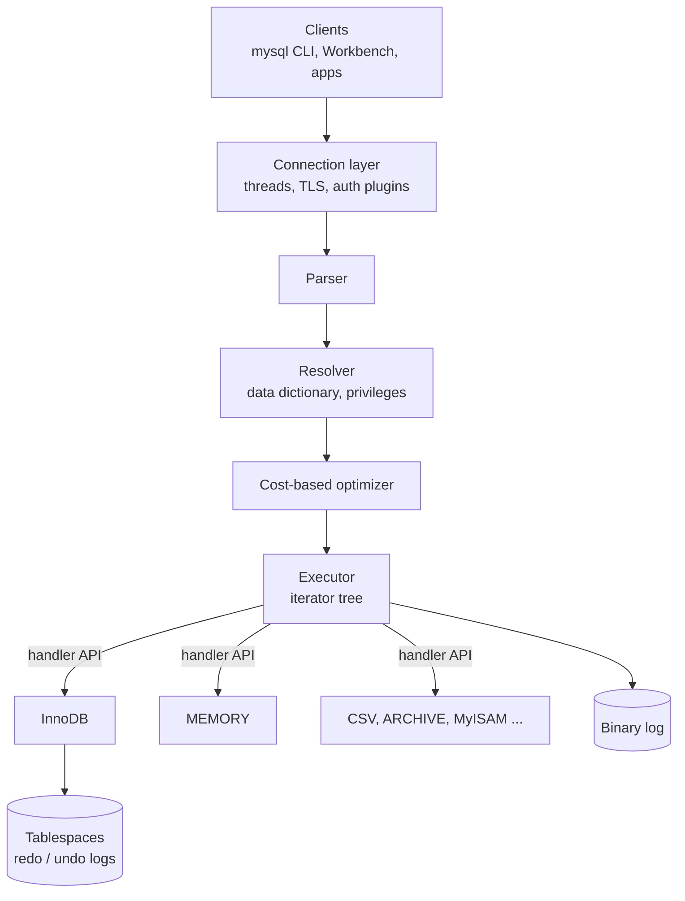

## Introduction

In Module 1 you learned what a database management system is in general: software that stores data durably, enforces integrity, answers declarative queries and coordinates concurrent transactions ([Data, Databases and DBMS](/lessons/m01-data-database-dbms)). **MySQL** is one concrete DBMS — an open-source, relational, client/server database server — and it is the one this course uses to make every theoretical idea executable.

"MySQL" actually names several different things, and professionals keep them apart:

- **A server program**, `mysqld`, that owns the data files and listens for connections (by default on TCP port 3306).
- **A family of client programs and libraries** — the `mysql` command-line client, MySQL Shell, MySQL Workbench, connectors for Python, Java, Node.js and others — that send SQL to the server.
- **A product line** owned by Oracle Corporation, with a free Community Edition, a commercial Enterprise Edition and a managed cloud service (HeatWave).
- **A SQL dialect**: MySQL implements most of standard SQL plus a set of extensions (`LIMIT`, `ON DUPLICATE KEY UPDATE`, `AUTO_INCREMENT`, backtick-quoted identifiers, …) that you will learn to recognise as MySQL-specific.

This lesson answers the questions an engineer asks on day one with a new database: *Which version am I running and how long will it be supported? Which edition and features do I have? What happens inside the server when I send a query? Which part of the system stores my rows?* It also explains how MySQL relates to MariaDB, Percona Server and the cloud services that present themselves as "MySQL-compatible".

:::note[Dataset and sandbox]
The runnable examples use the **shop** dataset. Each block runs in your private lab schema on a real MySQL server. The platform targets **MySQL 8.4 LTS**; the outputs below were captured on the server version shown in the block header, which may be an 8.0 release — where 8.0 and 8.4 differ, the lesson says so explicitly.
:::

## DBMS Theory

:::theory[A DBMS as a layered system]
Database textbooks describe a DBMS as a stack of layers, each hiding the details of the one below it:

1. **Interface / connection layer** — accepts client sessions, authenticates them and receives statements.
2. **Query processor** — parses a declarative statement, checks it against the catalog, rewrites it, chooses a physical plan with a cost-based optimizer and executes the plan.
3. **Storage manager** — maps relations to files and pages, maintains access methods (B+ trees, hash indexes), manages the buffer pool, logs changes and implements concurrency control and recovery.

The interface between the query processor and the storage manager is usually an internal, tightly coupled API. **MySQL's distinctive design decision is to make that interface public and pluggable**: the storage manager is a *storage engine* behind a documented *handler* API, so one SQL layer can drive several different storage implementations.
:::

Three general ideas from Module 1 map directly onto MySQL:

| General DBMS concept | Where it lives in MySQL |
|---|---|
| Client/server architecture ([Database Architectures](/lessons/m01-database-architectures)) | `mysqld` is the server; every tool, application and driver is a client speaking the MySQL client/server protocol |
| Catalog / data dictionary | The **transactional data dictionary**, stored in InnoDB tables since 8.0 and exposed read-only through `information_schema` |
| Physical data independence ([Three-Schema Architecture](/lessons/m01-schemas-three-schema-architecture)) | The same `CREATE TABLE` and `SELECT` work whether the table's engine is InnoDB, MEMORY or CSV — the SQL layer does not care how rows are stored |
| ACID transactions ([ACID Transactions](/lessons/m01-acid-transactions)) | Provided by the **InnoDB** engine, not by the SQL layer; non-transactional engines (MyISAM, MEMORY) ignore `ROLLBACK` |

That last row is the most important consequence of the pluggable design: **many guarantees you associate with "MySQL" are actually guarantees of InnoDB.** Row-level locking, MVCC, crash recovery and foreign keys are engine features. Because InnoDB has been the default engine since MySQL 5.5 (2010), this distinction rarely bites in practice — but it explains why the manual so often says "for InnoDB tables…".

**Relational, but with a dialect.** MySQL is a relational DBMS in the sense of Module 1: data lives in tables (relations), queries are declarative SQL, integrity is enforced with keys and constraints. Like every commercial system, it deviates from the pure model (tables are bags, not sets; NULL introduces three-valued logic) and from the SQL standard (some standard features are missing — for example the `FILTER` clause on aggregates and full `MERGE` — while non-standard conveniences are added).

## Why It Exists

**A short history.** MySQL was created in Sweden by Michael "Monty" Widenius, David Axmark and Allan Larsson; the company MySQL AB published the first release in 1995. The goal was a fast, simple, free SQL database for the then-emerging web. Its dual-licensing model — GPL for open-source use, a commercial licence for embedding in proprietary products — financed development. MySQL became the "M" in the **LAMP** stack (Linux, Apache, MySQL, PHP/Perl/Python) and powered a large share of early web sites: forums, blogs, wikis and e-commerce shops.

Ownership changed twice: **Sun Microsystems acquired MySQL AB in 2008**, and **Oracle acquired Sun in 2010**. Concern about MySQL's future under Oracle (which also sells the Oracle Database) led Monty Widenius to start the **MariaDB** fork in 2009.

Key technical milestones explain much of what you will see in this course:

| Release | Approx. GA | Why it matters today |
|---|---|---|
| 5.1 | 2008 | Pluggable storage engine API as a plugin interface; partitioning |
| 5.5 | 2010 | **InnoDB becomes the default storage engine** (previously MyISAM) |
| 5.6 | 2013 | Online DDL, GTID replication, much-improved optimizer |
| 5.7 | 2015 | Native `JSON` type, generated columns, `ONLY_FULL_GROUP_BY` and strict mode on by default |
| 8.0 | 2018 | Transactional data dictionary, CTEs and window functions, roles, `utf8mb4` default, **query cache removed**, `caching_sha2_password` default |
| 8.4 LTS | 2024 | First LTS release of the new release model; `mysql_native_password` disabled by default; MASTER/SLAVE syntax removed |
| 9.x | 2024 → | Innovation releases: e.g. the `VECTOR` type (9.0), `mysql_native_password` removed (9.0) |

(Versions 6 and 7 were skipped for the server; 7.x numbering was used by MySQL NDB Cluster.)

**Why it is still chosen.** MySQL persists in production because it solves a specific problem well: a reliable, well-understood OLTP (online transaction processing) database for high volumes of short reads and writes, with mature replication, a huge ecosystem of drivers, ORMs, hosting options and operational knowledge, and no licence cost for the Community Edition. Large web companies have run MySQL at very large scale for years, and every major cloud offers a managed MySQL service. Knowing MySQL deeply is therefore a durable professional skill.

**What goes wrong without understanding the product model?** Teams that ignore release tracks end up on unsupported versions (MySQL 5.7 reached end of life in October 2023; 8.0 reached end of life in April 2026), upgrade into an Innovation release that is supported for only a few months, or assume features that exist only in the Enterprise Edition or only in a fork. Teams that ignore the engine layer create MyISAM or MEMORY tables by accident and lose transactions or crash safety.

## Internal Working

:::internals[The path of a query through mysqld]
`mysqld` is a single multi-threaded process. In the default configuration each client connection is served by its own **thread** (one-thread-per-connection; the Enterprise Edition and some forks add a thread pool). A statement passes through these components:

1. **Connection handling** — the network listener accepts a TCP or Unix-socket connection, negotiates TLS, and an **authentication plugin** (default `caching_sha2_password`) verifies the account. The session gets its own system-variable values (`SET SESSION …`).
2. **Parser** — turns SQL text into a parse tree; syntax errors (error 1064) are raised here.
3. **Resolver / prepare** — looks up tables and columns in the **data dictionary**, checks privileges, resolves names and types (unknown column: error 1054).
4. **Optimizer** — applies rewrites (e.g. subquery to semijoin transformations), estimates costs using statistics supplied by the engine, and chooses join order and access paths.
5. **Executor** — runs the chosen plan as a tree of **iterators** (since 8.0). Iterators that need rows call the **handler API** of the table's storage engine.
6. **Storage engine** — InnoDB (or another engine) locates rows through its indexes and buffer pool and returns them in MySQL's internal row format.

Server-wide services sit beside this path: the **binary log** (records committed changes for replication and point-in-time recovery — a server-layer log, distinct from InnoDB's redo log), the **Performance Schema** (instrumentation), and the **data dictionary**.
:::



**The handler API.** Each storage engine implements a C++ class derived from `handler`, with methods such as "open table", "position on the first row", "read the next row", "look up this index key", "write row", "update row" and "delete row". The executor never reads data files directly; it calls these methods. The server counts the calls in **`Handler_*` status variables**, which gives you a way to *see* the API at work from SQL — you will do so below.

**Engine capabilities differ.** Because each engine implements the API differently, capabilities vary: InnoDB supports transactions, row locks, MVCC, foreign keys and crash recovery; MyISAM has table-level locks and no transactions; MEMORY keeps rows in RAM and loses them on restart; CSV stores rows as comma-separated text; ARCHIVE compresses rows and supports only `INSERT` and `SELECT`. The optimizer asks the engine for capabilities and statistics and plans accordingly. Engines are compared in depth in [Storage Engines](/lessons/m02-storage-engines) and InnoDB internals in Module 10 ([MySQL Server Architecture](/lessons/m10-server-architecture)).

**The data dictionary (8.0+).** Before 8.0, table definitions were stored in `.frm` files next to the data, and DDL was not crash-safe. MySQL 8.0 moved all metadata into transactional InnoDB tables in the `mysql` system schema. DDL became *atomic*: a crash in the middle of `CREATE TABLE` no longer leaves a half-created table. `information_schema` tables are now views over the dictionary.

:::standard[Standard SQL vs MySQL]
The layered design is general DBMS theory. The *pluggable* engine layer, the `ENGINE=` table option, `SHOW ENGINES` and the `Handler_*` counters are **MySQL-specific**. Standard SQL says nothing about storage engines; PostgreSQL, for instance, has one native storage format (with an extension API for table access methods since version 12).
:::

## MySQL Implementation

The first thing to establish on any MySQL server is *exactly* what you are talking to. `VERSION()` returns the server version string; distribution builds append a suffix (for example `-0ubuntu…` for Ubuntu packages, `-log`, or nothing for Oracle's own builds):

```sql run
SELECT VERSION()            AS server_version,
       @@version_comment    AS build,
       @@version_compile_os AS os,
       @@license            AS license;
```

The `license` value tells you whether this is a GPL (Community) build; Oracle's Enterprise builds report a commercial licence. Version numbers follow `MAJOR.MINOR.PATCH`. Since the 2023 release-model change, the **minor** number tells you the track: `8.4.x` is the 8.4 LTS series, `9.1.0`, `9.2.0`, … are Innovation releases (see Syntax Breakdown).

Next, the storage engines this server provides and the default one:

```sql run
SELECT ENGINE, SUPPORT, TRANSACTIONS, XA, SAVEPOINTS, COMMENT
FROM information_schema.ENGINES
ORDER BY (SUPPORT = 'DEFAULT') DESC, ENGINE;
```

Exactly one engine reports `SUPPORT = 'DEFAULT'` — InnoDB, on every modern MySQL server. Only InnoDB reports `YES` for transactions, XA and savepoints. Some engines are compiled in but disabled (`FEDERATED` usually shows `NO`). `SHOW ENGINES` returns the same information in a fixed format.

Every table records its engine. On the shop dataset all tables use InnoDB with the `Dynamic` row format, the 8.0/8.4 default:

```sql run
SELECT TABLE_NAME, ENGINE, ROW_FORMAT, TABLE_ROWS AS approx_rows
FROM information_schema.TABLES
WHERE TABLE_SCHEMA = DATABASE()
ORDER BY TABLE_NAME;
```

`TABLE_ROWS` is an *estimate* supplied by the engine (InnoDB samples pages), which is why it is aliased `approx_rows`. `DATABASE()` returns the current schema — in the sandbox your private lab schema, shown as `your_lab`.

## Syntax Breakdown

This lesson is about the product rather than one statement, so the "syntax" to master is the vocabulary of versions, editions and server introspection.

### Release tracks

| Track | Examples | What changes between releases | Support | Choose it when |
|---|---|---|---|---|
| **LTS (Long-Term Support)** | 8.4.0, 8.4.1, … | Bug and security fixes only; no new features or behaviour changes in the series (with rare exceptions documented in release notes) | Years of support (Oracle's Lifetime Support policy: 5 years Premier + 3 years Extended) | Production systems that value stability; most companies |
| **Innovation** | 9.0, 9.1, 9.2, … | New features, deprecations and removals in every release (roughly quarterly) | Only until the next Innovation release | Evaluating new features, development, teams able to upgrade every quarter |
| **Bug-fix series (legacy model)** | 8.0.x | Before 8.0.34, 8.0 patch releases also added features; from 8.0.34 the 8.0 series became bug-fix only | 8.0 reached end of life in April 2026 | Legacy systems that must migrate to 8.4 |

Every few Innovation releases, Oracle declares the next LTS series, which then freezes. Upgrades are supported **within** an LTS series and from one LTS to the **next** LTS (8.0 → 8.4 → next LTS), so you never have to pass through every Innovation release.

:::version[8.0 vs 8.4 vs 9.x — differences you will meet in this course]
- **Authentication:** `mysql_native_password` was deprecated in 8.0, is **disabled by default in 8.4** (it can be re-enabled with `--mysql-native-password=ON`), and is **removed in 9.0**. `caching_sha2_password` is the default.
- **Terminology:** 8.4 **removed** the old `MASTER`/`SLAVE` replication syntax. Use `SHOW REPLICA STATUS`, `SHOW BINARY LOG STATUS` (replaces `SHOW MASTER STATUS`) and `CHANGE REPLICATION SOURCE TO`.
- **InnoDB defaults changed in 8.4:** `innodb_adaptive_hash_index=OFF`, `innodb_change_buffering=none`, `innodb_io_capacity=10000`, and on Linux `innodb_flush_method=O_DIRECT` where supported.
- **9.0** added the `VECTOR` data type and (Enterprise Edition) JavaScript stored programs.

```sql
-- MySQL 8.4 and later only (removed/renamed statements)
SHOW BINARY LOG STATUS;     -- was SHOW MASTER STATUS
SHOW REPLICA STATUS;        -- SHOW SLAVE STATUS no longer exists
```
:::

### Editions and distributions

| Product | Licence | What you get beyond the core server |
|---|---|---|
| **MySQL Community Edition** | GPLv2 (free) | Server, InnoDB, replication, Group Replication/InnoDB Cluster, MySQL Shell, Router, Workbench |
| **MySQL Enterprise Edition** | Commercial subscription | Adds Enterprise Backup (hot physical backups), Enterprise Monitor, thread pool, audit log, firewall, data masking, key-management integrations, Oracle support |
| **HeatWave MySQL** | Oracle Cloud service | Managed MySQL plus an in-memory analytics accelerator (HeatWave cluster) and in-database ML features |
| **Linux distribution packages** | GPL | Community server repackaged by Ubuntu, Debian, Fedora…; version string carries a distro suffix |
| **Managed cloud services** | Provider's terms | Amazon RDS / Aurora MySQL, Google Cloud SQL, Azure Database for MySQL — MySQL-compatible, operated by the provider, some with modified storage layers (Aurora) |

### Introspection statements

| Statement / expression | Returns | Standard or MySQL? |
|---|---|---|
| `SELECT VERSION()` / `@@version` | Server version string | MySQL |
| `@@version_comment`, `@@license` | Build description, licence | MySQL |
| `SHOW ENGINES`, `information_schema.ENGINES` | Available storage engines and capabilities | MySQL (`information_schema` itself is standard; this table is not) |
| `@@default_storage_engine` | Engine used when `CREATE TABLE` omits `ENGINE=` | MySQL |
| `information_schema.TABLES.ENGINE` | Engine of each table | MySQL column on a standard view |
| `SHOW SESSION STATUS LIKE 'Handler_%'` | Handler-API call counters for your session | MySQL |
| `EXPLAIN FORMAT=TREE` | The executor's iterator tree | MySQL |

## Practical Examples

**1. Watching the handler API.** The `Handler_read_*` counters count how many times the executor asked the storage engine for a row, and *how* it asked. `Handler_read_key` counts index lookups by key value; `Handler_read_rnd_next` counts "give me the next row" calls during a table scan. Take a snapshot, run a primary-key lookup, and look again:

```sql run
SHOW SESSION STATUS LIKE 'Handler_read%';
```

```sql run
SELECT customer_id, first_name, city FROM customers WHERE customer_id = 7;
SHOW SESSION STATUS LIKE 'Handler_read%';
```

Compare the two snapshots: the primary-key lookup increased `Handler_read_key` by one and did not change `Handler_read_rnd_next`. The SQL layer asked InnoDB "find the row with key 7" once, and InnoDB descended its clustered index to get it. Now filter on a column that has **no** index:

```sql run
SELECT COUNT(*) AS austin_customers FROM customers WHERE city = 'Austin';
SHOW SESSION STATUS LIKE 'Handler_read%';
```

This time `Handler_read_rnd_next` grew by 26 — one call for each of the table's 25 rows plus one final call that reported end-of-table — and `Handler_read_first` also moved: the executor positioned at the start of the table and pulled every row through the API, testing `city = 'Austin'` in the SQL layer. That is the division of labour of the pluggable architecture: **the engine fetches rows; the SQL layer filters, joins, groups and sorts them.** (Some predicates can be pushed down into the engine — *index condition pushdown* — which you will meet in Module 7.)

**2. Seeing the executor's plan.** `EXPLAIN FORMAT=TREE` prints the iterator tree that the executor will run. The leaves are the iterators that call the handler API:

```sql run
EXPLAIN FORMAT=TREE
SELECT c.city, COUNT(*) AS orders
FROM customers c
JOIN orders o ON o.customer_id = c.customer_id
WHERE o.status = 'delivered'
GROUP BY c.city;
```

Read it from the innermost (most indented) lines outward: table scans or index lookups at the bottom feed a join, which feeds aggregation. The optimizer chose the join order and access methods; how it does that is the subject of [Reading Execution Plans with EXPLAIN](/lessons/m07-explain).

**3. One SQL layer, several engines.** Create the same table definition with three different engines. The SQL is identical apart from the `ENGINE` option — physical data independence in action:

```sql run
CREATE TABLE engine_demo_innodb (id INT NOT NULL, note VARCHAR(20) NOT NULL) ENGINE = InnoDB;
CREATE TABLE engine_demo_memory (id INT NOT NULL, note VARCHAR(20) NOT NULL) ENGINE = MEMORY;
CREATE TABLE engine_demo_csv    (id INT NOT NULL, note VARCHAR(20) NOT NULL) ENGINE = CSV;
INSERT INTO engine_demo_innodb VALUES (1, 'durable');
INSERT INTO engine_demo_memory VALUES (1, 'lost on restart');
INSERT INTO engine_demo_csv    VALUES (1, 'plain text file');
SELECT TABLE_NAME, ENGINE
FROM information_schema.TABLES
WHERE TABLE_SCHEMA = DATABASE() AND TABLE_NAME LIKE 'engine_demo%'
ORDER BY TABLE_NAME;
```

(The CSV engine requires every column to be `NOT NULL` and supports no indexes — a reminder that capabilities differ.) The difference shows up when you use transactions. InnoDB honours `ROLLBACK`; MEMORY cannot, because it has no undo log:

```sql run
START TRANSACTION;
INSERT INTO engine_demo_innodb VALUES (2, 'rolled back?');
INSERT INTO engine_demo_memory VALUES (2, 'rolled back?');
ROLLBACK;
SELECT 'innodb' AS engine, COUNT(*) AS rows_after_rollback FROM engine_demo_innodb
UNION ALL
SELECT 'memory', COUNT(*) FROM engine_demo_memory;
```

The InnoDB table is back to one row; the MEMORY table kept the "rolled back" row and now has two. MySQL answered the `ROLLBACK` with warning 1196, *"Some non-transactional changed tables couldn't be rolled back"*. This is why accidentally creating a non-InnoDB table is a correctness problem, not just a performance one.

**4. Which features does *this* server have?** System variables reveal configuration that matters for compatibility. A few you should know from the first day:

```sql run
SELECT @@default_storage_engine          AS default_engine,
       @@character_set_server            AS server_charset,
       @@collation_server                AS server_collation,
       @@sql_mode                        AS sql_mode,
       @@transaction_isolation           AS isolation_level;
```

`utf8mb4` with the `utf8mb4_0900_ai_ci` collation has been the default since 8.0; the strict SQL mode (`STRICT_TRANS_TABLES`) and `ONLY_FULL_GROUP_BY` are on by default; InnoDB's default isolation level is `REPEATABLE-READ`. Each of these gets its own lesson later — the point now is that **a "MySQL" server is a version plus a configuration**, and both determine how your SQL behaves.

## Execution Walkthrough

Let us trace one statement through the layers described in Internal Working, using real observations at each step.

```walkthrough
title: SELECT first_name, city FROM customers WHERE customer_id = 7
steps:
  - title: "1. Connection layer — who am I?"
    explain: >-
      Before any query runs, the client has connected and been authenticated. CURRENT_USER() is the account the
      server matched (user@host); CONNECTION_ID() would identify the thread serving this session. In the sandbox
      the account is a per-lab user with privileges only on your lab schema.
    sql: SELECT CURRENT_USER() AS authenticated_as, DATABASE() AS current_schema;
  - title: "2. Parser — is it valid SQL?"
    explain: >-
      The parser turns text into a parse tree. A misspelled keyword (FORM instead of FROM) fails here, before
      the server has looked at any table: error 1064 is always a parser error.
    sql: SELECT first_name FORM customers WHERE customer_id = 7;
    expect: error
  - title: "3. Resolver — do the names exist?"
    explain: >-
      The statement parses, but the resolver looks up every column in the data dictionary and fails on an
      unknown name (error 1054). Parsing and name resolution are separate phases.
    sql: SELECT first_nam FROM customers WHERE customer_id = 7;
    expect: error
  - title: "4. Optimizer — choose an access path"
    explain: >-
      With a valid statement, the optimizer recognises an equality on the primary key and chooses a
      single-row lookup ("const" access) instead of a scan.
    sql: EXPLAIN SELECT first_name, city FROM customers WHERE customer_id = 7;
  - title: "5. Executor and storage engine — fetch the row"
    explain: >-
      The executor runs the plan: one handler call asks InnoDB to look up key 7 in the clustered index, and
      the SQL layer projects the two requested columns.
    sql: SELECT first_name, city FROM customers WHERE customer_id = 7;
```

Two things are worth noticing. First, errors tell you which layer rejected a statement: 1064 (parser) versus 1054 (resolver) versus a privilege error such as 1142 (resolver checking grants) versus a constraint violation such as 1062 (raised by the engine when writing). Second, the optimizer's choice (`type = const`, `key = PRIMARY`) is what made step 5 a single handler call — the same call you counted with `Handler_read_key` in Practical Examples.

## Output

The final result of the walkthrough is a single row — the first name and city of customer 7. Behind that row, the server authenticated a session, parsed and resolved the statement against the data dictionary, chose a primary-key lookup, and made one handler-API call into InnoDB.

The introspection outputs earlier in the lesson are equally "output" in a professional sense. When you report a problem, ask for help or file a bug, always include:

- the full `VERSION()` string (including any distribution suffix) and whether it is LTS or Innovation;
- the edition/licence (`@@license`, `@@version_comment`);
- the relevant settings (`@@sql_mode`, character set and collation, isolation level);
- the engine of every table involved (`SHOW CREATE TABLE` or `information_schema.TABLES`).

Behaviour that differs between two "MySQL" servers is almost always explained by one of those four items.

## Alternative Approaches

"Which database server?" has several MySQL-family answers, and outside the family several relational alternatives.

| Option | What it is | Compatibility with MySQL | When teams choose it |
|---|---|---|---|
| **Oracle MySQL Community 8.4 LTS** | The reference implementation | — | Default choice for new MySQL deployments |
| **MySQL Innovation (9.x)** | Same product, feature track | Same codebase; features may change each release | Need a new feature now (e.g. `VECTOR`) and can upgrade quarterly |
| **Percona Server for MySQL** | Free, drop-in enhanced build of Oracle MySQL by Percona, tracking each upstream release | Very high — same versions, same data files | Want Enterprise-like features (thread pool, audit log, extra instrumentation) without a commercial licence; pairs with Percona XtraBackup |
| **MariaDB Server** | Community fork started in 2009 | Diverged significantly since 10.x: different optimizer, different JSON implementation (JSON is an alias of `LONGTEXT`), different replication GTIDs, its own features (system-versioned tables, sequences, Aria/ColumnStore engines) | Linux distributions that ship it as default, teams wanting MariaDB-specific features; **not** a guaranteed drop-in replacement for MySQL 8.x |
| **Managed MySQL (RDS, Cloud SQL, Azure)** | MySQL operated by a cloud provider | High, with restrictions (no SUPER privilege, provider-controlled configuration) | Teams that prefer not to run servers |
| **Aurora MySQL / HeatWave / PlanetScale / TiDB** | MySQL-compatible services with re-engineered storage or distribution layers | Wire- and dialect-compatible to varying degrees | Specific scaling, analytics or operational needs |
| **PostgreSQL** | A different open-source RDBMS | Different dialect and internals | Richer standard SQL, extensibility; compared in [MySQL vs PostgreSQL](/lessons/m13-mysql-vs-postgresql) |

:::warning["MySQL-compatible" is a spectrum]
Compatibility claims usually mean "speaks the MySQL wire protocol and accepts most of the dialect". Data types, optimizer behaviour, isolation semantics, JSON functions and replication can still differ. Always test your actual workload — and in this course, learn what *Oracle MySQL 8.4* does, then check the differences of any other product you deploy.
:::

## Performance Analysis

Performance is not a property of "MySQL" as a brand but of **version × configuration × engine × workload**. Three product-level facts matter for performance:

1. **Version changes plans and defaults.** Each major version improved the optimizer (8.0 added hash joins, histograms, the iterator executor; 8.0.18+ introduced `EXPLAIN ANALYZE`). 8.4 changed several InnoDB defaults (adaptive hash index off, change buffering off, higher I/O capacity) because modern SSD-based servers behave differently from the spinning disks the old defaults were tuned for. An upgrade can therefore change query plans and I/O patterns — performance regressions after upgrades are usually plan changes, which is why production upgrades are tested with real query samples.
2. **Engine choice dominates.** The handler counters above show that the SQL layer delegates every row access to the engine. InnoDB's buffer pool, clustered index and MVCC determine the cost of almost every query you will write. MEMORY tables avoid disk I/O but use table-level locks; MyISAM avoids MVCC overhead but has no crash safety. In practice: use InnoDB.
3. **The removed query cache.** Older tutorials recommend `query_cache_size`. The query cache was **removed in MySQL 8.0** because its global mutex limited scalability on multi-core servers. Caching now belongs in the application or a dedicated cache ([Caching Strategies](/lessons/m12-caching)).

:::performance[Theory vs measurement]
The handler counters are a *measurement tool* you can use on any server: snapshot `SHOW SESSION STATUS LIKE 'Handler_read%'` before and after a query to see whether it performed key lookups or scans. On the 25-row customers table every query is instant; the counters, not timings, reveal the access pattern. Proper measurement with `EXPLAIN ANALYZE` is taught in [EXPLAIN ANALYZE](/lessons/m07-explain-analyze).
:::

## Best Practices

:::best-practice[Professional habits with MySQL as a product]
1. **Run an LTS release in production** (today: 8.4) and plan the next LTS-to-LTS upgrade well before end of support. Use Innovation releases for evaluation unless you can genuinely upgrade every quarter.
2. **Track the full version string** of every environment (dev, CI, staging, production) and keep them on the same series. "Works on my machine" bugs between 8.0 and 8.4 are real.
3. **Always use InnoDB** unless you can name the specific reason not to. Check with `information_schema.TABLES` that no table was created with another engine by an old script.
4. **Learn the dialect boundary.** When you use a MySQL extension (`ON DUPLICATE KEY UPDATE`, `LIMIT`, `REPLACE`), know that it is one; it matters for portability and when you read other databases' documentation.
5. **Read the release notes and the "What Is New in MySQL 8.4" page** before upgrading; deprecations announced in one series become removals in the next.
6. **Prefer documented sources.** The MySQL Reference Manual for your exact series (`/doc/refman/8.4/`) is authoritative; blog posts are often written for 5.7 or MariaDB.
:::

## Common Mistakes

**Mistake 1 — assuming every engine enforces the same guarantees.** A table created with `ENGINE=MEMORY` (or MyISAM) silently ignores `ROLLBACK`, as you saw above. It is worse with foreign keys: engines that do not support them **accept the `FOREIGN KEY` clause without error and then discard it**. Watch:

```sql run
CREATE TABLE memory_orders (
  order_id    INT PRIMARY KEY,
  customer_id INT UNSIGNED NOT NULL,
  FOREIGN KEY (customer_id) REFERENCES customers (customer_id)
) ENGINE = MEMORY;
SELECT CONSTRAINT_NAME, CONSTRAINT_TYPE
FROM information_schema.TABLE_CONSTRAINTS
WHERE TABLE_SCHEMA = DATABASE() AND TABLE_NAME = 'memory_orders';
INSERT INTO memory_orders VALUES (1, 999);   -- customer 999 does not exist
SELECT * FROM memory_orders;
```

The constraint list contains only the primary key — the foreign key vanished (MySQL kept an ordinary index on `customer_id`), and the order for the non-existent customer 999 was accepted. No error, no warning: a referential-integrity hole created by one table option. The correction is simply to use InnoDB (or omit `ENGINE=` and rely on the default):

```sql run
CREATE TABLE innodb_orders (
  order_id    INT PRIMARY KEY,
  customer_id INT UNSIGNED NOT NULL,
  FOREIGN KEY (customer_id) REFERENCES customers (customer_id)
);
SELECT CONSTRAINT_NAME, CONSTRAINT_TYPE
FROM information_schema.TABLE_CONSTRAINTS
WHERE TABLE_SCHEMA = DATABASE() AND TABLE_NAME = 'innodb_orders'
ORDER BY CONSTRAINT_TYPE;
```

```sql run error
INSERT INTO innodb_orders VALUES (1, 999);
```

Now the foreign key exists and InnoDB rejects the orphan row with error 1452.

**Mistake 2 — treating MariaDB and MySQL as the same product.** Since MariaDB 10.0 the two have diverged. SQL that runs on MariaDB (for example sequences or `RETURNING`) may not run on MySQL 8.4, and vice versa (MySQL's binary JSON storage and functions such as `JSON_TABLE` behave differently). Check which one you are connected to: MariaDB's `VERSION()` contains `MariaDB`.

**Mistake 3 — upgrading into an Innovation release by accident.** Package repositories and Docker tags such as `mysql:latest` or `mysql:9` move to new Innovation releases. Pin `mysql:8.4` (or an exact patch such as `8.4.x`) for anything long-lived.

**Mistake 4 — following outdated advice.** Tuning guides that mention `query_cache_size`, `innodb_file_format`, `.frm` files, `SHOW SLAVE STATUS` or `utf8` (which is the deprecated 3-byte `utf8mb3`) were written for 5.x. Using them on 8.4 produces errors or wrong designs.

**Mistake 5 — confusing the binary log with InnoDB's logs.** The binary log is written by the *server layer* for replication and point-in-time recovery; InnoDB's redo and undo logs are written by the *engine* for crash recovery and MVCC. They serve different purposes and are configured separately (Module 10).

## Industry Application

- **Web and SaaS back ends.** MySQL is a standard OLTP store behind web applications: user accounts, orders, payments, content. Frameworks such as Django, Rails, Laravel and Spring ship first-class MySQL support. Large companies run fleets of thousands of MySQL servers, typically sharded and replicated ([Sharding](/lessons/m12-sharding)).
- **Managed cloud databases.** A large share of new MySQL deployments are managed services (Amazon RDS/Aurora, Google Cloud SQL, Azure). Engineers still need to understand versions, parameters and engines because they choose the engine version, parameter groups and upgrade windows.
- **Platform teams and version policy.** Database platform teams publish an internal "supported versions" policy (e.g. "8.4 LTS only; 8.0 decommissioned by date X") and automate fleet upgrades LTS-to-LTS. The release model you learned here is what makes such policies possible.
- **Analytics offload.** Operational data in MySQL is replicated or streamed (CDC from the binary log) into warehouses and lakehouses for analytics ([ETL and ELT Pipelines](/lessons/m13-etl-elt)); HeatWave takes the alternative approach of adding an analytics engine to MySQL itself.
- **Data science workflows.** As a data professional you will frequently *read* from MySQL (pandas `read_sql`, SQLAlchemy, Spark JDBC). Knowing the version and engine tells you which SQL features (window functions need 8.0+) and which isolation guarantees your extracts rely on.

## Practice Exercises

These exercises use `information_schema` and system variables so that your answers are checked against the same server the reference solution runs on.

```exercise
id: ex1
title: Which engines support transactions?
difficulty: easy
concepts: [storage-engine-api, mysql-overview]
prompt: |
  Using `information_schema.ENGINES`, return the names of all storage engines on this server that
  support transactions. Return **one column**, `ENGINE`.
hints:
  - "information_schema.ENGINES has a TRANSACTIONS column with the values YES, NO or NULL."
  - "Filter with WHERE TRANSACTIONS = 'YES'."
solution: |
  SELECT ENGINE
  FROM information_schema.ENGINES
  WHERE TRANSACTIONS = 'YES';
explanation: |
  On a standard MySQL 8.x server only InnoDB is transactional. (NDB Cluster builds would also list `ndbcluster`.)
  A common mistake is filtering on `SUPPORT = 'YES'`, which lists engines that are *available*, not engines
  that are transactional. Note that `TRANSACTIONS` is NULL for disabled engines such as FEDERATED — another
  reason to compare with `= 'YES'` rather than `<> 'NO'`.
```

```exercise
id: ex2
title: Engine inventory of your schema
difficulty: easy
concepts: [storage-engine-api]
prompt: |
  Return one row per storage engine used by tables in your current schema, with columns
  `ENGINE` and `tables` (the number of tables using that engine).
hints:
  - "information_schema.TABLES has one row per table with TABLE_SCHEMA, TABLE_NAME and ENGINE."
  - "Restrict to TABLE_SCHEMA = DATABASE() and use GROUP BY ENGINE with COUNT(*)."
solution: |
  SELECT ENGINE, COUNT(*) AS tables
  FROM information_schema.TABLES
  WHERE TABLE_SCHEMA = DATABASE()
  GROUP BY ENGINE;
explanation: |
  On a fresh copy of the shop dataset every table is InnoDB, so the answer is a single row. This exact query
  is a real-world audit: platform teams run it across all schemas (`WHERE TABLE_SCHEMA NOT IN ('mysql',
  'sys', 'information_schema', 'performance_schema')`) to find legacy MyISAM tables before upgrades.
  Views appear in information_schema.TABLES with a NULL engine, which is why the column can be NULL in
  schemas that contain views.
```

```exercise
id: ex3
title: Prove that MEMORY ignores ROLLBACK
difficulty: medium
kind: dml
dataset: empty
concepts: [storage-engine-api, mysql-overview]
setup: |
  CREATE TABLE audit_innodb (id INT PRIMARY KEY, msg VARCHAR(30)) ENGINE = InnoDB;
  CREATE TABLE audit_memory (id INT PRIMARY KEY, msg VARCHAR(30)) ENGINE = MEMORY;
prompt: |
  Two empty tables exist: `audit_innodb` (InnoDB) and `audit_memory` (MEMORY). In **one transaction**,
  insert the row `(1, 'test')` into **both** tables, then roll the transaction back.

  The checker then counts the rows remaining in each table.
hints:
  - "START TRANSACTION; then two INSERT statements; then ROLLBACK;"
  - "You do not need to do anything special for the MEMORY table — the point is to observe what the engine does."
solution: |
  START TRANSACTION;
  INSERT INTO audit_innodb VALUES (1, 'test');
  INSERT INTO audit_memory VALUES (1, 'test');
  ROLLBACK;
check: |
  SELECT 'innodb' AS tbl, COUNT(*) AS n FROM audit_innodb
  UNION ALL
  SELECT 'memory', COUNT(*) FROM audit_memory;
explanation: |
  After the rollback the InnoDB table has 0 rows and the MEMORY table has 1. Transactions are implemented by
  the storage engine (InnoDB's undo log), not by the SQL layer, so a non-transactional engine applies each
  change immediately and cannot undo it. MySQL warns about this on ROLLBACK (warning 1196). If a transaction
  mixes engines, atomicity is lost for the non-transactional part.
```

```exercise
id: ex4
title: Configuration fingerprint
difficulty: medium
concepts: [mysql-overview, release-model]
prompt: |
  Write a single-row query that returns, in this order, the columns:

  1. `version` — the server version string
  2. `is_strict` — 1 if the current `sql_mode` contains `STRICT_TRANS_TABLES`, otherwise 0
  3. `default_engine` — the default storage engine
  4. `isolation` — the current transaction isolation level
hints:
  - "System variables are read with @@name, e.g. @@sql_mode, @@default_storage_engine, @@transaction_isolation."
  - "FIND_IN_SET('STRICT_TRANS_TABLES', @@sql_mode) > 0 returns 1 or 0, because sql_mode is a comma-separated list."
solution: |
  SELECT VERSION()                                          AS version,
         FIND_IN_SET('STRICT_TRANS_TABLES', @@sql_mode) > 0 AS is_strict,
         @@default_storage_engine                           AS default_engine,
         @@transaction_isolation                            AS isolation;
explanation: |
  `@@sql_mode` is a comma-separated list, which makes `FIND_IN_SET` the precise test; `LIKE
  '%STRICT_TRANS_TABLES%'` also works here (though it would also match a hypothetical mode whose name contains
  that text). A fingerprint like this belongs in every bug report and in CI logs, because version and
  configuration together decide how SQL behaves.
```

```exercise
id: ex5
title: Choose a release track and a distribution
difficulty: challenge
kind: open
concepts: [release-model, mysql-forks]
prompt: |
  A fintech start-up is choosing a database for its payments service. Requirements: ACID transactions,
  no licence fees, upgrades at most twice a year, at least five years of security fixes, and the option to
  move to a managed cloud service later. One engineer proposes "MySQL 9.x because it is newest", another
  proposes "MariaDB because it is the same as MySQL but more open".

  Recommend a product, release track and engine, justify it against each requirement, and explain what is
  wrong or risky in each engineer's proposal.
solution: |
  **Recommendation:** Oracle MySQL Community Edition, **8.4 LTS**, InnoDB for every table (or Percona Server
  for MySQL 8.4, a drop-in build of the same code, if they want extras such as an audit log without a licence).

  - *ACID:* provided by InnoDB (redo/undo logs, MVCC, row locks); verify no table uses MyISAM/MEMORY.
  - *No licence fees:* Community Edition is GPLv2. Using it as a network service does not require a
    commercial licence.
  - *Upgrades at most twice a year:* an LTS series receives only bug and security fixes, so patch upgrades
    within 8.4 are low-risk and can be scheduled when convenient.
  - *Five years of fixes:* LTS series are supported for years (Premier + Extended support under Oracle's
    lifetime policy); Innovation releases are supported only until the next Innovation release.
  - *Managed cloud later:* every major cloud offers managed MySQL 8.4; migrating LTS-to-LTS is the supported
    path.

  **9.x proposal:** Innovation releases add *and remove* features roughly every quarter and are supported only
  until the next release, which contradicts "upgrades at most twice a year". Newest is not most stable.

  **MariaDB proposal:** MariaDB is a fork that has diverged since 10.x (different JSON storage, optimizer,
  GTIDs, features). It is a legitimate database, but it is not "the same as MySQL", managed MySQL services do
  not run it (some offer it separately), and tools, drivers and SQL written for MySQL 8.4 may behave
  differently. Choosing it should be a deliberate decision, not an assumption of equivalence.
```

## Knowledge Assessment

```quiz
- id: q1
  question: "Which component of MySQL provides transactions, row-level locking and crash recovery?"
  options: ["The SQL parser", "The query optimizer", "The InnoDB storage engine", "The binary log"]
  answer: 2
  explanation: "These are storage-engine features implemented by InnoDB (undo/redo logs, MVCC, row locks). The parser and optimizer are part of the engine-independent SQL layer. The binary log is a server-layer log used for replication and point-in-time recovery, not for crash recovery of tables."
  concepts: [storage-engine-api, server-architecture]
- id: q2
  question: "A team needs a production MySQL version with only bug and security fixes for several years. Which do they choose?"
  options: ["The newest 9.x Innovation release", "8.4 LTS", "5.7, because it is mature", "Whatever `mysql:latest` points to"]
  answer: 1
  explanation: "8.4 is the current Long-Term Support series: bug and security fixes only, long support window. Innovation releases add and remove features and are supported only until the next release. 5.7 reached end of life in October 2023. `latest` tags move to new Innovation releases."
  concepts: [release-model]
- id: q3
  question: "`SELECT first_nam FROM customers;` fails with error 1054 (Unknown column). Which phase rejected it?"
  options: ["The parser", "The resolver, using the data dictionary", "The storage engine", "The network layer"]
  answer: 1
  explanation: "The statement is syntactically valid, so the parser accepts it. The resolver then looks up the column in the data dictionary and fails. A syntax error would be 1064 (parser). The storage engine is never called for this statement."
  concepts: [server-architecture]
- id: q4
  question: "Which statements about MySQL 8.4 compared with 8.0 are true? (Select all that apply.)"
  type: multi
  options:
    - "`mysql_native_password` is disabled by default"
    - "`SHOW SLAVE STATUS` was removed in favour of `SHOW REPLICA STATUS`"
    - "The query cache was reintroduced"
    - "`innodb_adaptive_hash_index` is OFF by default"
  answer: [0, 1, 3]
  explanation: "8.4 disables mysql_native_password by default (removed in 9.0), removes MASTER/SLAVE syntax, and turns the adaptive hash index off by default. The query cache was removed in 8.0 and has not returned."
  concepts: [release-model]
- id: q5
  question: "After `START TRANSACTION; INSERT INTO m VALUES (1); ROLLBACK;` the row is still in table `m`. What is the most likely explanation?"
  options:
    - "Autocommit was ON, so ROLLBACK is ignored"
    - "Table m uses a non-transactional engine such as MEMORY or MyISAM"
    - "ROLLBACK only works for UPDATE, not INSERT"
    - "The binary log replayed the insert"
  answer: 1
  explanation: "START TRANSACTION suspends autocommit until COMMIT/ROLLBACK, so autocommit is not the reason. ROLLBACK undoes inserts too — on transactional engines. Non-transactional engines apply changes immediately and cannot undo them; MySQL issues a warning. The binary log does not replay anything on the same server."
  concepts: [storage-engine-api]
- id: q6
  question: "What does the `Handler_read_rnd_next` status variable count?"
  options:
    - "Index lookups by exact key value"
    - "Requests to the storage engine for the next row during a table scan"
    - "Rows sent to the client"
    - "Random I/O operations on disk"
  answer: 1
  explanation: "Handler_* counters count handler-API calls from the executor into the engine. Handler_read_rnd_next counts 'read next row' calls in a scan; Handler_read_key counts key lookups. Rows sent to clients and disk I/O are counted elsewhere (e.g. Innodb_* status variables for I/O)."
  concepts: [storage-engine-api]
- id: q7
  question: "Which statement about MariaDB is accurate?"
  options:
    - "It is Oracle's commercial edition of MySQL"
    - "It is a fork of MySQL started in 2009 that has since diverged in features and internals"
    - "It is byte-for-byte identical to MySQL 8.4"
    - "It is MySQL's default storage engine"
  answer: 1
  explanation: "MariaDB was forked by MySQL's original creator in 2009. It shares history but differs today (e.g. JSON as LONGTEXT alias, different GTIDs, different optimizer). Oracle's commercial product is MySQL Enterprise Edition; the default engine is InnoDB."
  concepts: [mysql-forks]
- id: q8
  question: "Why could MySQL 8.0 make DDL statements atomic and crash-safe, unlike 5.7?"
  options:
    - "Because it removed the query cache"
    - "Because table metadata moved from .frm files into a transactional data dictionary stored in InnoDB"
    - "Because it switched the default character set to utf8mb4"
    - "Because it introduced the Innovation release model"
  answer: 1
  explanation: "With metadata in InnoDB tables, DDL updates to the dictionary are transactional and can be rolled back or recovered after a crash. The other changes are real but unrelated to DDL atomicity; the Innovation model arrived in 2023."
  concepts: [server-architecture]
```
