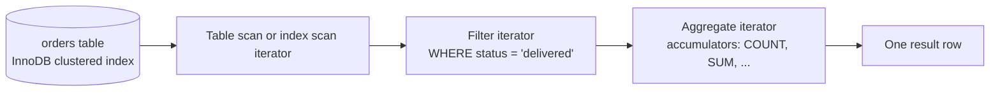

## Introduction

Almost every business question that starts with *"how many"*, *"how much"*, *"what is the average"*, *"what was the first"* or *"what is the largest"* is answered with an **aggregate function**. "How many customers do we have?", "What is our revenue?", "What is the average product rating?" — each of these takes **many rows** as input and produces **one value** as output.

MySQL provides the five classic aggregates defined by the SQL standard — `COUNT`, `SUM`, `AVG`, `MIN` and `MAX` — plus several others (`GROUP_CONCAT`, `JSON_ARRAYAGG`, `STDDEV_POP`, `VAR_SAMP`, `BIT_AND`, …). In this lesson you will learn exactly what each one computes, and in particular the rules that most often produce wrong answers in real reports:

- `COUNT(*)`, `COUNT(column)` and `COUNT(DISTINCT column)` count **different things**.
- Every aggregate except `COUNT(*)` **ignores NULLs** — and that silently changes averages.
- Aggregating **zero rows** returns `0` for `COUNT` but `NULL` for everything else.
- The **data type** you aggregate determines whether the answer is exact (`DECIMAL`) or approximate (`FLOAT`/`DOUBLE`).

This lesson aggregates whole tables (or a filtered subset). The next lesson, *GROUP BY and HAVING*, applies the same functions per group.

:::note[Dataset]
The examples use the **shop** dataset: 25 customers, 80 orders, 45 reviews and so on. Every output you see below was captured by running the query on a real MySQL server, and every block has a **Run** button so you can execute it yourself in your private lab.
:::

## DBMS Theory

:::theory[Aggregation in the relational model]
Classical relational algebra (selection σ, projection π, join ⋈, union, difference) cannot compute "how many" — every operator maps relations to relations of tuples drawn from the input. Database theory therefore extends the algebra with an **aggregation operator**, usually written with the script letter *G* (gamma, γ):

> γ<sub>grouping attributes; F₁(A₁), F₂(A₂), …</sub>(R)

It partitions relation **R** into groups of tuples that agree on the grouping attributes and applies each aggregate function **Fᵢ** to the multiset of values of attribute **Aᵢ** in the group. With **no grouping attributes** — the case in this lesson — the whole relation is a single group and the result is exactly **one tuple**.
:::

Three theoretical points matter in practice:

1. **Aggregates operate on multisets (bags), not sets.** If three orders each have quantity 2, `SUM(quantity)` must be 6, not 2. SQL keeps duplicates unless you ask for `DISTINCT`, which turns the bag into a set before aggregating.
2. **NULL means "unknown" or "not applicable", so it is excluded from the input multiset.** The SQL standard specifies that aggregates (other than `COUNT(*)`) first *eliminate* NULLs, and MySQL raises no warning when it does so. The average of {4, NULL, 2} is therefore (4 + 2) / 2 = 3, not (4 + 0 + 2) / 3 = 2.
3. **Empty input is a defined case.** The count of an empty bag is 0. The sum, average, minimum and maximum of an empty bag are undefined, so SQL returns **NULL**.

| Function | Computes over the input bag | NULLs | Empty input returns |
|---|---|---|---|
| `COUNT(*)` | number of rows | rows are counted even if every column is NULL | `0` |
| `COUNT(expr)` | number of non-NULL values | ignored | `0` |
| `COUNT(DISTINCT expr)` | number of distinct non-NULL values | ignored | `0` |
| `SUM(expr)` | total | ignored | `NULL` |
| `AVG(expr)` | SUM ÷ COUNT of non-NULL values | ignored | `NULL` |
| `MIN(expr)` / `MAX(expr)` | smallest / largest value (any orderable type) | ignored | `NULL` |

## Why It Exists

Without aggregates, an application would have to **fetch every row** to the client and add things up there. For a table of 10 million orders that means transferring gigabytes over the network, materializing objects in application memory, and doing work the database could do next to the data.

Aggregates exist so that:

- **The work happens where the data lives.** Only the one-row answer crosses the network.
- **The database can use its access paths.** `MAX(order_date)` on an indexed column can be answered by reading one index entry instead of scanning the table (you will see this below).
- **The result is transactionally consistent.** The aggregate is computed against one consistent snapshot of the data (InnoDB's MVCC), whereas an application that pages through rows in several requests can double-count or miss rows that change in between.
- **Semantics are standardized.** NULL handling and empty-input behaviour are defined by the SQL standard, so the same query means the same thing in MySQL, PostgreSQL or SQL Server — provided you know the rules.

## Internal Working

:::internals[How MySQL evaluates an aggregate]
Since MySQL 8.0 the executor is built from **iterators** (the Volcano model): each iterator produces rows on demand by calling `Read()` on its child. For an ungrouped aggregate, the plan is an **Aggregate** iterator on top of whatever iterator produces the filtered rows (a table scan, an index range scan, a join, …).

The aggregate iterator keeps one small **accumulator** per aggregate in the SELECT list, initializes it, and updates it for every input row:

- `COUNT(*)` — increment a counter.
- `COUNT(expr)` — evaluate `expr`; increment only if it is not NULL.
- `SUM(expr)` — add non-NULL values to a running total (exact for `DECIMAL` and integers, floating-point for `FLOAT`/`DOUBLE`).
- `AVG(expr)` — keep both a running SUM and a running COUNT; divide once at the end.
- `MIN`/`MAX(expr)` — keep the best value seen so far.
- `COUNT(DISTINCT expr)` — must remember every distinct value seen, so it uses a **deduplication structure** (an in-memory tree that can spill to a temporary table) — the reason it is far more expensive than `COUNT(expr)`.

When the child iterator reports end-of-data, the aggregate iterator emits exactly one row.
:::



**InnoDB and `COUNT(*)`.** A frequent surprise for people coming from MyISAM: InnoDB does **not** store an exact row count for a table. Because of multi-version concurrency control (MVCC), two transactions running at the same moment can legitimately see *different* numbers of rows — one may have inserted rows the other cannot see yet. A single stored counter cannot be correct for both. `SELECT COUNT(*) FROM t` on InnoDB therefore has to **read an index** and count the entries visible to the current transaction. MySQL usually chooses the smallest index for this, because it holds the most entries per 16 KB page and needs the fewest page reads. (MyISAM, which has no transactions, does keep an exact count and answers `COUNT(*)` without a WHERE clause instantly.)

**MIN/MAX on an indexed column.** A B+ tree index keeps its keys sorted, so the smallest key is at the far left of the tree and the largest at the far right. The optimizer recognizes `MIN(indexed_col)` / `MAX(indexed_col)` without a WHERE clause and resolves it **while optimizing** by reading one end of the index; EXPLAIN then reports *"Select tables optimized away"*.

:::standard[Standard SQL vs MySQL]
`COUNT`, `SUM`, `AVG`, `MIN`, `MAX`, `DISTINCT` inside aggregates, and NULL elimination are standard SQL. The standard `FILTER (WHERE …)` clause — `COUNT(*) FILTER (WHERE status = 'paid')` — is **not supported by MySQL**; use conditional aggregation (`SUM(CASE … END)`), shown later. `GROUP_CONCAT` and `ANY_VALUE` are MySQL-specific.
:::

## MySQL Implementation

The basic form aggregates every row returned by the `FROM` and `WHERE` clauses:

```sql
SELECT aggregate_function([DISTINCT] expression) [AS alias] [, ...]
FROM   table_name
[WHERE condition];
```

Start with the question that causes the most confusion — counting customers versus counting phone numbers:

```sql run
SELECT COUNT(*)      AS customers,
       COUNT(phone)  AS customers_with_phone,
       COUNT(*) - COUNT(phone) AS customers_without_phone
FROM customers;
```

`COUNT(*)` counted every row. `COUNT(phone)` counted only rows where `phone IS NOT NULL`. Their difference is the number of customers with no phone on file. Now add `DISTINCT`:

```sql run
SELECT COUNT(*)                      AS orders,
       COUNT(discount_code)          AS orders_with_code,
       COUNT(DISTINCT discount_code) AS distinct_codes_used
FROM orders;
```

Three columns, three different questions: how many **orders**, how many orders **used a code**, and how many **different codes** were used. A report that labels `COUNT(discount_code)` as "number of orders" is wrong by the number of orders without a code.

`SUM`, `AVG`, `MIN` and `MAX` work the same way on numeric columns. `MIN` and `MAX` also work on strings and dates:

```sql run
SELECT MIN(price)        AS cheapest,
       MAX(price)        AS most_expensive,
       AVG(price)        AS average_price,
       SUM(stock_qty)    AS units_in_stock,
       MIN(created_at)   AS first_product_added,
       MIN(name)         AS first_name_alphabetically
FROM products;
```

Notice that `AVG(price)` has **more decimal places** than `price` itself (which is `DECIMAL(10,2)`). MySQL widens the scale of a `DECIMAL` average by the value of the `div_precision_increment` system variable (default 4), so averages are not prematurely rounded.

Aggregates are computed **after** `WHERE` filters the rows:

```sql run
SELECT COUNT(*)    AS delivered_orders,
       MIN(order_date) AS first_delivered_order_date,
       MAX(order_date) AS last_delivered_order_date
FROM orders
WHERE status = 'delivered';
```

## Syntax Breakdown

| Component | Meaning |
|---|---|
| `COUNT(*)` | Counts **rows**. The `*` does not mean "all columns" here and does not read any column values. `COUNT(1)` is processed identically by MySQL. |
| `COUNT(expr)` | Counts rows where `expr` is **not NULL**. `expr` can be a column or any expression, e.g. `COUNT(shipped_at)` counts shipped orders. |
| `DISTINCT` | Removes duplicate values from the input **before** aggregating. Allowed in `COUNT`, `SUM`, `AVG`, `MIN`, `MAX` (it never changes `MIN`/`MAX`). `COUNT(DISTINCT a, b)` counts distinct non-NULL combinations — a MySQL extension. |
| `SUM(expr)`, `AVG(expr)` | Numeric aggregates. Integer and `DECIMAL` input gives an exact `DECIMAL` result; `FLOAT`/`DOUBLE` input gives a `DOUBLE` result. |
| `MIN(expr)`, `MAX(expr)` | Work on any orderable type. Strings compare using the column's **collation**, so `'apple'` and `'Apple'` compare as equal under the default case-insensitive `utf8mb4_0900_ai_ci`. |
| `AS alias` | Names the result column. Always alias aggregates — the default column name is the expression text (e.g. `COUNT(phone)`), which is awkward for application code. |
| `WHERE` | Filters rows **before** aggregation. You cannot use an aggregate inside `WHERE` (error 1111); filtering on aggregate results is what `HAVING` is for (next lesson). |

:::warning[Mixing aggregates and plain columns]
`SELECT first_name, COUNT(*) FROM customers;` is rejected with error 1140 under the default `ONLY_FULL_GROUP_BY` SQL mode, because MySQL would have to pick an arbitrary `first_name` from 25 rows. Older MySQL versions (before 5.7) silently returned an arbitrary value. Either aggregate every column or use `GROUP BY`.
:::

```sql run error
SELECT first_name, COUNT(*) FROM customers;
```

## Practical Examples

**1. NULL handling changes averages.** Create a small table of sensor readings in which one sensor failed to report:

```sql run
CREATE TABLE sensor_readings (
  reading_id INT PRIMARY KEY,
  sensor     VARCHAR(10) NOT NULL,
  celsius    DECIMAL(5,2) NULL
);
INSERT INTO sensor_readings VALUES
  (1, 'north', 20.00),
  (2, 'north', 22.00),
  (3, 'south', NULL),
  (4, 'south', 24.00);
SELECT AVG(celsius)                  AS avg_ignoring_null,
       SUM(celsius) / COUNT(*)       AS sum_over_all_rows,
       AVG(COALESCE(celsius, 0))     AS avg_null_as_zero
FROM sensor_readings;
```

Three formulas, three answers. `AVG` ignored the missing reading (66 ÷ 3). Dividing the sum by `COUNT(*)` treats the missing reading as if it contributed nothing but still counted (66 ÷ 4). `COALESCE(celsius, 0)` claims the sensor read 0 °C, which is almost certainly false. **Which one is correct depends on what NULL means in your domain** — for a failed sensor, ignoring it (the default) is right; for "no sales recorded today", treating NULL as 0 may be right.

**2. Empty input.** Aggregate a filter that matches nothing:

```sql run
SELECT COUNT(*)   AS n,
       SUM(price) AS total,
       AVG(price) AS average,
       MAX(price) AS highest
FROM products
WHERE price > 5000;
```

You still get **one row** — an ungrouped aggregate always returns exactly one row — but only `COUNT` is 0; the others are `NULL`. Applications that do `total = row["total"] + shipping` will crash or produce `NULL`. Use `COALESCE(SUM(price), 0)` when "nothing" should mean zero.

**3. Exact vs approximate arithmetic.** Add 0.1 ten times, once as `DOUBLE` and once as `DECIMAL`:

```sql run
WITH RECURSIVE ten(n) AS (
  SELECT 1 UNION ALL SELECT n + 1 FROM ten WHERE n < 10
)
SELECT SUM(CAST(0.1 AS DOUBLE))        AS double_sum,
       SUM(CAST(0.1 AS DECIMAL(10,2))) AS decimal_sum
FROM ten;
```

Binary floating point cannot represent 0.1 exactly, so the `DOUBLE` sum carries representation error. This is why money columns in the shop schema are `DECIMAL(10,2)`: `SUM(amount)` over payments is exact to the cent.

**4. Conditional aggregation — several counts in one pass.** MySQL evaluates a comparison such as `status = 'delivered'` to 1 (true), 0 (false) or NULL. Summing it counts the matching rows. The portable form uses `CASE`:

```sql run
SELECT COUNT(*)                                            AS all_orders,
       SUM(status = 'delivered')                           AS delivered,
       SUM(CASE WHEN status = 'cancelled' THEN 1 ELSE 0 END) AS cancelled,
       COUNT(CASE WHEN status IN ('refunded') THEN 1 END)  AS refunded,
       ROUND(100 * AVG(discount_code IS NOT NULL), 1)      AS pct_with_discount
FROM orders;
```

`COUNT(CASE WHEN … THEN 1 END)` works because a `CASE` without `ELSE` yields NULL for non-matching rows, and `COUNT` skips NULLs. `AVG(boolean_expression)` is the fraction of rows where the expression is true.

**5. Revenue from line items.** Aggregates accept any expression, not just columns:

```sql run
SELECT SUM(quantity * unit_price)       AS gross_item_revenue,
       SUM(quantity)                    AS units_sold,
       ROUND(SUM(quantity * unit_price) / SUM(quantity), 2) AS avg_price_per_unit
FROM order_items;
```

## Execution Walkthrough

Let us trace exactly what the aggregate iterator does for one query over the `sensor_readings` table created above. Each step shows a real query whose output is the state at that point.

```walkthrough
title: SELECT COUNT(*), COUNT(celsius), SUM(celsius), AVG(celsius), MAX(celsius) FROM sensor_readings
steps:
  - title: "1. FROM — the input rows"
    explain: The table scan iterator produces all four rows. Row 3 has NULL in celsius.
    sql: SELECT * FROM sensor_readings ORDER BY reading_id;
  - title: "2. WHERE — no filter"
    explain: There is no WHERE clause, so every row reaches the aggregate iterator. (With a WHERE clause, rows failing the predicate would be discarded here, before any accumulator is touched.)
  - title: "3. Accumulate row by row"
    explain: >-
      For each row, every accumulator is updated. This query reproduces the running state of the accumulators
      using window functions (taught in Module 4) so you can watch them change. Note that at row 3 COUNT(*)
      advances but COUNT(celsius), SUM and MAX do not, because celsius is NULL.
    sql: |
      SELECT reading_id, celsius,
             COUNT(*)       OVER w AS count_star,
             COUNT(celsius) OVER w AS count_celsius,
             SUM(celsius)   OVER w AS running_sum,
             MAX(celsius)   OVER w AS running_max
      FROM sensor_readings
      WINDOW w AS (ORDER BY reading_id ROWS BETWEEN UNBOUNDED PRECEDING AND CURRENT ROW);
  - title: "4. End of input — finalize"
    explain: >-
      When the scan reports end-of-data, AVG is finalized as running SUM ÷ COUNT(celsius) = 66.00 ÷ 3,
      and the iterator emits a single row.
    sql: |
      SELECT COUNT(*), COUNT(celsius), SUM(celsius), AVG(celsius), MAX(celsius)
      FROM sensor_readings;
```

**Logical clause order.** For an ungrouped aggregate query, SQL is logically evaluated as `FROM` → `WHERE` → *aggregate the remaining rows into one group* → `SELECT` expressions → `ORDER BY` → `LIMIT`. That is why a WHERE clause can restrict what is aggregated, but cannot refer to the aggregate's result.

**Physical execution.** You can see the plan MySQL actually chose with `EXPLAIN FORMAT=TREE`. For a filtered aggregate it shows the aggregate iterator above a filter above a table scan:

```sql run
EXPLAIN FORMAT=TREE
SELECT COUNT(*), SUM(stock_qty) FROM products WHERE is_active = TRUE;
```

For `MIN`/`MAX` on an indexed column (`orders.order_date` has the index `idx_orders_date`), the optimizer resolves the answer from the index during optimization:

```sql run
EXPLAIN SELECT MIN(order_date), MAX(order_date) FROM orders;
```

## Output

The final output of the walkthrough query is a single row: four rows were read, three non-NULL readings were counted, their sum is 66.00, the average is 22.000000 and the maximum is 24.00. Compare it with the query that counts every row and treats NULL as zero — the difference between those results is precisely the effect of NULL elimination:

```sql run
SELECT COUNT(*) AS rows_read,
       COUNT(celsius) AS readings,
       AVG(celsius) AS avg_of_readings,
       AVG(COALESCE(celsius, 0)) AS avg_if_missing_were_zero
FROM sensor_readings;
```

## Alternative Approaches

The same question can often be answered several ways. Consider *"how many orders were cancelled?"*:

```sql run
-- A: filter, then count rows (clearest when you need only this number)
SELECT COUNT(*) AS cancelled FROM orders WHERE status = 'cancelled';
```

```sql run
-- B: conditional aggregation (best when you need several counts in one pass)
SELECT SUM(status = 'cancelled') AS cancelled,
       SUM(status = 'refunded')  AS refunded
FROM orders;
```

```sql run
-- C: GROUP BY (best when you need the count for every status — next lesson)
SELECT status, COUNT(*) AS n FROM orders GROUP BY status ORDER BY n DESC;
```

| Approach | When to choose it | Trade-off |
|---|---|---|
| A — `WHERE` + `COUNT(*)` | One number; an index on `status` could be used to read only matching rows | One query per number if you need many |
| B — conditional aggregation | A fixed set of numbers side by side (dashboards, KPI rows) | Reads every row once; cannot use an index to skip rows; `SUM(cond)` is MySQL-specific, `CASE` is portable |
| C — `GROUP BY` | One number per category, unknown set of categories | Returns rows, not columns; pivoting into columns needs B |

**Existence checks** are another classic. To ask "does customer 23 have any orders?", `SELECT COUNT(*) FROM orders WHERE customer_id = 23` counts *all* matching rows, while `EXISTS` can stop at the first one:

```sql run
SELECT EXISTS (SELECT 1 FROM orders WHERE customer_id = 23) AS has_orders,
       EXISTS (SELECT 1 FROM orders WHERE customer_id = 1)  AS customer_1_has_orders;
```

## Performance Analysis

What each aggregate costs depends far more on **how many rows must be read** than on the function itself.

| Query shape | Typical access path | Cost grows with |
|---|---|---|
| `COUNT(*)` with no WHERE on InnoDB | Full scan of the smallest index (no stored row count) | Table size |
| `COUNT(*) WHERE indexed_col = ?` | Index range scan, counting entries | Number of matching rows |
| `MIN/MAX(indexed_col)` with no WHERE | One index dive ("Select tables optimized away") | Index height — effectively constant |
| `SUM/AVG(col) WHERE …` | Scan of the rows passing the filter | Matching rows (plus lookups if the index does not cover `col`) |
| `COUNT(DISTINCT col)` | Scan + deduplication (in-memory tree or temporary table) | Matching rows and the number of distinct values |

:::performance[Theory vs measurement]
The table above describes **expected** behaviour from how the iterators and InnoDB work. Actual timings depend on table size, whether pages are already in the buffer pool, hardware and concurrent load. To measure on your own data use `EXPLAIN ANALYZE` (Module 7). On the small shop dataset every query here runs in well under a millisecond, so timings would tell you nothing — the plan shape is what matters.
:::

Practical consequences:

- **Exact counts of huge tables are expensive.** `SELECT COUNT(*) FROM events` on a 500-million-row table must read a whole index. If an approximate number is acceptable (a dashboard "≈ 500M events"), `information_schema.TABLES.TABLE_ROWS` gives the optimizer's *estimate* instantly — but it can be off by a large margin and must never be used for business logic. If exact counts are needed frequently, maintain a counter or summary table (Module 6, denormalization; Module 12, large tables).
- **Do not count to test existence.** `IF (SELECT COUNT(*) …) > 0` reads every match; `EXISTS` stops at the first.
- **`COUNT(DISTINCT …)` on high-cardinality columns** is memory-hungry; on very large data sets analytics systems use approximate algorithms (HyperLogLog), which MySQL does not provide natively.
- **Conditional aggregation replaces N queries with one scan**, which is usually faster than N separate full scans, but slower than N index lookups when each condition is very selective and indexed. Measure with `EXPLAIN ANALYZE` before choosing.

## Best Practices

:::best-practice[Professional habits]
1. **Say what you count.** Use `COUNT(*)` for rows and `COUNT(col)` only when you deliberately want non-NULL values. Name the alias after the meaning (`customers_with_phone`, not `count`).
2. **Decide what NULL means before averaging.** Document whether NULL is "unknown" (ignore it — the default) or "zero" (`COALESCE(col, 0)`), and apply the choice consistently across reports.
3. **Guard against empty input** with `COALESCE(SUM(x), 0)` when the consumer expects a number.
4. **Store money as `DECIMAL`**, never `FLOAT`/`DOUBLE`, so sums are exact.
5. **Keep `ONLY_FULL_GROUP_BY` enabled** (the default since MySQL 5.7). It turns a whole class of silently wrong reports into errors.
6. **Prefer `EXISTS` for existence checks** and avoid `COUNT(*)` on very large tables in hot request paths.
7. **Round only for presentation** (`ROUND(AVG(x), 2)` in the final SELECT), not in intermediate calculations.
:::

## Common Mistakes

**Mistake 1 — counting a nullable column when you mean rows.**

```sql run
-- Wrong question answered: counts only orders that have shipped
SELECT COUNT(shipped_at) AS "orders?" FROM orders;
```

```sql run
-- Correct: count rows; count shipped orders separately and label it
SELECT COUNT(*) AS orders, COUNT(shipped_at) AS shipped_orders FROM orders;
```

**Mistake 2 — using an aggregate in WHERE.** Aggregates are computed after `WHERE`, so this is an error:

```sql run error
SELECT * FROM products WHERE price > AVG(price);
```

The fix needs a subquery, which computes the aggregate first (Module 4):

```sql run
SELECT name, price
FROM products
WHERE price > (SELECT AVG(price) FROM products)
ORDER BY price DESC;
```

**Mistake 3 — `SUM` of an empty set used as zero.** `SELECT SUM(amount) FROM payments WHERE status = 'chargeback'` returns NULL (there is no such status), not 0. Wrap it: `COALESCE(SUM(amount), 0)`.

**Mistake 4 — averaging averages.** The average of per-category averages is not the overall average unless every category has the same number of rows. Compute `SUM(x) / COUNT(x)` over the base rows instead.

**Mistake 5 — `COUNT(DISTINCT a, b)` vs `COUNT(DISTINCT CONCAT(a, b))`.** The concatenation version can merge different pairs (`'ab' + 'c'` and `'a' + 'bc'`) and turns the whole value into NULL if either part is NULL. Use the two-argument form (MySQL) or a derived table with `SELECT DISTINCT a, b`.

## Industry Application

- **KPI dashboards.** A single query with conditional aggregation produces a row of KPIs (orders today, revenue, refund rate, average basket) for an operations dashboard. Teams usually run it against a **read replica** or a **summary table** rather than the primary OLTP database, so dashboards refreshing every few seconds do not compete with customer traffic (Module 12).
- **Data quality checks in pipelines.** ETL jobs assert invariants with aggregates before publishing data: `COUNT(*) - COUNT(email)` must be 0, `SUM(debits) = SUM(credits)` for a ledger, `MAX(updated_at)` must be within the last hour (freshness). A failed check stops the pipeline.
- **Billing and finance.** Revenue, tax and payout totals are `SUM`s over `DECIMAL` columns — exactness and NULL policy are audited. A NULL-vs-zero mistake in an invoice total is a real financial incident.
- **Product analytics.** "Daily active users" is `COUNT(DISTINCT user_id)` over an events table. At scale this is moved to a columnar warehouse or approximated, because exact distinct counts over billions of rows are expensive in a row store.
- **Pagination UIs.** "Showing 1–20 of 1,284,551 results" requires a `COUNT(*)` per search. Many large sites display "1,000+ results" or estimates instead, precisely because exact counts of big result sets are costly.

## Practice Exercises

Work in your lab — every exercise is checked by running your query and the reference solution against the same data. Hints unlock one at a time; the reference solution unlocks after you have made an attempt.

```exercise
id: ex1
title: Customers without a phone number
difficulty: easy
concepts: [count, null-handling]
prompt: |
  Write a query that returns **one row with one column** named `no_phone`: the number of customers
  who have no phone number recorded.
hints:
  - "`COUNT(*)` counts rows; `COUNT(phone)` counts only non-NULL phone values."
  - "The difference between the two counts is what you want. Alternatively, filter with `WHERE phone IS NULL` and count rows."
solution: |
  SELECT COUNT(*) - COUNT(phone) AS no_phone
  FROM customers;
explanation: |
  Both `SELECT COUNT(*) - COUNT(phone) FROM customers` and `SELECT COUNT(*) FROM customers WHERE phone IS NULL`
  are correct. A common wrong answer is `WHERE phone = NULL`, which returns 0 because `phone = NULL` is
  UNKNOWN for every row (three-valued logic), so no row passes the filter.
```

```exercise
id: ex2
title: Discount code usage report
difficulty: medium
concepts: [count, count-distinct, conditional-aggregation]
prompt: |
  Marketing wants one row describing discount code usage across **all orders**, with these columns in this order:

  1. `total_orders` — number of orders
  2. `orders_with_code` — orders that used any discount code
  3. `distinct_codes` — how many different codes were used
  4. `pct_with_code` — percentage of orders that used a code, rounded to 1 decimal place
hints:
  - "You need three different forms of COUNT: rows, non-NULL values, and distinct non-NULL values."
  - "The percentage is 100 × orders_with_code ÷ total_orders. Wrap it in ROUND(…, 1)."
solution: |
  SELECT COUNT(*)                      AS total_orders,
         COUNT(discount_code)          AS orders_with_code,
         COUNT(DISTINCT discount_code) AS distinct_codes,
         ROUND(100 * COUNT(discount_code) / COUNT(*), 1) AS pct_with_code
  FROM orders;
explanation: |
  `ROUND(100 * AVG(discount_code IS NOT NULL), 1)` is an equivalent way to compute the percentage.
  Multiplying by 100 **before** dividing is a good habit: with integer operands MySQL's `/` already returns a
  DECIMAL, but in other databases (e.g. PostgreSQL) integer ÷ integer truncates.
```

```exercise
id: ex3
title: Payment reconciliation in one pass
difficulty: medium
concepts: [conditional-aggregation, sum]
prompt: |
  Finance needs a single-row reconciliation of the `payments` table with columns:

  - `succeeded_amount` — total amount of payments with status `succeeded`
  - `refunded_amount` — total amount of payments with status `refunded`
  - `failed_count` — number of payments with status `failed`

  Use one query that scans `payments` once.
hints:
  - "Use conditional aggregation: SUM(CASE WHEN status = '…' THEN amount ELSE 0 END)."
  - "For the count, SUM(status = 'failed') or COUNT(CASE WHEN status = 'failed' THEN 1 END) both work."
solution: |
  SELECT SUM(CASE WHEN status = 'succeeded' THEN amount ELSE 0 END) AS succeeded_amount,
         SUM(CASE WHEN status = 'refunded'  THEN amount ELSE 0 END) AS refunded_amount,
         SUM(status = 'failed')                                     AS failed_count
  FROM payments;
explanation: |
  `ELSE 0` matters for the sums: without it non-matching rows contribute NULL, which SUM ignores — the
  result is the same here, but if *no* row matched, `SUM` without `ELSE 0` returns NULL instead of 0.
  Three separate queries with WHERE clauses would also be correct but would read the table three times.
```

```exercise
id: ex4
title: Inventory valuation
difficulty: hard
concepts: [sum, expressions, decimal-precision]
prompt: |
  For **active** products only, return one row with:

  - `units` — total units in stock
  - `value_at_cost` — Σ(cost × stock_qty)
  - `value_at_retail` — Σ(price × stock_qty)
  - `potential_margin_pct` — (value_at_retail − value_at_cost) ÷ value_at_retail × 100, rounded to 2 decimals
hints:
  - "Filter with WHERE is_active = TRUE (or WHERE is_active)."
  - "Aggregates accept expressions: SUM(cost * stock_qty)."
  - "You cannot reference the aliases value_at_cost/value_at_retail inside the same SELECT list — repeat the expressions."
solution: |
  SELECT SUM(stock_qty)          AS units,
         SUM(cost * stock_qty)   AS value_at_cost,
         SUM(price * stock_qty)  AS value_at_retail,
         ROUND((SUM(price * stock_qty) - SUM(cost * stock_qty)) / SUM(price * stock_qty) * 100, 2) AS potential_margin_pct
  FROM products
  WHERE is_active = TRUE;
explanation: |
  Column aliases defined in a SELECT list are not visible to other expressions in the same SELECT list
  (they are assigned after all expressions are evaluated), so the sums are repeated. MySQL evaluates each
  SUM once per row regardless. Because cost and price are DECIMAL, the result is exact. A CTE (Module 4)
  can make this more readable by computing the two totals first.
```

```exercise
id: ex5
title: Review coverage
difficulty: challenge
concepts: [count-distinct, avg, null-handling]
prompt: |
  Using the `reviews` and `products` tables, return one row with:

  - `products_reviewed` — number of distinct products that have at least one review
  - `products_total` — total number of products
  - `avg_rating` — average rating across all reviews, rounded to 2 decimals
  - `reviews_with_comment_pct` — percentage of reviews that include a comment, rounded to 1 decimal

  Hint: scalar subqueries such as `(SELECT COUNT(*) FROM products)` may be used inside the SELECT list.
hints:
  - "COUNT(DISTINCT product_id) over reviews gives the number of reviewed products."
  - "A scalar subquery (SELECT COUNT(*) FROM products) can be placed directly in the SELECT list."
  - "COUNT(comment) counts reviews that have a comment."
solution: |
  SELECT COUNT(DISTINCT product_id)                  AS products_reviewed,
         (SELECT COUNT(*) FROM products)             AS products_total,
         ROUND(AVG(rating), 2)                       AS avg_rating,
         ROUND(100 * COUNT(comment) / COUNT(*), 1)   AS reviews_with_comment_pct
  FROM reviews;
explanation: |
  The main query aggregates `reviews`; the scalar subquery aggregates `products` independently. Using
  `COUNT(*)` for the products total would be wrong inside the main query, because it would count reviews.
```

```exercise
id: ex6
title: Why can't InnoDB just store the row count?
difficulty: medium
kind: open
concepts: [count, mvcc]
prompt: |
  In your own words, explain why `SELECT COUNT(*) FROM orders` on an InnoDB table must read an index,
  whereas MyISAM can return the answer instantly. Then describe one approach a production system can use
  when it needs a frequently displayed, exact total count of a very large table.
solution: |
  InnoDB is transactional and uses MVCC: at any moment, different transactions can see different sets of
  committed and uncommitted rows (for example, a REPEATABLE READ transaction keeps seeing the snapshot taken
  at its first read, while another transaction has inserted and committed new rows). A single stored counter
  cannot be correct for every concurrent transaction, so InnoDB counts the index entries visible to the
  current transaction's read view — usually by scanning the smallest index. MyISAM has no transactions or
  MVCC, so a single counter maintained on every insert/delete is always correct and COUNT(*) without WHERE is
  answered from table metadata.

  For a frequently displayed exact count, maintain a counter: either a summary table updated in the same
  transaction as inserts/deletes (exact, but the counter row becomes a write hot spot — mitigated by splitting
  it into N slot rows that are summed), or an asynchronous aggregate refreshed by a job / change-data-capture
  stream (cheap, but slightly stale). Many products also simply show an estimate ("about 1.2M").
```

## Knowledge Assessment

```quiz
- id: q1
  question: "A table has 10 rows. Column `bonus` is NULL in 4 of them. What does `SELECT COUNT(*), COUNT(bonus) FROM t` return?"
  options: ["10, 10", "10, 6", "6, 6", "10, 4"]
  answer: 1
  explanation: "COUNT(*) counts rows (10). COUNT(bonus) counts non-NULL values (10 − 4 = 6)."
  concepts: [count, null-handling]
- id: q2
  question: "`SELECT SUM(amount), COUNT(*) FROM payments WHERE 1 = 0;` returns:"
  options: ["No rows", "One row: NULL, NULL", "One row: 0, 0", "One row: NULL, 0"]
  answer: 3
  explanation: "An ungrouped aggregate always returns exactly one row. COUNT of an empty input is 0; SUM (and AVG, MIN, MAX) of an empty input is NULL."
  concepts: [aggregate-functions, null-handling]
- id: q3
  question: "Readings are 10, NULL, 20. Which expression returns 10?"
  options: ["AVG(x)", "SUM(x) / COUNT(*)", "AVG(COALESCE(x, 0))", "Both SUM(x) / COUNT(*) and AVG(COALESCE(x, 0))"]
  answer: 3
  explanation: "AVG(x) ignores the NULL: 30 ÷ 2 = 15. SUM(x)/COUNT(*) = 30 ÷ 3 = 10, and AVG(COALESCE(x,0)) averages 10, 0, 20 = 10."
  concepts: [null-handling, aggregate-functions]
- id: q4
  question: "Why does InnoDB not keep an exact stored row count to answer `SELECT COUNT(*) FROM t` instantly?"
  options:
    - "Because InnoDB tables have no primary key"
    - "Because under MVCC concurrent transactions may see different numbers of rows, so no single counter is correct for all of them"
    - "Because COUNT(*) reads every column of every row"
    - "Because the count is stored but disabled by default"
  answer: 1
  explanation: "Each transaction sees its own consistent snapshot. InnoDB counts index entries visible to the current read view, typically scanning the smallest index."
  concepts: [count, mvcc]
- id: q5
  question: "Which statements are true in MySQL 8.4? (Select all that apply.)"
  type: multi
  options:
    - "COUNT(1) and COUNT(*) are processed the same way"
    - "COUNT(DISTINCT col) counts NULL as one distinct value"
    - "MIN and MAX work on DATE and VARCHAR columns"
    - "The standard FILTER (WHERE …) clause is supported for aggregates"
  answer: [0, 2]
  explanation: "COUNT(1) is treated like COUNT(*). DISTINCT counts ignore NULL. MIN/MAX work on any orderable type, using the collation for strings. MySQL does not implement FILTER — use conditional aggregation."
  concepts: [count, count-distinct, aggregate-functions]
- id: q6
  question: "EXPLAIN for `SELECT MAX(order_date) FROM orders` shows 'Select tables optimized away'. What does that mean?"
  options:
    - "The query returned no rows"
    - "The optimizer resolved the value from one end of the index on order_date during optimization, without executing a table access"
    - "The table was cached in the query cache"
    - "MySQL used a full table scan in parallel"
  answer: 1
  explanation: "B+ tree indexes are sorted, so MIN/MAX of an indexed column without a WHERE clause is a single index dive. (The query cache was removed in MySQL 8.0.)"
  concepts: [aggregate-functions, indexes]
- id: q7
  question: "Which query correctly lists products priced above the average price?"
  options:
    - "SELECT name FROM products WHERE price > AVG(price);"
    - "SELECT name FROM products HAVING price > AVG(price);"
    - "SELECT name FROM products WHERE price > (SELECT AVG(price) FROM products);"
    - "SELECT name, AVG(price) FROM products WHERE price > 0;"
  answer: 2
  explanation: "Aggregates cannot appear in WHERE (error 1111) because WHERE runs before aggregation. A scalar subquery computes the average first."
  concepts: [aggregate-functions]
- id: q8
  question: "You must store and total invoice amounts. Which column type makes SUM exact to the cent?"
  options: ["FLOAT", "DOUBLE", "DECIMAL(12,2)", "VARCHAR(20)"]
  answer: 2
  explanation: "DECIMAL uses exact fixed-point arithmetic. FLOAT/DOUBLE are binary floating point and cannot represent most decimal fractions exactly."
  concepts: [decimal-precision]
```
