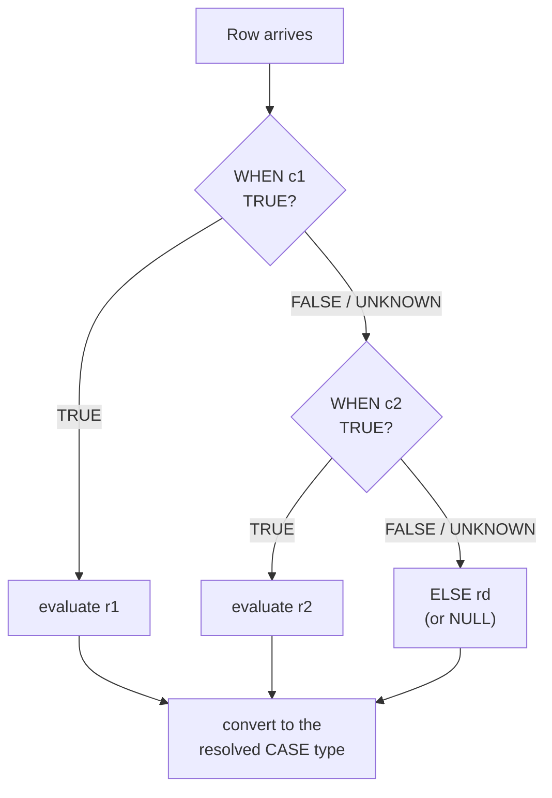

## Introduction

SQL is declarative: you describe the result, not the steps. Yet almost every real report needs *branching*: "label orders over $500 as **large**", "show **n/a** when the phone is missing", "count delivered and cancelled orders **as separate columns**", "divide revenue by units — **unless** units is zero". In a procedural language you would write an `if` statement. In SQL you write a **conditional expression**: an expression whose value depends on a condition, usable anywhere an expression is allowed — the SELECT list, `WHERE`, `ORDER BY`, `GROUP BY`, `HAVING`, inside aggregates, and in the `SET` clause of an `UPDATE`.

MySQL offers one standard, general construct and several convenient shorthands:

| Construct | Origin | What it does |
|---|---|---|
| `CASE … WHEN … THEN … ELSE … END` | SQL standard | General multi-branch conditional |
| `COALESCE(a, b, …)` | SQL standard | First non-NULL argument |
| `NULLIF(a, b)` | SQL standard | NULL if `a = b`, else `a` |
| `IF(cond, a, b)` | MySQL extension | Two-branch shorthand for `CASE` |
| `IFNULL(a, b)` | MySQL extension | Two-argument `COALESCE` |

This lesson shows what each computes, how they treat NULL, the less obvious rule that a conditional expression has **one result type** chosen from all its branches, and the most valuable application: **conditional aggregation**, which pivots categories into columns. You already met `SUM(status = 'delivered')` in [Aggregate Functions](/lessons/m03-aggregate-functions); here we generalize that idea into full pivot tables.

:::note[Dataset and prerequisites]
Examples use the **shop** dataset. You should be comfortable with three-valued logic from [Filtering with WHERE](/lessons/m03-where-filtering): a condition can be TRUE, FALSE or UNKNOWN (NULL), and only TRUE selects a branch or a row.
:::

## DBMS Theory

:::theory[Conditional expressions are total functions over rows]
A `CASE` expression is a **function** from a row to a single value. It consists of an ordered list of (condition, result) pairs and an optional default:

> CASE WHEN c₁ THEN r₁ WHEN c₂ THEN r₂ … ELSE r<sub>d</sub> END

Its value is rᵢ for the **first** i such that cᵢ evaluates to TRUE; if no condition is TRUE (each is FALSE or UNKNOWN), the value is r<sub>d</sub>, or **NULL** if there is no `ELSE`. Two properties follow:

1. **It is total.** Every row gets exactly one value — possibly NULL — so a CASE can be used wherever a scalar expression is allowed.
2. **It is typed.** A SQL expression has one declared type, independent of the row. The result type of CASE is therefore derived from **all** result expressions r₁ … r<sub>d</sub> together, not from the branch that happens to be chosen.
:::

The SQL standard defines `COALESCE` and `NULLIF` as **abbreviations** of CASE:

- `NULLIF(a, b)` ≡ `CASE WHEN a = b THEN NULL ELSE a END`
- `COALESCE(a, b)` ≡ `CASE WHEN a IS NOT NULL THEN a ELSE b END`, and `COALESCE(a, b, c)` ≡ `COALESCE(a, COALESCE(b, c))`

MySQL's `IF(c, a, b)` is equivalent to `CASE WHEN c THEN a ELSE b END`, and `IFNULL(a, b)` to `COALESCE(a, b)`.

**Three-valued logic decides the branch.** Only TRUE selects a branch. A condition that evaluates to UNKNOWN behaves like FALSE: evaluation moves on to the next WHEN. This is why a **simple CASE** — `CASE x WHEN NULL THEN …` — never matches NULL: it is defined as `CASE WHEN x = NULL THEN …`, and `x = NULL` is always UNKNOWN.

**Type resolution.** The standard specifies that the result type of CASE is the "union type" of the result expressions: numeric branches yield a numeric type wide enough for all of them; if any branch is a character string while others are numbers, the standard requires an explicit cast. **MySQL is more permissive**: it never rejects mixed branches, it silently picks a common type, and that common type is often a **string**. The manual's rules for `CASE`/`IF`/`IFNULL`/`COALESCE` result types are:

| Branch types | Result type in MySQL |
|---|---|
| All integer | integer (`INT`, `BIGINT`) |
| Integer and `DECIMAL` | `DECIMAL` |
| Any `DOUBLE`/`FLOAT` with other numerics | `DOUBLE` |
| Any string branch | string (`VARCHAR`), even if other branches are numbers |
| Temporal mixed with string | string |
| All branches NULL except one | the type of the non-NULL branch |

## Why It Exists

Without conditional expressions, branching logic would have to live in one of three worse places:

- **Several queries glued by UNION.** "Large orders" ∪ "small orders" with a literal label in each half: twice the scans, and a row that matches neither branch silently disappears.
- **Application code.** Fetch raw rows and compute labels in Python or Java. This duplicates business rules across every application and report that reads the data, and makes it impossible to *group by* or *sort by* the derived value inside the database.
- **Extra stored columns.** Precompute "size_band" in the table. Sometimes right (generated columns, Module 7), but every rule change requires a backfill.

Conditional expressions keep the rule **in the query, next to the data**, so the derived value can be filtered, grouped, sorted and aggregated in the same statement. `COALESCE`/`IFNULL` exist because NULL replacement is so common it deserves a one-word spelling; `NULLIF` exists mainly for one idiom — turning a "bad" sentinel (zero divisor, empty string, `'N/A'`) into NULL so that NULL's propagation rules do the right thing.

## Internal Working

:::internals[How MySQL evaluates CASE]
At parse/resolve time, the server builds an `Item_func_case` (for `IF`, `Item_func_if`; for `COALESCE`, `Item_func_coalesce`) and **resolves its result type once**, by aggregating the types of all THEN/ELSE expressions according to the rules in the table above. The aggregated type determines how results are returned to the client, how the value compares in `ORDER BY` and `WHERE`, and the column type if you materialize the result with `CREATE TABLE … AS SELECT`.

At execution time, the expression is evaluated **per row**, top-down: conditions are evaluated in order and evaluation stops at the first TRUE condition; only that branch's result expression is evaluated, then converted to the resolved type. `COALESCE` likewise stops at the first non-NULL argument. This **short-circuit** behaviour means a later branch's side effects (a warning such as division by zero) do not occur for rows that never reach it.

A simple CASE `CASE x WHEN v₁ … WHEN v₂ …` evaluates `x` once and compares it with each `vᵢ` using `=` semantics (including MySQL's implicit type conversions and the collation of strings).
:::



Because the result type is fixed before any row is read, a CASE that returns a number in one branch and a string in another returns **strings for every row** — including the rows that took the numeric branch. You will see the consequences for sorting below.

**CASE expression vs CASE statement.** Inside stored procedures MySQL also has a `CASE` *statement* (and an `IF … THEN … ELSEIF … END IF` statement) that controls which statements execute. That is procedural flow control (Module 9); the CASE *expression* in this lesson computes a value, and the `IF()` *function* is unrelated to the `IF` statement despite the name.

## MySQL Implementation

**Searched CASE** — each WHEN has its own condition. Price bands for products:

```sql run
SELECT product_id, name, price,
       CASE
         WHEN price >= 500 THEN 'premium'
         WHEN price >= 100 THEN 'mid-range'
         ELSE 'budget'
       END AS price_band
FROM products
WHERE product_id IN (3, 8, 12, 15, 24, 29)
ORDER BY price DESC;
```

The order of the WHEN clauses matters: a $1,799 laptop also satisfies `price >= 100`, but the first TRUE branch wins.

**Simple CASE** — compare one expression against a list of values. Useful for code-to-label mappings:

```sql run
SELECT method,
       CASE method
         WHEN 'card'          THEN 'Credit/debit card'
         WHEN 'paypal'        THEN 'PayPal'
         WHEN 'bank_transfer' THEN 'Bank transfer'
         ELSE 'Other'
       END AS method_label,
       COUNT(*) AS payments
FROM payments
GROUP BY method
ORDER BY payments DESC, method;
```

`gift_card` has no WHEN branch and falls through to `ELSE`. Note that MySQL accepts grouping by `method` while selecting an expression of `method` — the CASE is functionally dependent on the grouping column.

**IF() and IFNULL()** — compact MySQL forms:

```sql run
SELECT customer_id, first_name,
       IF(phone IS NULL, 'no phone', 'has phone') AS phone_status,
       IFNULL(loyalty_tier, 'none')                AS tier
FROM customers
WHERE customer_id BETWEEN 1 AND 6
ORDER BY customer_id;
```

**COALESCE** — first non-NULL of any number of arguments. A "best contact" column that prefers phone, then email:

```sql run
SELECT customer_id,
       COALESCE(phone, email) AS best_contact
FROM customers
WHERE customer_id IN (4, 5, 10)
ORDER BY customer_id;
```

**NULLIF** — the safe-division idiom. A margin ratio per order line can divide by zero if a product were free; `NULLIF(divisor, 0)` makes the division return NULL instead:

```sql run
SELECT 10 / 0              AS plain_division,
       10 / NULLIF(0, 0)   AS nullif_division,
       NULLIF('N/A', 'N/A') AS sentinel_to_null,
       NULLIF(5, 3)        AS unchanged;
```

In a `SELECT`, MySQL already returns NULL for `10 / 0` (with a warning, error 1365, under the default `ERROR_FOR_DIVISION_BY_ZERO` mode); `NULLIF` makes the intent explicit, avoids the warning, and — crucially — avoids the **error** that division by zero raises in strict mode inside `INSERT` and `UPDATE` (see [Mathematical Functions](/lessons/m03-numeric-functions)).

## Syntax Breakdown

| Form | Syntax | Returns | NULL behaviour |
|---|---|---|---|
| Searched CASE | `CASE WHEN cond THEN r [WHEN …] [ELSE d] END` | First `r` whose `cond` is TRUE; else `d`; else NULL | UNKNOWN conditions are skipped |
| Simple CASE | `CASE x WHEN v THEN r [WHEN …] [ELSE d] END` | First `r` where `x = v` | `WHEN NULL` never matches (`x = NULL` is UNKNOWN) |
| `IF(cond, a, b)` | MySQL | `a` if `cond` is TRUE, else `b` | UNKNOWN `cond` → `b` |
| `IFNULL(a, b)` | MySQL | `a` if not NULL, else `b` | exactly two arguments |
| `COALESCE(a, b, …)` | Standard | first non-NULL argument, else NULL | any number of arguments; stops at the first non-NULL |
| `NULLIF(a, b)` | Standard | NULL if `a = b`, else `a` | `NULLIF(NULL, x)` is NULL |
| `END` | — | closes a CASE **expression** | (`END CASE` closes the procedural CASE *statement*) |

:::standard[Portability]
`CASE`, `COALESCE` and `NULLIF` work in every major database and should be your default in shared code. `IF()` and `IFNULL()` are MySQL (and MariaDB) specific: SQL Server has `IIF()` and `ISNULL()`, Oracle has `NVL()`/`DECODE()`, PostgreSQL has none of them. `SUM(boolean_expression)` relies on MySQL treating TRUE/FALSE as 1/0 and does not port to PostgreSQL or SQL Server; `SUM(CASE WHEN … THEN 1 ELSE 0 END)` does. The standard `FILTER (WHERE …)` aggregate clause is not available in MySQL.
:::

### Result type in practice

Materializing expressions with `CREATE TABLE … AS SELECT` shows the type MySQL resolved for each one:

```sql run
CREATE TABLE case_types AS
SELECT CASE WHEN 1 = 1 THEN 1 ELSE 2.50 END      AS int_or_decimal,
       CASE WHEN 1 = 1 THEN 1 ELSE 1.5e0 END     AS int_or_double,
       CASE WHEN 1 = 1 THEN 1 ELSE 'x' END       AS int_or_string,
       IF(1 = 1, 10, 'ten')                      AS if_mixed,
       COALESCE(NULL, 5)                         AS coalesce_int,
       CASE WHEN 1 = 0 THEN 1 END                AS no_else;
SELECT COLUMN_NAME, COLUMN_TYPE, IS_NULLABLE
FROM information_schema.COLUMNS
WHERE TABLE_SCHEMA = DATABASE() AND TABLE_NAME = 'case_types'
ORDER BY ORDINAL_POSITION;
```

Integer + decimal gave `DECIMAL`, integer + double gave `DOUBLE`, and as soon as one branch is a string the whole expression is a `VARCHAR`. The CASE without ELSE is nullable — the implicit `ELSE NULL` is part of its type.

## Practical Examples

**1. Custom sort order.** Status values have a business order (pending → paid → shipped → delivered → cancelled → refunded) that is not alphabetical. A CASE in `ORDER BY` encodes it explicitly — this also works for plain `VARCHAR` columns, where you cannot rely on ENUM ordering:

```sql run
SELECT status, COUNT(*) AS orders
FROM orders
GROUP BY status
ORDER BY CASE status
           WHEN 'pending'   THEN 1
           WHEN 'paid'      THEN 2
           WHEN 'shipped'   THEN 3
           WHEN 'delivered' THEN 4
           ELSE 5
         END,
         status;
```

MySQL's `FIELD(status, 'pending', 'paid', …)` returns the position of a value in a list and is a shorter, non-portable alternative.

**2. Grouping by a derived category.** Count products and stock per price band — the CASE is computed per row and then used as the grouping key:

```sql run
SELECT CASE
         WHEN price >= 500 THEN '1 premium'
         WHEN price >= 100 THEN '2 mid-range'
         ELSE '3 budget'
       END              AS price_band,
       COUNT(*)         AS products,
       SUM(stock_qty)   AS units_in_stock
FROM products
GROUP BY price_band
ORDER BY price_band;
```

**3. Pivoting with conditional aggregation.** The rows-to-columns transformation: orders per quarter, with one column per status group. Each `SUM(CASE …)` is evaluated for every row of the group, contributing 1 only when the condition holds:

```sql run
SELECT QUARTER(order_date)                                              AS qtr,
       COUNT(*)                                                         AS all_orders,
       SUM(CASE WHEN status IN ('shipped', 'delivered') THEN 1 ELSE 0 END) AS fulfilled,
       SUM(CASE WHEN status IN ('pending', 'paid') THEN 1 ELSE 0 END)      AS open_orders,
       SUM(CASE WHEN status IN ('cancelled', 'refunded') THEN 1 ELSE 0 END) AS lost,
       ROUND(100 * AVG(CASE WHEN status IN ('cancelled', 'refunded') THEN 1 ELSE 0 END), 1) AS lost_pct
FROM orders
GROUP BY qtr
ORDER BY qtr;
```

Each output column is a fixed category; each output row a group. This is how spreadsheets' pivot tables are written in SQL. The categories must be known when writing the query — a dynamic pivot (unknown set of columns) needs dynamic SQL built from the distinct values (`PREPARE`/`EXECUTE`, Module 9) or is better done in the reporting tool.

**4. Pivoting money: revenue per payment method per quarter.** Conditional aggregation also sums amounts, not just counts:

```sql run
SELECT QUARTER(paid_at) AS qtr,
       SUM(CASE WHEN method = 'card'      THEN amount ELSE 0 END) AS card,
       SUM(CASE WHEN method = 'paypal'    THEN amount ELSE 0 END) AS paypal,
       SUM(CASE WHEN method = 'gift_card' THEN amount ELSE 0 END) AS gift_card,
       SUM(CASE WHEN method = 'bank_transfer' THEN amount ELSE 0 END) AS bank_transfer,
       SUM(amount)                                                AS total
FROM payments
WHERE status = 'succeeded'
GROUP BY qtr
ORDER BY qtr;
```

`ELSE 0` versus no `ELSE`: with no ELSE, non-matching rows yield NULL, which `SUM` ignores — the totals are the same, **except** for a group in which no row matches, where `SUM` of only NULLs returns NULL instead of 0. Use `ELSE 0` for sums and counts that should show zero.

**5. Conditional UPDATE in a single statement.** Apply different price changes per category in one pass instead of one UPDATE per rule. (We work on a copy so the dataset stays intact.)

```sql run
CREATE TABLE price_review AS
SELECT product_id, category_id, price FROM products WHERE category_id IN (7, 9);
UPDATE price_review
SET price = CASE category_id
              WHEN 7 THEN ROUND(price * 1.05, 2)   -- coffee +5 %
              WHEN 9 THEN ROUND(price * 0.90, 2)   -- database books −10 %
              ELSE price
            END;
SELECT pr.product_id, pr.category_id, p.price AS old_price, pr.price AS new_price
FROM price_review pr JOIN products p USING (product_id)
ORDER BY pr.product_id;
```

The `ELSE price` is a safety net: without it, any row not matched by a WHEN would be set to NULL — or rejected, since `price` here was copied from a `NOT NULL` column.

**6. Safe ratios with NULLIF and a display default with COALESCE.** Average selling price per product = revenue ÷ units. For products never sold, units is 0 after a LEFT JOIN with `COALESCE`, and the ratio must be NULL rather than an error or a misleading 0:

```sql run
SELECT p.product_id, p.name,
       COALESCE(SUM(oi.quantity), 0)                                      AS units,
       SUM(oi.quantity * oi.unit_price) / NULLIF(COALESCE(SUM(oi.quantity), 0), 0) AS avg_selling_price
FROM products p
LEFT JOIN order_items oi ON oi.product_id = p.product_id
WHERE p.product_id IN (1, 4, 13, 24)
GROUP BY p.product_id
ORDER BY p.product_id;
```

## Execution Walkthrough

Let us trace how a CASE inside an aggregate produces a pivot row, for the orders of customer 4.

```walkthrough
title: SELECT customer_id, SUM(CASE WHEN status='delivered' THEN 1 ELSE 0 END) … GROUP BY customer_id
steps:
  - title: "1. FROM + WHERE — the input rows"
    explain: Customer 4 has four orders with different statuses and discount codes.
    sql: SELECT order_id, customer_id, status, discount_code FROM orders WHERE customer_id = 4 ORDER BY order_id;
  - title: "2. Evaluate the CASE expressions per row"
    explain: >-
      Before aggregation, each CASE is evaluated once per row. Each produces exactly one value — 1, 0 or NULL —
      according to the first TRUE condition. The no_else column has no ELSE branch, so non-matching rows get NULL.
    sql: |
      SELECT order_id, status,
             CASE WHEN status = 'delivered' THEN 1 ELSE 0 END AS is_delivered,
             CASE WHEN status = 'shipped'   THEN 1 ELSE 0 END AS is_shipped,
             CASE WHEN discount_code IS NOT NULL THEN 1 END   AS used_code_no_else
      FROM orders WHERE customer_id = 4 ORDER BY order_id;
  - title: "3. Aggregate the per-row values"
    explain: >-
      SUM adds the 1s and 0s; COUNT of the no-ELSE column counts only non-NULL values, which gives the same
      count. AVG of the 0/1 column is the fraction of matching rows.
    sql: |
      SELECT customer_id,
             SUM(CASE WHEN status = 'delivered' THEN 1 ELSE 0 END)   AS delivered,
             SUM(CASE WHEN status = 'shipped'   THEN 1 ELSE 0 END)   AS shipped,
             COUNT(CASE WHEN discount_code IS NOT NULL THEN 1 END)   AS used_code,
             AVG(CASE WHEN status = 'delivered' THEN 1 ELSE 0 END)   AS delivered_share
      FROM orders WHERE customer_id = 4
      GROUP BY customer_id;
  - title: "4. The same pivot for every customer"
    explain: Removing the WHERE clause computes one pivot row per group; here the first eight customers who have orders.
    sql: |
      SELECT customer_id,
             SUM(CASE WHEN status = 'delivered' THEN 1 ELSE 0 END) AS delivered,
             SUM(CASE WHEN status = 'shipped'   THEN 1 ELSE 0 END) AS shipped,
             SUM(CASE WHEN status IN ('cancelled','refunded') THEN 1 ELSE 0 END) AS lost,
             COUNT(*) AS total
      FROM orders
      GROUP BY customer_id
      ORDER BY customer_id
      LIMIT 8;
```

**Short-circuit in action.** `COALESCE` stops at the first non-NULL argument, so a later argument that would raise a warning is never evaluated:

```sql run
SELECT COALESCE(1, 1 / 0) AS short_circuit,
       CASE WHEN 1 = 1 THEN 'first' ELSE 1 / 0 END AS case_short_circuit;
```

No division-by-zero warning appears, because `1 / 0` was never computed. Notice also the type effect: `COALESCE(1, 1 / 0)` displays `1.0000`, because the second argument is a `DECIMAL` division and the result type is resolved over *all* arguments, even unevaluated ones.

## Output

The pivot in step 4 is the typical shape of conditional-aggregation output: one row per entity, one column per category, plus a total. Read it with two checks in mind:

1. **Do the category columns add up to the total?** Here `delivered + shipped + lost` can be less than `total`, because pending and paid orders are not in any listed column. Whether that is correct depends on the report's definition — a missing category is a classic pivot bug.
2. **Are zeros real zeros?** With `ELSE 0`, a customer with no shipped orders shows 0. Without ELSE, `SUM` of only NULLs would show NULL for that customer.

The type of every column is also part of the output. The following query shows a surprising result that comes purely from type resolution:

```sql run
SELECT CASE WHEN 1 = 1 THEN 10 ELSE 'n/a' END
     < CASE WHEN 1 = 1 THEN 9  ELSE 'n/a' END AS ten_less_than_nine;
```

It returns 1 (TRUE): both CASE expressions have a string type, so the comparison is `'10' < '9'`, a character-by-character comparison in which `'1'` sorts before `'9'`.

## Alternative Approaches

| Problem | Option A | Option B | Choose |
|---|---|---|---|
| Replace NULL with a default | `COALESCE(x, d)` | `IFNULL(x, d)` / `CASE WHEN x IS NULL …` | `COALESCE` — standard and n-ary |
| Map codes to labels | `CASE code WHEN …` | A lookup table joined in | Lookup table when labels change or are reused across queries; CASE for a handful of stable values |
| Custom sort | `ORDER BY CASE …` | `ORDER BY FIELD(col, …)`; a `sort_order` column in a lookup table | Lookup column for shared rules; CASE for one query |
| Rows to columns | Conditional aggregation | Pivot in the BI tool / pandas `pivot_table` | SQL when the column set is fixed; the client when it is dynamic |
| Two-way branch | `IF(c, a, b)` | `CASE WHEN c THEN a ELSE b END` | `CASE` for portability; `IF` is fine in MySQL-only code |
| Count matching rows | `SUM(CASE … 1 ELSE 0 END)` | `COUNT(CASE … THEN 1 END)`, `SUM(cond)`, `WHERE` + `COUNT(*)` | `WHERE` if you need only one count; conditional aggregation for several |

A lookup table deserves emphasis. A CASE that maps 40 product codes to names embedded in ten reports is a maintenance hazard; the same mapping in a table is one row to update, can be joined, indexed and constrained by foreign keys. Use CASE for logic (thresholds, rules), tables for data (mappings).

## Performance Analysis

The per-row cost of a CASE is negligible — a few comparisons evaluated in memory. What matters is **where** you put it.

**CASE or IF in WHERE hides the column from the optimizer.** An index on `order_date` can be used for a range condition on the bare column. Wrap the column in a conditional and the condition is no longer sargable (search-argument-able): MySQL must evaluate the expression for every row.

```sql run
EXPLAIN FORMAT=TREE
SELECT order_id FROM orders
WHERE IF(order_date >= '2024-12-01', 1, 0) = 1;
```

```sql run
EXPLAIN FORMAT=TREE
SELECT order_id FROM orders
WHERE order_date >= '2024-12-01';
```

The first plan reads **all 80 entries** of `idx_orders_date` (an index scan used only because it is narrower than the table) and evaluates the `IF` for each; the second is a *covering index range scan* that starts at `'2024-12-01'` and is estimated to touch only 8 entries. Rewrite conditional predicates as plain boolean logic: `CASE WHEN a THEN x = 1 ELSE y = 2 END` becomes `(a AND x = 1) OR (NOT a AND y = 2)` — taking care with NULLs in `a`.

**Conditional aggregation is one scan.** A pivot with N category columns reads the input once, regardless of N. N separate `WHERE status = …` queries read it N times (or do N index lookups). For dashboards over large tables the single scan usually wins; when each category is tiny and indexed, separate index lookups can be cheaper. Measure with `EXPLAIN ANALYZE` on realistic data ([Reading EXPLAIN ANALYZE](/lessons/m07-explain-analyze)).

**Indexing a derived value.** If a query must filter on a CASE-derived category often (e.g. `price_band = 'premium'`), store it as a generated column or create a functional index on the expression (MySQL 8.0.13+), covered in [Covering, Prefix and Functional Indexes](/lessons/m07-covering-prefix-functional).

:::performance[Theory vs measurement]
The plans above show the access path change; the timing difference on 80 rows is unmeasurable. On millions of rows, a full scan versus a narrow range scan is typically orders of magnitude apart — but confirm with `EXPLAIN ANALYZE` on your own data rather than trusting a rule of thumb.
:::

## Best Practices

:::best-practice[Writing conditional expressions professionally]
1. **Always write an ELSE** — even `ELSE NULL` — so readers know the fall-through case was considered. For counts and sums in pivots, use `ELSE 0`.
2. **Keep all branches the same type.** If a numeric column needs a text placeholder, do it in the presentation layer, or `CAST` every branch to `CHAR` deliberately and never sort or compare on the result.
3. **Order WHEN clauses from most specific to least specific**; the first TRUE branch wins.
4. **Use searched CASE for NULL tests.** `CASE WHEN x IS NULL THEN …`, never `CASE x WHEN NULL …`.
5. **Prefer COALESCE over IFNULL** in code that may be shared or migrated; prefer CASE over IF for the same reason.
6. **Use NULLIF for every division whose divisor can be 0.** It documents the intent and avoids strict-mode errors in DML.
7. **Do not wrap indexed columns in conditionals in WHERE.** Express filters as plain boolean predicates on bare columns.
8. **Move stable mappings to lookup tables**; keep CASE for rules and thresholds.
:::

## Common Mistakes

**Mistake 1 — `CASE x WHEN NULL`.** The simple form compares with `=`, which is never TRUE for NULL:

```sql run
SELECT customer_id, loyalty_tier,
       CASE loyalty_tier WHEN NULL THEN 'none' ELSE loyalty_tier END AS wrong_label,
       CASE WHEN loyalty_tier IS NULL THEN 'none' ELSE loyalty_tier END AS right_label
FROM customers
WHERE customer_id IN (3, 4, 10)
ORDER BY customer_id;
```

The wrong version returns NULL for customers 3 and 10 — the `WHEN NULL` branch never fires and the ELSE copies the NULL through.

**Mistake 2 — mixing numbers and strings, then sorting.** A report shows "n/a" for products with no stock and the price otherwise, and sorts by that column:

```sql run
SELECT product_id, name,
       CASE WHEN stock_qty = 0 THEN 'n/a' ELSE price END AS shown_price
FROM products
WHERE product_id IN (1, 4, 6, 13, 24, 29)
ORDER BY shown_price;
```

The sort is alphabetical: `'1299.00'` comes before `'18.99'`, and `'n/a'` sorts last. Sort by the underlying numeric column (`ORDER BY stock_qty = 0, price`) and format only for display.

**Mistake 3 — forgetting ELSE in an UPDATE.** `UPDATE t SET price = CASE category_id WHEN 7 THEN price * 1.05 END` sets every non-matching row's price to NULL (or fails on a NOT NULL column in strict mode). Always include `ELSE price` — or restrict the rows with `WHERE category_id IN (7)`.

**Mistake 4 — overlapping conditions in the wrong order.**

```sql run
SELECT name, price,
       CASE WHEN price >= 100 THEN 'mid-range'
            WHEN price >= 500 THEN 'premium'
            ELSE 'budget' END AS wrong_band
FROM products
WHERE product_id IN (1, 3, 14)
ORDER BY price DESC;
```

No product can ever be labelled `premium`: every price ≥ 500 is also ≥ 100, and the first TRUE branch wins. Test the most restrictive condition first.

**Mistake 5 — `COALESCE` that silently hides data problems.** `COALESCE(discount_code, 'NONE')` is fine for display, but `GROUP BY COALESCE(category_id, 0)` in a report merges "uncategorized" with a real category 0 if one is ever created. Use an impossible sentinel or keep NULL as its own group.

## Industry Application

- **Business-rule labelling in analytics.** Customer segments ("new", "active", "lapsed"), risk tiers and SLA buckets ("< 1 h", "1–4 h", "> 4 h") are CASE expressions in the dbt models and views that feed dashboards. Teams centralize them in one view so every report uses the same thresholds.
- **KPI pivots.** Executive dashboards show metrics as columns per period — orders, fulfilled, cancelled, refund rate per week — produced by conditional aggregation in a single scan, usually against a replica or summary table.
- **Data cleansing in ETL.** `NULLIF(TRIM(col), '')` turns empty strings into NULL; `CASE` normalizes inconsistent codes (`'Y'`, `'yes'`, `'1'` → `1`); `COALESCE` supplies defaults for optional source fields. These run in `INSERT … SELECT` staging-to-core loads.
- **Safe metrics.** Conversion rate, average order value and margin are ratios. Production metric layers wrap every divisor in `NULLIF(…, 0)` so that a day with zero sessions shows "no data" instead of crashing a pipeline or reporting infinity.
- **Feature engineering for ML.** Data scientists derive binary and bucketed features in SQL (`CASE WHEN days_since_last_order > 90 THEN 1 ELSE 0 END AS churn_risk`) before exporting training sets — pushing the computation to the database avoids moving raw rows into notebooks.

## Practice Exercises

```exercise
id: ex1
title: Label customers by loyalty
difficulty: easy
concepts: [case-expression, null-handling]
prompt: |
  Return `customer_id` and `tier_label` for every customer, where `tier_label` is:
  `'VIP'` for gold, `'Member'` for silver or bronze, and `'Guest'` when `loyalty_tier` is NULL.
hints:
  - "Use a searched CASE so you can test IS NULL."
  - "CASE WHEN loyalty_tier = 'gold' THEN 'VIP' WHEN loyalty_tier IN ('silver','bronze') THEN 'Member' ELSE 'Guest' END"
solution: |
  SELECT customer_id,
         CASE WHEN loyalty_tier = 'gold' THEN 'VIP'
              WHEN loyalty_tier IN ('silver', 'bronze') THEN 'Member'
              ELSE 'Guest'
         END AS tier_label
  FROM customers;
explanation: |
  The NULL tier makes both WHEN conditions UNKNOWN, so those rows fall through to ELSE. A simple CASE with
  `WHEN NULL THEN 'Guest'` would never match. Writing the NULL test explicitly
  (`WHEN loyalty_tier IS NULL THEN 'Guest'`) is equally correct and arguably clearer.
```

```exercise
id: ex2
title: Stock status with safe defaults
difficulty: easy
concepts: [case-expression, coalesce]
prompt: |
  For every product return `product_id`, `category` and `stock_status`:

  - `category` — the product's `category_id`, or `0` when it is NULL
  - `stock_status` — `'out of stock'` when `stock_qty = 0`, `'low'` when it is below 20, otherwise `'ok'`
hints:
  - "COALESCE(category_id, 0) replaces NULL."
  - "Test stock_qty = 0 before stock_qty < 20, because 0 is also below 20."
solution: |
  SELECT product_id,
         COALESCE(category_id, 0) AS category,
         CASE WHEN stock_qty = 0 THEN 'out of stock'
              WHEN stock_qty < 20 THEN 'low'
              ELSE 'ok'
         END AS stock_status
  FROM products;
explanation: |
  Branch order matters: if `stock_qty < 20` came first, products with zero stock would be labelled `'low'`.
```

```exercise
id: ex3
title: Payment method pivot
difficulty: medium
concepts: [conditional-aggregation, pivot]
prompt: |
  Return **one row per payment `status`** with columns, in this order: `status`, `card`, `paypal`,
  `gift_card`, `bank_transfer` — each method column is the **number of payments** with that method and
  status (0 when there are none).
hints:
  - "GROUP BY status; one SUM(CASE …) column per method."
  - "Use ELSE 0 so that combinations with no payments show 0, not NULL."
solution: |
  SELECT status,
         SUM(CASE WHEN method = 'card'          THEN 1 ELSE 0 END) AS card,
         SUM(CASE WHEN method = 'paypal'        THEN 1 ELSE 0 END) AS paypal,
         SUM(CASE WHEN method = 'gift_card'     THEN 1 ELSE 0 END) AS gift_card,
         SUM(CASE WHEN method = 'bank_transfer' THEN 1 ELSE 0 END) AS bank_transfer
  FROM payments
  GROUP BY status;
explanation: |
  `COUNT(CASE WHEN method = 'card' THEN 1 END)` is an equivalent spelling that also yields 0 for no
  matches (COUNT never returns NULL). Without `ELSE 0`, `SUM(CASE … THEN 1 END)` would return NULL for
  e.g. bank transfers that never failed.
```

```exercise
id: ex4
title: Margin per product without division errors
difficulty: medium
concepts: [nullif, coalesce, decimal-precision]
prompt: |
  For products 1 to 10 return `product_id`, `units_sold` (total quantity in `order_items`, 0 if never
  sold) and `revenue_per_unit` = Σ(quantity × unit_price) ÷ Σ(quantity), rounded to 2 decimals, which must be
  **NULL** for products never sold. Order by `product_id`.
hints:
  - "LEFT JOIN order_items so that unsold products are kept; GROUP BY p.product_id."
  - "COALESCE(SUM(oi.quantity), 0) for units; divide by NULLIF(SUM(oi.quantity), 0)."
solution: |
  SELECT p.product_id,
         COALESCE(SUM(oi.quantity), 0) AS units_sold,
         ROUND(SUM(oi.quantity * oi.unit_price) / NULLIF(SUM(oi.quantity), 0), 2) AS revenue_per_unit
  FROM products p
  LEFT JOIN order_items oi ON oi.product_id = p.product_id
  WHERE p.product_id BETWEEN 1 AND 10
  GROUP BY p.product_id
  ORDER BY p.product_id;
orderMatters: true
explanation: |
  For an unsold product, `SUM(oi.quantity)` is NULL (only NULL-extended rows), so the division is already
  NULL — `NULLIF(…, 0)` additionally protects against a real zero divisor. Dividing by
  `COALESCE(SUM(oi.quantity), 0)` would be the classic mistake: it turns NULL into a 0 divisor and produces
  a division-by-zero warning (and an error inside strict-mode DML).
```

```exercise
id: ex5
title: Sorting a mixed-type CASE correctly
difficulty: hard
concepts: [case-expression, type-resolution]
prompt: |
  A report must show, for every **active** product, `product_id`, `name` and `display_price` — the text
  `'sold out'` when `stock_qty = 0`, otherwise the price — ordered so that **sold-out products come last**
  and the others are in **ascending numeric price order** (ties by `product_id`).
hints:
  - "display_price is necessarily a string column (it mixes text and numbers) — so do not sort by it."
  - "Sort by stock_qty = 0 first (FALSE = 0 sorts before TRUE = 1), then by price, then product_id."
solution: |
  SELECT product_id, name,
         CASE WHEN stock_qty = 0 THEN 'sold out' ELSE price END AS display_price
  FROM products
  WHERE is_active = TRUE
  ORDER BY stock_qty = 0, price, product_id;
orderMatters: true
explanation: |
  `ORDER BY display_price` would sort the CASE result as strings (`'1299.00'` before `'18.99'`). Sorting by
  the underlying columns keeps the numeric order. A portable spelling of the first key is
  `CASE WHEN stock_qty = 0 THEN 1 ELSE 0 END`.
```

```exercise
id: ex6
title: Quarterly order health dashboard
difficulty: challenge
concepts: [conditional-aggregation, nullif, group-by]
prompt: |
  Build one row per quarter of 2024 (`qtr` = 1..4) with these columns in order:

  1. `qtr`
  2. `orders` — all orders
  3. `delivered` — orders with status `delivered`
  4. `with_code` — orders that used any discount code
  5. `code_delivery_rate` — percentage of orders **with** a discount code that were delivered,
     rounded to 1 decimal; NULL if the quarter had no orders with a code

  Order by `qtr`.
hints:
  - "GROUP BY QUARTER(order_date)."
  - "Delivered orders with a code: SUM(CASE WHEN discount_code IS NOT NULL AND status = 'delivered' THEN 1 ELSE 0 END)."
  - "Divide by NULLIF(number of orders with a code, 0), multiply by 100 and ROUND(…, 1)."
solution: |
  SELECT QUARTER(order_date) AS qtr,
         COUNT(*) AS orders,
         SUM(CASE WHEN status = 'delivered' THEN 1 ELSE 0 END) AS delivered,
         COUNT(discount_code) AS with_code,
         ROUND(100 * SUM(CASE WHEN discount_code IS NOT NULL AND status = 'delivered' THEN 1 ELSE 0 END)
               / NULLIF(COUNT(discount_code), 0), 1) AS code_delivery_rate
  FROM orders
  GROUP BY qtr
  ORDER BY qtr;
orderMatters: true
explanation: |
  `COUNT(discount_code)` counts non-NULL codes — no CASE needed. The rate's numerator must apply **both**
  conditions; using the overall `delivered` count would mix customers with and without codes. `NULLIF`
  guarantees a NULL rather than a division by zero for a quarter with no coded orders.
```

## Knowledge Assessment

```quiz
- id: q1
  question: "What does `CASE loyalty_tier WHEN NULL THEN 'none' ELSE 'tiered' END` return for a row where loyalty_tier IS NULL?"
  options: ["'none'", "'tiered'", "NULL", "An error"]
  answer: 1
  explanation: "A simple CASE compares with =; NULL = NULL is UNKNOWN, which is not TRUE, so evaluation falls through to ELSE and returns 'tiered'. It does not return NULL because an ELSE exists, and it is valid syntax. Use CASE WHEN loyalty_tier IS NULL THEN … instead."
  concepts: [case-expression, null-handling]
- id: q2
  question: "What is the result type of `CASE WHEN x > 0 THEN price ELSE 'n/a' END` in MySQL, where price is DECIMAL(10,2)?"
  options: ["DECIMAL(10,2)", "A string (VARCHAR)", "DOUBLE", "It depends on which branch each row takes"]
  answer: 1
  explanation: "MySQL resolves one type for the whole expression from all branches; if any branch is a string, the result is a string for every row. The type cannot vary per row, and MySQL does not raise an error for mixed types as the standard would require."
  concepts: [type-resolution, case-expression]
- id: q3
  question: "Which expressions return NULL instead of performing a division by zero when `units` is 0? (Select all that apply.)"
  type: multi
  options:
    - "revenue / NULLIF(units, 0)"
    - "revenue / COALESCE(units, 0)"
    - "CASE WHEN units = 0 THEN NULL ELSE revenue / units END"
    - "revenue / IFNULL(units, 1)"
  answer: [0, 2]
  explanation: "NULLIF(units, 0) turns 0 into NULL, and dividing by NULL yields NULL. The CASE never evaluates the division when units = 0. COALESCE(units, 0) leaves 0 unchanged (it only replaces NULL), and IFNULL(units, 1) likewise does nothing for a 0 — both still divide by zero."
  concepts: [nullif, coalesce]
- id: q4
  question: "A pivot uses `SUM(CASE WHEN method = 'paypal' THEN amount END)` without ELSE. For a group with no PayPal payments, the column shows:"
  options: ["0", "NULL", "An error", "The total of all methods"]
  answer: 1
  explanation: "Every row's CASE yields NULL, and SUM over only NULLs returns NULL. With ELSE 0 the result would be 0. It is not an error, and non-matching rows never contribute other methods' amounts."
  concepts: [conditional-aggregation]
- id: q5
  question: "Which constructs are standard SQL and therefore the most portable choice?"
  type: multi
  options: ["CASE", "COALESCE", "NULLIF", "IF()", "IFNULL()"]
  answer: [0, 1, 2]
  explanation: "CASE, COALESCE and NULLIF are defined by the SQL standard (COALESCE and NULLIF as CASE abbreviations). IF() and IFNULL() are MySQL extensions; other systems use IIF/ISNULL (SQL Server) or NVL (Oracle)."
  concepts: [portability]
- id: q6
  question: "`SELECT name FROM products WHERE CASE WHEN price > 100 THEN 1 ELSE 0 END = 1` — what happens to an index on price?"
  options:
    - "It is used for a range scan, exactly as for price > 100"
    - "It cannot be used for a range scan, because the column is wrapped in an expression"
    - "MySQL rejects CASE in WHERE"
    - "It is used only if the CASE has an ELSE"
  answer: 1
  explanation: "The optimizer can build a range only from predicates on the bare column. Wrapping it in CASE forces evaluating the expression for every row. CASE in WHERE is legal; ELSE has nothing to do with index use. Rewrite as WHERE price > 100."
  concepts: [case-expression, sargability]
- id: q7
  question: "Products cost 1299, 249 and 29. What does `CASE WHEN price >= 100 THEN 'mid' WHEN price >= 1000 THEN 'premium' ELSE 'budget' END` return for them?"
  options:
    - "premium, mid, budget"
    - "mid, mid, budget"
    - "premium, premium, budget"
    - "mid, budget, budget"
  answer: 1
  explanation: "CASE returns the first TRUE branch. 1299 >= 100 is TRUE, so the premium branch is never reached. 249 is mid, 29 falls through to budget. Put the most restrictive condition first."
  concepts: [case-expression]
- id: q8
  question: "`SELECT COALESCE(1, 1/0)` returns 1.0000 and produces no warning. Why?"
  options:
    - "Division by zero never produces warnings in MySQL"
    - "COALESCE stops at the first non-NULL argument, so 1/0 is not evaluated; the type is resolved from all arguments, making it DECIMAL"
    - "MySQL evaluates 1/0 as 0 and returns the larger value"
    - "COALESCE converts all arguments to strings"
  answer: 1
  explanation: "COALESCE short-circuits at evaluation time, but its result type is fixed at resolve time from every argument; 1/0 has a DECIMAL type, so 1 is displayed as 1.0000. A SELECT of 1/0 on its own does return NULL with warning 1365."
  concepts: [coalesce, type-resolution]
```
