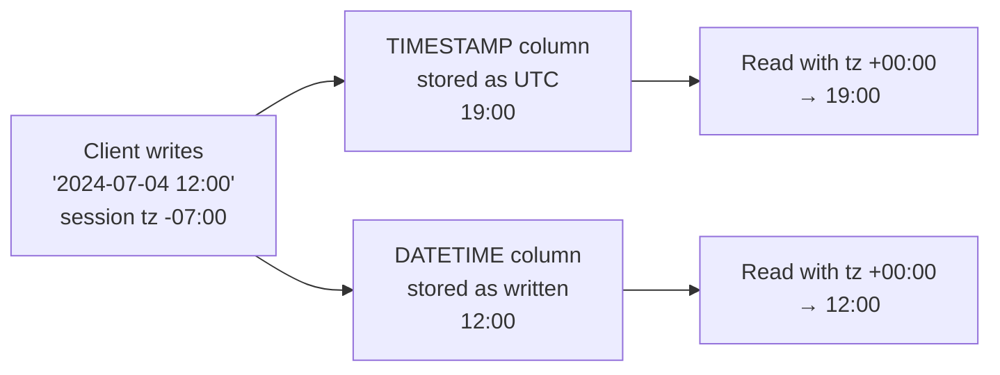

## Introduction

Time is the dimension of almost every business question: revenue **this month**, orders **in the last 30 days**, customers who **signed up in Q1** and **ordered within a week**, subscriptions that **renew on the last day of the month**, average **hours to ship**. Date and time functions answer these questions, and they hide more traps than any other part of the function library:

- `NOW()` is fixed for the whole statement; `SYSDATE()` is not — which matters for long statements and for replication.
- Adding one month to January 31 gives **February 29** (in 2024), and adding another month gives **March 29**, not March 31.
- `DATEDIFF` counts calendar-day boundaries while `TIMESTAMPDIFF(DAY, …)` counts complete 24-hour periods — they can disagree by one.
- Named time zones such as `'America/Los_Angeles'` return **NULL** until the server's time zone tables are loaded.
- `WHERE YEAR(order_date) = 2024` reads **every** row; `WHERE order_date >= '2024-01-01' AND order_date < '2025-01-01'` can use the index.

[Filtering with WHERE](/lessons/m03-where-filtering) introduced half-open date ranges and [Date and Time Types](/lessons/m02-datetime-types) covered storage. This lesson is about computation: what each function returns, the calendar rules behind it, and how to write date predicates that the optimizer can use.

:::note[Dataset]
Examples use the **shop** dataset, whose 80 orders all fall in calendar year 2024 (`order_date`, `shipped_at` are `DATETIME`). Queries that depend on "today" pin the session clock with `SET timestamp`, so their captured output is reproducible.
:::

## DBMS Theory

:::theory[Points in time, durations and calendars]
SQL distinguishes two kinds of temporal values:

- **Datetimes** — points on the time line: `DATE` (a day), `TIME` (a time of day; in MySQL also a duration), `DATETIME`/`TIMESTAMP` (a day plus a time).
- **Intervals** — durations. The standard defines two incompatible families: **year-month** intervals (years, months) and **day-time** intervals (days, hours, minutes, seconds, fractions). They cannot be mixed because a month has no fixed length in days.

Datetime arithmetic is defined as *datetime ± interval → datetime* and *datetime − datetime → interval*. Year-month arithmetic is calendar arithmetic: adding one month changes the month field, and if the resulting day does not exist (February 30), it must be adjusted. MySQL **clamps to the last valid day of the month**.
:::

Consequences you must internalize:

1. **Month arithmetic is not associative with day arithmetic and not reversible.** `('2024-01-31' + 1 month) + 1 month` = March 29, but `'2024-01-31' + 2 months` = March 31. And `('2024-03-31' − 1 month) + 1 month` = March 29, not the original date.
2. **"Difference in days" has two definitions.** The number of midnights crossed (calendar days) versus the number of complete 24-hour periods. Both are legitimate; choose deliberately.
3. **A point in time needs a time zone to be unambiguous.** "2024-03-10 02:30" does not exist in US Pacific time (DST gap), and "2024-11-03 01:30" exists twice (DST overlap). Systems store UTC or a type that normalizes to UTC (MySQL's `TIMESTAMP`) to avoid this.
4. **Current time within a transaction or statement.** The standard specifies that `CURRENT_TIMESTAMP` is evaluated once per statement, so all rows in one statement see the same value. MySQL's `NOW()` follows this; `SYSDATE()` is a MySQL function that deliberately does not.

:::standard[Standard SQL vs MySQL]
Standard: `CURRENT_DATE`, `CURRENT_TIME`, `CURRENT_TIMESTAMP`, `LOCALTIMESTAMP`, `EXTRACT(field FROM x)`, `INTERVAL` literals, datetime ± interval. MySQL supports these and adds `NOW()`, `SYSDATE()`, `DATE_ADD`/`DATE_SUB`, `DATEDIFF`, `TIMESTAMPDIFF`, `TIMESTAMPADD`, `DATE_FORMAT`, `STR_TO_DATE`, `LAST_DAY`, `DAYOFWEEK`, `WEEK`, `CONVERT_TZ` and many more. MySQL's interval syntax (`INTERVAL 1 MONTH`, `INTERVAL '1:30' HOUR_MINUTE`) is not a first-class interval *type*: intervals exist only as operands of date arithmetic and cannot be stored in a column.
:::

## Why It Exists

Doing date logic in application code seems easy until you hit leap years, month ends, time zones and DST. The database is often the better place because:

- **One clock.** Using the database server's clock (`NOW()`) gives every application instance the same notion of "now", unaffected by drifting application servers.
- **Set-based filtering and grouping.** "Orders per month" or "customers inactive for 90 days" are filters and groupings over millions of rows — they belong next to the data and the indexes.
- **Consistent calendar rules.** `INTERVAL 1 MONTH` behaves identically for every report; hand-written "add 30 days" logic does not.
- **Time zone normalization.** `TIMESTAMP` columns and `CONVERT_TZ` let one database serve users in many zones.

The flip side: date functions wrapped around indexed columns are the single most common cause of accidental full scans in reporting queries. Knowing both the functions and their effect on plans is what separates working queries from production-grade ones.

## Internal Working

:::internals[How MySQL represents and computes temporal values]
**Representation.** In memory, the server uses a broken-down `MYSQL_TIME` structure (year, month, day, hour, minute, second, microsecond, sign) and packed 64-bit integers for comparisons and sorting. On disk (since 5.6.4) `DATETIME` takes 5 bytes + 0–3 bytes for fractional seconds, `DATE` 3 bytes, and `TIMESTAMP` 4 bytes + fractions, storing **seconds since the Unix epoch in UTC**.

**TIMESTAMP vs DATETIME.** A `TIMESTAMP` value is converted from the session `time_zone` to UTC when stored and back to the session zone when read. A `DATETIME` is stored as written — "wall clock" digits with no zone. Changing `SET time_zone` therefore changes what a `TIMESTAMP` column displays but not a `DATETIME` column.

**Time zone support.** Offsets like `'+02:00'` work everywhere. Named zones (`'Europe/Berlin'`) require the `mysql.time_zone*` tables, which are **empty on a fresh install** and must be loaded with `mysql_tzinfo_to_sql` (Linux) or the downloadable package (Windows). Without them, `CONVERT_TZ` with a named zone returns NULL.

**Clock functions.** `NOW()` (= `CURRENT_TIMESTAMP`, `LOCALTIMESTAMP`) returns the time at which the **statement began**; inside a stored function or trigger it is the start time of the calling statement. It honours the `timestamp` session variable, which replication uses to make `NOW()` replay identically on replicas. `SYSDATE()` reads the system clock **each time it is evaluated**, ignores `SET timestamp`, is non-deterministic, and therefore cannot be used to look up an index and is unsafe for statement-based replication (unless the server runs with `--sysdate-is-now`).

**Interval arithmetic.** `DATE_ADD(d, INTERVAL n unit)` decomposes the value, adds to the relevant field, normalizes overflow (minute 61 → next hour), and for MONTH/QUARTER/YEAR clamps the day to the last day of the resulting month. Invalid input dates (`'2024-02-30'`) produce NULL with warning 1292 in expressions.
:::



## MySQL Implementation

**The current date and time.** To make outputs reproducible, we pin the session clock to the last second of 2024 with `SET timestamp` (seconds since the epoch). `NOW()`, `CURRENT_DATE` and friends then return that instant — `SYSDATE()` would not, which is precisely its difference:

```sql run
SET timestamp = UNIX_TIMESTAMP('2024-12-31 23:59:59');
SELECT NOW()              AS now_,
       CURRENT_TIMESTAMP  AS current_ts,
       CURRENT_DATE       AS today,
       CURDATE() + INTERVAL 1 DAY AS tomorrow,
       CURRENT_TIME       AS time_now,
       UTC_TIMESTAMP()    AS utc_now;
```

**NOW() vs SYSDATE().** `NOW()` is evaluated once at statement start; `SYSDATE()` each time it is called. With a one-second sleep between them in the same SELECT (the output differs per run, so it is not shown):

```sql run volatile
SET timestamp = DEFAULT;
SELECT NOW(6) AS stmt_start, SLEEP(1) AS slept, SYSDATE(6) AS at_eval,
       TIMESTAMPDIFF(SECOND, NOW(6), SYSDATE(6)) AS drift_seconds;
```

`drift_seconds` is 1: `SYSDATE(6)` was read after the sleep, `NOW(6)` still reports the statement's start. In a statement that updates a million rows, every row gets the same `NOW()` but different `SYSDATE()` values.

**INTERVAL arithmetic.** Both the operator form (`d + INTERVAL n unit`) and the function form (`DATE_ADD`, `DATE_SUB`) work:

```sql run
SELECT DATE '2024-07-04' + INTERVAL 10 DAY            AS plus_10_days,
       DATE_SUB('2024-07-04', INTERVAL 2 WEEK)        AS minus_2_weeks,
       '2024-07-04 22:30:00' + INTERVAL 90 MINUTE     AS plus_90_min,
       DATE_ADD('2024-07-04 22:30:00', INTERVAL '1:45' HOUR_MINUTE) AS plus_1h45,
       DATE '2024-07-04' - INTERVAL 1 QUARTER          AS minus_quarter;
```

**End-of-month clamping.** The behaviour that surprises everyone once:

```sql run
SELECT DATE '2024-01-31' + INTERVAL 1 MONTH                         AS jan31_plus_1m,
       DATE '2024-01-31' + INTERVAL 1 MONTH + INTERVAL 1 MONTH      AS plus_1m_twice,
       DATE '2024-01-31' + INTERVAL 2 MONTH                         AS plus_2m,
       DATE '2024-03-31' - INTERVAL 1 MONTH                         AS mar31_minus_1m,
       DATE '2024-02-29' + INTERVAL 1 YEAR                          AS leap_day_plus_1y,
       LAST_DAY('2024-02-10')                                       AS last_day_feb;
```

January 31 + 1 month is clamped to February 29 (2024 is a leap year). Adding another month starts from the 29th and gives March 29, while adding two months at once gives March 31. A monthly billing job that computes "next date = previous date + 1 month" drifts to the 28th/29th forever after February; compute every date from the **anchor** (`start_date + INTERVAL n MONTH`) instead, or use `LAST_DAY` for end-of-month schedules.

## Syntax Breakdown

| Function | Returns | Notes |
|---|---|---|
| `NOW([fsp])`, `CURRENT_TIMESTAMP` | Statement start time (session zone) | Constant within a statement; honours `SET timestamp` |
| `SYSDATE([fsp])` | Time of evaluation | Non-deterministic; ignores `SET timestamp` |
| `CURDATE()`, `CURRENT_DATE` | Today's date | `CURTIME()`, `UTC_DATE()`, `UTC_TIMESTAMP()` similar |
| `d + INTERVAL n unit`, `DATE_ADD(d, INTERVAL n unit)`, `DATE_SUB` | Shifted date/datetime | Units: MICROSECOND … YEAR, plus composites like `DAY_HOUR`, `HOUR_MINUTE`; month/quarter/year clamp to month end |
| `TIMESTAMPADD(unit, n, d)` | Same as DATE_ADD | Unit is a bare keyword |
| `DATEDIFF(a, b)` | Days between the **date parts**, a − b | Ignores time of day |
| `TIMESTAMPDIFF(unit, a, b)` | Complete units from a to b (b − a) | Truncates; note the argument order is the reverse of DATEDIFF |
| `TIMEDIFF(a, b)` | a − b as `TIME` | Same type of arguments required |
| `DATE_FORMAT(d, fmt)` | String | `%Y %m %d %H %i %s %W %M %b %a %e %j %p %U %u …` |
| `STR_TO_DATE(s, fmt)` | DATE/DATETIME parsed from a string | NULL + warning if it does not match |
| `EXTRACT(unit FROM d)` | Integer field | Also `YEAR()`, `MONTH()`, `DAY()`, `HOUR()`, `QUARTER()`, `EXTRACT(YEAR_MONTH …)` |
| `LAST_DAY(d)` | Last day of d's month | |
| `DAYOFWEEK(d)` / `WEEKDAY(d)` / `DAYNAME(d)` | 1 = Sunday … 7 / 0 = Monday … 6 / name | Two different numberings! |
| `WEEK(d [, mode])`, `YEARWEEK(d, mode)` | Week number | `mode 3` = ISO-8601 weeks |
| `CONVERT_TZ(d, from_tz, to_tz)` | Converted datetime | Named zones need loaded tz tables |
| `UNIX_TIMESTAMP(d)` / `FROM_UNIXTIME(n)` | Epoch seconds ↔ datetime | Interpreted in the session zone |

### Differences: DATEDIFF vs TIMESTAMPDIFF

```sql run
SELECT DATEDIFF('2024-03-01 00:00:01', '2024-02-29 23:59:59')                 AS datediff_days,
       TIMESTAMPDIFF(DAY,    '2024-02-29 23:59:59', '2024-03-01 00:00:01')     AS tsdiff_days,
       TIMESTAMPDIFF(SECOND, '2024-02-29 23:59:59', '2024-03-01 00:00:01')     AS tsdiff_seconds,
       TIMESTAMPDIFF(MONTH,  '2024-01-15', '2024-02-14')                      AS months_short,
       TIMESTAMPDIFF(MONTH,  '2024-01-15', '2024-02-15')                      AS months_full,
       TIMESTAMPDIFF(MONTH,  '2024-01-31', '2024-02-29')                      AS months_month_end,
       TIMESTAMPDIFF(YEAR,   '2000-02-29', '2024-02-28')                      AS age_years;
```

Two seconds apart, but `DATEDIFF` reports 1 day (a midnight was crossed) while `TIMESTAMPDIFF(DAY, …)` reports 0 (no complete 24 hours). `TIMESTAMPDIFF(MONTH, …)` counts complete months by comparing day-of-month and time: January 15 → February 14 is 0 months, → February 15 is 1. Note `months_month_end`: from January 31 to February 29 is still **0** complete months, even though January 31 + 1 month = February 29 — the two functions are not inverses at month ends.

## Practical Examples

**1. Fulfilment speed.** Hours and calendar days from order to shipment, for shipped orders:

```sql run
SELECT order_id, order_date, shipped_at,
       TIMESTAMPDIFF(HOUR, order_date, shipped_at) AS hours_to_ship,
       DATEDIFF(shipped_at, order_date)            AS calendar_days
FROM orders
WHERE shipped_at IS NOT NULL
ORDER BY order_id
LIMIT 6;
```

And the summary per month, with average hours rounded to one decimal:

```sql run
SELECT DATE_FORMAT(order_date, '%Y-%m')                      AS month,
       COUNT(*)                                              AS shipped_orders,
       ROUND(AVG(TIMESTAMPDIFF(MINUTE, order_date, shipped_at)) / 60, 1) AS avg_hours_to_ship,
       MAX(TIMESTAMPDIFF(HOUR, order_date, shipped_at))      AS slowest_hours
FROM orders
WHERE shipped_at IS NOT NULL
GROUP BY month
ORDER BY month
LIMIT 6;
```

Averaging minutes and dividing by 60 keeps precision that averaging truncated hours would lose.

**2. Weekday patterns.** Which days of the week are busiest? `DAYOFWEEK` (1 = Sunday) sorts naturally; `DAYNAME` labels:

```sql run
SELECT DAYOFWEEK(order_date) AS dow, DAYNAME(order_date) AS day_name, COUNT(*) AS orders
FROM orders
GROUP BY dow, day_name
ORDER BY dow;
```

**3. Formatting and parsing.** `DATE_FORMAT` turns a datetime into display text; `STR_TO_DATE` parses text from external systems into a real date:

```sql run
SELECT DATE_FORMAT('2024-07-04 15:30:05', '%W, %M %e, %Y')   AS long_form,
       DATE_FORMAT('2024-07-04 15:30:05', '%m/%d/%Y %h:%i %p') AS us_form,
       DATE_FORMAT('2024-07-04 15:30:05', '%Y-%m-%dT%H:%i:%s') AS iso_8601,
       DATE_FORMAT('2024-07-04', '%j')                         AS day_of_year,
       STR_TO_DATE('07/04/2024', '%m/%d/%Y')                   AS parsed_us,
       STR_TO_DATE('4 July 2024', '%e %M %Y')                  AS parsed_text;
```

**4. "Relative to today" reports — with a pinned clock.** Customers who signed up in the 365 days before "today", and their tenure in months. Pinning `timestamp` makes the example reproducible; in production you would simply use `CURDATE()`:

```sql run
SET timestamp = UNIX_TIMESTAMP('2024-12-31 23:59:59');
SELECT customer_id, signup_date,
       TIMESTAMPDIFF(MONTH, signup_date, CURDATE()) AS tenure_months,
       DATEDIFF(CURDATE(), signup_date)             AS tenure_days
FROM customers
WHERE signup_date >= CURDATE() - INTERVAL 365 DAY
ORDER BY signup_date
LIMIT 8;
```

Note the predicate shape: the column stands alone and the arithmetic is on the constant side (`CURDATE() - INTERVAL 365 DAY` is computed once).

**5. Period boundaries.** First and last day of each order's month and quarter — the building blocks of period reports:

```sql run
SELECT order_id, DATE(order_date)                                   AS order_day,
       DATE_FORMAT(order_date, '%Y-%m-01')                          AS month_start,
       LAST_DAY(order_date)                                         AS month_end,
       MAKEDATE(YEAR(order_date), 1) + INTERVAL QUARTER(order_date) - 1 QUARTER AS quarter_start,
       EXTRACT(YEAR_MONTH FROM order_date)                          AS yyyymm
FROM orders
WHERE order_id IN (1, 20, 45, 80)
ORDER BY order_id;
```

**6. Time zones: TIMESTAMP vs DATETIME.** Store the same wall-clock value in both types while the session is at UTC−7, then read it back at UTC:

```sql run
CREATE TABLE tz_demo (id INT PRIMARY KEY, as_timestamp TIMESTAMP NULL, as_datetime DATETIME NULL);
SET time_zone = '-07:00';
INSERT INTO tz_demo VALUES (1, '2024-07-04 12:00:00', '2024-07-04 12:00:00');
SELECT 'read at -07:00' AS session_zone, as_timestamp, as_datetime FROM tz_demo;
SET time_zone = '+00:00';
SELECT 'read at +00:00' AS session_zone, as_timestamp, as_datetime FROM tz_demo;
SET time_zone = 'SYSTEM';
```

The `TIMESTAMP` was converted to UTC on write (19:00) and is displayed in each reader's zone; the `DATETIME` is just digits. Use `TIMESTAMP` (or `DATETIME` holding UTC by convention) for instants, `DATETIME`/`DATE` for civil times like "store opens at 09:00 local".

**Converting between zones.** With numeric offsets `CONVERT_TZ` always works. Named zones depend on the time zone tables:

```sql run
SELECT CONVERT_TZ('2024-07-04 12:00:00', '+00:00', '-07:00')              AS with_offsets,
       CONVERT_TZ('2024-07-04 12:00:00', 'UTC', 'America/Los_Angeles')    AS with_names;
```

On the server used to capture this lesson the time zone tables are not loaded, so `with_names` is NULL — exactly what happens on a fresh installation. An administrator loads them once (a server-level task the sandbox cannot perform):

```sql
-- shell, on the database host (Linux):
--   mysql_tzinfo_to_sql /usr/share/zoneinfo | mysql -u root mysql
-- afterwards named zones work and follow DST rules:
SELECT CONVERT_TZ('2024-07-04 12:00:00', 'UTC', 'America/Los_Angeles');  -- 2024-07-04 05:00:00 (PDT, UTC−7)
SELECT CONVERT_TZ('2024-12-04 12:00:00', 'UTC', 'America/Los_Angeles');  -- 2024-12-04 04:00:00 (PST, UTC−8)
```

Fixed offsets do not know about daylight saving time; named zones do. That is why production systems load the tables (and refresh them when governments change DST rules).

## Execution Walkthrough

Trace "orders placed in the last 30 days before 2024-12-31 23:59:59, by week" — and see how MySQL evaluates the date expressions.

```walkthrough
title: SELECT YEARWEEK(order_date, 3), COUNT(*) FROM orders WHERE order_date >= NOW() - INTERVAL 30 DAY GROUP BY …
steps:
  - title: "1. Fix the statement clock"
    explain: >-
      NOW() is evaluated once at statement start. We pin it with SET timestamp so the walkthrough is reproducible.
      The boundary NOW() - INTERVAL 30 DAY is a constant for the whole statement.
    sql: |
      SET timestamp = UNIX_TIMESTAMP('2024-12-31 23:59:59');
      SELECT NOW() AS now_, NOW() - INTERVAL 30 DAY AS boundary;
  - title: "2. WHERE — a range on the bare column"
    explain: >-
      Because the column is compared with a constant, the optimizer can use idx_orders_date for a range scan and
      read only the qualifying entries. These are the rows that pass.
    sql: |
      SELECT order_id, order_date FROM orders
      WHERE order_date >= NOW() - INTERVAL 30 DAY
      ORDER BY order_date;
  - title: "3. Compute the grouping key per row"
    explain: >-
      YEARWEEK(order_date, 3) gives the ISO-8601 year and week (weeks start on Monday). No order here falls on
      December 30 or 31, which would belong to ISO week 1 of 2025 (see the Output section).
    sql: |
      SELECT order_id, DATE(order_date) AS day, DAYNAME(order_date) AS weekday,
             YEARWEEK(order_date, 3) AS iso_yearweek
      FROM orders
      WHERE order_date >= NOW() - INTERVAL 30 DAY
      ORDER BY order_date;
  - title: "4. Group, aggregate and label"
    explain: >-
      Each ISO week becomes one group. MIN/MAX show which days of the week actually had orders.
    sql: |
      SELECT YEARWEEK(order_date, 3) AS iso_yearweek,
             COUNT(*) AS orders,
             DATE(MIN(order_date)) AS first_order_day,
             DATE(MAX(order_date)) AS last_order_day
      FROM orders
      WHERE order_date >= NOW() - INTERVAL 30 DAY
      GROUP BY iso_yearweek
      ORDER BY iso_yearweek;
  - title: "5. The plan"
    explain: The range condition appears as an index range scan on idx_orders_date beneath the aggregation.
    sql: |
      EXPLAIN FORMAT=TREE
      SELECT YEARWEEK(order_date, 3) AS iso_yearweek, COUNT(*)
      FROM orders
      WHERE order_date >= NOW() - INTERVAL 30 DAY
      GROUP BY iso_yearweek;
```

## Output

Reading temporal output correctly:

1. **Know which type you are looking at.** `2024-07-04` is a `DATE`; `2024-07-04 00:00:00` is a `DATETIME` at midnight; a `TIME` such as `02:00:00` may be a duration (from `TIMEDIFF`) rather than a clock time.
2. **Check the zone for TIMESTAMP columns.** Two people looking at the same row with different `time_zone` settings see different digits; neither is wrong.
3. **Week numbers depend on the mode.** `WEEK('2024-01-01')` (mode 0, weeks start Sunday, week 1 contains the first Sunday) and ISO weeks differ:

```sql run
SELECT WEEK('2024-01-01')          AS week_mode0,
       WEEK('2024-01-01', 3)       AS iso_week,
       YEARWEEK('2024-12-30', 3)   AS iso_yearweek_dec30,
       DAYOFWEEK('2024-07-04')     AS dayofweek_sun1,
       WEEKDAY('2024-07-04')       AS weekday_mon0;
```

January 1, 2024 is week 0 in mode 0 but ISO week 1; December 30, 2024 belongs to ISO week 1 of **2025**. And July 4, 2024 (a Thursday) is 5 for `DAYOFWEEK` but 3 for `WEEKDAY`. Always state the convention in reports.

4. **Invalid dates become NULL in expressions.**

```sql run
SELECT DATE_ADD('2024-02-30', INTERVAL 1 DAY) AS invalid_input,
       STR_TO_DATE('31/02/2024', '%d/%m/%Y')   AS invalid_parse;
```

Both are NULL with warnings. In strict-mode `INSERT`/`UPDATE`, storing such a value into a date column is an error instead.

## Alternative Approaches

| Need | Option | Trade-off |
|---|---|---|
| Filter a year/month | `WHERE col >= '2024-06-01' AND col < '2024-07-01'` | Sargable; always prefer |
| | `WHERE YEAR(col) = 2024 AND MONTH(col) = 6` | Readable but scans every row |
| | Functional index on `(YEAR(col))` or generated column | Makes the function form indexable; extra index maintenance |
| Group by month | `DATE_FORMAT(col, '%Y-%m')` | Returns a string; sorts correctly because zero-padded |
| | `EXTRACT(YEAR_MONTH FROM col)` | Integer 202406; compact, numeric |
| | Join to a **calendar table** | Includes empty months, fiscal periods, holidays |
| Day difference | `DATEDIFF` | Calendar days (midnights) |
| | `TIMESTAMPDIFF(DAY/HOUR/MINUTE, …)` | Complete elapsed units |
| Monthly schedules | `anchor + INTERVAL n MONTH` | Stable at month ends; avoid chaining |
| | `LAST_DAY(…)` | For "last day of month" rules |
| Time zones | Store UTC (`TIMESTAMP` or UTC `DATETIME`), convert at the edge | Simple, DST-proof storage; display layer converts |

A **calendar (date dimension) table** — one row per day with year, quarter, ISO week, fiscal period, holiday flags — is the professional answer to many date problems: it turns function calls into joins and lets reports show days with zero activity. Recursive CTEs can generate one ([Recursive CTEs](/lessons/m04-recursive-ctes)).

## Performance Analysis

The defining performance rule for dates: **never wrap the indexed column in a function in WHERE**. Compare the two ways of selecting orders from June 2024:

```sql run
EXPLAIN FORMAT=TREE
SELECT order_id, order_date FROM orders
WHERE YEAR(order_date) = 2024 AND MONTH(order_date) = 6;
```

```sql run
EXPLAIN FORMAT=TREE
SELECT order_id, order_date FROM orders
WHERE order_date >= '2024-06-01' AND order_date < '2024-07-01';
```

The function version reads every entry of `idx_orders_date` and evaluates `YEAR()` and `MONTH()` for each one; the range version is a covering index range scan bounded by the two dates. The same applies to `DATE(order_date) = '2024-06-15'` (rewrite as `>= '2024-06-15' AND < '2024-06-16'`) and to `DATE_FORMAT(order_date, '%Y-%m') = '2024-06'`.

**Why half-open?** `BETWEEN '2024-06-01' AND '2024-06-30'` on a `DATETIME` column silently drops everything after midnight on June 30 (the upper bound is `2024-06-30 00:00:00`). `>= start AND < next_start` is correct for any precision, including fractional seconds ([Filtering with WHERE](/lessons/m03-where-filtering)).

When the function form is unavoidable — a BI tool generates `YEAR(col) = ?` — MySQL 8.0.13+ can index the expression:

```sql run
CREATE TABLE orders_fx AS SELECT order_id, order_date FROM orders;
UPDATE orders_fx SET order_date = order_date - INTERVAL (order_id % 8) YEAR;  -- spread over 2017–2024
CREATE INDEX idx_order_year ON orders_fx ((YEAR(order_date)));
ANALYZE TABLE orders_fx;
EXPLAIN FORMAT=TREE
SELECT order_id FROM orders_fx WHERE YEAR(order_date) = 2024;
```

The copy spreads the orders over eight years first, because in the original data every order is in 2024 and an index lookup matching all rows would be no better than a scan (the optimizer would rightly choose the scan). With ten rows per year, the plan becomes an *Index lookup* on `idx_order_year`. Functional indexes pay off for selective values on large tables.

**NOW() vs SYSDATE() in predicates.** Because `NOW()` is a constant for the statement, `WHERE order_date >= NOW() - INTERVAL 30 DAY` can use a range scan. `SYSDATE()` is re-evaluated per row and is non-deterministic, so `WHERE order_date >= SYSDATE() - INTERVAL 30 DAY` **cannot** be used for an index range — another reason to avoid `SYSDATE()` in queries.

:::performance[Theory vs measurement]
On 80 rows every plan is instant. On a 100-million-row event table, a range scan over one day reads a tiny fraction of the index, while `DATE(created_at) = …` reads all of it — the difference grows linearly with table size. Verify on realistic volumes with `EXPLAIN ANALYZE` ([Sargable Queries](/lessons/m07-sargable-queries)).
:::

## Best Practices

:::best-practice[Date and time habits of professionals]
1. **Filter with half-open ranges on bare columns**: `col >= start AND col < end`. Put arithmetic on the constant side.
2. **Use `NOW()`/`CURRENT_TIMESTAMP`, not `SYSDATE()`**, for consistency within a statement, index usability and replication safety.
3. **Compute schedules from an anchor date** (`start + INTERVAL n MONTH`), never by repeatedly adding months to the previous result.
4. **Choose day-difference semantics explicitly**: `DATEDIFF` for calendar days, `TIMESTAMPDIFF` for elapsed units — and remember their opposite argument orders.
5. **Store instants in UTC** (`TIMESTAMP`, or `DATETIME` with a UTC convention) and convert at the edges; load the time zone tables if you use named zones.
6. **Be explicit about weeks**: use `YEARWEEK(d, 3)`/`WEEK(d, 3)` for ISO weeks and document the convention.
7. **Keep formatting (`DATE_FORMAT`) in the final SELECT**; group and sort by real dates or numeric keys.
8. **Consider a calendar table** for reporting on fiscal periods, holidays and days with no activity.
:::

## Common Mistakes

**Mistake 1 — `YEAR(col) = …` in WHERE.** Correct results, full scan (see Performance Analysis). Rewrite as a range.

**Mistake 2 — `BETWEEN` with DATETIME upper bounds.**

```sql run
SELECT SUM(order_date BETWEEN '2024-06-01' AND '2024-06-30')            AS between_count,
       SUM(order_date >= '2024-06-01' AND order_date < '2024-07-01')   AS half_open_count
FROM orders;
```

`BETWEEN` counted 5 June orders, the half-open range 6: order 8 was placed on 2024-06-30 at 17:33, after the `BETWEEN` upper bound of `2024-06-30 00:00:00`. On data where the counts happen to match, the `BETWEEN` version is still a latent bug.

**Mistake 3 — chaining month additions.** Generating twelve monthly due dates by repeatedly adding one month to the previous due date turns "the 31st" into "the 29th" after February (see the end-of-month example). Use `anchor + INTERVAL n MONTH` for n = 1..12.

**Mistake 4 — swapping DATEDIFF and TIMESTAMPDIFF argument order.**

```sql run
SELECT DATEDIFF('2024-12-31', '2024-12-01')               AS datediff_end_minus_start,
       TIMESTAMPDIFF(DAY, '2024-12-31', '2024-12-01')     AS tsdiff_wrong_order,
       TIMESTAMPDIFF(DAY, '2024-12-01', '2024-12-31')     AS tsdiff_right_order;
```

`DATEDIFF(later, earlier)` but `TIMESTAMPDIFF(unit, earlier, later)`. Copying arguments from one to the other flips the sign.

**Mistake 5 — named time zones without tz tables.** `CONVERT_TZ(col, 'UTC', 'Europe/Berlin')` returns NULL on servers where the tables were never loaded, and a report silently shows empty timestamps. Check with `SELECT CONVERT_TZ('2024-01-01', 'UTC', 'Europe/Berlin')` during deployment.

**Mistake 6 — relying on SYSDATE() for "the same moment".** An `UPDATE … SET processed_at = SYSDATE()` over many rows stamps each row with a slightly different time, breaking "all rows processed in batch X share a timestamp" logic. Use `NOW()`.

## Industry Application

- **Subscription billing.** Renewal dates are computed from the original start date with `INTERVAL n MONTH`, with explicit policies for the 29th–31st (clamp, or move to the 1st). Billing teams test February and leap years explicitly.
- **SLA and operations metrics.** Ticket response times, order-to-ship hours and delivery lead times use `TIMESTAMPDIFF` in minutes, aggregated by week (ISO) and reported per region in local time.
- **Event analytics.** Event tables partitioned by day or month ([Partitioning](/lessons/m12-partitioning)) are queried with sargable ranges on the partitioning column so that partition pruning and index ranges apply; `DATE(created_at) = …` defeats both.
- **Global applications.** Systems store UTC instants and the user's IANA zone name separately, converting with `CONVERT_TZ` or in the application; DBAs keep the server's time zone tables updated when DST rules change.
- **Data retention.** Purge jobs delete rows `WHERE created_at < NOW() - INTERVAL 90 DAY` in batches; using `NOW()` (constant) keeps the predicate indexable and the batches consistent.

## Practice Exercises

```exercise
id: ex1
title: Orders in June 2024 (sargable)
difficulty: easy
concepts: [sargability, date-functions]
prompt: |
  Return `order_id` and `order_date` for all orders placed in **June 2024**, ordered by `order_date`, then
  `order_id`. Write the filter so that an index on `order_date` could be used.
hints:
  - "Avoid YEAR() and MONTH() on the column."
  - "Use a half-open range: order_date >= '2024-06-01' AND order_date < '2024-07-01'."
solution: |
  SELECT order_id, order_date
  FROM orders
  WHERE order_date >= '2024-06-01' AND order_date < '2024-07-01'
  ORDER BY order_date, order_id;
orderMatters: true
explanation: |
  `WHERE YEAR(order_date) = 2024 AND MONTH(order_date) = 6` returns the same rows but forces a full scan.
  `BETWEEN '2024-06-01' AND '2024-06-30'` would miss orders placed on June 30 after midnight.
```

```exercise
id: ex2
title: Days and hours to ship
difficulty: easy
concepts: [timestampdiff, datediff]
prompt: |
  For orders 1 to 15 that have shipped, return `order_id`, `calendar_days` (calendar days between order and
  shipment, using DATEDIFF) and `full_days` (complete 24-hour periods, using TIMESTAMPDIFF).
hints:
  - "DATEDIFF(shipped_at, order_date) — later date first."
  - "TIMESTAMPDIFF(DAY, order_date, shipped_at) — earlier date first."
solution: |
  SELECT order_id,
         DATEDIFF(shipped_at, order_date)            AS calendar_days,
         TIMESTAMPDIFF(DAY, order_date, shipped_at)  AS full_days
  FROM orders
  WHERE order_id BETWEEN 1 AND 15 AND shipped_at IS NOT NULL;
explanation: |
  The two columns can differ by one when the shipment happens at an earlier time of day than the order:
  a midnight was crossed (DATEDIFF counts it) but the last 24-hour period is incomplete (TIMESTAMPDIFF does not).
```

```exercise
id: ex3
title: Monthly revenue report
difficulty: medium
concepts: [date-format, group-by]
prompt: |
  Return one row per month of 2024 with `month` formatted as `'YYYY-MM'` and `payments_total` = the sum of
  `amount` of **succeeded** payments whose `paid_at` falls in that month. Order by `month`.
hints:
  - "DATE_FORMAT(paid_at, '%Y-%m') produces the month key."
  - "Filter status = 'succeeded' in WHERE, GROUP BY the month key."
solution: |
  SELECT DATE_FORMAT(paid_at, '%Y-%m') AS month, SUM(amount) AS payments_total
  FROM payments
  WHERE status = 'succeeded'
  GROUP BY month
  ORDER BY month;
orderMatters: true
explanation: |
  The zero-padded 'YYYY-MM' string sorts chronologically. Months without succeeded payments would be
  missing; a calendar table LEFT JOINed to the totals would show them with 0.
```

```exercise
id: ex4
title: Due dates that survive month ends
difficulty: hard
concepts: [interval-arithmetic, end-of-month]
setup: |
  CREATE TABLE contracts (contract_id INT PRIMARY KEY, start_date DATE NOT NULL);
  INSERT INTO contracts VALUES (1, '2024-01-31'), (2, '2024-01-15'), (3, '2024-03-31');
prompt: |
  Table `contracts(contract_id, start_date)` holds monthly contracts. Return `contract_id`, `due_1`, `due_2`
  and `due_3`: the due dates 1, 2 and 3 months after `start_date`, each computed **from the start date**
  (not from the previous due date). Order by `contract_id`.
hints:
  - "start_date + INTERVAL 1 MONTH, + INTERVAL 2 MONTH, + INTERVAL 3 MONTH."
  - "Do not compute due_2 as due_1 + INTERVAL 1 MONTH — that would drift after February."
solution: |
  SELECT contract_id,
         start_date + INTERVAL 1 MONTH AS due_1,
         start_date + INTERVAL 2 MONTH AS due_2,
         start_date + INTERVAL 3 MONTH AS due_3
  FROM contracts
  ORDER BY contract_id;
orderMatters: true
explanation: |
  For contract 1, anchor-based arithmetic gives Feb 29, Mar 31, Apr 30. Chaining would give Feb 29, Mar 29,
  Apr 29 — the "31st" rule is lost forever after the first short month.
```

```exercise
id: ex5
title: Busiest weekday by revenue
difficulty: hard
concepts: [date-functions, group-by]
prompt: |
  Using `orders` joined to `order_items`, compute revenue (Σ quantity × unit_price) per weekday for orders
  that were **not** cancelled or refunded. Return `day_name` (e.g. `Monday`) and `revenue`, ordered with
  Monday first and Sunday last.
hints:
  - "DAYNAME(order_date) gives the label; WEEKDAY(order_date) gives 0 = Monday … 6 = Sunday for sorting."
  - "GROUP BY WEEKDAY(o.order_date), DAYNAME(o.order_date) and ORDER BY the WEEKDAY expression."
solution: |
  SELECT DAYNAME(o.order_date) AS day_name,
         SUM(oi.quantity * oi.unit_price) AS revenue
  FROM orders o
  JOIN order_items oi ON oi.order_id = o.order_id
  WHERE o.status NOT IN ('cancelled', 'refunded')
  GROUP BY WEEKDAY(o.order_date), DAYNAME(o.order_date)
  ORDER BY WEEKDAY(o.order_date);
orderMatters: true
explanation: |
  Sorting by `day_name` would be alphabetical (Friday, Monday, …). `DAYOFWEEK` would put Sunday first
  (1 = Sunday). `WEEKDAY` matches the ISO convention of Monday as the first day.
```

```exercise
id: ex6
title: First-order latency after signup
difficulty: challenge
concepts: [timestampdiff, date-functions, group-by]
prompt: |
  For each customer who has ordered, return `customer_id`, `signup_date`, `first_order` (date part of the
  earliest `order_date`) and `days_to_first_order` (calendar days from signup to the first order).
  Only include customers who signed up **in 2024**. Order by `days_to_first_order`, then `customer_id`.
hints:
  - "Join customers to orders and GROUP BY the customer primary key; MIN(o.order_date) is the first order."
  - "DATEDIFF(MIN(o.order_date), c.signup_date) gives calendar days."
  - "Filter signup_date with a sargable range: >= '2024-01-01' AND < '2025-01-01'."
solution: |
  SELECT c.customer_id, c.signup_date,
         DATE(MIN(o.order_date))                AS first_order,
         DATEDIFF(MIN(o.order_date), c.signup_date) AS days_to_first_order
  FROM customers c
  JOIN orders o ON o.customer_id = c.customer_id
  WHERE c.signup_date >= '2024-01-01' AND c.signup_date < '2025-01-01'
  GROUP BY c.customer_id
  ORDER BY days_to_first_order, c.customer_id;
orderMatters: true
explanation: |
  The aggregate MIN(o.order_date) is computed per customer group, then DATEDIFF is applied to it. Grouping by
  the primary key makes signup_date functionally dependent. A negative value would reveal data that violates
  the business rule "no orders before signup" — date arithmetic is also a data quality tool.
```

## Knowledge Assessment

```quiz
- id: q1
  question: "An UPDATE stamps 1 million rows with `SET processed_at = …`. Which function guarantees that every row gets the same value?"
  options: ["SYSDATE()", "NOW()", "Both", "Neither"]
  answer: 1
  explanation: "NOW() (= CURRENT_TIMESTAMP) is evaluated once at statement start. SYSDATE() reads the clock each time it is evaluated, so rows processed later get later values. SYSDATE() also ignores SET timestamp and is unsafe for statement-based replication."
  concepts: [now-vs-sysdate]
- id: q2
  question: "What does `DATE '2024-01-31' + INTERVAL 1 MONTH + INTERVAL 1 MONTH` return?"
  options: ["2024-03-31", "2024-03-29", "2024-03-02", "NULL"]
  answer: 1
  explanation: "The first addition clamps to the last day of February 2024 (Feb 29); the second addition starts from the 29th and yields March 29. Adding INTERVAL 2 MONTH at once would give March 31. MySQL clamps rather than overflowing into March 2 and does not return NULL."
  concepts: [interval-arithmetic, end-of-month]
- id: q3
  question: "For a = '2024-02-29 23:59:59' and b = '2024-03-01 00:00:01', what are DATEDIFF(b, a) and TIMESTAMPDIFF(DAY, a, b)?"
  options: ["1 and 1", "0 and 0", "1 and 0", "0 and 1"]
  answer: 2
  explanation: "DATEDIFF compares only the date parts (one midnight crossed → 1). TIMESTAMPDIFF counts complete 24-hour periods; two seconds is not a complete day → 0."
  concepts: [datediff, timestampdiff]
- id: q4
  question: "Which WHERE clauses allow an index range scan on order_date? (Select all that apply.)"
  type: multi
  options:
    - "WHERE YEAR(order_date) = 2024"
    - "WHERE order_date >= '2024-01-01' AND order_date < '2025-01-01'"
    - "WHERE order_date >= NOW() - INTERVAL 30 DAY"
    - "WHERE DATE(order_date) = '2024-06-15'"
    - "WHERE order_date >= SYSDATE() - INTERVAL 30 DAY"
  answer: [1, 2]
  explanation: "Ranges on the bare column with constant bounds are sargable; NOW() is constant for the statement. YEAR() and DATE() wrap the column. SYSDATE() is non-deterministic and evaluated per row, so it cannot form an index range."
  concepts: [sargability, now-vs-sysdate]
- id: q5
  question: "A TIMESTAMP and a DATETIME column both hold '2024-07-04 12:00:00', inserted with time_zone = '+00:00'. A user reads them with time_zone = '+02:00'. What does the user see?"
  options:
    - "Both show 12:00:00"
    - "TIMESTAMP shows 14:00:00, DATETIME shows 12:00:00"
    - "TIMESTAMP shows 12:00:00, DATETIME shows 14:00:00"
    - "Both show 14:00:00"
  answer: 1
  explanation: "TIMESTAMP is stored as UTC and converted to the session zone on read (+2 h). DATETIME stores the digits as written with no zone conversion."
  concepts: [time-zones]
- id: q6
  question: "`SELECT CONVERT_TZ(NOW(), 'UTC', 'Asia/Tokyo')` returns NULL on a new server, but `CONVERT_TZ(NOW(), '+00:00', '+09:00')` works. Why?"
  options:
    - "Asia/Tokyo is not a valid zone name"
    - "The named time zone tables (mysql.time_zone*) have not been loaded"
    - "CONVERT_TZ does not accept NOW()"
    - "Named zones require SET GLOBAL time_zone first"
  answer: 1
  explanation: "Named zones are resolved via the mysql.time_zone* tables, which are empty on a fresh install until mysql_tzinfo_to_sql (or the Windows package) is loaded. Numeric offsets need no tables but ignore DST."
  concepts: [time-zones]
- id: q7
  question: "On a DATETIME column, why can `WHERE created BETWEEN '2024-06-01' AND '2024-06-30'` return fewer rows than expected?"
  options:
    - "BETWEEN excludes both endpoints"
    - "The upper bound means 2024-06-30 00:00:00, so rows later on June 30 are excluded"
    - "BETWEEN does not work on DATETIME"
    - "Strings are compared alphabetically"
  answer: 1
  explanation: "BETWEEN is inclusive, but '2024-06-30' converts to midnight at the start of June 30. A half-open range (< '2024-07-01') includes the whole day at any precision."
  concepts: [date-functions, sargability]
- id: q8
  question: "What do `DAYOFWEEK('2024-07-04')` and `WEEKDAY('2024-07-04')` return for that Thursday?"
  options: ["5 and 3", "4 and 4", "3 and 5", "5 and 4"]
  answer: 0
  explanation: "DAYOFWEEK numbers Sunday = 1 … Saturday = 7, so Thursday = 5. WEEKDAY numbers Monday = 0 … Sunday = 6, so Thursday = 3. Mixing the two conventions is a frequent off-by-one/two bug."
  concepts: [extract, date-functions]
```
