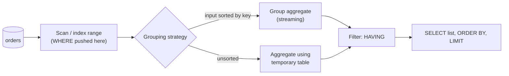

## Introduction

In [Aggregate Functions](/lessons/m03-aggregate-functions) every query collapsed *all* qualifying rows into a single answer: one count, one sum, one average. Real questions are almost never that coarse. Management does not ask "what is our revenue?" but "what is our revenue **per category**, **per month**, **per state**?" — and then "which of those categories made **more than $10,000**?". Each of these is a request for **one aggregate row per group of rows**.

`GROUP BY` is the clause that defines the groups. `HAVING` is the clause that filters the groups after they have been aggregated. Together they turn the aggregate functions you already know into the workhorse of reporting, analytics and data quality checks:

- "How many orders are in each status?" — `GROUP BY status`.
- "Which customers placed at least five orders?" — `GROUP BY customer_id HAVING COUNT(*) >= 5`.
- "Monthly revenue with a grand total at the bottom?" — `GROUP BY month WITH ROLLUP`.

This lesson goes beyond the syntax. You will see exactly what a grouped query computes step by step, why MySQL rejects `SELECT city, state, COUNT(*) … GROUP BY city` but accepts `SELECT customer_id, first_name, COUNT(*) … GROUP BY customer_id`, how to tell a "real" NULL from a subtotal NULL produced by `WITH ROLLUP`, and why a condition placed in `HAVING` instead of `WHERE` can stop MySQL from using an index.

:::note[Dataset]
The examples use the **shop** dataset (25 customers, 80 orders in 2024, 182 order lines, 30 products in 10 categories). Every output shown was captured from a real MySQL server; use **Run** to execute any block in your lab.
:::

## DBMS Theory

:::theory[The grouping operator γ]
Extended relational algebra writes aggregation as

> γ<sub>G₁, G₂, …; F₁(A₁) → N₁, F₂(A₂) → N₂, …</sub>(R)

The **grouping attributes** G₁, G₂, … define an **equivalence relation** on the tuples of R: two tuples are in the same group exactly when they agree on every grouping attribute. The operator partitions R into these equivalence classes, applies each aggregate function Fᵢ to the multiset of Aᵢ values *within* each class, and outputs **one tuple per class** consisting of the grouping values plus the aggregate results. With no grouping attributes the whole relation is one class — the special case from the previous lesson.
:::

Several consequences follow directly from this definition and explain most of SQL's grouping rules:

1. **Groups are a partition.** Every input row belongs to exactly one group; no row is lost or duplicated. The sum of the group counts always equals the number of input rows.
2. **The output has one row per non-empty group.** Groups are formed only from rows that exist, so a grouped query never produces a row for a category that has no rows — unlike an ungrouped aggregate, which returns one row even for empty input. `SELECT status, COUNT(*) FROM orders WHERE 1 = 0 GROUP BY status` returns **zero rows**, not a row with 0.
3. **Each output tuple may only contain values that are single-valued per group.** A grouping attribute is constant within its group by construction; an aggregate is one value per group by definition. Any other attribute might take several values inside one group, so "its value" is undefined. This is the theoretical basis of `ONLY_FULL_GROUP_BY`.
4. **Functional dependence relaxes rule 3.** If attribute B is **functionally dependent** on the grouping attributes (written G → B: any two tuples that agree on G also agree on B), then B is also constant within each group, and returning it is well defined. The classic case: grouping by a primary key determines every other column of that table. SQL:1999 added this rule to the standard (optional feature T301, "functional dependencies"); MySQL implements it since 5.7.5.
5. **NULLs group together.** For comparison, `NULL = NULL` is UNKNOWN, but for grouping the standard treats all NULLs in a grouping column as *not distinct* from one another, so they form **one group**. (The same rule applies to `DISTINCT`.)

:::standard[Standard SQL vs MySQL]
Standard: `GROUP BY` on columns, `HAVING`, functional dependence (T301), `ROLLUP` (written `GROUP BY ROLLUP (a, b)`), `GROUPING(…)`, plus `CUBE` and `GROUPING SETS`.
MySQL: writes rollup as `GROUP BY a, b WITH ROLLUP`; supports `GROUPING()` since 8.0.1; does **not** support `CUBE` or `GROUPING SETS`; allows `GROUP BY` and `HAVING` to reference **SELECT-list aliases** (an extension); provides `ANY_VALUE()` (MySQL-specific). Before 5.7.5 MySQL silently allowed non-grouped columns with arbitrary values — the behaviour still available today if `ONLY_FULL_GROUP_BY` is removed from `sql_mode`.
:::

| Term | Meaning |
|---|---|
| Grouping key | The list of expressions in `GROUP BY`; rows with equal keys form one group |
| Group | An equivalence class of rows sharing the grouping key |
| Group-level (aggregate) query | A query whose output has one row per group |
| Super-aggregate row | An extra subtotal/total row added by `WITH ROLLUP` |
| Functional dependency G → B | The value of G uniquely determines the value of B |
| Group predicate | A condition evaluated per group (in `HAVING`), usually over aggregates |

## Why It Exists

Without `GROUP BY` you have two bad options for "revenue per category":

- **Run one aggregate query per category.** Ten categories means ten queries, ten scans (or index lookups), and a list of categories that must be known in advance — add an eleventh category and the report silently omits it.
- **Fetch every order line to the client and group there.** That moves all detail rows across the network and re-implements, in application code, logic the database already has — including its NULL rules — usually with subtle differences.

`GROUP BY` solves both: the database discovers the set of groups from the data, computes all of them in **one pass** over the input, and returns only the summary rows. `HAVING` exists because some filters can only be expressed *after* aggregation: "customers with at least five orders" cannot be a `WHERE` condition, because when `WHERE` runs, no row knows how many orders its customer has. `WHERE` filters **rows**; `HAVING` filters **groups**.

`ONLY_FULL_GROUP_BY` exists because the relaxed pre-5.7 behaviour was a factory of silently wrong reports. A query such as `SELECT customer_id, order_date, COUNT(*) FROM orders GROUP BY customer_id` would return *some* order date per customer — not the first, not the last, just whichever row the engine happened to read — and the result could change after an index was added or the server was upgraded. Turning that into an error forces the author to say what they mean (`MIN(order_date)`? `MAX(order_date)`?).

## Internal Working

:::internals[Two ways to group: temporary table or sorted stream]
MySQL's executor builds grouped queries from the same iterators as ungrouped ones, with two main strategies:

1. **Aggregate using a temporary table** (hash-style aggregation). For every input row the server computes the grouping key, looks it up in an internal temporary table keyed on the grouping columns, and either creates a new group row or updates that row's accumulators. When the input is exhausted, the temporary table is scanned to emit the result. In MySQL 8.0+/8.4 internal temporary tables use the **TempTable** engine in memory, bounded by `temptable_max_ram`, spilling to disk when it is exceeded; `tmp_table_size` limits a single in-memory internal table. EXPLAIN FORMAT=TREE shows this as `Aggregate using temporary table` (traditional EXPLAIN: `Using temporary`).
2. **Group aggregate over sorted input** (streaming aggregation). If rows arrive **already ordered by the grouping key** — because an index on the grouping columns is being read in order — equal keys are adjacent. The iterator keeps a single set of accumulators, and whenever the key changes it emits the finished group and resets. No temporary table is needed, memory use is constant, and the first group can be returned before the scan is finished. EXPLAIN FORMAT=TREE shows `Group aggregate`.

A special case of (2) is the **loose index scan** (`Using index for group-by`): for queries like `SELECT k, MIN(x) … GROUP BY k` with an index on `(k, x)`, MySQL can jump from the first entry of one key to the first entry of the next key, reading only a few index entries per group instead of all of them.

`HAVING` is applied by a **Filter** iterator placed *above* the aggregation; `WHERE` is applied *below* it (or pushed into the index access).
:::



**No implicit sorting any more.** Up to MySQL 5.7, `GROUP BY` also **sorted** the result by the grouping columns (and accepted `GROUP BY col DESC` to sort descending), because the server frequently implemented grouping by sorting. MySQL 8.0 removed that guarantee: hash-style aggregation produces groups in whatever order the temporary table returns them. If you need ordered output you must write `ORDER BY`. The `ASC`/`DESC` modifiers on `GROUP BY` columns were deprecated in 5.7 and **removed in 8.0.13** — they are now a syntax error (you will see it below).

**How functional dependence is detected.** When a SELECT-list, HAVING or ORDER BY expression references a column that is not in `GROUP BY`, MySQL checks whether that column is functionally dependent on the grouping columns. The rules (MySQL manual, *Detection of Functional Dependence*) include: grouping by all columns of a **primary key or a UNIQUE key on NOT NULL columns** determines every column of that table; **equality conditions** in `WHERE` or in inner-join `ON` clauses (`o.customer_id = c.customer_id`) propagate dependencies across tables; and dependencies through views and derived tables are followed. If no rule proves the dependency, the query is rejected with error **1055** under `ONLY_FULL_GROUP_BY`.

## MySQL Implementation

The general form, with clauses in the order they must be written:

```sql
SELECT   grouping_expr [, …], aggregate_expr [, …]
FROM     table_reference
[WHERE   row_condition]
GROUP BY grouping_expr [, …] [WITH ROLLUP]
[HAVING  group_condition]
[ORDER BY …]
[LIMIT …];
```

Start with the simplest grouped query — orders per status:

```sql run
SELECT status, COUNT(*) AS orders
FROM orders
GROUP BY status;
```

Six statuses, six rows, and the counts add up to the 80 orders in the table — groups are a partition. Notice the row order: it is not alphabetical and not sorted by count. That is the order in which the temporary table returned the groups. Never rely on it; write `ORDER BY`:

```sql run
SELECT status, COUNT(*) AS orders
FROM orders
GROUP BY status
ORDER BY orders DESC, status;
```

Grouping by several columns makes one group per **distinct combination**. Customers per state and loyalty tier (note that the NULL tier forms its own group in each state where it occurs):

```sql run
SELECT state, loyalty_tier, COUNT(*) AS customers
FROM customers
GROUP BY state, loyalty_tier
ORDER BY state, loyalty_tier;
```

`HAVING` filters the groups. Customers who placed at least six orders:

```sql run
SELECT customer_id, COUNT(*) AS orders
FROM orders
GROUP BY customer_id
HAVING COUNT(*) >= 6
ORDER BY orders DESC, customer_id;
```

`WHERE` and `HAVING` can appear in the same query and do different jobs. Here `WHERE` keeps only delivered orders (a row filter) and `HAVING` keeps only customers with at least four of them (a group filter):

```sql run
SELECT customer_id, COUNT(*) AS delivered_orders
FROM orders
WHERE status = 'delivered'
GROUP BY customer_id
HAVING COUNT(*) >= 4
ORDER BY delivered_orders DESC, customer_id;
```

## Syntax Breakdown

| Component | Meaning and rules |
|---|---|
| `GROUP BY expr, …` | Defines the grouping key. Each `expr` may be a column, an expression (`YEAR(order_date)`), a SELECT-list **alias** (MySQL extension) or a **position** (`GROUP BY 1`, deprecated style — avoid). Rows with equal keys (NULLs equal to each other) form one group. |
| Non-aggregated columns in SELECT | Under `ONLY_FULL_GROUP_BY` (default) each must be in `GROUP BY` **or** functionally dependent on it **or** wrapped in an aggregate or `ANY_VALUE()`. Otherwise: error 1055. |
| `HAVING condition` | Evaluated once per group after aggregation. May reference grouping columns, aggregates (even ones not in the SELECT list), and SELECT aliases (MySQL extension). |
| `WHERE` vs `HAVING` | `WHERE` filters rows before grouping and cannot contain aggregates (error 1111). `HAVING` filters groups after grouping. A condition on a grouping column works in either, but belongs in `WHERE`. |
| `WITH ROLLUP` | Adds super-aggregate rows: a subtotal for each prefix of the grouping list and one grand total. The rolled-up columns show `NULL` in those rows. |
| `GROUPING(expr, …)` | Returns 1 if `expr` is rolled up (a super-aggregate NULL) in the current row, 0 otherwise. With several arguments returns a bitmask. Allowed in SELECT, HAVING and ORDER BY. Requires `WITH ROLLUP`. |
| `ANY_VALUE(expr)` | Suppresses the `ONLY_FULL_GROUP_BY` check for `expr` and returns the value from an arbitrary row of the group. |
| `ORDER BY` | The **only** way to get a defined order. Since 8.0.12 it may be combined with `WITH ROLLUP`. `GROUP BY col ASC/DESC` was removed in 8.0.13. |

:::version[Version timeline for GROUP BY features]
- 5.7.5: `ONLY_FULL_GROUP_BY` becomes the default and functional dependence detection is introduced.
- 8.0.0: implicit sorting of `GROUP BY` results removed.
- 8.0.1: `GROUPING()` function added.
- 8.0.12: `ORDER BY` allowed together with `WITH ROLLUP`.
- 8.0.13: `GROUP BY … ASC/DESC` syntax removed.
- 8.4 LTS: all of the above apply unchanged; `CUBE` and `GROUPING SETS` are still not available.
:::

## Practical Examples

**1. Grouping by an expression — monthly order counts and revenue.** Group by a computed month key. MySQL lets `GROUP BY` and `ORDER BY` use the alias `order_month`:

```sql run
SELECT DATE_FORMAT(o.order_date, '%Y-%m')   AS order_month,
       COUNT(DISTINCT o.order_id)           AS orders,
       SUM(oi.quantity * oi.unit_price)     AS gross_revenue
FROM orders o
JOIN order_items oi ON oi.order_id = o.order_id
WHERE o.status NOT IN ('cancelled', 'refunded')
GROUP BY order_month
ORDER BY order_month;
```

`COUNT(DISTINCT o.order_id)` matters here: after the join there is one row per **order line**, so `COUNT(*)` would count lines, not orders. This "join fan-out" is the most common source of inflated numbers in grouped reports (more in Common Mistakes).

**2. Functional dependence on a primary key.** Group by the customer's primary key and select the customer's name and city without aggregating them. MySQL proves that `customer_id → first_name, last_name, city` and accepts the query. The `LEFT JOIN` keeps customers with no orders (they get `COUNT(o.order_id) = 0`, because COUNT ignores the NULL-extended order columns):

```sql run
SELECT c.customer_id, c.first_name, c.last_name, c.city,
       COUNT(o.order_id) AS orders
FROM customers c
LEFT JOIN orders o ON o.customer_id = c.customer_id
GROUP BY c.customer_id
ORDER BY orders, c.customer_id
LIMIT 6;
```

The same works for a UNIQUE key on NOT NULL columns — `email` is `NOT NULL UNIQUE`, so grouping by it also determines the other customer columns:

```sql run
SELECT c.email, c.first_name, COUNT(*) AS orders
FROM customers c
JOIN orders o ON o.customer_id = c.customer_id
GROUP BY c.email
ORDER BY orders DESC, c.email
LIMIT 3;
```

**3. Dependence that cannot be proven is rejected.** `city` does not determine `state` as far as MySQL knows (no key says so — and in general two cities in different states can share a name), so this fails with error 1055:

```sql run error
SELECT city, state, COUNT(*) AS customers
FROM customers
GROUP BY city;
```

Fix it by saying what you mean — group by both columns (the usual answer), or aggregate the extra column:

```sql run
SELECT city, state, COUNT(*) AS customers
FROM customers
GROUP BY city, state
ORDER BY customers DESC, city;
```

**4. HAVING with an aggregate that is not in the SELECT list.** Categories whose products have an average price above $100, showing only the category name and product count:

```sql run
SELECT cat.name AS category, COUNT(*) AS products
FROM products p
JOIN categories cat ON cat.category_id = p.category_id
GROUP BY cat.category_id
HAVING AVG(p.price) > 100
ORDER BY products DESC, category;
```

`cat.name` is accepted because `category_id` is the primary key of `categories`. `AVG(p.price)` is computed for the filter even though it is not displayed.

**5. Subtotals and grand total with WITH ROLLUP and GROUPING().** Revenue by category and product for the Coffee and Databases categories, with a subtotal per category and a grand total:

```sql run
SELECT IF(GROUPING(cat.name) = 1, '== ALL CATEGORIES ==', cat.name) AS category,
       IF(GROUPING(p.name) = 1, '-- subtotal --', p.name)           AS product,
       SUM(oi.quantity)                                             AS units,
       SUM(oi.quantity * oi.unit_price)                             AS revenue
FROM order_items oi
JOIN products p     ON p.product_id = oi.product_id
JOIN categories cat ON cat.category_id = p.category_id
WHERE cat.name IN ('Coffee', 'Databases')
GROUP BY cat.name, p.name WITH ROLLUP
ORDER BY GROUPING(cat.name), cat.name, GROUPING(p.name), p.name;
```

`WITH ROLLUP` produced three kinds of rows: detail rows (both columns grouped), one subtotal row per category (`p.name` rolled up), and one grand-total row (both rolled up). `GROUPING()` lets us label them and, in `ORDER BY`, place each subtotal after its details and the grand total last.

**6. Why GROUPING() is needed: real NULLs vs rollup NULLs.** `discount_code` is NULL for orders without a code. In a rollup over `discount_code`, the super-aggregate row *also* shows NULL. `COALESCE` cannot tell them apart; `GROUPING()` can:

```sql run
SELECT discount_code,
       COALESCE(discount_code, '(no code)')                   AS coalesce_label,
       IF(GROUPING(discount_code) = 1, 'TOTAL',
          COALESCE(discount_code, '(no code)'))               AS grouping_label,
       GROUPING(discount_code)                                AS is_rollup_row,
       COUNT(*)                                               AS orders
FROM orders
GROUP BY discount_code WITH ROLLUP
ORDER BY GROUPING(discount_code), discount_code;
```

The first and last rows both have `discount_code = NULL`, and `COALESCE` labels both "(no code)" — the grand total of 80 is mislabelled. `GROUPING()` returns 0 for the genuine NULL group and 1 for the rollup row, so `grouping_label` is correct.

**7. ANY_VALUE — when you know better than the checker.** Sometimes a column really is single-valued per group but MySQL cannot prove it, or you genuinely do not care which value you get (for example, one sample order id per status for debugging). `ANY_VALUE()` disables the check for that expression:

```sql run
SELECT status,
       COUNT(*)            AS orders,
       ANY_VALUE(order_id) AS sample_order_id
FROM orders
GROUP BY status
ORDER BY status;
```

`ANY_VALUE` is honest about its semantics — the value comes from an arbitrary row and may change between executions or versions. If you need a *specific* row ("the latest order per customer"), `ANY_VALUE` is the wrong tool; use `MAX()`, a join back to the grouped result, or a window function ([Ranking functions](/lessons/m04-ranking-functions)).

## Execution Walkthrough

We trace a query that uses every clause: *for each customer with delivered orders, count those orders and the distinct products bought, keep customers with at least 4 delivered orders, and show the top results.*

```walkthrough
title: SELECT customer_id, COUNT(*) … FROM orders WHERE status = 'delivered' GROUP BY customer_id HAVING COUNT(*) >= 4 ORDER BY … LIMIT 5
steps:
  - title: "1. FROM — the input rows"
    explain: The scan produces all 80 orders. Here are the first ten (by order_id) with the columns the query uses.
    sql: SELECT order_id, customer_id, status FROM orders ORDER BY order_id LIMIT 10;
  - title: "2. WHERE — filter rows"
    explain: >-
      WHERE status = 'delivered' is evaluated per row, before any group exists. Rows with other statuses are
      discarded and never reach an accumulator. 45 of the 80 orders survive.
    sql: SELECT COUNT(*) AS rows_after_where FROM orders WHERE status = 'delivered';
  - title: "3. GROUP BY — partition into groups"
    explain: >-
      The remaining rows are partitioned by customer_id. This query shows the members of the first few groups
      (GROUP_CONCAT lists the order ids in each group) so you can see the partition itself.
    sql: |
      SELECT customer_id, GROUP_CONCAT(order_id ORDER BY order_id) AS orders_in_group
      FROM orders
      WHERE status = 'delivered'
      GROUP BY customer_id
      ORDER BY customer_id
      LIMIT 8;
  - title: "4. Aggregate — one row per group"
    explain: >-
      Each group's accumulators are finalized: COUNT(*) per group. The number of groups equals the number of
      distinct customers who have a delivered order.
    sql: |
      SELECT customer_id, COUNT(*) AS delivered_orders
      FROM orders
      WHERE status = 'delivered'
      GROUP BY customer_id
      ORDER BY customer_id;
  - title: "5. HAVING — filter groups"
    explain: >-
      HAVING COUNT(*) >= 4 is evaluated once per group, on the aggregated row. Groups that fail are discarded as a
      whole; individual orders are no longer visible at this stage.
    sql: |
      SELECT customer_id, COUNT(*) AS delivered_orders
      FROM orders
      WHERE status = 'delivered'
      GROUP BY customer_id
      HAVING COUNT(*) >= 4
      ORDER BY customer_id;
  - title: "6. SELECT, ORDER BY, LIMIT"
    explain: >-
      The SELECT list is evaluated per surviving group (here also computing the first and last delivered order
      date per customer), the result is sorted with a unique tie-breaker, and LIMIT keeps the top five.
    sql: |
      SELECT customer_id, COUNT(*) AS delivered_orders,
             DATE(MIN(order_date)) AS first_delivered, DATE(MAX(order_date)) AS last_delivered
      FROM orders
      WHERE status = 'delivered'
      GROUP BY customer_id
      HAVING COUNT(*) >= 4
      ORDER BY delivered_orders DESC, customer_id
      LIMIT 5;
```

```viz
type: query-order
```

The logical order — `FROM` → `WHERE` → `GROUP BY` → aggregates → `HAVING` → `SELECT` → `ORDER BY` → `LIMIT` — explains the visibility rules. `WHERE` cannot see aggregates because they do not exist yet. `HAVING` can see aggregates. Standard SQL does not let `HAVING` see SELECT aliases (the SELECT list is evaluated later), but MySQL resolves aliases in `HAVING` and `GROUP BY` as an extension; `ORDER BY` may use aliases in every database.

**The physical plan.** EXPLAIN FORMAT=TREE shows the same pipeline from the bottom up: the filter on `status` sits below the aggregation, the `HAVING` filter above it:

```sql run
EXPLAIN FORMAT=TREE
SELECT customer_id, COUNT(*) AS delivered_orders
FROM orders
WHERE status = 'delivered'
GROUP BY customer_id
HAVING COUNT(*) >= 4;
```

## Output

The final result of the walkthrough lists the five customers with the most delivered orders (customers with equal counts are ordered by id). Read each row as a statement about a **group**, not about an order: "customer X has N delivered orders, the first on D₁ and the last on D₂". The two dates in a row usually come from **different** orders — `MIN` and `MAX` are computed independently over the group. This is a frequent misreading: aggregates in the same row are not guaranteed to describe the same underlying row.

Two sanity checks every analyst should run on grouped output:

```sql run
SELECT COUNT(*)          AS customer_groups,
       SUM(n)            AS orders_in_groups
FROM (SELECT customer_id, COUNT(*) AS n
      FROM orders WHERE status = 'delivered'
      GROUP BY customer_id) AS g;
```

The number of groups equals the number of distinct customers with a delivered order, and the sum of the group counts equals the 45 delivered orders from step 2 — confirming that grouping partitioned the rows without losing or duplicating any.

## Alternative Approaches

**Window functions instead of GROUP BY.** `GROUP BY` collapses each group to one row. When you need the aggregate **next to each detail row** ("each order with its customer's order count"), use an aggregate window function ([Window Functions](/lessons/m04-window-functions)):

```sql run
SELECT order_id, customer_id, status,
       COUNT(*) OVER (PARTITION BY customer_id) AS customer_order_count
FROM orders
WHERE customer_id IN (1, 3)
ORDER BY customer_id, order_id;
```

**DISTINCT instead of GROUP BY.** `SELECT DISTINCT state FROM customers` and `SELECT state FROM customers GROUP BY state` return the same set; MySQL often executes them identically. Use `DISTINCT` when you only want unique values and `GROUP BY` when you compute aggregates — the intent is clearer.

**Conditional aggregation instead of multiple GROUP BY columns (pivoting).** `GROUP BY customer_id, status` returns one row per pair; `GROUP BY customer_id` with `SUM(status = 'delivered')`, `SUM(status = 'cancelled')` returns one row per customer with statuses as columns. The latter is a pivot — covered in [Conditional Logic](/lessons/m03-conditional-expressions).

**A correlated subquery instead of GROUP BY + JOIN.** `SELECT c.*, (SELECT COUNT(*) FROM orders o WHERE o.customer_id = c.customer_id) FROM customers c` also produces per-customer counts and naturally includes zero counts. The optimizer may or may not transform it into a join; for large tables the grouped join (or grouping first in a derived table, then joining) is usually the more predictable plan ([Correlated Subqueries](/lessons/m04-correlated-subqueries)).

**Emulating CUBE / GROUPING SETS.** MySQL has only `ROLLUP`. For subtotals over independent dimensions (by state *and* separately by tier), combine grouped queries with `UNION ALL` ([Set Operations](/lessons/m04-set-operations)).

| Need | Best tool |
|---|---|
| One row per group with aggregates | `GROUP BY` |
| Filter on aggregate values | `HAVING` |
| Aggregate alongside detail rows | Window function `… OVER (PARTITION BY …)` |
| Hierarchical subtotals + grand total | `WITH ROLLUP` + `GROUPING()` |
| Categories as columns | Conditional aggregation |
| Independent subtotal dimensions | `UNION ALL` of grouped queries |

## Performance Analysis

**WHERE vs HAVING on a grouping column.** Logically, `WHERE category_id = 3 … GROUP BY category_id` and `GROUP BY category_id HAVING category_id = 3` return the same row. Physically they are very different. With `WHERE`, the condition is applied while reading, so MySQL can use the index `idx_products_category` to read only category 3:

```sql run
EXPLAIN FORMAT=TREE
SELECT category_id, COUNT(*) AS products, AVG(price) AS avg_price
FROM products
WHERE category_id = 3
GROUP BY category_id;
```

With `HAVING`, every product is read and grouped, and the groups for all other categories are computed only to be thrown away:

```sql run
EXPLAIN FORMAT=TREE
SELECT category_id, COUNT(*) AS products, AVG(price) AS avg_price
FROM products
GROUP BY category_id
HAVING category_id = 3;
```

The first plan is an *Index lookup* (`category_id=3`) under the aggregate; the second is an *Index scan* over all rows with the filter *above* the aggregate. On 30 rows the difference is invisible; on 30 million rows it is the difference between reading a few pages and reading the whole index. MySQL 8.0/8.4 does not move such conditions from `HAVING` to `WHERE` for you in a plain grouped query, so put row conditions in `WHERE` yourself.

**Temporary table vs streaming aggregation.** Grouping by `status` (no index) needs a temporary table; grouping by `customer_id` (indexed by `idx_orders_customer`) can stream over the index in key order:

```sql run
EXPLAIN FORMAT=TREE
SELECT status, COUNT(*) FROM orders GROUP BY status;
```

```sql run
EXPLAIN FORMAT=TREE
SELECT customer_id, COUNT(*) FROM orders GROUP BY customer_id;
```

| Plan shape | Memory | Cost grows with | Notes |
|---|---|---|---|
| Group aggregate over an index in key order | Constant (one group at a time) | Rows read | Can return first groups early; needs an index whose leading columns are the grouping key |
| Aggregate using temporary table | Proportional to the **number of groups** | Rows read + group lookups | Spills to disk if the temp table outgrows its memory limit |
| Loose index scan (`Using index for group-by`) | Constant | **Number of groups**, not rows | Only for MIN/MAX (and some COUNT DISTINCT) patterns with a suitable index |
| Sort, then group | Sort buffer | Rows read × log(rows) | Chosen when the optimizer finds sorting cheaper |

:::performance[Theory vs measurement]
These are expected behaviours from how the iterators work. Whether the optimizer chooses streaming or a temporary table depends on statistics and estimated costs, and the small shop tables make every plan fast. To compare strategies on your own data, generate a larger table with a recursive CTE and measure with `EXPLAIN ANALYZE` (Module 7, [Reading EXPLAIN ANALYZE](/lessons/m07-explain-analyze)). The number of groups and whether a covering index on the grouping key exists are the two factors that matter most.
:::

Practical guidance: put selective row filters in `WHERE`; index the grouping columns (followed by the aggregated column for a covering index) for large, frequently run reports; aggregate **before** joining to large dimension tables when possible (group in a derived table, then join), so the join processes groups instead of detail rows.

## Best Practices

:::best-practice[Professional habits for grouped queries]
1. **Keep `ONLY_FULL_GROUP_BY` enabled.** Never "fix" error 1055 by removing it from `sql_mode` — that restores silently arbitrary results.
2. **Group by the key, display the attributes.** `GROUP BY c.customer_id` and select `c.name`, `c.city` freely — functional dependence makes it valid and the grouping is by identity, not by a name that two customers might share.
3. **Row conditions in WHERE, group conditions in HAVING.** If the condition does not involve an aggregate, it belongs in `WHERE`.
4. **Always write ORDER BY** when the order matters. Since 8.0, `GROUP BY` does not sort.
5. **Watch for join fan-out.** Before aggregating across a one-to-many join, ask "what does one row represent now?" Use `COUNT(DISTINCT …)` or aggregate in a derived table before joining.
6. **Label rollup rows with `GROUPING()`**, not `COALESCE`/`IFNULL`, whenever the grouped column can contain real NULLs.
7. **Use `ANY_VALUE()` sparingly and deliberately**, with a comment explaining why any value is acceptable.
8. **Prefer explicit column names over `GROUP BY 1, 2`.** Positions break silently when someone reorders the SELECT list.
:::

## Common Mistakes

**Mistake 1 — a non-grouped, non-dependent column.** The classic error 1055 — here, "the latest order date per customer" written without an aggregate:

```sql run error
SELECT customer_id, order_date, COUNT(*) AS orders
FROM orders
GROUP BY customer_id;
```

Decide which date you want and say so:

```sql run
SELECT customer_id, MAX(order_date) AS latest_order, COUNT(*) AS orders
FROM orders
GROUP BY customer_id
ORDER BY customer_id
LIMIT 5;
```

**Mistake 2 — an aggregate in WHERE.** `WHERE` runs before grouping:

```sql run error
SELECT customer_id, COUNT(*) AS orders
FROM orders
WHERE COUNT(*) >= 6
GROUP BY customer_id;
```

The condition belongs in `HAVING` (see the MySQL Implementation section).

**Mistake 3 — relying on 5.7-style sorting syntax.** Code written for MySQL 5.7 sometimes uses `GROUP BY … DESC`. It is a syntax error since 8.0.13:

```sql run error
SELECT status, COUNT(*) FROM orders GROUP BY status DESC;
```

Write `GROUP BY status ORDER BY status DESC` instead. Code that relied on the old *implicit* ascending sort does not error — it just returns rows in a different order after upgrading to 8.0, which can break reports and tests silently.

**Mistake 4 — join fan-out inflates aggregates.** Counting orders per customer after joining order lines counts **lines**:

```sql run
SELECT o.customer_id,
       COUNT(*)                   AS wrong_order_count,
       COUNT(DISTINCT o.order_id) AS order_count
FROM orders o
JOIN order_items oi ON oi.order_id = o.order_id
GROUP BY o.customer_id
ORDER BY o.customer_id
LIMIT 5;
```

`COUNT(DISTINCT …)` repairs counts, but **sums** of order-level columns (shipping fees, order totals) cannot be repaired that way — two orders with the same amount would be merged. Aggregate the many side first, then join ([Multi-Table Joins](/lessons/m04-multi-table-joins) covers fan-out traps in depth).

**Mistake 5 — labelling rollup rows with COALESCE.** As example 6 showed, `COALESCE(discount_code, 'TOTAL')` labels both the "no code" group and the grand total as TOTAL. Use `GROUPING()`.

**Mistake 6 — expecting a row for empty groups.** "Orders per status" never shows `pending: 0` if there are no pending orders, and "orders per customer" from the `orders` table alone never shows the five customers (2, 13 and 23–25) who never ordered. Groups come from existing rows; to report zeros, start from the table that lists all categories (or customers) and `LEFT JOIN` the facts, counting a column from the right-hand table, as in example 2.

## Industry Application

- **BI dashboards and reporting.** Every bar chart "X per Y" is a `GROUP BY`. BI tools (Tableau, Looker, Power BI, Metabase) generate grouped SQL; understanding fan-out and NULL grouping is what lets an analyst explain why two dashboards disagree.
- **Financial reports with subtotals.** Profit-and-loss statements, sales by region → country → city with subtotals and a grand total are a natural fit for `WITH ROLLUP`. Finance teams require that subtotal rows are labelled unambiguously — `GROUPING()` exists precisely for this.
- **Data quality checks.** Duplicate detection is `GROUP BY natural_key HAVING COUNT(*) > 1`; referential sanity checks count orphan rows per table; distribution checks compare per-day row counts to detect a broken ingestion job (a day whose count is 0 simply disappears from a grouped result — hence the "start from a calendar table and LEFT JOIN" pattern).
- **Summary (rollup) tables.** High-traffic systems pre-aggregate detail data with `INSERT … SELECT … GROUP BY` into daily or hourly summary tables, so dashboards read hundreds of rows instead of scanning millions ([Large Tables](/lessons/m12-large-tables) in Module 12).
- **Migrations from MySQL 5.7.** Upgrades routinely surface queries that relied on implicit `GROUP BY` sorting or on `ONLY_FULL_GROUP_BY` being disabled by an application's `sql_mode`. Teams audit for both before upgrading.

## Practice Exercises

```exercise
id: ex1
title: Products per category
difficulty: easy
concepts: [group-by]
prompt: |
  Return one row per `category_id` in the `products` table with two columns, in this order:
  `category_id` and `products` (the number of products in that category). Include the products that
  have no category (they form their own group). Order is not checked.
hints:
  - "GROUP BY category_id and COUNT(*)."
  - "NULL values in the grouping column form one group automatically — you do not need to do anything special."
solution: |
  SELECT category_id, COUNT(*) AS products
  FROM products
  GROUP BY category_id;
explanation: |
  Grouping treats all NULLs as one group, so the gift card (category NULL) appears as a group of 1.
  Writing `COUNT(category_id)` instead of `COUNT(*)` would be wrong for that group: it would report 0,
  because COUNT(column) ignores NULLs.
```

```exercise
id: ex2
title: Frequent customers
difficulty: easy
concepts: [group-by, having]
prompt: |
  List customers who placed **at least 5 orders** (any status). Return `customer_id` and `orders`
  (the order count), ordered by `orders` descending, then `customer_id` ascending.
hints:
  - "The filter is on a count, so it cannot go in WHERE."
  - "GROUP BY customer_id HAVING COUNT(*) >= 5, then ORDER BY orders DESC, customer_id."
solution: |
  SELECT customer_id, COUNT(*) AS orders
  FROM orders
  GROUP BY customer_id
  HAVING COUNT(*) >= 5
  ORDER BY orders DESC, customer_id;
orderMatters: true
explanation: |
  `WHERE COUNT(*) >= 5` fails with error 1111 because aggregates do not exist yet when WHERE runs.
  The tie-breaker `customer_id` makes the order deterministic when two customers have the same count.
```

```exercise
id: ex3
title: Customer order summary with names
difficulty: medium
concepts: [group-by, functional-dependence, null-handling]
prompt: |
  For **every** customer (including those who never ordered) return `customer_id`, `first_name`,
  `last_name` and `orders` (number of orders, 0 if none). Order by `orders` descending, then `customer_id`.
hints:
  - "Start from customers and LEFT JOIN orders so that customers without orders are kept."
  - "Group by the customers primary key; first_name and last_name are functionally dependent on it."
  - "Count a column from orders (COUNT(o.order_id)), not COUNT(*), so the NULL-extended rows count as 0."
solution: |
  SELECT c.customer_id, c.first_name, c.last_name, COUNT(o.order_id) AS orders
  FROM customers c
  LEFT JOIN orders o ON o.customer_id = c.customer_id
  GROUP BY c.customer_id
  ORDER BY orders DESC, c.customer_id;
orderMatters: true
explanation: |
  `COUNT(*)` would return 1 for the five customers without orders (2, 13 and 23–25), because the LEFT JOIN produces one NULL-extended row
  for each of them. Grouping by `c.first_name, c.last_name` instead of the key would merge two
  different customers who share a name. Grouping by `c.customer_id` alone is accepted under
  ONLY_FULL_GROUP_BY because MySQL detects that the names depend on the primary key.
```

```exercise
id: ex4
title: Monthly revenue with a grand total
difficulty: hard
concepts: [group-by, with-rollup, grouping-function]
prompt: |
  Compute revenue from `order_items` (Σ quantity × unit_price) for orders whose status is `delivered`,
  per month of `order_date`. Return two columns:

  1. `month` — the month formatted as `'YYYY-MM'`, or the text `'TOTAL'` on the grand-total row
  2. `revenue`

  Months in ascending order, followed by the grand-total row last.
hints:
  - "Join orders to order_items, filter status in WHERE, group by DATE_FORMAT(order_date, '%Y-%m')."
  - "Add WITH ROLLUP for the grand total. Use GROUPING(…) to detect the total row."
  - "With WITH ROLLUP, MySQL does not match a grouped expression nested inside another expression (IF(…, DATE_FORMAT(…))) and raises error 1055. Compute the month in a derived table first, then group by its column name."
solution: |
  SELECT IF(GROUPING(ym) = 1, 'TOTAL', ym) AS month,
         SUM(line_revenue)                  AS revenue
  FROM (SELECT DATE_FORMAT(o.order_date, '%Y-%m') AS ym,
               oi.quantity * oi.unit_price        AS line_revenue
        FROM orders o
        JOIN order_items oi ON oi.order_id = o.order_id
        WHERE o.status = 'delivered') AS t
  GROUP BY ym WITH ROLLUP
  ORDER BY GROUPING(ym), ym;
orderMatters: true
explanation: |
  Here no month is ever NULL, so `COALESCE(month, 'TOTAL')` would happen to work — but `GROUPING()` is
  correct even when the grouped expression can be NULL, so it is the habit to build. Grouping directly by
  `DATE_FORMAT(o.order_date, '%Y-%m') WITH ROLLUP` works on its own, but as soon as that expression is
  wrapped in `IF(GROUPING(…) = 1, 'TOTAL', …)` MySQL no longer recognises it as the grouping expression
  and raises error 1055 — the derived table gives the expression a plain column name. The status filter
  is a row condition and belongs in WHERE; putting it in HAVING is not even possible here because
  `status` is not a grouping column.
```

```exercise
id: ex5
title: Find duplicate customer names (data quality)
difficulty: medium
concepts: [group-by, having, data-quality]
prompt: |
  A data steward suspects duplicate customer records. Find every `(first_name, last_name)` combination
  that occurs **more than once**, or — if none do — every `first_name` used by more than one customer.
  For this exercise return the second variant: columns `first_name` and `customers`
  (how many customers have that first name), only for first names shared by at least 2 customers,
  ordered by `customers` descending, then `first_name`.
hints:
  - "GROUP BY first_name, then HAVING COUNT(*) >= 2."
  - "Order by the count descending and use first_name as a tie-breaker."
solution: |
  SELECT first_name, COUNT(*) AS customers
  FROM customers
  GROUP BY first_name
  HAVING COUNT(*) >= 2
  ORDER BY customers DESC, first_name;
orderMatters: true
explanation: |
  `GROUP BY key HAVING COUNT(*) > 1` is the standard duplicate-detection pattern. In production you would
  group by a normalized key, e.g. `LOWER(TRIM(email))`, and then inspect the members of each duplicate
  group with `GROUP_CONCAT(customer_id)`.
```

```exercise
id: ex6
title: Category performance report
difficulty: challenge
concepts: [group-by, having, functional-dependence, join-fan-out]
prompt: |
  For each category that has sold products, report:

  1. `category` — the category name
  2. `orders` — the number of **distinct orders** containing at least one product from that category
  3. `units` — total units sold
  4. `revenue` — Σ quantity × unit_price

  Consider all order statuses except `cancelled` and `refunded`. Keep only categories with revenue of
  **at least 1000**. Order by `revenue` descending, then `category`.
hints:
  - "Join order_items → orders (for status) and order_items → products → categories (for the name)."
  - "Filter statuses in WHERE; filter revenue in HAVING."
  - "After the joins one row is an order line, so count orders with COUNT(DISTINCT oi.order_id)."
solution: |
  SELECT cat.name                          AS category,
         COUNT(DISTINCT oi.order_id)       AS orders,
         SUM(oi.quantity)                  AS units,
         SUM(oi.quantity * oi.unit_price)  AS revenue
  FROM order_items oi
  JOIN orders o       ON o.order_id = oi.order_id
  JOIN products p     ON p.product_id = oi.product_id
  JOIN categories cat ON cat.category_id = p.category_id
  WHERE o.status NOT IN ('cancelled', 'refunded')
  GROUP BY cat.category_id
  HAVING SUM(oi.quantity * oi.unit_price) >= 1000
  ORDER BY revenue DESC, category;
orderMatters: true
explanation: |
  Grouping by `cat.category_id` (the key) and displaying `cat.name` is valid thanks to functional
  dependence. `COUNT(*)` would count order lines, not orders. The gift card has no category and is dropped
  by the inner join to `categories` — if it had to appear, a LEFT JOIN plus a label such as
  `COALESCE(cat.name, '(uncategorized)')` would be needed.
```

## Knowledge Assessment

```quiz
- id: q1
  question: "In which order are these clauses logically evaluated?"
  options:
    - "SELECT → FROM → WHERE → GROUP BY → HAVING"
    - "FROM → WHERE → GROUP BY → HAVING → SELECT → ORDER BY"
    - "FROM → GROUP BY → WHERE → HAVING → SELECT"
    - "FROM → WHERE → HAVING → GROUP BY → SELECT"
  answer: 1
  explanation: "Rows are produced (FROM), filtered (WHERE), partitioned and aggregated (GROUP BY), groups are filtered (HAVING), then the SELECT list is evaluated and the result sorted. Putting GROUP BY before WHERE would let WHERE see aggregates, which it cannot; HAVING before GROUP BY would have no groups to filter."
  concepts: [group-by, having]
- id: q2
  question: "`SELECT customer_id, first_name, COUNT(*) FROM customers c JOIN orders o USING (customer_id) GROUP BY customer_id;` runs under ONLY_FULL_GROUP_BY. Why?"
  options:
    - "ONLY_FULL_GROUP_BY only checks columns in HAVING"
    - "first_name is functionally dependent on customer_id, the primary key of customers"
    - "MySQL picks an arbitrary first_name, which is allowed for VARCHAR columns"
    - "COUNT(*) makes every other column legal"
  answer: 1
  explanation: "MySQL detects functional dependence: grouping by the primary key determines every column of that table. The check covers SELECT, HAVING and ORDER BY; arbitrary values are exactly what the mode forbids; an aggregate in the list does not legalize other columns."
  concepts: [only-full-group-by, functional-dependence]
- id: q3
  question: "A table has 10 orders, 4 of them with discount_code NULL and the rest split between two codes. How many rows does `SELECT discount_code, COUNT(*) FROM t GROUP BY discount_code` return?"
  options: ["2", "3", "6", "4"]
  answer: 1
  explanation: "All NULLs form a single group, so there are two code groups plus one NULL group = 3 rows. NULLs are not excluded from grouping (they are only excluded inside aggregates such as COUNT(col)), and each NULL is not its own group."
  concepts: [group-by, null-handling]
- id: q4
  question: "Which statements about WITH ROLLUP in MySQL 8.4 are true? (Select all that apply.)"
  type: multi
  options:
    - "It adds a subtotal row for each prefix of the GROUP BY list plus a grand total"
    - "GROUPING(col) returns 1 in rows where col was rolled up"
    - "It can be combined with ORDER BY"
    - "MySQL also supports CUBE and GROUPING SETS"
  answer: [0, 1, 2]
  explanation: "ROLLUP over (a, b) yields (a, b) details, (a) subtotals and the grand total. GROUPING() distinguishes rollup NULLs from data NULLs. ORDER BY with ROLLUP is allowed since 8.0.12. CUBE and GROUPING SETS are standard SQL but not implemented in MySQL."
  concepts: [with-rollup, grouping-function]
- id: q5
  question: "Two queries filter products to category 3: one with WHERE category_id = 3 before GROUP BY category_id, one with HAVING category_id = 3. What does EXPLAIN typically show?"
  options:
    - "Identical plans, because the optimizer moves the HAVING condition into WHERE"
    - "WHERE allows an index lookup on category_id; HAVING scans and groups all rows and filters afterwards"
    - "HAVING is faster because it filters fewer rows"
    - "The HAVING version fails with error 1111"
  answer: 1
  explanation: "WHERE conditions are applied while reading, so the index can restrict the rows. A HAVING condition is a Filter above the aggregate — every group is computed first. MySQL does not move it into WHERE in a plain grouped query. Error 1111 concerns aggregates in WHERE, not grouping columns in HAVING."
  concepts: [having, query-performance]
- id: q6
  question: "An application upgraded from MySQL 5.7 to 8.4 now lists report groups in a seemingly random order. No query errors. What is the most likely cause?"
  options:
    - "The ONLY_FULL_GROUP_BY mode changed the result"
    - "GROUP BY no longer sorts its output implicitly since 8.0; the query lacks ORDER BY"
    - "InnoDB lost the index on the grouping column during upgrade"
    - "WITH ROLLUP is now applied by default"
  answer: 1
  explanation: "Up to 5.7, GROUP BY results were sorted by the grouping columns. 8.0 removed that guarantee, so queries that depended on it need an explicit ORDER BY. ONLY_FULL_GROUP_BY would cause errors, not reordering; indexes are not dropped by upgrades; ROLLUP is never implicit."
  concepts: [group-by, version-differences]
- id: q7
  question: "What does `SELECT status, ANY_VALUE(order_id) FROM orders GROUP BY status` return in the second column?"
  options:
    - "The smallest order_id of each status"
    - "The most recent order_id of each status"
    - "An order_id from an arbitrary row of each group; it may differ between executions"
    - "An error, because order_id is not grouped"
  answer: 2
  explanation: "ANY_VALUE disables the ONLY_FULL_GROUP_BY check for its argument and returns a value from some row of the group with no guarantee which. For the smallest or latest id use MIN or MAX."
  concepts: [any-value, only-full-group-by]
- id: q8
  question: "A report joins orders to order_items and computes `COUNT(*)` per customer as 'number of orders'. What is wrong?"
  options:
    - "Nothing — COUNT(*) counts orders"
    - "It counts order lines, because the join produces one row per order line; COUNT(DISTINCT o.order_id) is needed"
    - "COUNT(*) ignores NULL order lines"
    - "It fails under ONLY_FULL_GROUP_BY"
  answer: 1
  explanation: "After a one-to-many join each row represents an order line, so COUNT(*) inflates the order count (join fan-out). COUNT(*) counts rows regardless of NULLs, and the query is valid SQL — which is exactly why this mistake survives into production."
  concepts: [group-by, join-fan-out]
```
