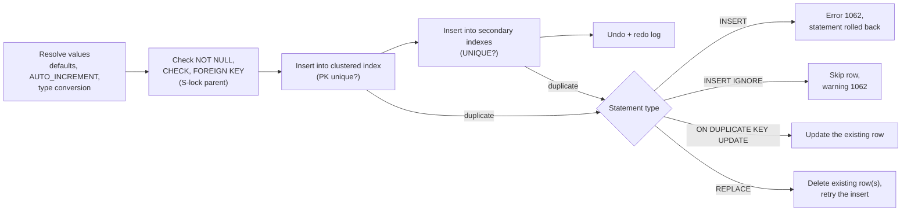

## Introduction

Every row in every table got there through an `INSERT` (or a bulk loader that does the same thing internally). A sign-up form, a checkout, an IoT gateway writing sensor readings, an ETL job loading last night's data — all of them insert.

Writing data raises questions that reading never does:

- **What happens when a row violates a rule** — a duplicate email, a missing required value, a price below zero, an order for a customer who does not exist? Error, warning, or silent "fix"?
- **What happens to the rest of a multi-row insert when one row fails?**
- **How do you insert-or-update** a row whose key may or may not exist — the *upsert* that every sync job needs?
- **What do the numbers MySQL reports back mean** — "3 rows affected", "Records: 3 Duplicates: 1 Warnings: 1"?

MySQL offers a family of statements for these needs: plain `INSERT`, multi-row `INSERT`, `INSERT … SELECT`, `INSERT IGNORE`, `INSERT … ON DUPLICATE KEY UPDATE` and `REPLACE`. They look alike but differ sharply in what they do to existing data, to `AUTO_INCREMENT` values and to rows in other tables. Choosing the wrong one is a classic source of data loss.

:::note[Dataset and lab]
The examples use the **shop** dataset and create a few small tables in your lab. Every output — including rows-affected counts, info messages and warnings — was captured from a real MySQL server. Because these blocks change data, run them in order; use your lab's **Reset** button to start over.
:::

## DBMS Theory

:::theory[Insertion, integrity constraints and atomicity]
Formally, inserting a set of tuples **T** into relation **R** produces the new relation **R ∪ T** — *provided the result satisfies every integrity constraint* declared on R: domain (type) constraints, NOT NULL, key (PRIMARY KEY / UNIQUE) constraints, CHECK constraints and referential (FOREIGN KEY) constraints. A DBMS must reject an insertion that would leave the database in a state violating any constraint. Constraints are the database's guarantee that *invalid states are unrepresentable*, whatever application wrote the data.
:::

Three principles from transaction theory govern how an insert behaves:

1. **Statement-level atomicity.** A single SQL statement either takes full effect or none. If the fifth row of a 10-row INSERT violates a key, the four rows already written are undone. On transactional engines (InnoDB) MySQL implements this by rolling back the statement using undo log records; on non-transactional engines (MyISAM) this guarantee does not exist.
2. **Key uniqueness is checked per row, against the current state.** The DBMS checks each new row against existing rows *and* rows inserted earlier in the same statement.
3. **Errors versus warnings.** The SQL standard requires an exception for any constraint violation. MySQL historically allowed "forgiving" behaviour (truncating strings, converting invalid values to defaults). Modern MySQL defaults to **strict SQL mode** (`STRICT_TRANS_TABLES` is part of the default `sql_mode`), which turns those cases into errors — standard behaviour. The `IGNORE` modifier explicitly re-enables the forgiving behaviour for one statement.

**Upsert** (update-or-insert) is not a relational algebra operation but a ubiquitous need. The SQL standard expresses it with `MERGE`; MySQL does not implement `MERGE` and instead offers `INSERT … ON DUPLICATE KEY UPDATE` (a MySQL extension) — and the older, more destructive `REPLACE`.

## Why It Exists

Applications must add data safely under concurrency and failure:

- **Correctness at the boundary.** When the database enforces NOT NULL, UNIQUE, CHECK and FOREIGN KEY on every INSERT, no buggy client can create an order for a non-existent customer or two accounts with the same email.
- **Efficiency in bulk.** One multi-row INSERT of 1,000 rows is one network round trip, one statement parse, and (with autocommit) one transaction commit — instead of 1,000 of each. In practice this is often an order of magnitude faster.
- **Idempotent writes.** Retries happen: a client times out and resends, a message queue delivers twice, a sync job reruns after a crash. An upsert keyed on a natural identifier makes the write **idempotent** — doing it twice has the same effect as doing it once. Without upsert, applications fall back to "SELECT then INSERT or UPDATE", which has a race condition between the check and the write.
- **Moving data inside the server.** `INSERT … SELECT` copies, archives and transforms data without it ever leaving the database.

## Internal Working

:::internals[What InnoDB does for one inserted row]
1. **Values are resolved.** Omitted columns get their DEFAULT (or the implicit default if allowed); `AUTO_INCREMENT` columns get the next counter value; generated columns are computed; values are converted to the column types (in strict mode, an invalid or out-of-range value raises an error here).
2. **Constraints are checked.** NOT NULL and CHECK constraints are evaluated. For each FOREIGN KEY, InnoDB looks up the parent row in the parent's index and takes a **shared lock** on it so the parent cannot be deleted before this transaction commits.
3. **The row is written into the clustered index** (the B+ tree keyed by the primary key). If the key already exists, the insert fails with a duplicate-key error (1062). To check uniqueness, InnoDB takes locks on the conflicting index records.
4. **Each secondary index gets an entry.** UNIQUE secondary indexes are checked for duplicates at this point; non-unique ones may be buffered (change buffer).
5. **Undo and redo are logged.** An undo record ("delete this row") allows rollback of the statement or transaction; redo records make the change durable at commit.
:::



**AUTO_INCREMENT allocation.** InnoDB keeps an auto-increment counter per table (persisted across restarts since MySQL 8.0). The default `innodb_autoinc_lock_mode = 2` ("interleaved") lets concurrent inserts obtain values without a table-level lock, at the price that values are only guaranteed **unique and increasing per statement**, not gap-free. Values are consumed when allocated, not when committed: a rolled-back insert, a failed insert, an `INSERT IGNORE` that skips a row, or an `ON DUPLICATE KEY UPDATE` that turns into an update can all leave **gaps**. Never use AUTO_INCREMENT values as gap-free invoice numbers.

**Duplicate handling paths.** When a duplicate key is detected, the statement type decides what happens next — error, skip, update the existing row, or delete it and try again (the diagram above). Those four behaviours are the whole difference between the INSERT variants in this lesson.

## MySQL Implementation

Create a small table for the examples:

```sql run
CREATE TABLE signups (
  signup_id  INT UNSIGNED NOT NULL AUTO_INCREMENT PRIMARY KEY,
  email      VARCHAR(100) NOT NULL,
  name       VARCHAR(40)  NOT NULL,
  source     VARCHAR(20)  NOT NULL DEFAULT 'web',
  created_at DATETIME     NOT NULL DEFAULT '2024-01-01 00:00:00',
  UNIQUE KEY uq_signups_email (email)
);
```

**Single-row insert with a column list.** Always list the columns: the statement then does not depend on the table's column order, and omitted columns take their defaults.

```sql run
INSERT INTO signups (email, name)
VALUES ('ana@example.com', 'Ana');
SELECT * FROM signups;
```

**Multi-row insert.** One statement, several rows. The info message reports how many records were processed:

```sql run
INSERT INTO signups (email, name, source)
VALUES ('ben@example.com',  'Ben',  'app'),
       ('caro@example.com', 'Caro', 'web'),
       ('dev@example.com',  'Dev',  'partner');
SELECT LAST_INSERT_ID() AS first_id_of_last_insert;
```

`LAST_INSERT_ID()` returns the **first** AUTO_INCREMENT value generated by the most recent INSERT in *this session* — for a multi-row insert, that of its first row. It is per connection, so concurrent clients never see each other's values.

**The `SET` form and the `DEFAULT` keyword** (MySQL syntax for single rows):

```sql run
INSERT INTO signups SET email = 'eve@example.com', name = 'Eve', source = DEFAULT;
SELECT signup_id, email, name, source FROM signups ORDER BY signup_id;
```

**INSERT … SELECT** copies the result of a query. Archive the Californian customers into a new table:

```sql run
CREATE TABLE customer_snapshot (
  customer_id INT UNSIGNED PRIMARY KEY,
  full_name   VARCHAR(101) NOT NULL,
  city        VARCHAR(60)  NOT NULL
);
INSERT INTO customer_snapshot (customer_id, full_name, city)
SELECT customer_id, CONCAT(first_name, ' ', last_name), city
FROM customers
WHERE state = 'CA';
SELECT COUNT(*) AS rows_copied FROM customer_snapshot;
```

The SELECT can contain joins, expressions, grouping — anything. The columns are matched by **position** to the INSERT column list, not by name.

## Syntax Breakdown

```sql
INSERT [IGNORE] [INTO] tbl_name [(col, ...)]
  { VALUES (expr, ...)[, (expr, ...)] ... [AS row_alias[(col_alias, ...)]]
  | SET col = expr [, col = expr] ... [AS row_alias]
  | SELECT ... | TABLE other_tbl }
  [ON DUPLICATE KEY UPDATE col = expr [, col = expr] ...];

REPLACE [INTO] tbl_name [(col, ...)] { VALUES (...), ... | SET ... | SELECT ... };
```

| Element | Meaning |
|---|---|
| Column list | Columns to fill, in the order of the values. Omitted columns get their default; omitting a NOT NULL column without a default is an error in strict mode (1364). |
| `VALUES (…), (…)` | One or more row constructors. All rows must have as many values as the column list (error 1136 otherwise). |
| `DEFAULT` | Explicitly use the column's default. |
| `SELECT …` / `TABLE t` | Insert a query result (columns matched by position). |
| `IGNORE` | Turn errors that can be ignored (duplicate keys, NOT NULL, out-of-range, too-long values, FK and CHECK violations) into **warnings**; offending rows are skipped or adjusted. |
| `ON DUPLICATE KEY UPDATE` | If a row would duplicate a PRIMARY KEY or UNIQUE value, update the existing row instead. |
| `AS row_alias` | (8.0.19+) Names the row being inserted so the UPDATE clause can reference its values: `new.qty`. Optional column aliases: `AS new(s, q)`. |
| `VALUES(col)` in the UPDATE clause | Older way to reference the inserted value. **Deprecated since 8.0.20**; produces warning 1287. Use the row alias. |
| `REPLACE` | Like INSERT, but conflicting existing rows are **deleted** first. |

**Rows-affected semantics** — what the client receives:

| Statement outcome | Affected rows |
|---|---|
| Each row inserted | 1 |
| ON DUPLICATE KEY UPDATE changed an existing row | 2 |
| ON DUPLICATE KEY UPDATE matched a row but changed nothing | 0 |
| REPLACE with no conflict | 1 |
| REPLACE that deleted *n* conflicting rows | 1 + *n* |
| INSERT IGNORE skipped row | 0 (and a warning) |

(These are MySQL's default semantics. A client connecting with the `CLIENT_FOUND_ROWS` flag gets 1 instead of 0 for "matched but unchanged".)

:::standard[Standard SQL vs MySQL]
`INSERT INTO t (cols) VALUES (…)`, multi-row `VALUES` and `INSERT … SELECT` are standard. MySQL extensions: `INSERT … SET`, `IGNORE`, `ON DUPLICATE KEY UPDATE`, `REPLACE`, the row alias, and `LAST_INSERT_ID()`. The standard upsert is `MERGE`, which MySQL does not support. PostgreSQL's equivalent is `INSERT … ON CONFLICT (key) DO UPDATE` / `DO NOTHING`; SQLite supports both `ON CONFLICT` and `REPLACE`.
:::

:::version[Row alias and VALUES()]
The row alias (`INSERT … VALUES (…) AS new ON DUPLICATE KEY UPDATE c = new.c`) was added in MySQL **8.0.19**. Using `VALUES(col)` inside `ON DUPLICATE KEY UPDATE` is deprecated since **8.0.20** and still works in 8.4 LTS with warning 1287; expect it to be removed in a future release. Code written for 5.7 must keep `VALUES()`, so libraries that support both versions often still emit it.
:::

## Practical Examples

**1. Upsert with the row alias.** An inventory table receives stock counts from a warehouse system. Existing SKUs must be updated, new SKUs inserted:

```sql run
CREATE TABLE inventory (
  sku        VARCHAR(20) PRIMARY KEY,
  qty        INT NOT NULL,
  updated_at DATETIME NOT NULL
);
INSERT INTO inventory VALUES
  ('SKU-1001', 10, '2024-06-01 08:00:00'),
  ('SKU-1002',  4, '2024-06-01 08:00:00');
```

```sql run
INSERT INTO inventory (sku, qty, updated_at)
VALUES ('SKU-1001', 12, '2024-06-02 08:00:00'),
       ('SKU-1003',  7, '2024-06-02 08:00:00') AS new
ON DUPLICATE KEY UPDATE qty = new.qty, updated_at = new.updated_at;
SELECT * FROM inventory ORDER BY sku;
```

The rows-affected count combines both outcomes: 2 for the updated SKU-1001 plus 1 for the inserted SKU-1003, and the info message reports one duplicate. Running the same upsert again changes nothing: the duplicate is found, the UPDATE clause would write identical values, and MySQL reports **0** rows affected:

```sql run
INSERT INTO inventory (sku, qty, updated_at)
VALUES ('SKU-1001', 12, '2024-06-02 08:00:00') AS new
ON DUPLICATE KEY UPDATE qty = new.qty, updated_at = new.updated_at;
```

**2. Accumulating upserts.** The UPDATE clause can combine the existing row's value with the new one — for example, a delivery *adds* stock. Because the row alias `d` has columns with the same names as the table, an unqualified `qty` is ambiguous (error 1052, shown in Common Mistakes); qualify the existing value with the table name:

```sql run
INSERT INTO inventory (sku, qty, updated_at)
VALUES ('SKU-1002', 5, '2024-06-03 09:00:00') AS d
ON DUPLICATE KEY UPDATE qty = inventory.qty + d.qty, updated_at = d.updated_at;
SELECT * FROM inventory ORDER BY sku;
```

An accumulating upsert is **not** idempotent: replaying it adds the stock twice. Design upserts that may be retried to *set* values, or deduplicate by a message ID.

**3. The deprecated `VALUES()` function** still works, with a warning:

```sql run
INSERT INTO inventory (sku, qty, updated_at)
VALUES ('SKU-1003', 8, '2024-06-04 10:00:00')
ON DUPLICATE KEY UPDATE qty = VALUES(qty), updated_at = VALUES(updated_at);
```

**4. INSERT IGNORE: duplicates become warnings.** Loading a batch that contains an already-registered email:

```sql run
INSERT IGNORE INTO signups (email, name)
VALUES ('ana@example.com',  'Ana Again'),
       ('fay@example.com',  'Fay');
SELECT signup_id, email, name FROM signups ORDER BY signup_id;
```

One row was inserted, the duplicate was skipped, and the info message shows `Duplicates: 1  Warnings: 1`. Ana's original row is untouched. Keep an eye on the IDs: this statement reserved an AUTO_INCREMENT value for each of its two rows but used only one, so the next row inserted (Gus, in the following example) receives 8, not 7 — a gap.

**5. INSERT IGNORE does more than skip duplicates.** It downgrades *other* errors too — and then stores adjusted data:

```sql run
INSERT IGNORE INTO signups (email, name, source)
VALUES ('gus@example.com', 'Augustus Maximilian Fitzgerald-Montgomery III', NULL);
SELECT signup_id, email, name, source FROM signups WHERE email = 'gus@example.com';
```

The too-long name was **truncated** to 40 characters and the NULL for a NOT NULL column was replaced by the implicit default for the type (the empty string) — each with a warning. Without `IGNORE`, strict mode rejects the statement. This is why `INSERT IGNORE` is dangerous as a "skip duplicates" tool: it also silently accepts damaged data. Use `ON DUPLICATE KEY UPDATE col = col` (a no-op update) when you only want to skip duplicates.

**6. REPLACE is delete + insert.** Replacing Ben's signup by email (without giving an ID):

```sql run
SELECT signup_id, email, name, source FROM signups WHERE email = 'ben@example.com';
```

```sql run
REPLACE INTO signups (email, name, source)
VALUES ('ben@example.com', 'Benjamin', 'app');
SELECT signup_id, email, name, source FROM signups WHERE email = 'ben@example.com';
```

Two rows affected: one deleted, one inserted. The row has a **new `signup_id`** (it was 2) — anything that referenced the old ID now points nowhere. Every column not listed in the statement, such as `created_at`, is set to its default rather than kept; Ben's row happened to hold the default already, but a real sign-up timestamp would have been lost. An upsert would have kept both the ID and the timestamp.

If the new row conflicts with *several* existing rows on different unique keys, all of them are deleted:

```sql run
REPLACE INTO signups (signup_id, email, name)
VALUES (1, 'caro@example.com', 'Merged');
SELECT signup_id, email, name FROM signups ORDER BY signup_id;
```

Three rows affected: the row with `signup_id = 1` (Ana) **and** the row with Caro's email were both deleted, then one row inserted. Two customers became one.

**7. REPLACE and foreign keys.** Because REPLACE deletes, it triggers foreign-key actions. With `ON DELETE CASCADE`, children vanish silently:

```sql run
CREATE TABLE warehouses (
  warehouse_id INT PRIMARY KEY,
  name         VARCHAR(40) NOT NULL
);
CREATE TABLE bins (
  bin_id       INT PRIMARY KEY,
  warehouse_id INT NOT NULL,
  label        VARCHAR(20) NOT NULL,
  FOREIGN KEY (warehouse_id) REFERENCES warehouses (warehouse_id) ON DELETE CASCADE
);
INSERT INTO warehouses VALUES (1, 'Austin DC'), (2, 'Boston DC');
INSERT INTO bins VALUES (10, 1, 'A-01'), (11, 1, 'A-02'), (20, 2, 'B-01');
REPLACE INTO warehouses VALUES (1, 'Austin Distribution Center');
SELECT b.bin_id, b.label, w.name
FROM warehouses AS w LEFT JOIN bins AS b ON b.warehouse_id = w.warehouse_id
ORDER BY w.warehouse_id, b.bin_id;
```

Renaming a warehouse with REPLACE deleted its bins. With the default `RESTRICT`/`NO ACTION`, REPLACE on a referenced row fails instead — as on the shop's `customers` table, which `orders` references:

```sql run error
REPLACE INTO customers (customer_id, first_name, last_name, email, city, state, signup_date)
VALUES (1, 'Amara', 'Sharma', 'amara.sharma1@example.com', 'Dallas', 'TX', '2023-04-15');
```

An `UPDATE` (or `INSERT … ON DUPLICATE KEY UPDATE`) changes the row in place and fires no delete actions.

## Execution Walkthrough

How does one multi-row upsert proceed row by row? Trace a batch that contains an update, a no-op, and an insert.

```walkthrough
title: INSERT … VALUES (three rows) AS new ON DUPLICATE KEY UPDATE
steps:
  - title: "1. Starting state"
    explain: The inventory table before the batch.
    sql: SELECT * FROM inventory ORDER BY sku;
  - title: "2. The batch"
    explain: >-
      Three rows arrive. SKU-1001 exists with qty 12 (the new value 15 differs → update, counts 2). SKU-1002 exists
      with qty 9 and the same timestamp is sent (identical values → matched but unchanged, counts 0). SKU-1004 does not
      exist (insert, counts 1). MySQL processes the rows one at a time, in order, each time probing the primary key.
  - title: "3. Execute the upsert"
    explain: >-
      The rows-affected value is the sum 2 + 0 + 1 = 3. Note the info message: Duplicates is 1, not 2 — MySQL counts the
      duplicate that was actually updated, not the one whose values were unchanged. Every row is processed inside one
      statement, so if any row raised an error the whole batch would be rolled back.
    sql: |
      INSERT INTO inventory (sku, qty, updated_at)
      VALUES ('SKU-1001', 15, '2024-06-05 08:00:00'),
             ('SKU-1002',  9, '2024-06-03 09:00:00'),
             ('SKU-1004',  3, '2024-06-05 08:00:00') AS new
      ON DUPLICATE KEY UPDATE qty = new.qty, updated_at = new.updated_at;
  - title: "4. Resulting state"
    explain: SKU-1001 updated, SKU-1002 untouched, SKU-1004 inserted, SKU-1003 not mentioned and therefore unchanged.
    sql: SELECT * FROM inventory ORDER BY sku;
```

**Statement atomicity under strict mode.** Now a plain multi-row INSERT in which the *second* row is a duplicate:

```sql run
SELECT COUNT(*) AS signups_before FROM signups;
```

```sql run error
INSERT INTO signups (email, name)
VALUES ('hal@example.com', 'Hal'),
       ('dev@example.com', 'Dev Duplicate'),
       ('ivy@example.com', 'Ivy');
```

```sql run
SELECT COUNT(*) AS signups_after,
       SUM(email = 'hal@example.com') AS hal_present
FROM signups;
```

Hal's row was inserted first and then undone when the second row failed: InnoDB rolled back the whole statement. (On a non-transactional MyISAM table, the rows before the error would remain — one more reason all application tables use InnoDB.)

## Output

After any INSERT, read three things the server reports:

1. **Rows affected** — interpret it with the table in *Syntax Breakdown*. For upserts, `2` means "updated" and `0` means "already up to date", so the raw number is not "rows written".
2. **Info message** — `Records: N  Duplicates: D  Warnings: W` for multi-row statements. `Duplicates` counts rows that hit a duplicate key and were skipped (IGNORE) or updated (ON DUPLICATE KEY UPDATE); as the walkthrough showed, a duplicate whose update changed nothing is not counted.
3. **Warnings** — `SHOW WARNINGS` right after the statement lists them (the platform displays them under the block). A non-zero warning count after an INSERT almost always means data was not stored exactly as sent.

Then verify the state, not just the message. The final contents of the `signups` table after all examples:

```sql run
SELECT signup_id, email, name, source FROM signups ORDER BY signup_id;
```

## Alternative Approaches

| Goal | Option | When to use | Caveats |
|---|---|---|---|
| Insert, fail on duplicates | plain `INSERT` | Default; duplicates indicate a bug | Handle error 1062 in the application |
| Insert, skip duplicates | `INSERT … ON DUPLICATE KEY UPDATE pk = pk` | Idempotent loads where existing rows win | Consumes AUTO_INCREMENT values |
| Insert, skip duplicates (simple) | `INSERT IGNORE` | Only when downgrading *all* ignorable errors is acceptable | Hides truncation, NULL conversion, FK and CHECK failures |
| Insert or update | `INSERT … AS new ON DUPLICATE KEY UPDATE` | Upserts, sync jobs, counters | With several unique keys, the row updated may not be the one you expect |
| Insert or overwrite whole row | `REPLACE` | Rarely; tables with no dependents, no AUTO_INCREMENT identity and only one unique key | Deletes rows, new IDs, cascades, resets omitted columns |
| Conditional logic per row | `SELECT … FOR UPDATE` then `INSERT`/`UPDATE` in a transaction | Complex rules that cannot be expressed in one statement | More round trips; locking (Module 8) |
| Bulk load from files | `LOAD DATA` (disabled in the sandbox) | Millions of rows from CSV | Needs file privileges; has its own `IGNORE`/`REPLACE` options |

**Multiple unique keys and upserts.** If a table has more than one unique index and a new row conflicts with *different* existing rows on each, `ON DUPLICATE KEY UPDATE` updates only **one** of them (the manual warns that you should avoid ON DUPLICATE KEY UPDATE on tables with multiple unique indexes), and statement-based replication considers such statements unsafe. Prefer upserts on tables with exactly one natural key.

## Performance Analysis

**Batching.** The fixed per-statement costs — network round trip, parsing, and with autocommit a transaction commit that must flush the redo log to disk (`innodb_flush_log_at_trx_commit = 1`) — dominate single-row inserts. Batching rows (multi-row VALUES, or many single-row INSERTs inside one explicit transaction) amortizes them. Typical batch sizes are hundreds to a few thousand rows; very large statements are limited by `max_allowed_packet` and create long transactions that hold locks and bloat undo logs.

Generate 50,000 rows with a single `INSERT … SELECT` and inspect the measured time:

```sql run measured
CREATE TABLE readings (
  reading_id INT UNSIGNED NOT NULL AUTO_INCREMENT PRIMARY KEY,
  sensor_id  INT NOT NULL,
  value      DECIMAL(6,2) NOT NULL
);
SET SESSION cte_max_recursion_depth = 50000;
INSERT INTO readings (sensor_id, value)
WITH RECURSIVE seq(n) AS (SELECT 1 UNION ALL SELECT n + 1 FROM seq WHERE n < 50000)
SELECT n % 100, (n * 37) % 1000 / 10 FROM seq;
```

One statement inserted all rows in one transaction. The equivalent 50,000 autocommitted single-row INSERTs from an application would pay 50,000 round trips and 50,000 commit flushes.

**Primary key order matters.** InnoDB stores rows in primary-key order. Inserting in increasing key order (AUTO_INCREMENT, time-ordered IDs) appends to the rightmost leaf page and fills pages densely. Random keys (e.g. random UUIDv4 strings) insert into random leaf pages, causing page splits, fragmentation and a much larger working set in the buffer pool. This is why MySQL offers `UUID_TO_BIN(uuid, 1)` to reorder time-based UUIDs (Module 2/7).

**Secondary indexes cost per row.** Each secondary index adds one B+ tree insertion per row; unique indexes additionally need a read to check for duplicates. A table with eight indexes pays roughly eight index maintenance operations per insert.

**Upserts and locking.** `ON DUPLICATE KEY UPDATE` and `REPLACE` take exclusive locks on the conflicting index records (and, for duplicate checks, gap locks under REPEATABLE READ). High-concurrency upserts on the same keys can therefore block or deadlock each other; the locking module (Module 8) demonstrates this with real sessions.

:::performance[Theory vs measurement]
The cost model above — fixed per-statement and per-commit overhead, per-row index maintenance, page splits for random keys — explains *why* batching and sequential keys help. The measured time for the 50,000-row INSERT … SELECT was recorded on the build machine and says nothing about your hardware; on a real server the commit cost depends heavily on storage latency and on `innodb_flush_log_at_trx_commit` and `sync_binlog`.
:::

## Best Practices

:::best-practice[Inserting data professionally]
1. **Always specify the column list.** `INSERT INTO t VALUES (…)` breaks when a column is added.
2. **Keep strict SQL mode on** (the default). Do not "fix" errors by switching it off or reaching for `IGNORE`.
3. **Use `INSERT … AS new ON DUPLICATE KEY UPDATE`** for upserts; reference `new.col`, not the deprecated `VALUES(col)`.
4. **Avoid `REPLACE`** on tables with AUTO_INCREMENT identities, foreign keys, triggers, or more than one unique key.
5. **Make retryable writes idempotent**: upsert on a natural key and *set* values rather than incrementing them, or deduplicate with a request/message ID.
6. **Batch inserts** (multi-row VALUES or explicit transactions) and keep batches moderate.
7. **Check warnings** after bulk loads; a non-zero warning count means the stored data differs from the input.
8. **Treat AUTO_INCREMENT as an identifier, not a sequence number** — expect gaps.
:::

## Common Mistakes

**Mistake 1 — relying on column order.** Without a column list the values must match *all* columns in table order:

```sql run error
INSERT INTO signups VALUES ('jo@example.com', 'Jo');
```

**Mistake 2 — violating a CHECK constraint.** The shop's `order_items` require `quantity > 0`:

```sql run error
INSERT INTO order_items (order_id, product_id, quantity, unit_price)
VALUES (1, 30, 0, 69.99);
```

**Mistake 3 — inserting a child without its parent.** Order 999 does not exist, so the foreign key rejects the line item:

```sql run error
INSERT INTO order_items (order_id, product_id, quantity, unit_price)
VALUES (999, 5, 1, 29.99);
```

**Mistake 4 — strings that are too long.** Strict mode refuses to truncate silently:

```sql run error
INSERT INTO signups (email, name) VALUES ('kim@example.com', 'A name that is definitely longer than forty characters');
```

**Mistake 5 — unqualified column names next to a row alias.** The alias `d` exposes columns named like the table's, so `qty` alone could mean either:

```sql run error
INSERT INTO inventory (sku, qty, updated_at)
VALUES ('SKU-1002', 1, '2024-06-06 09:00:00') AS d
ON DUPLICATE KEY UPDATE qty = qty + d.qty;
```

Write `inventory.qty + d.qty`, or give the alias its own column names: `AS d(s, q, t) … qty = qty + d.q`.

**Mistake 6 — using `INSERT IGNORE` to skip duplicates.** It also hides the errors in Mistakes 2–4 (turning them into warnings and skipping or truncating rows). Use a no-op `ON DUPLICATE KEY UPDATE`.

**Mistake 7 — using `REPLACE` as an update.** It changed Ben's ID, reset his `created_at`, merged two different signups and cascaded deletes into `bins` in the examples above.

**Mistake 8 — reading `MAX(id)` to get "the ID I just inserted".** Under concurrency another session may have inserted in between. Use `LAST_INSERT_ID()` (or your driver's `lastrowid`), which is per connection.

## Industry Application

- **Event ingestion.** Analytics and IoT pipelines buffer events and write them in multi-row batches (or via `LOAD DATA`) to sustain tens of thousands of rows per second; tables use AUTO_INCREMENT or time-ordered keys so inserts append to the B+ tree.
- **Idempotent APIs.** Payment and order APIs accept an `Idempotency-Key` header and store it in a table with a UNIQUE constraint. A retry hits the duplicate key, and the API returns the stored result instead of charging twice.
- **Data synchronization.** CRM, catalogue and inventory sync jobs upsert by external ID (`INSERT … AS new ON DUPLICATE KEY UPDATE`) so that reruns after a crash are safe.
- **Counters and aggregates.** Rate limiters and daily-metrics tables use accumulating upserts (`ON DUPLICATE KEY UPDATE hits = hits + 1`) keyed by `(user_id, day)` — accepting that a retried increment may double count, or deduplicating upstream.
- **Archiving.** `INSERT INTO orders_archive SELECT … WHERE order_date < :cutoff` followed by a batched `DELETE` moves cold data out of hot tables (see [UPDATE and DELETE](/lessons/m03-update-delete)).
- **ORMs.** Hibernate, Django and Rails all expose "bulk insert" and "upsert" helpers that generate exactly these MySQL statements; knowing their semantics (especially REPLACE vs ON DUPLICATE KEY UPDATE) lets you choose the right helper.

## Practice Exercises

These are **DML exercises**: your statements run against a fresh copy of the dataset, then a check query compares the resulting table state with the reference solution's.

```exercise
id: ex1
title: Add a category
difficulty: easy
kind: dml
concepts: [insert]
prompt: |
  Add a new category named **Gaming** whose parent is the **Electronics** category (category_id 1). Let
  MySQL assign the `category_id`.
hints:
  - "List the columns you provide: name and parent_id."
  - "INSERT INTO categories (name, parent_id) VALUES (...);"
solution: |
  INSERT INTO categories (name, parent_id) VALUES ('Gaming', 1);
check: |
  SELECT category_id, name, parent_id FROM categories ORDER BY category_id;
explanation: |
  Omitting `category_id` lets AUTO_INCREMENT assign the next value. Supplying an explicit ID is possible but
  risks collisions with concurrent inserts. `INSERT INTO categories VALUES ('Gaming', 1)` fails with error 1136
  because the table has three columns.
```

```exercise
id: ex2
title: Register three newsletter subscribers
difficulty: easy
kind: dml
concepts: [multi-row-insert]
setup: |
  CREATE TABLE newsletter (
    email      VARCHAR(100) PRIMARY KEY,
    first_name VARCHAR(40)  NOT NULL,
    opted_in   BOOLEAN      NOT NULL DEFAULT TRUE
  );
prompt: |
  The table `newsletter (email, first_name, opted_in)` exists; `opted_in` defaults to TRUE. In **one
  statement**, add these subscribers, all opted in:

  | email | first_name |
  |---|---|
  | lea@example.com | Lea |
  | omar@example.com | Omar |
  | yuki@example.com | Yuki |
hints:
  - "Use one INSERT with three row constructors separated by commas."
  - "Leave out opted_in so the default applies."
solution: |
  INSERT INTO newsletter (email, first_name)
  VALUES ('lea@example.com', 'Lea'),
         ('omar@example.com', 'Omar'),
         ('yuki@example.com', 'Yuki');
check: |
  SELECT email, first_name, opted_in FROM newsletter ORDER BY email;
explanation: |
  A multi-row INSERT is one statement, one round trip and (with autocommit) one commit. Writing `opted_in` as
  `TRUE` or `DEFAULT` gives the same state.
```

```exercise
id: ex3
title: Build a VIP list with INSERT … SELECT
difficulty: medium
kind: dml
concepts: [insert-select]
setup: |
  CREATE TABLE vip_customers (
    customer_id INT UNSIGNED PRIMARY KEY,
    email       VARCHAR(255) NOT NULL,
    tier        VARCHAR(10)  NOT NULL
  );
prompt: |
  The table `vip_customers (customer_id, email, tier)` is empty. Fill it with every customer whose
  `loyalty_tier` is **gold** or **silver**, copying `customer_id`, `email` and the tier — using a single
  `INSERT … SELECT`.
hints:
  - "INSERT INTO vip_customers (customer_id, email, tier) SELECT … FROM customers WHERE …"
  - "loyalty_tier IN ('gold', 'silver')"
solution: |
  INSERT INTO vip_customers (customer_id, email, tier)
  SELECT customer_id, email, loyalty_tier
  FROM customers
  WHERE loyalty_tier IN ('gold', 'silver');
check: |
  SELECT customer_id, email, tier FROM vip_customers ORDER BY customer_id;
explanation: |
  The SELECT's columns are matched to the INSERT column list by position. The ENUM value is converted to the
  VARCHAR column automatically. Customers with a NULL tier are excluded by the IN predicate, as intended.
```

```exercise
id: ex4
title: Apply a stock count with an upsert
difficulty: hard
kind: dml
concepts: [on-duplicate-key-update, row-alias]
setup: |
  CREATE TABLE stock_levels (
    sku        VARCHAR(20) PRIMARY KEY,
    qty        INT NOT NULL,
    counted_at DATETIME NOT NULL
  );
  INSERT INTO stock_levels VALUES
    ('SKU-1005', 118, '2024-06-01 08:00:00'),
    ('SKU-1006',  89, '2024-06-01 08:00:00'),
    ('SKU-1009',  11, '2024-06-01 08:00:00');
prompt: |
  A physical stock count on **2024-06-10 07:30:00** produced these quantities. Write **one statement** that
  sets `qty` and `counted_at` for existing SKUs and inserts the SKUs that are missing:

  | sku | qty |
  |---|---|
  | SKU-1005 | 120 |
  | SKU-1009 | 0 |
  | SKU-1030 | 133 |

  SKU-1006 was not counted and must stay unchanged. Use the row-alias syntax.
hints:
  - "INSERT … VALUES (…), (…), (…) AS new ON DUPLICATE KEY UPDATE …"
  - "In the UPDATE clause set qty = new.qty and counted_at = new.counted_at."
solution: |
  INSERT INTO stock_levels (sku, qty, counted_at)
  VALUES ('SKU-1005', 120, '2024-06-10 07:30:00'),
         ('SKU-1009',   0, '2024-06-10 07:30:00'),
         ('SKU-1030', 133, '2024-06-10 07:30:00') AS new
  ON DUPLICATE KEY UPDATE qty = new.qty, counted_at = new.counted_at;
check: |
  SELECT sku, qty, counted_at FROM stock_levels ORDER BY sku;
explanation: |
  The upsert *sets* the counted values, so rerunning it is harmless (idempotent). `qty = stock_levels.qty + new.qty` would
  be wrong here — a count replaces the old quantity. `REPLACE` would also produce this state on this
  particular table, but on a table with dependents or extra columns it would delete and recreate rows.
  `VALUES(qty)` instead of `new.qty` works with deprecation warning 1287.
```

```exercise
id: ex5
title: Merge a staging feed without damaging good data
difficulty: challenge
kind: dml
concepts: [insert-select, on-duplicate-key-update, null-handling]
setup: |
  CREATE TABLE crm_contacts (
    email VARCHAR(100) PRIMARY KEY,
    name  VARCHAR(60)  NOT NULL,
    phone VARCHAR(20)  NULL
  );
  INSERT INTO crm_contacts VALUES
    ('amara.sharma1@example.com', 'Amara Sharma', '+1-450-555-4657'),
    ('grace.smith5@example.com',  'Grace Smith',  '+1-206-555-0100'),
    ('old.contact@example.com',   'Old Contact',  NULL);
  CREATE TABLE staging_contacts (
    email VARCHAR(100) NOT NULL,
    name  VARCHAR(60)  NOT NULL,
    phone VARCHAR(20)  NULL
  );
  INSERT INTO staging_contacts VALUES
    ('amara.sharma1@example.com', 'Amara S. Sharma', NULL),
    ('grace.smith5@example.com',  'Grace Smith',     '+1-206-555-0199'),
    ('new.lead@example.com',      'New Lead',        '+1-312-555-0142');
prompt: |
  Merge `staging_contacts` into `crm_contacts` (key: `email`) in **one statement**:

  - new emails are inserted;
  - for existing emails, take the staging `name`;
  - for existing emails, take the staging `phone` **only if it is not NULL** — a missing phone in the feed must
    not erase a known phone.
hints:
  - "Use INSERT INTO crm_contacts (…) SELECT … FROM staging_contacts AS s ON DUPLICATE KEY UPDATE …"
  - "In INSERT … SELECT … ON DUPLICATE KEY UPDATE you can reference the source table's columns, e.g. s.name."
  - "COALESCE(s.phone, crm_contacts.phone) keeps the existing phone when the incoming one is NULL."
solution: |
  INSERT INTO crm_contacts (email, name, phone)
  SELECT s.email, s.name, s.phone
  FROM staging_contacts AS s
  ON DUPLICATE KEY UPDATE
    name  = s.name,
    phone = COALESCE(s.phone, crm_contacts.phone);
check: |
  SELECT email, name, phone FROM crm_contacts ORDER BY email;
explanation: |
  For INSERT … SELECT, the UPDATE clause may refer to columns of the SELECT's tables (`s.name`, `s.phone`) and
  to the target row's current values (`crm_contacts.phone`). `phone = s.phone` would wipe Amara's phone.
  `REPLACE` would do the same and also drop any column not supplied. `INSERT IGNORE … SELECT` would insert
  the new lead but never update existing contacts.
```

## Knowledge Assessment

```quiz
- id: q1
  question: "With MySQL's default client flags, `INSERT … ON DUPLICATE KEY UPDATE` reports 2 rows affected for a single-row statement. What happened?"
  options:
    - "Two rows were inserted"
    - "An existing row was found and changed by the UPDATE clause"
    - "One row was deleted and one inserted"
    - "The row matched but nothing changed"
  answer: 1
  explanation: "MySQL reports 1 for an insert, 2 for an update of an existing row and 0 for a matched row with no change. Delete-plus-insert is REPLACE's behaviour (also reported as 2, but not by this statement)."
  concepts: [on-duplicate-key-update]
- id: q2
  question: "A table has `id` AUTO_INCREMENT PRIMARY KEY and `email` UNIQUE. `REPLACE INTO t (email, name) VALUES ('a@x.com', 'New')` conflicts with the row id=7 on email. What is true afterwards? (Select all that apply.)"
  type: multi
  options:
    - "The row for a@x.com has a new id, not 7"
    - "Columns not listed in the statement keep their old values"
    - "ON DELETE CASCADE child rows of id 7 were deleted"
    - "Two rows were reported as affected"
  answer: [0, 2, 3]
  explanation: "REPLACE deletes the conflicting row and inserts a new one: AUTO_INCREMENT assigns a new id, omitted columns take their defaults (not old values), delete-triggered FK actions run, and affected rows = 1 + 1 deleted."
  concepts: [replace, auto-increment]
- id: q3
  question: "In strict mode, a 3-row INSERT into an InnoDB table fails on the 3rd row with a duplicate-key error. How many of the three rows are in the table?"
  options: ["2", "0", "3", "It depends on autocommit"]
  answer: 1
  explanation: "A statement is atomic on transactional engines: InnoDB rolls back the rows already inserted by the failed statement. Autocommit does not change statement atomicity. On MyISAM the first two rows would remain."
  concepts: [statement-atomicity]
- id: q4
  question: "Why is `INSERT IGNORE` a risky way to 'skip duplicates'?"
  options:
    - "It is slower than ON DUPLICATE KEY UPDATE"
    - "It also downgrades other errors (too-long strings, NULL into NOT NULL, FK and CHECK violations) to warnings and stores adjusted data or skips rows silently"
    - "It deletes the existing duplicate row"
    - "It does not work with multi-row inserts"
  answer: 1
  explanation: "IGNORE affects every ignorable error, so truncated or defaulted values can be stored with only a warning. It does not delete existing rows (that is REPLACE) and works with multi-row inserts."
  concepts: [insert-ignore, strict-mode]
- id: q5
  question: "Which is the recommended MySQL 8.4 syntax for referencing the inserted value in the update part of an upsert?"
  options:
    - "ON DUPLICATE KEY UPDATE qty = VALUES(qty)"
    - "VALUES (…) AS new ON DUPLICATE KEY UPDATE qty = new.qty"
    - "ON CONFLICT (sku) DO UPDATE SET qty = EXCLUDED.qty"
    - "MERGE INTO t USING … WHEN MATCHED THEN UPDATE"
  answer: 1
  explanation: "The row alias (8.0.19+) is the current syntax; VALUES() in the UPDATE clause is deprecated since 8.0.20 (warning 1287). ON CONFLICT is PostgreSQL/SQLite syntax and MERGE is standard SQL that MySQL does not implement."
  concepts: [row-alias, on-duplicate-key-update]
- id: q6
  question: "After a multi-row `INSERT INTO t (name) VALUES ('a'), ('b'), ('c')` that generated ids 41, 42, 43, what does `LAST_INSERT_ID()` return in the same session?"
  options: ["43", "41", "3", "NULL"]
  answer: 1
  explanation: "LAST_INSERT_ID() returns the first AUTO_INCREMENT value generated by the most recent INSERT in the session. It is per connection, so other sessions' inserts do not affect it. The row count would be 3."
  concepts: [auto-increment, multi-row-insert]
- id: q7
  question: "Invoice numbers must be gap-free. Why is an AUTO_INCREMENT column not suitable?"
  options:
    - "AUTO_INCREMENT values can repeat after a restart"
    - "Values are consumed on allocation, so rollbacks, failed or ignored inserts and upserts that update can leave gaps"
    - "AUTO_INCREMENT only supports 32-bit integers"
    - "AUTO_INCREMENT values are assigned in random order"
  answer: 1
  explanation: "InnoDB never reuses allocated values within the running counter, so any allocated-but-unused value becomes a gap. Values do not repeat (the counter is persisted since 8.0), BIGINT is supported, and values increase."
  concepts: [auto-increment]
- id: q8
  question: "An idempotent sync job may be retried. Which upsert is safe to run twice?"
  options:
    - "ON DUPLICATE KEY UPDATE qty = qty + new.qty"
    - "ON DUPLICATE KEY UPDATE qty = new.qty"
    - "INSERT IGNORE with qty = qty + 1"
    - "REPLACE with an accumulating value"
  answer: 1
  explanation: "Setting the value to the incoming value has the same effect on every run. Accumulating updates double count on a retry; INSERT IGNORE never updates existing rows; REPLACE deletes rows and has other side effects."
  concepts: [on-duplicate-key-update]
```
