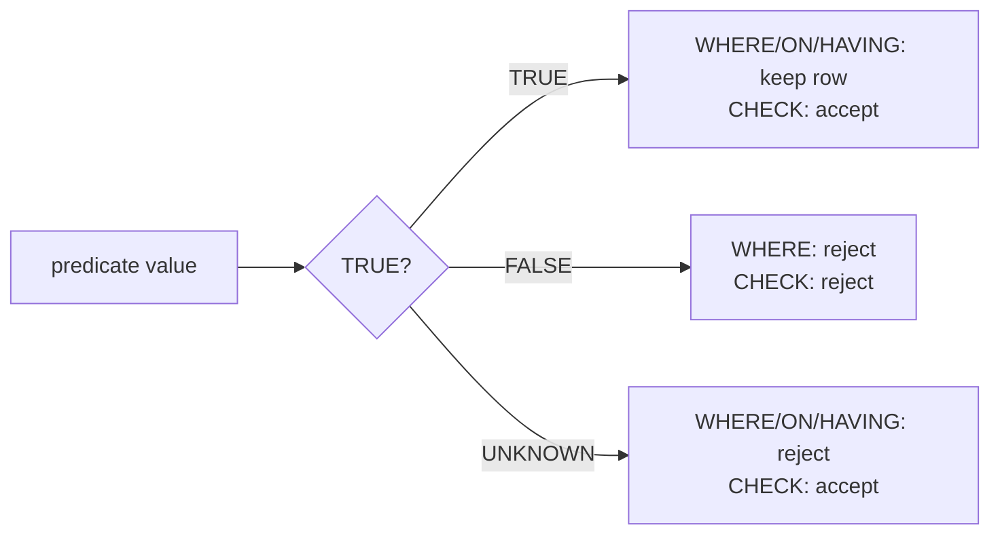

## Introduction

You have met NULL in almost every lesson of this module: `WHERE phone = NULL` finding nothing ([Filtering with WHERE](/lessons/m03-where-filtering)), `COUNT(phone)` skipping missing values ([Aggregate Functions](/lessons/m03-aggregate-functions)), NULLs forming one group ([GROUP BY and HAVING](/lessons/m03-group-by-having)), `CONCAT` returning NULL ([String Functions](/lessons/m03-string-functions)) and `CASE x WHEN NULL` never matching ([Conditional Logic](/lessons/m03-conditional-expressions)). Each rule makes sense on its own; together they look inconsistent. Why is `NULL = NULL` not true, yet `DISTINCT` treats two NULLs as duplicates? Why does a `UNIQUE` column accept many NULLs? Why does `NOT IN` return **no rows** when the subquery contains one NULL?

This lesson is a synthesis. It organizes NULL behaviour around **two principles** — *comparison* uses three-valued logic, *grouping-like operations* treat NULLs as "not distinct" — and walks through every clause of a query to show which principle applies. It then turns to the questions professionals actually face: how to write queries that are correct in the presence of NULLs, how NULLs interact with indexes and constraints in MySQL/InnoDB, and when a column should be nullable at all.

:::note[Dataset]
The **shop** dataset has realistic NULLs: `customers.phone` (5 of 25), `customers.loyalty_tier` (4), `products.category_id` (the gift card), `orders.shipped_at` (16 of 80), `orders.discount_code` (36), `reviews.comment` (13 of 45). All outputs below were captured from a real server.
:::

## DBMS Theory

:::theory[NULL, three-valued logic and "distinctness"]
In the relational model as extended by SQL, **NULL is a marker for a missing value**, not a value. Codd distinguished two meanings — *applicable but unknown* (a customer's phone exists but we do not know it) and *inapplicable* (a gift card has no category) — but SQL has a single NULL for both.

Because the value is missing, a comparison involving it cannot be decided: `x = NULL`, `x <> NULL`, `x > NULL` evaluate to the third truth value, **UNKNOWN**. SQL's logic is therefore three-valued (3VL):

| p | q | p AND q | p OR q | NOT p |
|---|---|---|---|---|
| TRUE | UNKNOWN | UNKNOWN | TRUE | FALSE |
| FALSE | UNKNOWN | FALSE | UNKNOWN | TRUE |
| UNKNOWN | UNKNOWN | UNKNOWN | UNKNOWN | UNKNOWN |

Filters (`WHERE`, `HAVING`, `ON`, `CASE WHEN`) keep a row only when the condition is **TRUE**; FALSE and UNKNOWN are both rejected. `CHECK` constraints are the opposite: they reject a row only when the condition is **FALSE** — UNKNOWN passes.

For operations that must decide whether two rows are *the same* — `DISTINCT`, `GROUP BY`, `UNION`, set operations, `ORDER BY` placement — the standard uses a different notion, **distinctness**: two NULLs are *not distinct* from each other. That is why NULLs collapse into one group or one `DISTINCT` row even though `NULL = NULL` is UNKNOWN.
:::

The two principles, side by side:

| Principle | Applies to | NULL vs NULL | NULL vs value |
|---|---|---|---|
| **Comparison (3VL)** | `=`, `<>`, `<`, `IN`, `BETWEEN`, `LIKE`, join `ON`, `CASE x WHEN` | UNKNOWN | UNKNOWN |
| **Distinctness** | `DISTINCT`, `GROUP BY`, `UNION`, `ORDER BY`, `COUNT(DISTINCT)` | not distinct (same) | distinct |
| **Null-safe comparison** | `<=>` (MySQL), `IS [NOT] DISTINCT FROM` (standard, not in MySQL) | TRUE | FALSE |
| **Elimination** | aggregates other than `COUNT(*)` | ignored | ignored |
| **Propagation** | arithmetic, most functions, `CONCAT` | NULL | NULL |

Two more theoretical facts explain common surprises:

1. **NULL breaks some laws of two-valued logic.** `p OR NOT p` is not always TRUE (it is UNKNOWN when p is UNKNOWN), so `WHERE x = 5 OR x <> 5` does not return all rows — it omits rows where `x` is NULL.
2. **`NOT IN` is a conjunction of inequalities.** `x NOT IN (a, b, NULL)` means `x <> a AND x <> b AND x <> NULL`. The last term is UNKNOWN, so the whole condition can never be TRUE.

:::standard[Standard SQL vs MySQL]
Standard and MySQL agree on 3VL, `IS NULL`/`IS NOT NULL`, NULL elimination in aggregates, NULLs as one group, and `COALESCE`/`NULLIF`. MySQL-specific: the `<=>` operator (the standard spells it `IS NOT DISTINCT FROM`, which MySQL does not support), `IFNULL`, `ISNULL(x)` (a function returning 1/0), `IS UNKNOWN` as a synonym for testing a boolean NULL, and sorting NULLs **first** in ascending order (the standard leaves placement implementation-defined and offers `NULLS FIRST/LAST`, which MySQL lacks). For `UNIQUE` constraints, MySQL — like PostgreSQL by default and the standard's original rule — allows multiple NULLs.
:::

## Why It Exists

Real data is incomplete. A customer declines to give a phone number; a product is not yet categorized; an order has not shipped. Without NULL, a schema must either:

- **Invent sentinel values** — `phone = ''`, `category_id = 0`, `shipped_at = '1970-01-01'`. Every query must then know and exclude the magic value; aggregates silently include it (`AVG` of a column with `0` for "unknown" is wrong); foreign keys to category 0 need a fake row.
- **Split optional attributes into separate tables** — `customer_phones(customer_id, phone)` with a row only when a phone exists. This is the normalized ideal for some cases (and avoids NULL entirely) but costs a join for every read.

NULL is the pragmatic middle ground: one marker with standardized semantics that aggregates, constraints and outer joins all understand. The price is that every query author must reason in three-valued logic. Outer joins make NULL unavoidable even in schemas with no nullable columns: a `LEFT JOIN` produces NULLs for unmatched rows by definition ([Outer Joins](/lessons/m04-outer-joins)).

## Internal Working

:::internals[How MySQL and InnoDB store and use NULLs]
**Row storage.** In InnoDB's COMPACT and DYNAMIC row formats (DYNAMIC is the 8.0/8.4 default), each record header contains a **NULL bitmap** with one bit per *nullable* column (rounded up to whole bytes). A NULL value occupies only its bit — no space in the variable-length data area. `NOT NULL` columns need no bit at all. NULLs are therefore cheap to store; their cost is semantic, not physical.

**Indexes.** InnoDB secondary indexes **do store NULL keys** (unlike some other engines that omit them), and NULLs sort **before** all non-NULL values in the B+ tree. Hence `WHERE col IS NULL` can use an index lookup, and MySQL has a dedicated access type, **`ref_or_null`**, for `col = const OR col IS NULL`. A `UNIQUE` index allows any number of NULL keys, because NULLs are not considered equal for uniqueness.

**Evaluation.** Every `Item` in the expression tree carries a `null_value` flag. Comparison items return UNKNOWN (represented as NULL) when an argument is NULL; filter iterators treat anything but TRUE as reject. Aggregate accumulators skip NULL inputs (`COUNT(expr)` does not increment, `SUM` does not add). `<=>` is implemented as a separate comparator that checks both null flags before comparing values.

**Optimizer use of NOT NULL.** Knowing a column is `NOT NULL` lets the optimizer simplify: `col IS NULL` on a NOT NULL column is always false; `NOT IN (subquery)` over a NOT NULL column needs no special null handling; outer joins whose WHERE clause rejects NULLs are converted to inner joins.
:::



## MySQL Implementation

**The basic truth table, executed.** Comparisons with NULL yield NULL (UNKNOWN); `IS NULL` and `<=>` always return 1 or 0:

```sql run
SELECT NULL = NULL       AS eq,
       NULL <> 1         AS neq,
       NULL <=> NULL     AS null_safe_both,
       1 <=> NULL        AS null_safe_one,
       NULL IS NULL      AS is_null,
       TRUE OR NULL      AS true_or_unknown,
       FALSE AND NULL    AS false_and_unknown,
       NOT NULL          AS not_unknown,
       1 IN (1, NULL)    AS in_found,
       2 IN (1, NULL)    AS in_not_found,
       2 NOT IN (1, NULL) AS not_in_with_null;
```

`TRUE OR UNKNOWN` is TRUE and `FALSE AND UNKNOWN` is FALSE — 3VL short-circuits where the unknown cannot change the outcome. `2 IN (1, NULL)` is UNKNOWN, not FALSE, because 2 might equal the unknown value; therefore `2 NOT IN (1, NULL)` is also UNKNOWN.

**WHERE keeps only TRUE.** Splitting the customers by tier with complementary predicates does not account for everyone:

```sql run
SELECT COUNT(*)                                    AS all_customers,
       SUM(loyalty_tier = 'gold')                  AS gold,
       SUM(loyalty_tier <> 'gold')                 AS not_gold,
       SUM(loyalty_tier IS NULL)                   AS unknown_tier,
       (SELECT COUNT(*) FROM customers
        WHERE loyalty_tier = 'gold' OR loyalty_tier <> 'gold') AS gold_or_not_gold
FROM customers;
```

`gold + not_gold` is 21, not 25: the four customers with an unknown tier satisfy neither `= 'gold'` nor `<> 'gold'`, so "gold or not gold" also returns 21. To include them write `loyalty_tier <> 'gold' OR loyalty_tier IS NULL`, or the null-safe `NOT (loyalty_tier <=> 'gold')`.

## Syntax Breakdown

| Construct | Meaning | Returns |
|---|---|---|
| `x IS NULL` / `x IS NOT NULL` | Test for the marker | 1 or 0, never NULL |
| `x <=> y` | Null-safe equality (MySQL) | 1 if equal or both NULL; 0 otherwise |
| `NOT (x <=> y)` | Null-safe inequality ("is distinct from") | 1 or 0 |
| `ISNULL(x)` | Function form of `x IS NULL` (MySQL) | 1 or 0 |
| `COALESCE(x, y, …)` / `IFNULL(x, y)` | First non-NULL | value |
| `NULLIF(x, y)` | NULL if `x = y` | value or NULL |
| `x IS TRUE` / `IS FALSE` / `IS UNKNOWN` | Test a boolean including the unknown case | 1 or 0 |
| `ORDER BY x IS NULL, x` | Emulate `NULLS LAST` | — |
| `COUNT(*)` vs `COUNT(x)` | Rows vs non-NULL values | integer, never NULL |

## Practical Examples

**1. NULL in aggregates — a one-row census.** Every aggregate except `COUNT(*)` ignores NULLs:

```sql run
SELECT COUNT(*)                       AS reviews,
       COUNT(comment)                 AS with_comment,
       COUNT(*) - COUNT(comment)      AS without_comment,
       AVG(rating)                    AS avg_rating_all,
       AVG(CASE WHEN comment IS NOT NULL THEN rating END) AS avg_rating_commented
FROM reviews;
```

The `CASE` without `ELSE` produces NULL for reviews without a comment, and `AVG` ignores them — conditional aggregation is NULL elimination put to work.

**2. NULL in GROUP BY and DISTINCT — one bucket.** All unknown tiers form a single group and a single distinct value:

```sql run
SELECT loyalty_tier, COUNT(*) AS customers
FROM customers
GROUP BY loyalty_tier
ORDER BY loyalty_tier;
```

```sql run
SELECT COUNT(DISTINCT loyalty_tier)               AS distinct_tiers_count,
       (SELECT COUNT(*) FROM (SELECT DISTINCT loyalty_tier FROM customers) d) AS distinct_rows
FROM customers;
```

`SELECT DISTINCT` returns four rows (three tiers and NULL), but `COUNT(DISTINCT …)` returns 3 — the aggregate eliminates the NULL before counting. Both behaviours are standard.

**3. NULL in ORDER BY — first in ascending order.** MySQL sorts NULLs before every value in `ASC` (and last in `DESC`). Emulate `NULLS LAST` with an extra sort key:

```sql run
SELECT customer_id, loyalty_tier
FROM customers
WHERE customer_id <= 12
ORDER BY loyalty_tier IS NULL, loyalty_tier, customer_id;
```

`loyalty_tier IS NULL` is 0 for known tiers and 1 for NULLs, so known tiers come first. (ENUM columns sort by their index: bronze, silver, gold.)

**4. NULL in joins — keys never match.** An equality join can never match a NULL key, so the gift card (category NULL) disappears from an inner join, and only a LEFT JOIN keeps it:

```sql run
SELECT 'inner join' AS kind, COUNT(*) AS products
FROM products p JOIN categories c ON c.category_id = p.category_id
UNION ALL
SELECT 'left join', COUNT(*)
FROM products p LEFT JOIN categories c ON c.category_id = p.category_id;
```

In the LEFT JOIN result, a NULL in `c.name` can mean two different things: "the product has no category" or "the category row has a NULL name". Test the **joined table's key** to distinguish "no match":

```sql run
SELECT p.product_id, p.name, p.category_id, c.category_id AS matched_category, c.name AS category
FROM products p
LEFT JOIN categories c ON c.category_id = p.category_id
WHERE c.category_id IS NULL;
```

**5. The WHERE clause that silently turns a LEFT JOIN into an inner join.** Customers and their delivered orders — including customers with none:

```sql run
SELECT 'filter in WHERE' AS variant, COUNT(DISTINCT c.customer_id) AS customers
FROM customers c LEFT JOIN orders o ON o.customer_id = c.customer_id
WHERE o.status = 'delivered'
UNION ALL
SELECT 'filter in ON', COUNT(DISTINCT c.customer_id)
FROM customers c LEFT JOIN orders o ON o.customer_id = c.customer_id AND o.status = 'delivered';
```

For a customer without delivered orders, the NULL-extended row has `o.status = NULL`, and `NULL = 'delivered'` is UNKNOWN, so `WHERE` discards it — the LEFT JOIN behaves like an inner join (18 customers). Putting the condition in `ON` restricts which orders match while keeping all 25 customers.

**6. The null-safe operator for change detection.** Comparing old and new values to find changed rows — the classic place where `<>` fails:

```sql run
CREATE TABLE phone_changes (customer_id INT PRIMARY KEY, old_phone VARCHAR(20) NULL, new_phone VARCHAR(20) NULL);
INSERT INTO phone_changes VALUES
  (1, '+1-450-555-4657', '+1-450-555-4657'),   -- unchanged
  (2, '+1-232-555-1488', '+1-232-555-0000'),   -- changed
  (3, NULL,               '+1-774-555-4257'),  -- added
  (4, '+1-206-555-3615',  NULL),               -- removed
  (5, NULL,               NULL);
SELECT customer_id,
       old_phone <> new_phone          AS plain_changed,
       NOT (old_phone <=> new_phone)   AS null_safe_changed
FROM phone_changes
ORDER BY customer_id;
```

Customer 5 had no phone before and has none now — unchanged. `<>` reports NULL (UNKNOWN) for the added, removed and still-unknown phones, so `WHERE old_phone <> new_phone` would miss them. `NOT (a <=> b)` gives a definite answer for every row. Change-data-capture, audit triggers and `UPDATE … WHERE` "only if changed" logic should use it.

## Execution Walkthrough

The most damaging NULL bug in real systems is the **NOT IN subquery trap**. Question: *which categories have no products?*

```walkthrough
title: SELECT name FROM categories WHERE category_id NOT IN (SELECT category_id FROM products)
steps:
  - title: "1. The candidate rows"
    explain: There are 10 categories. Category 1 (Electronics) is a parent category with no products directly assigned.
    sql: SELECT category_id, name, parent_id FROM categories ORDER BY category_id;
  - title: "2. The subquery's values — including a NULL"
    explain: >-
      The distinct category_id values used by products. The gift card has category_id NULL, so NULL is part of
      the list the outer query will compare against.
    sql: SELECT DISTINCT category_id FROM products ORDER BY category_id;
  - title: "3. Evaluate NOT IN for each category"
    explain: >-
      For category 1, NOT IN expands to 1 <> 2 AND 1 <> 3 AND … AND 1 <> NULL. Every term is TRUE except the last,
      which is UNKNOWN, so the conjunction is UNKNOWN. For categories that do have products, one term is FALSE, so
      the result is FALSE. No category ever gets TRUE.
    sql: |
      SELECT category_id, name,
             category_id NOT IN (SELECT category_id FROM products) AS not_in_result
      FROM categories
      ORDER BY category_id;
  - title: "4. WHERE keeps only TRUE — the result is empty"
    explain: Because WHERE rejects FALSE and UNKNOWN alike, the query returns no rows. No error, no warning — just a wrong, empty answer.
    sql: |
      SELECT name FROM categories
      WHERE category_id NOT IN (SELECT category_id FROM products);
  - title: "5. Correct alternatives"
    explain: >-
      NOT EXISTS asks "is there no product with this category?", which is decided per row with a correlated
      equality — a NULL product category simply never matches. Excluding NULLs inside the subquery also fixes NOT IN.
    sql: |
      SELECT 'NOT EXISTS' AS method, name FROM categories c
      WHERE NOT EXISTS (SELECT 1 FROM products p WHERE p.category_id = c.category_id)
      UNION ALL
      SELECT 'NOT IN + IS NOT NULL', name FROM categories
      WHERE category_id NOT IN (SELECT category_id FROM products WHERE category_id IS NOT NULL);
```

Step 3 is the heart of the matter: `NOT IN` returns NULL for the one category that should qualify. The same query was correct until the day someone added a product without a category — NULL bugs are often **data-dependent time bombs**. [EXISTS, NOT EXISTS, IN and NOT IN](/lessons/m04-exists-in) covers how the optimizer executes each form.

## Output

The walkthrough's step 3 output is the one to remember: a column of `NOT IN` results containing 0s and a NULL, but no 1. When you debug a filter that returns too few rows, **select the predicate as a column** like this — rows where it is NULL are the ones three-valued logic is silently discarding.

A compact way to audit a table's NULLs, useful before writing any report:

```sql run
SELECT COUNT(*)                      AS orders,
       COUNT(*) - COUNT(shipped_at)    AS null_shipped_at,
       COUNT(*) - COUNT(discount_code) AS null_discount_code,
       SUM(shipped_at IS NULL AND status IN ('shipped', 'delivered')) AS shipped_status_without_date
FROM orders;
```

The last column is a data quality check that combines NULL logic with business rules: an order in status shipped or delivered should have a shipping date. Zero means the invariant holds.

Constraints read NULL the opposite way from WHERE. A `CHECK` rejects only FALSE, and a `UNIQUE` index ignores NULLs:

```sql run
CREATE TABLE null_rules (
  id    INT PRIMARY KEY,
  email VARCHAR(50) NULL UNIQUE,
  price DECIMAL(6,2) NULL,
  CONSTRAINT chk_price CHECK (price >= 0)
);
INSERT INTO null_rules VALUES (1, NULL, NULL), (2, NULL, NULL), (3, 'a@example.com', 10.00);
SELECT * FROM null_rules ORDER BY id;
```

Two rows with NULL email coexist in a UNIQUE column, and NULL prices pass `CHECK (price >= 0)` because `NULL >= 0` is UNKNOWN, not FALSE. A negative price is still rejected:

```sql run error
INSERT INTO null_rules VALUES (4, 'b@example.com', -1.00);
```

If a value must be present, the constraint is `NOT NULL`, not `CHECK`.

## Alternative Approaches

| Problem | NULL-prone form | Robust alternatives |
|---|---|---|
| "Not in this set" with a subquery | `x NOT IN (SELECT y …)` | `NOT EXISTS (… WHERE y = x)`; `LEFT JOIN … WHERE y IS NULL`; `NOT IN (SELECT y … WHERE y IS NOT NULL)` |
| Equality on nullable columns | `a = b` | `a <=> b` (NULLs match) when NULL should equal NULL |
| Inequality / change detection | `a <> b` | `NOT (a <=> b)` |
| Complement of a filter | `NOT (cond)` | `NOT (cond) OR col IS NULL`, or `(cond) IS NOT TRUE` |
| Display a default | Leave NULL | `COALESCE(col, 'n/a')` in the final SELECT only |
| Sort NULLs last | Default (NULLs first) | `ORDER BY col IS NULL, col` |
| Optional attribute | Nullable column | Separate 1:0..1 table (no NULLs, extra join) |
| Unknown vs not applicable | One NULL for both | A status/flag column that records which, or separate tables |

`(cond) IS NOT TRUE` deserves a mention: it is TRUE when `cond` is FALSE **or** UNKNOWN, giving the "complement including unknowns" in one expression, e.g. `WHERE (loyalty_tier = 'gold') IS NOT TRUE` returns the 21 non-gold customers *and* the 4 unknowns.

## Performance Analysis

NULL handling affects plans in three ways.

**1. `IS NULL` is indexable.** InnoDB indexes store NULL keys, so `WHERE category_id IS NULL` can use `idx_products_category`, and `col = const OR col IS NULL` gets the special `ref_or_null` access type:

```sql run
EXPLAIN SELECT product_id, name FROM products
WHERE category_id = 3 OR category_id IS NULL;
```

The `type` column shows `ref_or_null`: one index lookup for the constant and one for the NULL key.

**2. `NOT IN` vs `NOT EXISTS` plans.** Because `NOT IN` must honour the "a NULL in the subquery makes everything UNKNOWN" rule, MySQL cannot always convert it into a simple anti-join. Compare the plans:

```sql run
EXPLAIN FORMAT=TREE
SELECT name FROM categories WHERE category_id NOT IN (SELECT category_id FROM products);
```

```sql run
EXPLAIN FORMAT=TREE
SELECT name FROM categories c
WHERE NOT EXISTS (SELECT 1 FROM products p WHERE p.category_id = c.category_id);
```

The `NOT IN` plan is not an anti-join: it materializes the subquery's distinct values once and then evaluates a filter `category_id in (select #2) is false` for every category. The `IS FALSE` wrapper is how the server preserves three-valued logic — a row passes only when `IN` is definitely FALSE, never when it is UNKNOWN because of a NULL. `NOT EXISTS` has no such obligation and is planned as a **Nested loop antijoin** that probes `idx_products_category` per category and stops at the first match. Depending on the version, statistics and whether the subquery column is nullable, the optimizer may choose other strategies for `NOT IN` (for example a dependent subquery with explicit NULL checks); declaring the column `NOT NULL` or filtering `IS NOT NULL` in the subquery gives it the most freedom and removes the semantic trap at the same time.

**3. NOT NULL columns help the optimizer.** On a `NOT NULL` column, `IS NULL` predicates fold to FALSE at optimization time, and outer joins with null-rejecting WHERE conditions become inner joins, opening more join orders.

:::performance[Theory vs measurement]
On the 10-row categories table all of these plans are instantaneous; the differences are structural (which access types and transformations are possible). On large tables, a dependent null-aware subquery evaluated per outer row can be dramatically slower than an anti-join — confirm with `EXPLAIN ANALYZE` on realistic data ([Optimizing Subqueries](/lessons/m07-optimizing-subqueries)).
:::

## Best Practices

:::best-practice[Designing and querying with NULLs]
1. **Make columns `NOT NULL` by default.** Allow NULL only when "unknown" or "not applicable" is a real state the business recognises. Each nullable column multiplies the cases every query must handle.
2. **Never use sentinel values** (`0`, `''`, `'1970-01-01'`, `-1`) in place of NULL — they corrupt aggregates and need special cases everywhere.
3. **Use `NOT EXISTS` (or `LEFT JOIN … IS NULL`) instead of `NOT IN (subquery)`**, unless the subquery column is guaranteed `NOT NULL`.
4. **Test with `IS NULL` / `IS NOT NULL`**, never `= NULL`; use `<=>` / `NOT (a <=> b)` for null-safe equality and change detection.
5. **Decide what NULL means before aggregating** — ignore (default), treat as zero (`COALESCE`), or report separately — and document it.
6. **Put conditions on the optional side of an outer join in `ON`**, not `WHERE`, unless you intend to filter out unmatched rows.
7. **Use `NOT NULL` constraints for mandatory data**; `CHECK` alone lets NULL through.
8. **Replace NULLs for display at the last step** (`COALESCE` in the final SELECT), keeping NULL in the data and intermediate results.
9. **Audit NULLs in data pipelines** (`COUNT(*) - COUNT(col)` per column) and alert on unexpected changes.
:::

## Common Mistakes

**Mistake 1 — `= NULL`.** Returns no rows, silently:

```sql run
SELECT (SELECT COUNT(*) FROM customers WHERE phone = NULL)  AS eq_null,
       (SELECT COUNT(*) FROM customers WHERE phone IS NULL) AS is_null;
```

**Mistake 2 — `NOT IN` with a nullable subquery column.** See the walkthrough: an empty result where Electronics was expected.

**Mistake 3 — WHERE on the outer-joined table.** See Practical Example 5: 18 customers instead of 25.

**Mistake 4 — `COUNT(col)` when you mean rows**, and `AVG(col)` when NULL should mean zero. The census in Example 1 shows how far apart they can be.

**Mistake 5 — expecting `x <> 'gold'` to include unknowns.** The four customers with an unknown tier are in neither half. Ask: "should unknowns be included?" and write `OR col IS NULL` explicitly.

**Mistake 6 — `CONCAT` and arithmetic on nullable columns.** `price * discount_pct` is NULL for every row without a discount; `CONCAT(first, ' ', middle, ' ', last)` is NULL for everyone without a middle name. Use `COALESCE` or `CONCAT_WS`.

**Mistake 7 — relying on a UNIQUE nullable column to prevent duplicates.** Any number of rows may have NULL in a `UNIQUE` column. If "at most one row without a value" is required, model it differently (a NOT NULL column with a meaningful default, or a generated column that maps NULL to a constant, indexed uniquely).

## Industry Application

- **Data quality monitoring.** Pipelines track NULL rates per column per day; a jump from 2 % to 40 % NULL emails usually means an upstream form or API broke. Tools such as dbt tests and Great Expectations encode `not_null` assertions that compile to exactly the `COUNT(*) - COUNT(col)` queries shown here.
- **Anti-joins in production.** "Users who never purchased", "products never reviewed", "invoices without payment" are anti-joins. Experienced engineers write them with `NOT EXISTS` by reflex, precisely because `NOT IN` breaks the first time the subquery column gets a NULL.
- **Change data capture and slowly changing dimensions.** Comparing source and target rows to detect changes uses null-safe comparisons (`NOT (a <=> b)` in MySQL, `IS DISTINCT FROM` elsewhere); a plain `<>` misses changes from or to NULL, causing warehouses to drift from their sources.
- **Schema reviews.** DBA checklists flag nullable columns without justification, `UNIQUE` constraints on nullable columns, and sentinel values. Mandatory attributes are `NOT NULL` with defaults where sensible; truly optional groups of attributes move to 1:0..1 side tables.
- **Analytics semantics.** BI layers document whether NULL means "zero", "unknown" or "not applicable" for each metric. Averages that ignore NULL (the SQL default) versus averages that count missing as zero can differ substantially — a classic source of disagreements between dashboards.

## Practice Exercises

```exercise
id: ex1
title: Customers outside the gold tier, including unknowns
difficulty: easy
concepts: [three-valued-logic, null-handling]
prompt: |
  Return the `customer_id` of every customer who is **not** in the `gold` tier, **including** customers whose
  tier is unknown (NULL).
hints:
  - "loyalty_tier <> 'gold' is UNKNOWN for NULL tiers, so those rows are dropped."
  - "Add OR loyalty_tier IS NULL — or use NOT (loyalty_tier <=> 'gold')."
solution: |
  SELECT customer_id
  FROM customers
  WHERE loyalty_tier <> 'gold' OR loyalty_tier IS NULL;
explanation: |
  `NOT (loyalty_tier <=> 'gold')` and `(loyalty_tier = 'gold') IS NOT TRUE` are equivalent one-condition
  forms. The plain `<> 'gold'` misses the four customers with an unknown tier.
```

```exercise
id: ex2
title: Categories without products (the NOT IN trap)
difficulty: medium
concepts: [not-in-null, null-handling]
prompt: |
  Return the `name` of every category that has **no products directly assigned** to it. Make sure your query
  is correct even though some products have a NULL `category_id`.
hints:
  - "NOT IN (SELECT category_id FROM products) returns nothing because of the NULL."
  - "Use NOT EXISTS with a correlated equality, or exclude NULLs inside the subquery."
solution: |
  SELECT c.name
  FROM categories c
  WHERE NOT EXISTS (SELECT 1 FROM products p WHERE p.category_id = c.category_id);
explanation: |
  `NOT EXISTS` is immune to NULLs in the subquery: a product with NULL category simply never satisfies
  `p.category_id = c.category_id`. A `LEFT JOIN products p ON … WHERE p.product_id IS NULL` anti-join is
  also correct. This exercise targets Mistake 2.
```

```exercise
id: ex3
title: Customers and their delivered orders
difficulty: medium
concepts: [outer-join-nulls, null-handling]
prompt: |
  For **every** customer return `customer_id` and `delivered_orders` — the number of their orders with status
  `delivered` (0 if none). Order by `customer_id`.
hints:
  - "LEFT JOIN orders, but put the status condition in the ON clause, not in WHERE."
  - "Count a column of the orders table (o.order_id) so NULL-extended rows count as 0."
solution: |
  SELECT c.customer_id, COUNT(o.order_id) AS delivered_orders
  FROM customers c
  LEFT JOIN orders o ON o.customer_id = c.customer_id AND o.status = 'delivered'
  GROUP BY c.customer_id
  ORDER BY c.customer_id;
orderMatters: true
explanation: |
  With `WHERE o.status = 'delivered'` the NULL-extended rows of customers without delivered orders are
  rejected (NULL = 'delivered' is UNKNOWN) and those customers vanish. `COUNT(*)` would count the NULL-extended
  row as 1. Conditional aggregation (`SUM(o.status = 'delivered')` with the plain LEFT JOIN) works too, but
  returns NULL instead of 0 for customers with no orders at all unless wrapped in COALESCE.
```

```exercise
id: ex4
title: Detect changed values null-safely
difficulty: medium
setup: |
  CREATE TABLE tier_snapshot (customer_id INT PRIMARY KEY, old_tier VARCHAR(10) NULL, new_tier VARCHAR(10) NULL);
  INSERT INTO tier_snapshot VALUES
    (1, 'bronze', 'bronze'), (2, 'bronze', 'silver'), (3, NULL, 'gold'),
    (4, 'silver', NULL), (5, NULL, NULL), (6, 'gold', 'gold');
concepts: [null-safe-equality]
prompt: |
  `tier_snapshot(customer_id, old_tier, new_tier)` compares yesterday's and today's loyalty tier. Return the
  `customer_id` of every customer whose tier **changed**, where a change from or to NULL counts as a change,
  but NULL → NULL does not. Order by `customer_id`.
hints:
  - "old_tier <> new_tier is UNKNOWN when either side is NULL."
  - "NOT (old_tier <=> new_tier) is 1 exactly when the values differ, treating NULLs as equal to each other."
solution: |
  SELECT customer_id
  FROM tier_snapshot
  WHERE NOT (old_tier <=> new_tier)
  ORDER BY customer_id;
orderMatters: true
explanation: |
  The expected result is customers 2, 3 and 4. A plain `<>` returns only customer 2. The standard spelling is
  `old_tier IS DISTINCT FROM new_tier`, which MySQL does not support; `NOT (a <=> b)` is the MySQL idiom.
```

```exercise
id: ex5
title: NULL-aware review statistics per product
difficulty: hard
concepts: [aggregate-nulls, null-handling, group-by]
prompt: |
  For each product that has reviews, return:

  1. `product_id`
  2. `reviews` — number of reviews
  3. `with_comment` — reviews that have a comment
  4. `avg_rating` — average rating, rounded to 2 decimals
  5. `avg_rating_commented` — average rating of reviews **with** a comment, rounded to 2 decimals (NULL if none)

  Order by `product_id`.
hints:
  - "COUNT(comment) counts non-NULL comments."
  - "AVG(CASE WHEN comment IS NOT NULL THEN rating END) averages only commented reviews; the missing ELSE yields NULL, which AVG ignores."
solution: |
  SELECT product_id,
         COUNT(*)                                                    AS reviews,
         COUNT(comment)                                              AS with_comment,
         ROUND(AVG(rating), 2)                                       AS avg_rating,
         ROUND(AVG(CASE WHEN comment IS NOT NULL THEN rating END), 2) AS avg_rating_commented
  FROM reviews
  GROUP BY product_id
  ORDER BY product_id;
orderMatters: true
explanation: |
  Adding `ELSE 0` to the CASE would be a bug: uncommented reviews would contribute a rating of 0 and drag the
  average down. Here NULL elimination is exactly the desired semantics. For a product whose reviews have no
  comments, the CASE yields only NULLs and AVG returns NULL — the honest answer.
```

```exercise
id: ex6
title: Order data quality report
difficulty: challenge
concepts: [null-handling, three-valued-logic, conditional-aggregation]
prompt: |
  Produce one row per order `status` with these columns, ordered by `status` (the ENUM order is fine):

  1. `status`
  2. `orders`
  3. `missing_ship_date` — orders with NULL `shipped_at`
  4. `ship_date_violations` — orders whose status is `shipped` or `delivered` but whose `shipped_at` is NULL,
     **plus** orders whose status is `pending` or `paid` but whose `shipped_at` is **not** NULL
  5. `pct_with_code` — percentage of orders with a non-NULL `discount_code`, rounded to 1 decimal
hints:
  - "COUNT(*) - COUNT(shipped_at) gives missing dates."
  - "SUM of a boolean combining status and IS NULL / IS NOT NULL counts violations."
  - "100 * COUNT(discount_code) / COUNT(*), rounded."
solution: |
  SELECT status,
         COUNT(*)                     AS orders,
         COUNT(*) - COUNT(shipped_at) AS missing_ship_date,
         SUM(CASE WHEN status IN ('shipped', 'delivered') AND shipped_at IS NULL THEN 1
                  WHEN status IN ('pending', 'paid') AND shipped_at IS NOT NULL THEN 1
                  ELSE 0 END)         AS ship_date_violations,
         ROUND(100 * COUNT(discount_code) / COUNT(*), 1) AS pct_with_code
  FROM orders
  GROUP BY status
  ORDER BY status;
orderMatters: true
explanation: |
  Every NULL test uses IS [NOT] NULL, so no condition can become UNKNOWN; `ELSE 0` keeps the violation count
  at 0 rather than NULL for clean statuses. `COUNT(discount_code)` relies on NULL elimination. Data quality
  reports like this are typical pipeline checks: any non-zero violation count should alert someone.
```

## Knowledge Assessment

```quiz
- id: q1
  question: "Which statements are true about NULL in MySQL? (Select all that apply.)"
  type: multi
  options:
    - "NULL = NULL evaluates to TRUE"
    - "SELECT DISTINCT returns a single row for many NULLs"
    - "GROUP BY puts all NULLs in one group"
    - "COUNT(DISTINCT col) counts NULL as one value"
  answer: [1, 2]
  explanation: "Comparison uses 3VL, so NULL = NULL is UNKNOWN. Distinctness-based operations (DISTINCT, GROUP BY) treat NULLs as not distinct, so they collapse into one row/group. COUNT(DISTINCT) is an aggregate and eliminates NULLs before counting."
  concepts: [three-valued-logic, distinct-nulls]
- id: q2
  question: "`SELECT name FROM categories WHERE category_id NOT IN (SELECT category_id FROM products)` returns no rows, though one category has no products. Why?"
  options:
    - "NOT IN does not work with subqueries in MySQL"
    - "products.category_id contains a NULL, so for every category the NOT IN result is FALSE or UNKNOWN, never TRUE"
    - "The subquery returns duplicates"
    - "The categories table has no index"
  answer: 1
  explanation: "x NOT IN (…, NULL) expands to … AND x <> NULL, which is UNKNOWN unless another term is FALSE. WHERE keeps only TRUE. Duplicates and indexes do not affect the result. Use NOT EXISTS or filter the subquery with IS NOT NULL."
  concepts: [not-in-null]
- id: q3
  question: "A table has CHECK (price >= 0) and price is nullable. Which INSERT succeeds?"
  options:
    - "Only rows with price >= 0"
    - "Rows with price >= 0 and rows with price NULL"
    - "Only rows with price NULL"
    - "None — CHECK requires NOT NULL"
  answer: 1
  explanation: "CHECK rejects only FALSE. NULL >= 0 is UNKNOWN, so the row is accepted. Use NOT NULL to require a value."
  concepts: [null-handling, schema-design]
- id: q4
  question: "Customers LEFT JOIN orders with `WHERE o.status = 'delivered'` returns fewer customers than expected. Why?"
  options:
    - "LEFT JOIN drops unmatched rows by design"
    - "For customers without delivered orders the joined row has o.status NULL (or another status); the WHERE condition is not TRUE, so those rows are removed, turning the outer join into an inner join"
    - "WHERE is evaluated before the join"
    - "The status column is an ENUM"
  answer: 1
  explanation: "NULL-extended rows fail any comparison on the optional table's columns. Move the condition into ON to restrict matches while keeping all customers. Logically WHERE runs after the join; ENUM is irrelevant."
  concepts: [outer-join-nulls]
- id: q5
  question: "Which expression returns 1 exactly when a and b differ, treating two NULLs as equal and NULL vs value as different?"
  options: ["a <> b", "NOT (a <=> b)", "a != b OR a IS NULL", "COALESCE(a, 0) <> COALESCE(b, 0)"]
  answer: 1
  explanation: "<=> is null-safe equality; its negation is null-safe inequality. a <> b is UNKNOWN when either is NULL. The OR variant misreports NULL vs NULL as different. COALESCE with 0 confuses a real 0 with NULL."
  concepts: [null-safe-equality]
- id: q6
  question: "Where do NULLs appear in `ORDER BY loyalty_tier ASC` in MySQL, and how do you put them last?"
  options:
    - "Last; use ORDER BY loyalty_tier NULLS FIRST"
    - "First; use ORDER BY loyalty_tier IS NULL, loyalty_tier"
    - "Randomly; NULLs cannot be sorted"
    - "First; use ORDER BY loyalty_tier NULLS LAST"
  answer: 1
  explanation: "MySQL treats NULL as lower than any value: first in ASC, last in DESC. MySQL does not support NULLS FIRST/LAST; sorting by the boolean col IS NULL first is the standard emulation."
  concepts: [null-ordering]
- id: q7
  question: "A nullable column has a UNIQUE index. What happens when you insert three rows with NULL in that column?"
  options:
    - "The second insert fails with a duplicate-key error"
    - "All three succeed — NULLs are not considered equal for uniqueness"
    - "The NULLs are converted to empty strings"
    - "Only the first succeeds and the others are ignored with a warning"
  answer: 1
  explanation: "MySQL (InnoDB) UNIQUE indexes permit multiple NULLs. If at most one missing value is allowed, the design needs a different mechanism."
  concepts: [null-handling, schema-design]
- id: q8
  question: "Which access type does EXPLAIN show for `WHERE category_id = 3 OR category_id IS NULL` on an indexed nullable column?"
  options: ["ALL", "range", "ref_or_null", "const"]
  answer: 2
  explanation: "InnoDB indexes store NULL keys, and MySQL has a dedicated ref_or_null access type that performs a lookup for the constant and one for NULL. A full scan (ALL) is not needed; const applies only to unique lookups of one row."
  concepts: [null-handling, index-usage]
```
