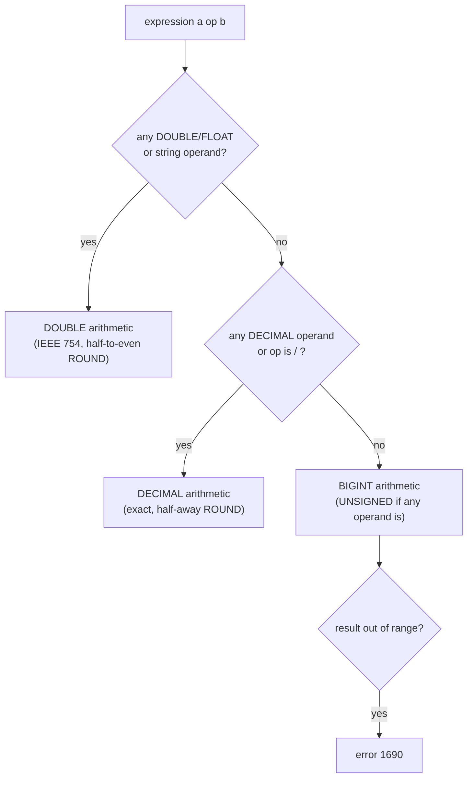

## Introduction

Prices with tax, discounts, margins, unit conversions, percentages, packaging into boxes of twelve, bucketing customers into deciles, splitting minutes into hours and minutes — numeric expressions are everywhere in SQL. Most of the time they "just work". The exceptions are the expensive bugs:

- An invoice line rounds to **$1.01** in one place and **$1.00** in another, because one value was `DECIMAL` and the other `DOUBLE`.
- A report divides by a count that is sometimes **zero** — the `SELECT` quietly returns NULL, but the nightly `INSERT … SELECT` into a summary table **fails** with error 1365.
- `quantity - 5` on an `INT UNSIGNED` column raises **"BIGINT UNSIGNED value is out of range"** instead of returning −4.
- `FLOOR(-1.5)` is −2 but `TRUNCATE(-1.5, 0)` is −1, and `-7 DIV 2` is −3 — three "integer parts" that disagree for negative numbers.

This lesson covers MySQL's mathematical function library — `ROUND`, `TRUNCATE`, `CEIL`/`FLOOR`, `MOD`/`%`, `DIV`, `ABS`, `POWER`, `SQRT`, `RAND` and friends — together with the type rules that decide what each one returns. It builds on the numeric types from [Numeric Data Types](/lessons/m02-numeric-types) and on the exact-vs-approximate sums you saw in [Aggregate Functions](/lessons/m03-aggregate-functions).

:::note[Dataset]
Examples use the **shop** dataset, where all money columns are `DECIMAL(10,2)` and quantities are `INT UNSIGNED`. Outputs were captured on a server with the default SQL mode (`STRICT_TRANS_TABLES`, `ERROR_FOR_DIVISION_BY_ZERO`, …).
:::

## DBMS Theory

:::theory[Exact and approximate numeric types]
The SQL standard divides numeric types into two families with different arithmetic:

- **Exact numerics** — `INTEGER`, `SMALLINT`, `BIGINT`, `DECIMAL(p,s)`/`NUMERIC(p,s)`. Values are represented exactly in base 10 with a declared precision *p* (total digits) and scale *s* (digits after the decimal point). Addition, subtraction and multiplication are exact as long as the result fits; the standard defines the result's precision and scale from the operands'.
- **Approximate numerics** — `REAL`, `DOUBLE PRECISION`, `FLOAT`. Values are binary floating-point numbers (IEEE 754 in practice) with a fixed number of significant bits. Most decimal fractions (0.1, 0.2, 1.005) **cannot be represented exactly**, so results carry tiny representation errors that can surface in comparisons and rounding.
:::

Every numeric literal and column belongs to one of these families, and MySQL decides the family of an expression from its operands:

| Expression | Family of the result |
|---|---|
| Integer op integer (`+ − *`) | Exact integer (`BIGINT` arithmetic) |
| Integer `/` integer | Exact `DECIMAL` (MySQL never truncates `/`) |
| Any `DECIMAL` operand, no float | Exact `DECIMAL` |
| Any `FLOAT`/`DOUBLE` operand | Approximate `DOUBLE` |
| Literal `2.5` | Exact `DECIMAL` |
| Literal `2.5e0`, `25E-1` | Approximate `DOUBLE` |
| String operand (`'2.5' + 1`) | Converted to `DOUBLE` ([Type Conversion](/lessons/m03-type-conversion)) |

**Rounding rules are a property of the family.** For exact values MySQL's `ROUND()` uses **round half away from zero** (2.5 → 3, −2.5 → −3). For approximate values the manual states that the result depends on the C library, and on most systems that means **round half to even** ("banker's rounding": 2.5 → 2, 3.5 → 4). Moreover, a DOUBLE that *looks* like 1.005 is actually stored as 1.00499999999999989…, so it rounds down regardless of the half-rule.

**Division by zero is undefined in mathematics.** The SQL standard says it raises an exception (SQLSTATE 22012). MySQL's behaviour depends on context and SQL mode: in a `SELECT` it returns NULL (with warning 1365 when `ERROR_FOR_DIVISION_BY_ZERO` is enabled); in an `INSERT` or `UPDATE` under strict mode with `ERROR_FOR_DIVISION_BY_ZERO` it raises error 1365 and aborts the statement. Both modes are in the default `sql_mode` of 8.0 and 8.4.

:::standard[Standard SQL vs MySQL]
Standard: `+ − * /`, `ABS`, `MOD`, `POWER`, `SQRT`, `EXP`, `LN`, `FLOOR`, `CEILING`, `WIDTH_BUCKET`, and (since SQL:2003) `LOG10`. MySQL adds `ROUND`, `TRUNCATE`, `DIV` (integer division), the `%` operator, `CEIL` as a synonym, `POW`, `LOG(b, x)`, `SIGN`, `PI`, `RAND`, `CONV`, `CRC32`, `FORMAT` and more. MySQL does not implement `WIDTH_BUCKET`. Integer division differs across products: MySQL's `/` always returns a decimal, whereas PostgreSQL and SQL Server truncate `7 / 2` to 3 for integers.
:::

## Why It Exists

Arithmetic in the database avoids fetching raw rows to compute derived numbers in application code, and — more importantly — lets the database compute them **consistently**: every report that uses `ROUND(price * 1.0825, 2)` with `DECIMAL` inputs gets the same cent. Computing the same tax in JavaScript (which only has binary doubles) and in SQL can produce different results for the same order, which accountants notice.

Strict division-by-zero handling exists because silently storing NULL (or worse, zero) in a financial table is data corruption. `SELECT` is read-only, so returning NULL plus a warning is tolerable; writing that NULL into a table is not, so strict mode turns it into an error. Likewise, MySQL raises an error on integer overflow rather than wrapping around (as C or Java integers do), because a silently wrapped balance is far worse than a failed statement.

## Internal Working

:::internals[How MySQL computes numeric expressions]
**Type resolution first.** When a statement is prepared, every arithmetic `Item` resolves its result type from its arguments: integer, `DECIMAL` (with a computed precision and scale), or `DOUBLE`. This happens once, before any row is read, exactly like the CASE type resolution in [Conditional Logic](/lessons/m03-conditional-expressions).

**Exact arithmetic.** `DECIMAL` values are stored and computed in a base-10⁹ representation (each 4-byte word holds nine decimal digits), with at most **65 digits** of precision and 30 digits of scale. The result scale follows fixed rules:

| Operation | Result scale |
|---|---|
| `a + b`, `a − b` | max(scale(a), scale(b)) |
| `a * b` | scale(a) + scale(b) |
| `a / b` | scale(a) + `div_precision_increment` (default 4) |

Internally, division keeps additional digits (scale is extended in steps of nine digits), so `1/3*3` evaluates to `1.0000`, not `0.9999`: the displayed `0.3333` of `1/3` is not the intermediate value used in further arithmetic.

**Approximate arithmetic.** `DOUBLE` operations map to the CPU's IEEE 754 double-precision instructions (53-bit significand, about 15–17 significant decimal digits). `ROUND` on a double uses the C library's rounding, which on common platforms rounds half to even.

**Integer arithmetic and overflow.** Integer `+ − *` are computed in 64-bit `BIGINT`. If any operand is `UNSIGNED`, the result is `BIGINT UNSIGNED` (unless `NO_UNSIGNED_SUBTRACTION` is set), so a negative result is out of range and raises **error 1690**. Overflow of signed BIGINT also raises 1690.
:::



## MySQL Implementation

**ROUND and TRUNCATE on exact values.** `ROUND(x, d)` rounds to *d* decimals (negative *d* rounds to tens, hundreds…); `TRUNCATE(x, d)` drops digits without rounding (toward zero):

```sql run
SELECT ROUND(1299.456, 2)   AS round_2,
       TRUNCATE(1299.456, 2) AS truncate_2,
       ROUND(1299.456)      AS round_0,
       ROUND(1299.456, -2)  AS round_hundreds,
       TRUNCATE(1299.456, -2) AS truncate_hundreds,
       ROUND(-1.5)          AS round_neg,
       TRUNCATE(-1.5, 0)    AS truncate_neg;
```

**Rounding exact vs approximate values.** The same digits, two types, different results:

```sql run
SELECT ROUND(2.5)        AS dec_2_5,
       ROUND(2.5e0)      AS dbl_2_5,
       ROUND(3.5e0)      AS dbl_3_5,
       ROUND(-2.5)       AS dec_neg_2_5,
       ROUND(-2.5e0)     AS dbl_neg_2_5,
       ROUND(1.005, 2)   AS dec_1_005,
       ROUND(1.005e0, 2) AS dbl_1_005;
```

The `DECIMAL` literals round half away from zero (3, −3, 1.01). The `DOUBLE` literals round half to even (2, 4, −2), and `1.005e0` rounds *down* to 1 because its binary value is slightly below 1.005. This is the concrete reason money must be `DECIMAL`.

**CEIL, FLOOR and the integer part of negative numbers.**

```sql run
SELECT CEIL(1.2)  AS ceil_pos,  FLOOR(1.8)  AS floor_pos,
       CEIL(-1.5) AS ceil_neg,  FLOOR(-1.5) AS floor_neg,
       TRUNCATE(-1.5, 0) AS trunc_neg,
       -7 DIV 2   AS div_neg,
       FLOOR(-7 / 2) AS floor_div_neg;
```

`CEIL` rounds toward +∞, `FLOOR` toward −∞, `TRUNCATE` and `DIV` toward zero. For positive numbers `FLOOR`, `TRUNCATE` and `DIV` agree; for negative numbers `FLOOR` differs by one.

**DIV and MOD.** `a DIV b` is integer division (truncating toward zero); `MOD(a, b)`, `a MOD b` and `a % b` return the remainder, whose sign follows the **dividend**:

```sql run
SELECT 7 DIV 2   AS div_7_2,
       7 MOD 3   AS mod_7_3,
       -7 MOD 3  AS mod_neg_7_3,
       7 % -3    AS mod_7_neg3,
       MOD(7.5, 2) AS mod_decimal,
       135 DIV 60 AS hours,
       135 MOD 60 AS minutes;
```

`(a DIV b) * b + (a MOD b) = a` always holds. The last two columns show the most common use: splitting 135 minutes into 2 hours and 15 minutes.

## Syntax Breakdown

| Function | Returns | Notes |
|---|---|---|
| `ROUND(x [, d])` | x rounded to d decimals (default 0) | Exact: half away from zero. Approximate: per C library (usually half to even). Negative d rounds left of the point. Result type follows x. |
| `TRUNCATE(x, d)` | x with digits beyond d dropped | Toward zero; d is required |
| `CEIL(x)` / `CEILING(x)` | Smallest integer ≥ x | Toward +∞ |
| `FLOOR(x)` | Largest integer ≤ x | Toward −∞ |
| `a DIV b` | Integer quotient | Truncates toward zero; `b = 0` → NULL |
| `MOD(a, b)`, `a % b`, `a MOD b` | Remainder | Sign of the dividend; works on DECIMAL; `b = 0` → NULL |
| `a / b` | Quotient | Never integer-truncates; DECIMAL scale + `div_precision_increment`; `b = 0` → NULL + warning (error in strict DML) |
| `ABS(x)`, `SIGN(x)` | Absolute value; −1/0/1 | |
| `POWER(x, y)` / `POW` | xʸ | Returns DOUBLE |
| `SQRT(x)`, `EXP(x)`, `LN(x)`, `LOG10(x)`, `LOG(b, x)` | Roots/exponentials/logs | DOUBLE; invalid input (`SQRT(-1)`, `LN(0)`) → NULL |
| `RAND([seed])` | DOUBLE in [0, 1) | Non-deterministic without a seed; evaluated per row |
| `PI()`, `GREATEST(…)`, `LEAST(…)` | | `GREATEST`/`LEAST` return NULL if any argument is NULL |

```sql run
SELECT ABS(-5)        AS abs_val,
       SIGN(-3)       AS sign_val,
       POWER(2, 10)   AS two_pow_10,
       SQRT(16)       AS sqrt_16,
       SQRT(-1)       AS sqrt_neg,
       LN(0)          AS ln_zero,
       LOG10(1000)    AS log10_1000,
       LOG(2, 8)      AS log2_8,
       GREATEST(3, 7, 5)    AS greatest_val,
       GREATEST(3, NULL, 5) AS greatest_null;
```

Invalid mathematical inputs return NULL rather than raising an error, and not always with the same diagnostics: `LN(0)` produced warning 3020 (*Invalid argument for logarithm*), while `SQRT(-1)` returned NULL silently. Note also that `POWER`, `SQRT` and `LOG10` return `DOUBLE` values (`1024`, `4`, `3` are doubles here), while `ABS`, `SIGN` and `GREATEST` of integers stay integers.

## Practical Examples

**1. Prices with tax — round once, at the end.** Sales tax of 8.25 % on order lines, computed exactly:

```sql run
SELECT order_id, product_id, quantity, unit_price,
       quantity * unit_price                       AS net,
       quantity * unit_price * 0.0825              AS tax_exact,
       ROUND(quantity * unit_price * 0.0825, 2)    AS tax_rounded,
       ROUND(quantity * unit_price * 1.0825, 2)    AS gross_rounded
FROM order_items
WHERE order_id = 2
ORDER BY product_id;
```

`tax_exact` shows the full scale MySQL keeps for a product of `DECIMAL(10,2)` × integer × `DECIMAL(5,4)` (scale 2 + 0 + 4 = 6). Round only when presenting or storing the final amount. Whether tax is rounded per line or per invoice is a business rule — the two approaches can differ by a cent, which is why invoicing systems document it.

**2. Packaging: how many boxes of 12?** `CEIL` answers "how many containers", `DIV`/`MOD` answer "how many full boxes and how many left over":

```sql run
SELECT product_id, name, stock_qty,
       CEIL(stock_qty / 12)  AS boxes_needed,
       stock_qty DIV 12      AS full_boxes,
       stock_qty MOD 12      AS loose_units
FROM products
WHERE product_id IN (5, 9, 13, 25)
ORDER BY product_id;
```

**3. Bucketing values into ranges.** `FLOOR(x / width) * width` maps every value to the lower bound of its bucket — a histogram of product prices in $100 buckets:

```sql run
SELECT FLOOR(price / 100) * 100        AS bucket_from,
       COUNT(*)                         AS products,
       MIN(price)                       AS lowest,
       MAX(price)                       AS highest
FROM products
GROUP BY bucket_from
ORDER BY bucket_from;
```

**4. Margins and percentages with exact arithmetic.** Gross margin per product, as a percentage rounded to one decimal:

```sql run
SELECT product_id, name, price, cost,
       price - cost                                     AS margin,
       ROUND((price - cost) / NULLIF(price, 0) * 100, 1) AS margin_pct
FROM products
WHERE product_id IN (1, 5, 17, 29)
ORDER BY margin_pct DESC;
```

**5. Exact precision through a chain of operations.** Because MySQL keeps extra internal digits in division, chaining operations does not accumulate the visible rounding:

```sql run
SELECT 1 / 3           AS one_third,
       1 / 3 * 3       AS times_three,
       1 / 3 + 1 / 3 + 1 / 3 AS sum_of_thirds,
       1e0 / 3         AS double_third,
       0.1 + 0.2 = 0.3       AS decimal_equal,
       0.1e0 + 0.2e0 = 0.3e0 AS double_equal;
```

With `DECIMAL`, `0.1 + 0.2 = 0.3` is TRUE. With `DOUBLE` it is FALSE — the classic floating-point surprise that also affects `FLOAT`/`DOUBLE` columns compared with `=`.

**6. Random sampling with RAND.** `RAND()` returns a new value per row, so `ORDER BY RAND() LIMIT n` returns a random sample (its output differs per run, so it is not shown):

```sql run volatile
SELECT customer_id, first_name, RAND() AS r
FROM customers
ORDER BY RAND()
LIMIT 3;
```

`ORDER BY RAND()` must generate a random number for **every** row and sort all of them — acceptable for 25 rows, expensive for 25 million. Large-scale sampling uses a precomputed random column, `WHERE RAND() < 0.01` (a Bernoulli sample in one scan), or sampling by key ranges.

## Execution Walkthrough

How does MySQL decide the type and value of `ROUND(quantity * unit_price * 1.0825, 2)`? We trace one order line.

```walkthrough
title: ROUND(quantity * unit_price * 1.0825, 2) — type resolution and evaluation
steps:
  - title: "1. The operand types"
    explain: >-
      quantity is INT UNSIGNED, unit_price is DECIMAL(10,2), and the literal 1.0825 is an exact DECIMAL with scale 4.
      No operand is approximate, so the whole expression will use exact DECIMAL arithmetic.
    sql: |
      SELECT order_id, product_id, quantity, unit_price
      FROM order_items WHERE order_id = 2 AND product_id = 14;
  - title: "2. Resolve result types (before any row is read)"
    explain: >-
      Multiplication adds scales: INT (scale 0) × DECIMAL(10,2) gives scale 2; × DECIMAL scale 4 gives scale 6.
      Materializing the intermediate expressions with CREATE TABLE … AS SELECT reveals the resolved column types.
    sql: |
      CREATE TABLE expr_types AS
      SELECT quantity * unit_price                         AS step_a,
             quantity * unit_price * 1.0825                AS step_b,
             ROUND(quantity * unit_price * 1.0825, 2)      AS step_c,
             quantity * unit_price * 1.0825e0              AS with_double
      FROM order_items WHERE order_id = 2 AND product_id = 14;
      SELECT COLUMN_NAME, COLUMN_TYPE FROM information_schema.COLUMNS
      WHERE TABLE_SCHEMA = DATABASE() AND TABLE_NAME = 'expr_types' ORDER BY ORDINAL_POSITION;
  - title: "3. Evaluate per row"
    explain: The exact product is computed digit-for-digit; ROUND then applies round-half-away-from-zero at the second decimal.
    sql: SELECT step_a, step_b, step_c, with_double FROM expr_types;
  - title: "4. Contrast — the same calculation in DOUBLE"
    explain: >-
      Changing one literal to 1.0825e0 makes the expression DOUBLE. The value is approximately equal, but it is a
      binary approximation, and its rounding follows the floating-point rules. For this line both versions round to 1620.50; the difference surfaces only for values at or very near a half — exactly the `ROUND(1.005e0, 2)` case shown earlier — which is what makes such bugs rare, data-dependent and hard to reproduce.
    sql: |
      SELECT ROUND(quantity * unit_price * 1.0825, 2)   AS exact_rounded,
             ROUND(quantity * unit_price * 1.0825e0, 2) AS double_rounded
      FROM order_items WHERE order_id = 2 AND product_id = 14;
```

The key insight: the **types are decided once, from the expression's structure**, and a single approximate operand (a `DOUBLE` column, an `e` literal, or a string converted to a number) switches the whole expression to floating-point arithmetic.

## Output

When reading numeric output, check three things:

1. **The scale.** `2.5000` from `10/4` and `7.0` from `2*3.5` tell you the type MySQL resolved (`DECIMAL` with scale 4 and 1). A `DOUBLE` result shows no trailing zeros and may show long tails like `1.4142135623730951`.
2. **NULLs that mean "undefined".** A NULL from `/`, `DIV`, `MOD`, `SQRT` or `LN` usually signals division by zero or an invalid argument — look at the warnings.
3. **Sign conventions for negatives.** `MOD` follows the dividend, `DIV` and `TRUNCATE` go toward zero, `FLOOR` toward −∞.

The division-by-zero behaviour in `SELECT`:

```sql run
SELECT 10 / 0     AS divide,
       10 DIV 0   AS int_divide,
       10 MOD 0   AS remainder,
       10 / NULLIF(0, 0) AS guarded;
```

All four are NULL. The unguarded divisions also raise warning 1365 (*Division by 0*) — visible under the result. The `NULLIF`-guarded one raises none, because it divides by NULL, not by zero.

## Alternative Approaches

| Need | Option | Trade-off |
|---|---|---|
| Round money | `ROUND(decimal_expr, 2)` | Exact, half away from zero. Standard for most currencies |
| Banker's rounding on exact values | Emulate: `CASE` on the remainder, or round in the application with a decimal library | MySQL's ROUND on DECIMAL has no half-to-even option |
| Integer part | `FLOOR` vs `TRUNCATE` vs `DIV` vs `CAST(x AS SIGNED)` | Differ for negatives; `CAST` **rounds** a decimal (`CAST(1.5 AS SIGNED)` = 2) |
| Avoid division by zero | `x / NULLIF(y, 0)` | Returns NULL; combine with `COALESCE(…, 0)` only if 0 is truly meaningful |
| Unsigned subtraction | `CAST(a AS SIGNED) - b`, or reorder (`a < b` checks), or `NO_UNSIGNED_SUBTRACTION` mode | Casting is local and explicit; changing `sql_mode` affects every statement |
| Percent shares that must sum to 100 | Round in the client with the largest-remainder method | Independent `ROUND` per row can sum to 99.9 or 100.1 |
| Random sample | `ORDER BY RAND() LIMIT n` | Simple but sorts all rows; use `WHERE RAND() < p` or key sampling at scale |

## Performance Analysis

Arithmetic functions cost nanoseconds per row; they never dominate a query on their own. Their performance impact comes from two indirect effects:

**1. Expressions on indexed columns are not sargable.** `WHERE price * 1.0825 > 100` cannot use an index on `price`; the equivalent `WHERE price > 100 / 1.0825` can, because the column stands alone and the right side is a constant computed once. The same holds for `WHERE ROUND(price) = 50`, `WHERE FLOOR(amount) = …` or `WHERE id % 10 = 3`. Move arithmetic to the constant side when possible — and watch out for rounding differences when you do.

```sql run
EXPLAIN FORMAT=TREE
SELECT order_id FROM orders WHERE order_id * 2 = 84;
```

```sql run
EXPLAIN FORMAT=TREE
SELECT order_id FROM orders WHERE order_id = 84 / 2;
```

The first plan reads every entry of an index (`idx_orders_customer`, the narrowest index, which also contains the primary key) and evaluates the multiplication for each of the 80 entries. The second is resolved by the optimizer as a constant primary-key lookup before execution even starts (*Rows fetched before execution*).

**2. DECIMAL vs DOUBLE cost.** Exact `DECIMAL` arithmetic is implemented in software and is slower per operation than hardware `DOUBLE` arithmetic. For financial data this cost is irrelevant compared to correctness. For scientific or ML feature data (sensor readings, embeddings, probabilities) where exact decimal representation has no meaning, `DOUBLE` is the right choice — and comparisons should use tolerances (`ABS(a - b) < 1e-9`) rather than `=`.

:::performance[Theory vs measurement]
The relative cost of DECIMAL vs DOUBLE arithmetic depends on the CPU and the expression; it is not worth reasoning about without measurement, and on OLTP queries it is dwarfed by I/O and index access. The plan difference above (index scan vs. primary-key lookup), by contrast, is structural: it determines how many rows are read and scales with table size.
:::

## Best Practices

:::best-practice[Numeric correctness checklist]
1. **Store money and quantities with business meaning as `DECIMAL`/integers**; reserve `DOUBLE` for measurements where approximation is inherent.
2. **Keep expressions exact**: avoid `e`-notation literals and string-to-number conversions in financial formulas; one approximate operand makes the whole expression `DOUBLE`.
3. **Round once, at the end** (for display or when storing the final amount), and document whether rounding is per line or per total.
4. **Guard every division** with `NULLIF(divisor, 0)` — especially in `INSERT … SELECT` and `UPDATE`, where strict mode turns division by zero into an error.
5. **Know your "integer part"**: use `FLOOR` for bucketing (consistent for negatives), `TRUNCATE` to drop digits, `DIV`/`MOD` for quotient/remainder.
6. **Cast unsigned columns to `SIGNED` before subtracting** if the result can be negative.
7. **Never compare `DOUBLE`s with `=`**; use a tolerance or store `DECIMAL`.
8. **Keep `ERROR_FOR_DIVISION_BY_ZERO` and strict mode enabled** (the defaults); they convert silent data corruption into visible errors.
:::

## Common Mistakes

**Mistake 1 — subtracting from an UNSIGNED column.** `order_items.quantity` is `INT UNSIGNED`; "how many units short of a 5-unit minimum?" fails as soon as a result would be negative:

```sql run error
SELECT order_id, product_id, quantity - 5 AS shortfall
FROM order_items
ORDER BY quantity
LIMIT 3;
```

Cast to signed first:

```sql run
SELECT order_id, product_id, quantity, CAST(quantity AS SIGNED) - 5 AS shortfall
FROM order_items
ORDER BY quantity, order_id, product_id
LIMIT 3;
```

**Mistake 2 — division by zero inside DML.** A `SELECT` with a zero divisor merely returns NULL with a warning. The same expression in an `INSERT` under the default strict mode aborts the statement:

```sql run
CREATE TABLE unit_prices (
  product_id INT PRIMARY KEY,
  avg_unit_price DECIMAL(10,2) NULL
);
```

```sql run error
INSERT INTO unit_prices (product_id, avg_unit_price)
SELECT p.product_id, SUM(oi.quantity * oi.unit_price) / 0
FROM products p JOIN order_items oi ON oi.product_id = p.product_id
WHERE p.product_id = 1
GROUP BY p.product_id;
```

In real code the zero comes from data (`/ SUM(quantity)` for an unsold product, `/ COUNT(…)` of an empty group). The fix is `NULLIF(divisor, 0)`, not `INSERT IGNORE` — `IGNORE` downgrades *all* errors in the statement to warnings, including ones you want to see:

```sql run
INSERT INTO unit_prices (product_id, avg_unit_price)
SELECT p.product_id,
       SUM(oi.quantity * oi.unit_price) / NULLIF(SUM(oi.quantity), 0)
FROM products p LEFT JOIN order_items oi ON oi.product_id = p.product_id
WHERE p.product_id IN (1, 4)
GROUP BY p.product_id;
SELECT * FROM unit_prices ORDER BY product_id;
```

Product 4 was never sold, so its average is NULL — correct, and no error. The note 1265 (*Data truncated*) is expected: the computed average 1278.489474… has more decimals than `DECIMAL(10,2)`, so it was rounded to 1278.49 when stored. Storing into a narrower scale rounds silently (with a note) even in strict mode; only values that exceed the column's *integer* digits are errors.

**Mistake 3 — rounding a DOUBLE and expecting decimal rules.** `ROUND(1.005e0, 2)` returns 1, not 1.01, and `ROUND(2.5e0)` returns 2. If a `FLOAT`/`DOUBLE` column holds money, convert the schema to `DECIMAL` — casting at query time (`ROUND(CAST(col AS DECIMAL(12,4)), 2)`) only helps if the stored double is close enough to the intended decimal value.

**Mistake 4 — integer division expectations from other databases.** Code ported from PostgreSQL or SQL Server may rely on `7 / 2 = 3`. In MySQL `7 / 2` is `3.5000`; use `7 DIV 2` for the integer quotient. Conversely, MySQL code ported to PostgreSQL silently changes `COUNT(x) / COUNT(*)` from a fraction to 0.

**Mistake 5 — percentages that do not sum to 100.** Rounding each share independently (33.3 + 33.3 + 33.3 = 99.9) is mathematically correct per row but confuses report readers. Present with a footnote, or allocate the remainder (largest-remainder method) in the reporting layer.

## Industry Application

- **Invoicing and payments.** Payment systems store amounts as `DECIMAL` or as integer **minor units** (cents) to avoid floating point entirely; tax and discount rounding rules (per line vs per invoice, half-up vs half-even) are specified by finance and tested against reference calculations.
- **Inventory and logistics.** `CEIL(qty / pack_size)` for cartons and pallets, `DIV`/`MOD` for full and partial units, `GREATEST(stock - reserved, 0)` for available-to-promise quantities — with care for unsigned columns.
- **Analytics bucketing.** `FLOOR(value / width) * width` produces histograms; `NTILE` (window functions) produces quantiles; both feed dashboards and ML feature pipelines.
- **ETL guards.** Summary-table loads (`INSERT … SELECT … GROUP BY`) wrap every ratio in `NULLIF(…, 0)` because a single empty group would otherwise fail the whole nightly job under strict mode.
- **A/B testing and sampling.** Deterministic bucketing uses hashing (`CRC32(user_id) % 100 < 10`) rather than `RAND()`, so each user stays in the same experiment group across sessions.

## Practice Exercises

```exercise
id: ex1
title: Price with sales tax
difficulty: easy
concepts: [round, decimal-precision]
prompt: |
  For products 1 to 5, return `product_id`, `price` and `price_with_tax` — the price including 8.25 %
  sales tax, rounded to 2 decimals.
hints:
  - "Multiply by 1.0825 (an exact DECIMAL literal)."
  - "ROUND(price * 1.0825, 2)."
solution: |
  SELECT product_id, price, ROUND(price * 1.0825, 2) AS price_with_tax
  FROM products
  WHERE product_id BETWEEN 1 AND 5;
explanation: |
  Using the literal `1.0825` keeps the calculation in exact DECIMAL arithmetic, so ROUND applies
  half-away-from-zero rounding. Writing `1.0825e0` would switch to DOUBLE and could round some values
  differently.
```

```exercise
id: ex2
title: Delivery time in hours and minutes
difficulty: easy
concepts: [integer-division, modulo]
prompt: |
  For shipped orders (non-NULL `shipped_at`) with `order_id` ≤ 20, return `order_id`, `hours` and
  `minutes`, where the time between `order_date` and `shipped_at` is split into whole hours and the
  remaining minutes. Use `TIMESTAMPDIFF(MINUTE, order_date, shipped_at)` to get the total minutes.
hints:
  - "total DIV 60 gives the hours; total MOD 60 the remaining minutes."
  - "Filter WHERE shipped_at IS NOT NULL AND order_id <= 20."
solution: |
  SELECT order_id,
         TIMESTAMPDIFF(MINUTE, order_date, shipped_at) DIV 60 AS hours,
         TIMESTAMPDIFF(MINUTE, order_date, shipped_at) MOD 60 AS minutes
  FROM orders
  WHERE shipped_at IS NOT NULL AND order_id <= 20;
explanation: |
  `DIV` and `MOD` are the integer quotient and remainder. `FLOOR(total / 60)` would give the same hours here
  because the values are positive; for negative durations `DIV` truncates toward zero while `FLOOR` goes
  toward −∞.
```

```exercise
id: ex3
title: Cartons for restocking
difficulty: medium
concepts: [ceil-floor, integer-division]
prompt: |
  The warehouse wants every **active** product restocked to 250 units. Products are shipped in cartons of
  24. For each active product whose `stock_qty` is below 250, return `product_id`, `units_missing`
  (250 − stock_qty) and `cartons` (the number of cartons needed to cover the missing units).
hints:
  - "stock_qty is a signed INT here, so 250 - stock_qty is safe."
  - "Cartons = CEIL(units_missing / 24)."
solution: |
  SELECT product_id,
         250 - stock_qty              AS units_missing,
         CEIL((250 - stock_qty) / 24) AS cartons
  FROM products
  WHERE is_active = TRUE AND stock_qty < 250;
explanation: |
  `CEIL` rounds up because a partial carton still has to be ordered. `(250 - stock_qty) DIV 24` would
  undercount whenever the missing units are not a multiple of 24.
```

```exercise
id: ex4
title: Shortfall on an unsigned column
difficulty: medium
concepts: [unsigned-overflow, numeric-functions]
prompt: |
  For order lines of order 2, return `product_id`, `quantity` and `diff_from_3` = quantity − 3 (which may be
  negative). The `quantity` column is `INT UNSIGNED`. Order by `product_id`.
hints:
  - "quantity - 3 raises error 1690 when the result would be negative."
  - "CAST(quantity AS SIGNED) - 3."
solution: |
  SELECT product_id, quantity, CAST(quantity AS SIGNED) - 3 AS diff_from_3
  FROM order_items
  WHERE order_id = 2
  ORDER BY product_id;
orderMatters: true
explanation: |
  With an UNSIGNED operand the result type of subtraction is BIGINT UNSIGNED, so any negative result is out
  of range. Casting one operand to SIGNED makes the arithmetic signed. Setting
  `sql_mode = 'NO_UNSIGNED_SUBTRACTION'` would also work but changes behaviour for the whole session.
```

```exercise
id: ex5
title: Price histogram
difficulty: hard
concepts: [ceil-floor, group-by]
prompt: |
  Build a histogram of **active** product prices in buckets of 50: return `bucket_from` (the lower
  bound: 0, 50, 100, …) and `products`, for buckets that contain at least one product, ordered by
  `bucket_from`.
hints:
  - "FLOOR(price / 50) * 50 maps a price to its bucket's lower bound."
  - "GROUP BY that expression (or its alias) and COUNT(*)."
solution: |
  SELECT FLOOR(price / 50) * 50 AS bucket_from, COUNT(*) AS products
  FROM products
  WHERE is_active = TRUE
  GROUP BY bucket_from
  ORDER BY bucket_from;
orderMatters: true
explanation: |
  `ROUND(price / 50) * 50` would be wrong: it maps 49.99 to the bucket starting at 50. Empty buckets do not
  appear, because groups come from existing rows; a complete histogram needs a generated series of buckets
  LEFT JOINed to the counts (recursive CTEs, Module 4).
```

```exercise
id: ex6
title: Category margin report
difficulty: challenge
concepts: [round, decimal-precision, division-by-zero, group-by]
prompt: |
  For each `category_id` in `products` (excluding NULL), compute from `order_items` joined to `products`:

  1. `category_id`
  2. `revenue` — Σ quantity × unit_price
  3. `cost` — Σ quantity × products.cost
  4. `margin_pct` — (revenue − cost) ÷ revenue × 100, rounded to 1 decimal, NULL if revenue is 0

  Only categories with sales appear. Order by `margin_pct` descending, then `category_id`.
hints:
  - "Join order_items to products; GROUP BY p.category_id; filter WHERE p.category_id IS NOT NULL."
  - "Divide by NULLIF(SUM(oi.quantity * oi.unit_price), 0)."
  - "Multiply by 100 before or after dividing — DECIMAL arithmetic is exact either way, but round only at the end."
solution: |
  SELECT p.category_id,
         SUM(oi.quantity * oi.unit_price) AS revenue,
         SUM(oi.quantity * p.cost)        AS cost,
         ROUND((SUM(oi.quantity * oi.unit_price) - SUM(oi.quantity * p.cost))
               / NULLIF(SUM(oi.quantity * oi.unit_price), 0) * 100, 1) AS margin_pct
  FROM order_items oi
  JOIN products p ON p.product_id = oi.product_id
  WHERE p.category_id IS NOT NULL
  GROUP BY p.category_id
  ORDER BY margin_pct DESC, p.category_id;
orderMatters: true
explanation: |
  The historical `unit_price` is used for revenue (what customers actually paid), while cost comes from the
  product. All operands are DECIMAL or integer, so the ratio is exact until the final ROUND. Rounding the two
  sums before dividing would introduce avoidable error. `NULLIF` protects the division even though every
  category with sales has positive revenue here.
```

## Knowledge Assessment

```quiz
- id: q1
  question: "What do `ROUND(2.5)` and `ROUND(2.5e0)` return in MySQL on a typical Linux server?"
  options: ["3 and 3", "2 and 2", "3 and 2", "2 and 3"]
  answer: 2
  explanation: "2.5 is an exact DECIMAL literal and rounds half away from zero to 3. 2.5e0 is a DOUBLE; ROUND on approximate values follows the C library, which on common platforms rounds half to even, giving 2."
  concepts: [round, floating-point]
- id: q2
  question: "`SELECT 10 / 0;` runs with the default SQL mode. What happens?"
  options:
    - "Error 1365 and no result"
    - "Returns NULL with warning 1365"
    - "Returns 0"
    - "Returns infinity"
  answer: 1
  explanation: "In SELECT, division by zero returns NULL; with ERROR_FOR_DIVISION_BY_ZERO enabled (default) a warning is raised. The error occurs only in INSERT/UPDATE under strict mode. MySQL never returns 0 or infinity for division by zero."
  concepts: [division-by-zero]
- id: q3
  question: "Which statements about `INSERT INTO t SELECT x / 0 …` under the default strict SQL mode are true? (Select all that apply.)"
  type: multi
  options:
    - "It fails with error 1365"
    - "It inserts NULL and raises a warning"
    - "INSERT IGNORE would insert NULL with a warning instead"
    - "NULLIF(divisor, 0) avoids both the error and the warning"
  answer: [0, 2, 3]
  explanation: "Strict mode plus ERROR_FOR_DIVISION_BY_ZERO turns division by zero in DML into an error. IGNORE downgrades it to a warning and inserts NULL (but also hides every other error). Dividing by NULLIF(divisor, 0) divides by NULL, which yields NULL without any warning."
  concepts: [division-by-zero, strict-mode]
- id: q4
  question: "What is `-7 MOD 3`, `-7 DIV 2` and `FLOOR(-7 / 2)`?"
  options: ["2, -4, -4", "-1, -3, -4", "-1, -4, -3", "2, -3, -3"]
  answer: 1
  explanation: "MOD takes the sign of the dividend (−1). DIV truncates toward zero (−3). FLOOR rounds toward −∞ (−3.5 → −4). Mathematicians' modulo (always non-negative, giving 2) is not what MySQL implements."
  concepts: [modulo, integer-division, ceil-floor]
- id: q5
  question: "`SELECT quantity - 5 FROM order_items` fails with 'BIGINT UNSIGNED value is out of range'. Why?"
  options:
    - "quantity contains NULLs"
    - "quantity is UNSIGNED, so the subtraction's result type is BIGINT UNSIGNED and negative results overflow"
    - "Subtraction is not allowed on integer columns"
    - "The literal 5 is a string"
  answer: 1
  explanation: "If any operand of integer arithmetic is UNSIGNED, the result is UNSIGNED (unless NO_UNSIGNED_SUBTRACTION is set), so a negative value raises error 1690. NULLs would just yield NULL. Cast to SIGNED first."
  concepts: [unsigned-overflow]
- id: q6
  question: "Why does `0.1 + 0.2 = 0.3` return 1 but `0.1e0 + 0.2e0 = 0.3e0` return 0?"
  options:
    - "The e0 suffix multiplies by zero"
    - "Literals without exponent are exact DECIMAL; with exponent they are binary DOUBLE, which cannot represent 0.1, 0.2 or 0.3 exactly"
    - "MySQL rounds DOUBLE results to 4 decimals"
    - "Comparison of DOUBLE values always returns 0"
  answer: 1
  explanation: "Exact DECIMAL arithmetic represents these decimal fractions exactly. Binary floating point stores approximations, and the approximate sum differs from the approximation of 0.3 in the last bits. DOUBLE comparisons work but are unreliable for such values."
  concepts: [floating-point, decimal-precision]
- id: q7
  question: "What is the result type (scale) of `price * quantity * 0.0825` where price is DECIMAL(10,2) and quantity is INT?"
  options: ["DECIMAL with scale 2", "DECIMAL with scale 4", "DECIMAL with scale 6", "DOUBLE"]
  answer: 2
  explanation: "Multiplication adds scales: 2 (price) + 0 (integer) + 4 (the literal 0.0825) = 6. It stays DECIMAL because no operand is approximate."
  concepts: [decimal-precision]
- id: q8
  question: "Which WHERE clause lets MySQL use the primary key index on order_id for a direct lookup?"
  options:
    - "WHERE order_id * 2 = 84"
    - "WHERE order_id = 84 / 2"
    - "WHERE order_id % 42 = 0"
    - "WHERE FLOOR(order_id) = 42"
  answer: 1
  explanation: "With the column alone on one side and a constant expression on the other, the optimizer can perform an index lookup. Arithmetic or functions applied to the column prevent that, forcing a scan."
  concepts: [sargability, numeric-functions]
```
