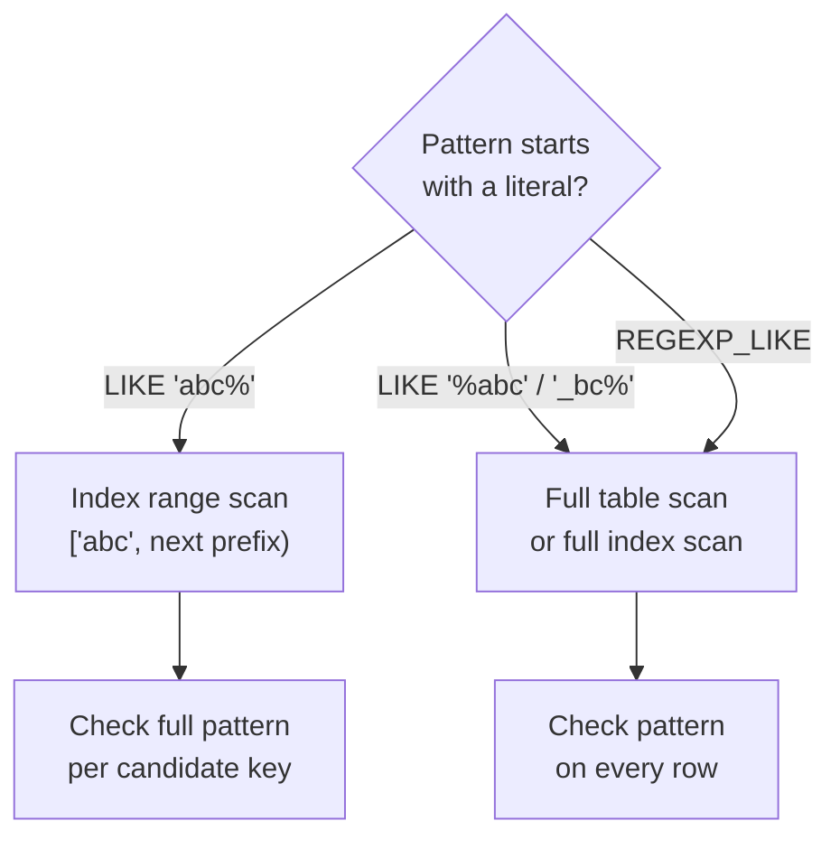

## Introduction

Equality answers "is this value exactly X?". A large share of real questions about text are fuzzier:

- "Customers whose email is at a particular domain."
- "Products whose name contains *laptop*."
- "SKUs that follow the pattern `SKU-` followed by four digits."
- "Phone numbers stored in five different formats — normalize them to digits only."
- "Extract the order number from a free-text support message."

SQL offers two tools. **`LIKE`** is the standard, simple and fast pattern operator with exactly two wildcards. **Regular expressions** — in MySQL, `REGEXP_LIKE()`, `REGEXP_REPLACE()`, `REGEXP_SUBSTR()`, `REGEXP_INSTR()` and the `REGEXP`/`RLIKE` operators — are far more expressive and are powered since MySQL 8.0 by the **ICU** (International Components for Unicode) library.

Two engineering questions run through this lesson. First, **what does a pattern actually match** once the column's collation is taken into account (case, accents, trailing spaces)? Second, **what does the pattern cost**: a `LIKE 'abc%'` can be answered by an index range scan, while `LIKE '%abc'` and every regular expression must examine every row. Understanding that difference is what separates a search box that works on 100 rows from one that works on 100 million.

:::note[Dataset]
The examples use the **shop** dataset plus two small tables created in your lab: `promo_codes` (to demonstrate escaping) and `contacts` (50,000 generated rows, to make index plans visible). All outputs were captured from a real MySQL server.
:::

## DBMS Theory

:::theory[Patterns as predicates]
A pattern-matching predicate `s LIKE p` is an atomic condition in the WHERE clause like any comparison: it is TRUE, FALSE or — if either operand is NULL — UNKNOWN. Formally, a LIKE pattern describes a **regular language** of a very restricted kind: literal characters, `_` (any single character) and `%` (any sequence of zero or more characters). A full **regular expression** describes an arbitrary regular language using alternation `|`, grouping `( )`, character classes `[ ]`, quantifiers `* + ? {m,n}` and anchors `^ $`. Every LIKE pattern can be rewritten as a regex (`'ab%c_'` ≡ `'^ab.*c.$'`), but not vice versa.
:::

Two theoretical properties matter for databases:

1. **Anchoring determines index usability.** A B+ tree index over a string column is sorted by the collation's ordering. A pattern with a fixed **prefix** (`'diego%'`) describes a contiguous key interval — all keys ≥ `'diego'` and < the next possible prefix — so it is *sargable*. A pattern beginning with a wildcard (`'%diego'`) matches keys scattered throughout the sort order; no interval contains exactly them. This is a property of ordered indexes in every DBMS, not a MySQL limitation.
2. **Matching is defined by the collation, not by bytes.** In the standard, `LIKE` compares characters using the collation of the operands. Under a case-insensitive collation, `'A'` and `'a'` are the same character for matching purposes. MySQL's default collation `utf8mb4_0900_ai_ci` is both accent-insensitive (`ai`) and case-insensitive (`ci`).

The standard SQL regex facility is `SIMILAR TO` (a hybrid of LIKE and regex syntax) and the `LIKE_REGEX`/`REGEXP_*` functions of SQL:2008 based on XQuery. **MySQL implements neither `SIMILAR TO` nor `LIKE_REGEX`**; its `REGEXP_*` functions are a MySQL design (similar in spirit to Oracle's) whose pattern syntax is ICU's, which closely follows Perl/Java regular expressions.

## Why It Exists

Free text is everywhere in operational databases: names, emails, addresses, product titles, log messages, notes typed by support staff. Without pattern matching you could only find exact values, and data cleansing would require exporting data to a script.

- **Search and lookup**: autocomplete ("names starting with *Gr*"), prefix search on codes, filtering by email domain.
- **Validation**: rejecting malformed data at the boundary — a `CHECK` constraint with `REGEXP_LIKE` can enforce that SKUs look like `SKU-` plus four digits.
- **Cleansing and extraction**: normalizing phone numbers, stripping punctuation, extracting numbers or codes from text — directly in an `UPDATE` or an ETL `SELECT`.
- **Data profiling**: finding values that do *not* match an expected format is often the fastest way to discover data quality problems.

What pattern matching is **not** for: ranked natural-language search ("best matches for *wireless noise cancelling*"). That needs a full-text index (`MATCH … AGAINST`, Module 7) or a dedicated search engine; `LIKE '%…%'` over a large table is the classic anti-pattern that leads teams to them.

## Internal Working

:::internals[How MySQL evaluates LIKE]
For `col LIKE 'pattern'`, MySQL first inspects the pattern **at optimization time**:

- If the pattern is a constant that **does not start with a wildcard**, the optimizer derives an index range from the literal prefix. For `email LIKE 'diego%'` the range is "keys from `'diego'` up to (but excluding) the smallest key that no longer starts with `'diego'`", computed with the collation's rules. EXPLAIN shows `type = range` on an index of `email`. The full LIKE condition is still checked on each key in the range (it may contain further wildcards), often inside InnoDB via Index Condition Pushdown.
- If the pattern **starts with `%` or `_`**, there is no prefix and therefore no range: the optimizer can only scan the whole table, or the whole index if it covers the query (`type = index`).

During execution, each candidate string is compared with the pattern by a collation-aware matching routine that walks both strings character by character; `%` triggers backtracking. For ordinary patterns this is cheap — the dominant cost is how many rows have to be examined.
:::

:::internals[The ICU regular-expression engine]
Since MySQL 8.0.4, regular expressions are implemented with **ICU**. The older Henry Spencer library (MySQL 5.7 and earlier) worked on bytes and was not multibyte-safe; ICU works on Unicode code points and supports Unicode properties (`\p{L}` = any letter). Consequences:

- Syntax follows ICU (Perl-like): `\d`, `\w`, `\s`, `\b`, lazy quantifiers `*?`, look-ahead `(?=…)`, back-references in replacements (`$1`).
- The old word-boundary markers `[[:<:]]` and `[[:>:]]` are **not supported**; use `\b`.
- Matching is **case-insensitive if the arguments' collation is**, unless overridden with a `match_type` argument.
- ICU's matcher is a backtracking engine. To protect the server from pathological patterns, MySQL limits each match with the `regexp_time_limit` (in steps of the matching engine, default 32) and `regexp_stack_limit` (bytes, default 8000000) system variables; exceeding them raises an error rather than hanging the server.
- A regular expression can never be turned into an index range: every candidate row is evaluated.
:::



## MySQL Implementation

### LIKE

```sql
expr [NOT] LIKE pattern [ESCAPE 'escape_char']
```

`%` matches any sequence of zero or more characters, `_` exactly one character. Everything else matches itself — according to the collation:

```sql run
SELECT customer_id, first_name, last_name, email
FROM customers
WHERE email LIKE 'diego%'
ORDER BY customer_id;
```

```sql run
SELECT product_id, name
FROM products
WHERE name LIKE '%laptop%'
ORDER BY product_id;
```

Notice that `'%laptop%'` matched names containing "Laptop" with a capital L: the column's collation is case-insensitive. `_` is precise about length:

```sql run
SELECT first_name
FROM customers
WHERE first_name LIKE '____'
ORDER BY first_name;
```

Four underscores match exactly four characters. Without wildcards, `LIKE` behaves like `=` with one difference covered below (trailing spaces).

### Escaping wildcards

To match a literal `%` or `_`, escape it. The default escape character is backslash — which must itself be written as `\\` inside a MySQL string literal, because the string parser consumes one level of backslashes. Create a small table to see it:

```sql run
CREATE TABLE promo_codes (
  code VARCHAR(20) PRIMARY KEY,
  description VARCHAR(60) NOT NULL
);
INSERT INTO promo_codes VALUES
  ('SUMMER_10', '10% off in summer'),
  ('SUMMER10',  'legacy summer code'),
  ('SUMMERX10', 'test code'),
  ('HALF%OFF',  '50% off one item');
SELECT code FROM promo_codes WHERE code LIKE 'SUMMER_10' ORDER BY code;
```

Unescaped, `_` matched any character, so `SUMMERX10` was returned too (and `SUMMER10` was not, because `_` requires exactly one character). Escaped:

```sql run
SELECT code FROM promo_codes WHERE code LIKE 'SUMMER\\_10' ORDER BY code;
```

```sql run
SELECT code, description
FROM promo_codes
WHERE description LIKE '%!%%' ESCAPE '!'
ORDER BY code;
```

The `ESCAPE '!'` clause chooses a different escape character, which avoids the double-backslash confusion and is portable to other databases (and immune to the `NO_BACKSLASH_ESCAPES` SQL mode). `'%!%%'` reads as: anything, a literal `%`, anything.

### Regular expressions

```sql
REGEXP_LIKE(expr, pattern [, match_type])
expr REGEXP pattern        -- operator form; RLIKE is a synonym
REGEXP_REPLACE(expr, pattern, replacement [, pos [, occurrence [, match_type]]])
REGEXP_SUBSTR(expr, pattern [, pos [, occurrence [, match_type]]])
REGEXP_INSTR(expr, pattern [, pos [, occurrence [, return_option [, match_type]]]])
```

Unlike LIKE, a regex matches **anywhere** in the string unless anchored with `^` (start) and `$` (end):

```sql run
SELECT REGEXP_LIKE('SKU-1001', 'SKU-[0-9]{4}')   AS contains_pattern,
       REGEXP_LIKE('XSKU-10012', 'SKU-[0-9]{4}') AS contains_too,
       REGEXP_LIKE('XSKU-10012', '^SKU-[0-9]{4}$') AS anchored;
```

Validate the shop's SKUs — and find product names containing digits:

```sql run
SELECT COUNT(*) AS products,
       SUM(REGEXP_LIKE(sku, '^SKU-[0-9]{4}$')) AS well_formed_skus
FROM products;
```

```sql run
SELECT product_id, name
FROM products
WHERE REGEXP_LIKE(name, '[0-9]')
ORDER BY product_id;
```

## Syntax Breakdown

**LIKE**

| Element | Meaning |
|---|---|
| `%` | Zero or more characters |
| `_` | Exactly one character (a character, not a byte — multibyte safe) |
| `\%`, `\_` (written `'\\%'`, `'\\_'` in a literal) | Literal wildcard with the default escape character |
| `ESCAPE 'c'` | Use `c` as the escape character (standard SQL) |
| `NOT LIKE` | Negation; NULL operands still give UNKNOWN |
| Collation | Case/accent sensitivity follows the collation; force one with `col LIKE 'x%' COLLATE utf8mb4_0900_as_cs` |

**Regular expression syntax (ICU) — the most used constructs**

| Construct | Meaning | Example |
|---|---|---|
| `^`, `$` | Start / end of string (of line with match type `m`) | `'^SKU'` |
| `.` | Any character (not newline unless match type `n`) | `'a.c'` |
| `[abc]`, `[^abc]`, `[a-z]` | Character class, negated class, range | `'[^0-9]'` |
| `\d`, `\w`, `\s`, `\b` | Digit, word character, whitespace, word boundary (write `\\d` in a SQL literal) | `'\\bMouse\\b'` |
| `\p{L}`, `\p{Lu}` | Unicode property: any letter, uppercase letter | `'^\\p{Lu}'` |
| `*`, `+`, `?`, `{m,n}` | Quantifiers (greedy); add `?` for lazy | `'[0-9]{4}'` |
| `( … )`, `\|` | Group (captured as `$1`, `$2` in replacements), alternation | `'(gold\|silver)'` |
| `[[:digit:]]`, `[[:alpha:]]` | POSIX classes (supported) | `'[[:digit:]]+'` |

**`match_type` characters** (combine several, later ones win on conflict): `c` case-sensitive, `i` case-insensitive, `m` multi-line (`^`/`$` match at line breaks), `n` `.` matches newline, `u` Unix line endings only.

**Function results**

| Function | Returns |
|---|---|
| `REGEXP_LIKE` / `REGEXP` | 1, 0, or NULL if an argument is NULL |
| `REGEXP_REPLACE` | The string with matches replaced (all occurrences by default; `occurrence` = n replaces only the n-th) |
| `REGEXP_SUBSTR` | The matched substring (first by default), or NULL if no match |
| `REGEXP_INSTR` | 1-based position of the match (or of the character after it with `return_option` = 1), 0 if none |

:::version[Regular expressions across versions]
MySQL 8.0.4 replaced the Henry Spencer regex library with ICU and introduced `REGEXP_LIKE`, `REGEXP_REPLACE`, `REGEXP_SUBSTR` and `REGEXP_INSTR`. Everything in this lesson behaves the same in 8.0 and 8.4 LTS. Code migrated from MySQL 5.7 may still contain `[[:<:]]word[[:>:]]`, which now raises error 3685 — replace the markers with `\\b`.
:::

:::standard[Standard SQL vs MySQL]
`LIKE` with `%`, `_` and `ESCAPE` is standard. Backslash as the *default* escape character is a MySQL extension (the standard has no default). `REGEXP`/`RLIKE` and the `REGEXP_*` functions are MySQL-specific; standard `SIMILAR TO` and `LIKE_REGEX` are not supported. PostgreSQL users should note that MySQL has no `ILIKE` — case-insensitivity comes from the collation.
:::

## Practical Examples

**1. Collation decides what matches.** Under `utf8mb4_0900_ai_ci`, LIKE ignores case and accents. Force a case-sensitive comparison with a `COLLATE` clause:

```sql run
SELECT 'Austin' LIKE 'austin'                               AS ci_default,
       'Austin' LIKE 'austin' COLLATE utf8mb4_0900_as_cs    AS case_sensitive,
       'Café'   LIKE 'cafe'                                 AS accent_insensitive,
       'Café'   LIKE 'cafe'   COLLATE utf8mb4_0900_as_cs    AS accent_sensitive;
```

And trailing spaces: with an equality comparison, a NO PAD collation such as `utf8mb4_0900_ai_ci` treats trailing spaces as significant; `LIKE` always compares character by character and never pads:

```sql run
SELECT 'Austin ' = 'Austin'    AS equals_with_trailing_space,
       'Austin ' LIKE 'Austin' AS like_with_trailing_space,
       'Austin ' LIKE 'Austin%' AS like_with_percent;
```

Older PAD SPACE collations (such as `utf8mb4_general_ci`, common in databases upgraded from 5.7) make `'Austin ' = 'Austin'` TRUE. If a column's collation differs from what you expect, matches change — check it with `SHOW FULL COLUMNS FROM t`.

**2. Domain filtering with LIKE vs regex.** All shop emails are at `example.com`; profile the local parts instead. Which customers' email local part ends in a two-digit number?

```sql run
SELECT customer_id, email
FROM customers
WHERE REGEXP_LIKE(email, '[0-9]{2}@')
ORDER BY customer_id
LIMIT 6;
```

The same with LIKE would need `'%__@%'` plus a separate digit check — LIKE cannot express "digit".

**3. Normalizing phone numbers with REGEXP_REPLACE.** Remove everything that is not a digit:

```sql run
SELECT customer_id,
       phone,
       REGEXP_REPLACE(phone, '[^0-9]', '') AS digits_only
FROM customers
WHERE phone IS NOT NULL
ORDER BY customer_id
LIMIT 5;
```

Capture groups rearrange text. Reformat `+1-450-555-4657` as `(450) 555-4657`:

```sql run
SELECT phone,
       REGEXP_REPLACE(phone, '^\\+1-([0-9]{3})-([0-9]{3})-([0-9]{4})$', '($1) $2-$3') AS us_format
FROM customers
WHERE phone IS NOT NULL
ORDER BY customer_id
LIMIT 3;
```

NULL phones stay NULL — `REGEXP_REPLACE(NULL, …)` is NULL, which is why the example filters them for readability.

**4. Extracting with REGEXP_SUBSTR and REGEXP_INSTR.** The digits embedded in each email, the area code (second number group in the phone) and the position of `@`:

```sql run
SELECT email,
       REGEXP_SUBSTR(email, '[0-9]+')              AS customer_number,
       REGEXP_SUBSTR(phone, '[0-9]+', 1, 2)        AS area_code,
       REGEXP_INSTR(email, '@')                    AS at_position
FROM customers
ORDER BY customer_id
LIMIT 5;
```

`REGEXP_SUBSTR(phone, '[0-9]+', 1, 2)` starts at position 1 and returns the **second** occurrence — the first is the country code `1`. For customers without a phone it returns NULL.

**5. Case sensitivity with match_type.** The `c` flag makes one regex case-sensitive without changing the column's collation:

```sql run
SELECT name,
       REGEXP_LIKE(name, 'pro')      AS ci_match,
       REGEXP_LIKE(name, 'pro', 'c') AS cs_match
FROM products
WHERE REGEXP_LIKE(name, 'pro')
ORDER BY product_id;
```

**6. Word boundaries.** `'%book%'` matches "book" anywhere — including inside "Ultrabook" and "Chromebook". The ICU `\b` boundary matches whole words only:

```sql run
SELECT name,
       name LIKE '%book%'               AS like_contains,
       REGEXP_LIKE(name, '\\bbook\\b')  AS whole_word
FROM products
WHERE name LIKE '%book%'
ORDER BY product_id;
```

## Execution Walkthrough

To see the cost difference between anchored and unanchored patterns we need more than 25 rows. The walkthrough generates 50,000 contacts with an indexed `email` column and compares plans.

```walkthrough
title: Prefix pattern vs leading wildcard on an indexed column
steps:
  - title: "1. Build a table with an index on email"
    explain: >-
      A recursive CTE generates 50,000 rows. Each email has the form user<n>@domain<k>.test, and the secondary index
      idx_contacts_email orders the entries by email using the column collation.
    sql: |
      SET SESSION cte_max_recursion_depth = 60000;
      CREATE TABLE contacts (
        contact_id INT PRIMARY KEY,
        email      VARCHAR(100) NOT NULL,
        city       VARCHAR(40)  NOT NULL,
        KEY idx_contacts_email (email)
      );
      INSERT INTO contacts (contact_id, email, city)
      WITH RECURSIVE seq(n) AS (SELECT 1 UNION ALL SELECT n + 1 FROM seq WHERE n < 50000)
      SELECT n, CONCAT('user', n, '@domain', n % 50, '.test'), ELT(1 + n % 4, 'Austin', 'Boston', 'Seattle', 'Chicago')
      FROM seq;
      ANALYZE TABLE contacts;
      SELECT COUNT(*) AS rows_loaded FROM contacts;
  - title: "2. Anchored pattern — the optimizer derives a range"
    explain: >-
      'user4999%' has the literal prefix user4999, which corresponds to one contiguous slice of the index. EXPLAIN
      shows type range on idx_contacts_email and a small rows estimate: only that slice is read.
    sql: EXPLAIN SELECT contact_id, email FROM contacts WHERE email LIKE 'user4999%';
  - title: "3. The rows that slice contains"
    explain: Every key in the range is then checked against the full pattern; here every candidate matches.
    sql: SELECT contact_id, email FROM contacts WHERE email LIKE 'user4999%' ORDER BY email;
  - title: "4. Leading wildcard — no range is possible"
    explain: >-
      '%@domain7.test' has no fixed prefix, so the matching keys are scattered across the whole index. The optimizer
      can at best scan the entire secondary index (type index, because it contains email and the primary key) and test
      every entry. The rows estimate (taken from index statistics, so not exactly 50,000) is essentially the whole table.
    sql: EXPLAIN SELECT contact_id, email FROM contacts WHERE email LIKE '%@domain7.test';
  - title: "5. Asking for a non-indexed column too"
    explain: >-
      Once the query needs city, which is not in the index, a full index scan would add a clustered-index lookup per
      row, so the optimizer reads the table directly (type ALL).
    sql: EXPLAIN SELECT contact_id, email, city FROM contacts WHERE email LIKE '%@domain7.test';
  - title: "6. A regular expression — always a scan"
    explain: >-
      REGEXP_LIKE is an opaque function call for the optimizer, even when the regex is anchored with ^. No range can
      be derived, and the function runs once per row examined.
    sql: EXPLAIN SELECT contact_id, email FROM contacts WHERE REGEXP_LIKE(email, '^user4999');
```

The measured cost confirms the plans. `EXPLAIN ANALYZE` executes the query and reports actual rows and time per iterator:

```sql run measured
EXPLAIN ANALYZE SELECT COUNT(*) FROM contacts WHERE email LIKE 'user4999%';
```

```sql run measured
EXPLAIN ANALYZE SELECT COUNT(*) FROM contacts WHERE email LIKE '%@domain7.test';
```

Compare the `rows=` values in the two trees: the anchored query's covering range scan reads 11 index entries, the unanchored one reads all 50,000 and its filter keeps 1,000 of them. The strange-looking upper bound of the first range — `'user4999'` padded with `?` characters — is how the optimizer builds the end of a prefix range: it pads the prefix with the collation's maximum character. The accompanying warning 1300 (*Invalid utf8mb3 character string*) is an artifact of printing that internal bound, not a problem with the query. The absolute times are tiny at this size and depend on the machine — the ratio of rows examined is what scales.

## Output

Pattern functions produce three kinds of output, and each needs a different reading:

- **Predicates** (`LIKE`, `REGEXP_LIKE`) produce 1/0/NULL and are used for filtering. A NULL input gives NULL — a row with a NULL email satisfies neither `email LIKE '%x%'` nor `email NOT LIKE '%x%'`, exactly like comparisons in [Filtering with WHERE](/lessons/m03-where-filtering).
- **Transformations** (`REGEXP_REPLACE`) produce a new string. If the pattern does not match, the input is returned unchanged — which makes "the cleansing did nothing" bugs invisible. Count how many rows actually changed:

```sql run
SELECT COUNT(*) AS phones,
       SUM(phone <> REGEXP_REPLACE(phone, '[^0-9]', '')) AS phones_changed_by_cleanup
FROM customers
WHERE phone IS NOT NULL;
```

- **Extractions** (`REGEXP_SUBSTR`, `REGEXP_INSTR`) return NULL / 0 when nothing matches. Always decide what an extraction failure should mean before using the result in a join or a calculation.

## Alternative Approaches

| Requirement | Approach | Trade-off |
|---|---|---|
| Prefix search (autocomplete) | `col LIKE 'abc%'` with a B+ tree index on `col` | Fast range scan; case/accents per collation |
| Suffix search (`'%@domain7.test'`) | Store `REVERSE(col)` in an indexed generated column and search `LIKE REVERSE('%…')` as a prefix | Extra index; turns a scan into a range |
| Contains a word, ranked results | `FULLTEXT` index + `MATCH … AGAINST` (InnoDB) | Word-based (tokenized), not substring; stopwords and minimum token size apply |
| Arbitrary substring at scale | n-gram full-text parser, or an external search engine (Elasticsearch/OpenSearch) | More infrastructure |
| Format validation on write | `CHECK (REGEXP_LIKE(sku, '^SKU-[0-9]{4}$'))` | Enforced by MySQL ≥ 8.0.16 for every insert/update |
| Exact match ignoring case | Plain `=` under a `_ci` collation | Uses the index; no pattern needed |

The suffix trick shows how to rescue the leading-wildcard query from the walkthrough. A **generated column** stores the reversed email and is indexed; the suffix search becomes a prefix search:

```sql run
ALTER TABLE contacts
  ADD COLUMN email_reversed VARCHAR(100) AS (REVERSE(email)) STORED,
  ADD INDEX idx_contacts_email_rev (email_reversed);
EXPLAIN SELECT contact_id, email
FROM contacts
WHERE email_reversed LIKE CONCAT(REVERSE('@domain7.test'), '%');
```

The plan now uses a range on `idx_contacts_email_rev`. The cost is an additional index to maintain on every write — worth it only for searches that run often.

**FULLTEXT** is the right tool for "search product descriptions for words". It is covered in the indexing module; its semantics (word tokens, relevance ranking, `IN BOOLEAN MODE`) differ fundamentally from substring matching, so it is not a drop-in replacement for `LIKE '%x%'`.

## Performance Analysis

| Pattern | Access path possible | Rows examined |
|---|---|---|
| `col = 'abc'` | ref / range on an index of `col` | Matching rows |
| `col LIKE 'abc%'` | range on an index of `col` | Rows with the prefix |
| `col LIKE 'abc%xyz'` | range on the prefix `abc`, rest checked per key | Rows with the prefix |
| `col LIKE '%abc'`, `'%abc%'`, `'_bc'` | full table or full index scan | All rows |
| `REGEXP_LIKE(col, …)`, `col REGEXP …` | full table or full index scan | All rows |
| `col LIKE ?` (prepared, value known at execution) | range if the bound value has a literal prefix | Depends on the value |

Practical points:

- **Low selectivity can disable the range anyway.** `sku LIKE 'SKU-10%'` has a prefix, but it matches all 30 products, so the optimizer prefers a table scan — correctly. A prefix only helps when it is selective.
- **Short prefixes are weak.** `LIKE 'a%'` on a large table may match 5% of rows; the optimizer may still scan. Autocomplete UIs usually wait for 2–3 characters before querying.
- **Regex cost per row is higher than LIKE cost per row**, and badly written patterns with nested quantifiers (`(a+)+b`) can backtrack exponentially; MySQL's `regexp_time_limit` turns that into an error instead of an outage, but the query still fails.
- **Leading wildcards also hurt writes.** An `UPDATE … WHERE name LIKE '%x%'` must scan every row and, under InnoDB's default REPEATABLE READ, lock every row it scans.

:::performance[Theory vs measurement]
The access-path table follows directly from how ordered indexes work and holds in every B+ tree database. The timings printed by `EXPLAIN ANALYZE` above were measured on the build machine on a tiny, fully cached table; your numbers will differ. What carries over to production is the **rows examined** column: an unanchored pattern examines every row, so its cost grows linearly with table size.
:::

## Best Practices

:::best-practice[Pattern matching in production]
1. **Anchor whenever you can.** Design search features as prefix searches on indexed columns; it is the difference between a range scan and a full scan.
2. **Never put user input into a pattern unescaped.** A user who types `50%` or `a_b` into a search box changes the meaning of your LIKE; escape `%`, `_` and the escape character (or use `ESCAPE '!'` and escape `!`), and always bind the value as a parameter.
3. **Prefer an explicit `ESCAPE` character** over backslash: portable, readable, and unaffected by `NO_BACKSLASH_ESCAPES`.
4. **Know your collation.** Case-, accent- and pad-sensitivity of every match follow from it. Use `COLLATE` deliberately when you need different semantics, aware that it can prevent index use.
5. **Use regex for validation and cleansing, not for hot-path search.** Put format rules in `CHECK` constraints; run cleansing in batch jobs.
6. **Anchor regexes with `^…$` when validating** — an unanchored validation pattern accepts garbage around a valid core.
7. **Reach for FULLTEXT or a search engine** when users need word search with ranking over large text.
:::

## Common Mistakes

**Mistake 1 — expecting a leading wildcard to use the index.** Shown in the walkthrough: `LIKE '%term'` reads every row, however many indexes exist.

**Mistake 2 — forgetting that `_` is a wildcard.** `WHERE code LIKE 'SUMMER_10'` also matched `SUMMERX10`. Any pattern built from data containing underscores (table names, codes, file names) needs escaping.

**Mistake 3 — single backslashes in string literals.** In `'\d'` the MySQL string parser removes the backslash before the regex engine ever sees it (an unknown escape sequence `\d` becomes plain `d`), so the pattern means "the letter d":

```sql run
SELECT REGEXP_LIKE('Room 42', '\d')  AS single_backslash,
       REGEXP_LIKE('Room 42', '\\d') AS double_backslash,
       REGEXP_LIKE('Room d', '\d')   AS matches_letter_d;
```

**Mistake 4 — old word-boundary syntax.** Code from MySQL 5.7 using `[[:<:]]` fails under ICU:

```sql run error
SELECT REGEXP_LIKE('Wireless Mouse', '[[:<:]]Mouse');
```

**Mistake 5 — validation without anchors.** `REGEXP_LIKE(sku, '[0-9]{4}')` accepts `'xx12345yy'`. Write `'^SKU-[0-9]{4}$'`.

**Mistake 6 — case-sensitive expectations under a `_ci` collation.** `WHERE name LIKE 'Pro%'` also returns `'pro…'` and `'PRO…'`. If case matters, use `COLLATE utf8mb4_0900_as_cs` or regex match type `c`, or store the column with a case-sensitive collation.

## Industry Application

- **E-commerce search.** Product search boxes typically start as `LIKE '%term%'` and are rewritten — first to prefix search plus FULLTEXT, then to a dedicated search engine — as catalogue size and traffic grow. Recognizing the leading-wildcard scan in an EXPLAIN is often how that migration starts.
- **Data cleansing pipelines.** ETL jobs normalize phone numbers, postal codes and identifiers with `REGEXP_REPLACE` while loading staging tables, and quarantine rows that fail `REGEXP_LIKE` validation for manual review.
- **Compliance and PII discovery.** Security teams scan text columns with regexes for values that look like credit-card numbers, national IDs or emails stored where they should not be — a batch job, never a hot-path query.
- **Log and event triage.** Operational databases that store error messages use `REGEXP_SUBSTR` to extract error codes or request IDs for grouping, often materializing the extracted value into an indexed generated column so later queries are sargable.
- **Domain-based routing.** B2B platforms map users to organizations by email domain. Instead of `LIKE '%@acme.com'` on every login, they store the domain in its own indexed column (computed on write) — the same idea as the reversed-email generated column.

## Practice Exercises

```exercise
id: ex1
title: Names starting with D
difficulty: easy
concepts: [like-operator]
prompt: |
  Return `customer_id`, `first_name`, `last_name` for every customer whose **first name starts with "D"**.
hints:
  - "A prefix pattern: the literal followed by %."
  - "WHERE first_name LIKE 'D%'"
solution: |
  SELECT customer_id, first_name, last_name
  FROM customers
  WHERE first_name LIKE 'D%';
explanation: |
  Under the default case-insensitive collation `'d%'` would return the same rows. A prefix pattern like this
  can use an index on `first_name` if one exists; `'%D'` (ends with D) could not.
```

```exercise
id: ex2
title: Find the literal underscore
difficulty: medium
concepts: [like-escape]
setup: |
  CREATE TABLE file_names (id INT PRIMARY KEY, name VARCHAR(50) NOT NULL);
  INSERT INTO file_names VALUES
    (1, 'report_2024.csv'), (2, 'report-2024.csv'), (3, 'report2024.csv'),
    (4, 'summary_q1.xlsx'), (5, 'summaryXq1.xlsx'), (6, 'notes.txt');
prompt: |
  The table `file_names (id, name)` exists in your lab. Return `id` and `name` of every file whose name
  **contains a literal underscore character**.
hints:
  - "In LIKE, _ is a wildcard meaning 'any one character', so '%_%' matches every non-empty name."
  - "Escape it: '%!_%' ESCAPE '!' (or '%\\_%' with the default backslash escape)."
solution: |
  SELECT id, name
  FROM file_names
  WHERE name LIKE '%!_%' ESCAPE '!';
explanation: |
  `LIKE '%_%'` returns all six rows, because `_` matches any character. With the escape, only
  `report_2024.csv` and `summary_q1.xlsx` qualify. `INSTR(name, '_') > 0` or `REGEXP_LIKE(name, '_')` are
  alternatives — `_` is not special in a regex.
```

```exercise
id: ex3
title: Digits-only phone numbers
difficulty: medium
concepts: [regexp-replace, null-handling]
prompt: |
  For every customer **who has a phone number**, return `customer_id` and `phone_digits` — the phone number
  with every non-digit character removed.
hints:
  - "REGEXP_REPLACE(expr, pattern, replacement) replaces every match by default."
  - "The pattern for 'not a digit' is '[^0-9]'. Filter out NULL phones with IS NOT NULL."
solution: |
  SELECT customer_id, REGEXP_REPLACE(phone, '[^0-9]', '') AS phone_digits
  FROM customers
  WHERE phone IS NOT NULL;
explanation: |
  `'\\D'` (non-digit in ICU syntax, written with a doubled backslash) is equivalent to `'[^0-9]'`. Forgetting
  the WHERE clause returns extra rows with NULL `phone_digits`, because `REGEXP_REPLACE(NULL, …)` is NULL.
```

```exercise
id: ex4
title: Well-formed product names
difficulty: hard
concepts: [regexp, icu-regex]
prompt: |
  Return `product_id` and `name` of every product whose name **contains a number with at least two digits**
  (for example "14", "1080", "$50"). Use a regular expression.
hints:
  - "A quantifier {2,} means 'two or more'."
  - "The pattern '[0-9]{2,}' finds two or more consecutive digits anywhere in the string; no anchors are needed."
solution: |
  SELECT product_id, name
  FROM products
  WHERE REGEXP_LIKE(name, '[0-9]{2,}');
explanation: |
  An unanchored regex matches anywhere, which is what "contains" means. `LIKE '%[0-9][0-9]%'` does **not**
  work in MySQL — square brackets are not LIKE wildcards (that syntax belongs to SQL Server), so the pattern
  would look for literal brackets. `'1kg'` in "Single-Origin Beans 1kg" has only one digit, so it is excluded.
```

```exercise
id: ex5
title: Extract and reformat
difficulty: challenge
concepts: [regexp-substr, regexp-replace, like-operator]
prompt: |
  For customers in the state of **CA** who have a phone number, return:

  1. `customer_id`
  2. `area_code` — the three-digit area code (the second group of digits in numbers formatted like `+1-774-555-4257`)
  3. `pretty_phone` — the number reformatted as `(774) 555-4257`
hints:
  - "REGEXP_SUBSTR(phone, '[0-9]+', 1, 2) returns the second run of digits."
  - "Use capture groups in REGEXP_REPLACE and refer to them as $1, $2, $3 in the replacement."
  - "The + in the phone must be escaped in the pattern: '^\\+1-([0-9]{3})-([0-9]{3})-([0-9]{4})$'."
solution: |
  SELECT customer_id,
         REGEXP_SUBSTR(phone, '[0-9]+', 1, 2) AS area_code,
         REGEXP_REPLACE(phone, '^\\+1-([0-9]{3})-([0-9]{3})-([0-9]{4})$', '($1) $2-$3') AS pretty_phone
  FROM customers
  WHERE state = 'CA' AND phone IS NOT NULL;
explanation: |
  `+` is a quantifier in regex syntax, so a literal plus sign needs `\\+` in a SQL literal. If any phone did not
  match the anchored pattern, REGEXP_REPLACE would return it unchanged — a robust pipeline would flag such rows
  with `NOT REGEXP_LIKE(phone, '^\\+1-[0-9]{3}-[0-9]{3}-[0-9]{4}$')`.
```

```exercise
id: ex6
title: Design a search for email domains
difficulty: challenge
kind: open
concepts: [pattern-index-usage, sargability]
prompt: |
  A support tool must find all users of a given company by email domain (`WHERE email LIKE '%@acme.com'`) in
  a 40-million-row `users` table that has an index on `email`. The query takes seconds. Explain why, and
  propose two schema-level fixes with their trade-offs.
solution: |
  **Why.** The pattern starts with `%`, so it has no literal prefix; the B+ tree on `email` is sorted from the
  first character, and the matching keys are scattered across the whole index. MySQL must scan the whole index
  (or table) and test all 40 million values.

  **Fix 1 — store the domain separately.** Add `email_domain` as a STORED generated column
  (`SUBSTRING_INDEX(email, '@', -1)`) with an index, and query `WHERE email_domain = 'acme.com'`. Equality
  lookup, very selective, easy to understand; costs one more index and a little storage, and every query must
  use the new column.

  **Fix 2 — reversed column.** Index `REVERSE(email)` in a generated column and query
  `WHERE email_reversed LIKE CONCAT(REVERSE('@acme.com'), '%')`. Supports arbitrary suffix searches, not just
  domains, but is less readable.

  (A FULLTEXT index is a poor fit: it tokenizes words and does not do exact suffix matching.)
```

## Knowledge Assessment

```quiz
- id: q1
  question: "Which pattern can be resolved with an index range scan on an indexed `email` column?"
  options: ["LIKE '%@example.com'", "LIKE '_iego%'", "LIKE 'diego.%'", "REGEXP_LIKE(email, '^diego')"]
  answer: 2
  explanation: "Only a pattern with a literal prefix maps to a contiguous range of the sorted index. A leading % or _ has no prefix. REGEXP_LIKE is never converted into a range, even with ^, because the optimizer treats it as an opaque function."
  concepts: [pattern-index-usage]
- id: q2
  question: "With the default collation `utf8mb4_0900_ai_ci`, what does `SELECT 'Café' LIKE 'cafe', 'Austin ' = 'Austin';` return?"
  options: ["1, 0", "0, 0", "1, 1", "0, 1"]
  answer: 0
  explanation: "The ai_ci collation ignores accents and case, so 'Café' LIKE 'cafe' is 1. utf8mb4_0900 collations are NO PAD, so the trailing space is significant in = and the comparison is 0. Older PAD SPACE collations such as utf8mb4_general_ci would return 1 for the second."
  concepts: [collation, like-operator]
- id: q3
  question: "Which predicates match the value 'SUMMERX10'? (Select all that apply.)"
  type: multi
  options:
    - "code LIKE 'SUMMER_10'"
    - "code LIKE 'SUMMER!_10' ESCAPE '!'"
    - "code LIKE 'SUMMER%10'"
    - "REGEXP_LIKE(code, '^SUMMER_10$')"
  answer: [0, 2]
  explanation: "Unescaped _ matches any single character and % any sequence, so the first and third match. The escaped version requires a literal underscore. In a regex, _ is an ordinary character, so the regex also requires a literal underscore."
  concepts: [like-escape, like-operator, regexp]
- id: q4
  question: "Code migrated from MySQL 5.7 contains `REGEXP '[[:<:]]pro[[:>:]]'` and now fails with error 3685. What is the correct replacement in MySQL 8.4?"
  options: ["REGEXP '<pro>'", "REGEXP '\\\\bpro\\\\b'", "LIKE '% pro %'", "REGEXP '[[:word:]]pro'"]
  answer: 1
  explanation: "MySQL 8.0+ uses ICU, which does not support the Spencer word-boundary markers; the ICU word boundary is \\b, written with doubled backslashes inside a SQL string. LIKE '% pro %' misses words at the start or end of the string or next to punctuation."
  concepts: [icu-regex]
- id: q5
  question: "What does `REGEXP_SUBSTR('+1-774-555-4257', '[0-9]+', 1, 2)` return?"
  options: ["'1'", "'774'", "'555'", "'1774'"]
  answer: 1
  explanation: "Starting at position 1, the runs of digits are '1', '774', '555', '4257'. The occurrence argument 2 selects the second run, '774'. REGEXP_SUBSTR never concatenates matches."
  concepts: [regexp-substr]
- id: q6
  question: "Why does `REGEXP_LIKE('Room 42', '\\d')` (a single backslash in the SQL literal) return 0?"
  options:
    - "ICU does not support \\d"
    - "The MySQL string parser removes the backslash, so the regex engine receives the pattern 'd'"
    - "Regexes are case-sensitive by default"
    - "\\d only matches at the start of the string"
  answer: 1
  explanation: "String literals process backslash escapes first; an unknown escape \\d becomes the plain letter d. The regex then searches for the letter d, which 'Room 42' does not contain. Write '\\\\d' in the literal so ICU receives \\d. ICU fully supports \\d, and regexes match anywhere unless anchored."
  concepts: [icu-regex, regexp]
- id: q7
  question: "A search on a 50M-row table uses `WHERE name LIKE '%wireless%'` and is slow. Which change would most directly let MySQL avoid examining every row for word searches?"
  options:
    - "Add a B+ tree index on name"
    - "Rewrite it as REGEXP_LIKE(name, 'wireless')"
    - "Add a FULLTEXT index and use MATCH(name) AGAINST('wireless')"
    - "Add COLLATE utf8mb4_bin to the predicate"
  answer: 2
  explanation: "A FULLTEXT (inverted) index maps words to rows, so word searches need not scan. A B+ tree index cannot serve a leading wildcard, REGEXP is also a full scan, and changing the collation only changes the comparison semantics (and can disable index use)."
  concepts: [pattern-index-usage]
```
