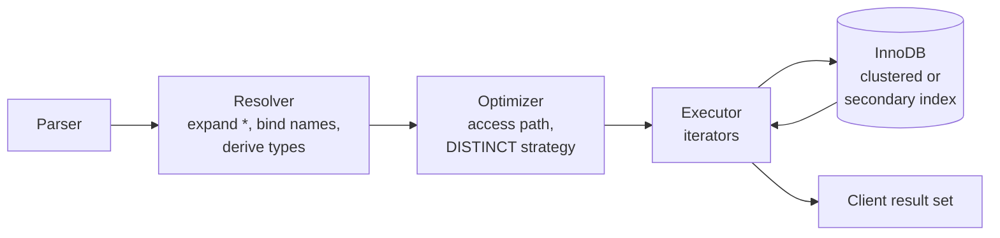

## Introduction

`SELECT` is the statement you will write more than any other. It is how a report asks "which customers live in California?", how an API endpoint fetches a product page, how a data pipeline extracts yesterday's orders, and how an analyst explores a table they have never seen before. Every other read feature you will learn — filtering, joins, grouping, window functions, subqueries — is a clause bolted onto this one statement.

This lesson is about the part of `SELECT` that comes before any filtering: the **SELECT list** and the **FROM clause**. That sounds simple, but the SELECT list is where several professional-grade questions are decided:

- **Which columns** cross the network to the application — and whether the database can answer the query from an index alone.
- **Which expressions** are computed by the server (prices with tax, full names, margins) and what *type* the result has.
- **What the result columns are called**, which is the contract your application code depends on.
- **Whether duplicates are kept** — the difference between SQL's bag semantics and the set semantics of relational theory.
- **When each part runs**, which explains why you can use an alias in `ORDER BY` but not in `WHERE`.

By the end you should be able to read any `SELECT` list and say exactly what it produces, in what types, under what names, and in what order MySQL logically evaluated it.

:::note[Dataset]
The examples use the **shop** dataset: 25 customers, 10 categories, 30 products, 80 orders and their line items, payments and reviews. Every output shown below was captured from a real MySQL server; press **Run** on any block to execute it in your private lab.
:::

## DBMS Theory

:::theory[Projection, extended projection and bags]
In relational algebra, **projection** π<sub>A₁, A₂, …</sub>(R) produces a relation containing only the listed attributes of R. Because a relation is a *set*, projection in pure theory also removes duplicate tuples: projecting the `city` attribute of a customers relation gives each city once.

Practical query languages need more than picking attributes, so database theory defines **extended (generalized) projection**: π<sub>F₁ AS B₁, F₂ AS B₂, …</sub>(R), where each Fᵢ is an *expression* over the attributes of a tuple (arithmetic, string functions, constants) and Bᵢ names the resulting attribute. Renaming is formally the separate operator **ρ** (rho); SQL folds it into the SELECT list as `AS`.
:::

SQL departs from the theory in one deliberate way: **SQL tables and query results are bags (multisets), not sets.** A `SELECT city FROM customers` returns one row per customer, so a city appears as many times as there are customers living there. Duplicate elimination is opt-in through `DISTINCT`. There are good reasons for this design:

1. **Cost.** Removing duplicates requires sorting or hashing the entire result. Most queries do not need it, so paying for it by default would be wasteful.
2. **Meaning.** Duplicates often carry information. The list of cities of 25 customers, with repetition, is exactly what you need to count customers per city later.
3. **Aggregates need multiplicity.** `SUM(quantity)` over three rows each containing 2 must be 6; set semantics would collapse them to a single 2.

Three further theoretical terms appear throughout the course:

| Term | Meaning in SQL |
|---|---|
| **Derived column** | A SELECT-list item that is an expression rather than a stored column, e.g. `price - cost`. It exists only in the result. |
| **Correlation name / range variable** | A table alias such as `o` in `FROM orders AS o`. Formally it names a variable that ranges over the rows of the table — essential once a query references the same table twice (self joins). |
| **Result schema** | The column names and types of a query's output. It is determined *before* any rows are read, which is why tools can describe a query's columns without executing it. |

**NULL and DISTINCT.** For duplicate elimination, SQL treats NULLs as *not distinct from each other*: two NULLs are considered duplicates, so `SELECT DISTINCT loyalty_tier` returns a single NULL row. This is different from comparison semantics, where `NULL = NULL` is UNKNOWN (see [NULL and three-valued logic](/lessons/m02-null-three-valued-logic)). The standard calls this the "IS NOT DISTINCT FROM" notion of sameness, and it is also used by `GROUP BY`, `UNION` and `UNIQUE` constraints on most systems.

## Why It Exists

Imagine an application without projection: every read returns every column of every row and the application picks what it needs. That is effectively what `SELECT *` does, and it causes concrete problems:

- **Wasted I/O and network.** A `products` row might include a large `description` text or JSON blob. A product-listing page needs four columns; transferring the blob for 50 products per page multiplies the bytes on the wire for nothing.
- **Missed index-only plans.** If a query asks only for columns that live in an index, InnoDB can answer it from the index without touching the table's rows (a *covering index*). Asking for every column makes this impossible.
- **Fragile contracts.** Application code that reads columns by position breaks when someone adds a column; code that maps columns to object fields breaks when a column is renamed. An explicit SELECT list makes the contract visible and reviewable.

Expressions in the SELECT list exist because the database is often the best place to compute derived values: the computation runs next to the data, uses exact `DECIMAL` arithmetic, and is identical for every client (a Python service and a BI tool get the same margin). Aliases exist so that derived values have stable, meaningful names. `DISTINCT` exists because "which different values occur?" is a fundamental question — distinct cities, distinct discount codes, distinct status values — and answering it in the client would require fetching every row.

## Internal Working

:::internals[From SQL text to result rows]
When MySQL receives a `SELECT`, it passes through these server layers before InnoDB returns a single row:

1. **Parser** — checks syntax and builds a parse tree. A missing comma in the SELECT list is *not* a syntax error (you will see why below), but `SELECT FROM t` is.
2. **Resolver (name resolution)** — binds every column reference to a table in the FROM clause, expands `*` into the concrete column list using the data dictionary, resolves aliases, and computes the **result type** of every expression. Unknown columns fail here with error 1054.
3. **Optimizer** — chooses an access path for each table (full scan, index scan, range scan, covering index) and decides how to implement `DISTINCT` (an index, a temporary table with a unique key, or a sort).
4. **Executor** — builds a tree of **iterators**; rows flow up from the storage engine. For each row that survives filtering, the executor evaluates the SELECT-list expressions and sends the resulting row to the client.
:::

Two internal facts explain most performance behaviour of the SELECT list.

**InnoDB stores rows in the clustered index.** Every InnoDB table is a B+ tree keyed by its primary key; the leaf pages contain the full rows. A **secondary index** (such as `idx_orders_customer` on `orders.customer_id`) is a separate B+ tree whose leaves contain the indexed columns *plus the primary key*. If every column the query needs is in the secondary index — including the primary key, which is always there — the optimizer can read only that index. EXPLAIN shows this as **`Using index`**. If the query needs any other column, each index entry must be followed by a lookup in the clustered index to fetch the row.

**DISTINCT is implemented by deduplication.** MySQL treats `SELECT DISTINCT a, b` much like `GROUP BY a, b` without aggregates. It can avoid work when an index already delivers the values in sorted order (EXPLAIN may say `Using index for group-by`, a *loose index scan* that jumps from one distinct key to the next). Otherwise it inserts every result row into an internal **temporary table with a unique index**, discarding rows whose key already exists — EXPLAIN shows **`Using temporary`**. The temporary table lives in memory (the `TempTable` engine) until it exceeds its memory limit, then spills to disk.



**Expression evaluation and types.** The resolver derives each expression's type from its operands: integer + integer is an integer; any `DECIMAL` operand makes the result `DECIMAL` (exact); a `DOUBLE` operand makes it `DOUBLE`; `/` on integers returns `DECIMAL` with extra scale controlled by `div_precision_increment` (default 4), while `DIV` performs integer division. Any arithmetic involving NULL yields NULL. Division by zero yields NULL with a warning (and, for `INSERT`/`UPDATE` in strict mode with `ERROR_FOR_DIVISION_BY_ZERO`, an error).

## MySQL Implementation

The general shape of the statement, limited to the clauses covered in this lesson:

```sql
SELECT [DISTINCT] select_expr [[AS] alias] [, select_expr [[AS] alias] ...]
FROM   table_reference [[AS] table_alias];
```

Start by projecting a few columns. The order of columns in the result is the order you list them, not the order in the table:

```sql run
SELECT last_name, first_name, city
FROM customers
ORDER BY customer_id
LIMIT 5;
```

(`ORDER BY` and `LIMIT` are covered properly in [Sorting and Pagination](/lessons/m03-sorting-pagination); they are used here only to keep outputs short and deterministic.)

Now compute derived columns. Expressions can combine columns, constants and functions, and each should get an alias:

```sql run
SELECT name,
       price,
       cost,
       price - cost                          AS unit_margin,
       ROUND((price - cost) / price * 100, 1) AS margin_pct,
       price * 1.0825                        AS price_with_tax
FROM products
ORDER BY product_id
LIMIT 5;
```

Notice the types of the derived columns: `price - cost` keeps two decimal places because both operands are `DECIMAL(10,2)`; multiplying by the literal `1.0825` (an exact decimal literal in MySQL) produces a `DECIMAL` with more scale. Nothing was rounded unless you asked for it.

String expressions use functions — MySQL's `||` is **not** concatenation by default (more on that in Common Mistakes):

```sql run
SELECT CONCAT(first_name, ' ', last_name)    AS full_name,
       CONCAT_WS(', ', city, state)         AS location,
       UPPER(state)                         AS state_code,
       LOWER(email)                         AS email
FROM customers
ORDER BY customer_id
LIMIT 5;
```

A SELECT does not even need a table. MySQL lets you evaluate expressions directly, and accepts the dummy table name `DUAL` for compatibility with other systems:

```sql run
SELECT 7 / 2 AS decimal_division,
       7 DIV 2 AS integer_division,
       7 % 2 AS remainder,
       NULL + 1 AS null_arithmetic,
       CONCAT('a', NULL) AS null_concat;
```

The last two columns illustrate NULL propagation: an unknown value plus one is still unknown, and `CONCAT` returns NULL if *any* argument is NULL. `CONCAT_WS` (with separator) is the exception — it skips NULL arguments — which is why it is popular for building addresses from optional parts.

Finally, `DISTINCT` removes duplicate result rows:

```sql run
SELECT DISTINCT state
FROM customers
ORDER BY state;
```

## Syntax Breakdown

| Component | Meaning and rules |
|---|---|
| `SELECT` | Introduces the projection. Logically evaluated *after* `FROM`, `WHERE`, `GROUP BY` and `HAVING`. |
| `select_expr` | A column (`price`), a qualified column (`p.price`), an expression (`price - cost`), a function call, a literal, a scalar subquery, or `*` / `t.*`. |
| `*` | Expands, at resolution time, to every column of every table in `FROM`, in table-definition order. `t.*` expands only table `t`'s columns. |
| `AS alias` | Names the result column. `AS` is optional (a source of bugs — see the missing-comma trap). Quote aliases containing spaces or reserved words with backticks: `` AS `unit margin` ``. A double-quoted alias also works because MySQL accepts a string literal in alias position, but backticks are unambiguous. |
| `DISTINCT` | Applies to the **whole row** of the SELECT list, not to the column it is written next to. `SELECT DISTINCT city, state` returns distinct (city, state) pairs. `DISTINCTROW` is a synonym; `ALL` (the default) keeps duplicates. |
| `FROM table [AS] t` | The source of rows. The table alias `t` *replaces* the table name for the rest of the query: once aliased, `orders.order_id` is an error and `o.order_id` is required. |
| `FROM DUAL` | Optional dummy table for table-less SELECTs; MySQL ignores it. |
| `TABLE t` | MySQL 8.0.19+ shorthand for `SELECT * FROM t` (supports `ORDER BY` and `LIMIT`, but not `WHERE` or column lists). |

**Where aliases are visible.** This follows from the logical order of evaluation, which the walkthrough later makes concrete:

| Clause | Can it reference a SELECT-list alias? |
|---|---|
| `WHERE` | **No** — `WHERE` is evaluated before the SELECT list exists (error 1054). |
| `GROUP BY` | Yes in MySQL (an extension; standard SQL says no). |
| `HAVING` | Yes in MySQL (an extension). |
| `ORDER BY` | **Yes** — standard SQL; `ORDER BY` runs after the SELECT list. |
| Another item in the same SELECT list | **No** — all items are evaluated "at the same time" (error 1054). |

:::standard[Standard SQL vs MySQL]
Standard: SELECT list, `AS`, `DISTINCT`, `*`, table aliases (correlation names), aliases in `ORDER BY`. MySQL extensions: `FROM DUAL` is optional, `SELECT` without `FROM`, aliases in `GROUP BY`/`HAVING`, `DIV`, `%` as modulo, `DISTINCTROW`, the `TABLE` statement form (also in recent standards as an explicit table), and adjacent string literals being concatenated (`'a' 'b'`). In standard SQL `||` is string concatenation; in MySQL it means logical OR unless the `PIPES_AS_CONCAT` SQL mode is enabled.
:::

:::version[|| as OR is deprecated]
Using `||` as a synonym for `OR` is deprecated in MySQL 8.0 and 8.4 and produces warning 1287 ("'|| as a synonym for OR' is deprecated"). It still behaves as OR in 8.4, so code that meant concatenation silently returns 0/1 values. Always use `CONCAT()`.
:::

## Practical Examples

**1. A product listing with a stable API contract.** An API returning products should name exactly the fields it promises, with names that match the JSON contract:

```sql run
SELECT product_id AS id,
       sku,
       name       AS title,
       price      AS list_price,
       stock_qty > 0 AS in_stock
FROM products
ORDER BY product_id
LIMIT 6;
```

`stock_qty > 0` is a boolean expression; MySQL represents booleans as integers `1` (true) and `0` (false). Look at product 4 (the inactive Chromebook with zero stock) in the output.

**2. Table aliases and qualified columns.** Once a query reads more than one table — even a simple join previewed here, taught fully in Module 4 — every column should be qualified with a short table alias so readers (and the resolver) know where it comes from:

```sql run
SELECT o.order_id,
       o.order_date,
       c.first_name,
       c.last_name,
       o.status
FROM orders AS o
JOIN customers AS c ON c.customer_id = o.customer_id
ORDER BY o.order_id
LIMIT 5;
```

Both tables have a `customer_id` column. An unqualified `customer_id` in the SELECT list would fail with error 1052 *"Column 'customer_id' in field list is ambiguous"*.

**3. DISTINCT on multiple columns.** `DISTINCT` deduplicates the whole projected row. Distinct states and distinct (city, state) pairs are different questions:

```sql run
SELECT DISTINCT city, state
FROM customers
ORDER BY state, city;
```

**4. DISTINCT and NULL.** NULLs are treated as duplicates of each other for `DISTINCT`, so one NULL row appears — but `COUNT(DISTINCT …)` ignores NULLs entirely, so the two numbers differ:

```sql run
SELECT DISTINCT loyalty_tier
FROM customers
ORDER BY loyalty_tier;
```

```sql run
SELECT COUNT(DISTINCT loyalty_tier) AS distinct_non_null_tiers,
       (SELECT COUNT(*) FROM (SELECT DISTINCT loyalty_tier FROM customers) AS d) AS distinct_rows_including_null
FROM customers;
```

A report that says "customers fall into N tiers" must decide whether "no tier" counts as a tier. The `DISTINCT` list says yes; `COUNT(DISTINCT)` says no.

**5. Profiling an unfamiliar table.** Analysts often start with a quick profile. `DISTINCT` on a low-cardinality column reveals the domain of values actually in use (which may differ from the `ENUM` definition):

```sql run
SELECT DISTINCT status
FROM orders
ORDER BY status;
```

`ORDER BY status` on an `ENUM` column sorts by the enum's **internal index** (definition order: pending, paid, shipped, …), not alphabetically. That is a MySQL-specific detail worth remembering when you sort status columns.

**6. The TABLE statement.** For quick inspection of small tables, MySQL 8.0.19+ offers `TABLE`, equivalent to `SELECT *`:

```sql run
TABLE categories ORDER BY category_id LIMIT 4;
```

It is handy at the console, but it has all the disadvantages of `SELECT *` and cannot filter, so it does not belong in application code.

## Execution Walkthrough

SQL is written in the order `SELECT … FROM … WHERE … ORDER BY … LIMIT`, but it is **logically evaluated** in a different order. The following walkthrough traces one query clause by clause, showing the real intermediate result at every step:

```sql
SELECT DISTINCT city, state AS st
FROM customers
WHERE loyalty_tier = 'silver'
ORDER BY st, city
LIMIT 4;
```

```walkthrough
title: SELECT DISTINCT city, state AS st FROM customers WHERE loyalty_tier = 'silver' ORDER BY st, city LIMIT 4
steps:
  - title: "1. FROM — produce the input rows"
    explain: >-
      The FROM clause defines the source: all 25 rows of customers, with every column available. Nothing has been
      projected yet, so later clauses (WHERE, ORDER BY) may still reference any column, even ones that will not
      appear in the result. Only the first rows are shown here.
    sql: SELECT customer_id, first_name, city, state, loyalty_tier FROM customers ORDER BY customer_id LIMIT 8;
  - title: "2. WHERE — keep only rows whose predicate is TRUE"
    explain: >-
      The predicate loyalty_tier = 'silver' is evaluated for each row. Rows where it is FALSE or UNKNOWN (NULL tier)
      are discarded. The SELECT-list alias st does not exist yet, which is why WHERE st = 'CA' would fail.
    sql: SELECT customer_id, first_name, city, state, loyalty_tier FROM customers WHERE loyalty_tier = 'silver' ORDER BY customer_id;
  - title: "3. SELECT — evaluate the SELECT list and assign aliases"
    explain: >-
      For each surviving row the SELECT-list expressions are evaluated and the result columns are named city and st.
      Other columns (first_name, loyalty_tier) are no longer part of the row being produced. Duplicates are still
      present — several silver customers live in the same city.
    sql: SELECT city, state AS st FROM customers WHERE loyalty_tier = 'silver' ORDER BY customer_id;
  - title: "4. DISTINCT — remove duplicate result rows"
    explain: >-
      DISTINCT is applied to the projected rows, so it compares (city, st) pairs. In the plan this is a temporary
      table with a unique key; the row order is not guaranteed at this point.
    sql: SELECT DISTINCT city, state AS st FROM customers WHERE loyalty_tier = 'silver';
  - title: "5. ORDER BY — sort, alias now visible"
    explain: >-
      ORDER BY runs after the SELECT list, so it can use the alias st. Without ORDER BY the order of rows is
      whatever the plan happens to produce and must never be relied on.
    sql: SELECT DISTINCT city, state AS st FROM customers WHERE loyalty_tier = 'silver' ORDER BY st, city;
  - title: "6. LIMIT — return the first 4 rows"
    explain: LIMIT is applied last, to the sorted, deduplicated result.
    sql: SELECT DISTINCT city, state AS st FROM customers WHERE loyalty_tier = 'silver' ORDER BY st, city LIMIT 4;
```

The full logical order for a single-table query is:


```viz
type: query-order
```

**Logical order is not physical order.** The optimizer is free to execute the query differently as long as the result is the same: it can apply the WHERE condition inside an index range scan, avoid the sort entirely if an index delivers rows already ordered, or stop reading early once `LIMIT` rows are produced. The logical order defines *what* the answer is and which names are visible where; the plan defines *how* it is computed. You can see the physical plan with `EXPLAIN FORMAT=TREE`:

```sql run
EXPLAIN FORMAT=TREE
SELECT DISTINCT city, state AS st
FROM customers
WHERE loyalty_tier = 'silver'
ORDER BY st, city
LIMIT 4;
```

Read the tree from the innermost (most indented) line outwards: a table scan of `customers`, a filter applying the WHERE predicate, deduplication, a sort and a limit. Because no index covers `loyalty_tier`, the whole table is scanned — irrelevant for 25 rows, decisive for 25 million.

## Output

A result set has two parts: the **result schema** (column names and types) and the **rows**. The column names you see in an output grid are exactly the aliases — or, when no alias was given, the expression text itself. Compare:

```sql run
SELECT price - cost, price - cost AS unit_margin
FROM products
ORDER BY product_id
LIMIT 3;
```

The first column is literally named `price - cost`. Application code would have to write `row["price - cost"]`, and the name changes if someone reformats the expression with different spacing. Always alias derived columns.

When you read output, check three things:

1. **Row count** — does it match the question? A `SELECT city FROM customers` returns one row per customer; if you wanted one row per city you needed `DISTINCT` (or `GROUP BY`).
2. **Types and scale** — `DECIMAL` results show trailing zeros (`3.5000`) because the scale is part of the type, not a formatting choice.
3. **NULLs** — a NULL in a derived column usually means one of its inputs was NULL; trace it back rather than assuming the computation is broken.

## Alternative Approaches

**DISTINCT vs GROUP BY.** For deduplication without aggregates the two are equivalent, and MySQL usually produces the same plan:

```sql run
SELECT city, state FROM customers GROUP BY city, state ORDER BY state, city LIMIT 5;
```

| Approach | When to choose it | Trade-off |
|---|---|---|
| `SELECT DISTINCT cols` | You only need the distinct values | Clearest intent; cannot add per-group counts |
| `GROUP BY cols` | You will also need aggregates per value (counts, sums) | Slightly more verbose for pure deduplication |
| `EXISTS` / semi-join (Module 4) | You use DISTINCT only to undo duplicates created by a join | Avoids generating the duplicates in the first place — often much cheaper |

That last row describes the most common misuse of `DISTINCT` in production code: a join multiplies rows (one customer × many orders), and `DISTINCT` is slapped on to hide it. The query is correct but does far more work than a semi-join that asks "customers for whom an order exists".

**Computing expressions in SQL vs in the application.** Formatting (currency symbols, date display formats, localization) usually belongs in the presentation layer; business calculations that must be identical everywhere (margin, tax, net amount) are better in SQL, in a **view** (Module 9), or in a **generated column** (Module 2) so every consumer shares one definition.

**`SELECT *` vs explicit lists.** `SELECT *` is acceptable for interactive exploration, in `EXISTS (SELECT * …)` subqueries (where the list is ignored), and in `SELECT t.*` from a derived table you defined yourself in the same query. Everywhere else, list the columns.

## Performance Analysis

The SELECT list influences performance in three main ways.

**1. Covering indexes.** When every column the query needs is in one index, InnoDB never touches the clustered index rows. Compare these two plans on `orders`, which has a secondary index `idx_orders_customer (customer_id)`:

```sql run
EXPLAIN SELECT order_id, customer_id FROM orders WHERE customer_id = 18;
```

```sql run
EXPLAIN SELECT * FROM orders WHERE customer_id = 18;
```

The first plan's `Extra` column shows `Using index`: `order_id` is the primary key and is stored in every secondary-index entry, so the index alone suffices. The second query needs `order_date`, `status` and the other columns, so each matching index entry must be followed by a primary-key lookup into the clustered index. On a table with millions of rows and a cold buffer pool, those extra random page reads are the difference between milliseconds and seconds.

**2. DISTINCT strategy.** Deduplication is cheap if an index already groups the values, expensive otherwise:

```sql run
EXPLAIN SELECT DISTINCT customer_id FROM orders;
```

```sql run
EXPLAIN SELECT DISTINCT city FROM customers;
```

`orders.customer_id` is indexed, so MySQL can use a loose index scan (`Using index for group-by`), touching one entry per distinct value. `customers.city` has no index, so every row is scanned and inserted into a deduplicating temporary table (`Using temporary`). The cost of the temporary-table strategy grows with both the number of input rows and the number of distinct values (memory for the hash/unique index, possible spill to disk).

**3. Bytes per row.** Wide columns (`TEXT`, `BLOB`, `JSON`) are stored off-page by InnoDB when large; selecting them forces extra page reads, larger network packets and more client memory. Leaving them out of the SELECT list is the cheapest optimization there is.

:::performance[Theory vs measurement]
The plan differences above are visible even on tiny tables, but the *timing* differences are not: the shop dataset fits in a few pages and every query here runs in well under a millisecond. Plans tell you the algorithm; only measurement on realistic data volumes (`EXPLAIN ANALYZE`, Module 7) tells you the cost. Never conclude "SELECT * is fine, I measured it" on a development database with 100 rows.
:::

Expression evaluation itself is cheap: computing `price - cost` per row costs nanoseconds compared with the microseconds of reading a page. Expressions matter for performance mainly when they appear in `WHERE` or `ORDER BY` and prevent index use (next lessons) — not in the SELECT list.

## Best Practices

:::best-practice[Professional habits for the SELECT list]
1. **List columns explicitly in application code.** It documents the contract, enables covering indexes, and protects against schema changes. Reserve `SELECT *` for exploration.
2. **Alias every derived column** with a meaningful snake_case name (`unit_margin`, not `col3`), and always write the `AS` keyword so a missing comma cannot masquerade as an alias.
3. **Qualify columns with short table aliases** (`o.order_id`) whenever more than one table is involved — and preferably in any query that might later gain a join.
4. **Use `CONCAT`/`CONCAT_WS`, never `||`,** for string concatenation in MySQL.
5. **Use `DISTINCT` deliberately.** If you are adding it to fix duplicates, first ask *why* the duplicates exist — usually a join that should be a semi-join (`EXISTS`).
6. **Round only for presentation**, in the outermost SELECT. Intermediate rounding accumulates error.
7. **Be explicit about NULL** in derived columns: `COALESCE(discount, 0)` when NULL should mean zero, `CONCAT_WS` when parts are optional.
:::

## Common Mistakes

**Mistake 1 — the missing comma.** Because `AS` is optional, a forgotten comma turns the second column name into an *alias* for the first. The query runs, returns one column instead of two, and the column is mislabelled:

```sql run
-- Intended: first_name and last_name. Actual: first_name, labelled "last_name"
SELECT first_name last_name
FROM customers
ORDER BY customer_id
LIMIT 3;
```

Always writing `AS` makes the mistake visible in review, because an alias without `AS` then looks wrong.

**Mistake 2 — `||` for concatenation.** In MySQL's default SQL mode `||` is logical OR. Each name is converted to a number (0, since names do not start with digits), and the "concatenation" returns 0 for every row, with deprecation and truncation warnings:

```sql run
SELECT first_name || ' ' || last_name AS full_name
FROM customers
ORDER BY customer_id
LIMIT 2;
```

```sql run
SELECT CONCAT(first_name, ' ', last_name) AS full_name
FROM customers
ORDER BY customer_id
LIMIT 2;
```

**Mistake 3 — using a SELECT alias in WHERE.** The alias is assigned after `WHERE` is evaluated:

```sql run error
SELECT name, price - cost AS unit_margin
FROM products
WHERE unit_margin > 100;
```

Repeat the expression in `WHERE` (`WHERE price - cost > 100`), or wrap the query in a derived table/CTE (Module 4) and filter on the alias outside.

**Mistake 4 — referring to an alias in the same SELECT list.**

```sql run error
SELECT price - cost AS unit_margin,
       unit_margin / price AS margin_ratio
FROM products;
```

**Mistake 5 — using the table name after aliasing it.** Once `orders` is aliased as `o`, the name `orders` is no longer in scope:

```sql run error
SELECT orders.order_id FROM orders AS o;
```

**Mistake 6 — believing DISTINCT applies to one column.** `SELECT DISTINCT city, first_name` does not return distinct cities "with a name"; it returns distinct (city, first_name) pairs. If you want one row per city with some representative name, you need grouping and an explicit rule for which name (e.g. `MIN(first_name)`).

**Mistake 7 — expecting a default row order.** Without `ORDER BY`, rows come back in whatever order the chosen plan produces. It often *looks* like primary-key order on small InnoDB tables, which makes the bug invisible until the plan changes.

## Industry Application

- **ORMs and generated SQL.** Frameworks such as Hibernate, Django ORM and SQLAlchemy emit explicit column lists by default. When performance teams profile slow endpoints, a common fix is to make the ORM load only needed columns ("deferred" or "only()" loading) so that wide columns stay on disk and covering indexes become usable.
- **API contracts and backward compatibility.** Teams that expose database-backed APIs keep the SELECT list explicit precisely so that adding a column to a table — a routine migration — cannot change an API payload or break a client that reads columns by position.
- **Analytics engineering.** In dbt-style transformation pipelines, staging models are mostly SELECT lists: renaming source columns to a consistent convention (`cust_id AS customer_id`), casting types and computing derived fields. Aliases are the documentation layer of the warehouse.
- **Data quality profiling.** `SELECT DISTINCT status` (or `GROUP BY status` with counts) is the first check when integrating a new source: it reveals unexpected values ('Delivered ' with a trailing space, 'N/A') that break downstream logic.
- **Columnar warehouses.** In column stores (BigQuery, Snowflake, Redshift) `SELECT *` is not just wasteful, it is billed: cost is proportional to the bytes of the columns read. The habit of explicit columns learned on MySQL pays off directly there.

## Practice Exercises

Each exercise is checked by running your query and the reference solution on a fresh copy of the dataset and comparing results.

```exercise
id: ex1
title: Product price sheet
difficulty: easy
concepts: [select-list, column-aliases, expressions]
prompt: |
  Return every product with these columns in this order:

  1. `sku`
  2. `product_name` — the product's name
  3. `price`
  4. `unit_margin` — price minus cost
hints:
  - "List the columns you need explicitly and give each derived or renamed column an alias with AS."
  - "unit_margin is the expression price - cost."
solution: |
  SELECT sku, name AS product_name, price, price - cost AS unit_margin
  FROM products;
explanation: |
  Renaming `name` to `product_name` is projection plus renaming (π with ρ). Because `price` and `cost` are
  both `DECIMAL(10,2)`, `price - cost` is exact. A frequent slip is `SELECT sku name AS product_name …` —
  the missing comma makes `name` an alias of `sku`, and the query then fails or returns the wrong data.
```

```exercise
id: ex2
title: Where do our customers live?
difficulty: easy
concepts: [distinct]
prompt: |
  Return the distinct combinations of `state` and `city` where customers live, with columns `state`, `city`
  (in that order). Each combination must appear exactly once.
hints:
  - "DISTINCT applies to the whole SELECT list."
  - "SELECT DISTINCT state, city FROM customers;"
solution: |
  SELECT DISTINCT state, city FROM customers;
explanation: |
  `DISTINCT` compares complete projected rows, so two cities with the same name in different states would
  both be kept. `GROUP BY state, city` is an equivalent alternative. Selecting only `DISTINCT city` would be
  wrong if a city name occurred in two states.
```

```exercise
id: ex3
title: Customer directory entries
difficulty: medium
concepts: [expressions, null-handling, column-aliases]
prompt: |
  Build a directory with one row per customer and these columns, in order:

  1. `customer_id`
  2. `full_name` — first name, a single space, last name
  3. `contact` — the phone number if there is one, otherwise the email address

  (Several customers have no phone number.)
hints:
  - "Use CONCAT for the full name — not ||, which means OR in MySQL."
  - "COALESCE(a, b) returns the first non-NULL argument."
solution: |
  SELECT customer_id,
         CONCAT(first_name, ' ', last_name) AS full_name,
         COALESCE(phone, email)             AS contact
  FROM customers;
explanation: |
  `COALESCE(phone, email)` falls back to the email for the customers whose phone is NULL. Writing
  `first_name || ' ' || last_name` returns `0` for every row (logical OR of strings converted to numbers) and
  raises deprecation warning 1287. `IFNULL(phone, email)` is a MySQL-specific two-argument equivalent of
  COALESCE.
```

```exercise
id: ex4
title: Margin analysis without aliases in WHERE
difficulty: medium
concepts: [expressions, logical-query-order, column-aliases]
prompt: |
  Return the products whose unit margin (price − cost) is greater than 200, with columns:

  1. `name`
  2. `unit_margin` — price − cost
  3. `margin_pct` — unit margin as a percentage of price, rounded to 1 decimal place

  Remember that a SELECT-list alias cannot be used in WHERE.
hints:
  - "WHERE is evaluated before the SELECT list, so repeat the expression: WHERE price - cost > 200."
  - "margin_pct = ROUND((price - cost) / price * 100, 1)."
solution: |
  SELECT name,
         price - cost                           AS unit_margin,
         ROUND((price - cost) / price * 100, 1) AS margin_pct
  FROM products
  WHERE price - cost > 200;
explanation: |
  `WHERE unit_margin > 200` fails with error 1054 because, in the logical evaluation order
  FROM → WHERE → SELECT, the alias does not yet exist when WHERE runs. Repeating the expression is normal
  and costs nothing measurable. A derived table — `SELECT * FROM (SELECT name, price - cost AS unit_margin …) t
  WHERE unit_margin > 200` — is the alternative when the expression is long.
```

```exercise
id: ex5
title: Distinct tiers, honestly counted
difficulty: hard
concepts: [distinct, null-handling, count-distinct]
prompt: |
  Return one row with two columns:

  1. `tiers_assigned` — the number of different non-NULL loyalty tiers in use
  2. `tier_values_listed` — the number of rows `SELECT DISTINCT loyalty_tier FROM customers` would return
     (which includes NULL as a value)
hints:
  - "COUNT(DISTINCT col) ignores NULL."
  - "To count the rows of a DISTINCT result, put it in a derived table: (SELECT COUNT(*) FROM (SELECT DISTINCT …) AS d)."
solution: |
  SELECT COUNT(DISTINCT loyalty_tier) AS tiers_assigned,
         (SELECT COUNT(*) FROM (SELECT DISTINCT loyalty_tier FROM customers) AS d) AS tier_values_listed
  FROM customers;
explanation: |
  `DISTINCT` treats all NULLs as one duplicate group, so the DISTINCT list contains a NULL row, while
  `COUNT(DISTINCT …)` eliminates NULLs before counting. The difference is exactly one because some
  customers have no tier. An alternative for the second column is
  `COUNT(DISTINCT loyalty_tier) + MAX(loyalty_tier IS NULL)`.
```

```exercise
id: ex6
title: Review a SELECT * in production code
difficulty: challenge
kind: open
concepts: [select-star, covering-index, select-list]
prompt: |
  A teammate's endpoint runs `SELECT * FROM orders WHERE customer_id = ?` to show a customer's order IDs and
  dates on a mobile screen. The `orders` table has an index on `customer_id` and will soon gain a large JSON
  column `shipping_snapshot`. Write a short code review: what problems do you see now and after the
  migration, what would you change, and what index could make the query index-only?
solution: |
  **Problems now.** `SELECT *` returns every column although the screen needs two; the client code becomes
  coupled to the table's full column list and order. Each matching entry of `idx_orders_customer` must be
  followed by a lookup into the clustered index to fetch the full row (no `Using index` in EXPLAIN).

  **After the migration.** The JSON column will be fetched for every order — larger rows, off-page reads for
  big documents, more network traffic and memory on the device-facing service — without any code change,
  which is exactly the kind of silent regression explicit column lists prevent.

  **Change.** `SELECT order_id, order_date FROM orders WHERE customer_id = ? ORDER BY order_date DESC LIMIT 20`.
  **Index.** A composite index `(customer_id, order_date)` contains `customer_id`, `order_date` and (implicitly,
  as in every InnoDB secondary index) the primary key `order_id`, so the query becomes covering
  (`Using index`) and the rows also come out already ordered by date, avoiding a sort.
```

## Knowledge Assessment

```quiz
- id: q1
  question: "What does `SELECT first_name last_name FROM customers;` return?"
  options:
    - "A syntax error because of the missing comma"
    - "Two columns, first_name and last_name"
    - "One column containing first names, labelled last_name"
    - "One column containing last names"
  answer: 2
  explanation: "AS is optional, so `last_name` is parsed as an alias for `first_name`. It is not a syntax error, which is why the bug is dangerous; it does not return two columns, and the data shown is first names, not last names."
  concepts: [column-aliases, select-list]
- id: q2
  question: "In MySQL, which clauses can reference a column alias defined in the SELECT list? (Select all that apply.)"
  type: multi
  options: ["WHERE", "ORDER BY", "HAVING", "Another expression in the same SELECT list"]
  answer: [1, 2]
  explanation: "ORDER BY runs after the SELECT list (standard SQL). MySQL also allows aliases in HAVING and GROUP BY as an extension. WHERE runs before the SELECT list, and items in one SELECT list are evaluated together, so both give error 1054."
  concepts: [column-aliases, logical-query-order]
- id: q3
  question: "Column `tier` contains 'gold', 'gold', NULL, 'silver', NULL. How many rows does `SELECT DISTINCT tier` return, and what is `COUNT(DISTINCT tier)`?"
  options: ["3 rows; 3", "3 rows; 2", "4 rows; 2", "2 rows; 2"]
  answer: 1
  explanation: "DISTINCT treats NULLs as duplicates of each other, giving gold, silver and one NULL (3 rows). COUNT(DISTINCT) ignores NULLs, giving 2. Answer 4 rows would require NULLs to be distinct from each other; 2 rows would require DISTINCT to drop NULL."
  concepts: [distinct, null-handling]
- id: q4
  question: "Which is the logical evaluation order of a single-table query?"
  options:
    - "SELECT → FROM → WHERE → ORDER BY → LIMIT"
    - "FROM → WHERE → SELECT → DISTINCT → ORDER BY → LIMIT"
    - "FROM → SELECT → WHERE → ORDER BY → LIMIT"
    - "WHERE → FROM → SELECT → LIMIT → ORDER BY"
  answer: 1
  explanation: "Rows come from FROM, are filtered by WHERE, projected by SELECT (aliases assigned), deduplicated by DISTINCT, sorted by ORDER BY and cut by LIMIT. The written order (SELECT first) is not the evaluation order; LIMIT before ORDER BY would return arbitrary rows."
  concepts: [logical-query-order]
- id: q5
  question: "`SELECT CONCAT('Order ', NULL), CONCAT_WS('-', 'a', NULL, 'b')` returns:"
  options: ["'Order ', 'a--b'", "NULL, 'a-b'", "NULL, NULL", "'Order NULL', 'a-NULL-b'"]
  answer: 1
  explanation: "CONCAT returns NULL if any argument is NULL. CONCAT_WS skips NULL arguments (but not empty strings), so it joins only 'a' and 'b'. NULL is never rendered as the text 'NULL' by these functions."
  concepts: [expressions, null-handling]
- id: q6
  question: "EXPLAIN for `SELECT order_id, customer_id FROM orders WHERE customer_id = 18` shows `Using index`, but `SELECT *` with the same WHERE does not. Why?"
  options:
    - "SELECT * disables indexes"
    - "The secondary index on customer_id also stores the primary key order_id, so the first query is answered from the index alone; SELECT * needs other columns from the clustered index"
    - "The first query is cached"
    - "order_id has its own index that is merged with idx_orders_customer"
  answer: 1
  explanation: "InnoDB secondary-index entries contain the indexed columns plus the primary key, making the index covering for (order_id, customer_id). SELECT * still uses the index to find rows, it just must fetch the rest of each row. There is no query cache in MySQL 8.0+, and no index merge is involved."
  concepts: [select-star, covering-index]
- id: q7
  question: "A query returns 0 for every row of `SELECT first_name || last_name FROM customers` in MySQL 8.4 with the default SQL mode. Why?"
  options:
    - "`||` is logical OR in MySQL by default; the strings are converted to numbers (0) and OR-ed"
    - "The names are NULL"
    - "`||` is bitwise OR on the strings' bytes"
    - "The result is truncated to fit an integer column"
  answer: 0
  explanation: "Without PIPES_AS_CONCAT, `||` is a deprecated synonym for OR. Non-numeric strings convert to 0, so 0 OR 0 is 0 (with warnings 1287 and 1292). The names are not NULL — NULL would give NULL — and bitwise OR is the `|` operator."
  concepts: [expressions]
- id: q8
  question: "Which statement about `SELECT DISTINCT a, b FROM t` is correct?"
  options:
    - "It returns distinct values of a, with an arbitrary b"
    - "It returns distinct (a, b) pairs"
    - "It is an error; DISTINCT allows one column"
    - "It returns distinct a and distinct b as separate lists"
  answer: 1
  explanation: "DISTINCT is a property of the whole SELECT list, deduplicating complete result rows. To pick one b per a you need GROUP BY with an aggregate and an explicit rule."
  concepts: [distinct]
```
