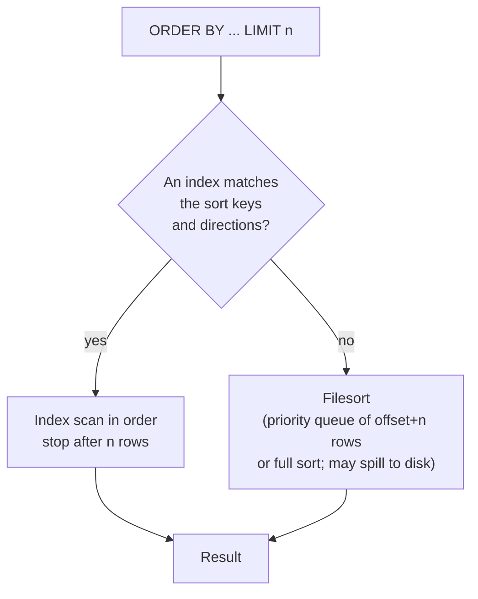

## Introduction

Every list a user ever sees is sorted: newest orders first, cheapest products first, customers alphabetically, search results by relevance. And almost every list is **paginated**: 20 rows per page, "load more", infinite scroll, an API that returns `next_cursor`.

In SQL both are expressed at the very end of a query: `ORDER BY` decides the sequence of rows, `LIMIT` (with an optional `OFFSET`) decides which slice of that sequence is returned. They look trivial, yet they hide three professional-grade problems:

1. **Without `ORDER BY`, there is no order.** A table is a set (bag) of rows. Results that "come back sorted" without `ORDER BY` are an accident of the current plan.
2. **Ties make sorting nondeterministic.** If two rows have the same sort key, the database may return them in either order — and with `LIMIT`, a row may appear on two pages or on none.
3. **`OFFSET` gets slower with every page.** `LIMIT 20 OFFSET 100000` must produce and discard 100,000 rows. Deep pagination is a classic production incident; **keyset pagination** is the standard fix.

This lesson covers sorting semantics (directions, multiple keys, NULLs, expressions, collations), how MySQL executes a sort (index order versus *filesort*), and pagination done properly.

:::note[Dataset]
Examples use the **shop** dataset, plus a generated `events` table of 200,000 rows to make pagination costs measurable. All outputs were captured from a real MySQL server.
:::

## DBMS Theory

:::theory[Relations are unordered; ORDER BY produces a sequence]
In the relational model a relation is a **set** of tuples, and sets have no order. Every relational operator — σ, π, ⋈, ∪, γ — takes unordered inputs and produces an unordered output. Sorting is therefore *not* a relational operator. It is usually written **τ** (tau) in extended algebra and is applied **only at the end**, turning the final relation into a **sequence** (a list) for presentation. This is why the SQL standard allows `ORDER BY` only on the outermost query (or together with a row limit), and why an `ORDER BY` inside a derived table or view without a limit may be ignored by the optimizer.
:::

A sort is defined by a list of **sort keys**, each with a direction. Rows are compared on the first key; only if they are equal on it is the second key consulted, and so on — a **lexicographic order**. Formally, the result is a total order only if the sort keys together form a **unique key** of the result. Otherwise the order is a *partial* (weak) order: rows that agree on every sort key are **peers** (ties), and the standard explicitly leaves their relative order **implementation-dependent**.

That single fact explains the most common pagination bug. `LIMIT` cuts a sequence at a position; if the cut falls inside a group of peers, *which* peers land on which side of the cut is undefined, and can change between executions, plans or server versions.

NULL ordering is also implementation-defined in the standard, which provides `NULLS FIRST` / `NULLS LAST` to make it explicit. MySQL treats NULL as **smaller than any non-NULL value**: NULLs come first in ascending order and last in descending order. MySQL does **not** support the `NULLS FIRST/LAST` syntax.

Row limiting has two standard forms: `FETCH FIRST n ROWS ONLY` with `OFFSET m ROWS` (SQL:2008), and the widely used non-standard `LIMIT n OFFSET m`. **MySQL supports only `LIMIT`.**

## Why It Exists

Applications need order for meaning ("latest first", "rank 1, 2, 3"), for usability (alphabetical lists) and for correctness of logic that consumes rows sequentially (running balances, "first event of each day"). Pagination exists because returning 2 million rows to a browser or a mobile app is impossible: memory, bandwidth and human attention all demand slices.

Doing this in the database rather than in the application matters because:

- **Top-N is cheaper than sort-everything.** "Ten newest orders" can be answered by reading the last ten entries of an index on `order_date`, or by keeping only the best ten rows in a small heap during a scan. The application cannot do either without first fetching everything.
- **Only the page crosses the network.** `LIMIT 20` sends 20 rows, not the whole result.
- **Consistent collation.** Sorting text correctly (case, accents, language rules) is defined by the column's collation; doing it in each client in different languages gives inconsistent results.

## Internal Working

:::internals[Two ways to produce ordered rows]
**1. Read an index in order.** A B+ tree index keeps keys sorted, and its leaf pages are linked, so scanning it forward (or backward) yields rows already in key order. If the ORDER BY matches a prefix of an index's columns — in compatible directions — and the WHERE clause does not get in the way, MySQL simply reads the index and **no sort happens**. Combined with `LIMIT n` it can stop after *n* rows: the cost is independent of table size.

**2. Filesort.** Otherwise MySQL sorts. EXPLAIN shows `Using filesort` (traditional format) or a `Sort:` node (tree format). Despite the name, a filesort happens **in memory** when the data fits into the sort buffer (`sort_buffer_size`, default 256 KB per sort) and spills to temporary files on disk, merged in passes, when it does not. MySQL 8.0 stores the needed columns ("addon fields", packed) in the sort buffer so it does not have to re-read rows after sorting.

**Top-N optimization.** For `ORDER BY … LIMIT n` (with or without OFFSET) MySQL can use a **priority queue** holding only the best `offset + n` rows instead of sorting the whole input. `EXPLAIN FORMAT=TREE` shows this as `Sort: …, limit input to N row(s) per chunk`. Note the `offset + n`: for deep offsets the queue is large.
:::



**When can an index provide the order?** The ORDER BY columns must be a leftmost prefix of the index (or follow equality conditions on earlier index columns), and the directions must either all match the index or all be the reverse of it (InnoDB scans indexes backward). An index `(created_at, event_id)` serves `ORDER BY created_at, event_id` and `ORDER BY created_at DESC, event_id DESC`, but not `ORDER BY created_at ASC, event_id DESC` — unless you create a **descending index** with mixed directions, supported since MySQL 8.0.

**How OFFSET is executed.** There is no way to jump to "row 100,001" of an ordered result: the server must generate rows 1 through 100,000 in order and throw them away. With an index scan that means reading 100,000 index entries (and, if the index does not cover the query, 100,000 row lookups); with a filesort it means sorting at least 100,010 rows. The cost grows **linearly with the offset**.

## MySQL Implementation

```sql
SELECT select_list
FROM table_reference
[WHERE condition]
ORDER BY sort_expr [ASC | DESC] [, sort_expr [ASC | DESC] ...]
LIMIT row_count [OFFSET offset];      -- or: LIMIT offset, row_count
```

Sort by one key, ascending (the default) and descending:

```sql run
SELECT product_id, name, price
FROM products
ORDER BY price DESC
LIMIT 5;
```

Multiple keys: the second key orders rows that tie on the first. Customers by state, then city, then last name:

```sql run
SELECT state, city, last_name, first_name
FROM customers
ORDER BY state, city, last_name
LIMIT 8;
```

Each key has its **own** direction. `ORDER BY state DESC, city` sorts state descending and city ascending — `DESC` does not distribute over the list:

```sql run
SELECT state, city, last_name
FROM customers
ORDER BY state DESC, city
LIMIT 6;
```

`LIMIT` with `OFFSET` returns a page. Page 2 of products by price, 5 per page:

```sql run
SELECT product_id, name, price
FROM products
ORDER BY price DESC, product_id
LIMIT 5 OFFSET 5;
```

`LIMIT 5, 5` (offset first, then count) is the same query in MySQL's older syntax — easy to misread, so prefer the explicit `OFFSET` keyword.

## Syntax Breakdown

| Element | Meaning and rules |
|---|---|
| `ORDER BY expr` | Sort key: a column, an expression (`price - cost`), a SELECT-list alias, or (discouraged) a column position (`ORDER BY 2`). |
| `ASC` / `DESC` | Direction per key; `ASC` is the default. Applies only to the key it follows. |
| Multiple keys | Lexicographic: later keys only break ties of earlier keys. |
| NULLs | Sort first in `ASC`, last in `DESC`. No `NULLS FIRST/LAST`; emulate with `ORDER BY col IS NULL, col`. |
| Strings | Ordered by the column's **collation** (`utf8mb4_0900_ai_ci`: case- and accent-insensitive, so `'apple'` and `'Apple'` are peers). |
| `ENUM` | Ordered by the enum's **definition index**, not alphabetically. |
| `LIMIT n` | At most *n* rows. `n` must be a non-negative integer literal, a `?` placeholder in a prepared statement, or a variable inside a stored program — not an arbitrary expression. |
| `LIMIT n OFFSET m` / `LIMIT m, n` | Skip *m* rows, then return at most *n*. |
| `ORDER BY RAND()` | Random order; evaluates `RAND()` per row and sorts the whole input — expensive on large tables. |

:::standard[Standard SQL vs MySQL]
`ORDER BY` with `ASC`/`DESC` and multiple keys is standard. Standard SQL has `NULLS FIRST/LAST` and `OFFSET m ROWS FETCH FIRST n ROWS ONLY`; MySQL supports neither and uses `LIMIT`. MySQL extensions: `LIMIT`, sorting by aliases in combination with expressions, `ORDER BY` in `UPDATE`/`DELETE`, and `ORDER BY` with column positions (which the MySQL manual describes as deprecated, since the syntax was removed from the standard).
:::

:::version[Sorting changes since MySQL 5.7]
MySQL 8.0 removed the implicit sorting that `GROUP BY` used to perform (and the `GROUP BY col DESC` syntax): grouped results are no longer ordered unless you write `ORDER BY`. 8.0 also added real **descending indexes** (in 5.7, `DESC` in an index definition was parsed but ignored). `SQL_CALC_FOUND_ROWS` and `FOUND_ROWS()` are deprecated since 8.0.17; run a separate `COUNT(*)` instead. All of this applies unchanged to 8.4 LTS.
:::

## Practical Examples

**1. NULL placement and how to control it.** Orders that have not shipped have `shipped_at` NULL. Ascending puts them first; descending puts them last:

```sql run
SELECT order_id, status, shipped_at
FROM orders
ORDER BY shipped_at
LIMIT 5;
```

To put NULLs **last** in an ascending sort, sort by the boolean `shipped_at IS NULL` first (0 for non-NULL rows, 1 for NULL rows):

```sql run
SELECT order_id, status, shipped_at
FROM orders
ORDER BY shipped_at IS NULL, shipped_at, order_id
LIMIT 5;
```

**2. Sorting by an expression or alias.** Products by unit margin, highest first. The alias defined in the SELECT list is visible in ORDER BY, because ORDER BY is evaluated after SELECT:

```sql run
SELECT name, price, cost, price - cost AS unit_margin
FROM products
ORDER BY unit_margin DESC, product_id
LIMIT 5;
```

**3. Custom business order.** Status should appear in the workflow order the support team uses (pending, paid, shipped, then the rest). `FIELD(str, s1, s2, …)` returns the position of `str` in the list (0 if absent); a `CASE` expression is the portable equivalent:

```sql run
SELECT order_id, status
FROM orders
WHERE order_id <= 12
ORDER BY CASE status
           WHEN 'pending'   THEN 1
           WHEN 'paid'      THEN 2
           WHEN 'shipped'   THEN 3
           ELSE 4
         END,
         order_id;
```

**4. ENUM ordering surprise.** `status` is an `ENUM('pending','paid','shipped','delivered','cancelled','refunded')`. Sorting it uses the **definition index**; to sort alphabetically, sort a string version:

```sql run
SELECT DISTINCT status,
       CAST(status AS CHAR) AS status_text
FROM orders
ORDER BY status;
```

```sql run
SELECT DISTINCT status
FROM orders
ORDER BY CAST(status AS CHAR);
```

**5. Ties and determinism.** Several products share the same `stock_qty`. Sort by stock ascending and look at the peers:

```sql run
SELECT product_id, name, stock_qty
FROM products
ORDER BY stock_qty
LIMIT 6;
```

The first two rows both have `stock_qty = 0`, and in the captured run the filesort returned product 13 *before* product 4 — not primary-key order. If you asked for `LIMIT 1`, which of them is "the product with the lowest stock" is undefined. The MySQL manual states it directly: rows with identical ORDER BY values may be returned in any order, and that order may differ depending on the overall execution plan — adding or removing `LIMIT` can change it. Adding a unique tie-breaker makes the order a total order:

```sql run
SELECT product_id, name, stock_qty
FROM products
ORDER BY stock_qty, product_id
LIMIT 6;
```

Now product 4 comes first, by definition rather than by accident. Compare the two outputs: same rows, different order among the peers. Often the two orders happen to coincide, which is the real danger — the bug only shows up when the plan changes (a new index, more data, an upgrade), and then rows silently jump between pages.

## Execution Walkthrough

How does the server produce "page 2 of active products, cheapest first"? The walkthrough follows the logical order FROM → WHERE → SELECT → ORDER BY → LIMIT with real intermediate results.

```walkthrough
title: SELECT name, price FROM products WHERE is_active ORDER BY price, product_id LIMIT 4 OFFSET 4
steps:
  - title: "1. FROM and WHERE — the candidate rows (unordered)"
    explain: >-
      The input is every product; WHERE keeps the active ones. At this point the rows have no defined order —
      shown here in primary-key order only because we asked for it.
    sql: SELECT product_id, name, price, is_active FROM products WHERE is_active ORDER BY product_id LIMIT 10;
  - title: "2. SELECT — project the columns"
    explain: >-
      The SELECT list is evaluated. product_id is not in the SELECT list of the final query, yet ORDER BY may still
      use it, because sorting happens on the rows produced by FROM/WHERE with all their columns available.
  - title: "3. ORDER BY — sort the whole filtered set"
    explain: >-
      All active products are sorted by price, with product_id breaking ties. The first eight positions are shown;
      positions 5–8 are the page we want.
    sql: |
      SELECT ROW_NUMBER() OVER (ORDER BY price, product_id) AS position, product_id, name, price
      FROM products WHERE is_active
      ORDER BY price, product_id
      LIMIT 8;
  - title: "4. OFFSET — generate and discard the first 4"
    explain: >-
      OFFSET 4 does not jump anywhere: positions 1–4 are produced and thrown away. On a large table this discarded
      work is the entire cost of deep pagination.
  - title: "5. LIMIT — return the next 4"
    explain: The final result is positions 5–8.
    sql: SELECT name, price FROM products WHERE is_active ORDER BY price, product_id LIMIT 4 OFFSET 4;
  - title: "6. The physical plan"
    explain: >-
      There is no index on price, so MySQL filesorts. The tree shows a sort that keeps only offset + limit = 8 rows
      (the priority-queue Top-N optimization), above a filter on is_active and a table scan.
    sql: EXPLAIN FORMAT=TREE SELECT name, price FROM products WHERE is_active ORDER BY price, product_id LIMIT 4 OFFSET 4;
```

(The `ROW_NUMBER()` window function in step 3 is taught in Module 4; it is used here only to display positions.)

Now contrast a sort an index can satisfy. `orders` has `idx_orders_date (order_date)`; the newest five orders need no sort at all — MySQL reads the index backward and stops after five entries:

```sql run
EXPLAIN FORMAT=TREE
SELECT order_id, order_date FROM orders ORDER BY order_date DESC LIMIT 5;
```

## Output

The output of a sorted, limited query must be read together with its sort keys:

- **Check the boundary rows.** Look at the last row of a page and the first row of the next page. If they have the same sort-key values, your sort keys are not unique and the page boundary is unstable.
- **NULL rows cluster at one end.** If a "most recent first" list starts with blank dates, the DESC/ASC choice met MySQL's NULL ordering; decide where NULLs belong and encode it.
- **Pages are snapshots in time.** Two page requests are two separate queries. If rows are inserted or deleted between them, OFFSET-based pages shift: a row can be skipped or shown twice even with a perfect tie-breaker. Keyset pagination (below) does not have this problem for inserts before the cursor.

```sql run
-- Boundary check for pages of 5 products ordered by stock: rows 5 and 6 straddle the page break
SELECT product_id, stock_qty
FROM products
ORDER BY stock_qty, product_id
LIMIT 2 OFFSET 4;
```

Here the two boundary rows have different stock values (17 and 22), so this page break is stable. A break falling between the two zero-stock products would be stable only because `product_id` is part of the sort.

## Alternative Approaches

### Keyset (seek) pagination

Instead of "skip *m* rows", remember the **sort key of the last row shown** and ask for rows *after* it:

```sql
-- Page 1
SELECT … FROM events ORDER BY created_at, event_id LIMIT 20;
-- Next page: last row of the previous page had (created_at = :c, event_id = :id)
SELECT … FROM events
WHERE created_at > :c OR (created_at = :c AND event_id > :id)
ORDER BY created_at, event_id
LIMIT 20;
```

With an index on `(created_at, event_id)`, the WHERE clause becomes an index range that starts exactly at the cursor; the cost of every page is the cost of reading 20 index entries, no matter how deep. The unique tie-breaker (`event_id`) is mandatory: it makes the cursor position unambiguous.

| Approach | Strengths | Weaknesses |
|---|---|---|
| `LIMIT n OFFSET m` | Trivial; random access to "page 37"; easy total page count | Cost grows with `m`; rows shift when data changes between requests |
| Keyset / seek | Constant cost per page; stable under inserts; ideal for infinite scroll and APIs (`next_cursor`) | No jumping to arbitrary page numbers; cursor must contain all sort keys; mixed sort directions complicate the predicate |
| Deferred join ("late row lookup") | Keeps OFFSET semantics but scans only a narrow covering index for the skipped rows, then fetches full rows for the page | Still linear in `m`, just cheaper per skipped row; Module 7 |
| Cached result IDs | Snapshot the ordered ID list once (e.g. in a cache) and page through it | Stale data; memory |

Keyset pagination is previewed here and developed further with indexing in Module 7.

### Counting the total

UIs that show "page 3 of 128" need a total count. The old trick `SELECT SQL_CALC_FOUND_ROWS … LIMIT 20` followed by `SELECT FOUND_ROWS()` is deprecated; the manual recommends a separate `SELECT COUNT(*) … WHERE <same filter>`. On large results even that is expensive (see [Aggregate Functions](/lessons/m03-aggregate-functions)), which is why many products show "1,000+ results" or offer only "next".

## Performance Analysis

Generate 200,000 events with an index on `(created_at, event_id)` — three events per minute, so `created_at` alone has many ties and the tie-breaker matters:

```sql run
SET SESSION cte_max_recursion_depth = 200000;
CREATE TABLE events (
  event_id   INT PRIMARY KEY,
  created_at DATETIME    NOT NULL,
  kind       VARCHAR(10) NOT NULL,
  payload    VARCHAR(50) NOT NULL,
  KEY idx_events_created (created_at, event_id)
);
INSERT INTO events (event_id, created_at, kind, payload)
WITH RECURSIVE seq(n) AS (SELECT 1 UNION ALL SELECT n + 1 FROM seq WHERE n < 200000)
SELECT n, '2024-01-01' + INTERVAL (n DIV 3) MINUTE, ELT(1 + n % 3, 'click', 'view', 'buy'), REPEAT('x', 40)
FROM seq;
ANALYZE TABLE events;
SELECT COUNT(*) AS events FROM events;
```

**Shallow page with OFFSET** — the index provides the order; MySQL reads offset + limit entries:

```sql run measured
EXPLAIN ANALYZE SELECT * FROM events ORDER BY created_at, event_id LIMIT 10 OFFSET 100;
```

**Deep page with OFFSET** — 150,010 rows must be produced to return 10. Following the index would mean 150,010 random row lookups, so the optimizer prefers to scan the whole table and run a Top-N sort that keeps 150,010 rows:

```sql run measured
EXPLAIN ANALYZE SELECT * FROM events ORDER BY created_at, event_id LIMIT 10 OFFSET 150000;
```

Find the sort key of the last row before that page — this is what a keyset cursor would hold:

```sql run
SELECT created_at, event_id
FROM events
ORDER BY created_at, event_id
LIMIT 1 OFFSET 149999;
```

**Keyset page** — the predicate starts the index range right after the cursor; only the 10 needed entries are read:

```sql run measured
EXPLAIN ANALYZE
SELECT * FROM events
WHERE created_at > '2024-02-04 17:20:00'
   OR (created_at = '2024-02-04 17:20:00' AND event_id > 150000)
ORDER BY created_at, event_id
LIMIT 10;
```

Read the `actual … rows=10` part of the range-scan line: only ten index entries were read. The `cost` and estimated `rows` on that line describe the *whole* range to the end of the table; the optimizer knows `LIMIT 10` will stop the scan early, which is why it still chose this plan.

Both queries return the same ten rows, which you can verify:

```sql run
SELECT event_id, created_at FROM events ORDER BY created_at, event_id LIMIT 3 OFFSET 150000;
```

```sql run
SELECT event_id, created_at FROM events
WHERE created_at > '2024-02-04 17:20:00'
   OR (created_at = '2024-02-04 17:20:00' AND event_id > 150000)
ORDER BY created_at, event_id
LIMIT 3;
```

:::warning[The row-constructor form of the keyset predicate]
Standard SQL lets you write the cursor condition compactly as `WHERE (created_at, event_id) > (:c, :id)`. It is logically identical, but check the plan: on the MySQL 8.0 server used to capture this lesson, the optimizer did **not** turn that row comparison into an index range — it scanned the index from the beginning and filtered (shown below). Write the expanded `a > x OR (a = x AND b > y)` form, and confirm with EXPLAIN on your own server version.
:::

```sql run measured
EXPLAIN ANALYZE
SELECT * FROM events
WHERE (created_at, event_id) > ('2024-02-04 17:20:00', 150000)
ORDER BY created_at, event_id
LIMIT 10;
```

**Mixed directions need a matching index.** `ORDER BY created_at ASC, event_id DESC` cannot use `(created_at, event_id)` — neither the forward nor the backward scan produces that order — so MySQL filesorts. A descending index (MySQL 8.0+) with the same mixed directions fixes it:

```sql run
EXPLAIN FORMAT=TREE SELECT * FROM events ORDER BY created_at, event_id DESC LIMIT 10;
```

```sql run
ALTER TABLE events ADD INDEX idx_events_created_mixed (created_at ASC, event_id DESC);
EXPLAIN FORMAT=TREE SELECT * FROM events ORDER BY created_at, event_id DESC LIMIT 10;
```

:::performance[Theory vs measurement]
The plans show the algorithmic difference: OFFSET work is proportional to the offset, keyset work to the page size. The `actual time` values were measured on the build machine against a cached 200,000-row table and will differ on yours — compare the `rows=` counts instead, which are deterministic. At production scale (tens of millions of rows, cold pages), the deep-OFFSET query reads proportionally more pages and the gap widens.
:::

## Best Practices

:::best-practice[Sorting and paging like a professional]
1. **Always write `ORDER BY` when order matters** — including in tests. Never rely on "it comes back sorted".
2. **End every ORDER BY used for pagination with a unique key** (usually the primary key) so the order is total.
3. **Make NULL placement explicit** with `col IS NULL` as a leading sort key when the default (NULLs first in ASC) is not what users expect.
4. **Use keyset pagination for deep or unbounded lists** (feeds, exports, APIs), with an index whose columns and directions match the ORDER BY exactly.
5. **Cap OFFSET-based pagination** (e.g. at page 100) and offer search/filters instead of deep paging.
6. **Avoid `ORDER BY RAND()` on large tables**; pick random IDs in the application or sample with a precomputed random column.
7. **Prefer `LIMIT n OFFSET m`** over `LIMIT m, n` for readability, and pass both as bound parameters.
8. **Avoid `SQL_CALC_FOUND_ROWS`** (deprecated); count separately, approximately, or not at all.
:::

## Common Mistakes

**Mistake 1 — expressions in LIMIT.** `LIMIT` accepts literals and placeholders, not expressions. Compute the offset in the application (or use a prepared statement parameter):

```sql run error
SELECT product_id FROM products ORDER BY product_id LIMIT 2 + 3;
```

**Mistake 2 — thinking DESC applies to every key.** `ORDER BY state, city DESC` sorts state ascending. Write the direction on each key.

**Mistake 3 — paging without a tie-breaker.** `ORDER BY order_date LIMIT 20 OFFSET 20` is fine only if `order_date` is unique. With `stock_qty`, `status` or `created_at`-per-minute, add the primary key.

**Mistake 4 — ORDER BY in a subquery used for "top per group".** An `ORDER BY` inside a derived table without a `LIMIT` has no meaning for the outer query; MySQL's optimizer may drop it. Order the outermost query.

**Mistake 5 — relying on ENUM sort order being alphabetical.** It is definition order (shown in Practical Example 4).

**Mistake 6 — sorting by a column position.** `ORDER BY 3` breaks silently when someone reorders the SELECT list. Use names or aliases.

**Mistake 7 — `LIMIT` before thinking about cost.** `LIMIT 10` does not make a query cheap if the plan must filesort millions of rows first. Check EXPLAIN for `Using filesort` on large inputs.

## Industry Application

- **Social feeds and activity streams.** Feeds are paginated with opaque cursors that encode `(created_at, id)` — keyset pagination. Many public APIs (GitHub, Stripe, Slack) use cursor-based pagination exactly so that clients can page through millions of items at constant cost.
- **Data exports and backfills.** Batch jobs that process a large table in chunks iterate with `WHERE id > :last_id ORDER BY id LIMIT 1000` rather than OFFSET, so that each batch is cheap and the job can resume from the last ID after a failure.
- **Admin dashboards.** Back-office tables often allow sorting by any column; teams index the popular sort columns (with the primary key appended) and restrict sorting on unindexed columns or large tables.
- **Leaderboards and rankings.** "Top 100 players" uses `ORDER BY score DESC, player_id LIMIT 100` with an index on `(score DESC, player_id)` — the descending index avoids a sort on every request.
- **Search UIs.** Showing "about 2,300 results" and limiting navigation to the first few pages is a deliberate design choice: exact counts and deep offsets are expensive for every database.

## Practice Exercises

```exercise
id: ex1
title: The five most expensive products
difficulty: easy
concepts: [order-by, sort-direction, limit-offset]
prompt: |
  Return the 5 most expensive products with columns `name`, `price`, from most to least expensive. If two
  products had the same price, the one with the smaller `product_id` should come first.
hints:
  - "Sort descending by price and add a tie-breaker."
  - "ORDER BY price DESC, product_id LIMIT 5"
solution: |
  SELECT name, price
  FROM products
  ORDER BY price DESC, product_id
  LIMIT 5;
orderMatters: true
explanation: |
  `DESC` applies only to `price`; `product_id` is ascending, as required. The tie-breaker guarantees a
  deterministic result even if prices tie in the future.
```

```exercise
id: ex2
title: Unshipped orders last
difficulty: medium
concepts: [null-ordering, order-by]
prompt: |
  List all orders with `order_id`, `shipped_at`, sorted by `shipped_at` **ascending** (earliest shipment
  first) but with **unshipped orders (NULL) at the end**. Break ties by `order_id`.
hints:
  - "MySQL puts NULLs first in ascending order and has no NULLS LAST."
  - "Sort by shipped_at IS NULL first: it is 0 for shipped orders and 1 for unshipped ones."
solution: |
  SELECT order_id, shipped_at
  FROM orders
  ORDER BY shipped_at IS NULL, shipped_at, order_id;
orderMatters: true
explanation: |
  `ORDER BY shipped_at` alone puts the unshipped orders first. `ORDER BY shipped_at DESC` would move NULLs to
  the end but reverse the date order. `ORDER BY ISNULL(shipped_at), shipped_at` or
  `ORDER BY COALESCE(shipped_at, '9999-12-31')` also work — the latter hides intent and cannot use an index.
```

```exercise
id: ex3
title: Page 3 of the catalogue
difficulty: medium
concepts: [limit-offset, deterministic-ordering]
prompt: |
  The catalogue shows products ordered by `name` (A→Z), **6 products per page**. Return **page 3** with
  columns `product_id`, `name`.
hints:
  - "Page p with page size s starts at offset (p − 1) × s."
  - "LIMIT 6 OFFSET 12"
solution: |
  SELECT product_id, name
  FROM products
  ORDER BY name, product_id
  LIMIT 6 OFFSET 12;
orderMatters: true
explanation: |
  Page 3 skips the 12 rows of pages 1 and 2. `LIMIT 12, 6` is the equivalent MySQL syntax; `LIMIT 6, 12`
  (a common slip) skips 6 rows and returns 12. Product names happen to be unique here, but adding
  `product_id` keeps the order total if a duplicate name is ever added.
```

```exercise
id: ex4
title: Lowest stock, deterministically
difficulty: hard
concepts: [deterministic-ordering, order-by]
prompt: |
  Return the **4 active products with the lowest stock**, columns `product_id`, `name`, `stock_qty`, lowest
  first. Several products share stock values, so define a deterministic order: ties are broken by the
  **higher price first**, then by `product_id`.
hints:
  - "Filter active products in WHERE; sort by three keys."
  - "ORDER BY stock_qty, price DESC, product_id"
solution: |
  SELECT product_id, name, stock_qty
  FROM products
  WHERE is_active
  ORDER BY stock_qty, price DESC, product_id
  LIMIT 4;
orderMatters: true
explanation: |
  Without the tie-breakers the result of `LIMIT 4` could legitimately differ between executions whenever the
  cut falls among peers. Each key carries its own direction: `price DESC` does not affect `stock_qty` or
  `product_id`.
```

```exercise
id: ex5
title: Keyset pagination with mixed directions
difficulty: challenge
concepts: [keyset-pagination, deterministic-ordering, sort-direction]
prompt: |
  An API lists products by **price descending**, ties broken by **product_id ascending**, 5 per page. The
  last product on the previous page had `price = 89.00` and `product_id = 18`.

  Return the **next page** — columns `product_id`, `name`, `price` — **without using OFFSET**.
hints:
  - "'After' the cursor in this order means: a lower price, or the same price with a higher product_id."
  - "WHERE price < 89.00 OR (price = 89.00 AND product_id > 18)"
  - "Keep exactly the same ORDER BY as the listing, then LIMIT 5."
solution: |
  SELECT product_id, name, price
  FROM products
  WHERE price < 89.00 OR (price = 89.00 AND product_id > 18)
  ORDER BY price DESC, product_id
  LIMIT 5;
orderMatters: true
explanation: |
  Because the two keys have opposite directions, the row-constructor shortcut `(price, product_id) < (89.00, 18)`
  would be wrong (it means a lower price, or the same price with a *lower* id). The expanded predicate states
  each direction explicitly. An index on `(price DESC, product_id ASC)` would let MySQL start reading exactly at
  the cursor.
```

```exercise
id: ex6
title: Why does page 5000 time out?
difficulty: hard
kind: open
concepts: [limit-offset, keyset-pagination, filesort]
prompt: |
  An admin page lists orders with `SELECT * FROM orders ORDER BY created_at DESC LIMIT 50 OFFSET :offset`.
  Page 1 is fast; page 5,000 times out. The table has 30 million rows and an index on `created_at`.
  Explain what the server does for page 5,000, and propose a fix including the index you would use.
solution: |
  Page 5,000 means OFFSET 249,950: the server must produce 250,000 rows in `created_at DESC` order and discard
  all but the last 50. Following the index backwards would require ~250,000 primary-key lookups for `SELECT *`;
  the optimizer may instead scan and sort the table with a 250,000-row priority queue. Either way the work grows
  linearly with the page number. `created_at` alone is also not unique, so rows with equal timestamps can move
  between pages.

  Fix: switch to keyset pagination with a unique tie-breaker — `ORDER BY created_at DESC, order_id DESC` with an
  index on `(created_at, order_id)` (scanned backward) and the next page requested as
  `WHERE created_at < :c OR (created_at = :c AND order_id < :id) … LIMIT 50`. Each page then reads ~50 index
  entries. If random access to page numbers is a hard requirement, cap the reachable page depth, and use a
  deferred join (page through the narrow index to find 50 primary keys, then join back for the full rows).
```

## Knowledge Assessment

```quiz
- id: q1
  question: "A query has no ORDER BY. In which order does MySQL return the rows?"
  options:
    - "Primary-key order, always"
    - "Insertion order"
    - "Unspecified — whatever order the chosen plan produces"
    - "Alphabetical by the first column"
  answer: 2
  explanation: "Relations are unordered; without ORDER BY the order is an artifact of the plan (a table scan often yields primary-key order on InnoDB, an index scan yields index order, a hash or temporary table yields something else). It can change when the plan changes."
  concepts: [order-by]
- id: q2
  question: "In MySQL, where do NULLs appear in `ORDER BY col ASC` and in `ORDER BY col DESC`?"
  options: ["First, first", "Last, last", "First, last", "Last, first"]
  answer: 2
  explanation: "MySQL treats NULL as lower than any non-NULL value: first in ascending order, last in descending. MySQL does not support NULLS FIRST/LAST; use ORDER BY col IS NULL, col to put NULLs last in ascending order."
  concepts: [null-ordering]
- id: q3
  question: "`ORDER BY state DESC, city` sorts:"
  options:
    - "Both state and city descending"
    - "State descending, city ascending"
    - "State ascending, city descending"
    - "It is a syntax error"
  answer: 1
  explanation: "Each sort key has its own direction, defaulting to ASC. DESC does not distribute over the list."
  concepts: [sort-direction]
- id: q4
  question: "Which statements about `LIMIT 20 OFFSET 100000` are true? (Select all that apply.)"
  type: multi
  options:
    - "The server must produce and discard 100,000 ordered rows"
    - "MySQL jumps directly to row 100,001 using the index"
    - "Without a unique tie-breaker in ORDER BY, rows can appear on two pages or be skipped"
    - "Its cost is independent of the offset"
  answer: [0, 2]
  explanation: "There is no positional access into an ordered result: rows up to the offset are generated and discarded, so cost grows with the offset. Ties make the page boundary nondeterministic. Keyset pagination avoids both problems."
  concepts: [limit-offset, deterministic-ordering]
- id: q5
  question: "An index exists on `(created_at, event_id)`. Which ORDER BY can be satisfied by reading this index without a filesort?"
  options:
    - "ORDER BY created_at ASC, event_id DESC"
    - "ORDER BY event_id"
    - "ORDER BY created_at DESC, event_id DESC"
    - "ORDER BY payload"
  answer: 2
  explanation: "InnoDB can scan an index forward or backward, so all-ascending or all-descending orders on a leftmost prefix work. Mixed directions need a descending index with matching directions; event_id alone is not a leftmost prefix; payload is not in the index."
  concepts: [filesort, descending-index]
- id: q6
  question: "The last row of a page sorted by `price DESC, product_id ASC` has price 50.00 and product_id 29. Which WHERE clause selects the following rows for keyset pagination?"
  options:
    - "WHERE (price, product_id) < (50.00, 29)"
    - "WHERE price < 50.00 OR (price = 50.00 AND product_id > 29)"
    - "WHERE price <= 50.00 AND product_id > 29"
    - "WHERE price < 50.00"
  answer: 1
  explanation: "After the cursor means a lower price, or an equal price with a higher id (ascending tie-breaker). The row-constructor version treats both keys as descending; the AND version drops cheaper products with smaller ids; price < 50.00 alone skips remaining peers at 50.00."
  concepts: [keyset-pagination]
- id: q7
  question: "`EXPLAIN FORMAT=TREE` shows `Sort: products.price, limit input to 8 row(s) per chunk` for `ORDER BY price LIMIT 4 OFFSET 4`. What does that mean?"
  options:
    - "Only 8 rows of the table were read"
    - "MySQL keeps only the best offset + limit = 8 rows in a priority queue while reading all input rows"
    - "The sort spilled to 8 temporary files"
    - "The query uses an index on price"
  answer: 1
  explanation: "The Top-N optimization keeps a bounded heap of offset + limit rows instead of sorting everything, but every input row is still read and compared. Spilling to disk is not indicated here, and a sort node means no index provided the order."
  concepts: [filesort, limit-offset]
- id: q8
  question: "Why is `ORDER BY status` on the ENUM column `status ENUM('pending','paid','shipped',...)` not alphabetical?"
  options:
    - "ENUM values are sorted by their internal index, i.e. definition order"
    - "ENUMs are sorted by string length"
    - "The collation is binary"
    - "It is alphabetical; the question is wrong"
  answer: 0
  explanation: "MySQL stores ENUM values as integers referencing the definition list and sorts by that number. Use ORDER BY CAST(status AS CHAR) for alphabetical order."
  concepts: [order-by]
```
