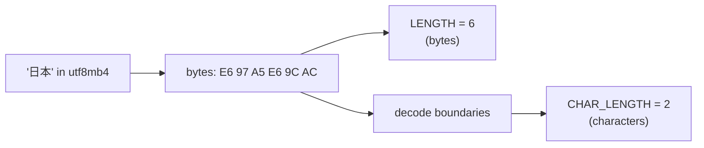

## Introduction

A surprising amount of production SQL is text manipulation. Customer names arrive with stray spaces, product codes must be zero-padded for an ERP export, email domains need to be extracted for a B2B report, a list of tags must be collapsed into one comma-separated cell, and a mailing label needs "City, ST" without a dangling comma when the state is missing. MySQL ships more than sixty string functions; a dozen of them cover nearly all real work, and a few behave in ways that cause real bugs:

- `CONCAT` returns **NULL** if any argument is NULL; `CONCAT_WS` skips NULLs.
- `LENGTH` counts **bytes**, `CHAR_LENGTH` counts **characters** — they differ for accented letters, Asian scripts and emoji in `utf8mb4`.
- `GROUP_CONCAT` **truncates** its result at `group_concat_max_len` (1,024 bytes by default) with only a warning.
- `REPLACE` is **case-sensitive** even when the column's collation is case-insensitive.
- Wrapping an indexed column in a string function in `WHERE` usually **prevents index use**.

[SELECT basics](/lessons/m03-select-basics) introduced `CONCAT` for building display columns, and [Pattern Matching](/lessons/m03-pattern-matching) covered `LIKE` and regular expressions. This lesson is the systematic tour of the function library: what each function computes, how it treats NULL and multibyte characters, and how to use it without wrecking query plans.

:::note[Dataset]
Examples use the **shop** dataset plus small illustrative tables created in your lab. All outputs were captured from a real MySQL server over a `utf8mb4` connection.
:::

## DBMS Theory

:::theory[Strings, character sets and collations]
In the relational model an attribute's **domain** may be a set of character strings. SQL refines this with two independent properties of every string value:

- A **character set** (repertoire + encoding): which characters exist and how each is stored as bytes. `utf8mb4` encodes all of Unicode in **1 to 4 bytes** per character (ASCII in 1, most accented Latin letters in 2, most CJK characters in 3, emoji in 4).
- A **collation**: the rules for comparing and sorting strings in that character set — case sensitivity, accent sensitivity, and how trailing spaces are treated. MySQL 8.0/8.4's default collation is `utf8mb4_0900_ai_ci`: **a**ccent-**i**nsensitive, **c**ase-**i**nsensitive, based on Unicode Collation Algorithm 9.0.0.

A string function is a mapping from strings (and numbers) to a value. Some functions are defined over **characters** (`CHAR_LENGTH`, `SUBSTRING`, `LEFT`, `UPPER`), some over **bytes** (`LENGTH`, `BIT_LENGTH`), and some depend on the **collation** (comparisons, `LOCATE` and `INSTR` matching, `ORDER BY`, `GROUP BY`, `DISTINCT`). Knowing which of the three a function depends on predicts most of its surprises.
:::

Two further theoretical points matter in practice:

1. **NULL propagation.** Standard SQL defines string operators to return NULL when any operand is NULL: the standard concatenation operator `||` behaves this way, and MySQL's `CONCAT()` follows the same rule. Unknown + "Smith" is unknown. `CONCAT_WS` (concatenate *with separator*) is a MySQL extension that deliberately skips NULL arguments.
2. **Positions are 1-based.** SQL string positions start at 1, not 0 as in Python or Java. `SUBSTRING('database', 1, 4)` is `'data'`. A position of 0 yields an empty string in MySQL; negative positions count from the end (a MySQL extension).

:::standard[Standard SQL vs MySQL]
Standard: `SUBSTRING(s FROM p FOR n)`, `TRIM([LEADING|TRAILING|BOTH] c FROM s)`, `UPPER`, `LOWER`, `CHAR_LENGTH`, `OCTET_LENGTH`, `POSITION(x IN s)`, `||` concatenation, `LISTAGG` for string aggregation.
MySQL: supports the standard forms of SUBSTRING, TRIM, POSITION, CHAR_LENGTH and OCTET_LENGTH, and adds `CONCAT`, `CONCAT_WS`, `LEFT`, `RIGHT`, `SUBSTRING_INDEX`, `LOCATE`, `INSTR`, `LPAD`, `RPAD`, `REPLACE`, `REVERSE`, `GROUP_CONCAT`. In MySQL `||` means **logical OR** unless the `PIPES_AS_CONCAT` SQL mode is set — never use `||` for concatenation in MySQL code. `LISTAGG` and PostgreSQL's `STRING_AGG` are not available; use `GROUP_CONCAT`.
:::

## Why It Exists

Data rarely arrives in the shape reports need. Without in-database string functions, every cleanup and formatting step would require pulling rows into application code and writing them back — slow, non-transactional and duplicated across every consumer. String functions let you:

- **Clean at load time** (`TRIM`, `REPLACE`, `UPPER`) inside `INSERT … SELECT` and `UPDATE`, so bad data never reaches core tables.
- **Derive attributes** (email domain, area code, initials) in views and reports without storing redundant columns.
- **Format output** (zero-padded codes, "Last, First") consistently for exports and integrations.
- **Aggregate text** (`GROUP_CONCAT`) to turn one-to-many relationships into a single readable cell — "order 42: Mouse, Keyboard, Hub".

The cost of this convenience is subtle: text semantics depend on character sets and collations, and string expressions in predicates interact badly with indexes. Both are covered below.

## Internal Working

:::internals[How MySQL stores and processes strings]
**Storage.** A `VARCHAR(n)` column declares a maximum of *n* **characters**, not bytes. InnoDB stores the actual bytes plus a 1- or 2-byte length prefix; in `utf8mb4` a `VARCHAR(50)` value can occupy up to 200 bytes. `CHAR(n)` is fixed-length in characters; for `utf8mb4` InnoDB stores CHAR values in a variable-length format between n and 4n bytes and pads with spaces.

**Evaluation.** Every string value inside the server carries its character set and collation. Character-based functions (`CHAR_LENGTH`, `SUBSTRING`, `LEFT`, `LPAD`) must **decode** the variable-length encoding to find character boundaries — for `utf8mb4` that means walking the bytes, since a character can be 1–4 bytes wide. `LENGTH` simply returns the byte count, which is known without decoding.

**Collation-aware functions.** `LOCATE`, `INSTR` and `POSITION` use the collation of their arguments, so under `utf8mb4_0900_ai_ci` they match case- and accent-insensitively. `REPLACE`, by contrast, performs a **byte-exact, case-sensitive** search regardless of collation.

**GROUP_CONCAT.** For each group the server appends values into a buffer. When `ORDER BY` or `DISTINCT` is specified inside `GROUP_CONCAT`, it keeps the values in an internal tree/temporary structure per group to sort or deduplicate them. When the buffer would exceed `group_concat_max_len` **bytes**, it stops appending and records warning 1260 (*"Row N was cut by GROUP_CONCAT()"*). The result type is `VARCHAR` when `group_concat_max_len` ≤ 512, otherwise `TEXT` (or the binary equivalents).
:::



**Trailing spaces and PAD attributes.** Collations have a *pad attribute*. The 8.0+ default `utf8mb4_0900_ai_ci` is **NO PAD**: trailing spaces are significant, so `'abc ' = 'abc'` is FALSE. Older collations such as `utf8mb4_general_ci` and `utf8mb4_bin` are **PAD SPACE**: trailing spaces are ignored in comparisons, so `'abc ' = 'abc'` is TRUE. A schema upgraded from 5.7 can therefore compare strings differently from a new 8.4 schema. `TRIM` before comparing (or at load time) removes the ambiguity.

## MySQL Implementation

**Concatenation and NULL.** `CONCAT` propagates NULL; `CONCAT_WS(separator, …)` skips NULL arguments (but returns NULL if the *separator* is NULL):

```sql run
SELECT customer_id,
       phone,
       CONCAT(first_name, ' ', last_name, ' (', phone, ')')       AS concat_label,
       CONCAT_WS(' · ', CONCAT(first_name, ' ', last_name), phone) AS concat_ws_label
FROM customers
WHERE customer_id IN (4, 5, 10)
ORDER BY customer_id;
```

For customers 5 and 10 (no phone) `CONCAT` produced NULL — the entire label vanished — while `CONCAT_WS` simply omitted the missing part and its separator.

**Bytes vs characters.** Create a small table with multibyte text:

```sql run
CREATE TABLE intl_names (
  id   INT PRIMARY KEY,
  name VARCHAR(20) NOT NULL
) DEFAULT CHARSET = utf8mb4;
INSERT INTO intl_names VALUES
  (1, 'Smith'), (2, 'Müller'), (3, 'José'), (4, '東京'), (5, 'Café ☕'), (6, 'Zoë 🎉');
SELECT id, name,
       CHAR_LENGTH(name) AS characters,
       LENGTH(name)      AS bytes,
       HEX(name)         AS encoded
FROM intl_names
ORDER BY id;
```

ASCII text has one byte per character, so both functions agree on `'Smith'`. `'ü'` and `'é'` take 2 bytes, each kanji 3 bytes, and the emoji 4 bytes. Use `CHAR_LENGTH` for "how long is this name" (validation, UI limits that match `VARCHAR(n)`); use `LENGTH` only when you really care about storage or protocol byte limits.

**Extracting parts.** `SUBSTRING`, `LEFT`, `RIGHT` and `SUBSTRING_INDEX`:

```sql run
SELECT email,
       SUBSTRING_INDEX(email, '@', 1)   AS local_part,
       SUBSTRING_INDEX(email, '@', -1)  AS domain,
       LEFT(phone, 2)                   AS country_prefix,
       SUBSTRING(phone, 4, 3)           AS area_code,
       RIGHT(phone, 4)                  AS last_four
FROM customers
WHERE customer_id IN (1, 2, 5)
ORDER BY customer_id;
```

`SUBSTRING_INDEX(s, delim, n)` returns everything **before** the n-th delimiter (n > 0) or **after** the n-th delimiter counted from the right (n < 0). It is the most practical way to split "user@domain", "a/b/c" paths or "key=value" strings.

## Syntax Breakdown

| Function | Returns | Notes / NULL behaviour |
|---|---|---|
| `CONCAT(s1, s2, …)` | Concatenation | NULL if **any** argument is NULL; numbers are converted to strings |
| `CONCAT_WS(sep, s1, …)` | Concatenation with separator | Skips NULL arguments; NULL only if `sep` is NULL |
| `SUBSTRING(s, pos [, len])` / `SUBSTRING(s FROM pos FOR len)` | Substring | 1-based; negative `pos` counts from the end; `SUBSTR`, `MID` are synonyms |
| `LEFT(s, n)` / `RIGHT(s, n)` | First / last n characters | Characters, not bytes |
| `SUBSTRING_INDEX(s, delim, n)` | Text before n-th / after (−n)-th delimiter | Delimiter match is case-sensitive |
| `TRIM([BOTH\|LEADING\|TRAILING] [chars] FROM s)` | Removes a prefix/suffix | Default removes spaces only (not tabs/newlines); `chars` is a string removed as a unit, repeatedly; `LTRIM`/`RTRIM` remove spaces |
| `REPLACE(s, from, to)` | All occurrences replaced | **Case-sensitive** always |
| `LOCATE(sub, s [, start])` / `INSTR(s, sub)` / `POSITION(sub IN s)` | 1-based position or 0 | Note the reversed argument order of `INSTR`; collation-aware |
| `UPPER(s)` / `LOWER(s)` | Case conversion | No effect on binary strings; follow Unicode rules of the collation |
| `LPAD(s, len, pad)` / `RPAD(s, len, pad)` | Padded to `len` characters | **Truncates** `s` if it is longer than `len` |
| `CHAR_LENGTH(s)` | Number of characters | `CHARACTER_LENGTH` synonym |
| `LENGTH(s)` | Number of bytes | `OCTET_LENGTH` synonym |
| `GROUP_CONCAT([DISTINCT] expr [ORDER BY …] [SEPARATOR 'x'])` | Aggregated string per group | Skips NULLs; default separator `,`; truncated at `group_concat_max_len` bytes with warning 1260 |

### Cleaning functions side by side

```sql run
SELECT TRIM('   padded   ')                    AS trimmed,
       CHAR_LENGTH(TRIM('   padded   '))       AS trimmed_len,
       TRIM(LEADING '0' FROM '000120')         AS no_leading_zeros,
       TRIM(BOTH '-' FROM '--SKU-1001--')      AS no_dashes,
       REPLACE('+1-450-555-4657', '-', '')     AS digits_only,
       LPAD('42', 6, '0')                      AS zero_padded,
       LPAD('1234567', 6, '0')                 AS lpad_truncates,
       RPAD('ab', 5, '.')                      AS right_padded;
```

Note `lpad_truncates`: when the input is longer than the target width, `LPAD` cuts it to the **leftmost** six characters — a silent data change if you use LPAD to "format" IDs that may grow.

## Practical Examples

**1. Building robust display labels with CONCAT_WS.** "City, ST · tier" where the tier may be NULL:

```sql run
SELECT customer_id,
       CONCAT_WS(', ', city, state)                         AS location,
       CONCAT_WS(' · ', CONCAT_WS(', ', city, state),
                 UPPER(loyalty_tier))                       AS location_and_tier
FROM customers
WHERE customer_id IN (1, 3, 9, 10)
ORDER BY customer_id;
```

**2. Case-insensitive search vs case-sensitive REPLACE.** Under the default collation, comparisons and `LOCATE` ignore case — `REPLACE` does not:

```sql run
SELECT 'Hello' = 'hello'                     AS equal_ci,
       LOCATE('LAPTOP', 'Gaming Laptop 16')   AS locate_ci,
       REPLACE('Gaming Laptop 16', 'laptop', 'Notebook') AS replace_lower,
       REPLACE('Gaming Laptop 16', 'Laptop', 'Notebook') AS replace_exact;
```

`LOCATE` found `'LAPTOP'` at position 8, but `REPLACE` with `'laptop'` changed nothing. For case-insensitive replacement use `REGEXP_REPLACE(s, 'laptop', 'Notebook', 1, 0, 'i')` ([Pattern Matching](/lessons/m03-pattern-matching)).

**3. Normalizing messy input.** A staging table of imported SKUs with inconsistent spacing and case. Clean it in one `UPDATE`:

```sql run
CREATE TABLE sku_import (id INT PRIMARY KEY, raw_sku VARCHAR(30), clean_sku VARCHAR(30));
INSERT INTO sku_import (id, raw_sku) VALUES
  (1, '  sku-1001 '), (2, 'SKU 1002'), (3, 'Sku-1003'), (4, 'sku_1004  ');
UPDATE sku_import
SET clean_sku = UPPER(REPLACE(REPLACE(TRIM(raw_sku), ' ', '-'), '_', '-'));
SELECT id, CONCAT('[', raw_sku, ']') AS raw_bracketed, clean_sku,
       clean_sku IN (SELECT sku FROM products) AS matches_catalog
FROM sku_import ORDER BY id;
```

Brackets make the leading and trailing spaces visible. After `TRIM`, separator normalization and `UPPER`, every imported code matches the catalogue.

**4. String aggregation with GROUP_CONCAT.** The products in each order as one readable cell, sorted, with a custom separator:

```sql run
SELECT oi.order_id,
       COUNT(*)                                                  AS line_count,
       GROUP_CONCAT(p.name ORDER BY p.name SEPARATOR ' | ')      AS products
FROM order_items oi
JOIN products p ON p.product_id = oi.product_id
WHERE oi.order_id BETWEEN 1 AND 5
GROUP BY oi.order_id
ORDER BY oi.order_id;
```

`GROUP_CONCAT(DISTINCT …)` removes duplicates; NULL values are skipped like in every aggregate.

**5. GROUP_CONCAT truncation.** The default `group_concat_max_len` is 1,024 bytes — enough for small lists, too small for "all product names per category" in a real catalogue. Lower it in the session to see what happens at the limit:

```sql run
SET SESSION group_concat_max_len = 40;
SELECT category_id,
       GROUP_CONCAT(name ORDER BY name)             AS names,
       CHAR_LENGTH(GROUP_CONCAT(name ORDER BY name)) AS len
FROM products
WHERE category_id IN (7, 9)
GROUP BY category_id
ORDER BY category_id;
```

Both lists were cut at 40 bytes — mid-word — and the only signal is warning 1260. An application that does not check warnings ships truncated data. Raise the limit for the session (the maximum is bounded by `max_allowed_packet`) before large aggregations, or use `JSON_ARRAYAGG`, which is not subject to `group_concat_max_len`:

```sql run
SET SESSION group_concat_max_len = 1024;
SELECT category_id,
       CHAR_LENGTH(GROUP_CONCAT(name ORDER BY name)) AS len,
       JSON_ARRAYAGG(name)                           AS names_json
FROM products
WHERE category_id = 7
GROUP BY category_id;
```

`JSON_ARRAYAGG` does not accept an `ORDER BY`; element order follows the order rows are aggregated and is not guaranteed.

**6. Fixed-width export formatting.** Legacy systems often require fixed-width fields — zero-padded numeric IDs, space-padded names:

```sql run
SELECT CONCAT(LPAD(product_id, 6, '0'), RPAD(LEFT(name, 15), 15, ' '), LPAD(stock_qty, 5, ' ')) AS fixed_width_line,
       CHAR_LENGTH(CONCAT(LPAD(product_id, 6, '0'), RPAD(LEFT(name, 15), 15, ' '), LPAD(stock_qty, 5, ' '))) AS width
FROM products
WHERE product_id IN (1, 10, 25)
ORDER BY product_id;
```

`LEFT(name, 15)` truncates deliberately *before* padding, so the field width is guaranteed. Every line is exactly 26 characters.

## Execution Walkthrough

Trace how a nested cleaning expression transforms a value step by step, using the email address `'  Amara.Sharma1@Example.COM '` typed carelessly into a form.

```walkthrough
title: LOWER(SUBSTRING_INDEX(TRIM(raw), '@', -1)) — extracting a normalized email domain
steps:
  - title: "1. The raw input"
    explain: The value has leading/trailing spaces and mixed case. Brackets make the spaces visible; CHAR_LENGTH counts them.
    sql: |
      SET @raw = '  Amara.Sharma1@Example.COM ';
      SELECT CONCAT('[', @raw, ']') AS bracketed, CHAR_LENGTH(@raw) AS len;
  - title: "2. TRIM — innermost function first"
    explain: Functions are evaluated inside-out. TRIM removes leading and trailing spaces (only spaces — not tabs or newlines).
    sql: SELECT CONCAT('[', TRIM(@raw), ']') AS trimmed, CHAR_LENGTH(TRIM(@raw)) AS len;
  - title: "3. SUBSTRING_INDEX — keep everything after the last @"
    explain: With a count of -1, SUBSTRING_INDEX returns the text to the right of the first '@' counted from the end.
    sql: SELECT SUBSTRING_INDEX(TRIM(@raw), '@', -1) AS domain_part;
  - title: "4. LOWER — normalize case"
    explain: Domains are case-insensitive by definition (RFC 1035), so lowercase is a safe canonical form for grouping and joining.
    sql: SELECT LOWER(SUBSTRING_INDEX(TRIM(@raw), '@', -1)) AS normalized_domain;
  - title: "5. Applied to a column — grouping by the derived value"
    explain: The same expression applied per row lets us group customers by email domain.
    sql: |
      SELECT LOWER(SUBSTRING_INDEX(TRIM(email), '@', -1)) AS domain, COUNT(*) AS customers
      FROM customers
      GROUP BY domain;
```

In the shop dataset every customer uses `example.com`, so step 5 yields a single group of 25. In production the same query is how B2B teams discover which companies have the most user accounts.

## Output

The outputs in this lesson share three reading rules:

1. **Look for NULLs that should not be there.** A NULL label usually means `CONCAT` met a NULL argument. Decide whether to substitute (`COALESCE(phone, 'n/a')`), skip (`CONCAT_WS`) or show nothing.
2. **Make whitespace visible when debugging.** `CONCAT('[', col, ']')` or `HEX(col)` reveals trailing spaces, tabs (`09`) and non-breaking spaces (`C2A0` in UTF-8) that `TRIM` does not remove.
3. **Check warnings after aggregating text.** In the truncation example the visible output looked plausible; only warning 1260 revealed that the lists were cut.

The byte/character table from the implementation section is the most important output to remember:

```sql run
SELECT name, CHAR_LENGTH(name) AS chars, LENGTH(name) AS bytes,
       LENGTH(name) - CHAR_LENGTH(name) AS extra_bytes
FROM intl_names
WHERE LENGTH(name) <> CHAR_LENGTH(name)
ORDER BY id;
```

`WHERE LENGTH(col) <> CHAR_LENGTH(col)` is a practical query for finding rows that contain non-ASCII characters — useful before exporting to a system that only accepts ASCII.

## Alternative Approaches

| Task | String functions | Alternative | When to prefer the alternative |
|---|---|---|---|
| Complex parsing or validation | Nested `SUBSTRING`/`LOCATE` | `REGEXP_SUBSTR`, `REGEXP_LIKE` | Patterns with variable structure ([Pattern Matching](/lessons/m03-pattern-matching)) |
| Case-insensitive replace | — (`REPLACE` is case-sensitive) | `REGEXP_REPLACE(…, 'i')` | Always, for case-insensitive replacement |
| Aggregate to a list | `GROUP_CONCAT` | `JSON_ARRAYAGG` | The consumer parses JSON; values may contain the separator; avoiding the length limit |
| Splitting a delimited string into rows | `SUBSTRING_INDEX` with a numbers CTE | `JSON_TABLE` over a JSON array | Variable number of elements; better: normalize the schema |
| Repeated derived value in WHERE | Function on the column | Generated column or functional index | The derived value is filtered often |
| Locale-aware formatting (currency, dates) | `FORMAT(x, 2, 'de_DE')` | Application / BI layer | Presentation belongs in the client in most architectures |

A deeper alternative is **schema design**. If you constantly split `'red,green,blue'` stored in one column, the column violates first normal form; a child table with one row per value makes the parsing disappear and allows indexes and foreign keys ([First Normal Form](/lessons/m06-1nf)).

## Performance Analysis

String functions are cheap per call. The performance risk is not the CPU cost but **lost index access**: an index on `sku` stores raw `sku` values in sorted order, and the optimizer can only use it for conditions on the bare column.

```sql run
EXPLAIN FORMAT=TREE
SELECT product_id, sku FROM products WHERE LEFT(sku, 7) = 'SKU-102';
```

```sql run
EXPLAIN FORMAT=TREE
SELECT product_id, sku FROM products WHERE sku LIKE 'SKU-102%';
```

The `LEFT()` version scans the index and evaluates the function for every entry; the `LIKE 'prefix%'` version is a range scan on `uq_products_sku`. (The warning 1300 attached to the second EXPLAIN is cosmetic: the printed upper bound of the range is padded with the highest possible character, which the plan printer reports as an invalid utf8mb3 string. It does not affect the query.) Rewrite prefix tests as `LIKE 'prefix%'` and keep columns bare.

When a derived value **must** be searched — for example customers by email domain — MySQL 8.0.13+ supports **functional key parts**: an index on an expression. The optimizer uses it when the query contains the *same* expression:

```sql run
CREATE TABLE customers_fx AS SELECT * FROM customers;
UPDATE customers_fx
SET email = CONCAT(SUBSTRING_INDEX(email, '@', 1), '@',
                   ELT(1 + customer_id % 5, 'acme.com', 'globex.com', 'initech.com', 'umbrella.com', 'example.com'));
CREATE INDEX idx_email_domain ON customers_fx ((SUBSTRING_INDEX(email, '@', -1)));
ANALYZE TABLE customers_fx;
EXPLAIN FORMAT=TREE
SELECT customer_id FROM customers_fx
WHERE SUBSTRING_INDEX(email, '@', -1) = 'initech.com';
```

(The copy gets five different domains first: in the original data every customer uses `example.com`, and an index that matches every row is useless — the optimizer would rightly choose a table scan.) The plan now shows an *Index lookup* on `idx_email_domain`. The expression in the query must match the indexed expression exactly, which is why many teams prefer a **stored generated column** with a normal index: it is easier to reference and to read in plans ([Covering, Prefix and Functional Indexes](/lessons/m07-covering-prefix-functional)).

| Pattern | Index on `col` usable? |
|---|---|
| `col = 'x'`, `col LIKE 'x%'` | Yes (ref / range) |
| `LEFT(col, n) = 'x'`, `UPPER(col) = 'X'`, `TRIM(col) = 'x'` | No — full index or table scan |
| `col LIKE '%x'` | No ([Pattern Matching](/lessons/m03-pattern-matching)) |
| Functional index on `(f(col))`, query uses `f(col)` | Yes, if expressions match and the value is selective |

:::performance[Theory vs measurement]
On the 30-row products table, all of these plans finish instantly; the plan shape is what transfers to production. `GROUP_CONCAT` with `ORDER BY`/`DISTINCT` adds a per-group sort or deduplication whose cost grows with group size; for very large groups measure with `EXPLAIN ANALYZE` and consider whether the full list is really needed in the database result.
:::

`UPPER(col) = 'X'` deserves a specific note: with a case-insensitive collation it is **pointless** as well as slow — `col = 'x'` already matches case-insensitively and can use the index.

## Best Practices

:::best-practice[Working with text professionally]
1. **Use `utf8mb4` everywhere** (the 8.0+ default). `utf8mb3` (alias `utf8`) cannot store emoji or many CJK characters and is deprecated.
2. **Use `CHAR_LENGTH` for user-facing length rules**; `LENGTH` only for byte budgets.
3. **Use `CONCAT_WS` when parts are optional**, or `COALESCE` each nullable argument of `CONCAT` deliberately.
4. **Clean data on the way in** (`TRIM`, case and separator normalization in the load step), not in every query.
5. **Never wrap indexed columns in functions in WHERE.** Rewrite (`LIKE 'x%'`), or add a functional index / generated column.
6. **Set `group_concat_max_len` explicitly** in sessions that aggregate text, and check warnings — or use `JSON_ARRAYAGG`.
7. **Do not use `||` for concatenation** in MySQL; it is logical OR by default.
8. **Keep presentation formatting (thousands separators, padding for screens) in the client** unless the output is a file format that requires it.
:::

## Common Mistakes

**Mistake 1 — CONCAT with a nullable column.** A mailing list built with `CONCAT(first_name, ' ', last_name, ', ', phone)` silently drops every customer without a phone (their whole label is NULL). Use `CONCAT_WS` or `COALESCE(phone, '')`.

**Mistake 2 — validating length in bytes.** A form limits display names to 6 characters, and the check uses `LENGTH`:

```sql run
SELECT name, LENGTH(name) <= 6 AS passes_byte_check, CHAR_LENGTH(name) <= 6 AS passes_char_check
FROM intl_names
WHERE id IN (2, 4, 6)
ORDER BY id;
```

The byte check rejects `'Müller'` (6 characters, 7 bytes) and `'Zoë 🎉'` (5 characters, 9 bytes), discriminating against non-ASCII names, while the character check matches what `VARCHAR(n)` actually enforces.

**Mistake 3 — trusting GROUP_CONCAT output without raising the limit.** See example 5: the default 1,024 bytes is quickly exceeded; the result is cut with only a warning.

**Mistake 4 — LPAD on values that can outgrow the width.**

```sql run
SELECT LPAD(7000, 5, '0')   AS code_for_7000,
       LPAD(80000, 5, '0')  AS code_for_80000,
       LPAD(100000, 5, '0') AS code_for_100000,
       LPAD(100004, 5, '0') AS code_for_100004;
```

Values up to five digits are padded as intended, but six-digit values are **truncated** to their first five characters — `100000` and `100004` both become `'10000'`, producing duplicate, wrong codes. Validate widths (`CHAR_LENGTH(x) <= 5`) or choose a width that cannot be exceeded.

**Mistake 5 — expecting TRIM to remove tabs and newlines.** `TRIM(s)` removes spaces only. Imported data with `'\t'` or `'\r\n'` needs `TRIM(BOTH '\t' FROM …)`, nested `REPLACE`, or `REGEXP_REPLACE(s, '^\\s+|\\s+$', '')`.

**Mistake 6 — trailing spaces and collation pad attributes.** Under `utf8mb4_0900_ai_ci` (NO PAD), `'abc ' = 'abc'` is FALSE; under `utf8mb4_bin` or the 5.7-era `utf8mb4_general_ci` (PAD SPACE) it is TRUE:

```sql run
SELECT 'abc ' = 'abc'                         AS default_no_pad,
       'abc ' = 'abc' COLLATE utf8mb4_bin     AS bin_pad_space,
       'abc ' = 'abc' COLLATE utf8mb4_general_ci AS general_pad_space;
```

Joins between tables created in different MySQL eras can therefore match differently. `TRIM` at load time avoids the issue.

## Industry Application

- **Customer data platforms and CRM.** Deduplication relies on normalized keys: `LOWER(TRIM(email))`, phone numbers stripped to digits with `REPLACE`/`REGEXP_REPLACE`. These normalized values are stored in generated columns with unique indexes to prevent duplicates at write time.
- **ETL and ELT pipelines.** Staging layers trim, case-normalize and split fields from CSV and API sources; `NULLIF(TRIM(col), '')` converts empty strings to NULL so that `COUNT(col)` and `IS NULL` behave correctly downstream.
- **Integrations and exports.** Banking files (fixed-width), EDI messages and ERP imports require padded, fixed-length fields built with `LPAD`/`RPAD` — with explicit checks that no value exceeds its width.
- **Reporting.** `GROUP_CONCAT` produces "tags", "products in order", "courses taken" columns for CSV exports and admin screens. Teams that hit the 1,024-byte default set `group_concat_max_len` in the connection initialization of their reporting service.
- **Internationalization.** Global products store names in `utf8mb4` and validate with `CHAR_LENGTH`; search uses accent-insensitive collations so that "Jose" finds "José". Byte-based limits matter only at boundaries such as index key length (3,072 bytes for InnoDB DYNAMIC rows) or external systems with byte budgets.

## Practice Exercises

```exercise
id: ex1
title: Mailing labels that survive missing data
difficulty: easy
concepts: [concat-ws, null-handling]
prompt: |
  For customers 1 to 10, return `customer_id` and `label`, where `label` is the full name, the city,
  and the phone number joined with `' | '` — for example `Amara Sharma | Austin | +1-450-555-4657`.
  When the phone is NULL, the label must end after the city (no trailing separator).
hints:
  - "CONCAT would return NULL for customers without a phone."
  - "CONCAT_WS(' | ', CONCAT(first_name, ' ', last_name), city, phone) skips the NULL phone."
solution: |
  SELECT customer_id,
         CONCAT_WS(' | ', CONCAT(first_name, ' ', last_name), city, phone) AS label
  FROM customers
  WHERE customer_id BETWEEN 1 AND 10;
explanation: |
  `CONCAT_WS` skips NULL arguments together with their separator. A common wrong answer is
  `CONCAT(…, ' | ', phone)`, which produces NULL for customers 5 and 10.
```

```exercise
id: ex2
title: Customers per email domain and name length
difficulty: easy
concepts: [substring, char-length]
prompt: |
  Return `customer_id`, `domain` (the part of the email after `@`) and `name_chars` (the number of
  **characters** in `first_name` plus `last_name`, without any separator) for customers 20 to 25.
hints:
  - "SUBSTRING_INDEX(email, '@', -1) returns the domain."
  - "CHAR_LENGTH(CONCAT(first_name, last_name)) counts characters."
solution: |
  SELECT customer_id,
         SUBSTRING_INDEX(email, '@', -1)            AS domain,
         CHAR_LENGTH(CONCAT(first_name, last_name)) AS name_chars
  FROM customers
  WHERE customer_id BETWEEN 20 AND 25;
explanation: |
  The names in this dataset are ASCII, so `LENGTH` would give the same numbers here — but `CHAR_LENGTH` is
  the correct function for character counts and stays correct for names like 'Müller'.
```

```exercise
id: ex3
title: Order contents as one cell
difficulty: medium
concepts: [group-concat, group-by]
prompt: |
  For orders 10 to 15 return `order_id`, `items` (number of lines) and `skus`: the product SKUs of the
  order, sorted ascending and separated by `;` (no spaces). Order by `order_id`.
hints:
  - "Join order_items to products to get the SKU; GROUP BY order_id."
  - "GROUP_CONCAT(p.sku ORDER BY p.sku SEPARATOR ';')."
solution: |
  SELECT oi.order_id,
         COUNT(*)                                        AS items,
         GROUP_CONCAT(p.sku ORDER BY p.sku SEPARATOR ';') AS skus
  FROM order_items oi
  JOIN products p ON p.product_id = oi.product_id
  WHERE oi.order_id BETWEEN 10 AND 15
  GROUP BY oi.order_id
  ORDER BY oi.order_id;
orderMatters: true
explanation: |
  Without `ORDER BY` inside GROUP_CONCAT, the order of SKUs within a cell is not guaranteed and can change
  between executions — which breaks automated comparisons of exports. Orders without lines would not appear
  at all (inner join); every order in this range has lines.
```

```exercise
id: ex4
title: Clean imported phone numbers
difficulty: medium
kind: dml
setup: |
  CREATE TABLE phone_import (id INT PRIMARY KEY, raw_phone VARCHAR(30), digits VARCHAR(20));
  INSERT INTO phone_import (id, raw_phone) VALUES
    (1, ' +1-450-555-4657'), (2, '+1 (232) 555-1488 '), (3, '+1.774.555.4257'), (4, NULL);
concepts: [replace, trim, string-functions]
prompt: |
  The table `phone_import(id, raw_phone, digits)` holds raw phone numbers. Write an `UPDATE` that sets
  `digits` to the phone number with **only its digits** — remove spaces, `+`, `-`, `.`, `(` and `)`.
  Rows with a NULL `raw_phone` must keep `digits` NULL.
hints:
  - "Nest REPLACE calls, one per unwanted character: REPLACE(REPLACE(raw_phone, '-', ''), ' ', '') …"
  - "REPLACE of NULL is NULL, so NULL rows are handled automatically. REGEXP_REPLACE(raw_phone, '[^0-9]', '') is a shorter alternative."
solution: |
  UPDATE phone_import
  SET digits = REPLACE(REPLACE(REPLACE(REPLACE(REPLACE(REPLACE(raw_phone,
                 ' ', ''), '+', ''), '-', ''), '.', ''), '(', ''), ')', '');
check: |
  SELECT id, digits FROM phone_import ORDER BY id;
explanation: |
  Every string function returns NULL for NULL input, so row 4 stays NULL without special handling.
  `REGEXP_REPLACE(raw_phone, '[^0-9]', '')` expresses "keep only digits" directly and is more robust to
  characters you did not anticipate.
```

```exercise
id: ex5
title: Find values with hidden whitespace
difficulty: hard
setup: |
  CREATE TABLE tags (id INT PRIMARY KEY, tag VARCHAR(30) NOT NULL);
  INSERT INTO tags VALUES (1, 'sale'), (2, 'sale '), (3, ' new'), (4, 'new'), (5, 'clearance'), (6, 'Sale');
concepts: [trim, char-length, collation]
prompt: |
  The table `tags(id, tag)` contains user-entered tags. Return `id`, `tag` and `extra_spaces` (how many
  leading/trailing spaces the tag has) for every tag whose value **changes when trimmed**. Order by `id`.
hints:
  - "A tag changes when trimmed if TRIM(tag) <> tag — but think about collations: under NO PAD collations trailing spaces are significant, which is what we want."
  - "Comparing lengths is collation-independent: CHAR_LENGTH(tag) <> CHAR_LENGTH(TRIM(tag))."
solution: |
  SELECT id, tag, CHAR_LENGTH(tag) - CHAR_LENGTH(TRIM(tag)) AS extra_spaces
  FROM tags
  WHERE CHAR_LENGTH(tag) <> CHAR_LENGTH(TRIM(tag))
  ORDER BY id;
orderMatters: true
explanation: |
  Comparing lengths does not depend on the pad attribute of the collation, so it works the same under
  `utf8mb4_0900_ai_ci` (NO PAD) and older PAD SPACE collations, where `'sale ' = 'sale'` would be TRUE and a
  `TRIM(tag) <> tag` test would miss trailing spaces. 'Sale' is not reported: it differs only by case,
  which TRIM does not touch.
```

```exercise
id: ex6
title: Category catalogue export
difficulty: challenge
concepts: [group-concat, lpad, concat-ws, group-by]
prompt: |
  Produce one row per category that has products, with columns:

  1. `code` — `'CAT-'` followed by the category id zero-padded to 3 digits (e.g. `CAT-007`)
  2. `category` — the category name
  3. `product_count`
  4. `catalogue` — the category's product names in ascending alphabetical order, separated by `', '`

  Exclude products without a category. Order by `code`.
hints:
  - "Join products to categories; GROUP BY the category id."
  - "CONCAT('CAT-', LPAD(c.category_id, 3, '0')) builds the code."
  - "GROUP_CONCAT(p.name ORDER BY p.name SEPARATOR ', ')."
solution: |
  SELECT CONCAT('CAT-', LPAD(c.category_id, 3, '0'))           AS code,
         c.name                                                AS category,
         COUNT(*)                                              AS product_count,
         GROUP_CONCAT(p.name ORDER BY p.name SEPARATOR ', ')   AS catalogue
  FROM products p
  JOIN categories c ON c.category_id = p.category_id
  GROUP BY c.category_id
  ORDER BY code;
orderMatters: true
explanation: |
  Grouping by the primary key `c.category_id` makes `c.name` functionally dependent, so ONLY_FULL_GROUP_BY
  accepts it. Because the code is zero-padded, sorting the strings gives the numeric order — that is
  precisely why fixed-width codes are popular. The longest catalogue here is well under 1,024 bytes; in a
  real catalogue you would raise `group_concat_max_len` first.
```

## Knowledge Assessment

```quiz
- id: q1
  question: "What does `SELECT CONCAT('Ann', NULL, 'Lee'), CONCAT_WS(' ', 'Ann', NULL, 'Lee')` return?"
  options: ["'AnnLee', 'Ann Lee'", "NULL, 'Ann Lee'", "NULL, NULL", "'Ann  Lee', 'Ann Lee'"]
  answer: 1
  explanation: "CONCAT returns NULL if any argument is NULL. CONCAT_WS skips NULL arguments and their separators, giving 'Ann Lee'. CONCAT never treats NULL as an empty string, and CONCAT_WS does not insert a double separator."
  concepts: [concat, concat-ws, null-handling]
- id: q2
  question: "A utf8mb4 column contains 'Zoë'. What are CHAR_LENGTH and LENGTH?"
  options: ["3 and 3", "3 and 4", "4 and 3", "3 and 6"]
  answer: 1
  explanation: "'Z' and 'o' take one byte each and 'ë' takes two bytes in UTF-8: 3 characters, 4 bytes. LENGTH counts bytes, CHAR_LENGTH characters; utf8mb4 does not use a fixed 2 bytes per character."
  concepts: [char-length, character-sets]
- id: q3
  question: "A query aggregates product names per category with GROUP_CONCAT and some lists end mid-word. What happened?"
  options:
    - "GROUP_CONCAT sorts and drops duplicates by default"
    - "The result exceeded group_concat_max_len (default 1024 bytes) and was truncated with warning 1260"
    - "The column is VARCHAR(255), so the result is cut at 255 characters"
    - "NULL names stopped the aggregation"
  answer: 1
  explanation: "GROUP_CONCAT truncates at group_concat_max_len bytes and only raises a warning. It neither sorts nor deduplicates unless ORDER BY/DISTINCT are given, the source column width is irrelevant, and NULLs are skipped rather than stopping aggregation."
  concepts: [group-concat]
- id: q4
  question: "Under the default utf8mb4_0900_ai_ci collation, which statements are true? (Select all that apply.)"
  type: multi
  options:
    - "'Hello' = 'hello' is TRUE"
    - "REPLACE('Hello', 'hello', 'Bye') returns 'Bye'"
    - "LOCATE('LAP', 'Laptop') returns 1"
    - "'abc ' = 'abc' is TRUE"
  answer: [0, 2]
  explanation: "Comparisons and LOCATE are case-insensitive under a _ci collation. REPLACE is always case-sensitive, so it returns 'Hello' unchanged. utf8mb4_0900_ai_ci is a NO PAD collation, so trailing spaces are significant and 'abc ' = 'abc' is FALSE."
  concepts: [collation, replace, locate]
- id: q5
  question: "What does `LPAD('123456', 4, '0')` return?"
  options: ["'123456'", "'0123456'", "'1234'", "'3456'"]
  answer: 2
  explanation: "LPAD pads or truncates to exactly the requested length; when the input is longer, it keeps the leftmost characters. It does not return the input unchanged and does not keep the rightmost digits — a silent truncation risk for growing IDs."
  concepts: [padding]
- id: q6
  question: "Which predicate can use a B+ tree index on `sku` for a range scan?"
  options:
    - "WHERE LEFT(sku, 7) = 'SKU-102'"
    - "WHERE UPPER(sku) = 'SKU-1021'"
    - "WHERE sku LIKE 'SKU-102%'"
    - "WHERE SUBSTRING(sku, 1, 7) = 'SKU-102'"
  answer: 2
  explanation: "A prefix LIKE on the bare column maps to a key range. The other three wrap the column in a function, so the optimizer cannot use the index order (unless a functional index on exactly that expression exists)."
  concepts: [sargability, string-functions]
- id: q7
  question: "What does `SUBSTRING_INDEX('a/b/c/d', '/', -2)` return?"
  options: ["'a/b'", "'c/d'", "'b/c/d'", "'d'"]
  answer: 1
  explanation: "A negative count returns everything to the right of the 2nd delimiter counted from the end: 'c/d'. A positive 2 would return 'a/b'."
  concepts: [substring]
- id: q8
  question: "In MySQL with the default SQL mode, what does `SELECT 'a' || 'b'` do?"
  options:
    - "Returns 'ab'"
    - "Evaluates logical OR of the two strings (converted to numbers), returning 0"
    - "Raises a syntax error"
    - "Returns NULL"
  answer: 1
  explanation: "In MySQL || is a synonym for OR unless PIPES_AS_CONCAT is enabled. Both strings convert to 0 (with warnings), so the result is 0. Use CONCAT for portable intent in MySQL code. (|| as an OR synonym is deprecated.)"
  concepts: [concat, portability]
```
