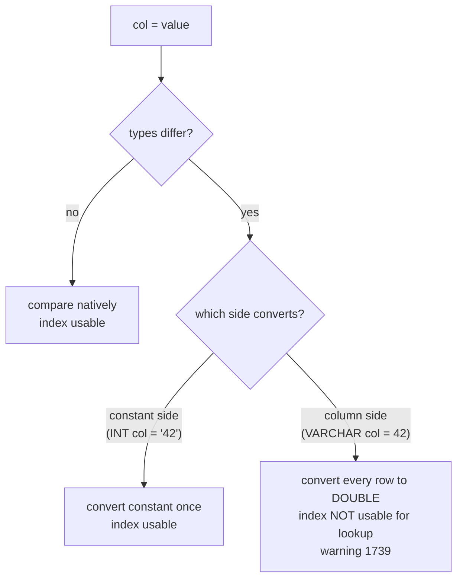

## Introduction

Every SQL expression has a type, and every operator expects its operands to have compatible types. When you write `WHERE code = 123` against a `VARCHAR` column, `'10' + '5'`, or `WHERE order_date >= '2024-06-01'`, something must decide how to reconcile a string with a number or a date. Some databases refuse (PostgreSQL raises an error for `varchar = integer`); **MySQL converts silently**, following a fixed set of rules. Those rules make everyday SQL convenient — and occasionally produce results that look like bugs:

- `'1abc' = 1` is **TRUE**, and `'abc' = 0` is **TRUE**.
- `'9007199254740993' = 9007199254740992` is **TRUE** — two different numbers compare equal.
- `WHERE code = 123` on an indexed `VARCHAR` column matches `'00123'`, `' 123'` and `'123abc'`, and **cannot use the index**.
- `CAST(1.5 AS SIGNED)` is 2, but `CAST('1.9' AS SIGNED)` is 1.

This lesson explains the conversion rules MySQL applies, when they produce a warning versus an error, how to take control with `CAST` and `CONVERT`, and how conversion interacts with indexes. It ties together threads from [Mathematical Functions](/lessons/m03-numeric-functions) (exact vs approximate arithmetic), [Date and Time Functions](/lessons/m03-date-functions) (string literals as dates) and [String Functions](/lessons/m03-string-functions) (character sets).

:::note[Dataset]
The examples use the **shop** dataset plus a small `vcodes` table built in your lab to make index effects visible. Outputs were captured with the default SQL mode (strict).
:::

## DBMS Theory

:::theory[Type systems: strong, weak, implicit, explicit]
A type system decides which operations are valid on which values. In SQL:

- **Explicit conversion** (a *cast*) is requested by the query author: `CAST(x AS DECIMAL(10,2))`. The standard defines which source/target pairs are allowed and what happens on failure (an exception).
- **Implicit conversion** (*coercion*) is inserted by the DBMS when an operator receives operands of different types. The SQL standard allows implicit conversion only within type families — between numeric types, between character string types, between datetime types — and requires an explicit `CAST` to cross families (string ↔ number).

**MySQL is weakly typed in this respect**: it coerces across families automatically. Strings become numbers in arithmetic and in comparisons with numbers; numbers become strings in string functions; string literals become dates when compared with temporal columns.
:::

MySQL's comparison rules, as stated in the manual (*Type Conversion in Expression Evaluation*), are applied in order:

| # | Operands | Compared as |
|---|---|---|
| 1 | Either is NULL | Result is NULL (except for the NULL-safe `<=>`) |
| 2 | Both strings | Strings, using collation rules |
| 3 | Both integers | Integers |
| 4 | Hexadecimal literal not compared with a number | Binary string |
| 5 | One is a `TIMESTAMP`/`DATETIME` column, the other a constant | The constant is converted to a timestamp |
| 6 | One is `DECIMAL`, the other `DECIMAL` or integer | `DECIMAL` |
| 6′ | One is `DECIMAL`, the other floating point | `DOUBLE` |
| 7 | **All other cases** (e.g. string vs number) | **Floating-point (`DOUBLE`)** |

Rule 7 is the source of most surprises. Converting a string to `DOUBLE` reads the longest numeric prefix (leading spaces allowed, scientific notation recognised), ignores the rest with a warning, and yields 0 if there is no numeric prefix at all. And a `DOUBLE` has only 53 bits of precision (about 15–17 significant digits), so long digit strings lose their last digits.

Two consequences follow from the theory, not just from MySQL:

1. **Conversion is not injective.** Many strings map to the same number (`'123'`, `'0123'`, `'123.0'`, `'1.23e2'`, `'123abc'` → 123). Comparing a string column with a number therefore compares *equivalence classes*, not values.
2. **Conversion of the column side prevents index use.** A B+ tree index on a `VARCHAR` column is ordered by the **string** collation (`'10' < '9'`). An index ordered by strings cannot be searched for "all strings whose numeric value is 123", because those strings are scattered across the index.

:::standard[Standard SQL vs MySQL]
Standard SQL requires `CAST` for string ↔ number conversions and raises an exception when a cast fails. MySQL converts implicitly, and an invalid conversion inside a `SELECT` produces a value (0, NULL, or the numeric prefix) plus a **warning**; in strict-mode `INSERT`/`UPDATE` the same problem is an **error**. `CAST(x AS type)` is standard; `CONVERT(x, type)` and `CONVERT(x USING charset)` are MySQL forms (the latter corresponds to the standard `TRANSLATE … USING`). MySQL's cast targets use its own names (`SIGNED`, `UNSIGNED`, `CHAR`, `DATE`, `DECIMAL`, `DOUBLE`, `FLOAT`, `JSON`, `YEAR` …) rather than all standard type names.
:::

## Why It Exists

Implicit conversion exists for convenience and history. MySQL grew up serving web applications that sent every value as text over the wire — form fields, URL parameters, CSV imports. Accepting `WHERE id = '42'` or `INSERT … VALUES ('19.99')` without explicit casts made those applications simpler. Date literals written as strings (`'2024-06-01'`) depend on the same mechanism.

Explicit conversion exists because convenience has limits:

- **Data arrives in the wrong type.** Staging tables loaded from CSV hold numbers and dates as `VARCHAR`; reports must convert them correctly and detect garbage.
- **Sorting and grouping need the right semantics.** `'10'` sorts before `'9'` as a string; numerically it is larger.
- **Precision must be controlled.** Converting to `DECIMAL(10,2)` (not `DOUBLE`) keeps money exact.
- **Interoperability.** Producing text for exports (`CAST(x AS CHAR)`), JSON documents, or comparisons across character sets (`CONVERT(… USING utf8mb4)`).

Strict SQL mode exists because silently storing the result of a bad conversion — `'12abc'` stored as 12, `'2024-02-30'` stored as `0000-00-00` — is data corruption. Since MySQL 5.7 strict mode is the default, so DML fails instead of corrupting data, while `SELECT` remains permissive and only warns.

## Internal Working

:::internals[Where conversions happen inside the server]
**At resolve time** (once per statement), each comparison `Item` examines the types of its two arguments and chooses a **comparison type** according to the rules above, installing the matching comparator (string with collation, integer, decimal, double, or datetime). If the argument types differ, conversion functions are applied to one or both sides. In MySQL 8.0.18 and later the optimizer makes many of these conversions explicit by inserting `cast(…)` nodes, which you can see in `EXPLAIN FORMAT=TREE` and in the rewritten statement shown by `SHOW WARNINGS` after `EXPLAIN`.

**String → number** uses the server's string-to-double routine: skip leading whitespace, parse optional sign, digits, decimal point, exponent; stop at the first invalid character. If characters remain, a "Truncated incorrect DOUBLE value" warning (1292) is raised. If nothing numeric was parsed, the value is 0.

**String → temporal** parses the string according to the target type's formats (`'YYYY-MM-DD'`, `'YYYYMMDD'`, `'YYYY-MM-DD HH:MM:SS[.frac]'`, relaxed delimiters). Invalid dates yield NULL (in expressions) with warning 1292.

**Number → string** formats the number in its canonical form; for `DOUBLE` this may use scientific notation.

**Index access requires the indexed column unconverted.** The range and ref optimizers can only use an index when the condition compares the **indexed column itself**, using the index's own comparison semantics, with a value that can be converted to the column's type. When the column must be converted (VARCHAR column compared as DOUBLE), the optimizer reports warning 1739 *"Cannot use ref/range access on index … due to type or collation conversion on field …"* and falls back to scanning. When only the **constant** needs converting (INT column compared with `'42'`), the constant is converted once and the index is used normally.
:::



## MySQL Implementation

**String vs number comparisons** — rule 7 in action. Each string is converted to `DOUBLE`:

```sql run
SELECT '1abc' = 1        AS prefix_match,
       'abc' = 0         AS no_digits_is_zero,
       '1e3' = 1000      AS scientific,
       ' 12' = 12        AS leading_space,
       '1.0' = 1         AS decimal_text,
       '1.0' = '1'       AS both_strings,
       '0x10' = 16       AS hex_text;
```

`'1.0' = 1` is TRUE (numeric comparison) but `'1.0' = '1'` is FALSE (string comparison, rule 2). `'0x10'` as a *string* is not hexadecimal — conversion stops at the `x`, giving 0. The captured warnings list every string that was truncated during conversion.

**Precision loss through DOUBLE.** Integers above 2⁵³ (9,007,199,254,740,992) cannot all be represented in a double. When a long digit string is compared with a number, both become doubles and neighbouring values collide:

```sql run
SELECT '9007199254740993' = 9007199254740992   AS string_vs_number,
       '9007199254740993' = '9007199254740992' AS string_vs_string,
       9007199254740993 = 9007199254740992     AS number_vs_number;
```

Only the mixed comparison is TRUE. Large identifiers stored as `VARCHAR` (tracking numbers, credit-card-like tokens, Twitter-style 64-bit IDs) and compared with numeric literals can therefore match the **wrong row**.

**Arithmetic on strings** converts them to numbers the same way:

```sql run
SELECT '10' + '5'         AS string_plus_string,
       '3 apples' + 2     AS prefix_arithmetic,
       CONCAT(1, 2) + 1   AS number_to_string_and_back,
       'a' + 0            AS non_numeric;
```

`CONCAT(1, 2)` converts the numbers to the string `'12'`; `+ 1` converts it back to the number 12. Note that `+` never concatenates in MySQL.

## Syntax Breakdown

| Form | Meaning |
|---|---|
| `CAST(expr AS type)` | Standard explicit conversion |
| `CONVERT(expr, type)` | MySQL synonym of CAST |
| `CONVERT(expr USING charset)` | Convert a string to another character set |
| `CAST(expr AS CHAR[(n)] [CHARACTER SET cs])` | To string (optionally truncated to n characters) |
| `CAST(expr AS SIGNED [INTEGER])` / `UNSIGNED` | To 64-bit integer. From DECIMAL/DOUBLE: **rounds**. From a string: parses the integer prefix (**truncates** `'1.9'` to 1) |
| `CAST(expr AS DECIMAL(p, s))` | Exact decimal; rounds to s decimals; clips to the largest value if out of range (with a warning) |
| `CAST(expr AS DOUBLE)` / `FLOAT` / `REAL` | Approximate (8.0.17+) |
| `CAST(expr AS DATE)` / `DATETIME[(fsp)]` / `TIME[(fsp)]` | Temporal; NULL + warning if invalid |
| `CAST(expr AS YEAR)` | Year (8.0.22+) |
| `CAST(expr AS JSON)` | JSON value |
| `CAST(expr AS BINARY)` | Binary string (byte comparison; `BINARY expr` shorthand is deprecated) |
| `expr + 0` | Idiom: force numeric context (e.g. ENUM index, string to number) |
| `SHOW WARNINGS` | Lists warnings of the last statement — where conversion problems are reported |

### CAST behaviour in detail

```sql run
SELECT CAST(1.5 AS SIGNED)              AS decimal_to_int_rounds,
       CAST(-1.5 AS SIGNED)             AS negative_rounds,
       CAST('1.9' AS SIGNED)            AS string_to_int_truncates,
       CAST('  42abc' AS SIGNED)        AS string_prefix,
       CAST(-1 AS UNSIGNED)             AS negative_to_unsigned,
       CAST('3.14159' AS DECIMAL(4,2))  AS to_decimal_rounds,
       CAST(123.456 AS DECIMAL(4,2))    AS to_decimal_clipped,
       CAST(20240630 AS DATE)           AS number_to_date,
       CAST('2024-13-01' AS DATE)       AS invalid_date;
```

Read this output carefully — it is a compact catalogue of conversion semantics:

- Numeric → integer **rounds** (1.5 → 2, −1.5 → −2), but string → integer **parses the integer prefix** ('1.9' → 1). If you need rounding from text, cast to `DECIMAL` first.
- `CAST(-1 AS UNSIGNED)` wraps around to 2⁶⁴ − 1 — CAST does not range-check signed-to-unsigned conversions.
- `DECIMAL(4,2)` can hold at most 99.99, so 123.456 is **clipped** to 99.99 with warning 1264. In an `INSERT` under strict mode the same value would be rejected.
- Numbers like 20240630 are valid date representations (`YYYYMMDD`); month 13 is not, giving NULL.

## Practical Examples

**1. Sorting numbers stored as text.** A staging table holds numeric codes as `VARCHAR`. String order and numeric order differ:

```sql run
CREATE TABLE staging_codes (id INT PRIMARY KEY, code VARCHAR(10) NOT NULL);
INSERT INTO staging_codes VALUES (1, '9'), (2, '10'), (3, '100'), (4, '25'), (5, '3');
SELECT GROUP_CONCAT(code ORDER BY code)                     AS string_order,
       GROUP_CONCAT(code ORDER BY CAST(code AS UNSIGNED))   AS numeric_order
FROM staging_codes;
```

The string order compares character by character (`'1' < '2' < '3' < '9'`); the numeric order is what humans expect. The real fix is a numeric column type; until then, sort by an explicit `CAST`.

**2. Converting a CSV staging table safely.** Values loaded as text must be validated **before** conversion — `CAST` of garbage produces a number plus a warning, not an error, inside a `SELECT`:

```sql run
CREATE TABLE price_import (id INT PRIMARY KEY, raw_price VARCHAR(20));
INSERT INTO price_import VALUES (1, '19.99'), (2, ' 5.00 '), (3, '12,50'), (4, 'N/A'), (5, '1e2'), (6, NULL);
SELECT id, raw_price,
       CAST(raw_price AS DECIMAL(10,2))                         AS naive_cast,
       REGEXP_LIKE(TRIM(raw_price), '^[0-9]+(\\.[0-9]{1,2})?$') AS is_valid_money,
       IF(REGEXP_LIKE(TRIM(raw_price), '^[0-9]+(\\.[0-9]{1,2})?$'),
          CAST(TRIM(raw_price) AS DECIMAL(10,2)), NULL)          AS safe_value
FROM price_import
ORDER BY id;
```

`naive_cast` turned `'12,50'` (European decimal comma) into **12.00** and `'N/A'` into **0.00** — wrong values that look plausible. Validating with a pattern first and casting only valid values produces NULL for bad data, which can then be reported and fixed. (`'1e2'` is technically numeric but not a valid money format, so the strict pattern rejects it; decide what your import accepts.)

**3. Dates written as strings and numbers.** When a `DATETIME` column is compared with a constant, the constant is converted to a datetime (rule 5), so all of these find the same orders and can use `idx_orders_date`:

```sql run
SELECT SUM(order_date >= '2024-12-20')            AS iso_string,
       SUM(order_date >= '2024/12/20')            AS slash_string,
       SUM(order_date >= 20241220)                AS yyyymmdd_number,
       SUM(order_date >= '20241220')              AS yyyymmdd_string,
       SUM(order_date >= DATE '2024-12-20')       AS date_literal
FROM orders;
```

All five find the same 4 orders. The slash form, however, raised warning 4095: delimiters other than `-` in date strings are deprecated (since MySQL 8.0.29, and still in 8.4), so relaxed formats may stop working in a future release. The typed literal `DATE '2024-12-20'` is the most explicit and portable form.

**4. ENUM values in numeric context.** An `ENUM` is stored as an index number; `+ 0` exposes it, and comparing with a number compares the index, not the label:

```sql run
SELECT status, status + 0 AS enum_index, COUNT(*) AS orders
FROM orders
GROUP BY status
ORDER BY enum_index;
```

`WHERE status = 2` therefore means "the second enum value" (`paid`) — a classic source of confusion when ENUM labels look numeric.

**5. Character set conversion.** `CONVERT(… USING …)` changes the encoding of a string; `CHARSET()` and `COLLATION()` reveal the result:

```sql run
SELECT CHARSET(name)                         AS col_charset,
       COLLATION(name)                       AS col_collation,
       CHARSET(CONVERT(name USING latin1))   AS converted_charset,
       HEX(CONVERT('é' USING latin1))        AS latin1_bytes,
       HEX(CONVERT('é' USING utf8mb4))       AS utf8mb4_bytes
FROM products
WHERE product_id = 1;
```

The same character is one byte in `latin1` (E9) and two in `utf8mb4` (C3A9). Joining columns with different character sets or collations forces such conversions at query time — and, like numeric conversion, can prevent index use on the converted side.

## Execution Walkthrough

We trace the most expensive conversion mistake: comparing an indexed `VARCHAR` column with a number. The table `vcodes` has 1,000 zero-padded codes plus five "dirty" variants of 123.

```walkthrough
title: SELECT id, code FROM vcodes WHERE code = 123
steps:
  - title: "1. Build the table"
    explain: >-
      code is VARCHAR(10) with a secondary index. Rows 1–1000 hold codes '00001' … '01000'; rows 3001–3005 hold
      textual variants of 123 that a messy import might produce.
    sql: |
      CREATE TABLE vcodes (id INT PRIMARY KEY, code VARCHAR(10) NOT NULL, KEY idx_code (code));
      INSERT INTO vcodes
      WITH RECURSIVE s(n) AS (SELECT 1 UNION ALL SELECT n + 1 FROM s WHERE n < 1000)
      SELECT n, LPAD(n, 5, '0') FROM s;
      INSERT INTO vcodes VALUES (3001, '123'), (3002, ' 123'), (3003, '123abc'), (3004, '123.0'), (3005, '1.23e2');
      ANALYZE TABLE vcodes;
  - title: "2. Resolve the comparison type"
    explain: >-
      code is a string and 123 is a number, so rule 7 applies: compare as DOUBLE. Every code must be converted.
      Because the index is ordered by string collation, the optimizer cannot look up "strings equal to 123 as a
      number" — EXPLAIN reports warning 1739 and an index (full) scan of all 1,005 entries.
    sql: EXPLAIN SELECT id, code FROM vcodes WHERE code = 123;
  - title: "3. Execute — six rows match"
    explain: >-
      Each code is converted to DOUBLE and compared with 123. Six different strings have numeric value 123,
      including '123abc' (prefix) and '1.23e2' (scientific notation). The conversions also raise warnings.
    sql: SELECT id, code FROM vcodes WHERE code = 123 ORDER BY id;
  - title: "4. The fix — compare string to string"
    explain: >-
      Quoting the literal makes both operands strings (rule 2). The index is ordered by exactly this comparison,
      so a single covering lookup finds the row, and only the exact string matches.
    sql: |
      EXPLAIN FORMAT=TREE SELECT id, code FROM vcodes WHERE code = '00123';
  - title: "5. The reverse is harmless"
    explain: >-
      When an INTEGER column is compared with a string constant, only the constant is converted — once. The
      primary key lookup still works (here it is even resolved before execution).
    sql: EXPLAIN FORMAT=TREE SELECT id FROM vcodes WHERE id = '42';
```

The asymmetry is the key lesson: **converting the constant is free; converting the column is a scan.** Application code that binds every parameter as a number — or ORMs that infer parameter types from the value — can turn every lookup on a `VARCHAR` key into a full scan.

## Output

Conversion problems are reported through **warnings**, not errors, in `SELECT`. The captured outputs above show them under each block. In your own client:

```sql run
SELECT CAST('12,50' AS DECIMAL(10,2)) AS comma_decimal, '7 days' + 0 AS prefix;
SHOW WARNINGS;
```

`SHOW WARNINGS` lists the warnings of the **previous** statement: here "Truncated incorrect DECIMAL value" and "Truncated incorrect DOUBLE value" (code 1292). Many drivers expose warnings only on request (e.g. `cursor.warning_count` in Python connectors) — production code that ignores them never learns that data was silently reinterpreted.

The DML side is stricter. Under the default strict mode, inserting a non-numeric string into a numeric column is an **error**:

```sql run
CREATE TABLE typed_target (id INT PRIMARY KEY, qty INT NOT NULL, price DECIMAL(6,2) NOT NULL);
```

```sql run error
INSERT INTO typed_target VALUES (1, '12abc', 9.99);
```

```sql run error
INSERT INTO typed_target VALUES (2, 5, 12345.678);
```

The first fails with error 1265 (*Data truncated for column 'qty'*); the second exceeds `DECIMAL(6,2)`'s maximum of 9999.99 (error 1264, *Out of range value*). Without strict mode these would be stored as 12 and 9999.99 with warnings — which is why strict mode must stay on.

## Alternative Approaches

| Problem | Implicit approach | Better approach |
|---|---|---|
| Look up a VARCHAR key | `WHERE code = 123` | `WHERE code = '00123'` (bind parameters as strings) |
| Store numeric data | `VARCHAR` + casts everywhere | A numeric column type; convert once at load |
| Parse dirty text | `CAST(raw AS DECIMAL)` | Validate with `REGEXP_LIKE`, then `CAST`; route failures to an error table |
| Compare large IDs | Number literal vs string column | Same type on both sides — ideally `BIGINT UNSIGNED` column or string-to-string |
| Numeric sort of text | `ORDER BY col + 0` | `ORDER BY CAST(col AS UNSIGNED)` (explicit), or fix the type |
| Dates as strings | `'2024/12/20'` | `DATE '2024-12-20'` literal, or ISO strings `'YYYY-MM-DD'` |
| Different charsets in joins | Rely on implicit conversion | Make both columns the same charset/collation |

When the conversion cannot be avoided on the column side — for example a legacy table whose `VARCHAR` column must be compared numerically — a **generated column** with the converted value, plus an index on it, restores indexed access ([Covering, Prefix and Functional Indexes](/lessons/m07-covering-prefix-functional)).

## Performance Analysis

The performance impact of conversion is almost entirely about **access paths**, illustrated by the walkthrough:

| Predicate | Conversion | Plan on an index of `col` |
|---|---|---|
| `varchar_col = 'abc'` | none | ref / range lookup |
| `varchar_col = 123` | column → DOUBLE, every row | full index or table scan (warning 1739) |
| `int_col = '123'` | constant → INT, once | ref / const lookup |
| `datetime_col >= '2024-06-01'` | constant → DATETIME, once | range scan |
| `utf8mb4_col = latin1_col` (join) | latin1 side converted | index on the converted side unusable |
| `CAST(varchar_col AS UNSIGNED) = 123` | column, explicit | scan — unless a functional index on that exact expression exists |

The cost of the scan grows linearly with the table, while a lookup costs a handful of page reads regardless of size. On a 100-million-row table this is the difference between microseconds and minutes — and it is invisible in development databases with a few hundred rows.

Join conditions are even more dangerous than WHERE clauses: if `orders.customer_ref` is `VARCHAR` and `customers.id` is `INT`, the join converts the `VARCHAR` side, so MySQL can only drive the join from `orders` and look up `customers` by its integer key — never the other way round.

:::performance[Theory vs measurement]
The plan change from *lookup* to *scan* is structural and visible in `EXPLAIN` on any data size; the timing consequence is not measurable on the sandbox's small tables. Use `EXPLAIN` warnings (code 1739) as an early detector, and confirm the cost on production-sized data with `EXPLAIN ANALYZE` ([Sargable Queries](/lessons/m07-sargable-queries)).
:::

## Best Practices

:::best-practice[Conversion hygiene]
1. **Store data in its natural type.** Numbers in numeric columns, dates in `DATE`/`DATETIME`, money in `DECIMAL`. Convert once, at load time, not in every query.
2. **Compare like with like.** Quote literals for string columns; bind parameters with the column's type; give join columns identical types, character sets and collations.
3. **Cast explicitly when you must convert**, choosing the exact target (`DECIMAL(10,2)`, not `DOUBLE`, for money; `UNSIGNED` for numeric sorting of codes).
4. **Validate before casting dirty text** (`REGEXP_LIKE`, `TRIM`), and route failures to an error table instead of letting them become 0.
5. **Read warnings.** Check `SHOW WARNINGS` or the driver's warning API in ETL jobs; treat conversion warnings as data quality failures.
6. **Keep strict mode on** (`STRICT_TRANS_TABLES` is in the default `sql_mode`) so bad conversions in DML fail loudly.
7. **Watch EXPLAIN for warning 1739** — it names the column whose conversion disabled the index.
:::

## Common Mistakes

**Mistake 1 — numeric literal against a VARCHAR key.** Shown in the walkthrough: wrong matches (`'123abc'`) *and* a full scan. Quote the literal.

**Mistake 2 — `CAST` from text "rounds".** `CAST('1.9' AS SIGNED)` returns 1 because the string is parsed as an integer prefix. To round text, convert through `DECIMAL`:

```sql run
SELECT CAST('1.9' AS SIGNED)                       AS direct,
       CAST(CAST('1.9' AS DECIMAL(10,2)) AS SIGNED) AS via_decimal,
       ROUND('1.9')                                AS round_text;
```

`ROUND('1.9')` also works — but note it converts the string to `DOUBLE`, so the half-even rule of approximate rounding applies to values like `'2.5'`.

**Mistake 3 — ENUM compared with a number.** `WHERE status = 2` matches the second ENUM member, not a status labelled `'2'`. Always compare ENUMs with their string labels.

**Mistake 4 — trusting naive casts in imports.** `CAST('N/A' AS DECIMAL)` is 0 and `CAST('12,50' AS DECIMAL(10,2))` is 12.00 — both silently wrong in a `SELECT` (see Practical Example 2). Validate first.

**Mistake 5 — long numeric strings compared with numbers.** `WHERE tracking_no = 9007199254740993` on a `VARCHAR` column compares as `DOUBLE` and can match a neighbouring number. Compare string to string.

**Mistake 6 — believing `+` concatenates.** `'Order ' + order_id` is `0 + order_id` with a warning. Use `CONCAT('Order ', order_id)`.

## Industry Application

- **ORM and driver parameter binding.** Many production incidents of the form "this lookup suddenly takes seconds" trace back to an application binding a `VARCHAR` key (phone numbers, ZIP codes, SKUs, external IDs) as an integer parameter. Code reviews and slow-query analysis look for exactly this pattern; EXPLAIN warning 1739 confirms it.
- **ETL staging layers.** Data engineers load raw files into all-`VARCHAR` staging tables, validate with patterns, convert with explicit `CAST` into typed core tables, and divert rejects (with the raw value and the reason) into error tables for data stewards.
- **Schema migrations.** Converting a `VARCHAR` column that holds numbers into `INT` (`ALTER TABLE … MODIFY`) fails in strict mode if any value is non-numeric — teams run validation queries (`WHERE NOT REGEXP_LIKE(col, '^[0-9]+$')`) before migrating.
- **Cross-system integration.** IDs from JavaScript front ends lose precision above 2⁵³ for the same reason MySQL's string-to-double comparison does; APIs therefore transmit 64-bit IDs as strings and databases compare them as strings or `BIGINT`, never through floating point.
- **Multi-charset legacy systems.** Older schemas mixing `latin1` and `utf8mb4` tables suffer slow joins and mojibake; migrations to uniform `utf8mb4` with consistent collations are routine modernization projects.

## Practice Exercises

```exercise
id: ex1
title: Total of text amounts
difficulty: easy
setup: |
  CREATE TABLE text_amounts (id INT PRIMARY KEY, amount_text VARCHAR(20) NOT NULL);
  INSERT INTO text_amounts VALUES (1, '19.99'), (2, '5.01'), (3, '100.00'), (4, '0.10');
concepts: [cast, decimal-precision]
prompt: |
  `text_amounts(id, amount_text)` stores valid money amounts as text. Return one row with one column
  `total`: the exact sum of the amounts as a `DECIMAL` with 2 decimal places.
hints:
  - "SUM(amount_text) would convert to DOUBLE implicitly."
  - "SUM(CAST(amount_text AS DECIMAL(10,2)))."
solution: |
  SELECT SUM(CAST(amount_text AS DECIMAL(10,2))) AS total
  FROM text_amounts;
explanation: |
  Without the CAST, MySQL converts the strings to DOUBLE (rule 7) and the sum is approximate. With these
  values the double result may display identically, but explicit DECIMAL conversion guarantees an exact
  total for any input.
```

```exercise
id: ex2
title: Numeric sort of text codes
difficulty: easy
setup: |
  CREATE TABLE bins (bin_code VARCHAR(5) PRIMARY KEY);
  INSERT INTO bins VALUES ('7'), ('12'), ('100'), ('3'), ('25'), ('1');
concepts: [cast, type-conversion]
prompt: |
  Return all `bin_code` values from `bins` ordered by their **numeric** value ascending.
hints:
  - "ORDER BY bin_code sorts as strings ('100' before '12')."
  - "ORDER BY CAST(bin_code AS UNSIGNED)."
solution: |
  SELECT bin_code FROM bins ORDER BY CAST(bin_code AS UNSIGNED);
orderMatters: true
explanation: |
  `ORDER BY bin_code + 0` also works but relies on implicit conversion; the explicit CAST documents the
  intent. The durable fix is to store bin numbers in an integer column.
```

```exercise
id: ex3
title: Find dirty codes that collide numerically
difficulty: medium
setup: |
  CREATE TABLE codes (id INT PRIMARY KEY, code VARCHAR(10) NOT NULL);
  INSERT INTO codes VALUES (1, '00123'), (2, '123'), (3, '123abc'), (4, '124'), (5, ' 123'), (6, '1.23e2'), (7, 'abc');
concepts: [implicit-conversion, comparison-coercion]
prompt: |
  In `codes(id, code)` the canonical form of code 123 is exactly `'00123'`. Return `id` and `code` for every
  row whose code **compares equal to the number 123** but is **not** the canonical string `'00123'`.
  Order by `id`.
hints:
  - "code = 123 performs a numeric (DOUBLE) comparison and matches every string whose numeric value is 123."
  - "Add AND code <> '00123' — a string comparison."
solution: |
  SELECT id, code
  FROM codes
  WHERE code = 123 AND code <> '00123'
  ORDER BY id;
orderMatters: true
explanation: |
  This query deliberately exploits implicit conversion as a data-quality probe: it finds the variants
  ('123', '123abc', ' 123', '1.23e2') that a numeric comparison would treat as the same code. 'abc'
  converts to 0, not 123, so it does not appear.
```

```exercise
id: ex4
title: Validate before you cast
difficulty: hard
setup: |
  CREATE TABLE qty_import (id INT PRIMARY KEY, raw_qty VARCHAR(20));
  INSERT INTO qty_import VALUES (1, '12'), (2, ' 7 '), (3, '3.5'), (4, 'ten'), (5, '-2'), (6, NULL), (7, '40');
concepts: [cast, type-conversion, warnings]
prompt: |
  Quantities must be **positive whole numbers**. From `qty_import(id, raw_qty)` return `id`, `raw_qty` and
  `qty`, where `qty` is the trimmed value converted to an integer if it consists only of digits (after
  trimming spaces), and NULL otherwise. Order by `id`.
hints:
  - "REGEXP_LIKE(TRIM(raw_qty), '^[0-9]+$') tests 'only digits'."
  - "Use CASE WHEN … THEN CAST(TRIM(raw_qty) AS UNSIGNED) END (no ELSE → NULL)."
solution: |
  SELECT id, raw_qty,
         CASE WHEN REGEXP_LIKE(TRIM(raw_qty), '^[0-9]+$')
              THEN CAST(TRIM(raw_qty) AS UNSIGNED) END AS qty
  FROM qty_import
  ORDER BY id;
orderMatters: true
explanation: |
  A naive `CAST(raw_qty AS UNSIGNED)` would turn '3.5' into 3, 'ten' into 0 and '-2' into a huge wrapped
  number — all without an error in a SELECT. Validating first makes invalid input NULL so it can be reported.
  REGEXP_LIKE of NULL is NULL, so row 6 also falls through to NULL.
```

```exercise
id: ex5
title: Diagnose a slow lookup
difficulty: medium
kind: open
concepts: [index-usage, implicit-conversion]
prompt: |
  An application runs `SELECT * FROM shipments WHERE tracking_no = ?` and binds the parameter as an integer
  (e.g. 400123987). `tracking_no` is `VARCHAR(30)` with a unique index. The query is slow and occasionally
  returns a shipment whose tracking number is `'0400123987'`. Explain both symptoms and give two fixes.
solution: |
  Because the column is a string and the parameter a number, MySQL compares them as DOUBLE (the "all other
  cases" rule). That has two effects. (1) Performance: every `tracking_no` must be converted to a number, and
  the unique index — ordered by string collation — cannot be used for a lookup; EXPLAIN shows a full index or
  table scan with warning 1739 "Cannot use ref access … due to type or collation conversion". (2) Correctness:
  string-to-number conversion is many-to-one, so '0400123987', '400123987' and even '400123987abc' all equal
  400123987 numerically, and very long numbers can collide after losing precision in DOUBLE.

  Fixes: bind the parameter as a string (or cast it: `WHERE tracking_no = CAST(? AS CHAR)`), so the comparison
  is string-to-string and uses the index; and/or normalize the data (canonical format, perhaps a numeric
  column if tracking numbers are truly numeric) so that equality has one meaning. Adding a generated column
  holding the canonical form with its own index is an option when the legacy column cannot change.
```

```exercise
id: ex6
title: Reconcile a text-keyed import with orders
difficulty: challenge
setup: |
  CREATE TABLE carrier_feed (feed_id INT PRIMARY KEY, order_ref VARCHAR(12) NOT NULL, delivered_on VARCHAR(10) NOT NULL);
  INSERT INTO carrier_feed VALUES
    (1, 'ORD-00002', '2024-10-21'), (2, 'ORD-00003', '2024-04-23'), (3, 'ord-00007', '2024-03-19'),
    (4, 'ORD-00999', '2024-05-01'), (5, 'ORD-00008', '2024/07/04');
concepts: [cast, type-conversion, string-functions]
prompt: |
  A carrier sends `carrier_feed(feed_id, order_ref, delivered_on)` where `order_ref` looks like `'ORD-00002'`
  (prefix case may vary) and `delivered_on` is a date in text. Return `feed_id`, `order_id` (the matching
  order), `delivered` (the delivery date as a DATE) and `days_after_ship` (calendar days between the order's
  `shipped_at` and the delivery date), **only for feed rows that match an existing order**. Order by `feed_id`.
hints:
  - "Extract the number: CAST(SUBSTRING_INDEX(order_ref, '-', -1) AS UNSIGNED) and compare it with orders.order_id (same type on both sides)."
  - "CAST(delivered_on AS DATE) accepts both '2024-10-21' and '2024/07/04'."
  - "DATEDIFF(delivered_date, shipped_at) gives calendar days. An inner join drops ORD-00999."
solution: |
  SELECT f.feed_id,
         o.order_id,
         CAST(f.delivered_on AS DATE)                    AS delivered,
         DATEDIFF(CAST(f.delivered_on AS DATE), o.shipped_at) AS days_after_ship
  FROM carrier_feed f
  JOIN orders o ON o.order_id = CAST(SUBSTRING_INDEX(f.order_ref, '-', -1) AS UNSIGNED)
  ORDER BY f.feed_id;
orderMatters: true
explanation: |
  Converting the feed side explicitly to an integer means the join compares integer to integer, so
  `orders.order_id` (the primary key) can be used for each lookup. Joining on `o.order_id = f.order_ref`
  directly would compare as DOUBLE and match nothing ('ORD-…' converts to 0). Relaxed date delimiters are
  accepted by CAST(… AS DATE) — '2024/07/04' converts, with deprecation warning 4095 — but in a real pipeline you would validate and normalize the format first.
```

## Knowledge Assessment

```quiz
- id: q1
  question: "What does `SELECT 'abc' = 0, '1abc' = 1` return in MySQL?"
  options: ["0, 0", "1, 1", "NULL, NULL", "An error"]
  answer: 1
  explanation: "String vs number compares as DOUBLE. 'abc' has no numeric prefix and converts to 0; '1abc' converts to 1 (with a truncation warning). Both comparisons are TRUE. MySQL raises warnings, not errors, in SELECT."
  concepts: [implicit-conversion, comparison-coercion]
- id: q2
  question: "`code` is an indexed VARCHAR column. Why does `WHERE code = 123` scan the whole index?"
  options:
    - "Because 123 is converted to a string with a different collation"
    - "Because the comparison is done as DOUBLE, so every code must be converted, and the string-ordered index cannot be searched by numeric value"
    - "Because VARCHAR indexes cannot be used for equality"
    - "Because 123 is NULL"
  answer: 1
  explanation: "Rule 7 converts the column side to DOUBLE. The index order is by string collation, and many strings map to 123, so no lookup is possible; EXPLAIN shows warning 1739. Quoting the literal restores a lookup. The constant is not converted to a string here."
  concepts: [index-usage, implicit-conversion]
- id: q3
  question: "`id` is an INT primary key. What about `WHERE id = '42'`?"
  options:
    - "Full scan, because of conversion"
    - "The constant '42' is converted to a number once and the primary key lookup is used"
    - "Error: type mismatch"
    - "It matches no rows"
  answer: 1
  explanation: "Converting a constant is done once at optimization time; the indexed column stays unconverted, so the lookup works. The asymmetry — constant side cheap, column side expensive — is the key rule."
  concepts: [index-usage, comparison-coercion]
- id: q4
  question: "Which results are correct? (Select all that apply.)"
  type: multi
  options:
    - "CAST(1.5 AS SIGNED) = 2"
    - "CAST('1.9' AS SIGNED) = 2"
    - "CAST(-1 AS UNSIGNED) = 18446744073709551615"
    - "CAST('2024-13-01' AS DATE) raises an error in a SELECT"
  answer: [0, 2]
  explanation: "Numeric-to-integer casts round (1.5 → 2). String-to-integer parses the integer prefix ('1.9' → 1). Signed-to-unsigned wraps around to 2^64 − 1. An invalid date in a SELECT yields NULL with a warning, not an error."
  concepts: [cast]
- id: q5
  question: "Why can `'9007199254740993' = 9007199254740992` be TRUE?"
  options:
    - "MySQL ignores the last digit of long strings"
    - "Both sides are converted to DOUBLE, which cannot represent every integer above 2^53, so both become the same double"
    - "The comparison is done as strings"
    - "It is a bug fixed in 8.4"
  answer: 1
  explanation: "String vs number compares as floating point. A 53-bit significand cannot distinguish neighbouring integers above 2^53. Comparing as strings (or both as integers) gives FALSE. This is documented behaviour, not a bug."
  concepts: [implicit-conversion, floating-point]
- id: q6
  question: "Under the default strict SQL mode, `INSERT INTO t (qty) VALUES ('12abc')` into an INT column:"
  options:
    - "Stores 12 with a warning"
    - "Stores 0"
    - "Fails with an error"
    - "Stores NULL"
  answer: 2
  explanation: "In strict mode an invalid value for a column in INSERT/UPDATE is an error and the row is not written. Without strict mode (or with INSERT IGNORE) MySQL would store 12 and raise a warning — the behaviour strict mode exists to prevent."
  concepts: [strict-mode, warnings]
- id: q7
  question: "A query `SELECT CAST(raw AS DECIMAL(10,2)) FROM import` returns 0.00 for some rows. What is the best next step?"
  options:
    - "Nothing — 0.00 is the correct conversion"
    - "Run SHOW WARNINGS / validate the raw values with a pattern; non-numeric text converts to 0 with a 1292 warning"
    - "Switch to CAST(raw AS DOUBLE)"
    - "Enable strict mode, which makes SELECT fail"
  answer: 1
  explanation: "Non-numeric strings convert to 0 (or their numeric prefix) with a warning in SELECT. Warnings and pattern validation reveal bad input. DOUBLE converts the same way, and strict mode affects DML, not SELECT conversions."
  concepts: [cast, warnings]
- id: q8
  question: "`status` is ENUM('pending','paid','shipped',…). What does `WHERE status = 2` match?"
  options:
    - "Rows whose status label is '2'"
    - "Rows with status 'paid', the second ENUM member"
    - "No rows — type mismatch"
    - "All rows, because ENUM converts to 0"
  answer: 1
  explanation: "In numeric context an ENUM value is its 1-based index, so 2 is the second member, 'paid'. Compare ENUMs with their string labels to avoid this confusion."
  concepts: [type-conversion]
```
