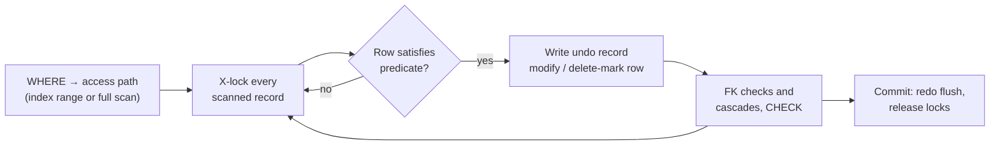

## Introduction

`UPDATE` changes values in existing rows; `DELETE` removes rows. Together with `INSERT` they make up the data-modification part of SQL, and they are the statements most likely to cause a production incident. A `SELECT` with a wrong WHERE clause produces a wrong report that someone can rerun. An `UPDATE` or `DELETE` with a wrong WHERE clause destroys information — sometimes millions of rows in a fraction of a second.

This lesson treats both statements as an engineer must:

- **Row selection** — `UPDATE` and `DELETE` use exactly the WHERE semantics of [Filtering with WHERE](/lessons/m03-where-filtering), including three-valued logic and operator precedence. Every pitfall there is a data-loss pitfall here.
- **Semantics of the change** — how `SET` expressions are evaluated (MySQL differs from the SQL standard), what "Rows matched: 3 Changed: 2" means, and how multi-table forms work.
- **Safety mechanisms** — transactions, safe-updates mode, `ORDER BY … LIMIT` for batching, and the habit of running the WHERE clause as a SELECT first.
- **Side effects** — locks on rows *scanned* (not just changed), foreign-key actions, AUTO_INCREMENT, and the very different behaviour of `TRUNCATE`.
- **Not deleting at all** — soft deletes, and their consequences for unique constraints.

:::note[Dataset and lab]
Examples run on the **shop** dataset and some small tables created in your lab. Blocks that change data are meant to be run in order; press **Reset** to restore the dataset. All outputs, including "Rows matched / Changed" messages, errors and lock snapshots, were captured on a real MySQL server.
:::

## DBMS Theory

:::theory[Modification as relational operations]
In relational terms, **deletion** of the tuples satisfying predicate *p* from relation R yields R − σ<sub>p</sub>(R). **Update** is conceptually a deletion followed by an insertion: R − σ<sub>p</sub>(R) ∪ { f(t) | t ∈ σ<sub>p</sub>(R) }, where *f* applies the SET assignments to each selected tuple. Two consequences follow from the theory: (1) the set of affected tuples is determined **before** any change is made — the predicate is evaluated against the original state; and (2) the new state must satisfy every integrity constraint, or the whole statement is rejected.
:::

The SQL standard makes the first consequence explicit: in `UPDATE t SET a = a + 1, b = a`, every right-hand side refers to the **old** row, so `b` receives the old value of `a`. Assignments are conceptually simultaneous. **MySQL deviates from this for single-table UPDATE:** assignments are evaluated **left to right**, and a later assignment sees the value produced by an earlier one. You will see this in the Practical Examples; it matters whenever one SET expression refers to a column that another assignment changes.

Three more concepts:

- **Referential actions.** Deleting (or changing the key of) a parent row that child rows reference triggers the foreign key's `ON DELETE` / `ON UPDATE` action: `RESTRICT`/`NO ACTION` (reject — InnoDB's default), `CASCADE` (delete/update the children), `SET NULL`.
- **Statement atomicity.** As with INSERT, a single UPDATE or DELETE on InnoDB either changes every selected row or none — if row 50,000 violates a constraint, the 49,999 earlier changes are rolled back.
- **Logical versus physical deletion.** A *soft delete* marks a row as deleted (e.g. `deleted_at` timestamp) instead of removing it. It is an application-level convention, not a DBMS feature: every query must filter it, and constraints must be designed around it.

## Why It Exists

Data changes: prices are adjusted, orders move through statuses, customers update addresses, records expire, regulations require erasure. A DBMS needs set-oriented statements that change many rows atomically and consistently:

- **Atomic, consistent change.** "Increase all Electronics prices by 5%" must happen to all of them or none, and concurrent readers must see either the old or the new prices, never a mixture inside one transaction.
- **Declarative targeting.** The WHERE clause describes *which* rows change; the optimizer finds them efficiently through indexes.
- **Integrity on change.** Constraints are re-checked: a price update that would violate `CHECK (price >= 0)` fails; deleting a customer who still has orders is refused by the foreign key.
- **Lifecycle management.** Data retention policies (delete logs older than 90 days), GDPR erasure requests and archiving all rely on DELETE — usually in carefully controlled batches.

What goes wrong without discipline is well known: the forgotten WHERE clause, the `OR` that matched far more than intended, the UPDATE that locked a whole table during peak traffic, the cascading delete nobody knew about.

## Internal Working

:::internals[How InnoDB executes UPDATE and DELETE]
1. **Find the rows.** The optimizer picks an access path for the WHERE clause exactly as for a SELECT (index range, full scan, …). EXPLAIN works on UPDATE and DELETE.
2. **Lock as you scan.** Rows are read with a *locking read*: InnoDB places an exclusive (X) lock on every index record it **scans** to evaluate the condition — under the default REPEATABLE READ isolation level, as next-key locks (record + the gap before it). If the WHERE clause cannot use an index, every row of the table is scanned and therefore locked until the transaction ends.
3. **Change in place.** For UPDATE, the old version of the row is copied to the **undo log** (for rollback and for MVCC readers who still need the old version), then the row is modified in the clustered index. Secondary indexes whose columns changed get a delete-mark on the old entry and a new entry. If the new value equals the old one, InnoDB detects that nothing changed and skips the write — the row counts as *matched* but not *changed*.
4. **Delete-mark, purge later.** DELETE does not physically remove the row immediately. It sets a delete-mark (and writes undo); the background **purge** thread removes the record once no active transaction can still see it. This is why a large DELETE does not immediately shrink the table file.
5. **Constraints and actions.** CHECK constraints are evaluated on updated rows; foreign keys are checked, and cascading actions are executed as additional internal modifications.
6. **Redo log and commit.** Changes are redo-logged; at commit they become durable and the locks are released.
:::



**TRUNCATE is not a DELETE.** `TRUNCATE TABLE` is implemented as DDL: InnoDB effectively drops and recreates the table (a new, empty tablespace). That is why it is fast regardless of size, cannot be rolled back, causes an implicit commit, resets AUTO_INCREMENT, fires no DELETE triggers and is refused when another table's foreign key references the table.

## MySQL Implementation

The core syntax:

```sql
UPDATE [LOW_PRIORITY] [IGNORE] tbl
SET col = expr [, col = expr] ...
[WHERE condition]
[ORDER BY ...] [LIMIT n];

DELETE [LOW_PRIORITY] [QUICK] [IGNORE] FROM tbl
[WHERE condition]
[ORDER BY ...] [LIMIT n];
```

**The golden rule: SELECT before you UPDATE.** Write the WHERE clause as a SELECT, check the rows, then turn it into the modification:

```sql run
SELECT product_id, name, price, stock_qty
FROM products
WHERE category_id = 7
ORDER BY product_id;
```

```sql run
UPDATE products
SET price = price * 1.05
WHERE category_id = 7;
```

The info message reports **Rows matched** (rows that satisfied the WHERE clause) and **Changed** (rows whose values actually changed), plus warnings. Look at the warnings too: `price * 1.05` can produce more decimal places than `DECIMAL(10,2)` holds. Three of the four new prices fit exactly; 34.50 × 1.05 = 36.225 does not, so MySQL rounded it to 36.23 and recorded a note (code 1265) — that is the `Warnings: 1`.

```sql run
SELECT product_id, name, price FROM products WHERE category_id = 7 ORDER BY product_id;
```

**Matched versus changed.** Setting a value to what it already is matches the row but changes nothing; the affected-rows count reports changed rows only:

```sql run
UPDATE products SET is_active = TRUE WHERE category_id = 7;
```

All matched rows were already active, so `Changed: 0`.

**DELETE** removes rows. Reviews are not referenced by any other table, so they can be deleted freely:

```sql run
SELECT review_id, product_id, rating FROM reviews WHERE rating = 1 ORDER BY review_id;
```

```sql run
DELETE FROM reviews WHERE rating = 1;
SELECT COUNT(*) AS reviews_left FROM reviews;
```

Deleting a row that other rows reference is refused by the foreign key (InnoDB default `RESTRICT`):

```sql run error
DELETE FROM customers WHERE customer_id = 1;
```

## Syntax Breakdown

| Element | Meaning |
|---|---|
| `SET col = expr, …` | Assignments. In single-table UPDATE MySQL evaluates them **left to right**; later expressions see earlier results. `col = DEFAULT` sets the column default. |
| `WHERE` | Selects the rows. Omitted → **every row**. Same three-valued logic as SELECT. |
| `ORDER BY … LIMIT n` | (Single-table only, MySQL extension) Process rows in this order and stop after *n*. Used for batching and to control the order of unique-key changes. |
| `IGNORE` | Downgrade ignorable errors (duplicate keys, invalid values) to warnings; rows that would cause duplicates are not updated. |
| Multi-table `UPDATE t1 JOIN t2 ON … SET t1.c = t2.c` | Update rows of one or more tables using values from joined tables. No `ORDER BY`/`LIMIT`. |
| Multi-table `DELETE t1 [, t2] FROM t1 JOIN t2 …` | Delete matching rows from the tables listed before `FROM`; others are only used for filtering. Alternative syntax: `DELETE FROM t1 USING t1 JOIN t2 …`. |
| `TRUNCATE [TABLE] t` | Empty the table (DDL semantics, see below). |
| Info message | `Rows matched: M  Changed: C  Warnings: W` for UPDATE; affected rows = C. For DELETE, affected rows = deleted rows (cascaded child deletions are not included). |

**DELETE vs TRUNCATE vs DROP**

| | `DELETE FROM t` | `TRUNCATE TABLE t` | `DROP TABLE t` |
|---|---|---|---|
| Category | DML | DDL | DDL |
| WHERE possible | Yes | No | No |
| Transactional (can roll back) | Yes | No — implicit commit | No — implicit commit |
| Speed on large tables | Proportional to rows (undo, redo, locks per row) | Fast, roughly constant | Fast |
| AUTO_INCREMENT | Kept | Reset to the start value | Gone |
| DELETE triggers | Fire per row | Do not fire | — |
| Referenced by a foreign key | Works if no child rows reference deleted rows (or cascades) | Refused (error 1701) | Refused unless the child is dropped first |
| Table definition | Kept | Kept | Removed |

:::standard[Standard SQL vs MySQL]
Single-table `UPDATE … SET … WHERE` and `DELETE FROM … WHERE` are standard, including simultaneous evaluation of SET assignments (which MySQL does **not** follow in single-table UPDATE). MySQL extensions: `ORDER BY`/`LIMIT` in UPDATE/DELETE, multi-table UPDATE/DELETE with JOIN syntax (the standard uses `MERGE` or correlated subqueries), `IGNORE`, `LOW_PRIORITY`, `QUICK`. MySQL does **not** support `UPDATE … FROM` (PostgreSQL/SQL Server) or `RETURNING` (PostgreSQL, MariaDB). `TRUNCATE TABLE` is standard since SQL:2008.
:::

## Practical Examples

**1. Left-to-right SET evaluation (MySQL-specific).** Swap-like updates expose it:

```sql run
CREATE TABLE swap_demo (id INT PRIMARY KEY, a INT, b INT);
INSERT INTO swap_demo VALUES (1, 10, 20);
UPDATE swap_demo SET a = b, b = a WHERE id = 1;
SELECT * FROM swap_demo;
```

In standard SQL this swaps the values (10, 20 → 20, 10). In MySQL, `a = b` runs first, making `a` 20, and then `b = a` copies the *new* `a` — both columns end up 20. A correct swap in MySQL needs a temporary value or a self-join; the multi-table UPDATE form does not guarantee any evaluation order at all.

**2. Multi-table UPDATE.** Deactivate all products in the *Fitness* category, identified by name through a join:

```sql run
UPDATE products AS p
JOIN categories AS c ON c.category_id = p.category_id
SET p.is_active = FALSE
WHERE c.name = 'Fitness';
SELECT p.product_id, p.name, p.is_active
FROM products AS p JOIN categories AS c ON c.category_id = p.category_id
WHERE c.name = 'Fitness'
ORDER BY p.product_id;
```

Only `products` is modified, because only `p.is_active` appears in SET. A multi-table UPDATE can modify several tables at once, but foreign-key and evaluation-order subtleties make that rarely advisable.

**3. Updating from an aggregate.** Store each product's average rating in a new column. MySQL refuses a subquery that reads the table being updated in a way that could depend on the update (error 1093):

```sql run
ALTER TABLE products ADD COLUMN avg_rating DECIMAL(3,2) NULL;
```

```sql run error
UPDATE products
SET avg_rating = (SELECT AVG(rating) FROM reviews WHERE reviews.product_id = products.product_id)
WHERE product_id IN (SELECT product_id FROM products WHERE stock_qty > 100);
```

The second subquery reads `products` while `products` is being updated. Joining to a **derived table** that is materialized before the update starts is the standard workaround:

```sql run
UPDATE products AS p
JOIN (SELECT product_id, AVG(rating) AS r FROM reviews GROUP BY product_id) AS agg
  ON agg.product_id = p.product_id
SET p.avg_rating = agg.r;
SELECT product_id, name, avg_rating FROM products WHERE avg_rating IS NOT NULL ORDER BY avg_rating DESC, product_id LIMIT 5;
```

The notes attached to this UPDATE (code 1265) come from storing averages such as 4.3333 in a `DECIMAL(3,2)` column: MySQL rounds them to two decimals. Notes are informational; in strict mode a value that does not *fit* at all (e.g. 12.5 in `DECIMAL(3,2)`) would be an error.

(The first subquery alone — reading `reviews` — would be fine; the restriction concerns reading the *target* table.)

**4. Multi-table DELETE.** Delete the line items of cancelled orders, but keep the orders themselves:

```sql run
SELECT COUNT(*) AS items_of_cancelled_orders
FROM order_items AS oi JOIN orders AS o ON o.order_id = oi.order_id
WHERE o.status = 'cancelled';
```

```sql run
DELETE oi
FROM order_items AS oi
JOIN orders AS o ON o.order_id = oi.order_id
WHERE o.status = 'cancelled';
```

Only `oi` is named before `FROM`, so only `order_items` rows are deleted; `orders` is used for filtering. (The MySQL manual warns that a multi-table DELETE that removes rows from both a parent and a child table may process the tables in an order that violates the foreign key, in which case the statement fails and rolls back; delete children and parents in separate statements, or use `ON DELETE CASCADE`.)

**5. ORDER BY … LIMIT for unique-key shifts.** A playlist stores `position` with a UNIQUE constraint. Inserting a track at position 2 requires shifting positions ≥ 2 up by one:

```sql run
CREATE TABLE playlist (
  track_id INT PRIMARY KEY,
  title    VARCHAR(40) NOT NULL,
  position INT NOT NULL,
  UNIQUE KEY uq_playlist_position (position)
);
INSERT INTO playlist VALUES (101, 'Intro', 1), (102, 'Verse', 2), (103, 'Chorus', 3), (104, 'Outro', 4);
```

```sql run error
UPDATE playlist SET position = position + 1 WHERE position >= 2;
```

InnoDB checks uniqueness row by row, immediately (not at the end of the statement). Processing position 2 first tries to make it 3 while 3 still exists. Process from the top down instead:

```sql run
UPDATE playlist SET position = position + 1 WHERE position >= 2 ORDER BY position DESC;
INSERT INTO playlist VALUES (105, 'Bridge', 2);
SELECT * FROM playlist ORDER BY position;
```

**6. Batched deletes with ORDER BY … LIMIT.** Purging old data in one huge DELETE creates a long transaction, a large undo log, replication lag and long-held locks. Delete in batches instead, oldest first:

```sql run
CREATE TABLE audit_log (
  log_id     INT PRIMARY KEY,
  created_at DATETIME NOT NULL,
  message    VARCHAR(40) NOT NULL,
  KEY idx_audit_created (created_at)
);
INSERT INTO audit_log
WITH RECURSIVE seq(n) AS (SELECT 1 UNION ALL SELECT n + 1 FROM seq WHERE n < 25)
SELECT n, '2024-01-01' + INTERVAL n DAY, CONCAT('event ', n) FROM seq;
DELETE FROM audit_log
WHERE created_at < '2024-01-21'
ORDER BY created_at
LIMIT 10;
SELECT COUNT(*) AS remaining, MIN(created_at) AS oldest_remaining FROM audit_log;
```

A purge job repeats the batch (committing after each) until it deletes zero rows. The `ORDER BY` makes each batch deterministic and lets it walk the index.

## Execution Walkthrough

**Step by step through a multi-table UPDATE.** Raise the price of every product that sold more than 15 units in delivered orders by 10%.

```walkthrough
title: UPDATE products JOIN (units sold) SET price = price * 1.10
steps:
  - title: "1. Build the driving set"
    explain: >-
      The derived table aggregates delivered line items per product. It is materialized first — before any row of
      products changes — which is why this form avoids error 1093.
    sql: |
      SELECT oi.product_id, SUM(oi.quantity) AS units
      FROM order_items AS oi JOIN orders AS o ON o.order_id = oi.order_id
      WHERE o.status = 'delivered'
      GROUP BY oi.product_id
      HAVING units > 15
      ORDER BY oi.product_id;
  - title: "2. Preview the target rows and new values"
    explain: >-
      The same join as a SELECT shows exactly which product rows will match and what the new price will be. This is
      the safety check that should precede every UPDATE.
    sql: |
      SELECT p.product_id, p.name, p.price, ROUND(p.price * 1.10, 2) AS new_price
      FROM products AS p
      JOIN (SELECT oi.product_id, SUM(oi.quantity) AS units
            FROM order_items AS oi JOIN orders AS o ON o.order_id = oi.order_id
            WHERE o.status = 'delivered'
            GROUP BY oi.product_id
            HAVING units > 15) AS hot ON hot.product_id = p.product_id
      ORDER BY p.product_id;
  - title: "3. Execute"
    explain: >-
      For each joined row InnoDB X-locks the products row, writes the old version to undo, and applies the new value.
      Rows matched equals the preview's row count.
    sql: |
      UPDATE products AS p
      JOIN (SELECT oi.product_id, SUM(oi.quantity) AS units
            FROM order_items AS oi JOIN orders AS o ON o.order_id = oi.order_id
            WHERE o.status = 'delivered'
            GROUP BY oi.product_id
            HAVING units > 15) AS hot ON hot.product_id = p.product_id
      SET p.price = ROUND(p.price * 1.10, 2);
  - title: "4. Verify the result"
    explain: The stored prices now equal the previewed new_price values.
    sql: |
      SELECT product_id, name, price FROM products
      WHERE product_id IN (12, 24)
      ORDER BY product_id;
```

**Transactions as a safety net.** Inside an explicit transaction, a mistaken DELETE can be undone:

```sql run
START TRANSACTION;
DELETE FROM payments WHERE method = 'card';
SELECT COUNT(*) AS payments_inside_txn FROM payments;
ROLLBACK;
SELECT COUNT(*) AS payments_after_rollback FROM payments;
```

**Locks follow the scan, not the result.** Two sessions update *different* rows of a table whose WHERE column has no index. Session A's UPDATE must scan — and lock — every row:

```concurrency
title: An unindexed WHERE clause locks rows it does not change
description: Session A closes Ann's tickets; session B wants to reopen one of Bob's tickets. They touch different rows.
setup: |
  CREATE TABLE tickets (ticket_id INT PRIMARY KEY, assignee VARCHAR(10) NOT NULL, status VARCHAR(10) NOT NULL);
  INSERT INTO tickets VALUES (1, 'ann', 'open'), (2, 'bob', 'open'), (3, 'ann', 'open'), (4, 'bob', 'closed');
steps:
  - session: A
    sql: START TRANSACTION; UPDATE tickets SET status = 'closed' WHERE assignee = 'ann';
    note: A matched two rows, but without an index on assignee it scanned the whole clustered index and X-locked every record it read (REPEATABLE READ next-key locks).
  - observe: locks
  - session: B
    sql: UPDATE tickets SET status = 'open' WHERE ticket_id = 4;
    expect: blocks
    note: B targets Bob's ticket 4 by primary key — a row A did not change — yet it waits, because A holds an X lock on that record.
  - session: A
    sql: COMMIT;
    note: Committing releases A's locks; B's UPDATE now completes.
  - session: B
    sql: SELECT * FROM tickets ORDER BY ticket_id;
```

With an index on `assignee`, A locks only the index entries (and primary-key records) of Ann's tickets, and B proceeds immediately:

```concurrency
title: The same updates with an index on the WHERE column
description: Identical statements, but tickets has an index on assignee.
setup: |
  CREATE TABLE tickets (ticket_id INT PRIMARY KEY, assignee VARCHAR(10) NOT NULL, status VARCHAR(10) NOT NULL, KEY idx_assignee (assignee));
  INSERT INTO tickets VALUES (1, 'ann', 'open'), (2, 'bob', 'open'), (3, 'ann', 'open'), (4, 'bob', 'closed');
steps:
  - session: A
    sql: START TRANSACTION; UPDATE tickets SET status = 'closed' WHERE assignee = 'ann';
    note: A now locates Ann's tickets through idx_assignee and locks only what that range scan touches.
  - observe: locks
  - session: B
    sql: UPDATE tickets SET status = 'open' WHERE ticket_id = 4;
    note: Ticket 4 is not locked by A, so B does not wait.
  - session: A
    sql: COMMIT;
```

Compare the two lock snapshots: in the first, A holds record locks on all four primary-key records (plus the supremum pseudo-record); in the second, its locks cover Ann's two entries in `idx_assignee` (next-key locks), a gap lock (`X,GAP`) on the first `'bob'` entry that closes the range, and Ann's two primary-key records (`X,REC_NOT_GAP`). Ticket 4's primary-key record is not locked. On a production table the difference is "one user blocked" versus "every writer to the table blocked".

## Output

Read the outcome of a modification at three levels:

1. **The message.** `Rows matched` tells you how many rows the WHERE clause selected — compare it with your preview SELECT. `Changed` (= affected rows) can be lower when some rows already had the new values. For DELETE, affected rows is the number of deleted rows in the target table.
2. **Warnings.** Rounding, truncation and conversions during UPDATE produce warnings, not errors, when the value can be adjusted (as in the 5% price increase above).
3. **The state.** Verify with a SELECT. For irreversible operations, verify *inside* a transaction before committing.

The final state of the playlist after the shift-and-insert, and of the audit log after the batch purge, are typical verification queries:

```sql run
SELECT (SELECT COUNT(*) FROM playlist)  AS playlist_tracks,
       (SELECT COUNT(*) FROM audit_log) AS audit_rows,
       (SELECT COUNT(*) FROM reviews)   AS reviews,
       (SELECT COUNT(*) FROM order_items) AS order_items;
```

## Alternative Approaches

### Soft deletes

Instead of removing a row, mark it:

```sql run
CREATE TABLE app_users (
  user_id    INT PRIMARY KEY,
  email      VARCHAR(100) NOT NULL,
  deleted_at DATETIME NULL,
  active_email VARCHAR(100) AS (IF(deleted_at IS NULL, email, NULL)) STORED,
  UNIQUE KEY uq_active_email (active_email)
);
INSERT INTO app_users (user_id, email) VALUES (1, 'ana@example.com'), (2, 'ben@example.com');
UPDATE app_users SET deleted_at = '2024-06-01 12:00:00' WHERE user_id = 1;
INSERT INTO app_users (user_id, email) VALUES (3, 'ana@example.com');
SELECT user_id, email, deleted_at, active_email FROM app_users ORDER BY user_id;
```

A plain `UNIQUE (email)` would prevent Ana from signing up again after her account was soft-deleted. The generated column `active_email` is NULL for deleted rows, and a UNIQUE index allows any number of NULLs — so uniqueness is enforced among *live* rows only. Soft-deleting the *new* Ana account would work too, and re-inserting a live duplicate still fails.

| Approach | Pros | Cons |
|---|---|---|
| Hard `DELETE` | Simple; data really gone (privacy); constraints straightforward | No undo after commit; history lost; FK restrictions |
| Soft delete (`deleted_at`) | Undo/restore; audit trail; references stay valid | Every query must filter `deleted_at IS NULL` (views help); tables grow; unique constraints need care; not real erasure for GDPR |
| Archive then delete | Hot table stays small; history kept elsewhere | Two steps; must be transactional or idempotent |
| Partition drop (Module 12) | Instant removal of a whole time range | Requires partitioned tables designed for it |

### Other alternatives

- **`ON DELETE CASCADE`** removes children automatically — convenient for true composition (order → line items), dangerous for references that should block deletion (customer → orders).
- **`INSERT … ON DUPLICATE KEY UPDATE`** replaces "SELECT, then UPDATE or INSERT" ([INSERT](/lessons/m03-insert)).
- **Optimistic concurrency** (`UPDATE … SET …, version = version + 1 WHERE id = ? AND version = ?`, checking affected rows = 1) avoids holding locks across user think-time (Module 8; the bank dataset's `accounts.version` column exists for this).

## Performance Analysis

**The WHERE clause decides the cost — and the locking footprint.** EXPLAIN works on DML. Compare a DELETE targeting rows by an indexed column with one using an unindexed column:

```sql run
EXPLAIN DELETE FROM orders WHERE order_date < '2024-02-01';
```

```sql run
EXPLAIN UPDATE orders SET status = 'cancelled' WHERE discount_code = 'NOPE';
```

The first uses a range on `idx_orders_date`. The second shows `type = index` on `PRIMARY` — a full scan of the clustered index, i.e. every row of the table — and, as the concurrency demo showed, such a scan locks every row it reads even though no row matches.

**Per-row costs.** Each modified row costs an undo record, redo log records, possibly secondary-index maintenance (only for indexes whose columns change) and lock memory. A DELETE of 10 million rows in one statement therefore generates a huge undo log, keeps millions of locks, and on a replica must be replayed as one giant transaction — causing replication lag. Batching (Practical Example 6) bounds every one of these.

**TRUNCATE versus DELETE for emptying a table.** TRUNCATE's cost is roughly constant (drop and recreate the tablespace); DELETE without WHERE is proportional to the number of rows. Demonstrate the semantic differences on a lab table:

```sql run
CREATE TABLE scratch (id INT AUTO_INCREMENT PRIMARY KEY, v INT);
INSERT INTO scratch (v) VALUES (1), (2), (3);
START TRANSACTION;
TRUNCATE TABLE scratch;
ROLLBACK;
SELECT COUNT(*) AS rows_after_rollback FROM scratch;
INSERT INTO scratch (v) VALUES (4);
SELECT * FROM scratch;
```

The ROLLBACK did nothing: `TRUNCATE` committed implicitly (and committed the open transaction with it). The next AUTO_INCREMENT value started again at 1. A referenced table cannot be truncated at all:

```sql run error
TRUNCATE TABLE orders;
```

:::performance[Theory vs measurement]
The statements above show plans and semantics, which are deterministic. How long a large UPDATE or DELETE takes depends on row count, index count, buffer-pool residency, redo log configuration, replication and concurrent load. Measure batch sizes on production-like data (`EXPLAIN ANALYZE` works for UPDATE and DELETE since MySQL 8.0.18 — it actually executes them, so use it inside a transaction you roll back).
:::

## Best Practices

:::best-practice[Changing data without regret]
1. **Preview with SELECT, using the identical WHERE clause**, and compare the row count with `Rows matched`.
2. **Run risky changes inside an explicit transaction**; check the result before `COMMIT`.
3. **Enable safe-updates mode** for interactive sessions (`mysql --safe-updates`, or `SET SESSION sql_safe_updates = 1`).
4. **Index the columns used in UPDATE/DELETE WHERE clauses** — for speed *and* to keep the locking footprint small.
5. **Batch large modifications** with `ORDER BY <indexed column> LIMIT n`, committing between batches.
6. **Parenthesize AND/OR** in DML predicates; a precedence slip in a DELETE is data loss.
7. **Never use TRUNCATE where you might need rollback**, and know which of your foreign keys cascade.
8. **Prefer soft deletes or archiving for business records**, hard deletes for genuinely disposable or privacy-regulated data — and design unique constraints for soft deletes.
:::

## Common Mistakes

**Mistake 1 — the missing WHERE clause.** `UPDATE customers SET loyalty_tier = 'gold';` changes every customer. Safe-updates mode turns this into an error:

```sql run error
SET SESSION sql_safe_updates = 1;
UPDATE customers SET loyalty_tier = 'gold';
```

Safe-updates mode rejects UPDATE and DELETE statements whose WHERE clause does not use a **key column** (and that have no LIMIT). Even a non-key condition is refused:

```sql run error
DELETE FROM reviews WHERE comment IS NULL;
```

A primary-key condition is allowed, and so is a `LIMIT`:

```sql run
UPDATE customers SET loyalty_tier = 'gold' WHERE customer_id = 3;
UPDATE customers SET loyalty_tier = 'bronze' WHERE loyalty_tier IS NULL LIMIT 2;
SET SESSION sql_safe_updates = 0;
```

**Mistake 2 — precedence in a DELETE.** Intended: old cancelled or refunded orders' payments. Written:

```sql
-- Deletes ALL refunded payments regardless of date
DELETE FROM payments WHERE status = 'failed' OR status = 'refunded' AND paid_at < '2024-06-01';
```

Correct: `WHERE status IN ('failed', 'refunded') AND paid_at < '2024-06-01'`.

**Mistake 3 — `= NULL` in an UPDATE.** `UPDATE customers SET loyalty_tier = 'bronze' WHERE loyalty_tier = NULL` matches nothing (Rows matched: 0) — use `IS NULL`.

**Mistake 4 — expecting standard SET semantics.** `SET a = b, b = a` does not swap in MySQL (Practical Example 1).

**Mistake 5 — ORDER BY/LIMIT in a multi-table statement.**

```sql run error
UPDATE products AS p JOIN categories AS c ON c.category_id = p.category_id
SET p.stock_qty = p.stock_qty + 1
WHERE c.name = 'Audio'
ORDER BY p.product_id LIMIT 2;
```

**Mistake 6 — using TRUNCATE "because DELETE is slow"** on a table that is referenced by foreign keys, inside a transaction you expected to roll back, or with DELETE triggers that maintain audit tables.

## Industry Application

- **Change management.** Many companies require production data fixes to be submitted as reviewed scripts that include the preview SELECT, the expected row count, the modification inside a transaction and a verification query — the exact workflow of this lesson, enforced by tools like database change-review systems.
- **Online schema and data migrations.** Backfilling a new column on a large table is done in batches (`UPDATE … WHERE id BETWEEN ? AND ?` or keyset loops) with sleeps between batches to protect replication and latency; tools such as gh-ost and pt-online-schema-change automate batched copying.
- **Data retention and privacy.** Retention jobs purge logs and events in batches by time; GDPR "right to erasure" requests require real (hard) deletes or irreversible anonymization (`UPDATE … SET email = CONCAT('deleted+', user_id, '@invalid')`), plus deletion in backups and downstream systems.
- **Soft deletes in SaaS.** Products with a "trash" or "undo" feature use `deleted_at` columns with views or ORM scopes that hide deleted rows by default, and generated-column tricks like `active_email` to keep uniqueness among live rows.
- **Status workflows.** Order, ticket and payment state machines are implemented with conditional UPDATEs (`UPDATE orders SET status = 'shipped' WHERE order_id = ? AND status = 'paid'`); checking that exactly one row was affected detects concurrent transitions without explicit locking.

## Practice Exercises

These are **DML exercises**: your statements run on a fresh copy of the dataset, then a check query compares the resulting state with the reference solution's.

```exercise
id: ex1
title: Correct a price
difficulty: easy
kind: dml
concepts: [update]
prompt: |
  The Wireless Mouse (`sku` = `SKU-1005`) should cost **31.99**. Update its price — and only its price.
hints:
  - "UPDATE products SET price = … WHERE …"
  - "Identify the row by its unique sku."
solution: |
  UPDATE products SET price = 31.99 WHERE sku = 'SKU-1005';
check: |
  SELECT product_id, sku, price FROM products ORDER BY product_id;
explanation: |
  Targeting the row by a unique key guarantees exactly one row matches (and is allowed in safe-updates
  mode). `WHERE name = 'Wireless Mouse'` would also work today but names are not guaranteed unique.
```

```exercise
id: ex2
title: Cancel stale pending orders
difficulty: medium
kind: dml
concepts: [update, where-clause]
prompt: |
  Orders that are still **pending** and were placed **before 2024-10-01** are considered abandoned. Set their
  status to **cancelled**. No other order may change.
hints:
  - "Two conditions joined with AND: status = 'pending' and a date bound."
  - "Use a half-open bound: order_date < '2024-10-01'."
solution: |
  UPDATE orders
  SET status = 'cancelled'
  WHERE status = 'pending' AND order_date < '2024-10-01';
check: |
  SELECT order_id, status FROM orders ORDER BY order_id;
explanation: |
  Run `SELECT order_id FROM orders WHERE status = 'pending' AND order_date < '2024-10-01'` first: it returns
  exactly the rows the UPDATE will match. The pending order from late November must remain pending.
```

```exercise
id: ex3
title: Discontinue a category with a join
difficulty: medium
kind: dml
concepts: [multi-table-update]
prompt: |
  Deactivate (`is_active = FALSE`) every product in the category named **Coffee**, identifying the category by
  its **name** (do not hard-code the category_id).
hints:
  - "UPDATE products AS p JOIN categories AS c ON c.category_id = p.category_id SET … WHERE c.name = 'Coffee'"
  - "A subquery `WHERE category_id = (SELECT category_id FROM categories WHERE name = 'Coffee')` also works."
solution: |
  UPDATE products AS p
  JOIN categories AS c ON c.category_id = p.category_id
  SET p.is_active = FALSE
  WHERE c.name = 'Coffee';
check: |
  SELECT product_id, is_active FROM products ORDER BY product_id;
explanation: |
  The subquery form is allowed here because it reads `categories`, not the target table `products`. Only
  columns mentioned in SET change, so `categories` is untouched.
```

```exercise
id: ex4
title: Remove low ratings for discontinued products
difficulty: hard
kind: dml
concepts: [multi-table-delete]
prompt: |
  Delete every review with a **rating of 2 or lower** for products in the **Audio** category (category name
  `Audio`). Keep all other reviews.
hints:
  - "Multi-table DELETE: name only the table to delete from before FROM."
  - "DELETE r FROM reviews AS r JOIN products AS p ON … JOIN categories AS c ON … WHERE c.name = 'Audio' AND r.rating <= 2"
solution: |
  DELETE r
  FROM reviews AS r
  JOIN products   AS p ON p.product_id  = r.product_id
  JOIN categories AS c ON c.category_id = p.category_id
  WHERE c.name = 'Audio' AND r.rating <= 2;
check: |
  SELECT review_id FROM reviews ORDER BY review_id;
explanation: |
  Writing `DELETE r, p FROM …` would also try to delete the products (and fail on foreign keys from
  order_items). The `IN (SELECT …)` form — `DELETE FROM reviews WHERE rating <= 2 AND product_id IN (SELECT
  p.product_id FROM products p JOIN categories c … )` — is an equivalent single-table DELETE.
```

```exercise
id: ex5
title: Promote big spenders
difficulty: challenge
kind: dml
concepts: [multi-table-update, update]
prompt: |
  Set `loyalty_tier = 'gold'` for every customer whose **delivered** orders add up to **more than 2,000** in
  line-item revenue (Σ quantity × unit_price over `order_items` of their delivered orders). Do not change any
  other customer — customers who are already gold may simply be matched again.
hints:
  - "Aggregate revenue per customer in a derived table: orders JOIN order_items, WHERE status = 'delivered', GROUP BY customer_id, HAVING SUM(…) > 2000."
  - "Join that derived table to customers in a multi-table UPDATE."
  - "A subquery reading orders/order_items (not customers) inside WHERE customer_id IN (…) also works."
solution: |
  UPDATE customers AS c
  JOIN (SELECT o.customer_id
        FROM orders AS o
        JOIN order_items AS oi ON oi.order_id = o.order_id
        WHERE o.status = 'delivered'
        GROUP BY o.customer_id
        HAVING SUM(oi.quantity * oi.unit_price) > 2000) AS big ON big.customer_id = c.customer_id
  SET c.loyalty_tier = 'gold';
check: |
  SELECT customer_id, loyalty_tier FROM customers ORDER BY customer_id;
explanation: |
  The derived table is materialized before the update, so no error 1093 arises (it does not read `customers`
  anyway). Joining `customers` directly to `orders` and `order_items` in the UPDATE would also work, but an
  aggregate condition needs GROUP BY/HAVING, which multi-table UPDATE does not allow — hence the derived table.
  Forgetting `status = 'delivered'` would promote customers based on cancelled and refunded orders.
```

```exercise
id: ex6
title: DELETE, TRUNCATE or soft delete?
difficulty: hard
kind: open
concepts: [truncate, soft-delete, delete]
prompt: |
  For each scenario choose `DELETE` (with or without batching), `TRUNCATE`, or a soft delete, and justify the
  choice in one or two sentences:

  1. A staging table that an ETL job reloads completely every night; nothing references it.
  2. Customers who close their account must be able to reopen it within 30 days.
  3. Remove 400 million log rows older than 90 days from a 600-million-row table that receives inserts
     continuously.
  4. A user submits a GDPR erasure request.
solution: |
  1. **TRUNCATE** — fast regardless of size, resets AUTO_INCREMENT, and rollback is not needed because the job
     reloads the data anyway; no foreign keys reference the table, so TRUNCATE is allowed.
  2. **Soft delete** (`closed_at` / `deleted_at`) — the row and its references stay intact and can be restored;
     queries filter live rows; a hard delete after 30 days can be a scheduled job.
  3. **Batched DELETE** (`WHERE created_at < :cutoff ORDER BY created_at LIMIT 10000`, committing per batch),
     or better, redesign with time-based partitions and drop old partitions. TRUNCATE is impossible (keeps
     recent rows) and a single DELETE would create a huge transaction, lock and lag replicas.
  4. **Hard DELETE (or irreversible anonymization)** of personal data, including dependent rows — a soft delete
     keeps the personal data and does not satisfy erasure; also handle backups and downstream copies per policy.
```

## Knowledge Assessment

```quiz
- id: q1
  question: "`UPDATE products SET is_active = TRUE WHERE category_id = 7;` reports `Rows matched: 4  Changed: 0`. What does that mean?"
  options:
    - "The statement failed for 4 rows"
    - "Four rows satisfied the WHERE clause but already had is_active = TRUE, so none was modified"
    - "Four rows were changed and the message is wrong"
    - "The rows were locked by another session"
  answer: 1
  explanation: "Matched counts rows selected by WHERE; Changed counts rows whose values actually changed. InnoDB skips writing rows whose new values equal the old ones. Failures would raise an error; locks would make the statement wait."
  concepts: [update]
- id: q2
  question: "In MySQL, a row has a = 10, b = 20. After `UPDATE t SET a = b, b = a`, what are a and b?"
  options: ["a = 20, b = 10", "a = 20, b = 20", "a = 10, b = 10", "a = 10, b = 20"]
  answer: 1
  explanation: "Single-table UPDATE in MySQL evaluates assignments left to right: a becomes 20, then b = a copies the new value 20. Standard SQL would swap the values (20, 10)."
  concepts: [update]
- id: q3
  question: "Which statements about TRUNCATE TABLE in MySQL/InnoDB are true? (Select all that apply.)"
  type: multi
  options:
    - "It causes an implicit commit and cannot be rolled back"
    - "It resets the AUTO_INCREMENT counter"
    - "It fires ON DELETE triggers for every row"
    - "It fails if another table has a foreign key referencing the table"
  answer: [0, 1, 3]
  explanation: "TRUNCATE is DDL: it commits implicitly, recreates the table (resetting AUTO_INCREMENT) and does not fire DELETE triggers. InnoDB refuses to truncate a table referenced by a foreign key (error 1701)."
  concepts: [truncate]
- id: q4
  question: "With `sql_safe_updates = 1`, which statement is allowed?"
  options:
    - "DELETE FROM reviews;"
    - "UPDATE customers SET city = 'Austin' WHERE city = 'Dallas';  -- city is not indexed"
    - "UPDATE customers SET city = 'Austin' WHERE customer_id = 7;"
    - "DELETE FROM reviews WHERE comment IS NULL;  -- comment is not indexed"
  answer: 2
  explanation: "Safe-updates mode requires a WHERE condition on a key column (or a LIMIT). A primary-key condition qualifies; no WHERE, or conditions only on non-indexed columns, are rejected with error 1175."
  concepts: [safe-updates]
- id: q5
  question: "Session A runs `START TRANSACTION; UPDATE tickets SET status='closed' WHERE assignee='ann';` on a table with no index on assignee (REPEATABLE READ). Session B then updates a different ticket by primary key. What happens?"
  options:
    - "B proceeds immediately because it touches a different row"
    - "B waits, because A's scan X-locked every record it read, including B's row"
    - "B gets a deadlock error immediately"
    - "A's UPDATE is rolled back"
  answer: 1
  explanation: "InnoDB locks the records it scans while evaluating the WHERE clause. Without an index, A scans and locks the whole table until commit, so B blocks. With an index on assignee, A would lock only Ann's entries and B would proceed."
  concepts: [row-locking]
- id: q6
  question: "Why does `UPDATE playlist SET position = position + 1 WHERE position >= 2` fail with a duplicate-key error when position is UNIQUE, and how is it fixed in MySQL?"
  options:
    - "UNIQUE is checked at commit; use a transaction"
    - "Uniqueness is checked row by row immediately; add ORDER BY position DESC so higher positions move first"
    - "UPDATE cannot change indexed columns; drop the index"
    - "position + 1 overflows; use BIGINT"
  answer: 1
  explanation: "InnoDB checks unique constraints immediately for each row (no deferred constraints). Processing in ascending order collides with the next existing value; ORDER BY position DESC (a MySQL extension for single-table UPDATE) avoids every intermediate collision."
  concepts: [dml-order-by-limit]
- id: q7
  question: "A table uses soft deletes and must allow a deleted user's email to be registered again, while keeping emails unique among live users. Which design works in MySQL?"
  options:
    - "UNIQUE (email)"
    - "UNIQUE (email, deleted_at) — NULLs make every live row distinct"
    - "A generated column IF(deleted_at IS NULL, email, NULL) with a UNIQUE index"
    - "No unique constraint; check in the application"
  answer: 2
  explanation: "A UNIQUE index allows multiple NULLs, so mapping deleted rows to NULL enforces uniqueness only among live rows. UNIQUE (email) blocks re-registration; UNIQUE (email, deleted_at) allows duplicate live rows because deleted_at is NULL for all of them and NULLs are not equal; application checks race."
  concepts: [soft-delete]
- id: q8
  question: "Why do professionals delete hundreds of millions of old rows in batches (`ORDER BY created_at LIMIT 10000`, committing each batch) instead of one DELETE?"
  options:
    - "MySQL limits DELETE to 10,000 rows"
    - "One huge transaction creates a massive undo log, holds locks for a long time and replicates as one long event causing replica lag"
    - "Batched deletes use less disk space after completion"
    - "A single DELETE cannot use indexes"
  answer: 1
  explanation: "Batches bound transaction size, lock duration and replication delay, and allow the job to pause or resume. There is no row limit on DELETE, disk space is reclaimed by purge either way, and a single DELETE can use indexes."
  concepts: [delete, dml-order-by-limit]
```
