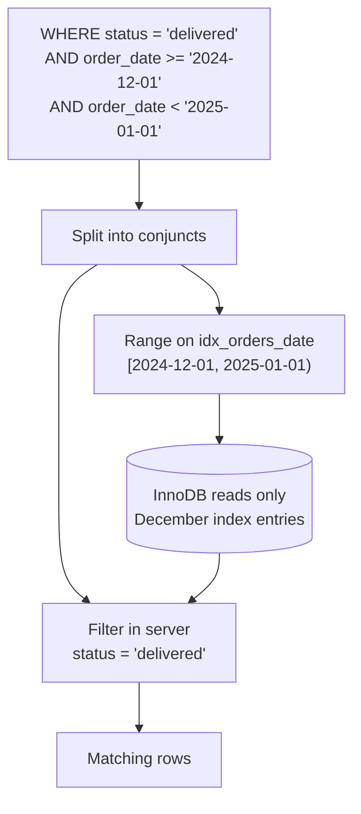

## Introduction

Almost no real query wants *all* rows. "Delivered orders from December", "customers in California without a phone number", "products between $50 and $100 that are in stock" — each is a **filter** over a table, and in SQL every row filter is written in the `WHERE` clause.

`WHERE` looks like the easiest clause in SQL, and that is exactly why it is the source of so many silently wrong reports. The syntax rarely fails; the *logic* does:

- `AND` binds tighter than `OR`, so a condition that reads correctly in English can mean something else to MySQL.
- A comparison with a NULL is neither true nor false, so rows with missing data disappear from both `= x` and `<> x`.
- `NOT IN` with a NULL in the list returns **no rows at all**.
- `BETWEEN '2024-10-01' AND '2024-10-31'` on a `DATETIME` column misses almost all of October 31.
- Wrapping an indexed column in a function (`DATE(order_date) = …`) turns an index lookup into a full table scan.

This lesson teaches the WHERE clause as a database professional must understand it: as a **predicate evaluated in three-valued logic**, whose *shape* determines both the correctness of the answer and whether the optimizer can use an index to find it.

:::note[Dataset]
The examples use the **shop** dataset (25 customers, 30 products, 80 orders placed during 2024). Every output was captured on a real MySQL server; press **Run** to execute any block in your lab.
:::

## DBMS Theory

:::theory[Selection and predicates]
In relational algebra, **selection** σ<sub>p</sub>(R) returns the tuples of R for which the predicate **p** is true. A predicate is built from **atomic conditions** (comparisons such as `price > 100`, membership tests, NULL tests) combined with the logical connectives ∧ (AND), ∨ (OR) and ¬ (NOT). Selection never changes the attributes of a tuple — it only decides whether the tuple is kept — and it commutes with other selections: σ<sub>p</sub>(σ<sub>q</sub>(R)) = σ<sub>p ∧ q</sub>(R). Optimizers rely on such equivalences to reorder and push filters as close to the data as possible.
:::

SQL extends the classical two-valued predicate logic with a third truth value, **UNKNOWN**, because a column can be NULL. Every comparison involving a NULL operand evaluates to UNKNOWN, and the connectives follow **Kleene's three-valued logic**:

| p | q | p AND q | p OR q | NOT p |
|---|---|---|---|---|
| TRUE | UNKNOWN | UNKNOWN | TRUE | FALSE |
| FALSE | UNKNOWN | FALSE | UNKNOWN | TRUE |
| UNKNOWN | UNKNOWN | UNKNOWN | UNKNOWN | UNKNOWN |

The rule that matters most for `WHERE`: **a row is returned only if the predicate is TRUE.** FALSE and UNKNOWN both discard the row. (A `CHECK` constraint is the opposite: it *rejects* a row only if the predicate is FALSE; UNKNOWN passes.) This asymmetry is why `WHERE x = 5` and `WHERE NOT (x = 5)` together do not return every row — rows where `x` is NULL satisfy neither. You studied the logic itself in [NULL and three-valued logic](/lessons/m02-null-three-valued-logic); this lesson shows its consequences for filtering.

Two further concepts from query-processing theory:

- **Selectivity** — the fraction of rows a predicate keeps. `status = 'pending'` (2 of 80 orders) is highly selective; `status <> 'pending'` is not. Optimizers estimate selectivity from statistics and histograms to choose between index access and a full scan.
- **Sargability** (from *Search ARGument ABLE*) — whether a predicate can be answered by an index **range** on a column. `order_date >= '2024-10-01'` is sargable: it maps to a contiguous slice of the B+ tree. `YEAR(order_date) = 2024` is not: the index is sorted by `order_date`, not by `YEAR(order_date)`, so every entry must be examined.

## Why It Exists

Without a filter, the only way to answer "which orders are pending?" is to send all rows to the client and test them there. That fails on every dimension that matters in production:

- **Efficiency.** Filtering in the server lets the optimizer use indexes to touch only matching rows, and ships only those rows over the network.
- **Consistency.** A single statement filters a consistent snapshot (InnoDB MVCC); client-side filtering across pages of data can see a mixture of states.
- **Correctness of writes.** `UPDATE` and `DELETE` use the same `WHERE` clause to decide *which* rows change. A mistaken predicate in a `SELECT` gives a wrong report; the same mistake in a `DELETE` destroys data. Learning to write exact predicates here is preparation for [UPDATE and DELETE](/lessons/m03-update-delete).
- **Concurrency.** In locking reads and DML, InnoDB locks the index records it *scans*, not just those it returns. A sargable predicate that scans 10 rows locks 10 rows; a non-sargable one may scan and lock the whole table (Module 8).

## Internal Working

:::internals[Where a WHERE condition is evaluated]
MySQL splits a WHERE clause into its top-level AND-ed parts (**conjuncts**) and decides, for each part, the earliest point at which it can be applied:

1. **Constant folding and simplification.** The optimizer evaluates constant sub-expressions once (`1 = 1` disappears, `price > 10 + 5` becomes `price > 15`), removes trivially true parts and detects impossible ones (`WHERE 1 = 0` → *Impossible WHERE*, no table access at all).
2. **Access method (range / ref).** Sargable conjuncts on an indexed column become **index ranges**: `order_date >= '2024-10-01' AND order_date < '2024-11-01'` is one interval of `idx_orders_date`; `status IN ('paid','shipped')` would be two point ranges on an index over `status`. InnoDB then reads only those ranges.
3. **Index Condition Pushdown (ICP).** Conditions on indexed columns that cannot form a range can still be checked *inside InnoDB* against the index entry before the full row is fetched. EXPLAIN shows `Using index condition`.
4. **Filter iterator.** All remaining conditions are evaluated in the server on each row returned by the storage engine. EXPLAIN shows `Using where`; `EXPLAIN FORMAT=TREE` shows a `Filter:` node.
:::



**Short-circuiting is not guaranteed.** In procedural languages `a && b` never evaluates `b` if `a` is false. SQL makes no such promise: the optimizer may evaluate conjuncts in any order, push some into the index and evaluate others later. Never write a WHERE clause whose correctness depends on evaluation order (for example a "guard" condition meant to prevent a division by zero in a later conjunct); use `CASE` or `NULLIF` instead.

**Type conversion happens before comparison.** When the operands of a comparison have different types, MySQL converts them according to fixed rules: two strings compare as strings using the **collation**; a string compared with a number compares as *floating-point numbers*; a `DATETIME` compared with a constant string converts the string to a `DATETIME`. The string-to-number rule is a notorious trap you will see in Common Mistakes. The collation rule explains why, with the default `utf8mb4_0900_ai_ci`, `city = 'austin'` matches `'Austin'`: the comparison is case-insensitive (`ci`) and accent-insensitive (`ai`). It is also a **NO PAD** collation, so trailing spaces are significant: `'Austin '` does not equal `'Austin'`.

## MySQL Implementation

```sql
SELECT select_list
FROM   table_reference
WHERE  predicate;
```

The predicate is any expression; MySQL treats a non-zero numeric result as TRUE, zero as FALSE and NULL as UNKNOWN. A single comparison:

```sql run
SELECT product_id, name, price
FROM products
WHERE price >= 300
ORDER BY price DESC;
```

The six standard comparison operators are `=`, `<>` (or `!=`), `<`, `<=`, `>`, `>=`. MySQL adds the **NULL-safe equality** operator `<=>`, which returns TRUE when both sides are NULL and FALSE (never UNKNOWN) when exactly one is:

```sql run
SELECT NULL = NULL      AS equals,
       NULL <=> NULL    AS null_safe_equals,
       1 <=> NULL       AS one_null_safe,
       NULL IS NULL     AS is_null,
       'Austin' = 'austin' AS case_insensitive;
```

Combine conditions with `AND`, `OR` and `NOT`:

```sql run
SELECT customer_id, first_name, last_name, city, phone
FROM customers
WHERE state = 'CA'
  AND phone IS NULL
ORDER BY customer_id;
```

`IN` tests membership in a list, `BETWEEN` tests an inclusive range:

```sql run
SELECT order_id, status, order_date
FROM orders
WHERE status IN ('pending', 'paid')
ORDER BY order_id;
```

```sql run
SELECT product_id, name, price
FROM products
WHERE price BETWEEN 50 AND 100
ORDER BY price, product_id;
```

Both ends of `BETWEEN` are included: the $50.00 gift card and the $99.00 fitness tracker appear in the result. `x BETWEEN a AND b` is exactly `x >= a AND x <= b`.

## Syntax Breakdown

| Operator / form | Meaning | NULL behaviour |
|---|---|---|
| `a = b`, `a <> b`, `a != b` | Equality / inequality | UNKNOWN if either side is NULL |
| `a < b`, `<=`, `>`, `>=` | Ordering comparisons (collation for strings, chronological for temporal types) | UNKNOWN if either side is NULL |
| `a <=> b` | NULL-safe equality (MySQL). Standard SQL spelling: `a IS NOT DISTINCT FROM b`, which MySQL does not support | Never UNKNOWN |
| `a IS NULL`, `a IS NOT NULL` | NULL tests — the **only** correct way to test for NULL | Never UNKNOWN |
| `a BETWEEN x AND y` | `a >= x AND a <= y`, both ends inclusive; `x` must be ≤ `y` or nothing matches | UNKNOWN if any operand is NULL |
| `a NOT BETWEEN x AND y` | `a < x OR a > y` | |
| `a IN (v1, v2, …)` | `a = v1 OR a = v2 OR …` | UNKNOWN if no match and the list contains NULL |
| `a NOT IN (v1, v2, …)` | `a <> v1 AND a <> v2 AND …` | **UNKNOWN for every row if the list contains NULL** |
| `(a, b) IN ((1, 2), (3, 4))` | Row-constructor membership (standard) | |
| `NOT p` | Negation | NOT UNKNOWN = UNKNOWN |
| `p AND q`, `p OR q`, `p XOR q` | Connectives (`XOR` is MySQL-specific) | Three-valued; see the truth table |

**Precedence**, highest to lowest, for the operators used in WHERE clauses (from the MySQL manual):

| Level | Operators |
|---|---|
| 1 (highest) | `!` (deprecated synonym for NOT) |
| 2 | unary `-`, `~` |
| 3 | `*`, `/`, `DIV`, `%`, `MOD` |
| 4 | `+`, `-` |
| 5 | comparisons `=`, `<=>`, `>=`, `>`, `<=`, `<`, `<>`, `!=`, `IS`, `LIKE`, `REGEXP`, `IN` |
| 6 | `BETWEEN`, `CASE`, `WHEN`, `THEN`, `ELSE` |
| 7 | `NOT` |
| 8 | `AND`, `&&` |
| 9 | `XOR` |
| 10 (lowest) | `OR`, `||` |

The practical consequences: arithmetic happens before comparison (`price - cost > 100` means `(price - cost) > 100`), comparisons happen before `NOT` (`NOT status = 'paid'` means `NOT (status = 'paid')`), and **`AND` happens before `OR`**. When a predicate mixes `AND` and `OR`, write the parentheses even where they are not required — they cost nothing and document intent.

:::standard[Standard SQL vs MySQL]
Comparison operators, `AND`/`OR`/`NOT`, `IN`, `BETWEEN`, `IS [NOT] NULL` and row constructors are standard. MySQL-specific: `<=>`, `XOR`, `&&` and `||` as logical operators (deprecated), `!` for NOT, and treating any numeric expression as a truth value (`WHERE is_active` works because BOOLEAN is `TINYINT(1)`). MySQL does not implement the standard `IS [NOT] DISTINCT FROM` predicate or `BETWEEN SYMMETRIC`.
:::

## Practical Examples

**1. Operator precedence: the classic bug.** Marketing asks for "delivered or shipped orders that used the VIP20 code". Translated word by word:

```sql run
SELECT COUNT(*) AS n
FROM orders
WHERE status = 'delivered' OR status = 'shipped' AND discount_code = 'VIP20';
```

Because `AND` binds tighter, MySQL read this as `status = 'delivered' OR (status = 'shipped' AND discount_code = 'VIP20')` — *every* delivered order plus the VIP20 shipped ones. The intended query needs parentheses, or better, `IN`:

```sql run
SELECT COUNT(*) AS n
FROM orders
WHERE status IN ('delivered', 'shipped')
  AND discount_code = 'VIP20';
```

The two results differ by a large margin, and nothing in the first query looks wrong at a glance. This is the single most common logic error in hand-written SQL.

**2. NULL in predicates: rows that vanish from both sides.** How many orders did *not* use the VIP20 code?

```sql run
SELECT COUNT(*)                                        AS all_orders,
       SUM(discount_code = 'VIP20')                    AS vip20,
       (SELECT COUNT(*) FROM orders WHERE discount_code <> 'VIP20') AS not_vip20_naive,
       SUM(discount_code IS NULL)                      AS no_code
FROM orders;
```

`vip20 + not_vip20_naive` is less than `all_orders`: the orders with no discount code are in neither group, because `NULL <> 'VIP20'` is UNKNOWN. If "not VIP20" is meant to include orders without a code, say so explicitly:

```sql run
SELECT COUNT(*) AS not_vip20_including_no_code
FROM orders
WHERE discount_code <> 'VIP20' OR discount_code IS NULL;
```

`WHERE NOT (discount_code <=> 'VIP20')` is an equivalent MySQL-specific spelling.

**3. NOT IN with a NULL in the list.** `NOT IN` expands to a chain of `<>` comparisons joined by AND. One NULL in the list makes one conjunct UNKNOWN for every row, and `TRUE AND UNKNOWN` is UNKNOWN — so nothing passes:

```sql run
SELECT (SELECT COUNT(*) FROM products WHERE category_id NOT IN (3, 4))       AS not_in_3_4,
       (SELECT COUNT(*) FROM products WHERE category_id NOT IN (3, 4, NULL)) AS with_null_in_list,
       (SELECT COUNT(*) FROM products WHERE category_id IS NULL)              AS null_category;
```

Look carefully at the first column too: the gift card has a NULL `category_id`, so it is excluded even from the NULL-free `NOT IN` — "not a laptop and not an accessory" does not include "category unknown" under three-valued logic. Nobody writes a literal `NULL` into an IN list on purpose; the danger is `NOT IN (SELECT col FROM …)` where the subquery's column contains a NULL. That variant — and why `NOT EXISTS` is the safe alternative — is analysed in depth in Module 4 ([Subqueries](/lessons/m04-subqueries)).

**4. Date ranges: BETWEEN versus half-open intervals.** `orders.order_date` is a `DATETIME`. A string such as `'2024-10-31'` compared with a DATETIME is converted to `'2024-10-31 00:00:00'` — midnight at the *start* of the day:

```sql run
SELECT CAST('2024-10-31' AS DATETIME) AS how_mysql_reads_the_bound;
```

So "October" written with BETWEEN silently excludes everything on October 31 after midnight:

```sql run
SELECT (SELECT COUNT(*) FROM orders
        WHERE order_date BETWEEN '2024-10-01' AND '2024-10-31')            AS between_oct,
       (SELECT COUNT(*) FROM orders
        WHERE order_date >= '2024-10-01' AND order_date < '2024-11-01')    AS half_open_oct;
```

```sql run
SELECT order_id, order_date
FROM orders
WHERE order_date >= '2024-10-31' AND order_date < '2024-11-01';
```

The missing order was placed on October 31 in the morning. The **half-open interval** `[start, next_start)` — `>=` the first instant, `<` the first instant of the next period — is correct for every temporal type and precision. Patching BETWEEN with `'2024-10-31 23:59:59'` works for `DATETIME` with no fractional seconds but breaks for `DATETIME(3)` or `DATETIME(6)` columns (a value at 23:59:59.500 is missed) and is awkward for months of different lengths. Half-open ranges also tile perfectly: consecutive periods neither overlap nor leave gaps.

**5. Filtering by a computed date without killing the index.** "Orders in December 2024" written with functions on the column is correct but non-sargable:

```sql run
SELECT order_id, order_date, status
FROM orders
WHERE YEAR(order_date) = 2024 AND MONTH(order_date) = 12
ORDER BY order_date;
```

The sargable form compares the bare column with constants, and you can compute the constants with date arithmetic when the period is a parameter:

```sql run
SELECT order_id, order_date, status
FROM orders
WHERE order_date >= '2024-12-01'
  AND order_date <  '2024-12-01' + INTERVAL 1 MONTH
ORDER BY order_date;
```

The results are identical; the plans are not (see Performance Analysis).

**6. Row constructors and NOT.** Match several (column, column) pairs at once with a row constructor, and use `NOT` with explicit parentheses:

```sql run
SELECT customer_id, first_name, city, state
FROM customers
WHERE (city, state) IN (('Austin', 'TX'), ('Boston', 'MA'))
  AND NOT (loyalty_tier = 'bronze')
ORDER BY customer_id;
```

Only the two non-bronze Austin customers qualify (every Boston customer is bronze). Note the NULL rule here too: had an Austin or Boston customer had a NULL `loyalty_tier`, they would *not* be returned, because `NOT (NULL = 'bronze')` is `NOT UNKNOWN`, which is UNKNOWN.

## Execution Walkthrough

Trace how one filter is evaluated. The query: delivered or shipped orders placed in December 2024.

```sql
SELECT order_id, status, order_date
FROM orders
WHERE status IN ('delivered', 'shipped')
  AND order_date >= '2024-12-01' AND order_date < '2025-01-01'
ORDER BY order_date;
```

```walkthrough
title: Filtering December's delivered/shipped orders
steps:
  - title: "1. FROM — the input"
    explain: >-
      Logically, WHERE receives every row of orders. Physically the optimizer will avoid reading most of them, as
      step 5 shows; this count is the size of the logical input.
    sql: SELECT COUNT(*) AS input_rows FROM orders;
  - title: "2. Split into conjuncts and evaluate the date range"
    explain: >-
      The WHERE clause is a conjunction of three atomic conditions. The two date comparisons are sargable on
      idx_orders_date, so they form the index range [2024-12-01, 2025-01-01). These are the rows that range
      produces — including statuses we do not want yet.
    sql: |
      SELECT order_id, status, order_date
      FROM orders
      WHERE order_date >= '2024-12-01' AND order_date < '2025-01-01'
      ORDER BY order_date;
  - title: "3. Evaluate the remaining conjunct for each row"
    explain: >-
      For each row from the range, status IN ('delivered','shipped') is evaluated to TRUE or FALSE (status is NOT
      NULL, so UNKNOWN cannot occur here). This query shows the truth value MySQL computes per row; only rows with 1
      survive.
    sql: |
      SELECT order_id, status, status IN ('delivered', 'shipped') AS predicate_value
      FROM orders
      WHERE order_date >= '2024-12-01' AND order_date < '2025-01-01'
      ORDER BY order_date;
  - title: "4. SELECT and ORDER BY — the result"
    explain: Surviving rows are projected and sorted. Rows for which the predicate was FALSE (paid, cancelled) are gone.
    sql: |
      SELECT order_id, status, order_date
      FROM orders
      WHERE status IN ('delivered', 'shipped')
        AND order_date >= '2024-12-01' AND order_date < '2025-01-01'
      ORDER BY order_date;
  - title: "5. The physical plan"
    explain: >-
      EXPLAIN FORMAT=TREE shows how the conjuncts were placed: an index range scan on idx_orders_date for the dates,
      and a filter for the status condition. Only the December index entries are read, not all orders.
    sql: |
      EXPLAIN FORMAT=TREE
      SELECT order_id, status, order_date
      FROM orders
      WHERE status IN ('delivered', 'shipped')
        AND order_date >= '2024-12-01' AND order_date < '2025-01-01'
      ORDER BY order_date;
```

Notice that no explicit sort is needed in the plan when rows are read from `idx_orders_date` in index order: the range scan already delivers them sorted by `order_date`. Read the tree's lines carefully to see whether your server reports a separate sort node.

## Output

A WHERE clause never changes columns — only which rows appear. When you read a filtered result, check it against the question with two quick sanity tests:

1. **Complement test.** Run the query with the predicate negated and with an `IS NULL` test. The three counts (`p`, `NOT p`, `p IS UNKNOWN`) must add up to the table's row count. If you expected two groups and the sum is short, NULLs are hiding somewhere.
2. **Boundary test.** For every range, look at the rows *at* the boundaries. Is the first day in? Is the last day in? Is the boundary value itself (exactly $50.00) in or out?

```sql run
SELECT SUM(discount_code = 'VIP20')               AS p_true,
       SUM(NOT (discount_code = 'VIP20'))         AS p_false,
       SUM((discount_code = 'VIP20') IS NULL)     AS p_unknown,
       COUNT(*)                                   AS total
FROM orders;
```

The three partition counts add up to `total` — every row is in exactly one truth-value bucket — and the size of `p_unknown` tells you how many rows any filter on `discount_code` will treat as "neither".

## Alternative Approaches

| Need | Options | Recommendation |
|---|---|---|
| One of several values | `a = 1 OR a = 2 OR a = 3` vs `a IN (1, 2, 3)` | `IN` — same semantics, clearer, harder to break with precedence |
| Exclude values, column nullable | `NOT IN (…)` vs `<> … AND …` vs `NOT (a <=> …)` | Decide explicitly what NULL rows should do; add `OR a IS NULL` if they belong |
| Exclude rows matching a subquery | `NOT IN (SELECT …)` vs `NOT EXISTS (…)` vs anti-join | `NOT EXISTS` — immune to NULLs in the subquery (Module 4) |
| Date period | `BETWEEN` vs `YEAR()/MONTH()/DATE()` vs half-open range | Half-open range on the bare column |
| Matching NULLs as equal | `a = b OR (a IS NULL AND b IS NULL)` vs `a <=> b` | `<=>` in MySQL; the longhand form is portable |
| Filter on an expression you cannot avoid | function in WHERE vs **functional index** vs generated column | Index the expression (below) |

When a predicate on an expression is genuinely needed — e.g. searches on `LOWER(email)` or on `DATE(order_date)` for a reporting tool that cannot be changed — MySQL 8.0.13+ can index the expression itself. Such statements are DDL that you will learn in Module 7; shown here for completeness:

```sql
-- Functional key part (MySQL 8.0.13+): makes WHERE DATE(order_date) = '2024-10-31' sargable
ALTER TABLE orders ADD INDEX idx_orders_day ((DATE(order_date)));
```

The optimizer uses a functional index only when the WHERE clause contains the *same* expression; the half-open range on the plain column needs no extra index at all and is usually the better fix.

## Performance Analysis

Compare the plans of the two December queries from Practical Example 5:

```sql run
EXPLAIN SELECT order_id FROM orders
WHERE YEAR(order_date) = 2024 AND MONTH(order_date) = 12;
```

```sql run
EXPLAIN SELECT order_id FROM orders
WHERE order_date >= '2024-12-01' AND order_date < '2025-01-01';
```

The function-wrapped version has `type = index` with a `rows` estimate covering the whole table: because the query needs only `order_id` and `order_date`, MySQL reads the *entire* `idx_orders_date` (a full index scan — cheaper than a table scan, but still every entry) and evaluates the functions on each one. It cannot map `YEAR(order_date) = 2024` to a slice of an index sorted by `order_date`. Select more columns and the same predicate becomes a full table scan (`type = ALL`). The half-open version is a `range` access on `idx_orders_date` with a small `rows` estimate. On 80 rows both are instant; on 80 million rows the first reads the entire table for every request.

| Predicate shape | Sargable? | Why |
|---|---|---|
| `col = const`, `col > const`, `col BETWEEN a AND b`, `col IN (…)` | Yes | Maps to index point/range intervals |
| `col >= a AND col < b` | Yes | One interval |
| `f(col) = const` (e.g. `DATE(col)`, `LOWER(col)`, `col + 1`) | No (unless a functional index on `f(col)` exists) | Index is ordered by `col`, not `f(col)` |
| `col1 = const OR col2 = const` | Only via *index merge* if both columns are indexed | Otherwise a full scan |
| `string_col = 123` (number) | No | Every string must be converted to a number for comparison |
| `col <> const`, `NOT IN (…)` | Technically a range (two intervals), rarely useful | Low selectivity — usually a scan is cheaper |

**Large IN lists.** MySQL turns `col IN (v1, …, vn)` on an indexed column into *n* point ranges. To estimate how many rows each range contains it performs **index dives** (short B+ tree descents) — accurate but costly when *n* is large. When the list has at least `eq_range_index_dive_limit` values (default 200) the optimizer switches to index statistics instead. Lists of thousands of values work, but if a query regularly filters by thousands of IDs, load them into a (temporary) table and join.

:::performance[Theory vs measurement]
The table above is derived from how B+ tree indexes and the range optimizer work; it predicts *which* plan is possible. Whether the optimizer actually picks an index range depends on its row estimates — for a predicate that matches most of the table, a full scan is genuinely cheaper than thousands of random index lookups, and MySQL will (correctly) ignore the index. Confirm with `EXPLAIN`, and measure real cost with `EXPLAIN ANALYZE` on realistic data volumes (Module 7).
:::

## Best Practices

:::best-practice[Writing predicates professionals trust]
1. **Parenthesize every mix of AND and OR**, and prefer `IN (…)` to chains of `OR` on the same column.
2. **Decide what NULL means for every nullable column you filter on**, and write `IS NULL` / `IS NOT NULL` / `<=>` explicitly. Never write `= NULL`.
3. **Use half-open intervals for time:** `col >= start AND col < next_start`. Never `BETWEEN` on `DATETIME`/`TIMESTAMP`.
4. **Keep indexed columns bare.** Move arithmetic and functions to the constant side: `order_date >= CURDATE() - INTERVAL 7 DAY`, not `DATEDIFF(CURDATE(), order_date) <= 7`.
5. **Compare like with like.** Quote string constants for string columns and use numeric literals for numeric columns, so no implicit conversion happens.
6. **Avoid `NOT IN (subquery)`**; use `NOT EXISTS`.
7. **Run the complement test** on any report filter: the counts of p, NOT p and "p is unknown" must add up to the total.
8. **Use bound parameters** (prepared statements) for values that come from users — never concatenate them into the WHERE clause (SQL injection, Module 11).
:::

## Common Mistakes

**Mistake 1 — `= NULL`.** It is syntactically valid, evaluates to UNKNOWN for every row, and returns nothing:

```sql run
SELECT COUNT(*) AS wrong FROM customers WHERE phone = NULL;
```

```sql run
SELECT COUNT(*) AS customers_without_phone FROM customers WHERE phone IS NULL;
```

**Mistake 2 — comparing a string column with a number.** The string is converted to a floating-point number; text that does not start with digits becomes 0, so this "matches" every customer:

```sql run
SELECT COUNT(*) AS matches FROM customers WHERE first_name = 0;
```

MySQL does attach a warning 1292 (*Truncated incorrect DOUBLE value*) for each converted string, as the captured output shows — but warnings never fail a query, and most application drivers do not read them, so in practice the bug is silent. The same rule makes `WHERE sku = 1001` unable to use the unique index on `sku`. Always quote string literals.

**Mistake 3 — reversed BETWEEN bounds.** `BETWEEN` is not symmetric in MySQL: `x BETWEEN 100 AND 50` means `x >= 100 AND x <= 50`, which no value satisfies.

```sql run
SELECT COUNT(*) AS n FROM products WHERE price BETWEEN 100 AND 50;
```

**Mistake 4 — trusting `<>` to include missing values.** Covered in Practical Example 2: `discount_code <> 'VIP20'` drops the orders without a code. Add `OR discount_code IS NULL` when they belong.

**Mistake 5 — an aggregate in WHERE.** WHERE filters rows *before* grouping, so it cannot reference aggregates:

```sql run error
SELECT customer_id FROM orders WHERE COUNT(*) > 3;
```

Filtering on aggregates is the job of `HAVING` ([GROUP BY and HAVING](/lessons/m03-group-by-having)).

**Mistake 6 — the precedence trap in `UPDATE`/`DELETE`.** `DELETE FROM orders WHERE status = 'cancelled' OR status = 'refunded' AND order_date < '2024-06-01'` deletes *every* cancelled order, not only old ones. In DML the price of a missing parenthesis is lost data.

## Industry Application

- **Multi-tenant SaaS.** Every query in a shared-schema SaaS product carries a tenant predicate (`WHERE tenant_id = ? AND …`). Teams enforce it with query builders or row-level policies because one missing conjunct leaks another customer's data; composite indexes start with `tenant_id` so the predicate is always sargable.
- **Time-partitioned reporting.** Data warehouses and reporting replicas filter by half-open time windows (`event_time >= :start AND event_time < :end`) that align with daily or monthly partitions, enabling **partition pruning** (Module 12). A `DATE(event_time) = …` predicate defeats pruning as well as indexes.
- **Incremental ETL.** Change-data extraction jobs pull rows with `updated_at >= :last_watermark AND updated_at < :new_watermark`. The half-open window guarantees each row is extracted exactly once even when consecutive runs share a boundary timestamp.
- **Data quality rules.** Validation jobs count rows violating predicates (`WHERE amount < 0 OR currency IS NULL`) and fail the pipeline if the count is non-zero — the complement test, automated.
- **Code review checklists.** Many engineering teams flag `NOT IN (SELECT …)`, `BETWEEN` on timestamps, functions on indexed columns and unparenthesized `OR` as review blockers, because each has caused production incidents.

## Practice Exercises

```exercise
id: ex1
title: Low-stock active products
difficulty: easy
concepts: [comparison-operators, where-clause]
prompt: |
  Return active products with fewer than 20 units in stock. Columns: `product_id`, `name`, `stock_qty`.
hints:
  - "Two conditions joined with AND: is_active and stock_qty < 20."
  - "is_active is a BOOLEAN (TINYINT(1)); WHERE is_active = TRUE or simply WHERE is_active works."
solution: |
  SELECT product_id, name, stock_qty
  FROM products
  WHERE is_active = TRUE AND stock_qty < 20;
explanation: |
  Product 4 also has zero stock but is inactive, so it is excluded by the first conjunct. `<` excludes
  exactly 20; use `<=` if the business rule says "20 or fewer".
```

```exercise
id: ex2
title: Fix the precedence bug
difficulty: medium
concepts: [operator-precedence, in-list]
prompt: |
  Return the `order_id` of every order whose status is **cancelled or refunded** and that was placed **before
  2024-07-01** (any time on June 30 counts). One column: `order_id`.
hints:
  - "AND binds more tightly than OR — group the two statuses with parentheses or IN."
  - "Use a half-open bound: order_date < '2024-07-01'."
solution: |
  SELECT order_id
  FROM orders
  WHERE status IN ('cancelled', 'refunded')
    AND order_date < '2024-07-01';
explanation: |
  `WHERE status = 'cancelled' OR status = 'refunded' AND order_date < '2024-07-01'` returns every cancelled
  order regardless of date, because MySQL evaluates the AND first. `order_date < '2024-07-01'` includes all of
  June 30 (the bound is midnight at the start of July 1); `<= '2024-06-30'` would miss June 30 after midnight.
```

```exercise
id: ex3
title: Orders placed in the third quarter
difficulty: medium
concepts: [date-filtering, between, sargability]
prompt: |
  Return `order_id` and `order_date` for every order placed in Q3 2024 (July 1 through September 30, inclusive
  of the whole last day). Write the predicate so that it could use the index on `order_date`.
hints:
  - "Q3 ends at the start of October 1."
  - "order_date >= '2024-07-01' AND order_date < '2024-10-01'."
solution: |
  SELECT order_id, order_date
  FROM orders
  WHERE order_date >= '2024-07-01' AND order_date < '2024-10-01';
explanation: |
  `BETWEEN '2024-07-01' AND '2024-09-30'` misses the order placed on September 30 at 08:27, because
  '2024-09-30' means midnight. `QUARTER(order_date) = 3 AND YEAR(order_date) = 2024` returns the right rows but
  cannot use idx_orders_date.
```

```exercise
id: ex4
title: Everyone except gold members
difficulty: hard
concepts: [null-predicates, not-in-null, three-valued-logic]
prompt: |
  The CRM team wants to email every customer who is **not** a gold member — and customers without any loyalty
  tier must be included. Return `customer_id` and `email`.
hints:
  - "loyalty_tier <> 'gold' is UNKNOWN when loyalty_tier is NULL, so those customers are dropped."
  - "Add OR loyalty_tier IS NULL, or use NOT (loyalty_tier <=> 'gold')."
solution: |
  SELECT customer_id, email
  FROM customers
  WHERE loyalty_tier <> 'gold' OR loyalty_tier IS NULL;
explanation: |
  The naive `WHERE loyalty_tier <> 'gold'` (or `NOT IN ('gold')`) silently omits the customers with no tier
  — the very customers a loyalty campaign most wants to reach. `NOT (loyalty_tier <=> 'gold')` is a compact
  MySQL-specific alternative; `COALESCE(loyalty_tier, '') <> 'gold'` works too but hides intent and is not
  sargable.
```

```exercise
id: ex5
title: Shipping SLA breach report
difficulty: challenge
concepts: [where-clause, operator-precedence, null-predicates, date-filtering]
prompt: |
  Operations defines an SLA breach as an order placed in **the second half of 2024** (July 1 onwards) that
  either

  - has status `shipped` or `delivered` and was shipped **more than 48 hours** after it was placed, or
  - has status `paid` and has **not been shipped at all**.

  Return `order_id`, `status`, `order_date`, `shipped_at`.
hints:
  - "Write the two breach conditions separately, each in parentheses, joined with OR — then AND the date condition around the whole group."
  - "'More than 48 hours later' can be written as shipped_at > order_date + INTERVAL 48 HOUR."
  - "'Not shipped at all' is shipped_at IS NULL."
solution: |
  SELECT order_id, status, order_date, shipped_at
  FROM orders
  WHERE order_date >= '2024-07-01'
    AND (
          (status IN ('shipped', 'delivered') AND shipped_at > order_date + INTERVAL 48 HOUR)
       OR (status = 'paid' AND shipped_at IS NULL)
        );
explanation: |
  Without the outer parentheses the date filter would bind only to the first breach condition, and every
  unshipped paid order from the first half of the year would leak in. `shipped_at > order_date + INTERVAL 48
  HOUR` is NULL-safe for this purpose: for unshipped orders it is UNKNOWN, so those rows are correctly handled
  only by the second branch.
```

## Knowledge Assessment

```quiz
- id: q1
  question: "How does MySQL evaluate `WHERE a = 1 OR b = 2 AND c = 3`?"
  options:
    - "(a = 1 OR b = 2) AND c = 3"
    - "a = 1 OR (b = 2 AND c = 3)"
    - "Left to right, as written"
    - "It is a syntax error without parentheses"
  answer: 1
  explanation: "AND has higher precedence than OR, so b = 2 AND c = 3 is grouped first. SQL is not evaluated purely left to right, and the expression is valid without parentheses — which is exactly why the mistake is common."
  concepts: [operator-precedence]
- id: q2
  question: "Column `x` has the values 1, 2, NULL. How many rows does `WHERE x NOT IN (1, NULL)` return?"
  options: ["0", "1", "2", "3"]
  answer: 0
  explanation: "x NOT IN (1, NULL) means x <> 1 AND x <> NULL. The second conjunct is UNKNOWN for every row, so no row can be TRUE. Row 2 would satisfy x <> 1, but TRUE AND UNKNOWN is UNKNOWN; the NULL row is UNKNOWN anyway."
  concepts: [not-in-null, three-valued-logic]
- id: q3
  question: "`order_date` is DATETIME. Which predicate returns every order placed on 2024-10-31?"
  options:
    - "order_date = '2024-10-31'"
    - "order_date BETWEEN '2024-10-31' AND '2024-10-31'"
    - "order_date >= '2024-10-31' AND order_date < '2024-11-01'"
    - "order_date <= '2024-10-31'"
  answer: 2
  explanation: "'2024-10-31' converts to 2024-10-31 00:00:00, so equality and the degenerate BETWEEN match only orders placed exactly at midnight, and <= includes all earlier days. The half-open interval covers the whole day for any precision."
  concepts: [date-filtering, between]
- id: q4
  question: "Which predicates can use a B+ tree index on `order_date` as a range? (Select all that apply.)"
  type: multi
  options:
    - "order_date >= '2024-01-01' AND order_date < '2024-02-01'"
    - "YEAR(order_date) = 2024"
    - "order_date BETWEEN '2024-01-01' AND '2024-01-31 23:59:59'"
    - "DATE(order_date) = '2024-01-15'"
  answer: [0, 2]
  explanation: "Comparisons of the bare column with constants map to index intervals (BETWEEN is sargable even though it is a poor choice for DATETIME). Wrapping the column in YEAR() or DATE() prevents range access unless a functional index on that exact expression exists."
  concepts: [sargability, date-filtering]
- id: q5
  question: "A table has 100 rows; `discount_code` is NULL in 40 rows and 'VIP' in 15. How many rows does `WHERE discount_code <> 'VIP'` return?"
  options: ["85", "60", "45", "100"]
  answer: 2
  explanation: "Only non-NULL, non-'VIP' rows satisfy the predicate: 100 − 40 − 15 = 45. The 40 NULL rows evaluate to UNKNOWN and are dropped; 85 would require NULL <> 'VIP' to be TRUE."
  concepts: [null-predicates]
- id: q6
  question: "What does `SELECT NULL <=> NULL, NULL = NULL, 1 <=> NULL;` return in MySQL?"
  options: ["1, NULL, 0", "1, 1, 0", "NULL, NULL, NULL", "1, NULL, NULL"]
  answer: 0
  explanation: "<=> is NULL-safe equality: TRUE (1) when both are NULL, FALSE (0) when one is NULL, never UNKNOWN. The ordinary = returns NULL (UNKNOWN) whenever an operand is NULL."
  concepts: [comparison-operators, null-predicates]
- id: q7
  question: "`customers.first_name` is VARCHAR. Why does `WHERE first_name = 0` match almost every row?"
  options:
    - "0 is treated as a wildcard"
    - "A string compared with a number is converted to a number; names not starting with digits convert to 0"
    - "The collation is case-insensitive"
    - "0 means FALSE, and the comparison is negated"
  answer: 1
  explanation: "MySQL compares a string and a number as floating-point values. 'Amara' converts to 0, so 'Amara' = 0 is TRUE. Collation only applies to string-vs-string comparisons, and 0 is not a wildcard."
  concepts: [comparison-operators]
- id: q8
  question: "A WHERE clause is `WHERE qty <> 0 AND total / qty > 10`. A colleague argues this is safe from division by zero because the first condition is checked first. Is that right?"
  options:
    - "Yes, SQL short-circuits AND from left to right"
    - "No, SQL does not guarantee evaluation order; use NULLIF(qty, 0) or CASE"
    - "Yes, but only in MySQL"
    - "No, because AND is evaluated after OR"
  answer: 1
  explanation: "The optimizer may reorder or push down conjuncts, so evaluation order is not guaranteed. In MySQL a division by zero yields NULL with a warning in SELECT, but in other contexts it may raise an error; NULLIF or CASE makes the intent explicit and safe."
  concepts: [where-clause]
```
