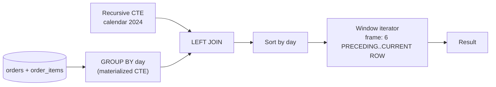

## Introduction

The previous lessons introduced the building blocks: [CTEs](/lessons/m04-ctes) to structure a query as a pipeline, [recursive CTEs](/lessons/m04-recursive-ctes) to generate series, and window functions for [frames](/lessons/m04-window-functions), [ranking](/lessons/m04-ranking-functions) and [neighbouring rows](/lessons/m04-value-functions). Real analytical questions combine them. This lesson is a catalogue of the patterns that data analysts, analytics engineers and data scientists write over and over again — each one reduced to its essential idea, applied to the shop data, and checked against real output:

| Pattern | Business question |
|---|---|
| **Running total** | How much revenue have we made year-to-date, day by day? |
| **Moving average** | What is the 7-day average of daily revenue, including days without sales? |
| **Gaps and islands** | For how many consecutive months did each customer buy? Where are the gaps? |
| **Cohort retention** | Of the customers acquired in Q1, how many came back in Q2, Q3, Q4? |
| **Funnel analysis** | How many customers make it from sign-up to order to delivery to review, and where do we lose them? |
| **Pivoting** | Show revenue per category as **columns**, one row per month. |

The second half of the lesson does what professionals must do before shipping an analytical query against large data: **compare alternative solutions with evidence**. A running total can be written with a window function, a correlated subquery or a self join; all three are correct, and their costs differ by orders of magnitude. You will measure them with `EXPLAIN ANALYZE` on a generated table.

:::note[Dataset]
The examples use the **shop** dataset: 80 orders in calendar year 2024 by 20 customers (customers 2, 13, 23, 24 and 25 never ordered), 182 line items, 45 reviews. "Revenue" means `quantity × unit_price` of line items on orders that were not cancelled or refunded. All outputs were captured from a real MySQL server.
:::

## DBMS Theory

:::theory[Analytical queries as compositions of relational and window operators]
Every pattern in this lesson is a composition of a few operators:

- **γ** (grouping/aggregation) to reach the right *grain* — one row per day, per customer-month, per cohort.
- **Series generation** (a recursive CTE) to make the domain *complete* — every day or month present, even without facts — followed by an **outer join** of the facts to the series.
- **Window operators** ω over an ordered partition: cumulative aggregates (running totals), sliding-frame aggregates (moving averages), offsets (LAG/LEAD), ranks.
- **Conditional aggregation** — Σ CASE … — to *pivot* rows into columns, a restricted form of the relational *pivot* operator that SQL lacks as a primitive in MySQL.

The single most important design decision in any analytical query is the **grain**: what one row of each intermediate result represents. Most wrong analytical results come from aggregating at one grain and windowing at another, or from missing rows in the domain (no row for a day without sales).
:::

Several patterns rely on identities worth knowing by name:

- **Running total** at row *i* = Σ<sub>j ≤ i</sub> xⱼ — a cumulative aggregate; with window functions O(n log n) for the sort plus O(n) for the scan, versus O(n²) for the naive "sum everything before me".
- **Gaps-and-islands identity.** For a strictly increasing sequence of integers *vᵢ* with row numbers *rᵢ* (in the same order), *vᵢ − rᵢ* is constant exactly within runs of consecutive values. The difference is therefore a **group key for islands**.
- **Retention** of cohort *c* at period *k* = |customers of *c* active in period start(c) + k| ÷ |c|. It is a ratio of two counts at different grains — the cohort and the cohort-period.
- **Funnel conversion** at step *s* = |users reaching step *s*| ÷ |users reaching step *s − 1*| (step conversion) or ÷ |users at step 1| (overall conversion). Funnel steps must be **nested**: a user counted at step *s* must also be counted at every earlier step.

:::standard[Standard SQL vs MySQL]
Everything here is standard SQL except two conveniences MySQL lacks: a native `PIVOT` operator (SQL Server, Oracle, Snowflake, DuckDB) and `generate_series` (PostgreSQL). In MySQL, pivot with conditional aggregation (or build the column list dynamically with a prepared statement) and generate series with a recursive CTE. MySQL also has no `PERCENTILE_CONT`/`MEDIAN` aggregate; percentiles are computed with ranking functions.
:::

## Why It Exists

Analytical questions are about **change, sequence and comparison over time** — exactly what plain `GROUP BY` handles worst. Without these patterns teams typically:

- **Export to spreadsheets or pandas** for every running total and retention table. The data leaves the database (security and freshness issues), the logic is unrepeatable, and the numbers drift from the official SQL reports.
- **Write O(n²) SQL** — correlated subqueries for running totals, self joins for "previous period" — which works on a test table and collapses on a year of production data.
- **Produce silently wrong charts** — a moving average that skips days without sales, a month-over-month comparison that compares March with January when February had no orders, a funnel whose later steps include users who never reached the earlier steps.

The patterns in this lesson exist so that analytical logic can live in **one reviewed SQL statement** executed next to the data, with explicit grain, a complete time domain and window frames that say exactly which rows are aggregated. They are also the foundation of what BI tools generate behind the scenes; knowing them lets you read, debug and optimize that generated SQL.

## Internal Working

:::internals[What the server does for a typical analytical pipeline]
A pipeline such as *calendar → left join daily revenue → 7-day moving average* is executed by MySQL as:

1. **Recursive CTE materialization** — the calendar is built iteratively into an internal temporary table (one iteration per day; `cte_max_recursion_depth` must allow 366 iterations, the default 1000 does).
2. **Aggregation** — the daily revenue CTE groups the joined orders/line items; because it contains `GROUP BY`, it is **materialized** (TempTable engine, spilling to disk if large). An automatic index (`<auto_key0>`) may be added to it for the join with the calendar.
3. **Outer join** — calendar rows probe the aggregated table; days without sales get NULLs.
4. **Window evaluation** — the joined rows are sorted by the window's `ORDER BY` (filesort), then scanned once; for a sliding frame the window iterator keeps a frame buffer and updates the aggregate incrementally (`optimized_frame_evaluation`).
5. **Final sort/limit** for presentation.

Each `WITH` step that cannot be merged becomes a materialization, each distinct window specification a sort. Those are the costs to look for in `EXPLAIN FORMAT=TREE`, and the reason analytical queries are best run on replicas or analytical stores when they touch large tables (Module 12).
:::



## MySQL Implementation

The foundation for most time-based patterns is a **daily grain table with a complete calendar**. Build it once as a CTE pipeline:

```sql run
WITH RECURSIVE calendar (d) AS (
  SELECT DATE '2024-01-01'
  UNION ALL
  SELECT d + INTERVAL 1 DAY FROM calendar WHERE d < '2024-12-31'
),
daily AS (
  SELECT DATE(o.order_date) AS d, SUM(oi.quantity * oi.unit_price) AS revenue
  FROM orders o
  JOIN order_items oi ON oi.order_id = o.order_id
  WHERE o.status NOT IN ('cancelled', 'refunded')
  GROUP BY DATE(o.order_date)
)
SELECT COUNT(*)                         AS calendar_days,
       COUNT(daily.d)                   AS days_with_sales,
       SUM(COALESCE(daily.revenue, 0))  AS revenue_2024
FROM calendar
LEFT JOIN daily ON daily.d = calendar.d;
```

Only a minority of the 366 days of 2024 (a leap year) have sales. Any row-based window over `daily` alone would silently treat "the previous row" as "the previous day with sales". The calendar fixes that.

**Running total (year-to-date revenue).** A cumulative `SUM` with an explicit `ROWS` frame over the complete calendar:

```sql run
WITH RECURSIVE calendar (d) AS (
  SELECT DATE '2024-01-01' UNION ALL SELECT d + INTERVAL 1 DAY FROM calendar WHERE d < '2024-12-31'
),
daily AS (
  SELECT DATE(o.order_date) AS d, SUM(oi.quantity * oi.unit_price) AS revenue
  FROM orders o JOIN order_items oi ON oi.order_id = o.order_id
  WHERE o.status NOT IN ('cancelled', 'refunded')
  GROUP BY DATE(o.order_date)
),
filled AS (
  SELECT c.d, COALESCE(daily.revenue, 0) AS revenue
  FROM calendar c LEFT JOIN daily ON daily.d = c.d
)
SELECT d, revenue,
       SUM(revenue) OVER (ORDER BY d ROWS BETWEEN UNBOUNDED PRECEDING AND CURRENT ROW) AS ytd_revenue
FROM filled
WHERE d BETWEEN '2024-06-24' AND '2024-07-03'
ORDER BY d;
```

Note *where* the date filter sits: in the **outer** query, after the window. Filtering inside `filled` would restart the running total at 24 June. Windows see only the rows that reach them — filter before the window to change what is aggregated, after it to change what is displayed.

## Syntax Breakdown

The patterns reuse a handful of constructs. This table is the "vocabulary" of analytical SQL in MySQL:

| Construct | Role in the patterns |
|---|---|
| `WITH RECURSIVE cal AS (… + INTERVAL 1 DAY …)` | Complete time domain (days, weeks, months). |
| `LEFT JOIN facts ON facts.d = cal.d` + `COALESCE(x, 0)` | Keep periods without facts; decide whether "no data" means 0. |
| `SUM(x) OVER (ORDER BY d ROWS UNBOUNDED PRECEDING)` | Running total. Add `PARTITION BY` for per-entity totals (per customer, per year). |
| `AVG(x) OVER (ORDER BY d ROWS BETWEEN 6 PRECEDING AND CURRENT ROW)` | 7-row moving average — correct only on a complete calendar. |
| `… RANGE BETWEEN INTERVAL 6 DAY PRECEDING AND CURRENT ROW` | 7-day window by date value — correct even with gaps (but averages only existing rows). |
| `v - ROW_NUMBER() OVER (PARTITION BY k ORDER BY v)` | Island key for consecutive integer sequences. |
| `LAG(v) OVER w` + flag + running `SUM` | Island/session numbering when "consecutive" needs a custom rule. |
| `MIN(event_time) OVER (PARTITION BY user)` or `GROUP BY user` | Cohort assignment (first activity). |
| `TIMESTAMPDIFF(MONTH, cohort_start, activity_start)` / `PERIOD_DIFF` | Period offset for retention matrices. |
| `SUM(CASE WHEN … THEN x ELSE 0 END) AS col` | Pivot a row value into a column. |
| `COUNT(DISTINCT CASE WHEN step THEN user END)` | Funnel step counts. |
| `PREPARE … FROM @sql; EXECUTE …` | Dynamic pivot when the column list is data-dependent. |

## Practical Examples

**1. Moving averages — ROWS on a complete calendar vs RANGE on sparse data.** Compute the 7-day moving average of daily revenue three ways for a week in November:

```sql run
WITH RECURSIVE calendar (d) AS (
  SELECT DATE '2024-01-01' UNION ALL SELECT d + INTERVAL 1 DAY FROM calendar WHERE d < '2024-12-31'
),
daily AS (
  SELECT DATE(o.order_date) AS d, SUM(oi.quantity * oi.unit_price) AS revenue
  FROM orders o JOIN order_items oi ON oi.order_id = o.order_id
  WHERE o.status NOT IN ('cancelled', 'refunded')
  GROUP BY DATE(o.order_date)
),
filled AS (
  SELECT c.d, COALESCE(daily.revenue, 0) AS revenue, daily.revenue AS raw_revenue
  FROM calendar c LEFT JOIN daily ON daily.d = c.d
),
sparse AS (
  SELECT d, revenue,
         ROUND(AVG(revenue) OVER (ORDER BY d ROWS BETWEEN 6 PRECEDING AND CURRENT ROW), 2) AS ma7_sparse_rows,
         ROUND(AVG(revenue) OVER (ORDER BY d RANGE BETWEEN INTERVAL 6 DAY PRECEDING AND CURRENT ROW), 2) AS ma7_sparse_range
  FROM daily
)
SELECT f.d, f.revenue,
       ROUND(AVG(f.revenue) OVER (ORDER BY f.d ROWS BETWEEN 6 PRECEDING AND CURRENT ROW), 2) AS ma7_calendar,
       s.ma7_sparse_rows, s.ma7_sparse_range
FROM filled f
LEFT JOIN sparse s ON s.d = f.d
WHERE f.d BETWEEN '2024-11-01' AND '2024-11-10'
ORDER BY f.d;
```

Three different numbers for the "same" metric:

- `ma7_calendar` — average over the last 7 **calendar days**, counting days without sales as 0. This is the conventional definition of a 7-day moving average of daily revenue.
- `ma7_sparse_rows` — average over the last 7 **days that had sales**, which may stretch back weeks: wrong for a daily metric.
- `ma7_sparse_range` — average over the sales days inside the last 7 calendar days: the right window, but it divides by the number of *sales days*, not 7, so it overstates the daily average.

(The sparse columns are NULL on days without sales, because those days are not in `daily`.) The lesson: the calendar plus `ROWS` gives the intended semantics; `RANGE` alone fixes the window but not the denominator.

**2. Running totals per entity — customer lifetime value over time.** Partition the cumulative sum by customer:

```sql run
WITH order_values AS (
  SELECT o.customer_id, o.order_id, o.order_date,
         SUM(oi.quantity * oi.unit_price) AS order_value
  FROM orders o JOIN order_items oi ON oi.order_id = o.order_id
  WHERE o.status NOT IN ('cancelled', 'refunded')
  GROUP BY o.customer_id, o.order_id, o.order_date
)
SELECT customer_id, order_id, DATE(order_date) AS order_day, order_value,
       SUM(order_value) OVER (PARTITION BY customer_id ORDER BY order_date, order_id
                              ROWS UNBOUNDED PRECEDING) AS lifetime_value
FROM order_values
WHERE customer_id IN (14, 19)
ORDER BY customer_id, order_date, order_id;
```

**3. Gaps and islands — consecutive buying months.** Reduce orders to distinct (customer, month) pairs; subtract a per-customer row number from the month number; equal differences mark a run of consecutive months:

```sql run
WITH months AS (
  SELECT DISTINCT customer_id, MONTH(order_date) AS m
  FROM orders
),
keyed AS (
  SELECT customer_id, m,
         m - ROW_NUMBER() OVER (PARTITION BY customer_id ORDER BY m) AS island_key
  FROM months
)
SELECT customer_id, island_key, m
FROM keyed
WHERE customer_id = 19
ORDER BY m;
```

Customer 19's months 6 through 12 all produce the same key, so they form one island. Grouping by the key turns islands into rows:

```sql run
WITH months AS (
  SELECT DISTINCT customer_id, MONTH(order_date) AS m FROM orders
),
keyed AS (
  SELECT customer_id, m,
         m - ROW_NUMBER() OVER (PARTITION BY customer_id ORDER BY m) AS island_key
  FROM months
)
SELECT customer_id, MIN(m) AS first_month, MAX(m) AS last_month, COUNT(*) AS consecutive_months
FROM keyed
GROUP BY customer_id, island_key
HAVING COUNT(*) >= 3
ORDER BY consecutive_months DESC, customer_id;
```

The **gaps** are the complement: the months between islands. With `LEAD` you can list each gap directly — the end of one island and the start of the next:

```sql run
WITH months AS (
  SELECT DISTINCT customer_id, MONTH(order_date) AS m FROM orders
)
SELECT customer_id, m AS last_active_month, next_m AS next_active_month,
       next_m - m - 1 AS inactive_months
FROM (SELECT customer_id, m, LEAD(m) OVER (PARTITION BY customer_id ORDER BY m) AS next_m
      FROM months) t
WHERE next_m - m > 1
ORDER BY inactive_months DESC, customer_id
LIMIT 8;
```

The `DISTINCT` step matters: the identity *v − r* requires **distinct** values. A customer with two orders in the same month would otherwise get two row numbers for one month and break the island.

**4. Cohort retention.** Assign each customer to the quarter of their first order (the **cohort**), then record in which quarters (relative to the cohort quarter) they were active, and pivot into a retention matrix:

```sql run
WITH first_orders AS (
  SELECT customer_id, QUARTER(MIN(order_date)) AS cohort_q
  FROM orders
  GROUP BY customer_id
),
activity AS (
  SELECT DISTINCT o.customer_id, f.cohort_q,
         QUARTER(o.order_date) - f.cohort_q AS q_offset
  FROM orders o
  JOIN first_orders f ON f.customer_id = o.customer_id
)
SELECT CONCAT('2024-Q', cohort_q)        AS cohort,
       COUNT(DISTINCT customer_id)       AS cohort_size,
       SUM(q_offset = 1)                 AS active_q_plus_1,
       SUM(q_offset = 2)                 AS active_q_plus_2,
       SUM(q_offset = 3)                 AS active_q_plus_3,
       ROUND(100 * SUM(q_offset = 1) / COUNT(DISTINCT customer_id), 0) AS retention_q1_pct
FROM activity
GROUP BY cohort_q
ORDER BY cohort_q;
```

Read the matrix row by row: each row is a cohort, each column a number of quarters after acquisition. Later cohorts have fewer columns of history (a Q4 customer cannot have a "Q+1" in 2024), which is why retention matrices are triangular. `SUM(q_offset = 1)` counts customers because `activity` was made `DISTINCT` per customer and offset — without that, a customer with three orders in a quarter would be counted three times.

**5. Funnel analysis.** Define nested steps per customer: signed up → placed an order → received a delivery → wrote a review. Compute, per customer, the furthest step reached, then count and convert:

```sql run
WITH per_customer AS (
  SELECT c.customer_id,
         EXISTS (SELECT 1 FROM orders o WHERE o.customer_id = c.customer_id)                           AS ordered,
         EXISTS (SELECT 1 FROM orders o WHERE o.customer_id = c.customer_id AND o.status = 'delivered') AS delivered,
         EXISTS (SELECT 1 FROM reviews r WHERE r.customer_id = c.customer_id)                           AS reviewed
  FROM customers c
),
steps AS (
  SELECT 1 AS step_no, 'signed up' AS step, COUNT(*) AS customers FROM per_customer
  UNION ALL SELECT 2, 'ordered',   SUM(ordered)                        FROM per_customer
  UNION ALL SELECT 3, 'delivered', SUM(ordered AND delivered)          FROM per_customer
  UNION ALL SELECT 4, 'reviewed',  SUM(ordered AND delivered AND reviewed) FROM per_customer
)
SELECT step_no, step, customers,
       ROUND(100 * customers / LAG(customers) OVER (ORDER BY step_no), 1)         AS step_conversion_pct,
       ROUND(100 * customers / FIRST_VALUE(customers) OVER (ORDER BY step_no), 1) AS overall_pct
FROM steps
ORDER BY step_no;
```

The `AND` chain enforces nesting: a customer counts at step *s* only if they also passed every earlier step. (In the shop data reviews exist only for delivered purchases, so the chain changes nothing here — but in real event data, users skip steps through other channels, and an un-nested funnel can show a step with *more* users than the previous one.) `LAG` gives step-to-step conversion; `FIRST_VALUE` gives conversion relative to the top of the funnel. For **time-bounded** funnels ("ordered within 30 days of sign-up"), add the time condition inside each `EXISTS`.

**6. Pivoting — revenue by top-level category as columns.** Conditional aggregation turns category rows into columns. First map each product to its top-level category (the tree is three levels deep, as in the CTE lesson's challenge):

```sql run
WITH top_cat AS (
  SELECT c.category_id, COALESCE(gp.name, p.name, c.name) AS top_name
  FROM categories c
  LEFT JOIN categories p  ON p.category_id = c.parent_id
  LEFT JOIN categories gp ON gp.category_id = p.parent_id
),
line_amounts AS (
  SELECT QUARTER(o.order_date) AS q, tc.top_name, oi.quantity * oi.unit_price AS amount
  FROM orders o
  JOIN order_items oi ON oi.order_id = o.order_id
  JOIN products pr    ON pr.product_id = oi.product_id
  LEFT JOIN top_cat tc ON tc.category_id = pr.category_id
  WHERE o.status NOT IN ('cancelled', 'refunded')
)
SELECT CONCAT('Q', q) AS quarter,
       SUM(CASE WHEN top_name = 'Electronics'    THEN amount ELSE 0 END) AS electronics,
       SUM(CASE WHEN top_name = 'Home & Kitchen' THEN amount ELSE 0 END) AS home_kitchen,
       SUM(CASE WHEN top_name = 'Books'          THEN amount ELSE 0 END) AS books,
       SUM(CASE WHEN top_name = 'Fitness'        THEN amount ELSE 0 END) AS fitness,
       SUM(CASE WHEN top_name IS NULL            THEN amount ELSE 0 END) AS uncategorised,
       SUM(amount) AS total
FROM line_amounts
GROUP BY q
ORDER BY q;
```

The gift card has no category, so it lands in `uncategorised` via the `LEFT JOIN`. A useful check: the category columns must add up to `total` on every row.

When the set of columns is data-dependent (a new top-level category should become a new column automatically), build the SQL text from the data and execute it as a **prepared statement**:

```sql run
SET @cols = (
  SELECT GROUP_CONCAT(
           CONCAT('SUM(CASE WHEN c.parent_id IS NULL AND c.category_id = ', category_id,
                  ' THEN 1 ELSE 0 END) AS `', REPLACE(name, '`', ''), '`')
           ORDER BY category_id SEPARATOR ', ')
  FROM categories WHERE parent_id IS NULL
);
SET @sql = CONCAT('SELECT ', @cols, ' FROM categories c');
PREPARE pivot_stmt FROM @sql;
EXECUTE pivot_stmt;
DEALLOCATE PREPARE pivot_stmt;
```

This toy version just counts root categories into one column each, to show the mechanics. Dynamic SQL must be treated with care: values that become identifiers or literals must be sanitized (here the backtick is stripped from names) to avoid SQL injection, and the result's shape changes as data changes — fine for an ad-hoc report, dangerous for application code that expects fixed columns. Module 9 covers prepared statements in depth.

## Execution Walkthrough

Trace the gaps-and-islands computation for customer 18, whose orders fall in months 2, 3, 3, 3, 4, 7, 8 and 11.

```walkthrough
title: Islands of consecutive buying months — DISTINCT, ROW_NUMBER, difference key, GROUP BY
steps:
  - title: "1. Raw facts — one row per order"
    explain: Customer 18 has several orders in March. Repeated months would break the identity v − r, so they must be removed first.
    sql: SELECT order_id, DATE(order_date) AS order_day, MONTH(order_date) AS m FROM orders WHERE customer_id = 18 ORDER BY order_date, order_id;
  - title: "2. Reduce to the right grain — distinct months"
    explain: The grain of the island problem is (customer, month). DISTINCT collapses the March orders into one row.
    sql: SELECT DISTINCT MONTH(order_date) AS m FROM orders WHERE customer_id = 18 ORDER BY m;
  - title: "3. Number the months and subtract"
    explain: >-
      ROW_NUMBER counts 1, 2, 3, … over the distinct months. Within a run of consecutive months both the month and
      the row number grow by 1 per row, so their difference stays constant; after a gap the month jumps by more
      than 1 and the difference changes.
    sql: |
      WITH months AS (SELECT DISTINCT MONTH(order_date) AS m FROM orders WHERE customer_id = 18)
      SELECT m, ROW_NUMBER() OVER (ORDER BY m) AS rn, m - ROW_NUMBER() OVER (ORDER BY m) AS island_key
      FROM months ORDER BY m;
  - title: "4. Group by the key — one row per island"
    explain: Each distinct island_key is one island. Its first and last month are MIN and MAX, its length is COUNT.
    sql: |
      WITH months AS (SELECT DISTINCT MONTH(order_date) AS m FROM orders WHERE customer_id = 18),
      keyed AS (SELECT m, m - ROW_NUMBER() OVER (ORDER BY m) AS island_key FROM months)
      SELECT island_key, MIN(m) AS first_month, MAX(m) AS last_month, COUNT(*) AS months_in_island
      FROM keyed GROUP BY island_key ORDER BY first_month;
```

## Output

For customer 18 the result has one row per island: a three-month streak (February–April), a two-month streak (July–August) and a single month (November). Across all customers, the `HAVING COUNT(*) >= 3` query earlier lists the streaks of three or more months; customer 19's seven-month streak (June–December) is the longest. Interpret such output with the grain in mind: an "active month" here means *at least one order of any status* — a definition you would agree with stakeholders (should a cancelled order count as activity?) before publishing a "consecutive active months" KPI.

## Alternative Approaches

Every pattern above has alternatives. The most instructive comparison is the **running total**, because it shows the difference between O(n log n) and O(n²) strategies most clearly. Generate 20,000 sales spread across 100 stores (200 per store) and compute each store's running total three ways.

```sql run
SET SESSION cte_max_recursion_depth = 30000;
CREATE TABLE sales_big (
  id       INT PRIMARY KEY,
  store_id INT NOT NULL,
  sale_day DATE NOT NULL,
  amount   DECIMAL(10,2) NOT NULL,
  KEY idx_store_day (store_id, sale_day, id)
);
INSERT INTO sales_big
WITH RECURSIVE seq (n) AS (SELECT 1 UNION ALL SELECT n + 1 FROM seq WHERE n < 20000)
SELECT n, n % 100, DATE '2024-01-01' + INTERVAL (n DIV 100) DAY, ((n * 7919) % 10007) / 100 FROM seq;
ANALYZE TABLE sales_big;
SET SESSION cte_max_recursion_depth = DEFAULT;
```

First check that the three strategies agree (on one store):

```sql run
SELECT w.id, w.running_window, c.running_correlated, j.running_selfjoin
FROM (SELECT id, SUM(amount) OVER (PARTITION BY store_id ORDER BY sale_day, id ROWS UNBOUNDED PRECEDING) AS running_window
      FROM sales_big WHERE store_id = 7) w
JOIN (SELECT s.id, (SELECT SUM(x.amount) FROM sales_big x
                    WHERE x.store_id = s.store_id
                      AND (x.sale_day < s.sale_day OR (x.sale_day = s.sale_day AND x.id <= s.id))) AS running_correlated
      FROM sales_big s WHERE s.store_id = 7) c ON c.id = w.id
JOIN (SELECT s.id, SUM(x.amount) AS running_selfjoin
      FROM sales_big s JOIN sales_big x
        ON x.store_id = s.store_id
       AND (x.sale_day < s.sale_day OR (x.sale_day = s.sale_day AND x.id <= s.id))
      WHERE s.store_id = 7
      GROUP BY s.id) j ON j.id = w.id
ORDER BY w.id
LIMIT 5;
```

Now measure each strategy over all 20,000 rows. **Window function:**

```sql run measured
EXPLAIN ANALYZE
SELECT id, SUM(amount) OVER (PARTITION BY store_id ORDER BY sale_day, id ROWS UNBOUNDED PRECEDING) AS running
FROM sales_big;
```

**Correlated subquery** (one dependent aggregate per row):

```sql run measured
EXPLAIN ANALYZE
SELECT s.id,
       (SELECT SUM(x.amount) FROM sales_big x
        WHERE x.store_id = s.store_id
          AND (x.sale_day < s.sale_day OR (x.sale_day = s.sale_day AND x.id <= s.id))) AS running
FROM sales_big s;
```

**Self join + GROUP BY** (join each row to all earlier rows of its store, then aggregate):

```sql run measured
EXPLAIN ANALYZE
SELECT s.id, SUM(x.amount) AS running
FROM sales_big s
JOIN sales_big x
  ON x.store_id = s.store_id
 AND (x.sale_day < s.sale_day OR (x.sale_day = s.sale_day AND x.id <= s.id))
GROUP BY s.id;
```

How to read the three trees:

- **Window**: one table scan of 20,000 rows, one sort, one window pass — every row is read once.
- **Correlated**: the subquery runs `loops=20000` times; each execution reads, through `idx_store_day`, the earlier rows of the store — on average about 100 index entries — so roughly 2 million index entries in total.
- **Self join**: the join produces one row per (row, earlier row) pair — about 2 million intermediate rows (look at the `rows` figure of the join) — which are then grouped in a temporary table.

Compare the `actual time` on the top line of each tree. The absolute values are from the build machine, but the ratio reflects the algorithmic difference: per store of *k* rows, the window does O(k log k) work and the other two O(k²). With 200 rows per store the gap is already large; with 20,000 rows per store it would be a hundred times larger.

| Strategy | Complexity per partition of k rows | When it is acceptable |
|---|---|---|
| Window function | O(k log k) sort + O(k) scan | Default for running totals, moving windows, ranks |
| Correlated subquery with index | O(k²) index reads (O(k) per row) | Very small partitions; MySQL 5.7; a handful of rows (e.g. one customer on a detail page) |
| Self join + GROUP BY | O(k²) intermediate rows + grouping | Rarely; portability to engines without windows |
| Application loop | O(k) but row-by-row network/processing | Streaming exports where rows are processed anyway |
| Precomputed summary table | O(1) at read time; maintenance on write | Dashboards hit thousands of times per day (Module 6, denormalization) |

The same reasoning applies to the other patterns: gaps-and-islands via self joins ("is there a row for month − 1?") and retention via correlated subqueries are correct but quadratic; the window formulations are linear after a sort.

## Performance Analysis

Beyond the strategy choice, analytical queries share a few performance levers:

- **Reduce rows before windows.** Each window sorts its input. Aggregate to the reporting grain first (daily, monthly), then window over the small result. The pipelines above always do `GROUP BY day` *before* the moving average.
- **Use indexes for the filters, not for the windows.** A date-range `WHERE` served by `idx_orders_date` reduces the rows reaching the sort; MySQL still sorts for the window even when an index provides the order (see the window functions lesson).
- **Count materializations.** Every non-mergeable CTE is a temporary table. Pipelines of six CTEs are fine at reporting grain; at event grain on hundreds of millions of rows, materializing intermediate results is the dominant cost.
- **Mind the memory limits.** Sorts spill beyond `sort_buffer_size`; temporary tables beyond TempTable's limits. On large data, check `EXPLAIN ANALYZE` and the session status counters (`Sort_merge_passes`, `Created_tmp_disk_tables`).

The plan of the year-to-date pipeline shows each of these steps:

```sql run
EXPLAIN FORMAT=TREE
WITH RECURSIVE calendar (d) AS (
  SELECT DATE '2024-01-01' UNION ALL SELECT d + INTERVAL 1 DAY FROM calendar WHERE d < '2024-12-31'
),
daily AS (
  SELECT DATE(o.order_date) AS d, SUM(oi.quantity * oi.unit_price) AS revenue
  FROM orders o JOIN order_items oi ON oi.order_id = o.order_id
  WHERE o.status NOT IN ('cancelled', 'refunded')
  GROUP BY DATE(o.order_date)
)
SELECT c.d, SUM(COALESCE(daily.revenue, 0)) OVER (ORDER BY c.d ROWS UNBOUNDED PRECEDING) AS ytd
FROM calendar c LEFT JOIN daily ON daily.d = c.d;
```

Reading bottom-up: the recursive CTE materialization (*Repeat until convergence*), the aggregated `daily` CTE (materialized, probed through an automatic index), the left join, the sort by date, and the window aggregate on top.

:::performance[Theory vs measurement]
The complexity classes above are the theory. The measured `EXPLAIN ANALYZE` blocks in *Alternative Approaches* are the evidence on one machine and one data distribution. On production data, partition sizes, indexes, memory settings and concurrent load all change the absolute numbers — and occasionally the ranking (a correlated subquery for a *single* customer's running total on a detail page can beat a window over the whole table). Measure the query you will actually run, with the filters it will actually have.
:::

## Best Practices

:::best-practice[Analytical SQL that survives production]
1. **State the grain of every CTE** in its name or a comment (`daily_revenue`, `customer_month`), and aggregate to the reporting grain before windowing.
2. **Complete the time domain** with a generated calendar before row-based windows or period-over-period comparisons, and decide explicitly whether a missing period means 0 or NULL.
3. **Write frames explicitly** (`ROWS BETWEEN 6 PRECEDING AND CURRENT ROW`) and use unique window orderings.
4. **Filter for display after the window, filter for scope before it** — and know which one you are doing.
5. **Make funnels nested and cohorts immutable**: a customer belongs to exactly one cohort (first activity), and step *s* implies all earlier steps.
6. **Reconcile**: pivot columns must sum to the total, cohort sizes to the number of customers, funnel step 1 to the population. Build these checks into the query or a test.
7. **Choose strategies with evidence**: prefer window formulations; validate with `EXPLAIN ANALYZE` on realistic volumes; precompute summary tables for hot dashboards.
8. **Keep dynamic SQL out of application paths** unless identifiers are whitelisted; for applications, fixed pivots or pivoting in the presentation layer are safer.
:::

## Common Mistakes

**Mistake 1 — moving averages over sparse data.** Using `ROWS 6 PRECEDING` on a table that only has rows for days with sales (Practical Example 1). The "7-day" window silently spans weeks. Fill the calendar.

**Mistake 2 — filtering before the running total.** Restricting the input rows to the display range restarts cumulative sums at the first displayed row:

```sql run
WITH daily AS (
  SELECT DATE(o.order_date) AS d, SUM(oi.quantity * oi.unit_price) AS revenue
  FROM orders o JOIN order_items oi ON oi.order_id = o.order_id
  WHERE o.status NOT IN ('cancelled', 'refunded')
    AND o.order_date >= '2024-12-01'                -- filter BEFORE the window
  GROUP BY DATE(o.order_date)
)
SELECT d, revenue, SUM(revenue) OVER (ORDER BY d ROWS UNBOUNDED PRECEDING) AS "ytd?"
FROM daily
ORDER BY d
LIMIT 3;
```

The "year-to-date" column starts from zero on 1 December. Compute the cumulative sum over the full year and filter in the outer query.

**Mistake 3 — islands over non-distinct values (and an unsigned surprise).** Forgetting the `DISTINCT` step when several facts share a period breaks the `v − ROW_NUMBER()` identity. On MySQL it can even fail outright, because `ROW_NUMBER()` returns `BIGINT UNSIGNED` and an unsigned subtraction that goes negative is an error:

```sql run error
SELECT MONTH(order_date) AS m,
       MONTH(order_date) - ROW_NUMBER() OVER (ORDER BY order_date, order_id) AS broken_key
FROM orders
WHERE customer_id = 18
ORDER BY order_date, order_id;
```

Customer 18's fourth order is in month 3 but gets row number 4, so 3 − 4 is out of the `BIGINT UNSIGNED` range (error 1690). Casting to `SIGNED` removes the error — and reveals the logical bug:

```sql run
SELECT MONTH(order_date) AS m,
       MONTH(order_date) - CAST(ROW_NUMBER() OVER (ORDER BY order_date, order_id) AS SIGNED) AS broken_key
FROM orders
WHERE customer_id = 18
ORDER BY order_date, order_id;
```

The three March orders get three different keys, so February–April no longer forms one island. Reduce to the island grain first (the `DISTINCT` step). In the correct pattern the value never drops below the row number, because distinct months start at 1 or later and grow by at least 1 per row — but when the sequence values can be smaller than the row count (for example, values starting at 0 or negative), cast the row number to `SIGNED` as a habit.

**Mistake 4 — counting events instead of entities in cohorts and funnels.** `SUM(q_offset = 1)` over raw orders counts *orders* in the following quarter, not *customers*. Use `DISTINCT` per (customer, period) or `COUNT(DISTINCT customer_id)`.

**Mistake 5 — trying to filter or nest window results in place.** Window functions in `WHERE` (error 3593) or nested inside other window functions are not allowed; every multi-step pattern above uses a CTE per step for that reason.

**Mistake 6 — dynamic pivots built from unsanitized data.** Concatenating category names straight into SQL text lets a category called ``x` FROM t; DROP TABLE …`` break or hijack the statement. Whitelist or escape identifiers, and never build dynamic SQL from user input.

## Industry Application

- **Finance and revenue operations** report year-to-date and month-over-month figures from running totals over a calendar dimension; the calendar ("date spine") is a standard table in every data warehouse for exactly the reasons shown here.
- **Growth and product analytics** teams own cohort retention matrices and conversion funnels; tools such as Amplitude and Mixpanel compute them on event data, and analytics engineers reproduce them in SQL (often with dbt) to make the definitions auditable.
- **Subscription businesses** use gaps-and-islands to compute subscription streaks, churn and reactivation (an island ends = churn; a new island = reactivation) and to merge overlapping contract periods.
- **Operations and SRE** detect outage windows as islands of failed health checks and compute SLA uptime from the gaps.
- **Marketing** builds pivot reports (channel × month) and campaign funnels; dynamic pivots are typically left to the BI layer.
- **Data engineering** chooses strategies with evidence: window-based transformations in the warehouse; incremental summary tables for dashboards; and `EXPLAIN ANALYZE` before scheduling a query that touches a year of events.

## Practice Exercises

```exercise
id: ex1
title: Cumulative order count by month
difficulty: easy
concepts: [running-totals]
prompt: |
  Return one row per month of 2024 with `month_no`, `orders` (number of orders placed that month, any status)
  and `cumulative_orders` (orders from January up to and including that month).
hints:
  - "First GROUP BY MONTH(order_date) in a CTE."
  - "SUM(orders) OVER (ORDER BY month_no ROWS UNBOUNDED PRECEDING)."
solution: |
  WITH monthly AS (
    SELECT MONTH(order_date) AS month_no, COUNT(*) AS orders
    FROM orders
    GROUP BY MONTH(order_date)
  )
  SELECT month_no, orders,
         SUM(orders) OVER (ORDER BY month_no ROWS UNBOUNDED PRECEDING) AS cumulative_orders
  FROM monthly;
explanation: |
  Aggregating to the monthly grain first keeps the window small. The final month's cumulative count must equal
  the 80 orders in the table — a quick sanity check.
```

```exercise
id: ex2
title: Three-month moving average of revenue
difficulty: medium
concepts: [moving-averages]
prompt: |
  Using revenue = Σ quantity × unit_price over orders that are not cancelled or refunded, return for each month
  `month_no`, `revenue` and `ma3` — the average revenue of the current and the two previous months, rounded to 2
  decimals (January averages only itself, February two months). Every month of 2024 has revenue.
hints:
  - "Aggregate to monthly revenue in a CTE."
  - "AVG(revenue) OVER (ORDER BY month_no ROWS BETWEEN 2 PRECEDING AND CURRENT ROW)."
solution: |
  WITH monthly AS (
    SELECT MONTH(o.order_date) AS month_no, SUM(oi.quantity * oi.unit_price) AS revenue
    FROM orders o JOIN order_items oi ON oi.order_id = o.order_id
    WHERE o.status NOT IN ('cancelled', 'refunded')
    GROUP BY MONTH(o.order_date)
  )
  SELECT month_no, revenue,
         ROUND(AVG(revenue) OVER (ORDER BY month_no ROWS BETWEEN 2 PRECEDING AND CURRENT ROW), 2) AS ma3
  FROM monthly;
explanation: |
  ROWS is correct here only because every month has a row (the prompt guarantees it). With missing months you
  would join to a generated month series first. The first two rows are edge effects with smaller frames.
```

```exercise
id: ex3
title: Longest streak of consecutive buying months
difficulty: hard
concepts: [gaps-and-islands]
prompt: |
  For every customer who has ordered, return `customer_id` and `longest_streak`: the largest number of
  consecutive calendar months (within 2024) in which the customer placed at least one order (any status).
hints:
  - "Reduce orders to DISTINCT (customer_id, MONTH(order_date))."
  - "Island key: m - ROW_NUMBER() OVER (PARTITION BY customer_id ORDER BY m)."
  - "COUNT(*) per (customer_id, island_key) gives island lengths; take the MAX per customer."
solution: |
  WITH months AS (
    SELECT DISTINCT customer_id, MONTH(order_date) AS m FROM orders
  ),
  keyed AS (
    SELECT customer_id, m - ROW_NUMBER() OVER (PARTITION BY customer_id ORDER BY m) AS island_key
    FROM months
  ),
  islands AS (
    SELECT customer_id, COUNT(*) AS len FROM keyed GROUP BY customer_id, island_key
  )
  SELECT customer_id, MAX(len) AS longest_streak
  FROM islands
  GROUP BY customer_id;
explanation: |
  Without DISTINCT, two orders in the same month would receive different row numbers and split one island into
  two. Customers with a single order have a streak of 1. Customer 19, active June–December, has the longest
  streak (7).
```

```exercise
id: ex4
title: Monthly cohort sizes and second-month return
difficulty: hard
concepts: [cohort-analysis]
prompt: |
  Define a customer's cohort as the month of their first order (any status). For each cohort month return
  `cohort_month`, `cohort_size` and `returned_next_month` — how many of the cohort's customers placed an order
  in the calendar month immediately after their cohort month.
hints:
  - "first_orders: SELECT customer_id, MONTH(MIN(order_date)) AS cohort_month … GROUP BY customer_id."
  - "Join orders to first_orders and test MONTH(order_date) = cohort_month + 1; count DISTINCT customers."
  - "Use a LEFT JOIN (or conditional COUNT(DISTINCT …)) so cohorts with zero returners still appear."
solution: |
  WITH first_orders AS (
    SELECT customer_id, MONTH(MIN(order_date)) AS cohort_month
    FROM orders
    GROUP BY customer_id
  )
  SELECT f.cohort_month,
         COUNT(DISTINCT f.customer_id) AS cohort_size,
         COUNT(DISTINCT CASE WHEN MONTH(o.order_date) = f.cohort_month + 1 THEN f.customer_id END) AS returned_next_month
  FROM first_orders f
  JOIN orders o ON o.customer_id = f.customer_id
  GROUP BY f.cohort_month;
explanation: |
  `COUNT(DISTINCT CASE … THEN customer_id END)` counts customers, not orders, and returns 0 for cohorts with no
  returners because the CASE yields NULL for every row. The join to orders cannot drop any cohort, because every
  customer in `first_orders` has at least one order.
```

```exercise
id: ex5
title: Purchase funnel with conversion rates
difficulty: challenge
concepts: [funnel-analysis, value-functions]
prompt: |
  Build a funnel over all customers with these nested steps: (1) `signed up` — every customer; (2) `ordered` —
  placed any order; (3) `paid` — has an order with at least one **succeeded** payment; (4) `repeat` — has
  **two or more** orders with a succeeded payment. Return `step_no`, `step`, `customers` and `step_conversion_pct`
  (customers ÷ previous step's customers × 100, rounded to 1 decimal; NULL for step 1).
hints:
  - "Per customer, compute ordered (EXISTS), paid_orders = number of distinct orders with a succeeded payment."
  - "Steps: COUNT(*), SUM(ordered), SUM(ordered AND paid_orders >= 1), SUM(ordered AND paid_orders >= 2) — stacked with UNION ALL."
  - "LAG(customers) OVER (ORDER BY step_no) gives the previous step for the conversion rate."
solution: |
  WITH per_customer AS (
    SELECT c.customer_id,
           EXISTS (SELECT 1 FROM orders o WHERE o.customer_id = c.customer_id) AS ordered,
           (SELECT COUNT(DISTINCT o.order_id)
            FROM orders o JOIN payments p ON p.order_id = o.order_id
            WHERE o.customer_id = c.customer_id AND p.status = 'succeeded') AS paid_orders
    FROM customers c
  ),
  steps AS (
    SELECT 1 AS step_no, 'signed up' AS step, COUNT(*) AS customers FROM per_customer
    UNION ALL SELECT 2, 'ordered', SUM(ordered) FROM per_customer
    UNION ALL SELECT 3, 'paid',    SUM(ordered AND paid_orders >= 1) FROM per_customer
    UNION ALL SELECT 4, 'repeat',  SUM(ordered AND paid_orders >= 2) FROM per_customer
  )
  SELECT step_no, step, customers,
         ROUND(100 * customers / LAG(customers) OVER (ORDER BY step_no), 1) AS step_conversion_pct
  FROM steps;
explanation: |
  Each step implies the previous ones (nested funnel), so conversion rates are at most 100 %. COUNT(DISTINCT
  order_id) prevents an order with several payments from counting twice. The funnel is computed per customer
  first (entity grain) and only then aggregated to steps — the same discipline as cohorts.
```

## Knowledge Assessment

```quiz
- id: q1
  question: "Daily revenue rows exist only for days with sales. What does `AVG(revenue) OVER (ORDER BY d ROWS BETWEEN 6 PRECEDING AND CURRENT ROW)` compute?"
  options:
    - "The average daily revenue over the last 7 calendar days"
    - "The average over the last 7 days that had sales, which may span much more than a week"
    - "An error, because ROWS requires a complete calendar"
    - "The same as a RANGE INTERVAL 6 DAY window"
  answer: 1
  explanation: "ROWS counts rows, so on sparse data the frame stretches back over days without rows. Fill a calendar first (and treat missing days as 0) for a true 7-day average; RANGE fixes the window but divides by the number of sales days."
  concepts: [moving-averages]
- id: q2
  question: "Distinct buying months of a customer are 2, 3, 4, 7, 8, 11. What island keys does `m - ROW_NUMBER() OVER (ORDER BY m)` produce?"
  options: ["1, 1, 1, 3, 3, 5", "1, 2, 3, 4, 5, 6", "2, 3, 4, 7, 8, 11", "0, 0, 0, 1, 1, 2"]
  answer: 0
  explanation: "Row numbers are 1–6: 2−1, 3−2, 4−3 = 1; 7−4, 8−5 = 3; 11−6 = 5. Equal keys mark islands: Feb–Apr, Jul–Aug, Nov."
  concepts: [gaps-and-islands]
- id: q3
  question: "A running total is computed in a CTE over all of 2024, and the outer query filters to December. A colleague moves the December filter into the CTE 'for performance'. What happens?"
  options:
    - "Same result, faster"
    - "The running total restarts at 1 December, so it no longer shows year-to-date values"
    - "An error, because windows cannot be used with WHERE"
    - "The total becomes NULL"
  answer: 1
  explanation: "Windows only see rows that reach them. Filtering before the window changes what is aggregated; filtering after it only changes what is displayed."
  concepts: [running-totals]
- id: q4
  question: "Which statements about cohort retention queries are correct? (Select all that apply.)"
  type: multi
  options:
    - "Each customer must belong to exactly one cohort, usually defined by first activity"
    - "Counting rows of raw orders per (cohort, offset) gives the number of retained customers"
    - "Retention matrices are triangular because recent cohorts have fewer elapsed periods"
    - "The period offset is the activity period minus the cohort period"
  answer: [0, 2, 3]
  explanation: "Cohorts are immutable and based on first activity; offsets are relative periods; recent cohorts cannot have late offsets. Counting raw orders counts events, not customers — use DISTINCT customer per period."
  concepts: [cohort-analysis]
- id: q5
  question: "In a funnel report, step 4 ('reviewed') shows more users than step 3 ('purchased'). What is the most likely cause?"
  options:
    - "A bug in COUNT"
    - "The steps are not nested — users who reviewed without a recorded purchase in this data are counted at step 4 but not step 3"
    - "LAG returned the wrong row"
    - "Integer division"
  answer: 1
  explanation: "Funnel steps must imply all previous steps. Compute per-user flags and AND them together (or require earlier steps' timestamps) so later steps cannot exceed earlier ones."
  concepts: [funnel-analysis]
- id: q6
  question: "On partitions of k rows, what are the complexities of running totals via window function, correlated subquery and self join + GROUP BY?"
  options:
    - "All O(k)"
    - "O(k log k), O(k²), O(k²)"
    - "O(k²), O(k log k), O(k)"
    - "O(k log k), O(k), O(k²)"
  answer: 1
  explanation: "The window sorts once and scans once. The correlated subquery re-reads the earlier rows for each row, and the self join materializes one row per (row, earlier row) pair before grouping — both quadratic."
  concepts: [solution-strategies]
- id: q7
  question: "What is the MySQL way to pivot quarterly revenue into one column per category?"
  options:
    - "SELECT … PIVOT (SUM(amount) FOR category IN (…))"
    - "Conditional aggregation: SUM(CASE WHEN category = 'X' THEN amount ELSE 0 END) AS x per column, grouped by quarter"
    - "GROUP BY category WITH ROLLUP"
    - "A recursive CTE"
  answer: 1
  explanation: "MySQL has no PIVOT operator. Conditional aggregation is the portable technique; dynamic column lists require building SQL text and a prepared statement."
  concepts: [pivoting]
- id: q8
  question: "Why must a gaps-and-islands query on order months reduce orders to DISTINCT (customer, month) before applying ROW_NUMBER?"
  options:
    - "ROW_NUMBER does not accept duplicate keys"
    - "Duplicate months receive different row numbers, which changes m − rn within one month and splits islands"
    - "DISTINCT makes the query faster but does not change the result"
    - "Windows cannot be partitioned by customer otherwise"
  answer: 1
  explanation: "The identity v − r is constant within runs only when v is strictly increasing. Three orders in March would give three different keys and break the Feb–Apr island."
  concepts: [gaps-and-islands]
```
