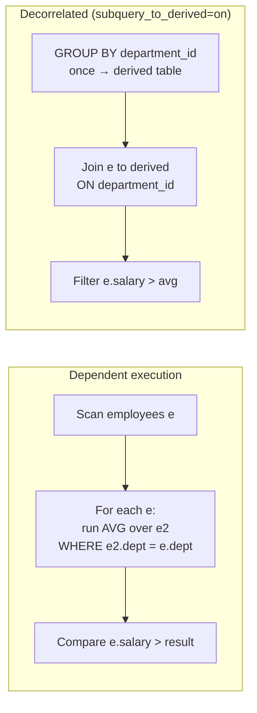

## Introduction

In the previous lesson, the subquery `(SELECT AVG(price) FROM products)` was **independent** of the outer query: it has one answer, computed once. Many questions, however, need a different inner answer **for each outer row**:

- "Which employees earn more than the average **of their own department**?"
- "For each employee, how many people report **to them**?"
- "Show each department's **two highest-paid** employees."
- "For each salary record, what was the **next** salary change for the same employee?"

The inner query in each case refers to a column of the current outer row — `e.department_id`, `e.employee_id` — so its result changes from row to row. That reference is called a **correlation**, and the subquery is a **correlated subquery**.

Correlated subqueries are among the most expressive tools in SQL: they read almost exactly like the English question. They also have a reputation for being slow, because their *logical* definition is "re-run the inner query for every outer row". This lesson separates the definition from the execution: you will see the per-row semantics precisely (including what happens with NULL correlation values and empty groups), watch MySQL execute a dependent subquery with `EXPLAIN ANALYZE` (`loops=30`), and see the optimizer **decorrelate** the same query into a join. Then you will compare the main alternatives — join with a derived table, `LATERAL`, and window functions — on the classic **top-N per group** problem.

:::note[Dataset]
The **hr** dataset: 30 employees in 6 staffed departments (Research has none), employee 124 with a NULL `department_id`, employees 107 and 108 with the same salary, and a yearly `salary_history`.
:::

## DBMS Theory

:::theory[Correlation and the tuple-iteration semantics]
A subquery is **correlated** if it contains a reference to an attribute bound in an enclosing query block (an *outer reference*). SQL defines its meaning by **tuple iteration**: for each tuple *t* produced by the outer FROM/WHERE, substitute *t*'s values for the outer references and evaluate the subquery as if those values were constants. Formally the subquery is a *parameterized* relation Q(t); the outer predicate is evaluated against Q(t).

This is a definition of the **result**, not an algorithm. Any execution strategy that produces the same result for every possible database is valid — and relational theory gives several such *decorrelation* rewrites (Kim 1982; Dayal 1987; Galindo-Legaria & Joshi 2001): a correlated aggregate subquery can be replaced by a join with a grouped derived table; a correlated `EXISTS` by a semi-join; `NOT EXISTS` by an anti-join.
:::

Two consequences of the iteration semantics trip up practitioners:

1. **The outer row's NULLs flow into the subquery.** If `e.department_id` is NULL, the inner predicate `e2.department_id = e.department_id` becomes `e2.department_id = NULL`, which is never true. The subquery sees an **empty** input.
2. **Empty input behaves like any aggregate over no rows.** `COUNT(*)` of an empty input is 0; `AVG`, `SUM`, `MAX` are NULL. Comparisons with NULL are UNKNOWN. So the same employee can be **kept** by a `COUNT`-based condition (`… < 2` is true for 0) and **dropped** by an `AVG`-based one (`salary > NULL` is UNKNOWN) — you will see both with employee 124.

These are not MySQL quirks; they follow from standard SQL's three-valued logic and empty-aggregate rules. A correct decorrelation must preserve them, which is why the optimizer's rewrites contain details (left joins, NULL handling) that a hand-written rewrite often forgets.

## Why It Exists

Without correlated subqueries, "compare each row with its own group" requires building the group summary separately and joining it back. That is perfectly possible — and often the better execution plan — but it changes how the question is *expressed*: the reader has to reconstruct the intent from a join and a derived table.

Correlated subqueries exist because some questions are inherently **row-relative**:

- *Comparisons with a group statistic*: above the department average, below the category median, the latest record per entity.
- *Existence tests*: "customers who have an order in December" (correlated `EXISTS`, next lesson).
- *Per-row lookups with aggregation*: the number of reports, the date of the next change, the total of related rows.

Historically (SQL-86 and SQL-89), before derived tables, window functions and `LATERAL` were standardized, correlated subqueries were the **only** way to express many of these. Today they compete with those alternatives — and a professional chooses among them based on clarity, correctness at the edges (NULLs, ties, empty groups) and the plan MySQL actually produces.

## Internal Working

:::internals[Dependent subqueries and decorrelation in MySQL]
**Dependent execution.** By default, MySQL executes a correlated scalar subquery as a **dependent subquery**: the outer iterator produces a row, the subquery iterator is re-executed with the outer values bound, and the result is used in the filter or SELECT expression. `EXPLAIN FORMAT=TREE` labels it `Select #2 (subquery in condition; dependent)` (or `in projection`); traditional EXPLAIN shows `select_type = DEPENDENT SUBQUERY`. Its cost is roughly *outer rows × cost of one execution*, so an **index on the correlation column** is decisive: each execution becomes an index lookup instead of a scan.

**Decorrelation.** MySQL rewrites some correlated subqueries into joins:
- correlated `IN`/`EXISTS` (and `NOT IN`/`NOT EXISTS`) in WHERE → **semi-join / anti-join** strategies (on by default; next lesson);
- correlated **scalar** subqueries with aggregates → a **grouped derived table joined to the outer query**, when the `subquery_to_derived` optimizer switch is on (available since 8.0.21, **off by default**). The derived table is computed once for all groups and joined on the correlation column; for a `COUNT` subquery the join is a left join so empty groups still yield 0.
:::



Neither strategy is universally better. Dependent execution with an index lookup is cheap when the outer side is small (or heavily filtered) and the groups are small. Decorrelation wins when the outer side touches most groups, because each group is aggregated once instead of once per member. That trade-off is why MySQL keeps `subquery_to_derived` off by default and why you should compare plans rather than follow rules of thumb.

## MySQL Implementation

The general shape: a subquery whose WHERE (or SELECT, or HAVING) references an outer alias.

```sql
SELECT ...
FROM outer_table AS o
WHERE o.col op (SELECT agg(i.x) FROM inner_table AS i WHERE i.key = o.key);
```

Always give the inner and outer occurrences **different aliases** when they are the same table — otherwise an unqualified column binds to the *nearest* (inner) table and the subquery is silently uncorrelated.

### Above the department average

```sql run
SELECT e.employee_id, e.first_name, e.department_id, e.salary
FROM employees AS e
WHERE e.salary > (SELECT AVG(e2.salary)
                  FROM employees AS e2
                  WHERE e2.department_id = e.department_id)
ORDER BY e.department_id, e.salary DESC;
```

The inner `AVG` is computed for the department of the **current** outer employee. Employee 124 (NULL department) is absent: the subquery's input is empty for him, `AVG` returns NULL, and `salary > NULL` is UNKNOWN.

### A correlated subquery in the SELECT list

Each employee with their number of direct reports:

```sql run
SELECT e.employee_id, e.first_name,
       (SELECT COUNT(*) FROM employees r WHERE r.manager_id = e.employee_id) AS direct_reports
FROM employees AS e
WHERE e.employee_id IN (100, 104, 105, 106, 124)
ORDER BY e.employee_id;
```

`COUNT(*)` over an empty input is 0, so employees without reports show 0 — no `COALESCE` needed, unlike a `LEFT JOIN … GROUP BY` that counts `*`.

### The next change in a history table

The [self-join lesson](/lessons/m04-cross-self-join) tried to find each salary record's successor with `effective_date + INTERVAL 1 YEAR` and missed three pairs. A correlated subquery asks the real question — "the earliest later date for the same employee":

```sql run
SELECT cur.employee_id, cur.effective_date, cur.salary,
       (SELECT MIN(nx.effective_date)
        FROM salary_history nx
        WHERE nx.employee_id = cur.employee_id
          AND nx.effective_date > cur.effective_date) AS next_change
FROM salary_history AS cur
WHERE cur.employee_id = 108
ORDER BY cur.effective_date;
```

The last row has NULL: there is no later record. Employee 108's irregular dates (August 30 → August 28) are handled correctly.

## Syntax Breakdown

| Element | Meaning |
|---|---|
| Outer reference `o.col` inside the subquery | Makes the subquery correlated. May appear in WHERE, SELECT, HAVING, or ON of the subquery. |
| Distinct aliases (`e` outside, `e2` inside) | Required for clarity when both levels use the same table; an unqualified name resolves to the innermost table that has such a column. |
| Correlated scalar subquery | Must return ≤ 1 row per outer row (error 1242 otherwise) — aggregates guarantee it. |
| Correlated `EXISTS` / `IN` | Existence tests, usually decorrelated into semi-joins — see [EXISTS and IN](/lessons/m04-exists-in). |
| Multi-level correlation | A subquery may reference any enclosing level, not just its direct parent. |
| `SET SESSION optimizer_switch = 'subquery_to_derived=on'` | Enables decorrelation of scalar subqueries into derived tables (8.0.21+; off by default). |
| `EXPLAIN ANALYZE` | Shows `loops=N` for the dependent subquery: how many times it was actually executed. |

:::standard[Standard SQL vs MySQL]
Correlated subqueries, including in SELECT and HAVING, are standard SQL and work the same way in every major database; the empty-input and NULL rules are standard. What differs is **optimization**: SQL Server, Oracle and PostgreSQL (for EXISTS/IN) decorrelate in various ways; MySQL decorrelates IN/EXISTS by default and scalar aggregate subqueries only with `subquery_to_derived=on`. The `optimizer_switch` flag and hint syntax are MySQL-specific.
:::

## Practical Examples

### 1. Top-N per group with a correlated count

"The two highest-paid employees in each department": an employee qualifies if **fewer than two** colleagues in the same department earn more.

```sql run
SELECT e.department_id, e.employee_id, e.first_name, e.salary
FROM employees AS e
WHERE (SELECT COUNT(*)
       FROM employees AS e2
       WHERE e2.department_id = e.department_id
         AND e2.salary > e.salary) < 2
ORDER BY e.department_id, e.salary DESC;
```

Notice the first row: employee 124 with a NULL department **is** included. For him the inner count runs over an empty input (NULL never equals anything), returns 0, and `0 < 2` is true. Compare with the AVG example, where the same employee was excluded. If unassigned employees must not appear, say so: `AND e.department_id IS NOT NULL`.

### 2. Ties change "top N"

The correlated count defines *rank with ties* — like `RANK()`. Look at the **three lowest-paid** employees of Engineering (department 20):

```sql run
SELECT e.employee_id, e.first_name, e.salary
FROM employees AS e
WHERE e.department_id = 20
  AND (SELECT COUNT(*) FROM employees e2
       WHERE e2.department_id = e.department_id AND e2.salary < e.salary) < 3
ORDER BY e.salary;
```

Four rows for "three lowest": employees 107 and 108 share 150,000, and for each of them only two colleagues earn less. Whether that is right is a **business decision** — "at most three people" (use `ROW_NUMBER` with a tie-breaker) or "everyone within the three lowest salary levels" (`DENSE_RANK`) are different questions. Decide explicitly.

### 3. Latest row per group

"Each employee's most recent salary record" — the correlated subquery finds the maximum date for the same employee:

```sql run
SELECT sh.employee_id, sh.effective_date, sh.salary
FROM salary_history AS sh
WHERE sh.effective_date = (SELECT MAX(s2.effective_date)
                           FROM salary_history s2
                           WHERE s2.employee_id = sh.employee_id)
  AND sh.employee_id BETWEEN 105 AND 110
ORDER BY sh.employee_id;
```

Because `(employee_id, effective_date)` is the primary key, the inner `MAX` is answered from the index, and the result is unique per employee.

### 4. Correlation in HAVING

"Departments whose average salary exceeds the company-wide average of their **location**" — the subquery is correlated with the outer group's `location_id`:

```sql run
SELECT d.department_id, d.name, d.location_id, ROUND(AVG(e.salary), 0) AS avg_salary
FROM departments d
JOIN employees e ON e.department_id = d.department_id
GROUP BY d.department_id, d.name, d.location_id
HAVING AVG(e.salary) > (SELECT AVG(e2.salary)
                        FROM employees e2
                        JOIN departments d2 ON d2.department_id = e2.department_id
                        WHERE d2.location_id = d.location_id)
ORDER BY d.department_id;
```

## Execution Walkthrough

Trace the per-row semantics of "above department average" on four employees, then compare the two physical strategies.

```walkthrough
title: SELECT e.* FROM employees e WHERE e.salary > (SELECT AVG(e2.salary) FROM employees e2 WHERE e2.department_id = e.department_id)
steps:
  - title: "1. The outer rows"
    explain: Four outer rows, including employee 124 whose department_id is NULL.
    sql: |
      SELECT employee_id, department_id, salary FROM employees
      WHERE employee_id IN (100, 110, 111, 124) ORDER BY employee_id;
  - title: "2. Bind the outer values and evaluate the subquery per row"
    explain: >-
      Conceptually the subquery runs once per outer row with e.department_id substituted. This query displays
      that per-row result as a column. For employee 124 the substituted predicate is e2.department_id = NULL, the
      input is empty and AVG returns NULL.
    sql: |
      SELECT e.employee_id, e.department_id, e.salary,
             (SELECT AVG(e2.salary) FROM employees e2 WHERE e2.department_id = e.department_id) AS dept_avg
      FROM employees e
      WHERE e.employee_id IN (100, 110, 111, 124)
      ORDER BY e.employee_id;
  - title: "3. Evaluate the outer predicate"
    explain: >-
      salary > dept_avg is 1 (true), 0 (false) or NULL (unknown). Only rows where it is true survive WHERE. The CEO
      is alone in Executive, so his salary equals the average and the comparison is false.
    sql: |
      SELECT e.employee_id, e.salary,
             (SELECT AVG(e2.salary) FROM employees e2 WHERE e2.department_id = e.department_id) AS dept_avg,
             e.salary > (SELECT AVG(e2.salary) FROM employees e2 WHERE e2.department_id = e.department_id) AS passes
      FROM employees e
      WHERE e.employee_id IN (100, 110, 111, 124)
      ORDER BY e.employee_id;
  - title: "4. Final result over the whole table"
    explain: Applying the same logic to all 30 employees keeps those whose predicate is true.
    sql: |
      SELECT COUNT(*) AS above_department_average
      FROM employees e
      WHERE e.salary > (SELECT AVG(e2.salary) FROM employees e2 WHERE e2.department_id = e.department_id);
```

### Dependent execution, measured

`EXPLAIN ANALYZE` executes the query and reports how often each iterator ran:

```sql run measured
EXPLAIN ANALYZE
SELECT e.employee_id, e.salary
FROM employees e
WHERE e.salary > (SELECT AVG(e2.salary) FROM employees e2 WHERE e2.department_id = e.department_id);
```

The subquery is labelled `dependent`, and its iterators show `loops=30`: it was executed once per outer employee — the tuple-iteration semantics, literally. Look at *how* each execution reads `e2` in this capture: `Table scan on e2` with `rows=30` per loop, followed by a `Filter` on `e2.department_id = e.department_id` that keeps about 6 rows. For a 30-row table the optimizer judged a scan per execution as cheap as index lookups, so it read 30 × 30 = 900 rows in total. That is harmless here and exactly the quadratic pattern that is catastrophic on a large table. The choice depends on the optimizer's cost estimates, which come from index statistics: on another copy of the hr data on the build machine, the same query used an `Index lookup on e2 using idx_employees_department` inside the dependent subquery (run `ANALYZE TABLE employees` in your lab and re-run the EXPLAIN to see what your server picks), and each execution then reads only the rows of one department — which is why the index on the correlation column matters so much.

### Decorrelated by the optimizer

Turn on `subquery_to_derived` for this session and look at the plan of the same query:

```sql run
SET SESSION optimizer_switch = 'subquery_to_derived=on';
```

```sql run
EXPLAIN FORMAT=TREE
SELECT e.employee_id, e.salary
FROM employees e
WHERE e.salary > (SELECT AVG(e2.salary) FROM employees e2 WHERE e2.department_id = e.department_id);
```

The subquery is gone. In its place is a derived table (named `derived_1_2` by MySQL) produced by a `Group aggregate: avg(e2.salary)` over the whole table — one average per department, computed **once** — and joined to `e` on `department_id` (here with a hash join, the derived table being the build input), with the salary comparison applied as a filter. The result is the same:

```sql run
SELECT COUNT(*) AS above_department_average
FROM employees e
WHERE e.salary > (SELECT AVG(e2.salary) FROM employees e2 WHERE e2.department_id = e.department_id);
```

For a `COUNT` subquery in the SELECT list the transformation uses a **left** join, so employees with no reports still get 0:

```sql run
EXPLAIN FORMAT=TREE
SELECT e.employee_id,
       (SELECT COUNT(*) FROM employees r WHERE r.manager_id = e.employee_id) AS direct_reports
FROM employees e;
```

```sql run
SET SESSION optimizer_switch = 'subquery_to_derived=off';
```

## Output

The walkthrough's final count is **11** employees above their department average. Reading correlated-subquery results correctly means checking the three edge cases the walkthrough exposed:

| Case | What the subquery returns | Effect |
|---|---|---|
| Outer correlation value is NULL (employee 124) | Aggregate over empty input: `AVG` NULL, `COUNT` 0 | `AVG`-based filters drop the row; `COUNT`-based filters may keep it |
| Group of one (the CEO alone in Executive) | The row's own value | `salary > AVG` is false — a singleton is never "above its own average" |
| Ties (107 and 108) | Equal values count equally | "Top N" may return more than N rows |

## Alternative Approaches

"Above department average", four ways — all return the same 11 rows on this data:

```sql run
-- A: join with a pre-aggregated derived table (manual decorrelation)
SELECT COUNT(*) AS n
FROM employees e
JOIN (SELECT department_id, AVG(salary) AS avg_sal
      FROM employees GROUP BY department_id) AS d ON d.department_id = e.department_id
WHERE e.salary > d.avg_sal;
```

```sql run
-- B: window function — one pass, no second table access
SELECT COUNT(*) AS n
FROM (SELECT salary, AVG(salary) OVER (PARTITION BY department_id) AS avg_sal
      FROM employees) AS w
WHERE w.salary > w.avg_sal;
```

Careful: B is **not** equivalent in general. `PARTITION BY department_id` puts all NULL departments into **one** partition (window partitioning treats NULLs as equal, like GROUP BY), so employee 124 gets an average — his own salary — instead of NULL. He is still excluded here only because a singleton cannot exceed its own average. With two unassigned employees, B could include one of them while the correlated subquery and the join (where `NULL = NULL` never matches) would not. A join-based rewrite also differs: approach A drops employee 124 because the join on `department_id` cannot match NULL — the same outcome as the subquery, for a different reason.

For top-N per group the main alternatives are:

```sql run
-- C: window function ranking (window functions are covered later in this module)
SELECT department_id, employee_id, salary
FROM (SELECT department_id, employee_id, salary,
             RANK() OVER (PARTITION BY department_id ORDER BY salary DESC) AS rnk
      FROM employees) AS r
WHERE rnk <= 2
ORDER BY department_id, salary DESC;
```

| Approach | Strengths | Weaknesses |
|---|---|---|
| Correlated subquery | Reads like the question; index lookups per row when correlated column is indexed | Logically per-row; n² without an index; edge cases with NULL correlation values |
| Join + grouped derived table | Each group aggregated once; easy to inspect the derived table | Must replicate NULL/empty-group semantics manually (LEFT JOIN + COALESCE for counts) |
| Window function | One pass; flexible ranking semantics (`ROW_NUMBER`, `RANK`, `DENSE_RANK`) | Requires a derived table to filter; NULL keys form a partition |
| `LATERAL` + `ORDER BY … LIMIT n` | Can stop after n rows per group using an index on `(group, sort)` | Per-outer-row execution; one outer row per group needed (e.g. from `departments`) |

The `LATERAL` version starts from the groups themselves, which also makes the treatment of empty groups explicit (Research is preserved with NULLs):

```sql run
SELECT d.department_id, d.name, top2.employee_id, top2.salary
FROM departments AS d
LEFT JOIN LATERAL (SELECT e.employee_id, e.salary
                   FROM employees e
                   WHERE e.department_id = d.department_id
                   ORDER BY e.salary DESC, e.employee_id
                   LIMIT 2) AS top2 ON TRUE
ORDER BY d.department_id, top2.salary DESC;
```

## Performance Analysis

| Strategy | Work (n outer rows, g groups, k rows per group) | Best when |
|---|---|---|
| Dependent subquery, index on correlation column | n × (index lookup + k rows) | Outer side small or heavily filtered; groups small |
| Dependent subquery, no index | n × (full scan) — quadratic | Never on large tables |
| Decorrelated (derived table + join) | one pass to aggregate all groups + join | Outer side touches many/all groups |
| Window function | one pass + sort/partition buffer | Need group statistic and detail together over many rows |
| LATERAL with `ORDER BY … LIMIT` | g × (index range scan of ≤ N rows) | Top-N per group with index on (group, sort key) |

:::performance[Theory vs measurement]
The table describes the shape of the work. On the 30-row hr table, every variant runs in microseconds and the measured timings above carry no information except `loops=30`. What generalizes is the evidence in the plans: `dependent` + index lookup (fine), `dependent` + table scan (danger), materialized derived table (aggregation once). For realistic volumes, compare variants with `EXPLAIN ANALYZE` on production-sized data; [Optimizing Subqueries](/lessons/m07-optimizing-subqueries) does exactly that.
:::

An important reason not to "always rewrite as a join": a dependent subquery inside a query that returns 20 rows (e.g. a paginated page of employees with their report counts) executes 20 cheap lookups, while a decorrelated version may aggregate the **entire** table to produce counts for all employees, then throw most away. MySQL's default (`subquery_to_derived=off`) reflects that this rewrite is not always a win.

## Best Practices

:::best-practice[Correlated subqueries]
1. **Alias both levels distinctly** and qualify every column inside the subquery, so the correlation is explicit and an accidental uncorrelated subquery is impossible.
2. **Index the correlation column(s)** of the inner table — that is what makes dependent execution cheap.
3. **Use aggregates that guarantee one row** (`MAX`, `COUNT`) in scalar correlated subqueries; avoid "it happens to return one row".
4. **Decide the NULL and empty-group policy explicitly**: add `IS NOT NULL` conditions or `COALESCE`, and test with a row whose correlation value is NULL.
5. **Decide the tie policy for top-N** and choose the construct that implements it (`ROW_NUMBER` vs `RANK` vs `DENSE_RANK` vs correlated count).
6. **Check `EXPLAIN` for `dependent`** and `EXPLAIN ANALYZE` for `loops=` on large tables.
7. **Prefer window functions** when you need detail rows and group statistics together over large inputs; prefer correlated subqueries for small, selective outer sets.
:::

## Common Mistakes

**Mistake 1 — the accidental uncorrelated subquery.** Forgetting to qualify the inner column makes it refer to the inner table itself:

```sql run
-- Intended: above own department average. Actual: e2.department_id = e2.department_id (always true unless NULL)
SELECT COUNT(*) AS n
FROM employees e
WHERE e.salary > (SELECT AVG(e2.salary) FROM employees e2 WHERE e2.department_id = department_id);
```

Inside the subquery, the unqualified `department_id` resolves to `e2` (the nearest table that has the column), so the condition compares `e2` with itself and the subquery computes the **company-wide** average of employees with a department. No error — just a different answer: 14 employees instead of the correct 11.

**Mistake 2 — a correlated scalar subquery that is not single-row.**

```sql run error
SELECT d.name,
       (SELECT e.first_name FROM employees e WHERE e.department_id = d.department_id) AS employee
FROM departments d;
```

Error 1242 as soon as a department has two employees. Aggregate (`GROUP_CONCAT`, `MAX`) or pick one deterministically (`ORDER BY … LIMIT 1`).

**Mistake 3 — forgetting the NULL-correlation case.** The top-2 query returned employee 124 as a "top earner" of the NULL department. Filters based on `COUNT` keep such rows; add `e.department_id IS NOT NULL` when they should not appear.

**Mistake 4 — top-N without a tie policy.** "Three lowest-paid" returned four people. If exactly N are required, add a deterministic tie-breaker: `AND (e2.salary < e.salary OR (e2.salary = e.salary AND e2.employee_id < e.employee_id))`, or use `ROW_NUMBER()` with `ORDER BY salary, employee_id`.

**Mistake 5 — correlating on an unindexed column in a large table.** The query is correct but quadratic. The fix is an index on the inner correlation column, or a decorrelated form.

## Industry Application

- **Compensation and HR analytics.** "Employees paid below their band", "above department average", "top 3 performers per region" — row-relative comparisons that HR analysts write as correlated subqueries or window functions. Tie and NULL policies are compliance-relevant, not cosmetic.
- **Latest-state queries in OLTP.** "Current status per order", "latest price per product" from history tables are often written as `WHERE ts = (SELECT MAX(ts) … WHERE id = outer.id)`, served by a composite index `(id, ts)`. At scale, teams denormalize the latest state into a separate table and keep the history for audit.
- **Feeds and leaderboards.** Top-N per group (latest 5 posts per user, top 10 products per category) power product pages. Engineers pick between `LATERAL` with an index (great for few groups per request) and window functions over precomputed batches.
- **Data quality rules.** "Rows whose value deviates more than 3σ from their group mean", "transactions larger than the customer's previous maximum" — correlated subqueries express such rules directly in validation SQL.
- **Code review.** Senior engineers flag `DEPENDENT SUBQUERY` on large tables without an index on the correlation column — one of the most common causes of queries that were fast in development and slow in production.

## Practice Exercises

```exercise
id: ex1
title: Earning more than the department average
difficulty: easy
concepts: [correlated-subquery]
prompt: |
  Return `employee_id`, `first_name` and `salary` of employees who earn more than the average salary of their own
  department.
hints:
  - "Use a subquery that computes AVG(salary) for the department of the current outer employee."
  - "Alias the outer table e and the inner table e2; correlate with e2.department_id = e.department_id."
solution: |
  SELECT e.employee_id, e.first_name, e.salary
  FROM employees AS e
  WHERE e.salary > (SELECT AVG(e2.salary)
                    FROM employees AS e2
                    WHERE e2.department_id = e.department_id);
explanation: |
  The subquery is re-evaluated (logically) for every outer row. Employee 124 is excluded because AVG over an
  empty input is NULL. Forgetting to qualify `department_id` inside the subquery would silently compare `e2` with
  itself.
```

```exercise
id: ex2
title: Direct reports for every employee
difficulty: easy
concepts: [correlated-subquery]
prompt: |
  Return every employee with columns `employee_id`, `last_name` and `direct_reports` (the number of employees whose
  manager_id is this employee; 0 if none).
hints:
  - "A correlated scalar subquery in the SELECT list can count r.manager_id = e.employee_id."
  - "COUNT(*) over an empty input is already 0."
solution: |
  SELECT e.employee_id, e.last_name,
         (SELECT COUNT(*) FROM employees r WHERE r.manager_id = e.employee_id) AS direct_reports
  FROM employees AS e;
explanation: |
  The scalar subquery returns exactly one row per employee thanks to COUNT. The join alternative needs a LEFT JOIN
  and COUNT(r.employee_id) to report 0 for non-managers.
```

```exercise
id: ex3
title: Latest salary record per employee
difficulty: medium
concepts: [correlated-subquery, top-n-per-group]
prompt: |
  From `salary_history`, return each employee's most recent record: `employee_id`, `effective_date`, `salary`.
  Exactly one row per employee.
hints:
  - "Keep rows whose effective_date equals the maximum effective_date for the same employee."
  - "WHERE sh.effective_date = (SELECT MAX(s2.effective_date) FROM salary_history s2 WHERE s2.employee_id = sh.employee_id)"
solution: |
  SELECT sh.employee_id, sh.effective_date, sh.salary
  FROM salary_history AS sh
  WHERE sh.effective_date = (SELECT MAX(s2.effective_date)
                             FROM salary_history AS s2
                             WHERE s2.employee_id = sh.employee_id);
explanation: |
  Uniqueness follows from the primary key (employee_id, effective_date). Window alternative:
  `ROW_NUMBER() OVER (PARTITION BY employee_id ORDER BY effective_date DESC) = 1` in a derived table.
```

```exercise
id: ex4
title: Top two earners per department — exactly two, no unassigned employees
difficulty: hard
concepts: [top-n-per-group, correlated-subquery]
prompt: |
  Return at most **two** employees per department — the highest paid — with columns `department_id`,
  `employee_id`, `salary`. Break salary ties by the **lower** `employee_id`. Exclude employees with no department.
hints:
  - "Count colleagues in the same department who rank ahead: higher salary, or equal salary and lower employee_id."
  - "Keep rows where that count is less than 2."
  - "Add e.department_id IS NOT NULL — otherwise employee 124 qualifies via COUNT = 0."
solution: |
  SELECT e.department_id, e.employee_id, e.salary
  FROM employees AS e
  WHERE e.department_id IS NOT NULL
    AND (SELECT COUNT(*)
         FROM employees AS e2
         WHERE e2.department_id = e.department_id
           AND (e2.salary > e.salary
                OR (e2.salary = e.salary AND e2.employee_id < e.employee_id))) < 2;
explanation: |
  The tie-breaker turns RANK-like semantics into ROW_NUMBER-like semantics, guaranteeing at most two rows per
  department. Without `IS NOT NULL`, the NULL-department employee passes because the inner count is 0. Window
  alternative: `ROW_NUMBER() OVER (PARTITION BY department_id ORDER BY salary DESC, employee_id) <= 2`.
```

```exercise
id: ex5
title: Raises relative to the previous record
difficulty: challenge
concepts: [correlated-subquery, window-functions-rewrite]
prompt: |
  For employee 108, return every salary record with `effective_date`, `salary` and `prev_salary` — the salary of
  the **immediately preceding** record of the same employee (NULL for the first record). Do not assume records are
  exactly one year apart.
hints:
  - "First find the previous date: MAX(effective_date) of the same employee that is earlier than the current one."
  - "Then fetch the salary at that date — a correlated subquery can be nested inside another, or use ORDER BY effective_date DESC LIMIT 1."
solution: |
  SELECT cur.effective_date, cur.salary,
         (SELECT pv.salary
          FROM salary_history pv
          WHERE pv.employee_id = cur.employee_id
            AND pv.effective_date < cur.effective_date
          ORDER BY pv.effective_date DESC
          LIMIT 1) AS prev_salary
  FROM salary_history AS cur
  WHERE cur.employee_id = 108;
explanation: |
  `ORDER BY … LIMIT 1` inside a scalar subquery picks one row deterministically (dates are unique per employee
  because of the primary key). The window-function form, `LAG(salary) OVER (PARTITION BY employee_id ORDER BY
  effective_date)`, is shorter and reads the table once. The `+ INTERVAL 1 YEAR` self join fails on 108's
  irregular dates.
```

```exercise
id: ex6
title: Should the optimizer decorrelate this?
difficulty: hard
kind: open
concepts: [decorrelation, dependent-subquery]
prompt: |
  An API endpoint returns 20 employees per page (`ORDER BY employee_id LIMIT 20 OFFSET …`) from a table of 2
  million employees, each with `(SELECT COUNT(*) FROM employees r WHERE r.manager_id = e.employee_id)`. A
  colleague proposes enabling `subquery_to_derived` globally because "correlated subqueries are slow". Evaluate
  the proposal.
solution: |
  As written, MySQL executes the scalar subquery as a dependent subquery, but only for the rows that are actually
  returned/processed — around 20 per page — and with an index on `manager_id` each execution is one index range
  lookup. That is cheap. With `subquery_to_derived=on`, MySQL would compute a grouped derived table of report
  counts for **all** managers in the 2-million-row table (a full aggregation per request) and join it to the page,
  doing far more work than the 20 lookups. Enabling it globally could also change plans of unrelated queries.

  Recommendation: keep the default; make sure `idx_employees_manager` exists; verify with `EXPLAIN ANALYZE`
  (`loops` ≈ 20 on the dependent subquery). Decorrelation pays off for queries that need the statistic for most
  groups (reports over the whole table); for those, write the join/derived-table form explicitly or use the
  switch per session or the corresponding optimizer hint for that query only.
```

## Knowledge Assessment

```quiz
- id: q1
  question: "What makes a subquery correlated?"
  options:
    - "It appears in the WHERE clause"
    - "It references a column of an enclosing query block"
    - "It returns more than one row"
    - "It uses an aggregate function"
  answer: 1
  explanation: "Correlation means an outer reference. Uncorrelated subqueries can also appear in WHERE, return many rows (IN) or aggregate; none of those make them correlated."
  concepts: [correlated-subquery]
- id: q2
  question: "Employee 124 has department_id NULL. Which statements are true? (Select all that apply.)"
  type: multi
  options:
    - "He is excluded by `salary > (SELECT AVG(e2.salary) … WHERE e2.department_id = e.department_id)`"
    - "He is included by `(SELECT COUNT(*) … WHERE e2.department_id = e.department_id AND e2.salary > e.salary) < 2`"
    - "The subquery for him returns all employees with a NULL department, including himself"
    - "MySQL raises an error for NULL correlation values"
  answer: [0, 1]
  explanation: "e2.department_id = NULL is never true, so the subquery's input is empty: AVG gives NULL (comparison UNKNOWN → excluded) while COUNT gives 0 (0 < 2 → included). NULL does not match NULL in a comparison, and no error occurs."
  concepts: [correlated-subquery]
- id: q3
  question: "EXPLAIN ANALYZE shows a subquery labelled `dependent` with `loops=30`. What does that mean?"
  options:
    - "The subquery was executed 30 times, once per outer row"
    - "The subquery returned 30 rows"
    - "The optimizer tried 30 plans"
    - "The subquery was cached 30 times"
  answer: 0
  explanation: "loops counts executions of an iterator. A dependent subquery is re-executed for each outer row; rows= reports rows per loop."
  concepts: [dependent-subquery]
- id: q4
  question: "With `subquery_to_derived=on`, how does MySQL transform `WHERE e.salary > (SELECT AVG(e2.salary) FROM employees e2 WHERE e2.department_id = e.department_id)`?"
  options:
    - "Into a semi-join with FirstMatch"
    - "Into a derived table that computes AVG per department once, joined to e on department_id, with the comparison as a filter"
    - "Into a window function"
    - "It cannot transform aggregate subqueries"
  answer: 1
  explanation: "subquery_to_derived (8.0.21+, off by default) replaces a scalar aggregate subquery with a grouped derived table and a join. Semi-joins are for IN/EXISTS; MySQL does not rewrite subqueries into window functions."
  concepts: [decorrelation]
- id: q5
  question: "Inside `(SELECT AVG(e2.salary) FROM employees e2 WHERE e2.department_id = department_id)`, the unqualified `department_id` refers to…"
  options: ["e.department_id of the outer query", "e2.department_id", "An error: ambiguous column", "The first department in the table"]
  answer: 1
  explanation: "Unqualified names resolve to the innermost query block that has such a column — here e2. The predicate becomes e2.department_id = e2.department_id, and the subquery is no longer correlated. No error is raised."
  concepts: [correlated-subquery]
- id: q6
  question: "A 'top 3 lowest salaries per department' query using `(SELECT COUNT(*) … WHERE e2.salary < e.salary) < 3` returns 4 rows for one department. Why?"
  options:
    - "The subquery is wrong; COUNT should be MAX"
    - "Two employees share a salary at the boundary, and both have only two colleagues earning less (RANK-like tie semantics)"
    - "NULL salaries are counted"
    - "The optimizer decorrelated the query"
  answer: 1
  explanation: "The correlated count implements rank-with-ties semantics. To get exactly N rows, add a deterministic tie-breaker or use ROW_NUMBER. Salaries are NOT NULL in hr, and optimizer rewrites never change results."
  concepts: [top-n-per-group]
- id: q7
  question: "When is a dependent (per-row) execution of a correlated subquery likely the BEST plan?"
  options:
    - "When the outer query processes few rows and the inner correlation column is indexed"
    - "When the outer query scans the whole large table and the inner column has no index"
    - "Never — decorrelation is always better"
    - "Only for subqueries in HAVING"
  answer: 0
  explanation: "Few outer rows × one index lookup each is very cheap; decorrelation might aggregate the whole table. Without an index and with many outer rows, dependent execution is quadratic. There is no universal winner."
  concepts: [dependent-subquery, decorrelation]
```
