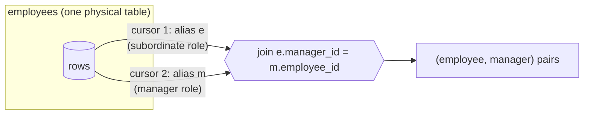

## Introduction

Two join forms look unusual at first but solve everyday problems:

- A **CROSS JOIN** pairs every row of one table with every row of another — the Cartesian product. Usually that is the bug you get when you forget a join predicate. Used **deliberately**, it generates combinations: every size × colour for a product catalogue, every department × month for a report that must show zeros, every pair of candidates for a matching algorithm.
- A **SELF JOIN** joins a table to itself under two different aliases. It is the tool for questions that relate rows of the **same** table to each other: "who is each employee's manager?" (the manager is also an employee), "which employees earn more than their manager?", "which employees share the same salary?", "how did each salary change from the previous year?".

Neither is a new operator. A cross join is an inner join without a predicate; a self join is an ordinary join whose two inputs happen to be the same table. What is new are the **patterns** — and the specific mistakes they invite: row explosions, duplicate pairs (A, B) and (B, A), rows paired with themselves, and the root of a hierarchy silently disappearing.

:::note[Dataset]
The examples use the **hr** dataset: 30 employees whose `manager_id` references `employees.employee_id`. The CEO (100) has `manager_id IS NULL`, employees 107 and 108 have the same salary, and `salary_history` keeps one row per employee per year.
:::

## DBMS Theory

:::theory[Cartesian product and self join]
The **Cartesian product** R × S is the set of all concatenations of a tuple of R with a tuple of S; |R × S| = |R| · |S|, and its degree (number of attributes) is the sum of the degrees. Every other join is defined from it: R ⋈<sub>θ</sub> S = σ<sub>θ</sub>(R × S).

A **self join** uses the **rename** operator ρ to make two distinguishable copies of one relation: ρ<sub>e</sub>(Employees) ⋈<sub>e.manager_id = m.employee_id</sub> ρ<sub>m</sub>(Employees). Without renaming, the attribute names of both copies would clash and the predicate could not say which copy it refers to.
:::

### Unary relationships

A foreign key that references its **own** table models a *unary* (recursive) relationship: employee → manager, category → parent category, part → sub-part, user → referred-by user. In ER terms (Module 5) the entity participates twice in the relationship, in two **roles** — "subordinate" and "manager". SQL aliases are exactly those roles: `e` for the subordinate role, `m` for the manager role.

A single self join follows the relationship **one level**. Following it an arbitrary number of levels ("all reports, direct and indirect") is the *transitive closure*, which plain relational algebra cannot express with a fixed number of joins. SQL adds recursion for that — see [Recursive CTEs](/lessons/m04-recursive-ctes).

### Counting pairs

When you compare rows of one table of n rows with each other, the predicate on the identifiers determines how many pairs you get:

| Predicate on ids | Pairs produced | Includes (a, a)? | Includes both (a, b) and (b, a)? |
|---|---|---|---|
| none (cross join) | n² | yes | yes |
| `a.id <> b.id` | n(n − 1) | no | yes |
| `a.id < b.id` | n(n − 1) / 2 | no | no — each unordered pair once |

For 30 employees that is 900, 870 and 435 pairs. The `<` predicate is the standard way to produce each **unordered** pair exactly once.

## Why It Exists

**Without CROSS JOIN**, generating combinations means loops in application code and inserting their output — or hard-coding lists. Worse, reports built only from facts have **holes**: if no one was hired in Marketing in 2019, a `GROUP BY department, year` simply has no row for it, and a chart or a pivot table shows a gap or misaligned columns. A cross join of the dimension tables (departments × years) creates the complete grid first; a left join of the facts then fills it with counts or zeros.

**Without SELF JOIN**, a hierarchy stored as `manager_id` could only be resolved by fetching each employee's manager in a separate query (N + 1 queries again), or by denormalizing the manager's name into every employee row — which becomes wrong the moment a manager changes their name. The self join lets the hierarchy stay normalized while queries read both roles side by side.

Self joins also enable **row-to-row comparisons**: before window functions (`LAG`, `LEAD`, added in MySQL 8.0), comparing a row with "the previous row" or finding duplicates required a self join, and much existing SQL still does it that way.

## Internal Working

:::internals[How MySQL executes cross and self joins]
**Cross join.** There is no join condition to look up, so an index cannot help. Since 8.0.20 MySQL executes a cross join as `Inner hash join (no condition)`: one input is loaded into the join buffer (the build side) and every row of the other input is combined with every buffered row. Any inequality condition (`a.id < b.id`) appears as a `Filter` above the hash join — the pairs are still generated, then filtered. Cost grows with |R| · |S| no matter what.

**Self join.** MySQL opens the same table **twice**, with two independent cursors (handler instances) — one per alias. Each alias can use a different access path: `e` may be scanned while `m` is read through its primary key. Pages read through one alias are cached in the InnoDB buffer pool and benefit the other, but logically they are two separate inputs. The self-referencing foreign key `fk_employees_manager` comes with the index `idx_employees_manager`, which makes "find the reports of manager X" an index lookup.
:::



Because a self join is planned like any other join, the optimizer chooses the driving alias and the access method by cost. You will see both a primary-key lookup (subordinate → manager: at most one match) and an index lookup on `manager_id` (manager → subordinates: many matches) in the plans below.

## MySQL Implementation

```sql
-- Cross join: three equivalent spellings in MySQL
SELECT ... FROM a CROSS JOIN b;
SELECT ... FROM a JOIN b;          -- MySQL extension: JOIN without ON is a cross join
SELECT ... FROM a, b;              -- comma join without a WHERE predicate

-- Self join: the same table under two aliases
SELECT ... FROM employees AS e
JOIN employees AS m ON m.employee_id = e.manager_id;
```

### A deliberate Cartesian product

A clothing catalogue needs a row for every size of every colour:

```sql run
CREATE TABLE sizes  (size_code VARCHAR(3) PRIMARY KEY, sort_order INT NOT NULL);
CREATE TABLE colors (color VARCHAR(10) PRIMARY KEY);
INSERT INTO sizes  VALUES ('S', 1), ('M', 2), ('L', 3);
INSERT INTO colors VALUES ('black'), ('navy'), ('red'), ('white');
SELECT c.color, s.size_code, CONCAT('TSHIRT-', UPPER(c.color), '-', s.size_code) AS sku
FROM colors AS c
CROSS JOIN sizes AS s
ORDER BY c.color, s.sort_order;
```

Four colours × three sizes = twelve variants, and no join condition. In the visualization, choose `cross` to see every pairing:

```viz
type: join
left:
  name: colors
  columns: [color]
  rows: [[black], [navy], [red], [white]]
right:
  name: sizes
  columns: [size_code, sort_order]
  rows: [[S, 1], [M, 2], [L, 3]]
leftKey: color
rightKey: size_code
types: [cross]
```

### A self join: employees and their managers

```sql run
SELECT e.employee_id, e.first_name, e.last_name,
       m.employee_id AS manager_id, m.first_name AS manager_first, m.last_name AS manager_last
FROM employees AS e
JOIN employees AS m ON m.employee_id = e.manager_id
ORDER BY e.employee_id
LIMIT 10;
```

Read the predicate as a sentence: *"m is the employee whose id is e's manager_id"*. The alias names carry the roles. Now count the rows:

```sql run
SELECT COUNT(*) AS employees,
       (SELECT COUNT(*) FROM employees e JOIN employees m ON m.employee_id = e.manager_id) AS inner_self_join_rows,
       (SELECT COUNT(*) FROM employees e LEFT JOIN employees m ON m.employee_id = e.manager_id) AS left_self_join_rows
FROM employees;
```

The inner self join has one row fewer than there are employees: the CEO has no manager, so the inner join drops him. Whenever the hierarchy's root must appear (an org chart always does), use `LEFT JOIN`. The visualization shows the same effect on five employees — the employee whose `manager_id` is NULL matches nobody:

```viz
type: join
left:
  name: employees e
  columns: [employee_id, first_name, manager_id]
  rows: [[100, Kofi, null], [101, Diego, 100], [104, Mei, 101], [106, Kofi, 104], [107, Grace, 104]]
right:
  name: employees m
  columns: [employee_id, first_name]
  rows: [[100, Kofi], [101, Diego], [104, Mei], [106, Kofi], [107, Grace]]
leftKey: manager_id
rightKey: employee_id
types: [inner, left]
```

## Syntax Breakdown

| Element | Meaning |
|---|---|
| `CROSS JOIN` | Cartesian product. Standard SQL; the clearest way to signal that the product is intended. |
| `JOIN` without `ON` | In MySQL, the same as `CROSS JOIN` (an extension). Ambiguous to readers — write `CROSS JOIN`. |
| `FROM a, b` | Comma join; a Cartesian product unless `WHERE` relates the tables. |
| `CROSS JOIN … ON …` | Accepted by MySQL (it treats `CROSS JOIN` and `INNER JOIN` as syntactic equivalents) but misleading; not standard. |
| `AS e`, `AS m` | Aliases are **mandatory** in a self join: the same table name twice is error 1066 *Not unique table/alias*. Choose names that describe the role (`e`/`m`, `child`/`parent`, `a`/`b` for symmetric pairs). |
| `m.employee_id = e.manager_id` | Follows the self-referencing foreign key one level (subordinate → manager). |
| `a.id < b.id` | Pairs each unordered pair once and excludes self-pairs. |
| `a.id <> b.id` | Excludes self-pairs, but keeps both orders. |
| `LEFT JOIN … AS m` | Keeps rows with no counterpart in the other role (the root of the hierarchy, leaves without children). |

## Practical Examples

### 1. A dense report grid (cross join + left join)

"Hires per department per year, 2020–2023, including zeros." The facts alone have holes. Build the grid with a cross join of departments and a small derived table of years, then left-join the facts:

```sql run
SELECT d.name AS department, y.yr,
       COUNT(e.employee_id) AS hires
FROM departments AS d
CROSS JOIN (SELECT 2020 AS yr UNION ALL SELECT 2021 UNION ALL SELECT 2022 UNION ALL SELECT 2023) AS y
LEFT JOIN employees AS e
       ON e.department_id = d.department_id
      AND YEAR(e.hire_date) = y.yr
WHERE d.department_id IN (20, 40, 70)
GROUP BY d.department_id, d.name, y.yr
ORDER BY d.department_id, y.yr;
```

Each of the three departments has exactly four rows — Research included, with zeros. Notice that the hire-year condition sits in `ON`: in `WHERE` it would delete the zero rows ([Outer Joins](/lessons/m04-outer-joins)). For longer series, generate the years with a recursive CTE instead of writing `UNION ALL` by hand.

### 2. Direct reports per manager

Going the other direction — from manager to subordinates — is a one-to-many self join:

```sql run
SELECT m.employee_id, m.first_name, m.last_name, COUNT(*) AS direct_reports
FROM employees AS m
JOIN employees AS e ON e.manager_id = m.employee_id
GROUP BY m.employee_id, m.first_name, m.last_name
ORDER BY direct_reports DESC, m.employee_id;
```

Employees with no reports do not appear (inner join); with `LEFT JOIN` and `COUNT(e.employee_id)` they would appear with 0.

### 3. Two levels up: employee, manager, skip-level manager

Each extra level is another alias of the same table. Use `LEFT JOIN` so that people near the top do not vanish:

```sql run
SELECT e.employee_id, e.first_name,
       m.first_name  AS manager,
       mm.first_name AS skip_level_manager
FROM employees AS e
LEFT JOIN employees AS m  ON m.employee_id  = e.manager_id
LEFT JOIN employees AS mm ON mm.employee_id = m.manager_id
WHERE e.employee_id IN (100, 101, 104, 110, 115)
ORDER BY e.employee_id;
```

The CEO has neither; a VP has a manager but no skip-level manager. A fixed number of joins handles a fixed number of levels — an arbitrary depth needs a recursive CTE.

### 4. Comparing a row with its related row: earning more than the manager

```sql run
SELECT e.employee_id, e.first_name, e.salary,
       m.employee_id AS manager_id, m.first_name AS manager, m.salary AS manager_salary
FROM employees AS e
JOIN employees AS m ON m.employee_id = e.manager_id
WHERE e.salary > m.salary
ORDER BY e.employee_id;
```

The join predicate pairs each employee with their manager; the `WHERE` condition compares two columns of the **same table** across those two roles — something no single-row filter can express.

### 5. Unique pairs: employees with identical salaries

```sql run
SELECT a.employee_id AS emp_a, b.employee_id AS emp_b, a.salary
FROM employees AS a
JOIN employees AS b
  ON b.salary = a.salary
 AND a.employee_id < b.employee_id
ORDER BY a.employee_id;
```

One row: employees 107 and 108. Without `a.employee_id < b.employee_id`, every employee would match **themselves** (30 self-pairs) and the 107/108 pair would appear twice. See it for yourself:

```sql run
SELECT COUNT(*) AS pairs_without_id_condition,
       SUM(a.employee_id = b.employee_id) AS self_pairs,
       SUM(a.employee_id <> b.employee_id) AS ordered_pairs_of_distinct_employees
FROM employees a JOIN employees b ON b.salary = a.salary;
```

### 6. Comparing consecutive rows in a history table

Each employee's salary history has roughly one row per year. Pairing a row with the row exactly one year later shows the raise:

```sql run
SELECT cur.employee_id, cur.effective_date, cur.salary,
       nxt.effective_date AS next_date, nxt.salary AS next_salary,
       nxt.salary - cur.salary AS raise
FROM salary_history AS cur
JOIN salary_history AS nxt
  ON nxt.employee_id = cur.employee_id
 AND nxt.effective_date = cur.effective_date + INTERVAL 1 YEAR
WHERE cur.employee_id = 107
ORDER BY cur.effective_date;
```

From 2020 onwards employee 107's raise is 0 — a salary freeze. But this self join hides a trap: it assumes the next row is **exactly** one year later. Check it against the number of consecutive pairs that must exist (every row except each employee's last):

```sql run
SELECT (SELECT COUNT(*) FROM salary_history) - (SELECT COUNT(DISTINCT employee_id) FROM salary_history) AS consecutive_pairs_expected,
       COUNT(*) AS pairs_found_by_plus_one_year
FROM salary_history AS cur
JOIN salary_history AS nxt
  ON nxt.employee_id = cur.employee_id
 AND nxt.effective_date = cur.effective_date + INTERVAL 1 YEAR;
```

Three pairs are missing because a few raises were recorded a couple of days off the anniversary. Equality on computed dates is fragile; the robust tools are a correlated subquery for the *next* date ([Correlated Subqueries](/lessons/m04-correlated-subqueries)) or the `LEAD`/`LAG` window functions ([Value Functions](/lessons/m04-value-functions)).

## Execution Walkthrough

Trace the unique-pairs pattern on five employees (100, 104, 106, 107, 108) to see exactly what each predicate removes.

```walkthrough
title: SELECT a.employee_id, b.employee_id FROM employees a JOIN employees b ON b.salary = a.salary AND a.employee_id < b.employee_id
steps:
  - title: "1. The two inputs are the same rows"
    explain: Both aliases read the same five employees. 107 and 108 have the same salary.
    sql: |
      SELECT employee_id, first_name, salary FROM employees
      WHERE employee_id IN (100, 104, 106, 107, 108) ORDER BY employee_id;
  - title: "2. Cartesian product — 5 × 5 = 25 pairs"
    explain: >-
      Every row pairs with every row, including itself (a = b). Shown here with the two comparisons evaluated for
      each pair so you can see which predicate will keep it.
    sql: |
      SELECT a.employee_id AS a_id, b.employee_id AS b_id,
             a.salary = b.salary AS same_salary,
             a.employee_id < b.employee_id AS a_before_b
      FROM employees a CROSS JOIN employees b
      WHERE a.employee_id IN (100, 104, 106, 107, 108)
        AND b.employee_id IN (100, 104, 106, 107, 108)
      ORDER BY a.employee_id, b.employee_id;
  - title: "3. Keep same salary — self-pairs and mirror pairs survive"
    explain: >-
      Seven pairs: the five self-pairs (every employee earns their own salary) plus (107, 108) and (108, 107).
    sql: |
      SELECT a.employee_id AS a_id, b.employee_id AS b_id, a.salary
      FROM employees a JOIN employees b ON b.salary = a.salary
      WHERE a.employee_id IN (100, 104, 106, 107, 108)
        AND b.employee_id IN (100, 104, 106, 107, 108)
      ORDER BY a.employee_id, b.employee_id;
  - title: "4. Add a.employee_id < b.employee_id — each unordered pair once"
    explain: The ordering condition removes self-pairs (a < a is false) and keeps only one of the two mirror pairs.
    sql: |
      SELECT a.employee_id AS a_id, b.employee_id AS b_id, a.salary
      FROM employees a JOIN employees b ON b.salary = a.salary AND a.employee_id < b.employee_id
      WHERE a.employee_id IN (100, 104, 106, 107, 108)
        AND b.employee_id IN (100, 104, 106, 107, 108)
      ORDER BY a.employee_id;
```

### The physical plans

A cross join has nothing to look up, so it runs as a hash join **with no condition**:

```sql run
EXPLAIN FORMAT=TREE
SELECT c.color, s.size_code FROM colors c CROSS JOIN sizes s;
```

The employee → manager self join can use the primary key of the `m` alias:

```sql run
EXPLAIN FORMAT=TREE
SELECT e.first_name, m.first_name AS manager
FROM employees e JOIN employees m ON m.employee_id = e.manager_id;
```

Two different aliases of `employees` appear as two separate inputs. The direction manager → reports uses the self-referencing foreign key's index:

```sql run
EXPLAIN FORMAT=TREE
SELECT m.first_name, e.first_name AS report
FROM employees m JOIN employees e ON e.manager_id = m.employee_id
WHERE m.employee_id = 104;
```

Only one input appears in this plan, and that is instructive. `m.employee_id = 104` pins the `m` alias to a single row through its primary key, so the optimizer reads that row **once, during optimization** (MySQL calls it a *constant table*) and substitutes its values into the rest of the query. What remains is an index lookup on `idx_employees_manager` with `manager_id=104` — the self-referencing foreign key's index finding Mei Berg's seven direct reports.

## Output

For the unique-pairs walkthrough, the final result is a single row — (107, 108, 150000.00) — and its correctness rests on two facts you can now read off the intermediate steps: the 25 pairs of the product shrank to 7 when only the salary had to match (because every row matches itself), and to 1 when the ordering condition removed self-pairs and mirror duplicates.

For the manager self join, the output has **29** rows for **30** employees. When you read any self-join result, check:

1. **Is the root/leaf missing?** An inner self join drops rows whose foreign key is NULL (the CEO) or that have no children (when joining parent → child).
2. **Are pairs duplicated or self-paired?** Look for rows where both ids are equal, or where (a, b) and (b, a) both appear.
3. **Is the grain what you intended?** Parent → children multiplies parents by their number of children.

## Alternative Approaches

| Problem | Self/cross join | Alternatives | Notes |
|---|---|---|---|
| Employee with manager name | `e JOIN employees m` | Correlated scalar subquery `(SELECT m.first_name FROM employees m WHERE m.employee_id = e.manager_id)` | The subquery behaves like a LEFT JOIN (NULL for the CEO); the join can return many manager columns at once |
| Whole hierarchy (all levels) | One join per level — fixed depth only | Recursive CTE | [Recursive CTEs](/lessons/m04-recursive-ctes) handle arbitrary depth and paths |
| Previous / next row | Self join on a computed key (fragile) | `LAG()` / `LEAD()` window functions | Window functions read the neighbour in sort order in one pass |
| Duplicate detection | Self join with `a.id < b.id` | `GROUP BY key HAVING COUNT(*) > 1`; `COUNT(*) OVER (PARTITION BY key)` | GROUP BY finds duplicate *keys*; the self join lists the *pairs* |
| Dense grid | `CROSS JOIN` of dimensions | Pre-built calendar table; recursive CTE number series | A permanent calendar table is standard in warehouses |

The previous-row problem solved with a window function, for comparison (window functions are taught later in this module):

```sql run
SELECT employee_id, effective_date, salary,
       salary - LAG(salary) OVER (PARTITION BY employee_id ORDER BY effective_date) AS raise
FROM salary_history
WHERE employee_id = 108
ORDER BY effective_date;
```

It does not care whether rows are exactly a year apart — `LAG` simply takes the previous row in date order — which is exactly where the `+ INTERVAL 1 YEAR` self join failed for employee 108.

## Performance Analysis

| Pattern | Rows generated | Index help | Plan shape |
|---|---|---|---|
| `CROSS JOIN` | \|R\| · \|S\| — always | None possible | `Inner hash join (no condition)` |
| Self join on `pk = fk` (child → parent) | ≤ n | PK lookup per row | `Single-row index lookup … using PRIMARY` |
| Self join on `fk = pk` (parent → children) | Σ children | Index on the FK (`idx_employees_manager`) | `Index lookup … using idx_employees_manager` |
| Pair comparison `a.k = b.k AND a.id < b.id` | Depends on duplicates of k | Index on k helps the equality | Equality used for lookup or hash; `<` applied as a filter |
| Pure inequality pairs `a.id < b.id` | n(n − 1)/2 | Range scans at best | Quadratic — fine for 30 rows, impossible for 10⁷ |

:::performance[Quadratic growth is the real risk]
A cross join of two 1,000-row tables is a million rows — still manageable. Two 100,000-row tables give 10¹⁰ rows: the query will run until it hits a timeout or fills the temporary space. The optimizer cannot make a Cartesian product cheaper, because the result itself is that large. Before writing `CROSS JOIN`, multiply the two row counts. For pairwise comparisons on big tables, always include an **equality** on a selective key (`ON b.salary = a.salary`) so the join can use an index or a hash table; the inequality alone forces every pair to be generated.
:::

In the self-join plans above, note that the optimizer is free to choose which alias drives: in the employee → manager join it scans the subordinates and looks up the manager by primary key, the cheapest direction because each lookup returns at most one row.

## Best Practices

:::best-practice[Cross and self joins]
1. **Write `CROSS JOIN` when you mean it.** Never rely on `JOIN` without `ON` or on a comma without `WHERE` — readers cannot tell intention from accident.
2. **Estimate the size first:** rows(R) × rows(S). Keep deliberate cross joins to small dimension tables.
3. **Name aliases after roles** (`e` and `m`, `child` and `parent`, `cur` and `prev`), never `t1`/`t2`.
4. **Use `LEFT JOIN` for hierarchies** whenever the root or leaves must remain visible.
5. **Use `a.id < b.id` for unordered pairs**; it removes self-pairs and mirror duplicates in one condition.
6. **Index self-referencing foreign keys** (InnoDB does it automatically when you declare the FK) so parent → children lookups are index lookups.
7. **Don't hard-code depth.** If the question is "all levels", use a recursive CTE instead of stacking joins.
8. **Prefer window functions for neighbour comparisons** in MySQL 8.0+; self joins on computed keys break on irregular data.
:::

## Common Mistakes

**Mistake 1 — the same table twice without aliases.**

```sql run error
SELECT employees.first_name, employees.first_name
FROM employees JOIN employees ON employees.employee_id = employees.manager_id;
```

Error 1066: MySQL cannot tell the two references apart. Give each one an alias.

**Mistake 2 — the inner self join drops the root.** The org chart below has no CEO:

```sql run
SELECT COUNT(*) AS rows_in_org_chart
FROM employees e JOIN employees m ON m.employee_id = e.manager_id;
```

Use `LEFT JOIN employees m` to keep employee 100 with a NULL manager.

**Mistake 3 — reversing the predicate.** `ON m.manager_id = e.employee_id` reads "m is managed by e": it pairs each employee with their **reports**, not their manager. Both versions run; only the role names reveal the error. Read the predicate aloud before trusting the output.

**Mistake 4 — duplicate and self pairs.** "Pairs of employees in the same department" with `a.employee_id <> b.employee_id` lists every pair twice:

```sql run
SELECT SUM(a.employee_id <> b.employee_id) AS with_not_equal,
       SUM(a.employee_id <  b.employee_id) AS with_less_than
FROM employees a JOIN employees b ON b.department_id = a.department_id;
```

The `<>` count is exactly twice the `<` count. Use `<`.

**Mistake 5 — an accidental cross join hidden in a comma list.** Adding a table to `FROM a, b, c` and forgetting its `WHERE` predicate multiplies the result by the table's row count. With explicit `JOIN … ON` the missing `ON` is visible.

## Industry Application

- **Product catalogues and pricing.** Variants (size × colour × material) and price matrices (product × customer tier × region) are generated with cross joins of small option tables, then filtered by business rules.
- **Reporting scaffolds.** BI teams cross-join a calendar table with a dimension (stores, products, sales reps) to produce a complete grid, then left-join facts so every cell exists — essential for period-over-period comparisons and charts without gaps.
- **Organisation and category trees.** HR systems, CMS category trees and threaded comments store `parent_id`. One-level self joins (manager name, parent category) appear on almost every screen; full trees use recursive CTEs or specialised models (closure tables, nested sets — Module 5).
- **Fraud and entity resolution.** Self joins find suspicious pairs: two accounts sharing a device id or address, two transactions on the same card within minutes (`a.card = b.card AND b.ts BETWEEN a.ts AND a.ts + INTERVAL 5 MINUTE AND a.id < b.id`). The equality on a selective key is what keeps such queries feasible at scale.
- **Recommendation and matching.** "Customers who bought A also bought B" is a self join of order lines on the order id with `a.product_id < b.product_id`, aggregated into pair counts — the classic market-basket query.

## Practice Exercises

```exercise
id: ex1
title: Employees with their manager's name
difficulty: easy
concepts: [self-join, hierarchy]
prompt: |
  Return every employee — **including the CEO** — with columns `employee_id`, `employee` (first name, space,
  last name) and `manager` (manager's first name, space, last name; NULL if there is no manager).
hints:
  - "Join employees to itself: e for the employee, m for the manager."
  - "The CEO has no manager, so an inner join would drop him — use LEFT JOIN."
solution: |
  SELECT e.employee_id,
         CONCAT(e.first_name, ' ', e.last_name) AS employee,
         CONCAT(m.first_name, ' ', m.last_name) AS manager
  FROM employees AS e
  LEFT JOIN employees AS m ON m.employee_id = e.manager_id;
explanation: |
  The LEFT JOIN keeps employee 100 with a NULL-extended manager; `CONCAT` of NULLs returns NULL, which is what
  the prompt asks for. An inner join returns 29 rows instead of 30.
```

```exercise
id: ex2
title: Managers and their number of direct reports
difficulty: medium
concepts: [self-join, aggregate-functions]
prompt: |
  Return `manager_id`, `manager_name` (first name, space, last name) and `direct_reports` for every employee who
  manages at least one person.
hints:
  - "This time the manager is the 'one' side: FROM employees m JOIN employees e ON e.manager_id = m.employee_id."
  - "GROUP BY the manager's id and name; COUNT the reports."
solution: |
  SELECT m.employee_id AS manager_id,
         CONCAT(m.first_name, ' ', m.last_name) AS manager_name,
         COUNT(*) AS direct_reports
  FROM employees AS m
  JOIN employees AS e ON e.manager_id = m.employee_id
  GROUP BY m.employee_id, m.first_name, m.last_name;
explanation: |
  The join multiplies each manager by their number of reports; grouping by the manager collapses that back to one
  row per manager. Employees without reports are dropped by the inner join, as required. Reversing the predicate
  (`m.manager_id = e.employee_id`) would count each person's *manager* instead — always one.
```

```exercise
id: ex3
title: Pairs of colleagues hired in the same year
difficulty: medium
concepts: [unique-pairs, self-join]
prompt: |
  List every unordered pair of **different** employees in the same department who were hired in the same calendar
  year. Columns: `department_id`, `emp_a`, `emp_b`, `hire_year`, where `emp_a < emp_b`. Each pair must appear once.
hints:
  - "Self join on department_id and on YEAR(hire_date)."
  - "Use a.employee_id < b.employee_id to remove self-pairs and mirror duplicates."
solution: |
  SELECT a.department_id, a.employee_id AS emp_a, b.employee_id AS emp_b, YEAR(a.hire_date) AS hire_year
  FROM employees AS a
  JOIN employees AS b
    ON b.department_id = a.department_id
   AND YEAR(b.hire_date) = YEAR(a.hire_date)
   AND a.employee_id < b.employee_id;
explanation: |
  With `<>` each pair would appear twice; with no id condition every employee would also pair with themselves.
  Employee 124 has a NULL department, and NULL = NULL is not true, so they can never be paired — correct, since
  "same department" is unknown for them.
```

```exercise
id: ex4
title: Department × job grid with head counts
difficulty: hard
concepts: [cross-join, left-join]
prompt: |
  For departments 20 (Engineering) and 30 (Data Platform), produce a complete grid of department × job for the
  jobs `SWE`, `DBA` and `DATA_ENG`: columns `department_id`, `job_id`, `employees` (number of employees of that
  department with that job, 0 if none). The result must have exactly 6 rows.
hints:
  - "Build the grid with departments CROSS JOIN jobs, filtered to the requested departments and jobs."
  - "LEFT JOIN employees on both department_id and job_id, and count e.employee_id."
solution: |
  SELECT d.department_id, j.job_id, COUNT(e.employee_id) AS employees
  FROM departments AS d
  CROSS JOIN jobs AS j
  LEFT JOIN employees AS e
         ON e.department_id = d.department_id
        AND e.job_id = j.job_id
  WHERE d.department_id IN (20, 30)
    AND j.job_id IN ('SWE', 'DBA', 'DATA_ENG')
  GROUP BY d.department_id, j.job_id;
explanation: |
  The cross join guarantees all 2 × 3 cells exist; the left join fills them; `COUNT(e.employee_id)` turns
  NULL-extended cells into 0. Grouping the employees table alone would omit combinations that have no employees.
  The WHERE conditions are on the grid tables (preserved side), so they are safe in WHERE.
```

```exercise
id: ex5
title: Out-earning the manager — with the skip-level manager
difficulty: challenge
concepts: [self-join, hierarchy, row-comparison]
prompt: |
  Find employees whose salary is higher than their **direct manager's** salary, and show who sits one level
  above that manager. Return `employee_id`, `salary`, `manager_salary`, `skip_manager_id` (the manager's
  manager; NULL if the manager has no manager).
hints:
  - "You need three aliases of employees: e (employee), m (manager) and mm (manager's manager)."
  - "e → m can be an inner join (the comparison needs a manager); m → mm should be a LEFT JOIN so a manager without a manager would not remove the row."
  - "Compare e.salary > m.salary in WHERE."
solution: |
  SELECT e.employee_id, e.salary, m.salary AS manager_salary, mm.employee_id AS skip_manager_id
  FROM employees AS e
  JOIN employees AS m       ON m.employee_id  = e.manager_id
  LEFT JOIN employees AS mm ON mm.employee_id = m.manager_id
  WHERE e.salary > m.salary;
explanation: |
  Each hierarchy level is another alias of the same table. The first join must find a manager (otherwise there
  is nothing to compare), so an inner join is right; the second is optional information, so it is a LEFT JOIN —
  if an employee reporting directly to the CEO out-earned him, an inner join to `mm` would wrongly hide that
  employee. The comparison `e.salary > m.salary` uses columns of the same table in two roles.
```

```exercise
id: ex6
title: Designing a pairing query that scales
difficulty: hard
kind: open
concepts: [cross-join, unique-pairs]
prompt: |
  A fraud team wants all pairs of transactions made with the same card within 10 minutes of each other, from a
  `card_tx(tx_id, card_id, ts, amount)` table with 200 million rows. A first draft is
  `SELECT … FROM card_tx a JOIN card_tx b ON a.tx_id <> b.tx_id AND ABS(TIMESTAMPDIFF(SECOND, a.ts, b.ts)) <= 600`.
  Explain why it will not finish, and write an improved version, naming the index it needs.
solution: |
  The draft has no equality predicate, so MySQL cannot look anything up: it must generate (or hash-join with "no
  condition") all 200M × 200M pairs and filter them — 4 × 10¹⁶ comparisons. It also returns each pair twice
  (`<>`) and wraps the columns in functions, which prevents index range access.

  Improved:
  ~~~sql
  SELECT a.tx_id, b.tx_id, a.card_id
  FROM card_tx a
  JOIN card_tx b
    ON b.card_id = a.card_id
   AND b.ts >= a.ts
   AND b.ts <= a.ts + INTERVAL 10 MINUTE
   AND a.tx_id < b.tx_id;
  ~~~
  With a composite index on `(card_id, ts)`, each row of `a` drives a narrow **range** scan of the same card's
  transactions in the following ten minutes. The equality on card_id makes the work proportional to the number of
  transactions per card rather than the table size, the range on ts keeps the inner scan short, and `a.tx_id <
  b.tx_id` reports each pair once (transactions with identical timestamps included). In practice the query would
  also be limited to a recent time window and run incrementally.
```

## Knowledge Assessment

```quiz
- id: q1
  question: "`colors` has 4 rows and `sizes` has 3 rows. How many rows does `SELECT * FROM colors CROSS JOIN sizes WHERE sizes.size_code <> 'L'` return?"
  options: ["12", "8", "7", "4"]
  answer: 1
  explanation: "The cross join produces 4 × 3 = 12 pairs; the WHERE removes the 4 pairs with size L, leaving 8. 7 confuses multiplication with addition; 4 assumes one row per colour."
  concepts: [cross-join, cartesian-product]
- id: q2
  question: "Why does `SELECT … FROM employees e JOIN employees m ON m.employee_id = e.manager_id` return 29 rows for 30 employees?"
  options:
    - "One employee has a duplicate id"
    - "The CEO's manager_id is NULL, so the inner join finds no manager row for him"
    - "Self joins always remove one row"
    - "The optimizer eliminated the CEO for performance"
  answer: 1
  explanation: "NULL = anything is never true, so the root of the hierarchy has no partner and is dropped by the inner join. A LEFT JOIN keeps him. Nothing about self joins or the optimizer removes rows otherwise."
  concepts: [self-join, hierarchy]
- id: q3
  question: "A self join on `b.salary = a.salary` for a table of 30 employees returns 32 rows. Exactly one pair of employees shares a salary. Which added condition returns that pair exactly once?"
  options: ["a.employee_id <> b.employee_id", "a.employee_id < b.employee_id", "a.employee_id = b.employee_id", "DISTINCT in the SELECT list"]
  answer: 1
  explanation: "32 = 30 self-pairs + the pair in both orders. `<` removes self-pairs and one of the mirror pairs. `<>` leaves both orders (2 rows). `=` keeps only the self-pairs. DISTINCT cannot merge (107,108) with (108,107) because they are different rows."
  concepts: [unique-pairs]
- id: q4
  question: "Which statements about cross joins in MySQL 8.4 are true? (Select all that apply.)"
  type: multi
  options:
    - "`a JOIN b` without ON or USING is executed as a cross join"
    - "An index on the joined tables makes a cross join return fewer rows"
    - "EXPLAIN FORMAT=TREE typically shows an Inner hash join with no condition"
    - "CROSS JOIN is standard SQL"
  answer: [0, 2, 3]
  explanation: "In MySQL JOIN without a condition is a cross join (an extension). Since 8.0.20 cross joins run as hash joins with no condition. CROSS JOIN is SQL-92. Indexes never change a query's result, and a Cartesian product has nothing to look up."
  concepts: [cross-join]
- id: q5
  question: "You need each employee together with ALL their indirect managers up to the CEO, for an organisation of unknown depth. What is the right tool?"
  options:
    - "A self join with as many aliases as you expect levels"
    - "A CROSS JOIN of employees with itself"
    - "A recursive CTE"
    - "GROUP BY manager_id"
  answer: 2
  explanation: "A fixed number of self joins handles a fixed depth only; arbitrary depth (transitive closure) needs recursion. A cross join pairs everyone with everyone, and GROUP BY aggregates one level."
  concepts: [hierarchy]
- id: q6
  question: "A report shows each department × month with sales, but months without sales are missing. Which pattern fixes it?"
  options:
    - "Change INNER JOIN to CROSS JOIN between sales and departments"
    - "CROSS JOIN departments with a months table, then LEFT JOIN the sales facts on both keys"
    - "Add WHERE sales.amount IS NOT NULL"
    - "Use GROUP BY month WITH ROLLUP"
  answer: 1
  explanation: "The grid of all combinations must come from the dimensions (cross join), and the facts are then left-joined so empty cells survive. Cross-joining the facts multiplies them; the WHERE removes rows; ROLLUP adds subtotals, not missing months."
  concepts: [cross-join]
- id: q7
  question: "`ON m.manager_id = e.employee_id` (instead of `m.employee_id = e.manager_id`) in a self join of employees produces…"
  options:
    - "an error, because the predicate is reversed"
    - "the same result"
    - "each employee paired with their direct reports, not their manager"
    - "a Cartesian product"
  answer: 2
  explanation: "The predicate now says 'm is managed by e', so e is paired with each person reporting to e. Both forms are valid SQL; only the meaning differs, which is why role-named aliases matter."
  concepts: [self-join]
```
