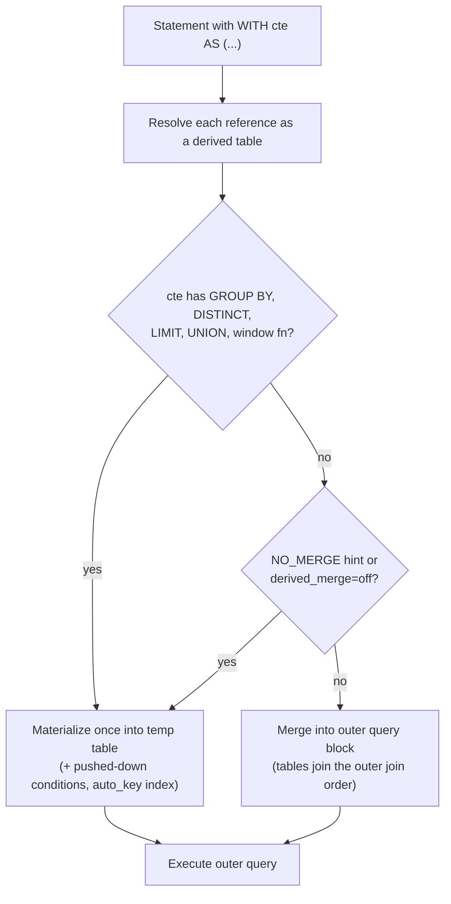

## Introduction

Analytical SQL quickly grows into nested layers: compute revenue per order, then revenue per customer from that, then compare each customer with the average customer. Written with derived tables, the innermost step sits at the deepest indentation level and the question you are actually answering is buried at the bottom-right of the query. Reading it means starting in the middle and working outwards.

A **common table expression (CTE)** fixes the reading order. The `WITH` clause lets you give a name to a query expression and then use that name, like a table, in the rest of the statement:

```sql
WITH order_totals AS (
  SELECT order_id, SUM(quantity * unit_price) AS total
  FROM order_items GROUP BY order_id
)
SELECT AVG(total) FROM order_totals;
```

Now the query reads top to bottom, step by step, like a data pipeline. CTEs answer three practical needs:

- **Readability** — name each intermediate result after what it means (`order_totals`, `customer_revenue`, `segments`).
- **Reuse within a statement** — reference the same intermediate result several times (for example, join it to itself) without writing it twice.
- **Recursion** — a CTE can refer to itself, which enables hierarchy and graph traversal. That is the topic of the next lesson, [Recursive CTEs](/lessons/m04-recursive-ctes).

This lesson covers **non-recursive** CTEs: syntax, scoping, how MySQL executes them (merge or materialize), how to read that in `EXPLAIN`, and how CTEs compare with derived tables (covered in [Subqueries — Scalar, Row, Table and Derived Tables](/lessons/m04-subqueries)), views and temporary tables.

:::note[Dataset]
The examples use the **shop** dataset (25 customers, 80 orders, 182 order lines, 30 products in a category hierarchy). Every output shown was captured from a real MySQL server.
:::

## DBMS Theory

:::theory[A CTE is a named query expression scoped to one statement]
In relational terms a query expression denotes a relation. A CTE simply **binds a name** to such a relation for the duration of a single SQL statement — comparable to a `let` binding in a functional language:

> let T₁ = Q₁, T₂ = Q₂(T₁) in Q(T₁, T₂)

Key properties, defined by the SQL standard (SQL:1999 introduced `WITH`):

- **Statement scope.** The name exists only inside the statement that defines it. It is not stored in the catalog, not visible to other statements or sessions, and has no persistent data.
- **Declarative meaning.** A non-recursive CTE means exactly the same as substituting its query wherever its name is referenced (*referential transparency*). Whether the DBMS actually substitutes it (merges it) or computes it once and stores the result (materializes it) is an **implementation choice** that must not change the result.
- **Ordered visibility.** In a `WITH` list, each CTE may reference CTEs defined *before* it. A non-recursive CTE cannot reference itself or later CTEs.
- **Snapshot semantics.** Like any subquery, a CTE is evaluated against the statement's consistent read view; all references see the same data.
:::

The standard leaves materialization to the implementation, and real systems differ. PostgreSQL before version 12 **always** materialized CTEs, which made them an "optimization fence" — a widely repeated piece of folklore that is **not true for MySQL**. MySQL treats a CTE reference like a derived table: it merges it into the outer query when it can, and materializes it when it must or when that is cheaper. Understanding which happens, and how to see it, is the core engineering skill of this lesson.

:::standard[Standard SQL vs MySQL]
`WITH`, optional column lists, multiple CTEs and `WITH RECURSIVE` are standard SQL, supported by MySQL since 8.0.1. Standard SQL also defines a `SEARCH`/`CYCLE` clause for recursive CTEs and PostgreSQL offers `AS [NOT] MATERIALIZED`; **MySQL implements neither**. In MySQL you influence merging with the optimizer hints `MERGE(name)` / `NO_MERGE(name)` or the `derived_merge` switch. MySQL extends the standard by allowing `WITH` before `UPDATE` and `DELETE`, and inside `INSERT … SELECT`, `CREATE TABLE … SELECT` and `CREATE VIEW`.
:::

## Why It Exists

Consider the question *"which customers spend more than the average customer, and by how much?"* Without CTEs you need the per-customer revenue twice — once for each customer and once for the average — so you either nest derived tables or repeat the same subquery:

```sql
SELECT cr.customer_id, cr.revenue, cr.revenue - avg_r.avg_revenue AS above_avg
FROM (SELECT o.customer_id, SUM(oi.quantity * oi.unit_price) AS revenue
      FROM orders o JOIN order_items oi ON oi.order_id = o.order_id
      GROUP BY o.customer_id) AS cr
CROSS JOIN (SELECT AVG(revenue) AS avg_revenue
            FROM (SELECT o.customer_id, SUM(oi.quantity * oi.unit_price) AS revenue
                  FROM orders o JOIN order_items oi ON oi.order_id = o.order_id
                  GROUP BY o.customer_id) AS x) AS avg_r
WHERE cr.revenue > avg_r.avg_revenue;
```

The revenue logic appears **twice**. When someone later decides that cancelled orders must be excluded, they must change both copies — and if they change only one, the report compares a filtered revenue with an unfiltered average. Duplicated logic is the classic source of inconsistent reports.

CTEs solve three problems at once:

1. **One definition, many references.** Define `customer_revenue` once and refer to it in both places.
2. **Top-down readability.** Each step has a meaningful name and appears before it is used; reviewers read the pipeline in order.
3. **Testability.** During development you can run the query with the final `SELECT` replaced by `SELECT * FROM step_n` to inspect any intermediate step — the same technique the execution walkthrough below uses.

What CTEs do **not** do: they do not store anything between statements (that is what views — stored *definitions* — and temporary tables — stored *data* — are for), and they do not automatically make a query faster or slower. Performance depends on how the optimizer executes them.

## Internal Working

:::internals[Merge or materialize]
During query preparation MySQL resolves each CTE reference into a **derived table** object. For each reference the optimizer then chooses one of two strategies — exactly the same machinery used for derived tables in `FROM (…)` and for views:

1. **Merge.** The CTE's query is folded into the outer query block: its tables join the outer join list, its `WHERE` conditions are combined with the outer `WHERE`. After merging there is no CTE any more — just a bigger query that the join optimizer can reorder freely and that can use the base tables' indexes. `EXPLAIN` shows the base tables directly; no `Materialize` step appears.
2. **Materialize.** The CTE's query is executed once and its result stored in an **internal temporary table** (TempTable engine in memory, spilling to disk when large). The outer query then reads that temporary table. To speed up joins against it, the optimizer may add an **automatic index** on the join column — `EXPLAIN` shows it as `<auto_key0>`. A CTE referenced several times in the same statement is **materialized only once**; each reference reads the same temporary table.

**Merging is impossible** when the CTE contains constructs that change the row set as a whole: aggregate functions or `GROUP BY`, `DISTINCT`, `LIMIT`, `UNION`/`INTERSECT`/`EXCEPT`, window functions, or assignments to user variables. Those CTEs are always materialized. Otherwise MySQL merges by default (`optimizer_switch` flag `derived_merge=on`), unless a hint says otherwise.

**Derived condition pushdown (8.0.22+).** When a CTE must be materialized, MySQL can still push a filter from the outer query *into* it, so that fewer rows are materialized. A filter on a grouping column is pushed into the CTE's `WHERE`; a filter on an aggregate result becomes a `HAVING` condition inside the CTE.
:::



**Scope and name resolution.** When the parser sees a table name inside a statement with `WITH`, it first looks for a CTE of that name in the enclosing `WITH` clauses (innermost first) and only then for a real table. A CTE named `orders` therefore **hides** the real `orders` table for the whole statement — legal, but confusing.

**No caching across statements.** A CTE's temporary table is created and destroyed within one statement's execution. Two statements that use the same CTE text compute it twice. If several statements need the same expensive intermediate result, use a temporary table instead.

## MySQL Implementation

The general form:

```sql
WITH [RECURSIVE]
  cte_name [(col_name [, col_name] ...)] AS (subquery)
  [, cte_name2 [(col_list)] AS (subquery)] ...
SELECT ... | UPDATE ... | DELETE ...;
```

A first CTE: revenue per order, then the average order value.

```sql run
WITH order_totals AS (
  SELECT order_id, SUM(quantity * unit_price) AS total
  FROM order_items
  GROUP BY order_id
)
SELECT COUNT(*) AS orders, ROUND(AVG(total), 2) AS avg_order_value, MAX(total) AS largest_order
FROM order_totals;
```

**Several CTEs, each building on the previous.** Here is the "customers above average" question from *Why It Exists*, rewritten as a pipeline, and excluding cancelled and refunded orders in one place only:

```sql run
WITH valid_orders AS (
  SELECT order_id, customer_id
  FROM orders
  WHERE status NOT IN ('cancelled', 'refunded')
),
customer_revenue AS (
  SELECT vo.customer_id, SUM(oi.quantity * oi.unit_price) AS revenue
  FROM valid_orders vo
  JOIN order_items oi ON oi.order_id = vo.order_id
  GROUP BY vo.customer_id
),
benchmark AS (
  SELECT AVG(revenue) AS avg_revenue FROM customer_revenue
)
SELECT cr.customer_id, cr.revenue,
       ROUND(cr.revenue - b.avg_revenue, 2) AS above_avg
FROM customer_revenue cr
CROSS JOIN benchmark b
WHERE cr.revenue > b.avg_revenue
ORDER BY cr.revenue DESC;
```

`customer_revenue` is referenced twice — by `benchmark` and by the final `SELECT` — but defined once. The final query reads like the business question.

**An explicit column list** names the CTE's columns independently of the select list — useful when the select list contains expressions:

```sql run
WITH category_stats (category_id, products, avg_price) AS (
  SELECT category_id, COUNT(*), ROUND(AVG(price), 2)
  FROM products
  WHERE category_id IS NOT NULL
  GROUP BY category_id
)
SELECT c.name, s.products, s.avg_price
FROM category_stats s
JOIN categories c ON c.category_id = s.category_id
ORDER BY s.avg_price DESC
LIMIT 5;
```

## Syntax Breakdown

| Element | Meaning and rules |
|---|---|
| `WITH` | Starts the CTE list. Allowed at the beginning of `SELECT`, `UPDATE`, `DELETE`; before the `SELECT` part of `INSERT … SELECT`, `REPLACE … SELECT`, `CREATE TABLE … SELECT`, `CREATE VIEW … AS`; and at the start of any subquery or derived table. |
| `RECURSIVE` | Required if **any** CTE in the list references itself (next lesson). Harmless otherwise. |
| `cte_name` | Must be unique within one `WITH` clause (error 1066 otherwise). Hides a base table of the same name inside the statement. |
| `(col_name, …)` | Optional column list. Its length must equal the number of select-list columns (error 1353). Without it, column names come from the select list — so alias every expression. |
| `AS (subquery)` | Any query expression: joins, `GROUP BY`, window functions, set operations, even another `WITH`. |
| `,` | Separates CTEs. A CTE may reference only CTEs defined earlier in the list (plus itself, if recursive). |
| References | A CTE can be referenced any number of times in the rest of the statement, including in subqueries, and joined to itself under different aliases. |
| Lifetime | One statement. Referencing the name in the next statement fails with error 1146 (table doesn't exist). |
| Hints | `/*+ MERGE(alias) */` or `/*+ NO_MERGE(alias) */` in the outer `SELECT` override the merge decision for the reference with that alias (the CTE name if the reference has no alias). |

:::mysql[Where WITH may appear]
MySQL places the `WITH` clause at the start of the statement for `SELECT`, `UPDATE` and `DELETE`, but **after** the target for inserts: `INSERT INTO t (cols) WITH cte AS (…) SELECT … FROM cte;`. Writing `WITH … INSERT INTO …` is a syntax error.
:::

## Practical Examples

**1. Reusing a CTE in a self-join — month-over-month revenue.** Compute monthly revenue once, then join each month to the previous month (window functions will offer a shorter way — see [Value Functions](/lessons/m04-value-functions)):

```sql run
WITH monthly AS (
  SELECT MONTH(o.order_date) AS m,
         SUM(oi.quantity * oi.unit_price) AS revenue
  FROM orders o
  JOIN order_items oi ON oi.order_id = o.order_id
  WHERE o.status NOT IN ('cancelled', 'refunded')
  GROUP BY MONTH(o.order_date)
)
SELECT cur.m AS month, cur.revenue,
       prev.revenue AS prev_revenue,
       ROUND(100 * (cur.revenue - prev.revenue) / prev.revenue, 1) AS pct_change
FROM monthly cur
LEFT JOIN monthly prev ON prev.m = cur.m - 1
ORDER BY cur.m;
```

The CTE `monthly` is referenced twice but computed once (you will verify that with `EXPLAIN` below). January has no previous month, so the `LEFT JOIN` yields NULL there.

**2. Classifying with a pipeline — customer segments.** Each CTE adds one concept: activity per customer, then a segment label, then a summary per segment.

```sql run
WITH activity AS (
  SELECT c.customer_id,
         COUNT(o.order_id) AS orders,
         MAX(o.order_date) AS last_order
  FROM customers c
  LEFT JOIN orders o ON o.customer_id = c.customer_id
  GROUP BY c.customer_id
),
segmented AS (
  SELECT customer_id, orders,
         CASE WHEN orders = 0 THEN 'never ordered'
              WHEN orders >= 5 THEN 'loyal'
              WHEN last_order >= '2024-10-01' THEN 'recent'
              ELSE 'lapsing' END AS segment
  FROM activity
)
SELECT segment, COUNT(*) AS customers, SUM(orders) AS orders
FROM segmented
GROUP BY segment
ORDER BY customers DESC, segment;
```

**3. A CTE inside a derived table or subquery.** `WITH` can also open a subquery. This is useful when only one branch of a larger query needs the helper result:

```sql run
SELECT p.name, p.price
FROM products p
WHERE p.price > (
  WITH cat_avg AS (SELECT AVG(price) AS a FROM products WHERE category_id = 9)
  SELECT a FROM cat_avg
)
AND p.category_id = 9
ORDER BY p.price DESC;
```

**4. CTEs in data modification.** Flag every product priced above its category's average as "premium". To keep the dataset intact we copy the products into a work table and update that. MySQL allows `WITH` before `UPDATE`:

```sql run
CREATE TABLE product_flags AS
SELECT product_id, category_id, price, FALSE AS is_premium FROM products;

WITH cat_avg AS (
  SELECT category_id, AVG(price) AS avg_price
  FROM product_flags
  WHERE category_id IS NOT NULL
  GROUP BY category_id
)
UPDATE product_flags pf
JOIN cat_avg ca ON ca.category_id = pf.category_id
SET pf.is_premium = TRUE
WHERE pf.price > ca.avg_price;

SELECT is_premium, COUNT(*) AS products FROM product_flags GROUP BY is_premium ORDER BY is_premium;
```

Note that the CTE reads the very table being updated. That works because `cat_avg` contains `GROUP BY` and is therefore materialized **before** the update starts — the update cannot disturb the averages it is comparing against.

**5. `INSERT … WITH … SELECT`.** Build a monthly summary table; note the position of `WITH` after the column list:

```sql run
CREATE TABLE monthly_summary (month_no INT PRIMARY KEY, orders INT, customers INT);

INSERT INTO monthly_summary (month_no, orders, customers)
WITH m AS (
  SELECT MONTH(order_date) AS month_no, order_id, customer_id FROM orders
)
SELECT month_no, COUNT(*), COUNT(DISTINCT customer_id)
FROM m
GROUP BY month_no;

SELECT * FROM monthly_summary ORDER BY month_no LIMIT 6;
```

## Execution Walkthrough

Trace the segmentation pipeline from Practical Example 2. During development you can inspect any CTE by ending the statement with `SELECT * FROM that_cte` — exactly what each step below does.

```walkthrough
title: WITH activity AS (...), segmented AS (...) SELECT segment, COUNT(*) ... GROUP BY segment
steps:
  - title: "1. CTE activity — one row per customer"
    explain: The LEFT JOIN keeps customers without orders (COUNT(o.order_id) = 0 for them, and last_order is NULL). This CTE has GROUP BY, so MySQL materializes it.
    sql: |
      WITH activity AS (
        SELECT c.customer_id, COUNT(o.order_id) AS orders, MAX(o.order_date) AS last_order
        FROM customers c LEFT JOIN orders o ON o.customer_id = c.customer_id
        GROUP BY c.customer_id)
      SELECT * FROM activity ORDER BY customer_id LIMIT 10;
  - title: "2. CTE segmented — a label per customer"
    explain: The CASE expression is evaluated top-down; the first true branch wins. A customer with 5+ orders is 'loyal' even if the last order was recent. This CTE has no aggregation, so it can be merged into the final query.
    sql: |
      WITH activity AS (
        SELECT c.customer_id, COUNT(o.order_id) AS orders, MAX(o.order_date) AS last_order
        FROM customers c LEFT JOIN orders o ON o.customer_id = c.customer_id
        GROUP BY c.customer_id),
      segmented AS (
        SELECT customer_id, orders,
               CASE WHEN orders = 0 THEN 'never ordered'
                    WHEN orders >= 5 THEN 'loyal'
                    WHEN last_order >= '2024-10-01' THEN 'recent'
                    ELSE 'lapsing' END AS segment
        FROM activity)
      SELECT * FROM segmented ORDER BY customer_id LIMIT 10;
  - title: "3. Final SELECT — group by segment"
    explain: The outer query aggregates the labelled rows. The result has one row per segment.
    sql: |
      WITH activity AS (
        SELECT c.customer_id, COUNT(o.order_id) AS orders, MAX(o.order_date) AS last_order
        FROM customers c LEFT JOIN orders o ON o.customer_id = c.customer_id
        GROUP BY c.customer_id),
      segmented AS (
        SELECT customer_id, orders,
               CASE WHEN orders = 0 THEN 'never ordered'
                    WHEN orders >= 5 THEN 'loyal'
                    WHEN last_order >= '2024-10-01' THEN 'recent'
                    ELSE 'lapsing' END AS segment
        FROM activity)
      SELECT segment, COUNT(*) AS customers, SUM(orders) AS orders
      FROM segmented GROUP BY segment ORDER BY customers DESC, segment;
  - title: "4. The physical plan"
    explain: >-
      EXPLAIN FORMAT=TREE shows what the optimizer did with the two CTEs: activity appears as a materialized CTE
      (it has GROUP BY), while segmented has been merged — there is no separate Materialize step for it; its CASE
      expression is evaluated directly on rows read from activity's temporary table.
    sql: |
      EXPLAIN FORMAT=TREE
      WITH activity AS (
        SELECT c.customer_id, COUNT(o.order_id) AS orders, MAX(o.order_date) AS last_order
        FROM customers c LEFT JOIN orders o ON o.customer_id = c.customer_id
        GROUP BY c.customer_id),
      segmented AS (
        SELECT customer_id, orders,
               CASE WHEN orders = 0 THEN 'never ordered'
                    WHEN orders >= 5 THEN 'loyal'
                    WHEN last_order >= '2024-10-01' THEN 'recent'
                    ELSE 'lapsing' END AS segment
        FROM activity)
      SELECT segment, COUNT(*) AS customers, SUM(orders) AS orders
      FROM segmented GROUP BY segment;
```

## Output

The pipeline's final output has one row per segment with the number of customers and their total orders. Read it against step 1: the `never ordered` count must equal the number of customers whose `orders` column is 0 there (the five customers 2, 13, 23, 24 and 25), and the `SUM(orders)` across all segments must equal the 80 orders in the table — a quick consistency check you should habitually apply to any pipeline:

```sql run
WITH activity AS (
  SELECT c.customer_id, COUNT(o.order_id) AS orders
  FROM customers c LEFT JOIN orders o ON o.customer_id = c.customer_id
  GROUP BY c.customer_id
)
SELECT COUNT(*) AS customers, SUM(orders) AS orders, SUM(orders = 0) AS never_ordered
FROM activity;
```

The plan in step 4 is the other half of the output: it tells you *how* MySQL ran your CTEs, which matters as soon as data grows.

## Alternative Approaches

A non-recursive CTE is one of four ways to give a name to an intermediate result. They differ in **scope**, **what is stored** and **how the optimizer treats them**.

| Tool | Scope / lifetime | Stores | Optimizer treatment | Choose it when |
|---|---|---|---|---|
| **CTE** (`WITH`) | One statement | Nothing persistent | Merged or materialized per reference; materialized once if referenced several times | Readable multi-step queries; reusing a result within one statement; recursion |
| **Derived table** (`FROM (SELECT …) AS d`) | One query block | Nothing | Same merge/materialize machinery as CTEs | A one-off helper used once; `LATERAL` derived tables that reference earlier tables (see [Subqueries](/lessons/m04-subqueries)) |
| **View** (`CREATE VIEW`) | Persistent object in the schema | The *definition* only | `MERGE` or `TEMPTABLE` algorithm, decided the same way | A reusable definition shared by many queries and users; security (exposing a subset of columns); Module 9 |
| **Temporary table** (`CREATE TEMPORARY TABLE`) | The session | The *data* | A real table; you can add indexes and run `ANALYZE TABLE` | The same expensive result is needed by **several statements**; you want explicit indexes; stepwise ETL |

The same question — "average revenue per customer, with cancelled orders excluded" — in the derived-table form:

```sql run
SELECT ROUND(AVG(revenue), 2) AS avg_customer_revenue
FROM (
  SELECT o.customer_id, SUM(oi.quantity * oi.unit_price) AS revenue
  FROM orders o JOIN order_items oi ON oi.order_id = o.order_id
  WHERE o.status NOT IN ('cancelled', 'refunded')
  GROUP BY o.customer_id
) AS customer_revenue;
```

And in the CTE form:

```sql run
WITH customer_revenue AS (
  SELECT o.customer_id, SUM(oi.quantity * oi.unit_price) AS revenue
  FROM orders o JOIN order_items oi ON oi.order_id = o.order_id
  WHERE o.status NOT IN ('cancelled', 'refunded')
  GROUP BY o.customer_id
)
SELECT ROUND(AVG(revenue), 2) AS avg_customer_revenue FROM customer_revenue;
```

Same result, same plan — the choice between them is about readability and reuse, not speed. Two concrete differences:

- **A derived table cannot be referenced twice.** `FROM (…) a JOIN (…) b` writes and computes the subquery twice; a CTE referenced twice is written once and materialized once.
- **A derived table can be `LATERAL`**, i.e. refer to columns of tables to its left in the same `FROM` clause; a CTE is defined before the `FROM` clause and cannot.

For a view, the definition persists across sessions:

```sql run
CREATE VIEW v_customer_revenue AS
WITH customer_revenue AS (
  SELECT o.customer_id, SUM(oi.quantity * oi.unit_price) AS revenue
  FROM orders o JOIN order_items oi ON oi.order_id = o.order_id
  WHERE o.status NOT IN ('cancelled', 'refunded')
  GROUP BY o.customer_id
)
SELECT customer_id, revenue FROM customer_revenue;

SELECT customer_id, revenue FROM v_customer_revenue ORDER BY revenue DESC LIMIT 3;
```

## Performance Analysis

Because a CTE is just a derived table with a name, its performance is entirely determined by **merge vs materialize**, by **whether filters reach the base tables**, and by **how many times it is computed**. All three are visible in `EXPLAIN`.

**Merged CTE — the CTE disappears.** A CTE without aggregation, joined to `customers` with a filter on the outer query:

```sql run
EXPLAIN FORMAT=TREE
WITH delivered AS (
  SELECT o.customer_id, o.order_id, o.order_date
  FROM orders o
  WHERE o.status = 'delivered'
)
SELECT c.first_name, d.order_id
FROM customers c
JOIN delivered d ON d.customer_id = c.customer_id
WHERE c.state = 'WA';
```

There is no `Materialize` step: the CTE was merged, and the optimizer reads `orders` through the index `idx_orders_customer` for each Washington customer, applying the status filter on the fetched rows. This is exactly the plan you would get without the CTE.

**Forced materialization — `NO_MERGE`.** The same query with the hint. Note that the hint names the **reference alias** (`d`), not the CTE name — with `NO_MERGE(delivered)` MySQL would report warning 3128 (*Unresolved name*) and ignore the hint:

```sql run
EXPLAIN FORMAT=TREE
WITH delivered AS (
  SELECT o.customer_id, o.order_id, o.order_date
  FROM orders o
  WHERE o.status = 'delivered'
)
SELECT /*+ NO_MERGE(d) */ c.first_name, d.order_id
FROM customers c
JOIN delivered d ON d.customer_id = c.customer_id
WHERE c.state = 'WA';
```

Now MySQL scans `orders`, materializes all delivered orders into a temporary table, builds an automatic index `<auto_key0>` on `customer_id` and probes it. On this tiny dataset both plans are instantaneous; on a table with millions of delivered orders, materializing all of them to serve a handful of customers would be a serious regression. This is why MySQL merges by default.

**Referenced twice — materialized once.** The month-over-month query references `monthly` twice:

```sql run
EXPLAIN
WITH monthly AS (
  SELECT MONTH(o.order_date) AS m, SUM(oi.quantity * oi.unit_price) AS revenue
  FROM orders o JOIN order_items oi ON oi.order_id = o.order_id
  GROUP BY MONTH(o.order_date)
)
SELECT cur.m, cur.revenue, prev.revenue
FROM monthly cur LEFT JOIN monthly prev ON prev.m = cur.m - 1;
```

The traditional plan has two rows reading `<derived2>` (the two references, `cur` and `prev`) but only **one** set of `DERIVED` rows with `id` 2 — the CTE's query block is executed once and both references read its temporary table. With two separate derived tables, you would see two derived query blocks, each executed.

**Condition pushdown into a materialized CTE.** A filter on the outer query can be pushed into a CTE that must be materialized:

```sql run
EXPLAIN FORMAT=TREE
WITH per_customer AS (
  SELECT customer_id, COUNT(*) AS orders
  FROM orders
  GROUP BY customer_id
)
SELECT * FROM per_customer
WHERE customer_id BETWEEN 7 AND 9 AND orders > 2;
```

Look at the plan: the condition on `customer_id` (the grouping column) has moved below the aggregation and turned into an index range scan on `idx_orders_customer`, and the condition on `orders` (the aggregate) has become a filter applied right after grouping. Only the matching groups are materialized. This **derived condition pushdown** (MySQL 8.0.22+) is why it is fine to write the filter in the outer query.

:::performance[Theory vs measurement]
- A **merged** CTE costs nothing extra — the plan is the plan of the equivalent flat query.
- A **materialized** CTE costs one execution of its query plus writing its rows to a temporary table (memory first, disk if it exceeds `tmp_table_size` or TempTable's memory budget). Reading it back is cheap, and `<auto_key>` indexes make joins against it efficient.
- A CTE referenced **N times** is computed once — a real saving versus N copies of a derived table when the CTE is expensive.
- What cannot be predicted from theory is the *magnitude* of these costs on your data. On the 80-order shop dataset all plans above run in microseconds. Verify with `EXPLAIN ANALYZE` on production-like volumes (Module 7) before adding hints.
:::

## Best Practices

:::best-practice[Writing CTEs professionally]
1. **Name CTEs after their meaning**, not their mechanics: `valid_orders`, `customer_revenue`, not `t1`, `sub`, `cte2`.
2. **Put each business rule in exactly one CTE** (e.g. "valid orders exclude cancelled and refunded") and build everything else on top of it.
3. **Alias every computed column** (or use the column list) so later steps and readers know what each column means.
4. **Filter early and let pushdown work**, but do not contort queries for the optimizer: write the filter where it is logically clearest and *check* the plan.
5. **Don't add `ORDER BY` inside a CTE** unless it is paired with `LIMIT`; the final ordering must be specified in the outermost query.
6. **Check `EXPLAIN` when a CTE is large** — look for `Materialize CTE` and whether `<auto_key0>` is used. Use `NO_MERGE`/`MERGE` hints only with evidence.
7. **Don't shadow real tables** with CTE names (`WITH orders AS …`); it makes the statement misleading for the next reader.
8. **Use a temporary table, not a repeated CTE, when several statements need the same expensive result.** CTEs are not cached between statements.
:::

## Common Mistakes

**Mistake 1 — expecting a CTE to survive the statement.** The CTE exists only in the statement that defines it:

```sql run
WITH top_customers AS (
  SELECT customer_id FROM orders GROUP BY customer_id HAVING COUNT(*) >= 6
)
SELECT customer_id FROM top_customers ORDER BY customer_id;
```

```sql run error
SELECT * FROM top_customers;
```

Error 1146: to the second statement, `top_customers` is an unknown table. If you need it again, repeat the `WITH`, create a view, or materialize it into a temporary table.

**Mistake 2 — referencing a CTE before it is defined.** Non-recursive CTEs can only see CTEs listed earlier:

```sql run error
WITH revenue_rank AS (SELECT customer_id FROM revenue WHERE total > 1000),
     revenue AS (SELECT o.customer_id, SUM(oi.quantity * oi.unit_price) AS total
                 FROM orders o JOIN order_items oi ON oi.order_id = o.order_id
                 GROUP BY o.customer_id)
SELECT * FROM revenue_rank;
```

MySQL looks for a *table* named `revenue`, does not find one, and reports error 1146. Reorder the CTEs.

**Mistake 3 — a column list of the wrong length.**

```sql run error
WITH stats (category_id, products, avg_price) AS (
  SELECT category_id, COUNT(*) FROM products GROUP BY category_id
)
SELECT * FROM stats;
```

Error 1353: the column list has three names, the select list two columns.

**Mistake 4 — the same name twice.**

```sql run error
WITH x AS (SELECT 1 AS n),
     x AS (SELECT 2 AS n)
SELECT * FROM x;
```

Error 1066 — names must be unique within one `WITH` clause.

**Mistake 5 — accidentally hiding a real table.** A CTE named like a base table silently replaces it in the statement:

```sql run
WITH orders AS (SELECT 1 AS order_id)
SELECT COUNT(*) AS orders_seen FROM orders;
```

The count is 1, not 80 — the query read the CTE, not the table. No error, wrong answer. (Inside the CTE's *own* definition, a non-recursive CTE's name is not yet in scope, so `WITH orders AS (SELECT * FROM orders WHERE …)` reads the real table there — and the CTE everywhere after. It runs, but every reader has to work out which `orders` is which.)

**Mistake 6 — believing a CTE is an "optimization fence" (or a cache).** Some developers wrap a filter-heavy subquery in a CTE "so it runs first", expecting materialization as in old PostgreSQL. In MySQL the CTE may be merged, and the filters may be reordered; conversely a materialized CTE is recomputed by every statement. Reason from `EXPLAIN`, not folklore.

## Industry Application

- **Analytics engineering.** The dominant style guide in modern analytics (popularized by dbt) writes every model as a chain of CTEs: *import* CTEs that select from source tables, *logical* CTEs that apply one transformation each, and a *final* CTE that is selected at the end. Reviewers read each step in isolation, and a failing data test can be traced to one named CTE.
- **Reporting queries in applications.** Back-office reports ("customers above average spend", "products below reorder level by warehouse") are kept in the code base as CTE pipelines because new requirements usually add or modify *one* step.
- **Safe data fixes.** Operations teams write one-off corrections as `WITH affected AS (…) SELECT * FROM affected` first, review the rows, and then change only the final statement to `UPDATE … JOIN affected …` — the selection logic is reviewed once and reused verbatim.
- **Query migration.** Moving reports from PostgreSQL (where CTEs were historically materialized) to MySQL can change plans — usually for the better, because MySQL merges. Teams verify with `EXPLAIN` instead of assuming identical behaviour.
- **Feature engineering for ML.** Data scientists build feature tables with CTEs — one per feature family (recency, frequency, monetary value) — joined on the entity key at the end. The readable structure doubles as documentation of how each feature is defined.

## Practice Exercises

```exercise
id: ex1
title: Average items per order
difficulty: easy
concepts: [cte, with-clause]
prompt: |
  Using a CTE named `order_sizes` that computes the total `quantity` per order from `order_items`, return one row
  with one column `avg_items_per_order`: the average order size rounded to 2 decimals.
hints:
  - "The CTE groups order_items by order_id and sums quantity."
  - "The outer query computes ROUND(AVG(...), 2) over the CTE."
solution: |
  WITH order_sizes AS (
    SELECT order_id, SUM(quantity) AS items
    FROM order_items
    GROUP BY order_id
  )
  SELECT ROUND(AVG(items), 2) AS avg_items_per_order
  FROM order_sizes;
explanation: |
  An average of per-order totals requires two levels of aggregation: first per order, then over orders. Writing
  `AVG(SUM(quantity))` directly is an error (nested aggregates); the CTE (or a derived table) provides the second
  level. `SUM(quantity) / COUNT(DISTINCT order_id)` over `order_items` is an equivalent single-level formula.
```

```exercise
id: ex2
title: Categories priced above the shop average
difficulty: medium
concepts: [cte, query-readability]
prompt: |
  Return the categories whose **average product price** is higher than the **average price of all products**.
  Columns: `name` (category name), `avg_price` (rounded to 2 decimals). Ignore products without a category
  when computing category averages, but include every product in the overall average.
hints:
  - "One CTE for per-category averages (with category_id), one for the overall average."
  - "Join the category averages to categories for the name and CROSS JOIN the overall average to compare."
solution: |
  WITH cat_avg AS (
    SELECT category_id, AVG(price) AS avg_price
    FROM products
    WHERE category_id IS NOT NULL
    GROUP BY category_id
  ),
  overall AS (
    SELECT AVG(price) AS avg_price FROM products
  )
  SELECT c.name, ROUND(ca.avg_price, 2) AS avg_price
  FROM cat_avg ca
  JOIN categories c ON c.category_id = ca.category_id
  CROSS JOIN overall o
  WHERE ca.avg_price > o.avg_price;
explanation: |
  Separating the two averages into named CTEs makes the comparison self-explanatory. Compare unrounded
  values; rounding before comparing can misclassify a category whose average is within half a cent of the
  benchmark.
```

```exercise
id: ex3
title: Reuse one CTE twice — customers sharing a city
difficulty: medium
concepts: [cte, materialization]
prompt: |
  Define a CTE `buyers` containing `customer_id` and `city` for customers who have **at least one order**.
  Using two references to that CTE, return every pair of different buyers who live in the same city, each pair
  once. Columns: `city`, `customer_a`, `customer_b` with `customer_a < customer_b`.
hints:
  - "buyers: SELECT DISTINCT c.customer_id, c.city FROM customers c JOIN orders o ON o.customer_id = c.customer_id"
  - "Self-join buyers a JOIN buyers b ON a.city = b.city AND a.customer_id < b.customer_id."
solution: |
  WITH buyers AS (
    SELECT DISTINCT c.customer_id, c.city
    FROM customers c
    JOIN orders o ON o.customer_id = c.customer_id
  )
  SELECT a.city, a.customer_id AS customer_a, b.customer_id AS customer_b
  FROM buyers a
  JOIN buyers b ON a.city = b.city AND a.customer_id < b.customer_id;
explanation: |
  The `<` condition removes self-pairs and mirror duplicates (see [CROSS JOIN and SELF JOIN](/lessons/m04-cross-self-join)).
  Because `buyers` uses DISTINCT, MySQL materializes it once and both references read the same temporary table —
  `EXPLAIN` shows one derived query block.
```

```exercise
id: ex4
title: Fix the forward reference
difficulty: hard
concepts: [cte, with-clause]
prompt: |
  A colleague's query fails with error 1146 (*Table '…revenue' doesn't exist*):

  ~~~sql
  WITH big_spenders AS (
    SELECT customer_id, total FROM revenue WHERE total > 3000
  ),
  revenue AS (
    SELECT o.customer_id, SUM(oi.quantity * oi.unit_price) AS total
    FROM orders o JOIN order_items oi ON oi.order_id = o.order_id
    GROUP BY o.customer_id
  )
  SELECT customer_id, total FROM big_spenders;
  ~~~

  Fix it so that it returns `customer_id` and `total` for every customer whose total line-item value
  (all orders, any status) exceeds 3000.
hints:
  - "A non-recursive CTE can only reference CTEs defined before it in the WITH list."
  - "Move the revenue CTE first; big_spenders then reads from it."
solution: |
  WITH revenue AS (
    SELECT o.customer_id, SUM(oi.quantity * oi.unit_price) AS total
    FROM orders o JOIN order_items oi ON oi.order_id = o.order_id
    GROUP BY o.customer_id
  ),
  big_spenders AS (
    SELECT customer_id, total FROM revenue WHERE total > 3000
  )
  SELECT customer_id, total FROM big_spenders;
explanation: |
  When `big_spenders` is resolved, `revenue` is not yet defined as a CTE, so MySQL looks for a base table called
  `revenue` and fails. Ordering CTEs by dependency fixes it. (Adding `RECURSIVE` would not help in the intended
  way: it changes how names are resolved and is meant for self-referencing CTEs.)
```

```exercise
id: ex5
title: Revenue share by top-level category
difficulty: challenge
concepts: [cte, query-readability, derived-tables]
prompt: |
  Compute each **top-level category's** share of revenue from non-cancelled, non-refunded orders. A product's
  top-level category is its own category if that category has no parent, otherwise its parent — except for
  Laptops and Accessories, whose top level is the grandparent (Electronics). The category tree is at most three
  levels deep, so you may resolve it with joins (the next lesson does it generally with recursion).
  Products without a category are ignored.

  Columns: `top_category`, `revenue`, `pct_of_total` (rounded to 1 decimal). Use at least three CTEs.
hints:
  - "CTE 1: map each category_id to its top-level ancestor with LEFT JOINs to the parent and grandparent: COALESCE(gp.category_id, p.category_id, c.category_id)."
  - "CTE 2: line revenue (quantity × unit_price) per product for valid orders, joined to products for category_id."
  - "CTE 3: revenue per top-level category; then compute the percentage against SUM over that CTE (a scalar subquery on the CTE)."
solution: |
  WITH top_level AS (
    SELECT c.category_id,
           COALESCE(gp.category_id, p.category_id, c.category_id) AS top_id
    FROM categories c
    LEFT JOIN categories p  ON p.category_id = c.parent_id
    LEFT JOIN categories gp ON gp.category_id = p.parent_id
  ),
  line_revenue AS (
    SELECT pr.category_id, oi.quantity * oi.unit_price AS amount
    FROM order_items oi
    JOIN orders o    ON o.order_id = oi.order_id
    JOIN products pr ON pr.product_id = oi.product_id
    WHERE o.status NOT IN ('cancelled', 'refunded')
      AND pr.category_id IS NOT NULL
  ),
  by_top AS (
    SELECT tl.top_id, SUM(lr.amount) AS revenue
    FROM line_revenue lr
    JOIN top_level tl ON tl.category_id = lr.category_id
    GROUP BY tl.top_id
  )
  SELECT c.name AS top_category, bt.revenue,
         ROUND(100 * bt.revenue / (SELECT SUM(revenue) FROM by_top), 1) AS pct_of_total
  FROM by_top bt
  JOIN categories c ON c.category_id = bt.top_id;
explanation: |
  `COALESCE(grandparent, parent, self)` picks the highest existing ancestor for a tree of depth ≤ 3. Each CTE has
  one responsibility — tree mapping, valid revenue, aggregation — so a change to the definition of "valid
  order" touches one place. `by_top` is referenced twice (the main query and the scalar subquery) yet computed
  once. For trees of unknown depth, replace `top_level` with a recursive CTE (next lesson).
```

## Knowledge Assessment

```quiz
- id: q1
  question: "What is the lifetime of a non-recursive CTE in MySQL?"
  options:
    - "Until the end of the session"
    - "The single statement in which it is defined"
    - "Until the transaction commits"
    - "Until the server restarts, like a view"
  answer: 1
  explanation: "A CTE is a named query expression scoped to one statement. Session lifetime describes temporary tables; persistent definitions are views."
  concepts: [cte]
- id: q2
  question: "A CTE contains `GROUP BY customer_id` and is referenced twice in the outer query. What does MySQL do?"
  options:
    - "Merges both references into the outer query"
    - "Materializes it twice, once per reference"
    - "Materializes it once into an internal temporary table that both references read"
    - "Raises an error: a CTE can only be referenced once"
  answer: 2
  explanation: "GROUP BY prevents merging, and a CTE referenced several times is materialized only once per statement. Two identical derived tables, by contrast, would be computed separately."
  concepts: [materialization, cte]
- id: q3
  question: "`EXPLAIN FORMAT=TREE` for a query using a simple filtering CTE (no aggregation) shows no 'Materialize CTE' line and the base table is accessed via an index. What happened?"
  options:
    - "The CTE was cached from an earlier execution"
    - "The CTE was merged into the outer query, so the optimizer planned the equivalent flat query"
    - "EXPLAIN does not show CTEs"
    - "The CTE was ignored because it was unused"
  answer: 1
  explanation: "With derived_merge=on (the default), mergeable CTEs are folded into the outer query block. MySQL does not cache CTE results between statements."
  concepts: [derived-merge]
- id: q4
  question: "Which statements about CTEs in MySQL 8.4 are true? (Select all that apply.)"
  type: multi
  options:
    - "WITH can precede UPDATE and DELETE statements"
    - "PostgreSQL's AS MATERIALIZED / NOT MATERIALIZED syntax is supported"
    - "A CTE may reference a CTE defined earlier in the same WITH clause"
    - "In INSERT … SELECT, the WITH clause goes after the INSERT INTO target"
    - "A CTE is always an optimization fence that is evaluated before the outer query"
  answer: [0, 2, 3]
  explanation: "MySQL allows WITH before UPDATE/DELETE and after INSERT INTO t (…). Earlier CTEs are visible to later ones. MySQL has no MATERIALIZED keyword (use NO_MERGE/MERGE hints) and CTEs are merged when possible, so they are not fences."
  concepts: [with-clause, cte]
- id: q5
  question: "Which tool should you use when three separate statements in a stored procedure all need the same expensive intermediate result?"
  options: ["A CTE repeated in each statement", "A temporary table", "A derived table", "A view"]
  answer: 1
  explanation: "A temporary table stores the data once for the session and can be indexed. A CTE or derived table would be recomputed by every statement; a view stores only the definition, so it would be recomputed too."
  concepts: [cte, views]
- id: q6
  question: "`WITH orders AS (SELECT 1 AS order_id) SELECT COUNT(*) FROM orders;` — what is returned on the shop dataset?"
  options: ["80", "1", "Error 1066: Not unique table/alias", "Error 1146: table doesn't exist"]
  answer: 1
  explanation: "Within the statement the CTE name hides the base table, so the query counts the CTE's single row. No error is raised — which is why shadowing table names is dangerous."
  concepts: [with-clause]
- id: q7
  question: "An outer query filters a materialized CTE with `WHERE customer_id BETWEEN 7 AND 9`, where customer_id is the CTE's GROUP BY column. What can MySQL 8.0.22+ do?"
  options:
    - "Nothing — filters on materialized CTEs are applied only after full materialization"
    - "Push the condition into the CTE's WHERE so only matching groups are computed and materialized"
    - "Convert the CTE into a view"
    - "Rewrite the CTE as a recursive CTE"
  answer: 1
  explanation: "Derived condition pushdown moves conditions on grouping columns into the derived table's WHERE (and conditions on aggregates into its HAVING), reducing materialization work."
  concepts: [materialization]
- id: q8
  question: "What is a real advantage of a derived table over a CTE?"
  options:
    - "Derived tables are always faster"
    - "A derived table can be LATERAL and reference columns of tables earlier in the same FROM clause"
    - "Derived tables can be referenced several times"
    - "Derived tables persist for the session"
  answer: 1
  explanation: "LATERAL derived tables (8.0.14+) can correlate with preceding FROM items; a CTE is defined before the FROM clause and cannot. Performance is generally identical; derived tables cannot be referenced twice, and neither persists."
  concepts: [derived-tables, cte]
```
