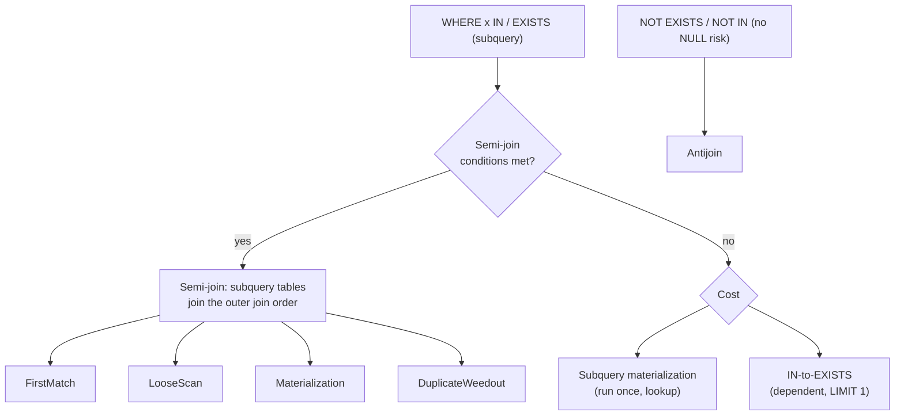

## Introduction

A large class of questions is about **whether related rows exist**, not about their content:

- "Which customers have placed **at least one** order in December?"
- "Which products have **never** been sold?"
- "Which promo codes were **never** used?"
- "Which categories contain **no** products directly?"

You do not want columns from the related table, and you do not want a customer repeated once per order. You want each row of the outer table **at most once**, kept or discarded depending on the existence of a match. SQL offers four predicates for that — `EXISTS`, `IN`, `NOT EXISTS` and `NOT IN` — and relational theory has names for the operations they express: the **semi-join** and the **anti-join**.

This lesson shows:

- how `EXISTS` and `IN` express a semi-join, and why a plain join is *not* the same thing (it multiplies rows);
- the most dangerous predicate in everyday SQL: **`NOT IN` with a NULL in the subquery returns no rows at all** — demonstrated on the shop data, where it makes a real report silently empty;
- how MySQL turns these predicates into join-like plans with its **semi-join strategies** (FirstMatch, LooseScan, Materialization, DuplicateWeedout) and **antijoins**, and how to read them in `EXPLAIN`;
- why "EXISTS is faster than IN" and "joins are faster than subqueries" are folklore: the answer depends on schema, NULLability, indexes and the optimizer's transformations.

:::note[Dataset]
The **shop** dataset. Two nullable columns matter here: `products.category_id` (NULL for the gift card) and `orders.discount_code` (NULL for about half the orders). Five customers never ordered; products 4 and 7 were never sold.
:::

## DBMS Theory

:::theory[Semi-join and anti-join]
For relations R and S and a predicate θ:

- **Semi-join** R ⋉<sub>θ</sub> S = { r ∈ R | ∃ s ∈ S : θ(r, s) } = π<sub>R</sub>(R ⋈<sub>θ</sub> S) *with set semantics*. Each R tuple appears **once** if it has at least one partner — never multiplied, and no S attributes in the output.
- **Anti-join** R ▷<sub>θ</sub> S = { r ∈ R | ¬∃ s ∈ S : θ(r, s) } = R − (R ⋉<sub>θ</sub> S). The R tuples with **no** partner.

In SQL, `WHERE EXISTS (SELECT … WHERE θ)` and `WHERE x IN (SELECT y …)` express semi-joins; `NOT EXISTS` expresses an anti-join. `NOT IN` expresses an anti-join **only when no NULLs are involved** — under three-valued logic it is a different operator.
:::

### Why a join is not a semi-join

`customers ⋈ orders` returns one row per *order*. To get "customers who ordered" from a join you must remove duplicates with `DISTINCT` (or `GROUP BY`), which is only equivalent if the projected columns identify the customer, and costs a deduplication step. A semi-join never creates the duplicates in the first place — and an engine executing it can stop looking after the **first** match.

### Three-valued logic of IN and NOT IN

`x IN (v1, v2, …)` is defined as `x = v1 OR x = v2 OR …`; `x NOT IN (…)` as `x <> v1 AND x <> v2 AND …`. With a NULL among the values:

| x | list | `x IN list` | `x NOT IN list` |
|---|---|---|---|
| 3 | (1, 2) | FALSE | TRUE |
| 3 | (1, 2, NULL) | 3 = NULL → UNKNOWN, so **UNKNOWN** | 3 <> NULL → UNKNOWN, so **UNKNOWN** |
| 1 | (1, 2, NULL) | TRUE | FALSE |
| NULL | (1, 2) | UNKNOWN | UNKNOWN |
| any | empty | FALSE | TRUE |

`WHERE` keeps only TRUE. So a single NULL in the subquery makes `NOT IN` UNKNOWN for every value that is not in the list — and those are exactly the rows you were looking for. `NOT EXISTS` does not have this problem: it asks "is there a row where `s.y = r.x` is TRUE?", and a NULL `s.y` simply is not such a row.

## Why It Exists

Existence tests are everywhere: eligibility ("customers with an active subscription"), data quality ("orders without payment"), access control ("documents the user has a grant for"), feature flags, deduplication of imports ("rows not yet loaded"). Without semi-join and anti-join predicates you would:

- **join and deduplicate** — expensive (the full join is produced, then deduplicated) and error-prone (forgetting `DISTINCT` inflates counts);
- **LEFT JOIN and test for NULL** for absence — workable (see [Outer Joins](/lessons/m04-outer-joins)) but less direct, and easy to break with an extra `WHERE` condition;
- **fetch keys into the application** and send them back as a huge `IN (…)` list — slow, size-limited, and inconsistent with concurrent changes.

`EXISTS`/`IN` state the intent precisely, and because the semantics are "at most once", the optimizer has room to choose clever strategies — stop at the first match, deduplicate the smaller side, or scan an index in a way that skips duplicates.

## Internal Working

:::internals[How MySQL executes IN / EXISTS subqueries]
**Semi-join transformation** (default since 5.6, extended to EXISTS in 8.0.16). An `IN (SELECT …)` or `EXISTS (SELECT …)` predicate in the WHERE (or ON) clause of a SELECT, combined with AND, and without GROUP BY/aggregates/LIMIT/UNION in the subquery, is converted into a **semi-join**: the subquery's tables join the outer query's join order, and one of these strategies removes duplicates:

| Strategy | Idea | Traditional EXPLAIN | EXPLAIN FORMAT=TREE |
|---|---|---|---|
| **FirstMatch** | For each outer row, stop scanning the inner table after the first match | `FirstMatch(outer)` in Extra | `Nested loop semijoin` |
| **LooseScan** | Scan an index on the inner table, reading only the first entry of each group of equal keys | `LooseScan` in Extra | `Remove duplicates from input sorted on <index>` |
| **Materialization** | Execute the subquery once into a temporary table with a unique index, then join / look up | `MATERIALIZED` select_type, table `<subquery2>` | `Materialize with deduplication` + lookup `using <auto_distinct_key>` |
| **DuplicateWeedout** | Run a normal join, then drop duplicate outer rows using a temporary table of row ids | `Start temporary` / `End temporary` | `Remove duplicate … rows using temporary table (weedout)` |

**Antijoin transformation** (8.0.17+). `NOT EXISTS`, `NOT IN` (when the columns involved are declared `NOT NULL`, so NULLs cannot interfere) and `LEFT JOIN … WHERE inner.col IS NULL` are executed as **antijoins**: `Nested loop antijoin` or `Hash antijoin` in the tree.

**When no transformation applies**, MySQL uses **subquery materialization** (execute once, look up per outer row) or the **IN-to-EXISTS** strategy (push the outer value into the subquery and run it as a dependent subquery that stops after one row).
:::

The optimizer chooses among these strategies by cost, controlled by the `optimizer_switch` flags `semijoin`, `firstmatch`, `loosescan`, `materialization`, `duplicateweedout` (all on by default) and by the hints `SEMIJOIN(…)`, `NO_SEMIJOIN(…)` and `SUBQUERY(MATERIALIZATION | INTOEXISTS)`. You will force each strategy on the same query below to see its plan.



## MySQL Implementation

```sql
-- Semi-join: keep outer rows that have at least one match
SELECT ... FROM r WHERE EXISTS (SELECT 1 FROM s WHERE s.key = r.key [AND …]);
SELECT ... FROM r WHERE r.key IN (SELECT s.key FROM s [WHERE …]);

-- Anti-join: keep outer rows with no match
SELECT ... FROM r WHERE NOT EXISTS (SELECT 1 FROM s WHERE s.key = r.key);
SELECT ... FROM r WHERE r.key NOT IN (SELECT s.key FROM s WHERE s.key IS NOT NULL);
```

### EXISTS and IN — customers who ordered in December

```sql run
SELECT c.customer_id, c.last_name
FROM customers AS c
WHERE EXISTS (SELECT 1
              FROM orders AS o
              WHERE o.customer_id = c.customer_id
                AND o.order_date >= '2024-12-01')
ORDER BY c.customer_id;
```

```sql run
SELECT c.customer_id, c.last_name
FROM customers AS c
WHERE c.customer_id IN (SELECT o.customer_id FROM orders AS o WHERE o.order_date >= '2024-12-01')
ORDER BY c.customer_id;
```

The same customers, each once. The select list of an `EXISTS` subquery is irrelevant — `SELECT 1`, `SELECT *` and `SELECT o.order_id` behave identically, because only the existence of a row matters.

### The join is different

```sql run
SELECT c.customer_id, c.last_name
FROM customers AS c
JOIN orders AS o ON o.customer_id = c.customer_id
WHERE o.order_date >= '2024-12-01'
ORDER BY c.customer_id;
```

Customers with several December orders appear several times. To answer the existence question with a join you need `DISTINCT` — correct here, but it is a deduplication *after* producing the duplicates, and it would also merge two different customers who happen to share the projected columns if you did not include the key.

### NOT EXISTS — products never sold

```sql run
SELECT p.product_id, p.name
FROM products AS p
WHERE NOT EXISTS (SELECT 1 FROM order_items AS oi WHERE oi.product_id = p.product_id)
ORDER BY p.product_id;
```

## Syntax Breakdown

| Predicate | Semantics | NULL behaviour |
|---|---|---|
| `EXISTS (subquery)` | TRUE if the subquery returns ≥ 1 row, else FALSE. Never UNKNOWN. | NULLs inside the subquery only matter through its WHERE clause |
| `NOT EXISTS (subquery)` | TRUE if the subquery returns no rows | Same — NULL-safe anti-join |
| `x IN (subquery)` | TRUE if some value equals x; FALSE if none and no NULLs; **UNKNOWN** if none but a NULL is present (or x is NULL) | UNKNOWN acts as FALSE in WHERE, so IN is usually safe |
| `x NOT IN (subquery)` | TRUE only if x differs from **every** value and none is NULL | **One NULL in the subquery → never TRUE**; x NULL → never TRUE (unless subquery empty) |
| `x = ANY (subquery)` | Same as `IN` | Same as IN |
| `x <> ALL (subquery)` | Same as `NOT IN` | Same trap |
| `(a, b) IN (SELECT x, y …)` | Row-valued semi-join | NULL in any component → UNKNOWN for that row |
| `EXISTS (…)` in the SELECT list | Returns 1/0 — a boolean flag column | — |
| `/*+ SEMIJOIN(@qb FIRSTMATCH, LOOSESCAN, MATERIALIZATION, DUPSWEEDOUT) */` | Restrict semi-join strategies for the query block named by `QB_NAME` | — |
| `/*+ NO_SEMIJOIN(@qb) */`, `/*+ SUBQUERY(@qb MATERIALIZATION \| INTOEXISTS) */` | Disable semi-join; choose the fallback strategy | — |

:::standard[Standard SQL vs MySQL]
`EXISTS`, `IN`, `ANY`/`SOME`/`ALL` and their NULL semantics are standard SQL and behave identically in PostgreSQL, Oracle and SQL Server — the NOT IN trap is universal. MySQL-specific are the optimizer strategies' names, the `optimizer_switch` flags and hints, and the restriction that `LIMIT` is not allowed in `IN`/`ANY`/`ALL` subqueries (error 1235).
:::

## Practical Examples

### 1. The NOT IN + NULL trap, on real data

"Which categories contain no products directly?" The natural `NOT IN`:

```sql run
SELECT c.category_id, c.name
FROM categories AS c
WHERE c.category_id NOT IN (SELECT p.category_id FROM products AS p);
```

**Empty.** No error, no warning — an empty report. The cause is the gift card: its `category_id` is NULL, so the subquery's value list contains a NULL, and `category_id NOT IN (…, NULL)` is UNKNOWN for every category that is not in the list. The same question with `NOT EXISTS`:

```sql run
SELECT c.category_id, c.name
FROM categories AS c
WHERE NOT EXISTS (SELECT 1 FROM products AS p WHERE p.category_id = c.category_id);
```

Electronics has no product assigned directly (its products live in the subcategories Computers, Laptops, Accessories and Audio). The `NOT IN` query hid it. If you must use `NOT IN`, exclude NULLs explicitly:

```sql run
SELECT c.category_id, c.name
FROM categories AS c
WHERE c.category_id NOT IN (SELECT p.category_id FROM products AS p WHERE p.category_id IS NOT NULL);
```

### 2. The same trap with a lookup table

Marketing keeps a list of promo codes and asks which were never used. `orders.discount_code` is NULL for orders without a code:

```sql run
CREATE TABLE promo_codes (code VARCHAR(20) PRIMARY KEY, campaign VARCHAR(40) NOT NULL);
INSERT INTO promo_codes VALUES
  ('VIP20', 'VIP programme'), ('WELCOME10', 'New customers'), ('SPRING15', 'Spring sale'),
  ('BLACKFRIDAY', 'Black Friday'), ('SUMMER5', 'Summer sale');
SELECT code FROM promo_codes
WHERE code NOT IN (SELECT discount_code FROM orders);
```

```sql run
SELECT pc.code, pc.campaign FROM promo_codes AS pc
WHERE NOT EXISTS (SELECT 1 FROM orders AS o WHERE o.discount_code = pc.code)
ORDER BY pc.code;
```

The `NOT IN` version reports that every code was used; `NOT EXISTS` finds the two unused campaigns. In a real company that difference decides whether a campaign is investigated or quietly forgotten.

### 3. NULL on the outer side

`NOT IN` and `NOT EXISTS` also differ when the **outer** value is NULL. "Products whose category is not a root category":

```sql run
SELECT
  (SELECT COUNT(*) FROM products p
   WHERE p.category_id NOT IN (SELECT category_id FROM categories WHERE parent_id IS NULL)) AS with_not_in,
  (SELECT COUNT(*) FROM products p
   WHERE NOT EXISTS (SELECT 1 FROM categories c
                     WHERE c.parent_id IS NULL AND c.category_id = p.category_id)) AS with_not_exists;
```

The counts differ by one: the gift card. For `NOT IN`, `NULL NOT IN (…)` is UNKNOWN, so it is excluded; for `NOT EXISTS`, no root category equals NULL, so it is included. Which is right depends on the question — "products we know are not in a root category" versus "products for which no root category matches" — but you must choose consciously.

### 4. Correlated EXISTS with several conditions

"Customers who bought a product from the Coffee category" — the subquery joins two tables and correlates with the outer customer:

```sql run
SELECT c.customer_id, c.last_name
FROM customers AS c
WHERE EXISTS (SELECT 1
              FROM orders AS o
              JOIN order_items AS oi ON oi.order_id = o.order_id
              JOIN products AS p ON p.product_id = oi.product_id
              WHERE o.customer_id = c.customer_id
                AND p.category_id = 7)
ORDER BY c.customer_id;
```

### 5. Existence flags in the SELECT list

```sql run
SELECT c.customer_id,
       EXISTS (SELECT 1 FROM orders o WHERE o.customer_id = c.customer_id)  AS has_ordered,
       EXISTS (SELECT 1 FROM reviews r WHERE r.customer_id = c.customer_id) AS has_reviewed
FROM customers AS c
WHERE c.customer_id IN (1, 2, 13, 18, 23)
ORDER BY c.customer_id;
```

Flags like these are a clean way to build feature tables for analytics and ML (customer has ordered / reviewed / returned something).

## Execution Walkthrough

Trace why `NOT IN` returns nothing while `NOT EXISTS` works, for the categories question.

```walkthrough
title: categories WHERE category_id NOT IN (SELECT category_id FROM products)
steps:
  - title: "1. The subquery's value list"
    explain: >-
      The distinct values the subquery produces. One of them is NULL (the gift card). This single NULL decides
      the result of NOT IN for every category that is not in the list.
    sql: SELECT DISTINCT category_id FROM products ORDER BY category_id;
  - title: "2. Evaluate IN and NOT IN per category"
    explain: >-
      For categories in the list, IN is 1 and NOT IN is 0. For Electronics (1), which is not in the list,
      both IN and NOT IN are NULL (UNKNOWN), because 1 = NULL is unknown. WHERE keeps only TRUE (1).
    sql: |
      SELECT c.category_id, c.name,
             c.category_id IN     (SELECT category_id FROM products) AS in_result,
             c.category_id NOT IN (SELECT category_id FROM products) AS not_in_result
      FROM categories c ORDER BY c.category_id;
  - title: "3. Evaluate NOT EXISTS per category"
    explain: >-
      EXISTS is always 1 or 0, never NULL: for Electronics no product row satisfies p.category_id = 1, so
      NOT EXISTS is 1 and the row is kept.
    sql: |
      SELECT c.category_id, c.name,
             NOT EXISTS (SELECT 1 FROM products p WHERE p.category_id = c.category_id) AS not_exists_result
      FROM categories c ORDER BY c.category_id;
  - title: "4. The final results"
    explain: NOT IN keeps no row; NOT EXISTS keeps Electronics.
    sql: |
      SELECT (SELECT COUNT(*) FROM categories WHERE category_id NOT IN (SELECT category_id FROM products)) AS not_in_rows,
             (SELECT COUNT(*) FROM categories c WHERE NOT EXISTS (SELECT 1 FROM products p WHERE p.category_id = c.category_id)) AS not_exists_rows;
```

### How MySQL executes the two forms

Execution plans depend on **index statistics**. InnoDB computes them in the background after a table is loaded, so in a freshly reset lab they may not be settled yet and plans can vary from run to run. `ANALYZE TABLE` recomputes them now, which makes the plans below reproducible (statistics are covered in depth in Module 7):

```sql run
ANALYZE TABLE customers, orders, order_items, products, categories, reviews, promo_codes;
```

`NOT EXISTS` becomes an **antijoin**:

```sql run
EXPLAIN FORMAT=TREE
SELECT c.name FROM categories c
WHERE NOT EXISTS (SELECT 1 FROM products p WHERE p.category_id = c.category_id);
```

The nullable `NOT IN` cannot be an antijoin — its NULL semantics differ — so MySQL keeps it as a subquery:

```sql run
EXPLAIN FORMAT=TREE
SELECT name FROM categories
WHERE category_id NOT IN (SELECT category_id FROM products);
```

In this capture the subquery is materialized once (`Materialize with deduplication`, `run only once`) and each category is looked up in it. Read the filter on the first line carefully: `… in (select #2) is false`. The executor evaluates the three-valued `IN` predicate and keeps the row only if it is **FALSE** — not merely "not TRUE". For Electronics the result is UNKNOWN, which is not FALSE, so the row is rejected. The plan faithfully implements the semantics that make the report empty.

Adding `WHERE category_id IS NOT NULL` to the subquery fixes the **result** — but look at the plan:

```sql run
EXPLAIN FORMAT=TREE
SELECT name FROM categories
WHERE category_id NOT IN (SELECT category_id FROM products WHERE category_id IS NOT NULL);
```

Still no antijoin in this capture: the optimizer chose the IN-to-EXISTS strategy (a `dependent` subquery with `Limit: 1 row(s)`) and kept NULL-handling machinery — `<is_not_null_test>`, `or (products.category_id is null)`, a lookup on `category_id=… or NULL` — because the *column* `products.category_id` is declared nullable. Compare a `NOT IN` whose columns are declared `NOT NULL` (`customers.customer_id` and `orders.customer_id`):

```sql run
EXPLAIN FORMAT=TREE
SELECT c.customer_id FROM customers c
WHERE c.customer_id NOT IN (SELECT o.customer_id FROM orders o);
```

Now the plan is an antijoin: with `NOT NULL` declared on both sides, `NOT IN` and `NOT EXISTS` are provably equivalent and MySQL treats them the same. The lesson for schema design: declaring columns `NOT NULL` where the domain allows it is not just documentation; it gives the optimizer facts it can use.

### The four semi-join strategies on one query

"Products that appear in some order item with quantity ≥ 3." First, the strategy the optimizer picks by itself:

```sql run
EXPLAIN
SELECT p.product_id, p.name FROM products p
WHERE p.product_id IN (SELECT i.product_id FROM order_items i WHERE i.quantity >= 3);
```

Here the optimizer picked **Materialization** by itself: `<subquery2>` with select_type `MATERIALIZED` is the deduplicated result of the subquery, and each product is looked up in it through `<auto_distinct_key>`. Now force each strategy with the `SEMIJOIN` hint (the subquery's query block is named with `QB_NAME`). **FirstMatch** — each product is emitted at most once, as soon as its first qualifying order item is found:

```sql run
EXPLAIN FORMAT=TREE
SELECT /*+ SEMIJOIN(@sq FIRSTMATCH) */ p.product_id, p.name FROM products p
WHERE p.product_id IN (SELECT /*+ QB_NAME(sq) */ i.product_id FROM order_items i WHERE i.quantity >= 3);
```

In this capture the FirstMatch semantics is executed by a `Hash semijoin` iterator: the filtered order items (quantity ≥ 3) are the build input, hashed on `product_id`, and each product probes the hash table and is emitted at most once. On another copy of the shop data on the build machine, the same hint produced the classic FirstMatch shape instead — `Nested loop semijoin` with an `Index lookup on i using idx_order_items_product` per product, and `FirstMatch(p)` in traditional EXPLAIN. Which iterator executes the strategy depends on the cost estimates.

**Materialization** — run the subquery once into a deduplicated temporary table, then look up each product in it:

```sql run
EXPLAIN FORMAT=TREE
SELECT /*+ SEMIJOIN(@sq MATERIALIZATION) */ p.product_id, p.name FROM products p
WHERE p.product_id IN (SELECT /*+ QB_NAME(sq) */ i.product_id FROM order_items i WHERE i.quantity >= 3);
```

**DuplicateWeedout** — join normally, driving from `order_items`, then remove duplicate product rows with a temporary table:

```sql run
EXPLAIN FORMAT=TREE
SELECT /*+ SEMIJOIN(@sq DUPSWEEDOUT) */ p.product_id, p.name FROM products p
WHERE p.product_id IN (SELECT /*+ QB_NAME(sq) */ i.product_id FROM order_items i WHERE i.quantity >= 3);
```

**LooseScan** needs an index whose leading column is the subquery's selected column and that covers the subquery. With the `quantity` filter, `idx_order_items_product` does not cover the subquery, so request LooseScan on the unfiltered form — "products that were ever sold":

```sql run
EXPLAIN
SELECT /*+ SEMIJOIN(@sq LOOSESCAN) */ p.product_id FROM products p
WHERE p.product_id IN (SELECT /*+ QB_NAME(sq) */ i.product_id FROM order_items i);
```

```sql run
EXPLAIN FORMAT=TREE
SELECT /*+ SEMIJOIN(@sq LOOSESCAN) */ p.product_id FROM products p
WHERE p.product_id IN (SELECT /*+ QB_NAME(sq) */ i.product_id FROM order_items i);
```

`Using index; LooseScan` in traditional EXPLAIN and `Remove duplicates from input sorted on idx_order_items_product` in the tree: the index on `order_items.product_id` is read in key order, and only the first entry of each run of equal product ids is used to look up the product.

When semi-join is disabled for the subquery, the fallback strategies appear:

```sql run
EXPLAIN FORMAT=TREE
SELECT /*+ SUBQUERY(@sq INTOEXISTS) */ p.product_id FROM products p
WHERE p.product_id IN (SELECT /*+ QB_NAME(sq) */ i.product_id FROM order_items i WHERE i.quantity >= 3);
```

IN-to-EXISTS: the subquery is `dependent`, the outer value is pushed in (`<cache>(p.product_id)`) and `Limit: 1 row(s)` stops each execution at the first match — the per-row execution that gave subqueries their bad reputation in old MySQL versions.

## Output

The decisive output of this lesson is the walkthrough's last step: **0 rows** for `NOT IN` versus **1 row** for `NOT EXISTS` on the same question. Step 2 shows the mechanism row by row — for the category that should be reported, `not_in_result` is NULL, not 1.

For the semi-join strategy demonstrations, every forced plan returns the same rows; only the work differs. Reading them:

| You see | Strategy | Work pattern |
|---|---|---|
| `Nested loop semijoin` (or `Hash semijoin`) | FirstMatch | outer rows × (lookup until first match), or one hash build + one probe per outer row |
| `Remove duplicates from input sorted on …` | LooseScan | one pass over the inner index, skipping duplicate keys |
| `Materialize with deduplication` + `<auto_distinct_key>` lookup | Materialization | subquery once + one hash/index lookup per outer row |
| `Remove duplicate … rows using temporary table (weedout)` | DuplicateWeedout | full join + temporary table of seen outer row ids |
| `Nested loop antijoin` / `Hash antijoin` | Antijoin | stop at first match; keep rows with none |
| `subquery in condition; dependent` + `Limit: 1 row(s)` | IN-to-EXISTS | dependent execution per outer row |

## Alternative Approaches

Three ways to ask "customers who ordered in December", and three ways to ask "customers who never ordered":

| Question | EXISTS / IN | Join form | Notes |
|---|---|---|---|
| Has a match | `WHERE EXISTS (…)` or `IN (SELECT …)` | `JOIN … ` + `SELECT DISTINCT` | Join duplicates rows; needs DISTINCT on a key |
| Has no match | `WHERE NOT EXISTS (…)` | `LEFT JOIN … WHERE inner.pk IS NULL` | Both NULL-safe; both become antijoins in MySQL 8.0.17+ |
| Has no match | `NOT IN (SELECT col … WHERE col IS NOT NULL)` | — | Only safe with the IS NOT NULL filter (or NOT NULL column) |

Compare the plans of the "has a match" forms:

```sql run
EXPLAIN FORMAT=TREE
SELECT c.customer_id FROM customers c
WHERE EXISTS (SELECT 1 FROM orders o WHERE o.customer_id = c.customer_id AND o.order_date >= '2024-12-01');
```

```sql run
EXPLAIN FORMAT=TREE
SELECT DISTINCT c.customer_id FROM customers c
JOIN orders o ON o.customer_id = c.customer_id
WHERE o.order_date >= '2024-12-01';
```

The `EXISTS` query became a semi-join without any dependent subquery: the optimizer converted it and chose a strategy by cost. The `DISTINCT` join needs its own deduplication step. Neither is categorically faster: with different data distributions and indexes, the optimizer may pick a different semi-join strategy, and the join may win when its deduplication is cheap. **Claims like "EXISTS is always faster than IN" or "joins are always faster than subqueries" are wrong in modern MySQL**: `IN` and `EXISTS` are both candidates for the same semi-join transformations, and their plans depend on the schema, NULLability, indexes and statistics. Compare plans for *your* query.

| Choose | When |
|---|---|
| `EXISTS` / `NOT EXISTS` | Default for existence and absence tests; NULL-safe; correlation with several conditions is natural |
| `IN (SELECT …)` | The subquery returns a clean list of keys; reads naturally; fine for semi-joins |
| `NOT IN` | Only with a NOT NULL column or an explicit `IS NOT NULL` filter — or avoid it altogether |
| Join + `DISTINCT` | You also need columns from the inner table (then it is not a semi-join any more) |
| `LEFT JOIN … IS NULL` | Absence test when the team prefers join syntax; same antijoin plan |

## Performance Analysis

| Strategy | Good when | Cost risk |
|---|---|---|
| FirstMatch | Outer table small/filtered; index on the inner correlation column; matches are found early | Inner rows scanned before the first match when the subquery has selective extra conditions |
| LooseScan | Inner index on the selected column covers the subquery; many duplicates per key | Requires a suitable index |
| Materialization | Subquery result is small; outer table large; or no index for correlation | Temporary table creation; large subquery results |
| DuplicateWeedout | Subquery side is the best driving table (small after filtering) | Temporary table of row ids; grows with join size |
| Antijoin | Absence tests | Same as a join without producing output; hash antijoin needs memory |
| IN-to-EXISTS (dependent) | Very few outer rows | outer rows × subquery execution |

:::performance[Theory vs measurement]
On the shop dataset all strategies cost microseconds; the forced plans illustrate shapes, not speed. The optimizer's choice among strategies uses row estimates; when estimates are wrong (stale statistics, skewed data), it may pick a poor strategy. Diagnose with `EXPLAIN ANALYZE` on realistic volumes, fix statistics or indexes first, and use `SEMIJOIN(...)`/`NO_SEMIJOIN`/`SUBQUERY(...)` hints only with measurements — [Optimizing Subqueries](/lessons/m07-optimizing-subqueries) covers this with generated data.
:::

A practical performance consequence of the NULL trap: a nullable `NOT IN` cannot be an antijoin, so it is executed with extra NULL checks and per-row subquery evaluation or materialization. Making the column `NOT NULL` when the domain allows it, or writing `NOT EXISTS`, fixes correctness **and** opens up the antijoin plan.

## Best Practices

:::best-practice[Existence and absence tests]
1. **Use `NOT EXISTS` for absence tests.** It is NULL-safe and optimized as an antijoin. Treat `NOT IN (SELECT …)` as a code-review red flag unless the column is declared `NOT NULL` or filtered with `IS NOT NULL`.
2. **Use `EXISTS` or `IN` — not a join — when you only need to filter.** If you find yourself writing `SELECT DISTINCT` after a join, ask whether you meant a semi-join.
3. **Declare columns `NOT NULL`** when NULL has no meaning. It prevents the trap and gives the optimizer more freedom.
4. **Index the correlation / IN column of the inner table** (`orders.customer_id`, `order_items.product_id`) so FirstMatch, LooseScan and antijoins can use lookups.
5. **Write `SELECT 1` in EXISTS** to signal that only existence matters (the select list is ignored anyway).
6. **Read the plan, not folklore.** `IN` vs `EXISTS` vs `JOIN` performance depends on the transformation MySQL applies — check `EXPLAIN`.
7. **Use hints as a last resort**, scoped with `QB_NAME`, documented and re-evaluated after upgrades.
:::

## Common Mistakes

**Mistake 1 — `NOT IN` over a nullable column** (shown above: an empty category report and a promo-code report claiming every code was used).

**Mistake 2 — using a join for an existence filter and forgetting DISTINCT.**

```sql run
SELECT COUNT(*) AS rows_from_join,
       COUNT(DISTINCT c.customer_id) AS customers
FROM customers c JOIN reviews r ON r.customer_id = c.customer_id;
```

"Number of customers who wrote a review" answered with `COUNT(*)` over the join returns the number of **reviews**.

**Mistake 3 — `LIMIT` inside an IN subquery.**

```sql run error
SELECT name FROM products
WHERE product_id IN (SELECT product_id FROM order_items ORDER BY quantity DESC LIMIT 5);
```

Error 1235. Wrap the limited query in a derived table — `IN (SELECT product_id FROM (SELECT … LIMIT 5) AS t)` — or use a join with the derived table.

**Mistake 4 — an uncorrelated EXISTS.** Forgetting the correlation predicate makes `EXISTS` true for every row as soon as the subquery returns anything:

```sql run
SELECT COUNT(*) AS customers_flagged
FROM customers c
WHERE EXISTS (SELECT 1 FROM orders o WHERE o.order_date >= '2024-12-01');
```

All 25 customers pass, including those who never ordered. The subquery must reference `c`.

**Mistake 5 — believing `IN` with a long literal list is free.** `WHERE id IN (… 50,000 literals …)` sent from an application is parsed, sorted and range-checked on every execution and can exceed `max_allowed_packet`. Load the ids into a (temporary) table and use a semi-join instead.

## Industry Application

- **Eligibility and segmentation.** Marketing audiences ("customers who bought X but not Y in the last 90 days") are combinations of `EXISTS` and `NOT EXISTS`. Getting the NOT IN trap wrong silently produces an empty or wrong audience — a costly campaign mistake.
- **Data quality and reconciliation.** Anti-joins find orphans and gaps: payments without orders, orders without payments, events not yet loaded into the warehouse (`NOT EXISTS` against the target table is the standard incremental-load filter).
- **Authorization.** Row-level access checks are semi-joins: show documents `WHERE EXISTS (SELECT 1 FROM grants g WHERE g.doc_id = d.id AND g.user_id = ?)`. An index on `(doc_id, user_id)` makes each check a single lookup.
- **ETL deduplication.** `INSERT … SELECT … WHERE NOT EXISTS (SELECT 1 FROM target t WHERE t.key = s.key)` loads only new rows idempotently (alongside `INSERT … ON DUPLICATE KEY UPDATE` and `INSERT IGNORE` in MySQL).
- **Code review checklists.** Many engineering teams have a linter rule or review guideline: "no `NOT IN (SELECT …)` on nullable columns; use `NOT EXISTS`". The SQL standard semantics make it a universal portability issue, not a MySQL quirk.

## Practice Exercises

```exercise
id: ex1
title: Customers who wrote a review
difficulty: easy
concepts: [exists, semi-join]
prompt: |
  Return `customer_id`, `first_name` and `last_name` of every customer who wrote at least one review. Each
  customer must appear once.
hints:
  - "This is a semi-join: use EXISTS (or IN) instead of a join."
  - "WHERE EXISTS (SELECT 1 FROM reviews r WHERE r.customer_id = c.customer_id)"
solution: |
  SELECT c.customer_id, c.first_name, c.last_name
  FROM customers AS c
  WHERE EXISTS (SELECT 1 FROM reviews AS r WHERE r.customer_id = c.customer_id);
explanation: |
  EXISTS returns each customer at most once. A plain join would return one row per review; it needs DISTINCT to be
  correct. `c.customer_id IN (SELECT customer_id FROM reviews)` is equivalent here.
```

```exercise
id: ex2
title: Unused promo codes (avoid the NOT IN trap)
difficulty: medium
setup: |
  CREATE TABLE promo_codes (code VARCHAR(20) PRIMARY KEY, campaign VARCHAR(40) NOT NULL);
  INSERT INTO promo_codes VALUES ('VIP20', 'VIP programme'), ('WELCOME10', 'New customers'), ('SPRING15', 'Spring sale'), ('BLACKFRIDAY', 'Black Friday'), ('SUMMER5', 'Summer sale');
concepts: [not-in-null, anti-join]
prompt: |
  A table `promo_codes(code, campaign)` exists in your lab. Return `code` and `campaign` of every promo code that
  was never used in any order (`orders.discount_code`). Note that `discount_code` is NULL for many orders.
hints:
  - "`code NOT IN (SELECT discount_code FROM orders)` returns nothing because the subquery contains NULLs."
  - "Use NOT EXISTS with the correlation o.discount_code = pc.code."
solution: |
  SELECT pc.code, pc.campaign
  FROM promo_codes AS pc
  WHERE NOT EXISTS (SELECT 1 FROM orders AS o WHERE o.discount_code = pc.code);
explanation: |
  NOT EXISTS is NULL-safe: orders with a NULL code simply never satisfy `o.discount_code = pc.code`. A NOT IN
  version is only correct with `WHERE discount_code IS NOT NULL` inside the subquery. A LEFT JOIN anti-join
  (`… LEFT JOIN orders o ON o.discount_code = pc.code WHERE o.order_id IS NULL`) is also correct.
```

```exercise
id: ex3
title: Products bought by gold-tier customers
difficulty: medium
concepts: [exists, semi-join]
prompt: |
  Return `product_id` and `name` of every product that appears in at least one order placed by a customer whose
  `loyalty_tier` is `gold`. Each product once.
hints:
  - "The subquery needs orders, order_items and customers; correlate on the product."
  - "WHERE EXISTS (SELECT 1 FROM order_items oi JOIN orders o … JOIN customers c … WHERE oi.product_id = p.product_id AND c.loyalty_tier = 'gold')"
solution: |
  SELECT p.product_id, p.name
  FROM products AS p
  WHERE EXISTS (SELECT 1
                FROM order_items AS oi
                JOIN orders    AS o ON o.order_id    = oi.order_id
                JOIN customers AS c ON c.customer_id = o.customer_id
                WHERE oi.product_id = p.product_id
                  AND c.loyalty_tier = 'gold');
explanation: |
  The semi-join keeps each product once no matter how many gold orders contain it. An IN form
  (`p.product_id IN (SELECT oi.product_id FROM … WHERE c.loyalty_tier = 'gold')`) is equivalent and is also
  converted to a semi-join by MySQL.
```

```exercise
id: ex4
title: Customers who ordered but never reviewed
difficulty: hard
concepts: [exists, anti-join]
prompt: |
  Return `customer_id` and `last_name` of customers who have at least one **delivered** order but have never
  written a review.
hints:
  - "Combine a semi-join (EXISTS delivered order) with an anti-join (NOT EXISTS review)."
  - "Both subqueries correlate on c.customer_id."
solution: |
  SELECT c.customer_id, c.last_name
  FROM customers AS c
  WHERE EXISTS (SELECT 1 FROM orders o
                WHERE o.customer_id = c.customer_id AND o.status = 'delivered')
    AND NOT EXISTS (SELECT 1 FROM reviews r WHERE r.customer_id = c.customer_id);
explanation: |
  Each predicate expresses one existence condition; combining them with AND lets MySQL convert both (a semi-join
  and an antijoin) into the join order. Writing this with joins would need an inner join + DISTINCT for the first
  condition and a LEFT JOIN … IS NULL for the second, which is easy to get wrong.
```

```exercise
id: ex5
title: Categories with no products anywhere in their subtree level
difficulty: challenge
concepts: [not-in-null, anti-join, exists]
prompt: |
  Return `category_id` and `name` of categories that have **no products directly** and also **no child category
  that has products directly**. (Look one level down only.) Your query must not be broken by the gift card's NULL
  `category_id`.
hints:
  - "Condition 1: NOT EXISTS a product with p.category_id = c.category_id."
  - "Condition 2: NOT EXISTS a child category ch (ch.parent_id = c.category_id) for which a product exists — a nested EXISTS inside NOT EXISTS."
  - "Avoid NOT IN over products.category_id; it contains a NULL."
solution: |
  SELECT c.category_id, c.name
  FROM categories AS c
  WHERE NOT EXISTS (SELECT 1 FROM products p WHERE p.category_id = c.category_id)
    AND NOT EXISTS (SELECT 1
                    FROM categories ch
                    WHERE ch.parent_id = c.category_id
                      AND EXISTS (SELECT 1 FROM products p2 WHERE p2.category_id = ch.category_id));
allowEmpty: true
explanation: |
  On the shop data the result is empty: Electronics has no direct products, but its children Computers and Audio
  do. That is a legitimate answer — and exactly why this kind of query needs a trustworthy formulation: with
  `NOT IN (SELECT category_id FROM products)` an empty result would be produced regardless of the data, so you
  could not tell a real "none" from the NULL trap. Nested EXISTS/NOT EXISTS expresses "for which no child has a
  product" directly; arbitrary depth would need a recursive CTE.
```

```exercise
id: ex6
title: Explain the empty report
difficulty: medium
kind: open
concepts: [not-in-null]
prompt: |
  A analyst's query `SELECT id FROM users WHERE id NOT IN (SELECT referred_by FROM users)` — "users who never
  referred anyone" — returns zero rows, although many users have referred nobody. Explain why, using SQL's
  three-valued logic, and give two correct rewrites. Which one would you recommend and why?
solution: |
  `referred_by` is NULL for every user who signed up without a referral, so the subquery's list contains NULL.
  `id NOT IN (…)` is defined as `id <> v1 AND id <> v2 AND …`; for a user who referred nobody, every comparison
  with a real value is TRUE but `id <> NULL` is UNKNOWN, and TRUE AND UNKNOWN is UNKNOWN. WHERE keeps only TRUE
  rows, so every such user is discarded; users who did refer someone are discarded because one comparison is
  FALSE. Result: zero rows.

  Rewrite 1: `WHERE id NOT IN (SELECT referred_by FROM users WHERE referred_by IS NOT NULL)`.
  Rewrite 2: `SELECT u.id FROM users u WHERE NOT EXISTS (SELECT 1 FROM users r WHERE r.referred_by = u.id)`.

  Recommend NOT EXISTS: it is NULL-safe by construction (no filter to forget), states the intent directly, and
  MySQL executes it as an antijoin; with an index on `referred_by` each check is a single index lookup.
```

## Knowledge Assessment

```quiz
- id: q1
  question: "`SELECT name FROM t WHERE id NOT IN (SELECT ref FROM s)` — `s.ref` contains the values 1, 2 and NULL. Which rows of t are returned?"
  options:
    - "All rows whose id is not 1 or 2"
    - "No rows"
    - "All rows"
    - "Only rows whose id is NULL"
  answer: 1
  explanation: "For ids not in {1, 2}, `id <> NULL` is UNKNOWN, making the whole NOT IN UNKNOWN; for ids 1 and 2 it is FALSE. WHERE keeps only TRUE, so nothing is returned. NOT EXISTS would return the ids not in {1, 2}."
  concepts: [not-in-null]
- id: q2
  question: "Which predicates are NULL-safe ways to express 'rows of r with no matching row in s'? (Select all that apply.)"
  type: multi
  options:
    - "WHERE NOT EXISTS (SELECT 1 FROM s WHERE s.k = r.k)"
    - "LEFT JOIN s ON s.k = r.k WHERE s.pk IS NULL"
    - "WHERE r.k NOT IN (SELECT s.k FROM s)"
    - "WHERE r.k <> ALL (SELECT s.k FROM s)"
  answer: [0, 1]
  explanation: "NOT EXISTS and the LEFT JOIN anti-join (testing a never-NULL column) are NULL-safe. NOT IN and its synonym <> ALL return no rows when s.k contains a NULL."
  concepts: [anti-join, not-in-null]
- id: q3
  question: "Why does `customers JOIN orders` not express 'customers who have ordered' correctly, while `EXISTS` does?"
  options:
    - "Joins cannot use indexes"
    - "The join returns one row per matching order, multiplying customers; a semi-join returns each customer at most once"
    - "EXISTS returns columns from orders"
    - "Joins drop customers with orders"
  answer: 1
  explanation: "A join's grain is one row per pair. A semi-join keeps each outer row once if at least one match exists. Joins use indexes fine, EXISTS returns no inner columns, and inner joins keep customers who have orders."
  concepts: [semi-join]
- id: q4
  question: "Traditional EXPLAIN shows `FirstMatch(p)` in the Extra column of the order_items row. What does the executor do?"
  options:
    - "Materializes the subquery into a temporary table"
    - "For each products row, scans matching order_items and stops at the first one that satisfies the subquery"
    - "Reads only the first row of the products table"
    - "Removes duplicates with a temporary table of row ids"
  answer: 1
  explanation: "FirstMatch short-circuits the inner scan per outer row. Materialization uses <subquery2> with a MATERIALIZED select_type; DuplicateWeedout uses Start/End temporary."
  concepts: [semijoin-strategies]
- id: q5
  question: "EXPLAIN FORMAT=TREE shows `Remove duplicates from input sorted on idx_order_items_product` under a nested loop join. Which strategy is this?"
  options: ["FirstMatch", "LooseScan", "Materialization", "DuplicateWeedout"]
  answer: 1
  explanation: "LooseScan reads the inner index in key order and uses only the first entry per key value. DuplicateWeedout says 'using temporary table (weedout)'; Materialization shows 'Materialize with deduplication'."
  concepts: [semijoin-strategies]
- id: q6
  question: "A team lead says: 'Always use EXISTS instead of IN, it is faster in MySQL.' What is the most accurate response?"
  options:
    - "True — IN is always executed per row"
    - "In MySQL 8, both IN and EXISTS subqueries are candidates for the same semi-join transformations; performance depends on the plan chosen, so compare EXPLAIN. The real difference that matters is NOT IN vs NOT EXISTS with NULLs."
    - "False — IN is always faster because it is materialized"
    - "True — EXISTS can use indexes and IN cannot"
  answer: 1
  explanation: "Modern MySQL converts IN and (since 8.0.16) EXISTS to semi-joins and chooses a strategy by cost. Both can use indexes. The correctness difference between NOT IN and NOT EXISTS with NULLs is what you must remember."
  concepts: [semi-join, exists, in-subquery]
- id: q7
  question: "`SELECT COUNT(*) FROM customers c WHERE EXISTS (SELECT 1 FROM orders o WHERE o.order_date >= '2024-12-01')` returns 25. Why?"
  options:
    - "All 25 customers ordered in December"
    - "The subquery is not correlated with c, so it is TRUE for every customer as soon as any December order exists"
    - "EXISTS counts orders"
    - "COUNT(*) ignores the WHERE clause"
  answer: 1
  explanation: "Without `o.customer_id = c.customer_id`, the subquery's result does not depend on the outer row. The fix is to add the correlation predicate."
  concepts: [exists]
- id: q8
  question: "Why can MySQL execute `NOT EXISTS (SELECT 1 FROM products p WHERE p.category_id = c.category_id)` as an antijoin, but not the nullable `c.category_id NOT IN (SELECT category_id FROM products)`?"
  options:
    - "Antijoins are only implemented for EXISTS syntax"
    - "Because NOT IN has different semantics when the subquery contains NULLs (UNKNOWN instead of TRUE), which an antijoin would not reproduce"
    - "Because products has no index on category_id"
    - "Because NOT IN subqueries are always materialized"
  answer: 1
  explanation: "An antijoin keeps rows with no match; nullable NOT IN must reject such rows if any NULL exists. When the columns are declared NOT NULL, NOT IN is converted to an antijoin too (an IS NOT NULL filter fixes the result, but on a nullable column the plan captured in this lesson still was not an antijoin). products does have idx_products_category."
  concepts: [anti-join, not-in-null]
```
