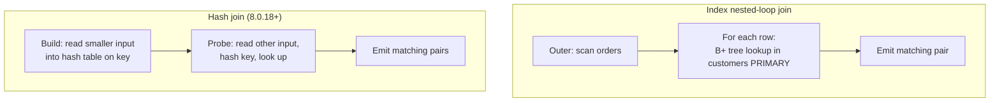

## Introduction

A well-designed relational schema deliberately **spreads facts across tables**. The shop dataset keeps a customer's name in `customers`, each order's date and status in `orders`, and each purchased product in `order_items`. That design avoids redundancy (Module 6 explains why), but it means that almost every useful question needs data from **more than one table**:

- "Show each order together with the name of the customer who placed it."
- "Which products were bought, and in which category is each one?"
- "What is our revenue per customer state?"

The **join** is the operator that answers these questions. It takes two tables and produces a new table whose rows **combine** a row from the left input with a row from the right input — but only for those pairs that satisfy a **join predicate**, such as `orders.customer_id = customers.customer_id`.

This lesson covers the **inner join**, the most common kind: it returns only the pairs that match. You will learn

- what the join predicate is and how `ON`, `USING` and `NATURAL` express it (and why `NATURAL JOIN` is a trap);
- why an inner join can **drop** rows (no partner) and **multiply** rows (several partners) — the single most important fact for writing correct reports;
- how MySQL physically executes a join with **nested-loop** and **hash join** algorithms, and how to see which one it picked with `EXPLAIN FORMAT=TREE`.

The next lesson, [Outer Joins](/lessons/m04-outer-joins), keeps the rows that an inner join drops.

:::note[Dataset]
The examples use the **shop** dataset (25 customers, 80 orders, 182 order items, 30 products, 10 categories). Five customers have never ordered, and one product (the gift card) has no category — these "unmatched" rows are exactly what makes join behaviour visible. Every output below was captured on a real MySQL server.
:::

## DBMS Theory

:::theory[The join in relational algebra]
The **Cartesian product** R × S pairs every tuple of R with every tuple of S, so |R × S| = |R| · |S|. A **theta join** is a product followed by a selection on a predicate θ:

> R ⋈<sub>θ</sub> S = σ<sub>θ</sub>(R × S)

When θ contains only equality comparisons (R.a = S.b) it is an **equi-join** — the overwhelmingly common case, typically following a foreign key to the primary key it references. A **natural join** R ⋈ S is the equi-join on *all attributes with the same name*, with each shared attribute kept only once in the output.
:::

This definition is the **logical meaning** of a join, not how a database computes it. No serious engine builds the full product and then filters it — for two tables of a million rows that would be 10¹² pairs. Physical algorithms (below) produce exactly the pairs that σ<sub>θ</sub>(R × S) would keep, but much more cheaply.

Four theoretical properties matter in practice:

1. **The join predicate decides which pairs survive.** It can be any boolean expression: equality on keys (equi-join), a range (`o.order_date BETWEEN p.start AND p.end`, a *non-equi join*, covered in [Multi-Table Joins](/lessons/m04-multi-table-joins)), or a combination.
2. **Inner joins are commutative and associative.** R ⋈ S = S ⋈ R and (R ⋈ S) ⋈ T = R ⋈ (S ⋈ T), apart from column order. This freedom is what lets the optimizer pick the **join order** — the order in which you write tables in `FROM` is not the order in which they are read.
3. **Cardinality is bounded by 0 ≤ |R ⋈ S| ≤ |R| · |S|.** Where a result lands in that range depends on how many partners each row has.
4. **SQL joins operate on bags.** If a customer has three orders, the customer's row appears three times in `customers ⋈ orders`. Duplicates are not removed unless you ask for `DISTINCT`.

### Join cardinality: rows can disappear and rows can multiply

For an equi-join on a key, think about each row's **number of partners** on the other side:

| Partners for a row | Effect on the inner join result |
|---|---|
| 0 | The row **disappears** (it has nobody to pair with) |
| exactly 1 | The row appears **once** |
| k > 1 | The row appears **k times**, once per partner |

When you join a child table to its parent along a `NOT NULL` foreign key (`orders.customer_id → customers.customer_id`), every child row has exactly one parent, so the result has **exactly as many rows as the child table**. When you go the other way and think "one row per customer", you get one row *per order* instead — customers with several orders are repeated and customers with none vanish. This **row multiplication** (also called *fan-out*) is harmless when you only display rows, but it silently inflates `SUM` and `COUNT` if you aggregate a column of the "one" side. [Multi-Table Joins](/lessons/m04-multi-table-joins) is devoted to that trap.

## Why It Exists

Normalization splits data so that each fact is stored once: a customer's email lives in one row, not copied into each of their 8 orders. Without joins, that design would be unusable — and the alternatives all have real costs:

- **Denormalize everything into one wide table.** Every order row repeats the customer's name, email and city. Updating an email means updating many rows, and missing one leaves the database contradicting itself (an *update anomaly*).
- **Join in the application ("N + 1 queries").** Fetch 80 orders, then run one query per order to fetch its customer. That is 81 network round trips instead of one, and the application re-implements, badly, what the database's join algorithms do with indexes and memory next to the data. ORMs that lazily load relationships produce exactly this pattern; it is one of the most common performance bugs in web applications.
- **Ship whole tables to the client and match them there.** This transfers every row even when only a few are needed and loses transactional consistency between the two reads.

The join exists so that data can be **stored normalized and read combined**, in one declarative statement, with the optimizer choosing how to match rows efficiently.

## Internal Working

:::internals[Physical join algorithms — general theory]
Databases implement the logical join with a handful of physical algorithms:

- **Nested-loop join (NLJ).** For each row of the *outer* (driving) input, scan the *inner* input for matching rows. Cost ≈ |outer| × cost of one inner search. Without an index the inner search is a full scan (|R| · |S| comparisons); with an index on the inner join column it becomes one B+ tree lookup per outer row — an **index nested-loop join**, the workhorse of OLTP systems.
- **Hash join.** *Build* an in-memory hash table on the join key of one input (ideally the smaller), then *probe* it with each row of the other input. Cost ≈ |R| + |S| for equi-joins, no index needed, but it needs memory and works only for equality predicates as the hash key.
- **Sort-merge join.** Sort both inputs on the key and merge them. Common in PostgreSQL, Oracle and SQL Server; **MySQL does not implement it**.
:::

### What MySQL actually uses

Since MySQL 8.0 the executor is a tree of **iterators**; a join is an iterator with two children that pulls rows from them. MySQL chooses between two join iterators:

| Iterator in `EXPLAIN FORMAT=TREE` | Algorithm | When MySQL uses it |
|---|---|---|
| `Nested loop inner join` | (Index) nested-loop join | The inner table can be searched efficiently — usually through an index on the join column (`Index lookup`, `Single-row index lookup` on a primary/unique key) |
| `Inner hash join` | Hash join | Since **8.0.18** for equi-joins where no index is usable on the inner side; since **8.0.20** it also replaces the old **Block Nested-Loop (BNL)** algorithm entirely, including for joins with no equality condition at all |

The hash join reads the **build input** (shown under the `Hash` node) into a hash table held in the join buffer (sized by the session variable `join_buffer_size`, 256 KB by default). It then reads the **probe input** (the other child) row by row, hashes its key and looks up matches. If the build input does not fit in memory, MySQL partitions both inputs into chunk files on disk and joins chunk by chunk — slower, but it still works.



:::version[Join algorithms across versions]
- **Before 8.0.18:** nested-loop and Block Nested-Loop (BNL, which buffered outer rows to reduce inner scans).
- **8.0.18:** hash join introduced for inner equi-joins without usable indexes.
- **8.0.20 and later (including 8.4 LTS):** BNL is removed; hash join is used wherever BNL used to be, also for outer joins, semijoins, antijoins and joins with no equality condition. The `hash_join` flag of `optimizer_switch` has had no effect since 8.0.19; hash joins are controlled with the `BNL` / `NO_BNL` optimizer hints or the `block_nested_loop` optimizer switch flag.
- **Batched Key Access (BKA)** exists but is off by default (`batched_key_access=off`).
:::

## MySQL Implementation

The basic form names both tables and the join predicate:

```sql
SELECT select_list
FROM   left_table  [AS] l
[INNER] JOIN right_table [AS] r
       ON join_condition          -- or: USING (col [, col ...])
[WHERE  row_filter];
```

To see join behaviour clearly, start with two tiny tables. `j_customers` has a customer (Dev) with no orders; `j_orders` has two orders for Ana (a **duplicate key** on the right) and an order for customer 9, who does not exist (an orphan — possible here because the demo table has no foreign key):

```sql run
CREATE TABLE j_customers (
  customer_id INT PRIMARY KEY,
  name        VARCHAR(20) NOT NULL
);
CREATE TABLE j_orders (
  order_id    INT PRIMARY KEY,
  customer_id INT NOT NULL,
  amount      DECIMAL(8,2) NOT NULL
);
INSERT INTO j_customers VALUES (1, 'Ana'), (2, 'Ben'), (3, 'Chen'), (4, 'Dev');
INSERT INTO j_orders VALUES (101, 1, 50.00), (102, 1, 20.00), (103, 2, 35.00), (104, 3, 80.00), (105, 9, 15.00);
SELECT * FROM j_customers ORDER BY customer_id;
```

Use the visualization to watch the matching: each left row is compared with each right row, and only pairs whose keys are equal are emitted.

```viz
type: join
left:
  name: j_customers
  columns: [customer_id, name]
  rows: [[1, Ana], [2, Ben], [3, Chen], [4, Dev]]
right:
  name: j_orders
  columns: [order_id, customer_id, amount]
  rows: [[101, 1, 50.00], [102, 1, 20.00], [103, 2, 35.00], [104, 3, 80.00], [105, 9, 15.00]]
leftKey: customer_id
rightKey: customer_id
types: [inner, cross]
```

Now run the same join in MySQL:

```sql run
SELECT c.customer_id, c.name, o.order_id, o.amount
FROM j_customers AS c
INNER JOIN j_orders AS o
        ON o.customer_id = c.customer_id
ORDER BY o.order_id;
```

Four rows: Ana appears **twice** (she has two orders), Ben and Chen once each, Dev **not at all** (no orders), and order 105 is gone too (no customer 9). Four customers and five orders produced four rows — neither input's row count.

On the real shop schema, the same pattern lists orders with customer names. Because `orders.customer_id` is a `NOT NULL` foreign key, every order has exactly one customer:

```sql run
SELECT o.order_id, o.order_date, o.status, c.first_name, c.last_name
FROM orders AS o
JOIN customers AS c ON c.customer_id = o.customer_id
ORDER BY o.order_id
LIMIT 8;
```

```sql run
SELECT (SELECT COUNT(*) FROM orders)    AS orders,
       (SELECT COUNT(*) FROM customers) AS customers,
       COUNT(*)                         AS joined_rows,
       COUNT(DISTINCT c.customer_id)    AS customers_in_result
FROM orders AS o
JOIN customers AS c ON c.customer_id = o.customer_id;
```

The join result has exactly one row per order (child → parent along a NOT NULL foreign key), but only 20 of the 25 customers appear in it: the five customers who never ordered have no partner and are dropped by the inner join.

## Syntax Breakdown

| Component | Meaning |
|---|---|
| `JOIN` / `INNER JOIN` | Identical. `INNER` is optional noise in both standard SQL and MySQL. |
| `ON condition` | The join predicate: any boolean expression over columns of the tables joined so far. Usually `child.fk = parent.pk`; may include extra conditions with `AND`. |
| `USING (c1, c2…)` | Shorthand for `ON l.c1 = r.c1 AND l.c2 = r.c2` when the columns have the **same name** in both tables. In `SELECT *` the `USING` columns appear **once** (coalesced), and you may refer to them unqualified. |
| `NATURAL JOIN` | Implicit `USING` over **every** column name the two tables share. Breaks silently when someone adds a same-named column (see below). |
| `CROSS JOIN` | Cartesian product. In MySQL, `JOIN`, `INNER JOIN` and `CROSS JOIN` are syntactic equivalents; `JOIN` without `ON`/`USING` is a cross join (a MySQL extension — standard SQL requires a condition for `INNER JOIN`). |
| `FROM a, b WHERE a.x = b.y` | The older "comma join" (SQL-89). Same result as an inner join; the comma has **lower precedence** than `JOIN`, which causes error 1054 when mixed with explicit joins. Prefer explicit `JOIN … ON`. |
| `AS alias` | A correlation name. Once a table has an alias, refer to it **only** by the alias. Required when the same table appears twice (self join). |
| `table.column` | Qualification. Mandatory when a column name exists in more than one joined table (otherwise error 1052, *ambiguous*). Good practice for every column in a join query. |
| `STRAIGHT_JOIN` | MySQL extension that forces the left table to be read before the right one. Covered in [Multi-Table Joins](/lessons/m04-multi-table-joins). |

:::standard[Standard SQL vs MySQL]
`INNER JOIN … ON`, `USING`, `NATURAL JOIN` and `CROSS JOIN` are standard SQL-92. MySQL extensions: `JOIN` without a condition acting as `CROSS JOIN`, `INNER JOIN` without `ON`, `STRAIGHT_JOIN`, and index hints such as `IGNORE INDEX` in the table reference. Portable code always writes `JOIN … ON` or `CROSS JOIN` explicitly.
:::

### ON versus USING

`USING` only works when the column names match, and it changes how `SELECT *` looks:

```sql run
SELECT *
FROM order_items
JOIN products USING (product_id)
ORDER BY order_id, product_id
LIMIT 3;
```

`product_id` appears once, first, followed by the remaining columns of `order_items` and then of `products`. With `ON order_items.product_id = products.product_id`, `SELECT *` would show `product_id` twice.

## Practical Examples

**1. Line items with product names.** Join the child (`order_items`) to its parent (`products`) and compute a line total:

```sql run
SELECT oi.order_id, p.name AS product, oi.quantity, oi.unit_price,
       oi.quantity * oi.unit_price AS line_total
FROM order_items AS oi
JOIN products AS p ON p.product_id = oi.product_id
WHERE oi.order_id IN (2, 3)
ORDER BY oi.order_id, p.name;
```

**2. Extra conditions in the join.** For an **inner** join, a condition in `ON` and the same condition in `WHERE` produce the same result — the inner join keeps a pair only if *all* conditions hold, wherever they are written. (This equivalence breaks for outer joins; that is the central topic of the next lesson.)

```sql run
SELECT COUNT(*) AS in_on
FROM orders o JOIN customers c ON c.customer_id = o.customer_id AND c.state = 'CA';
```

```sql run
SELECT COUNT(*) AS in_where
FROM orders o JOIN customers c ON c.customer_id = o.customer_id
WHERE c.state = 'CA';
```

Style convention: put the **relationship** in `ON` and **row filters** in `WHERE`. The optimizer treats them identically for inner joins, and humans read the query faster.

**3. The NATURAL JOIN trap.** `products` and `categories` both have a `category_id` column — and both have a `name` column. `NATURAL JOIN` joins on **both**, so it looks for products whose name equals their category's name:

```sql run
SELECT COUNT(*) AS natural_rows
FROM products NATURAL JOIN categories;
```

```sql run
SELECT COUNT(*) AS correct_rows
FROM products AS p
JOIN categories AS c ON c.category_id = p.category_id;
```

Zero rows versus 29 rows. Nothing errors; the report is simply empty. Worse, a `NATURAL JOIN` that works today breaks the day someone adds a `created_at` or `updated_at` column to both tables. Never use `NATURAL JOIN` in production code. And notice the 29: there are 30 products, but the gift card has `category_id IS NULL`, and `NULL = anything` is never true, so the inner join drops it.

**4. Joining and aggregating.** Revenue per customer state needs three tables (`customers` → `orders` → `order_items`). Each line item belongs to exactly one order, which belongs to exactly one customer, so no row is multiplied incorrectly — we aggregate the "many" side:

```sql run
SELECT c.state,
       COUNT(DISTINCT o.order_id)          AS orders,
       SUM(oi.quantity * oi.unit_price)    AS item_revenue
FROM customers AS c
JOIN orders AS o       ON o.customer_id = c.customer_id
JOIN order_items AS oi ON oi.order_id   = o.order_id
WHERE o.status IN ('paid', 'shipped', 'delivered')
GROUP BY c.state
ORDER BY item_revenue DESC;
```

`COUNT(DISTINCT o.order_id)` is needed because the join produced one row per *line item*; `COUNT(*)` would count items, not orders. This is row multiplication in action.

**5. Which join column?** Joining on the wrong pair of columns rarely fails — it returns plausible-looking garbage. `o.order_id = c.customer_id` is type-compatible and returns rows:

```sql run
SELECT COUNT(*) AS rows_from_wrong_predicate
FROM orders o JOIN customers c ON c.customer_id = o.order_id;
```

25 rows — orders 1 to 25 paired with customers 1 to 25 by coincidence of numbering. The only defences are naming discipline (`customer_id` everywhere, never a bare `id`), foreign keys documented in the schema, and sanity checks on row counts.

## Execution Walkthrough

The walkthrough traces the **logical** definition σ<sub>θ</sub>(R × S) on the demo tables, then shows what MySQL physically does instead.

```walkthrough
title: SELECT c.name, o.order_id, o.amount FROM j_customers c JOIN j_orders o ON o.customer_id = c.customer_id
steps:
  - title: "1. Left input — j_customers"
    explain: Four customers. Dev (4) will turn out to have no partner.
    sql: SELECT * FROM j_customers ORDER BY customer_id;
  - title: "2. Right input — j_orders"
    explain: Five orders. Customer 1 occurs twice (a duplicate key on the right); customer 9 does not exist on the left.
    sql: SELECT * FROM j_orders ORDER BY order_id;
  - title: "3. Logical step — the Cartesian product R × S"
    explain: >-
      Conceptually, every customer is paired with every order: 4 × 5 = 20 pairs. The column `matches` evaluates
      the join predicate for each pair (1 = true, 0 = false). No engine materializes this; it only defines which
      pairs belong in the answer.
    sql: |
      SELECT c.customer_id AS c_id, c.name, o.order_id, o.customer_id AS o_cust,
             (o.customer_id = c.customer_id) AS matches
      FROM j_customers c CROSS JOIN j_orders o
      ORDER BY c.customer_id, o.order_id;
  - title: "4. Selection σ — keep pairs where the predicate is true"
    explain: >-
      Only 4 of the 20 pairs satisfy o.customer_id = c.customer_id. Ana keeps two pairs (row multiplication),
      Dev keeps none (row loss), and order 105 never matched anyone.
    sql: |
      SELECT c.customer_id AS c_id, c.name, o.order_id, o.customer_id AS o_cust
      FROM j_customers c CROSS JOIN j_orders o
      WHERE o.customer_id = c.customer_id
      ORDER BY o.order_id;
  - title: "5. Projection π — the requested columns"
    explain: The SELECT list is evaluated for each surviving pair. This is the final result of the inner join.
    sql: |
      SELECT c.name, o.order_id, o.amount
      FROM j_customers c JOIN j_orders o ON o.customer_id = c.customer_id
      ORDER BY o.order_id;
```

### What MySQL really does — nested loop with an index lookup

Execution plans depend on **index statistics**. InnoDB computes them in the background after a table is loaded, so in a freshly reset lab they may not be settled yet and plans can vary from run to run. `ANALYZE TABLE` recomputes them now, which makes the plans below reproducible (statistics are covered in depth in Module 7):

```sql run
ANALYZE TABLE j_customers, j_orders, customers, orders;
```

Ask MySQL for the plan it actually executes:

```sql run
EXPLAIN FORMAT=TREE
SELECT c.name, o.order_id, o.amount
FROM j_customers c JOIN j_orders o ON o.customer_id = c.customer_id;
```

Read the tree from the inside out. The optimizer **reversed** the order written in the query: it scans `j_orders` (the outer loop) and, for each order, performs a **single-row index lookup** on the primary key of `j_customers`. That is an index nested-loop join; no Cartesian product exists anywhere. Driving from `j_orders` is cheap because each order needs at most one probe into a unique key, whereas driving from `j_customers` would need a search of `j_orders.customer_id`, which has no index.

### When no index is usable — hash join

To see the hash join, tell MySQL to pretend the primary key does not exist (`IGNORE INDEX` is a MySQL index hint):

```sql run
EXPLAIN FORMAT=TREE
SELECT c.name, o.order_id, o.amount
FROM j_customers AS c IGNORE INDEX (PRIMARY)
JOIN j_orders AS o ON o.customer_id = c.customer_id;
```

Now the plan is `Inner hash join (o.customer_id = c.customer_id)`. The child under `Hash` — the table scan on `c` — is the **build input**: its four rows are loaded into a hash table keyed on `customer_id`. The other child — the scan on `o` — is the **probe input**: each order's `customer_id` is hashed and looked up. Each table is read exactly once.

The `NO_BNL` hint disables hash join for the named tables; with no index available, MySQL must fall back to a plain nested loop that rescans the inner table for every outer row:

```sql run
EXPLAIN FORMAT=TREE
SELECT /*+ NO_BNL(c, o) */ c.name, o.order_id, o.amount
FROM j_customers AS c IGNORE INDEX (PRIMARY)
JOIN j_orders AS o ON o.customer_id = c.customer_id;
```

`Nested loop inner join` with a `Filter` over a full `Table scan on o` *inside* the loop: for every customer, all orders are scanned and filtered. With 4 × 5 rows that is trivial; with 10⁶ × 10⁶ rows it is 10¹² comparisons, which is why MySQL prefers hash join whenever no index applies.

On the full shop tables, the foreign key index on `orders.customer_id` is what the optimizer uses:

```sql run
EXPLAIN FORMAT=TREE
SELECT c.last_name, o.order_id
FROM customers c JOIN orders o ON o.customer_id = c.customer_id;
```

Here the optimizer drives from `customers` (a table scan of 25 rows) and, for each customer, performs a **covering index lookup** on `idx_orders_customer` — the index InnoDB keeps on the foreign key column. "Covering" means the index alone contains every column the query needs from `orders` (`customer_id` and, implicitly in every InnoDB secondary index, the primary key `order_id`), so no row in the clustered index has to be fetched. The `rows=4` estimate is the average number of orders per customer.

## Output

The final result of the walkthrough query has **four rows** although the inputs have four and five rows. Reading an inner join result correctly means asking three questions:

1. **Which rows disappeared?** Rows with no partner: Dev on the left, order 105 on the right. If "every customer" mattered, an inner join was the wrong tool — use a `LEFT JOIN`.
2. **Which rows were repeated?** Rows with several partners: Ana appears once per order. If the report is "per customer", aggregate (`GROUP BY c.customer_id`) or use `EXISTS` (later in this module).
3. **What is the grain?** The grain of a join result is "one row per matching pair". Here: one row per order that has a known customer.

```sql run
SELECT c.name, COUNT(*) AS orders, SUM(o.amount) AS total
FROM j_customers c JOIN j_orders o ON o.customer_id = c.customer_id
GROUP BY c.customer_id, c.name
ORDER BY c.customer_id;
```

Grouping by customer turns the pair-grain result back into one row per customer — but only for customers who had at least one order. Dev is still missing because the inner join removed him before grouping.

## Alternative Approaches

"List orders with the customer's last name" can be written several ways:

```sql run
-- A: explicit inner join (preferred)
SELECT o.order_id, c.last_name
FROM orders o JOIN customers c ON c.customer_id = o.customer_id
WHERE o.status = 'refunded'
ORDER BY o.order_id;
```

```sql run
-- B: comma join with the predicate in WHERE (legacy SQL-89 style, same result)
SELECT o.order_id, c.last_name
FROM orders o, customers c
WHERE c.customer_id = o.customer_id AND o.status = 'refunded'
ORDER BY o.order_id;
```

```sql run
-- C: scalar subquery in the SELECT list (one lookup per order)
SELECT o.order_id,
       (SELECT c.last_name FROM customers c WHERE c.customer_id = o.customer_id) AS last_name
FROM orders o
WHERE o.status = 'refunded'
ORDER BY o.order_id;
```

| Approach | When it fits | Trade-off |
|---|---|---|
| A — `JOIN … ON` | Default for combining columns from related tables | None; the optimizer can reorder and choose algorithms freely |
| B — comma join | Reading legacy code | Easy to forget a predicate (accidental Cartesian product); mixes relationship and filters; precedence surprises when mixed with `JOIN` |
| C — scalar subquery | Fetching *one* value per row; behaves like a LEFT JOIN (NULL if no match) | Must return at most one row (else error 1242); historically evaluated per row — see [Subqueries](/lessons/m04-subqueries) |
| `WHERE x IN (SELECT …)` / `EXISTS` | You only need to **filter** by the existence of a match, not show its columns | Does not multiply rows — see [EXISTS and IN](/lessons/m04-exists-in) |
| Join in application code | Data lives in different databases/services | Network round trips (N + 1), no transactional consistency |

Option C returns the same rows here because every order has a customer. If a key had no match, the join would drop the row whereas the scalar subquery would keep it with `NULL` — the two are **not** interchangeable in general.

## Performance Analysis

The cost of a join is dominated by **how the inner side is searched**:

| Situation | Plan you will see | Work done |
|---|---|---|
| Index on the inner join column (e.g. FK index, PK) | `Nested loop inner join` + `Index lookup` / `Single-row index lookup` | One B+ tree descent per outer row: ≈ outer rows × log(inner rows) |
| Equi-join, no usable index | `Inner hash join` | Read both inputs once + hash-table memory; may spill to disk when the build input exceeds `join_buffer_size` |
| No equality predicate at all | `Inner hash join (no condition)` + `Filter` (8.0.20+) | All pairs are generated and filtered: \|R\| · \|S\| |
| `NO_BNL` and no index | `Nested loop` over full scans | \|R\| · \|S\| row reads — avoid |

InnoDB **requires an index on foreign key columns** and creates one automatically if you do not, so joins along declared foreign keys normally have an index on the child side (`idx_orders_customer` here). Joins on undeclared relationships (e.g. matching `email` columns between systems) are where missing indexes hurt.

To measure rather than estimate, use `EXPLAIN ANALYZE` (Module 7), which runs the query and reports actual rows and time per iterator:

```sql run measured
EXPLAIN ANALYZE
SELECT c.state, COUNT(*) AS orders
FROM customers c JOIN orders o ON o.customer_id = c.customer_id
GROUP BY c.state;
```

In the captured plan the optimizer chose the opposite join order from the previous `EXPLAIN`: it scans `idx_orders_customer` (80 entries) and does a single-row primary-key lookup on `customers` for each — `loops=80` on the inner lookup is the nested loop made visible. The `Aggregate using temporary table` node then groups the 80 joined rows into 5 states. Same tables, same join predicate, different query shape — and a different, equally valid, join order.

:::performance[Theory vs measurement]
On the shop dataset every join finishes in well under a millisecond, so timings carry no information — read the **shape** of the plan (which table drives, which lookups use indexes, where a hash join appears). The `rows=` estimates in `EXPLAIN` come from index statistics and can differ from the `actual rows=` in `EXPLAIN ANALYZE`. A nested-loop join's cost is roughly proportional to the outer row count, so the optimizer tries to drive from the input with fewer rows after filtering. Module 7 ([Optimizing Joins](/lessons/m07-optimizing-joins)) studies join order and indexing on large generated data.
:::

## Best Practices

:::best-practice[Writing joins professionally]
1. **Always write explicit `JOIN … ON`.** Keep relationships in `ON` and filters in `WHERE`; never use comma joins in new code.
2. **Never use `NATURAL JOIN`.** Use `USING` only when you control both schemas and the column really has the same meaning in both.
3. **Alias every table and qualify every column** (`o.order_id`, `c.last_name`). It prevents error 1052 today and silent ambiguity when a column is added tomorrow.
4. **Know the grain of your result.** Before aggregating, ask "one row per *what*?" A join from parent to child changes the grain to the child.
5. **Check row counts** when developing a new join: compare `COUNT(*)` of the join with the counts of its inputs. Unexpected growth means a missing or wrong predicate; unexpected loss means unmatched keys or NULLs.
6. **Index the join columns** of the inner (looked-up) side, and join on columns of identical type and collation — a type or collation mismatch can make an index unusable.
7. **Read the plan** with `EXPLAIN FORMAT=TREE` for any join that will run frequently or on large tables.
:::

## Common Mistakes

**Mistake 1 — unqualified column that exists in both tables.** Both `orders` and `customers` have `customer_id`:

```sql run error
SELECT customer_id, order_id, last_name
FROM orders JOIN customers ON customers.customer_id = orders.customer_id;
```

Error 1052: MySQL refuses to guess. Qualify it: `SELECT o.customer_id, …`.

**Mistake 2 — forgetting the join predicate.** In MySQL, `JOIN` without `ON` is a cross join, so this runs and returns every customer paired with every order:

```sql run
SELECT COUNT(*) AS accidental_cartesian_rows
FROM orders JOIN customers;
```

80 × 25 = 2,000 rows. On production tables this can be billions of rows and an outage.

**Mistake 3 — referring to a table by its name after aliasing it.**

```sql run error
SELECT orders.order_id, c.last_name
FROM orders AS o JOIN customers AS c ON c.customer_id = o.customer_id;
```

Error 1054: once `orders` is aliased `o`, the name `orders` is no longer visible in that query block.

**Mistake 4 — NATURAL JOIN on tables that share more columns than you think** (shown above: 0 rows instead of 29).

**Mistake 5 — counting the wrong thing after a join.** "How many customers placed an order?" answered with `COUNT(*)` over `customers JOIN orders` returns the number of **orders**:

```sql run
SELECT COUNT(*) AS wrong_customer_count,
       COUNT(DISTINCT c.customer_id) AS right_customer_count
FROM customers c JOIN orders o ON o.customer_id = c.customer_id;
```

## Industry Application

- **OLTP request paths.** A product page joins `products` to `categories`, inventory and price tables by primary key; an order-history page joins `orders` to `order_items` and `products`. These are index nested-loop joins touching a handful of rows — the plan must show index lookups on every inner table, and teams check that in code review for hot queries.
- **ORMs and the N + 1 problem.** Frameworks such as Django, Rails or Hibernate lazily load relationships, turning one join into hundreds of queries. Professional teams enable eager loading (which generates `JOIN` or `IN (…)` queries) and monitor query counts per request.
- **Star-schema analytics.** In a data warehouse, a large *fact* table (sales) is inner-joined to small *dimension* tables (date, product, store). The fact → dimension joins are child → parent along keys, so the row count stays the fact table's — the same reasoning as orders → customers here. Hash joins on dimension tables are the norm in analytical engines.
- **Data integration.** Matching records between systems (CRM customers to billing accounts) uses joins on business keys such as email. Mismatched collations, trailing spaces or differing types are the usual causes of "missing" matches, and unexpected duplicates on the key cause row multiplication in downstream reports.

## Practice Exercises

Each exercise is graded by comparing your result with the reference solution on a fresh copy of the shop dataset.

```exercise
id: ex1
title: Refunded orders with customer names
difficulty: easy
concepts: [inner-join, join-predicate]
prompt: |
  List every order with status `refunded`. Return columns `order_id`, `order_date`, `first_name`, `last_name`
  (the customer's name), one row per order.
hints:
  - "The customer's name lives in `customers`; `orders.customer_id` references `customers.customer_id`."
  - "JOIN customers c ON c.customer_id = o.customer_id, then filter with WHERE o.status = 'refunded'."
solution: |
  SELECT o.order_id, o.order_date, c.first_name, c.last_name
  FROM orders AS o
  JOIN customers AS c ON c.customer_id = o.customer_id
  WHERE o.status = 'refunded';
explanation: |
  Child → parent along a NOT NULL foreign key: each order has exactly one customer, so the join returns one row
  per refunded order. Putting `o.status = 'refunded'` in `ON` would give the same result for an inner join, but
  `WHERE` expresses "filter" more clearly.
```

```exercise
id: ex2
title: Products per category (avoid the NATURAL JOIN trap)
difficulty: medium
concepts: [inner-join, using-natural]
prompt: |
  For each category that has at least one product, return `category_name` and `products` (the number of products
  directly in that category). Do **not** use NATURAL JOIN — `products` and `categories` both have a `name` column.
hints:
  - "Join products to categories on category_id only."
  - "GROUP BY the category and COUNT the products. Categories without products disappear naturally with an inner join."
solution: |
  SELECT c.name AS category_name, COUNT(*) AS products
  FROM products AS p
  JOIN categories AS c ON c.category_id = p.category_id
  GROUP BY c.category_id, c.name;
explanation: |
  `products NATURAL JOIN categories` joins on both `category_id` and `name`, matching nothing. `USING (category_id)`
  would also be correct. The gift card (NULL category) is excluded because NULL never equals anything, and
  categories with no direct products (e.g. a parent category whose products are all in subcategories) do not
  appear because the inner join keeps only matched pairs.
```

```exercise
id: ex3
title: Revenue per product category
difficulty: medium
concepts: [inner-join, join-cardinality, aggregate-functions]
prompt: |
  Using `order_items`, `products` and `categories`, return `category_name` and `revenue`, where revenue is
  Σ(quantity × unit_price) over **all** order items of products in that category. Order by revenue descending.
hints:
  - "You need two joins: order_items → products → categories."
  - "Use the historical unit_price from order_items, not products.price."
  - "SUM(oi.quantity * oi.unit_price) grouped by the category."
solution: |
  SELECT c.name AS category_name, SUM(oi.quantity * oi.unit_price) AS revenue
  FROM order_items AS oi
  JOIN products   AS p ON p.product_id  = oi.product_id
  JOIN categories AS c ON c.category_id = p.category_id
  GROUP BY c.category_id, c.name
  ORDER BY revenue DESC;
orderMatters: true
explanation: |
  Each order item has one product and each product at most one category, so joining "upwards" never multiplies
  line items — the SUM is correct. Using `p.price` instead of `oi.unit_price` is a classic modelling mistake: the
  catalogue price changes over time, while `unit_price` records what was actually charged. Gift-card sales are
  excluded because the gift card has no category.
```

```exercise
id: ex4
title: Customers who placed orders — count them correctly
difficulty: hard
concepts: [join-cardinality, count-distinct]
prompt: |
  Return one row with columns `customers_with_orders` (number of distinct customers who placed at least one order
  with status `delivered`) and `delivered_orders` (number of delivered orders). Use a join between `customers`
  and `orders`.
hints:
  - "After the join, each row is one (customer, order) pair."
  - "COUNT(*) counts pairs = orders; COUNT(DISTINCT c.customer_id) counts customers."
solution: |
  SELECT COUNT(DISTINCT c.customer_id) AS customers_with_orders,
         COUNT(*)                      AS delivered_orders
  FROM customers AS c
  JOIN orders AS o ON o.customer_id = c.customer_id
  WHERE o.status = 'delivered';
explanation: |
  The join's grain is one row per order, so `COUNT(*)` counts orders. Customers with several delivered orders
  appear several times, so counting customers requires `COUNT(DISTINCT …)`. Reporting `COUNT(*)` as "customers"
  is the row-multiplication mistake from this lesson.
```

```exercise
id: ex5
title: Low ratings with full context
difficulty: challenge
concepts: [inner-join, join-predicate]
prompt: |
  Product managers want every review with a rating of 1 or 2, enriched with context. Return
  `review_id`, `rating`, `customer` (first name, a space, last name), `product` (product name) and
  `category` (category name). Reviews of products without a category should **not** appear.
hints:
  - "Start from reviews and join customers, products and categories — three joins."
  - "CONCAT(c.first_name, ' ', c.last_name) builds the customer name."
  - "An inner join to categories automatically drops products whose category_id is NULL."
solution: |
  SELECT r.review_id, r.rating,
         CONCAT(cu.first_name, ' ', cu.last_name) AS customer,
         p.name  AS product,
         ca.name AS category
  FROM reviews    AS r
  JOIN customers  AS cu ON cu.customer_id = r.customer_id
  JOIN products   AS p  ON p.product_id   = r.product_id
  JOIN categories AS ca ON ca.category_id = p.category_id
  WHERE r.rating <= 2;
explanation: |
  Every join goes from a child to its parent (reviews → customers, reviews → products, products → categories),
  so each review appears at most once. Three tables have a `name`-like column, which is why aliasing (`p.name`,
  `ca.name`) is essential. Note that the join to categories is not just decoration: it filters out uncategorized
  products, exactly as the prompt requires.
```

```exercise
id: ex6
title: Explain the plan
difficulty: medium
kind: open
concepts: [nested-loop-join, hash-join]
prompt: |
  A colleague runs `EXPLAIN FORMAT=TREE` on a join between `events` (50 million rows) and `devices` (20,000 rows)
  on `events.device_serial = devices.serial`, and sees `Inner hash join` with `devices` under the `Hash` node.
  Neither column is indexed. Explain what MySQL does at run time, why it did not choose a nested-loop join, and
  what would change if an index were created on `devices.serial`.
solution: |
  MySQL reads all 20,000 `devices` rows (the build input) into an in-memory hash table keyed on `serial`, then
  scans the 50 million `events` once (the probe input), hashing each `device_serial` and looking up matching
  devices. Each table is read once. A nested-loop join without an index would scan `devices` once per event
  (50M × 20k comparisons), which is why MySQL (8.0.18+, and since 8.0.20 in place of Block Nested-Loop) uses a
  hash join for an equi-join with no usable index. If the build input exceeded `join_buffer_size`, MySQL would
  spill partitions to disk.

  With an index on `devices.serial`, an index nested-loop join becomes possible: scan `events`, and for each row
  do one B+ tree lookup in `devices`. Whether the optimizer switches depends on cost: 50M index lookups may cost
  more than one hash build plus a scan, so the hash join may remain. What changes reliably is the option to
  drive from a *filtered* subset of events (e.g. one day) with cheap lookups, which is where index nested-loop
  joins dominate.
```

## Knowledge Assessment

```quiz
- id: q1
  question: "`j_customers` has 4 rows and `j_orders` has 5 rows. Customer 1 has two orders, customers 2 and 3 have one each, customer 4 has none, and one order references a non-existent customer. How many rows does the inner join on customer_id return?"
  options: ["4", "5", "20", "3"]
  answer: 0
  explanation: "Count matching pairs: customer 1 contributes 2, customers 2 and 3 contribute 1 each, customer 4 contributes 0, and the orphan order matches nobody: 2 + 1 + 1 = 4. 20 is the Cartesian product (no predicate). 5 assumes one row per order, ignoring the orphan. 3 is the number of matching customers, ignoring multiplication."
  concepts: [join-cardinality]
- id: q2
  question: "`products` and `categories` both contain columns `category_id` and `name`. What does `products NATURAL JOIN categories` join on?"
  options: ["category_id only, because it is a foreign key", "name only", "Both category_id and name", "Nothing — NATURAL JOIN requires a USING clause"]
  answer: 2
  explanation: "NATURAL JOIN uses every column name the two tables share; it ignores foreign key declarations. Here that means category_id AND name, so only products whose name equals their category name match — none. NATURAL JOIN never takes a USING clause; it is an implicit USING."
  concepts: [using-natural]
- id: q3
  question: "Which statements about `JOIN … USING (product_id)` in MySQL are true? (Select all that apply.)"
  type: multi
  options:
    - "It is equivalent to ON l.product_id = r.product_id for deciding which rows match"
    - "SELECT * shows product_id only once"
    - "It works even if the right table names the column item_product_id"
    - "It joins on every column the tables have in common"
  answer: [0, 1]
  explanation: "USING lists explicit same-named columns and coalesces them, so SELECT * shows them once. It requires identical names on both sides, and it joins only on the listed columns — joining on all shared columns is NATURAL JOIN."
  concepts: [using-natural, join-predicate]
- id: q4
  question: "EXPLAIN FORMAT=TREE shows `Inner hash join (o.customer_id = c.customer_id)` with `Table scan on c` under a `Hash` node. What is true?"
  options:
    - "c is the probe input and is read once per row of o"
    - "c is the build input: its rows are loaded into a hash table, and o is scanned once to probe it"
    - "MySQL is using a sort-merge join"
    - "The join will return a Cartesian product"
  answer: 1
  explanation: "The child under `Hash` is the build input. The other child is the probe input, read once. MySQL has no sort-merge join. A hash join on an equality predicate returns only matching pairs, not a Cartesian product."
  concepts: [hash-join]
- id: q5
  question: "For an INNER JOIN, moving `AND c.state = 'CA'` from the ON clause to the WHERE clause…"
  options:
    - "changes the result: WHERE keeps unmatched rows"
    - "does not change the result; it is a style choice"
    - "causes error 1054"
    - "turns the join into a cross join"
  answer: 1
  explanation: "An inner join keeps a pair only if all conditions are true, so the conditions' placement does not matter. The placement DOES matter for outer joins (next lesson), which is why the convention 'relationship in ON, filters in WHERE' is worth adopting now."
  concepts: [inner-join, join-predicate]
- id: q6
  question: "In MySQL 8.4, an equi-join has no usable index on either join column. Which physical algorithm will MySQL normally choose?"
  options: ["Block Nested-Loop (BNL)", "Hash join", "Sort-merge join", "Batched Key Access"]
  answer: 1
  explanation: "Hash join (8.0.18+) is used for equi-joins without usable indexes, and since 8.0.20 it has replaced BNL completely. MySQL does not implement sort-merge joins. BKA requires an index on the inner table and is off by default."
  concepts: [hash-join, nested-loop-join]
- id: q7
  question: "A report counts customers with `SELECT COUNT(*) FROM customers c JOIN orders o ON o.customer_id = c.customer_id`. It shows 80 while the CRM says 20 customers have ordered. What is the cause?"
  options:
    - "The join predicate is wrong"
    - "COUNT(*) counts join pairs (one per order); customers with several orders are counted several times"
    - "Five customers have no orders and were counted as zero"
    - "InnoDB's COUNT(*) is approximate"
  answer: 1
  explanation: "Joining parent to child changes the grain to one row per child (order). Use COUNT(DISTINCT c.customer_id). Customers with no orders are not counted at all by an inner join, and InnoDB's COUNT(*) is exact."
  concepts: [join-cardinality, count-distinct]
- id: q8
  question: "Why does `SELECT customer_id FROM orders JOIN customers ON customers.customer_id = orders.customer_id` fail?"
  options:
    - "customer_id is ambiguous because it exists in both tables (error 1052)"
    - "JOIN requires the keyword INNER"
    - "ON cannot reference the table names without aliases"
    - "The join creates a Cartesian product"
  answer: 0
  explanation: "Both tables have customer_id, so the unqualified reference in SELECT is ambiguous. INNER is optional, ON may use table names when no alias is defined, and the predicate prevents a Cartesian product."
  concepts: [join-predicate]
```
