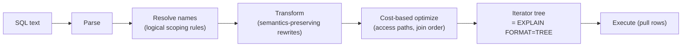

## Introduction

You **write** a `SELECT` statement in this order:

```sql
SELECT … FROM … WHERE … GROUP BY … HAVING … WINDOW … ORDER BY … LIMIT …
```

But SQL **defines its meaning** in a different order: first the rows are assembled (`FROM`), then filtered (`WHERE`), grouped (`GROUP BY`), group-filtered (`HAVING`), windowed, and only *then* is the `SELECT` list computed, duplicates removed, rows sorted and limited. This **logical query processing order** is the single most useful mental model in SQL. It explains, among many other things:

- why `WHERE inv > 1000` fails when `inv` is an alias defined in the `SELECT` list, while `ORDER BY inv` works;
- why aggregates are forbidden in `WHERE` but allowed in `HAVING`;
- why a window function cannot be filtered in `WHERE`;
- why `LIMIT` without `ORDER BY` returns an arbitrary subset;
- why a `LEFT JOIN` followed by a `WHERE` condition on the right table behaves like an inner join.

The second half of the story is just as important: the logical order describes **what** the result must be, not **how** the server computes it. The optimizer is free to push filters into joins, reorder tables, turn subqueries into joins, convert outer joins to inner joins, merge derived tables and read rows in index order to skip sorting — as long as the result is the one the logical order defines. `EXPLAIN FORMAT=TREE` shows that **physical plan**. Professionals keep both pictures in mind: the logical order to write correct SQL, the physical plan to make it fast.

This lesson closes Module 4 by tying together everything you have learned — joins ([Multi-Table Joins](/lessons/m04-multi-table-joins)), grouping ([GROUP BY and HAVING](/lessons/m03-group-by-having)), subqueries, CTEs and window functions — into one processing model.

:::note[Dataset]
The examples use the **shop** dataset (25 customers, 80 orders, 182 line items, 30 products). Every output and plan shown was captured from a real MySQL server.
:::

## DBMS Theory

:::theory[Logical query processing]
The SQL standard defines a query expression's result by a sequence of transformations, each consuming the virtual table produced by the previous step:

| Step | Clause | Input → output |
|---|---|---|
| 1 | `FROM` (with `JOIN … ON`) | base tables → joined virtual table (Cartesian product filtered by ON; outer joins add NULL-extended rows) |
| 2 | `WHERE` | rows → rows satisfying the predicate (TRUE only; FALSE and UNKNOWN are discarded) |
| 3 | `GROUP BY` | rows → one row per group |
| 4 | `HAVING` | groups → groups satisfying the predicate |
| 5 | window functions (`OVER`, `WINDOW`) | rows → same rows + window columns |
| 6 | `SELECT` list | rows → projected expressions; **aliases are assigned here** |
| 7 | `DISTINCT` | rows → duplicate-free rows |
| 8 | set operators (`UNION`, `INTERSECT`, `EXCEPT`) | combine query blocks |
| 9 | `ORDER BY` | rows → ordered rows (can use aliases) |
| 10 | `LIMIT` / `OFFSET` (standard: `FETCH FIRST`) | ordered rows → prefix |

A clause can only refer to names that exist **at its step**. Columns of the `FROM` tables exist from step 1; aggregates exist from step 3; window results from step 5; select-list aliases from step 6.
:::

This is a **semantic** definition — a specification of the result — in the same way relational algebra specifies a query: σ (WHERE) applied to ⋈ (FROM), then γ (GROUP BY with aggregates), σ again (HAVING), π (SELECT), δ (DISTINCT), τ (ORDER BY). The **declarative** nature of SQL means the DBMS may evaluate any algebraically equivalent expression. Classic equivalences the optimizer exploits:

- **Selection pushdown**: σ<sub>p</sub>(R ⋈ S) = σ<sub>p</sub>(R) ⋈ S when *p* refers only to R — filter before joining.
- **Join commutativity and associativity**: R ⋈ S = S ⋈ R; (R ⋈ S) ⋈ T = R ⋈ (S ⋈ T) — choose the cheapest join order.
- **Outer-join simplification**: R ⟕ S followed by σ<sub>p(S)</sub> where *p* rejects NULLs equals R ⋈ S with *p*.
- **Subquery unnesting**: `x IN (SELECT …)` ⇒ semi-join; `NOT EXISTS` ⇒ anti-join.
- **Order-providing access**: τ (ORDER BY) can be skipped if an index delivers rows already in that order.

The step numbering above also shows where MySQL deviates from — or extends — the standard, which the next sections make precise.

:::standard[Standard SQL vs MySQL extensions]
- **`GROUP BY` and `HAVING` may refer to select-list aliases** in MySQL (`GROUP BY cat HAVING n > 3`). Standard SQL does not allow aliases there, because they are defined at step 6. MySQL resolves them as a convenience extension.
- **`ORDER BY` may refer to aliases and to positions** (`ORDER BY 2`) — both standard (positions are deprecated in the standard but supported by MySQL).
- **`WHERE` may never refer to aliases** in MySQL or in standard SQL.
- **Window-function aliases cannot be used in `HAVING`** even in MySQL (error 3594), since windows come after `HAVING`.
- **`LIMIT n OFFSET m`** is MySQL/PostgreSQL syntax; the standard is `OFFSET m ROWS FETCH FIRST n ROWS ONLY`, which MySQL does not accept.
- MySQL has no `QUALIFY` clause (a step 5½ filter on window results that some engines offer).
:::

## Why It Exists

A logical order is needed because SQL is **declarative**: you say what result you want, and the meaning of the statement must be independent of how any particular engine executes it. Without a defined order of evaluation:

- the same query could legitimately return different results on different systems (does `WHERE` see aggregated values or raw rows? does `LIMIT` apply before or after sorting?);
- name resolution would be ambiguous (if `price` is both a column and an alias, which one does `WHERE price > 10` mean?);
- the optimizer would have no specification to preserve when it rewrites a query.

The logical order is therefore the **contract** between the person writing SQL and the optimizer. The writer reasons with it; the optimizer may do anything that is indistinguishable from it. Most SQL errors that puzzle beginners are violations of this contract, and most "the optimizer changed my query" confusions disappear once you separate the logical meaning from the physical plan.

A second, practical reason: knowing the order lets you **put each condition in the right clause**. A filter on raw rows belongs in `WHERE`, where it reduces the rows that are joined, grouped and sorted; a filter on aggregates must go in `HAVING`; a filter on window results must go in an outer query. Putting a raw-row filter in `HAVING` gives the same result but, as you will see, MySQL may evaluate it after doing all the grouping work.

## Internal Working

:::internals[From SQL text to iterator tree]
MySQL processes a statement in phases:

1. **Parse** — SQL text → parse tree (syntax errors such as 1064 happen here).
2. **Resolve / prepare** — names are bound to tables, columns and aliases following the scoping rules of the logical order (error 1054 *Unknown column 'inv' in 'where clause'* happens here); semantic checks such as `ONLY_FULL_GROUP_BY` (error 1055) and illegal window/aggregate placement (errors 1111, 3593, 3594) are enforced.
3. **Transform** — logical rewrites that do not depend on cost: constant folding and caching (`<cache>(10*10)`), outer-join simplification, subquery-to-semijoin conversion, merging of derived tables/views/CTEs, condition pushdown into derived tables, removal of always-true predicates, detection of impossible `WHERE`.
4. **Optimize** — cost-based decisions: access method per table (index range, ref, full scan), join order, join algorithm (nested loop, hash join), whether to sort or use index order, where to attach each filter.
5. **Build the iterator tree** — the physical plan: a tree of iterators (table scan, index lookup, filter, nested-loop join, hash join, aggregate, sort, window, limit…) executed with the Volcano model, each pulling rows from its children.

`EXPLAIN FORMAT=TREE` prints the iterator tree from step 5. The rewritten query after step 3 is available as a **note** after traditional `EXPLAIN` (`SHOW WARNINGS`, code 1003).
:::



The iterator tree is read **bottom-up** (or innermost first): leaves read tables, parents filter, join, aggregate, sort and limit. The physical order of operations is visible in the nesting — and often differs from the logical order: a `WHERE` condition may appear *inside* a join as an index lookup condition, a `LIMIT` may stop a scan early, an `ORDER BY` may disappear because an index already provides the order.

## MySQL Implementation

The animation below steps through the logical order of a grouped query. Press play and watch which clause runs at each step and what it can "see".

```viz
type: query-order
```

**Alias visibility follows from the order.** `inv` is created by the `SELECT` list (step 6). `WHERE` runs at step 2, so the alias does not exist yet:

```sql run error
SELECT name, price * stock_qty AS inv
FROM products
WHERE inv > 100000;
```

`ORDER BY` runs at step 9, after the alias exists:

```sql run
SELECT name, price * stock_qty AS inv
FROM products
WHERE price * stock_qty > 100000
ORDER BY inv DESC;
```

To use the alias in a filter, repeat the expression (as above) or compute it one level down and filter outside — a derived table or CTE makes the alias a real column of the outer query:

```sql run
WITH inventory AS (
  SELECT name, price * stock_qty AS inv FROM products
)
SELECT name, inv FROM inventory
WHERE inv > 100000
ORDER BY inv DESC;
```

**MySQL's extension: aliases in `GROUP BY` and `HAVING`.** MySQL resolves select-list aliases in these clauses too:

```sql run
SELECT category_id AS cat, COUNT(*) AS n
FROM products
GROUP BY cat
HAVING n >= 4
ORDER BY n DESC, cat;
```

The standard would require `GROUP BY category_id HAVING COUNT(*) >= 4`. The extension is convenient but not portable — PostgreSQL accepts aliases in `GROUP BY` but not in `HAVING`; SQL Server accepts neither.

## Syntax Breakdown

What each clause can reference, derived from the logical order (✓ allowed, ✗ error):

| Clause (logical step) | Base columns | Aggregates | Window functions | Select-list aliases |
|---|---|---|---|---|
| `FROM … ON` (1) | ✓ (tables joined so far) | ✗ | ✗ | ✗ |
| `WHERE` (2) | ✓ | ✗ error 1111 | ✗ error 3593 | ✗ error 1054 |
| `GROUP BY` (3) | ✓ | ✗ | ✗ | ✓ MySQL extension |
| `HAVING` (4) | grouped columns (or functionally dependent) | ✓ | ✗ | ✓ MySQL extension (not window aliases: error 3594) |
| window `OVER (…)` (5) | ✓ | ✓ (over grouped rows) | ✗ (no nesting) | ✗ |
| `SELECT` list (6) | ✓ | ✓ | ✓ | ✗ (aliases of the same list are not visible to each other) |
| `ORDER BY` (9) | ✓ (if no `DISTINCT`/`GROUP BY` conflict) | ✓ | ✓ | ✓ (and positions) |
| `LIMIT` (10) | constants / `?` parameters only | — | — | — |

Two rules that follow from the table and surprise people:

- **Aliases are not visible within the same `SELECT` list.** `SELECT price * 2 AS p2, p2 + 1` fails: all select expressions are evaluated "at the same time" at step 6.
- **`ORDER BY` with `DISTINCT`** can only use expressions that are in the select list, because `DISTINCT` (step 7) has already collapsed rows — there is no single value of a non-selected column per remaining row (error 3065).

## Practical Examples

**1. WHERE vs HAVING — same rows, different steps.** Count orders per customer for customers 1–4. Filtering on the grouping column works in either clause:

```sql run
SELECT customer_id, COUNT(*) AS orders
FROM orders
WHERE customer_id < 5
GROUP BY customer_id
ORDER BY customer_id;
```

```sql run
SELECT customer_id, COUNT(*) AS orders
FROM orders
GROUP BY customer_id
HAVING customer_id < 5
ORDER BY customer_id;
```

Identical results — but the plans differ. With `WHERE`, rows are filtered (step 2) before grouping; the filter becomes an index range scan:

```sql run
EXPLAIN FORMAT=TREE
SELECT customer_id, COUNT(*) AS orders FROM orders WHERE customer_id < 5 GROUP BY customer_id;
```

With `HAVING`, the captured plan groups **all** orders and filters the groups afterwards:

```sql run
EXPLAIN FORMAT=TREE
SELECT customer_id, COUNT(*) AS orders FROM orders GROUP BY customer_id HAVING customer_id < 5;
```

The `Filter` sits *above* the `Group aggregate` and the scan reads every index entry. On this server the optimizer did not move the condition into `WHERE`. Rule of thumb: conditions on raw columns go in `WHERE`; `HAVING` is for conditions on aggregates.

**2. Aggregates in WHERE — a step-order error.**

```sql run error
SELECT customer_id
FROM orders
WHERE COUNT(*) > 5
GROUP BY customer_id;
```

Error 1111 (*Invalid use of group function*): aggregates do not exist at step 2. Move the condition to `HAVING`:

```sql run
SELECT customer_id, COUNT(*) AS orders
FROM orders
GROUP BY customer_id
HAVING COUNT(*) > 5
ORDER BY orders DESC, customer_id;
```

**3. Windows come after HAVING, before ORDER BY.** A window over grouped rows can rank groups, and `ORDER BY` can use the window alias — but `HAVING` cannot:

```sql run
SELECT customer_id, COUNT(*) AS orders,
       RANK() OVER (ORDER BY COUNT(*) DESC) AS rnk
FROM orders
GROUP BY customer_id
ORDER BY rnk, customer_id
LIMIT 5;
```

```sql run error
SELECT customer_id, COUNT(*) AS orders,
       RANK() OVER (ORDER BY COUNT(*) DESC) AS rnk
FROM orders
GROUP BY customer_id
HAVING rnk = 1;
```

Error 3594. To filter on `rnk`, wrap the query in a CTE (step 5 results become columns of the outer query's step 1).

**4. DISTINCT and ORDER BY.** `DISTINCT` (step 7) runs before `ORDER BY` (step 9). Sorting distinct categories by a column that was not selected is ambiguous — each category has many prices:

```sql run error
SELECT DISTINCT category_id
FROM products
ORDER BY price;
```

Error 3065. Decide what you mean — e.g. order categories by their cheapest product:

```sql run
SELECT category_id, MIN(price) AS cheapest
FROM products
WHERE category_id IS NOT NULL
GROUP BY category_id
ORDER BY cheapest
LIMIT 5;
```

**5. LIMIT is last — and meaningless without ORDER BY.** `LIMIT` takes a prefix of the *ordered* result. Without `ORDER BY`, the order — and therefore which rows you get — depends on the physical plan:

```sql run
SELECT order_id, order_date FROM orders ORDER BY order_date DESC, order_id DESC LIMIT 3;
```

That query is deterministic. `SELECT order_id FROM orders LIMIT 3` is not: it returns whatever three rows the chosen access path produces first, which can change when an index is added or statistics change.

**6. ON vs WHERE in outer joins — steps 1 and 2.** In a `LEFT JOIN`, the `ON` condition is part of step 1 (it decides which rows match, and unmatched left rows are NULL-extended); `WHERE` is step 2 (it filters the joined rows, including the NULL-extended ones):

```sql run
SELECT c.customer_id, COUNT(o.order_id) AS delivered_orders
FROM customers c
LEFT JOIN orders o ON o.customer_id = c.customer_id AND o.status = 'delivered'
WHERE c.customer_id IN (2, 9, 13, 14)
GROUP BY c.customer_id
ORDER BY c.customer_id;
```

```sql run
SELECT c.customer_id, COUNT(o.order_id) AS delivered_orders
FROM customers c
LEFT JOIN orders o ON o.customer_id = c.customer_id
WHERE c.customer_id IN (2, 9, 13, 14) AND o.status = 'delivered'
GROUP BY c.customer_id
ORDER BY c.customer_id;
```

In the second query `o.status = 'delivered'` is evaluated at step 2 on NULL-extended rows, where it is UNKNOWN — so customers without delivered orders disappear, and the `LEFT JOIN` has effectively become an inner join. [Outer Joins](/lessons/m04-outer-joins) covers this in depth; the optimizer knows it too, as the next section shows.

## Execution Walkthrough

Trace one query through every logical step, materializing each intermediate result with a real query. The question: *for customers in California, how many delivered orders and how much revenue per city, for cities with at least 2 delivered orders, ranked by revenue?*

```walkthrough
title: SELECT c.city, COUNT(DISTINCT o.order_id), SUM(oi.quantity*oi.unit_price) … WHERE c.state='CA' AND o.status='delivered' GROUP BY c.city HAVING COUNT(DISTINCT o.order_id) >= 2 ORDER BY revenue DESC LIMIT 3
steps:
  - title: "1. FROM + JOIN — assemble rows"
    explain: The joined virtual table has one row per (customer, order, line item). Counting it shows the size of the input before any filtering.
    sql: |
      SELECT COUNT(*) AS joined_rows
      FROM customers c
      JOIN orders o       ON o.customer_id = c.customer_id
      JOIN order_items oi ON oi.order_id = o.order_id;
  - title: "2. WHERE — filter rows"
    explain: Only Californian customers' delivered orders remain. Aliases from the SELECT list do not exist yet; the conditions use base columns.
    sql: |
      SELECT c.city, o.order_id, oi.product_id, oi.quantity * oi.unit_price AS line_value
      FROM customers c
      JOIN orders o       ON o.customer_id = c.customer_id
      JOIN order_items oi ON oi.order_id = o.order_id
      WHERE c.state = 'CA' AND o.status = 'delivered'
      ORDER BY c.city, o.order_id, oi.product_id
      LIMIT 12;
  - title: "3. GROUP BY — one row per city"
    explain: Rows are partitioned by city and the aggregates are computed per group. COUNT(DISTINCT order_id) is needed because each order appears once per line item (fan-out).
    sql: |
      SELECT c.city, COUNT(DISTINCT o.order_id) AS delivered_orders,
             SUM(oi.quantity * oi.unit_price) AS revenue
      FROM customers c
      JOIN orders o       ON o.customer_id = c.customer_id
      JOIN order_items oi ON oi.order_id = o.order_id
      WHERE c.state = 'CA' AND o.status = 'delivered'
      GROUP BY c.city
      ORDER BY c.city;
  - title: "4. HAVING — filter groups"
    explain: Groups with fewer than two delivered orders are removed. HAVING can use aggregates (and, in MySQL, select-list aliases).
    sql: |
      SELECT c.city, COUNT(DISTINCT o.order_id) AS delivered_orders,
             SUM(oi.quantity * oi.unit_price) AS revenue
      FROM customers c
      JOIN orders o       ON o.customer_id = c.customer_id
      JOIN order_items oi ON oi.order_id = o.order_id
      WHERE c.state = 'CA' AND o.status = 'delivered'
      GROUP BY c.city
      HAVING delivered_orders >= 2
      ORDER BY c.city;
  - title: "5–6. Window and SELECT — compute output columns"
    explain: The window function ranks the remaining groups by revenue; then the select list is projected and aliases (revenue, revenue_rank) come into existence.
    sql: |
      SELECT c.city, COUNT(DISTINCT o.order_id) AS delivered_orders,
             SUM(oi.quantity * oi.unit_price) AS revenue,
             RANK() OVER (ORDER BY SUM(oi.quantity * oi.unit_price) DESC) AS revenue_rank
      FROM customers c
      JOIN orders o       ON o.customer_id = c.customer_id
      JOIN order_items oi ON oi.order_id = o.order_id
      WHERE c.state = 'CA' AND o.status = 'delivered'
      GROUP BY c.city
      HAVING delivered_orders >= 2
      ORDER BY c.city;
  - title: "9–10. ORDER BY and LIMIT"
    explain: ORDER BY can use the alias revenue because it runs after SELECT; LIMIT keeps the first rows of the ordered result.
    sql: |
      SELECT c.city, COUNT(DISTINCT o.order_id) AS delivered_orders,
             SUM(oi.quantity * oi.unit_price) AS revenue
      FROM customers c
      JOIN orders o       ON o.customer_id = c.customer_id
      JOIN order_items oi ON oi.order_id = o.order_id
      WHERE c.state = 'CA' AND o.status = 'delivered'
      GROUP BY c.city
      HAVING delivered_orders >= 2
      ORDER BY revenue DESC
      LIMIT 3;
  - title: "Physical plan — what MySQL actually does"
    explain: >-
      The iterator tree does not follow steps 1–10 literally. Read it bottom-up: the WHERE conditions are attached
      to the individual table accesses inside the join (selection pushdown), the join order is chosen by cost,
      and the HAVING filter, sort and limit sit on top of the aggregation. Note one purely physical trick: the
      Californian customers are sorted by city before the join, so the joined rows arrive grouped by city and the
      Group aggregate can stream without a temporary table.
    sql: |
      EXPLAIN FORMAT=TREE
      SELECT c.city, COUNT(DISTINCT o.order_id) AS delivered_orders,
             SUM(oi.quantity * oi.unit_price) AS revenue
      FROM customers c
      JOIN orders o       ON o.customer_id = c.customer_id
      JOIN order_items oi ON oi.order_id = o.order_id
      WHERE c.state = 'CA' AND o.status = 'delivered'
      GROUP BY c.city
      HAVING delivered_orders >= 2
      ORDER BY revenue DESC
      LIMIT 3;
```

## Output

The final result lists the Californian cities with at least two delivered orders, highest revenue first: only San Jose and San Francisco qualify (Los Angeles has a single delivered order and was removed by `HAVING`), so `LIMIT 3` returns two rows. Compare the walkthrough's step 1 (the full join) with step 2 (after `WHERE`) and step 3 (one row per city): the logical model says the database builds the entire join and then filters it. The physical plan in the last step shows it does nothing of the sort — the state and status filters are applied while reading `customers` and `orders`, so the full join is never materialized. Same result, far less work. That distinction is the subject of the next two sections.

## Alternative Approaches

When you need a select-list alias (or a window result) in a filter, there are three ways to respect the logical order:

```sql run
-- A: repeat the expression in WHERE
SELECT name, price * stock_qty AS inv FROM products
WHERE price * stock_qty > 100000
ORDER BY inv DESC;
```

```sql run
-- B: derived table — the alias becomes a column of the outer query
SELECT name, inv
FROM (SELECT name, price * stock_qty AS inv FROM products) AS t
WHERE inv > 100000
ORDER BY inv DESC;
```

```sql run
-- C: CTE — same as B, more readable for multi-step logic
WITH t AS (SELECT name, price * stock_qty AS inv FROM products)
SELECT name, inv FROM t WHERE inv > 100000 ORDER BY inv DESC;
```

Do B and C cost more than A? The logical model suggests "compute all rows, then filter"; the physical plan says otherwise. MySQL **merges** the simple derived table into the outer query (see [Common Table Expressions](/lessons/m04-ctes)):

```sql run
EXPLAIN FORMAT=TREE
SELECT name, inv
FROM (SELECT name, price * stock_qty AS inv FROM products) AS t
WHERE inv > 100000
ORDER BY inv DESC;
```

The plan is a filter over a scan of `products` followed by a sort — the same shape as version A. Choose by readability. For window results (which cannot be merged), a CTE is the only option, and the materialization it implies is the real cost of filtering on a window function.

## Performance Analysis

The optimizer's rewrites are where the logical and physical pictures diverge most visibly. `EXPLAIN` lets you see each one.

**Outer-join simplification.** Query 2 of Practical Example 6 wrote a `LEFT JOIN` but filtered the right table in `WHERE`. The optimizer notices that the condition rejects NULL-extended rows and turns the outer join into an inner join — which also frees it to choose either join order. The rewritten query is shown by `SHOW WARNINGS` after `EXPLAIN`:

```sql run
EXPLAIN
SELECT c.first_name, o.order_id
FROM customers c
LEFT JOIN orders o ON o.customer_id = c.customer_id
WHERE o.status = 'delivered';
SHOW WARNINGS;
```

The note (code 1003) shows the query as the optimizer will run it (table names in it are qualified with your lab's private schema name): the `left join` has become a plain `join`, with the `ON` condition moved into the `WHERE`. The tabular plan also shows the tables in the order the optimizer chose, which need not be the order you wrote.

**Constant folding and impossible conditions.** Expressions without columns are evaluated once; contradictions are detected before any row is read:

```sql run
EXPLAIN FORMAT=TREE
SELECT name FROM products WHERE 1 = 1 AND price > 10 * 10 AND category_id = 3;
```

```sql run
EXPLAIN FORMAT=TREE
SELECT name FROM products WHERE 1 = 0;
```

`1 = 1` vanished, `10 * 10` is marked `<cache>` (computed once), and the access uses the index on `category_id`. The second plan reads nothing at all: *Zero rows (Impossible WHERE)*.

**Selection pushdown into joins.** In a join, each `WHERE` condition is attached as early as possible — to the table it references:

```sql run
EXPLAIN FORMAT=TREE
SELECT c.first_name, o.order_id
FROM customers c
JOIN orders o ON o.customer_id = c.customer_id
WHERE c.state = 'WA' AND o.status = 'delivered';
```

The state filter sits directly on the `customers` scan, and the status filter directly on the `orders` lookup — not on top of a completed join.

**Sorting avoided by index order.** `ORDER BY` is logically one of the last steps, but if an index already returns rows in the requested order, the physical plan can skip the sort and stop after `LIMIT` rows:

```sql run
EXPLAIN FORMAT=TREE
SELECT order_id, order_date FROM orders ORDER BY order_date DESC LIMIT 3;
```

Here the plan reads the `idx_orders_date` index backwards and stops after three entries — `ORDER BY` and `LIMIT` were "executed" by the access method itself. This is the physical counterpart of "LIMIT is the last logical step".

:::version[EXPLAIN in MySQL 8.4]
`EXPLAIN FORMAT=TREE` (8.0.16+) and `EXPLAIN ANALYZE` (8.0.18+) exist in both 8.0 and 8.4. The `explain_format` system variable (8.0.32+) sets the default format for plain `EXPLAIN` (for example `SET SESSION explain_format = TREE`). MySQL 8.3 added a second JSON plan layout, selected with `explain_json_format_version`; in 8.4 you can request it as follows (not available on 8.0, so shown display-only):

```sql
SET SESSION explain_json_format_version = 2;
EXPLAIN FORMAT=JSON SELECT c.first_name, o.order_id
FROM customers c JOIN orders o ON o.customer_id = c.customer_id
WHERE c.state = 'WA';
```

Version 2 mirrors the iterator tree (the same structure as `FORMAT=TREE`) instead of the older query-block layout.
:::

:::performance[Theory vs measurement]
The logical order is a *specification*; reasoning about cost from it ("first the whole join is built…") is wrong. Reason from the physical plan: which iterators exist, where each filter is attached, whether a sort or temporary table appears, and — with `EXPLAIN ANALYZE` (Module 7) — how many rows and how much time each iterator really took.
:::

## Best Practices

:::best-practice[Writing with the logical order, verifying with the physical plan]
1. **Put each condition in the earliest clause that can express it**: row conditions in `WHERE` (or `ON` for outer-join matching), aggregate conditions in `HAVING`, window conditions in an outer query.
2. **Don't rely on MySQL's alias extensions in `GROUP BY`/`HAVING`** if the SQL must be portable; repeat the expression or use a CTE.
3. **Always pair `LIMIT` with a deterministic `ORDER BY`** (include a unique tie-breaker).
4. **Use CTEs/derived tables to name intermediate results** — the optimizer merges simple ones, so readability is free.
5. **Read `EXPLAIN FORMAT=TREE` bottom-up** and check where filters are attached, whether a sort or temporary table appears, and the join order.
6. **Use `EXPLAIN` + `SHOW WARNINGS`** to see the rewritten query when a result surprises you (e.g. an outer join silently converted to inner).
7. **Never infer performance from the logical order.** "WHERE runs before GROUP BY" is a semantic statement; the physical plan decides the actual sequence.
:::

## Common Mistakes

**Mistake 1 — an alias in WHERE.** Shown above (error 1054). Repeat the expression or use a derived table/CTE.

**Mistake 2 — an alias used within the same SELECT list.**

```sql run error
SELECT name, price - cost AS margin, margin / price AS margin_pct
FROM products;
```

Error 1054: all select expressions are evaluated at the same step, so `margin` is unknown to its neighbour. Repeat `(price - cost)` or compute `margin` in a CTE.

**Mistake 3 — an aggregate in WHERE.** Error 1111 (Practical Example 2). Use `HAVING`.

**Mistake 4 — a window function in WHERE or HAVING.** Errors 3593/3594. Use an outer query.

**Mistake 5 — expecting `LIMIT` to apply before `ORDER BY`.** "Give me 3 orders and sort them" is not what `ORDER BY … LIMIT 3` means; it returns the first 3 rows *after* sorting the whole result. If you really want "any 3 orders, sorted", select them in a derived table with `LIMIT` and sort outside.

**Mistake 6 — confusing ON and WHERE in outer joins.** A right-table condition in `WHERE` removes NULL-extended rows and turns a `LEFT JOIN` into an inner join (Practical Example 6). Put matching conditions in `ON`, and filters on the *preserved* table in `WHERE`.

**Mistake 7 — assuming clause order equals execution order when tuning.** Adding an index "for the `ORDER BY`" or moving conditions between `HAVING` and `WHERE` should be judged by the plan, not by the written order — sometimes the change matters (Example 1), sometimes the optimizer already did it.

## Industry Application

- **Code review.** Senior engineers spot logical-order bugs at a glance: filters in `HAVING` that belong in `WHERE`, outer joins neutralized by `WHERE` conditions, `LIMIT` without `ORDER BY` in pagination endpoints. These are among the most common SQL review comments.
- **Query debugging.** When a report returns too few rows, analysts rebuild the query step by step — exactly as in the walkthrough — checking the row count after `FROM`, after `WHERE`, after `GROUP BY` and after `HAVING` to find where rows disappear.
- **Performance work.** DBAs read `EXPLAIN FORMAT=TREE`/`EXPLAIN ANALYZE` to see the physical order — which table drives the join, where filters are applied, whether a sort or temporary table is used — and fix queries by enabling better physical plans (indexes, rewrites), never by reordering clauses.
- **Portability.** Teams that support several databases avoid MySQL's alias extensions in `GROUP BY`/`HAVING` and `LIMIT`, or generate SQL through an ORM/query builder that emits portable forms.
- **ORM-generated SQL.** ORMs often emit derived tables, `LEFT JOIN`s and `DISTINCT`; understanding logical order and optimizer rewrites (derived merge, outer-join simplification) explains why that verbose SQL often performs well — and when it doesn't.
- **Teaching and interviews.** "In what order is a SELECT evaluated?" and "why can't I use an alias in WHERE?" are staple interview questions; the strong answer distinguishes the logical order from the physical plan.

## Practice Exercises

```exercise
id: ex1
title: Filter on a computed margin
difficulty: easy
concepts: [alias-visibility, logical-query-order]
prompt: |
  Return `name` and `margin` (price − cost) for every product whose margin is greater than 200, ordered by
  `margin` descending.
hints:
  - "The alias margin cannot be used in WHERE."
  - "Repeat the expression in WHERE (or use a CTE) and use the alias in ORDER BY."
solution: |
  SELECT name, price - cost AS margin
  FROM products
  WHERE price - cost > 200
  ORDER BY margin DESC;
orderMatters: true
explanation: |
  WHERE is evaluated before the SELECT list assigns the alias; ORDER BY is evaluated after it. Writing
  `WHERE margin > 200` fails with error 1054. A CTE or derived table that computes `margin` first is an
  equally valid solution, and MySQL merges it into the same plan.
```

```exercise
id: ex2
title: Customers with many orders
difficulty: easy
concepts: [logical-query-order]
prompt: |
  Return `customer_id` and `orders` (number of orders) for customers with **at least 5** orders.
hints:
  - "The condition is on an aggregate, so it cannot go in WHERE."
  - "GROUP BY customer_id HAVING COUNT(*) >= 5."
solution: |
  SELECT customer_id, COUNT(*) AS orders
  FROM orders
  GROUP BY customer_id
  HAVING COUNT(*) >= 5;
explanation: |
  `WHERE COUNT(*) >= 5` fails with error 1111 because aggregates are computed at the GROUP BY step, after WHERE.
  MySQL also accepts `HAVING orders >= 5` (alias in HAVING is a MySQL extension, not portable).
```

```exercise
id: ex3
title: Keep customers without delivered orders
difficulty: medium
concepts: [logical-query-order, physical-plan]
prompt: |
  For **every** customer, return `customer_id` and `delivered_orders` — the number of their orders with status
  `delivered` (0 for customers with none). All 25 customers must appear.
hints:
  - "A LEFT JOIN keeps customers without matches — but a WHERE condition on orders removes the NULL-extended rows."
  - "Put o.status = 'delivered' in the ON clause and count o.order_id."
solution: |
  SELECT c.customer_id, COUNT(o.order_id) AS delivered_orders
  FROM customers c
  LEFT JOIN orders o
    ON o.customer_id = c.customer_id AND o.status = 'delivered'
  GROUP BY c.customer_id;
explanation: |
  ON is part of the FROM step: it decides which orders match, and customers without a delivered order get one
  NULL-extended row, counted as 0 by COUNT(o.order_id). Moving the status condition to WHERE evaluates it after
  the join on the NULL-extended rows (UNKNOWN), removing those customers — the optimizer even converts the outer
  join into an inner join.
```

```exercise
id: ex4
title: Top customer per city
difficulty: hard
concepts: [logical-query-order, alias-visibility]
prompt: |
  For each city, return the customer(s) with the most orders in that city. Columns: `city`, `customer_id`,
  `orders`. Customers without orders are ignored; ties are all returned.
hints:
  - "Aggregate orders per customer (with city), then rank per city with RANK() OVER (PARTITION BY city ORDER BY COUNT(*) DESC)."
  - "A window result cannot be filtered in WHERE or HAVING — compute it in a CTE and filter in the outer query."
solution: |
  WITH per_customer AS (
    SELECT c.city, c.customer_id, COUNT(*) AS orders,
           RANK() OVER (PARTITION BY c.city ORDER BY COUNT(*) DESC) AS rnk
    FROM customers c
    JOIN orders o ON o.customer_id = c.customer_id
    GROUP BY c.city, c.customer_id
  )
  SELECT city, customer_id, orders
  FROM per_customer
  WHERE rnk = 1;
explanation: |
  The query uses four logical steps in one block — join, group, window over the groups, select — and then an
  outer query because the window result only exists after HAVING. `HAVING rnk = 1` fails with error 3594.
```

```exercise
id: ex5
title: Explain the logical order to a colleague
difficulty: medium
kind: open
concepts: [logical-query-order, physical-plan, optimizer-rewrites]
prompt: |
  A colleague says: "SQL runs FROM, then WHERE, then GROUP BY, then SELECT. So in
  `SELECT … FROM orders o JOIN customers c … WHERE c.state = 'WA'`, MySQL first joins all orders with all
  customers and only then throws away the non-WA rows — so I should rewrite it with a derived table that filters
  customers first." Explain what is right and wrong about this, and how you would check.
solution: |
  The colleague correctly states the **logical** processing order: it defines what the result must be (and
  therefore which names each clause can see, why aliases are not visible in WHERE, etc.). It is wrong as a
  description of **execution**. SQL is declarative; MySQL's optimizer may apply any semantically equivalent
  transformation. Selection pushdown attaches `c.state = 'WA'` directly to the access of `customers`, the join
  order is chosen by cost (it may well start from the filtered customers and look up their orders through
  `idx_orders_customer`), and a simple derived table would be merged back into the same plan anyway.

  To check, run `EXPLAIN FORMAT=TREE` (and `EXPLAIN ANALYZE` on realistic data): the filter appears on the
  `customers` scan inside the nested-loop join, not on top of a completed join. The rewrite would add nothing
  but noise. Rewrites are worth it only when the plan shows a real problem (e.g. a filter that cannot be pushed,
  or a materialization).
```

## Knowledge Assessment

```quiz
- id: q1
  question: "In which order are these clauses logically processed?"
  options:
    - "SELECT, FROM, WHERE, GROUP BY, HAVING, ORDER BY, LIMIT"
    - "FROM, WHERE, GROUP BY, HAVING, SELECT, ORDER BY, LIMIT"
    - "FROM, WHERE, SELECT, GROUP BY, HAVING, LIMIT, ORDER BY"
    - "FROM, GROUP BY, WHERE, HAVING, SELECT, ORDER BY, LIMIT"
  answer: 1
  explanation: "Rows are assembled and filtered, grouped and group-filtered, then projected (window functions just before SELECT), sorted and limited. The written order starts with SELECT, which is why aliases confuse people."
  concepts: [logical-query-order]
- id: q2
  question: "Why does `SELECT price*2 AS p2 FROM products WHERE p2 > 100` fail, while `… ORDER BY p2` works?"
  options:
    - "Aliases are case-sensitive in WHERE"
    - "WHERE is processed before the SELECT list assigns aliases; ORDER BY is processed after"
    - "MySQL does not support aliases at all"
    - "ORDER BY re-executes the SELECT list"
  answer: 1
  explanation: "Name visibility follows the logical order. Error 1054 Unknown column 'p2' in 'where clause'. Repeat the expression or use a derived table/CTE."
  concepts: [alias-visibility]
- id: q3
  question: "Which of these are MySQL extensions rather than standard SQL? (Select all that apply.)"
  type: multi
  options:
    - "Using a select-list alias in HAVING"
    - "Using a select-list alias in ORDER BY"
    - "Using a select-list alias in GROUP BY"
    - "LIMIT n OFFSET m"
    - "Using an aggregate in HAVING"
  answer: [0, 2, 3]
  explanation: "Aliases in GROUP BY/HAVING and the LIMIT syntax are MySQL (and partly PostgreSQL) extensions. Aliases in ORDER BY and aggregates in HAVING are standard."
  concepts: [logical-query-order]
- id: q4
  question: "`SELECT customer_id, COUNT(*) FROM orders GROUP BY customer_id HAVING customer_id < 5` returns the same rows as the WHERE version. What did the captured MySQL plan show?"
  options:
    - "Both plans are identical"
    - "The HAVING version groups all orders and filters the groups afterwards; the WHERE version filters with an index range scan before grouping"
    - "The HAVING version is rejected"
    - "The WHERE version groups first"
  answer: 1
  explanation: "In the captured plan, the Filter sits above the Group aggregate for HAVING, while WHERE became a range scan on idx_orders_customer. Put row conditions in WHERE."
  concepts: [physical-plan]
- id: q5
  question: "A LEFT JOIN query has `WHERE o.status = 'delivered'` on the right table. What does `EXPLAIN` + `SHOW WARNINGS` reveal?"
  options:
    - "The optimizer rewrote the LEFT JOIN as an inner join, because the WHERE condition rejects NULL-extended rows"
    - "An error about ambiguous joins"
    - "The condition was moved into the ON clause, preserving outer-join semantics"
    - "Nothing — warnings only show errors"
  answer: 0
  explanation: "Outer-join simplification: NULL-extended rows can never satisfy o.status = 'delivered', so the outer join is equivalent to an inner join, which also allows reordering. Moving the condition to ON would change the result."
  concepts: [optimizer-rewrites]
- id: q6
  question: "`EXPLAIN FORMAT=TREE` for `SELECT order_id FROM orders ORDER BY order_date DESC LIMIT 3` shows no Sort iterator. Why?"
  options:
    - "ORDER BY is ignored when LIMIT is present"
    - "The optimizer reads the index on order_date in reverse order and stops after 3 entries, so no separate sort is needed"
    - "The query cache returned the result"
    - "EXPLAIN hides sorts"
  answer: 1
  explanation: "Logically ORDER BY and LIMIT are the last steps; physically an index that already provides the order lets the access method deliver sorted rows and stop early. (The query cache was removed in MySQL 8.0.)"
  concepts: [physical-plan]
- id: q7
  question: "Which error does each statement raise? `WHERE COUNT(*) > 5` / `WHERE ROW_NUMBER() OVER (…) = 1` / `HAVING rnk = 1` (rnk is a window alias)."
  options:
    - "1111 / 3593 / 3594"
    - "1054 / 1054 / 1054"
    - "3593 / 1111 / 1054"
    - "1064 / 3593 / 1111"
  answer: 0
  explanation: "1111 Invalid use of group function; 3593 window function not allowed in this context; 3594 window alias not allowed in this context. All three follow from the logical order: aggregates and windows don't exist yet at those steps."
  concepts: [logical-query-order]
- id: q8
  question: "A derived table `(SELECT name, price*stock_qty AS inv FROM products) t` is filtered with `WHERE inv > 100000`. What does EXPLAIN show on MySQL 8?"
  options:
    - "A materialized temporary table of all products, then a filter"
    - "The derived table is merged; the plan filters the products scan directly, like the version that repeats the expression"
    - "An error — derived-table aliases cannot be filtered"
    - "A hash join between products and t"
  answer: 1
  explanation: "Simple derived tables (and CTEs) are merged into the outer query (derived_merge=on), so readability costs nothing here. Materialization happens for non-mergeable constructs such as GROUP BY, DISTINCT, LIMIT or window functions."
  concepts: [optimizer-rewrites]
```
