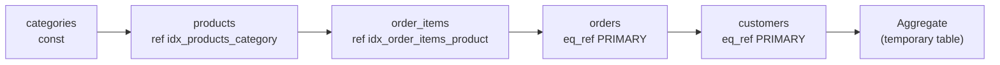
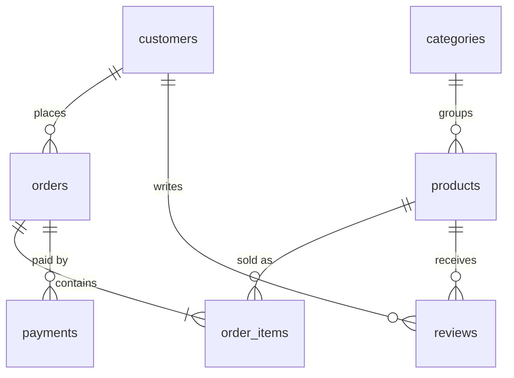

## Introduction

Real reporting questions cross many tables. "Revenue by customer state and product category" in the shop schema touches **five**: `customers → orders → order_items → products → categories`. "Each customer's item revenue next to the amount they actually paid" needs `orders`, `order_items` **and** `payments` — and that innocent-looking query is where many production dashboards go wrong.

This lesson is about the engineering of multi-table joins:

- **Navigating the schema** — reading the foreign keys as a graph and joining along it.
- **Grain and the fan-out trap** — when two *one-to-many* relationships hang off the same table, joining both multiplies rows, and `SUM` returns a number that is too large by a factor nobody notices. You will see the wrong totals, understand exactly why they are wrong, and fix them with **pre-aggregation**.
- **Non-equi joins** — joining on ranges (`price BETWEEN min_price AND max_price`) instead of equality.
- **Join order** — the optimizer, not the `FROM` clause, decides which table is read first. You will read that decision in `EXPLAIN`, and override it with `STRAIGHT_JOIN` or join-order hints when you have evidence the optimizer is wrong.

:::note[Dataset]
The **shop** dataset: 25 customers, 80 orders, 182 order items, 76 payments, 30 products, 10 categories. Every order has at most one payment; most orders have several line items. Outputs below are captured from a real MySQL server.
:::

## DBMS Theory

:::theory[Join graphs, associativity and grain]
A query joining n tables can be drawn as a **join graph**: one node per table, one edge per join predicate. For a normalized schema the edges usually follow foreign keys, and the graph is a tree (a "chain" or a "star").

Because inner joins are **associative and commutative**, ((A ⋈ B) ⋈ C) ⋈ D can be evaluated in any order that keeps each step connected by a predicate. With n tables there are up to n! left-deep orders (5 tables: 120; 10 tables: 3,628,800). Choosing among them is the optimizer's **join ordering problem**, one of the classic NP-hard problems in query optimization; all real optimizers use heuristics and cost estimates.
:::

The second theoretical idea is **grain** (or granularity): the meaning of one row of a result. Joining along a foreign key from child to parent (N:1) keeps the child's grain: `order_items ⋈ products` has one row per order item. Joining from parent to child (1:N) changes the grain to the child: `orders ⋈ order_items` has one row per item, not per order.

The **fan-out trap** follows directly. Suppose orders has two independent 1:N relationships — to `order_items` and to `payments`. Joining both:

> orders ⋈ order_items ⋈ payments

produces, for each order, **(number of items) × (number of payments)** rows: a Cartesian product *within* each order. Every payment row is repeated once per item; every item is repeated once per payment. Any `SUM` over either side is multiplied by the size of the other. (In dimensional modelling this is called the *chasm trap*; joining through a 1:N chain with an aggregate at the wrong level is the related *fan trap*.)

| Relationship walked | Grain after the join | Safe to SUM |
|---|---|---|
| child → parent (N:1) | child | child columns; **not** parent columns |
| parent → child (1:N) | child | child columns; parent columns are repeated |
| parent → child₁ and parent → child₂ | child₁ × child₂ per parent | **neither** without pre-aggregation |

A **non-equi join** is a theta join whose predicate is not an equality: R ⋈<sub>R.v ≥ S.lo ∧ R.v ≤ S.hi</sub> S. It is the relational way to map values to ranges (price bands, tax brackets, date validity intervals).

## Why It Exists

Normalization (Module 6) deliberately splits information into many narrow tables so that every fact lives once. The price of that design is that answers must be **reassembled** by joining several tables, so writing correct multi-table joins is a core professional skill rather than an advanced trick.

Without discipline, three things go wrong in practice:

1. **Inflated numbers.** A finance dashboard joining orders to both line items and payments overstates revenue — sometimes by 2×, sometimes by 14×, depending on the customer — and the error is not obvious because every individual row looks right.
2. **Lost rows.** One inner join in a chain of left joins, or one NULL foreign key (the uncategorized gift card), silently removes rows from a report.
3. **Slow plans.** With five or more tables, a bad join order can turn milliseconds into minutes. Engineers need to read the chosen order and, rarely, correct it.

## Internal Working

:::internals[How MySQL plans and executes an n-way join]
**Left-deep pipelines.** MySQL's nested-loop executor evaluates a join of n tables as a *left-deep* plan: table 1 drives, each of its rows is joined with table 2, each resulting partial row with table 3, and so on. In `EXPLAIN FORMAT=TREE` this appears as nested `Nested loop inner join` iterators, the innermost pair being the first two tables. Hash joins can be inserted at any level when an equi-join has no usable index.

**Choosing the order.** The optimizer considers join orders using a cost model (estimated rows from index statistics × cost of each access). For many tables it uses a **greedy, depth-limited search** controlled by `optimizer_search_depth` (default 62, which effectively means "search fully, but MySQL automatically reduces the depth for large joins"), and prunes hopeless partial plans (`optimizer_prune_level`). Constraints apply: the preserved table of an outer join must come before the NULL-supplying table.

**Constant tables.** A table that the WHERE clause restricts to at most one row through a primary or unique key (e.g. `categories.name = 'Coffee'` with a unique index on `name`) is read **during optimization** and treated as a constant; it is placed first and its values are substituted into the rest of the plan.
:::

Every partial row flowing through the pipeline carries columns from all tables joined so far. That is why a predicate like `oi.order_id = o.order_id` can be used as an **index lookup key** — the value of `o.order_id` is known when `oi` is accessed — and why the order matters: the index on `order_items` is usable only if `orders` has been read first.



The diagram is the plan MySQL picks for the "revenue for Coffee products by state" query in this lesson: it starts from the most selective table and walks the foreign keys outwards, so every step after the first is an index lookup.

## MySQL Implementation

A multi-table join is a sequence of joins, each with its own condition:

```sql
SELECT ...
FROM t1
JOIN t2 ON t2.fk = t1.pk
JOIN t3 ON t3.fk = t2.pk
LEFT JOIN t4 ON t4.fk = t3.pk
...
```

Each `ON` may reference **any table already introduced** to its left. Start with the five-table chain — revenue by state for one category:

```sql run
SELECT c.state, ca.name AS category,
       SUM(oi.quantity * oi.unit_price) AS revenue,
       COUNT(DISTINCT o.order_id)       AS orders
FROM customers   AS c
JOIN orders      AS o  ON o.customer_id  = c.customer_id
JOIN order_items AS oi ON oi.order_id    = o.order_id
JOIN products    AS p  ON p.product_id   = oi.product_id
JOIN categories  AS ca ON ca.category_id = p.category_id
WHERE ca.name = 'Coffee'
GROUP BY c.state, ca.name
ORDER BY revenue DESC;
```

The grain of the join is **one row per order item** (the deepest child), so `SUM(oi.quantity * oi.unit_price)` is correct and `COUNT(DISTINCT o.order_id)` is needed to count orders. Each join walks a foreign key; there is exactly one 1:N branch from any table (orders → order_items), so no fan-out occurs.

### The schema as a graph



`orders` has **two** one-to-many branches (`order_items` and `payments`). Any query that follows both from the same order is a fan-out risk.

## Syntax Breakdown

| Element | Meaning |
|---|---|
| `JOIN t ON …` repeated | Each join adds one table; its `ON` may use any table already joined. Write them in the order of the join graph so each `ON` is local and readable. |
| Parenthesized joins `a JOIN (b JOIN c ON …) ON …` | Groups joins explicitly. Rarely needed for inner joins (associative); can matter for outer joins. |
| `ON x BETWEEN lo AND hi` | Non-equi join on a range. Any boolean expression is allowed in `ON`. |
| `SELECT STRAIGHT_JOIN …` | MySQL extension: join tables in exactly the order listed in `FROM`. |
| `a STRAIGHT_JOIN b ON …` | MySQL extension: force `a` before `b` for this pair only. Behaves as an inner join. |
| `/*+ JOIN_ORDER(t1, t2, …) */` | Optimizer hint (8.0+): join the named tables in this order; others are free. |
| `/*+ JOIN_PREFIX(t1, t2) */` / `JOIN_SUFFIX` | Fix the first / last tables of the order. |
| `/*+ JOIN_FIXED_ORDER() */` | Hint form of `SELECT STRAIGHT_JOIN`. |
| `(SELECT … GROUP BY key) AS agg` | A **derived table** used to pre-aggregate a child table to the parent's grain before joining. |

:::standard[Standard SQL vs MySQL]
Multi-way joins, `BETWEEN` predicates in `ON`, and derived tables are standard SQL. `STRAIGHT_JOIN` and the `/*+ … */` optimizer hints are MySQL-specific (other systems have their own hint syntax, e.g. Oracle's `/*+ LEADING */`, SQL Server's `OPTION (FORCE ORDER)`). PostgreSQL deliberately has no hints and respects explicit join order only when `join_collapse_limit` is lowered.
:::

## Practical Examples

### 1. The fan-out trap — wrong totals, for real

Finance wants, per customer, the **item revenue** (Σ quantity × unit_price) and the **amount paid** (Σ succeeded payments). The obvious query joins everything:

```sql run
-- WRONG: joins two independent one-to-many relationships of orders
SELECT o.customer_id,
       SUM(oi.quantity * oi.unit_price) AS item_revenue,
       SUM(p.amount)                    AS amount_paid,
       COUNT(*)                         AS joined_rows
FROM orders AS o
JOIN order_items AS oi ON oi.order_id = o.order_id
JOIN payments    AS p  ON p.order_id  = o.order_id AND p.status = 'succeeded'
WHERE o.customer_id IN (18, 19)
GROUP BY o.customer_id
ORDER BY o.customer_id;
```

Now compute the paid amount on its own, without the line items:

```sql run
SELECT o.customer_id, SUM(p.amount) AS amount_paid, COUNT(*) AS payments
FROM orders AS o
JOIN payments AS p ON p.order_id = o.order_id AND p.status = 'succeeded'
WHERE o.customer_id IN (18, 19)
GROUP BY o.customer_id
ORDER BY o.customer_id;
```

The first query's `amount_paid` is far larger than the truth — 13,655.75 instead of 5,713.27 for customer 18, and 21,207.57 instead of 8,448.82 for customer 19. Each payment row was repeated once per line item of its order, so a payment for an order with four items was counted four times. The `joined_rows` column shows the inflated row count (one row per item × payment pair). Nothing failed, every row in the join was "correct", and the numbers are plausible enough to end up in a board report.

Look at `item_revenue` too. It is right for customer 18 only **because every order in this dataset has at most one payment** — if an order were paid in two instalments, its items would be doubled as well. Correctness that depends on the current data, not on the schema, is a bug waiting for its first split payment. For customer 19 the item revenue is already wrong, in the *other* direction: the inner join to `payments … AND p.status = 'succeeded'` silently dropped the items of every order that has no succeeded payment. One query, two independent bugs — fan-out inflating one column, an inner join on an optional relationship deflating the other.

### 2. Fixing fan-out: pre-aggregate each branch to the common grain

Aggregate each child table to **one row per order** first, then join the aggregates:

```sql run
SELECT o.customer_id,
       SUM(it.item_revenue)              AS item_revenue,
       SUM(COALESCE(pay.amount_paid, 0)) AS amount_paid
FROM orders AS o
JOIN (SELECT order_id, SUM(quantity * unit_price) AS item_revenue
      FROM order_items
      GROUP BY order_id) AS it ON it.order_id = o.order_id
LEFT JOIN (SELECT order_id, SUM(amount) AS amount_paid
           FROM payments
           WHERE status = 'succeeded'
           GROUP BY order_id) AS pay ON pay.order_id = o.order_id
WHERE o.customer_id IN (18, 19)
GROUP BY o.customer_id
ORDER BY o.customer_id;
```

Each derived table has exactly one row per `order_id`, so joining them to `orders` is N:1 on both sides — no multiplication. The paid amounts now match the standalone query. The payments branch is a `LEFT JOIN` so that orders without a succeeded payment keep their item revenue — which is why customer 19's item revenue is now 8,528.80, higher than the 8,448.82 the naive join reported.

Why not `SUM(DISTINCT p.amount)`? It removes duplicate **values**, not duplicate **rows**: two different payments of the same amount would be merged. `COUNT(DISTINCT p.payment_id)` is a valid fix for *counts* (it de-duplicates on a key), but there is no key-based `SUM(DISTINCT …)`. Pre-aggregation is the general fix.

### 3. Many tables with optional relationships

"Every product with its category, units sold and average rating" — categories are optional (gift card), and so are sales and reviews. Two 1:N branches from products (order_items and reviews) means pre-aggregation again:

```sql run
SELECT p.product_id, p.name,
       ca.name                     AS category,
       COALESCE(s.units_sold, 0)   AS units_sold,
       r.avg_rating,
       COALESCE(r.reviews, 0)      AS reviews
FROM products AS p
LEFT JOIN categories AS ca ON ca.category_id = p.category_id
LEFT JOIN (SELECT product_id, SUM(quantity) AS units_sold
           FROM order_items GROUP BY product_id) AS s ON s.product_id = p.product_id
LEFT JOIN (SELECT product_id, ROUND(AVG(rating), 2) AS avg_rating, COUNT(*) AS reviews
           FROM reviews GROUP BY product_id) AS r ON r.product_id = p.product_id
WHERE p.product_id IN (1, 4, 7, 14, 29)
ORDER BY p.product_id;
```

All five products appear, including the gift card (NULL category), product 4 (never sold, no reviews) and product 7 (never sold).

### 4. Non-equi join — mapping values to ranges

Price bands are defined as ranges, not keys:

```sql run
CREATE TABLE price_bands (
  band      VARCHAR(10) PRIMARY KEY,
  min_price DECIMAL(10,2) NOT NULL,
  max_price DECIMAL(10,2) NOT NULL
);
INSERT INTO price_bands VALUES
  ('budget', 0.00, 49.99), ('mid', 50.00, 199.99), ('premium', 200.00, 999.99), ('luxury', 1000.00, 99999.99);
SELECT b.band, COUNT(*) AS products, MIN(p.price) AS cheapest, MAX(p.price) AS dearest
FROM products AS p
JOIN price_bands AS b ON p.price BETWEEN b.min_price AND b.max_price
GROUP BY b.band, b.min_price
ORDER BY b.min_price;
```

The join is correct only if the ranges are **non-overlapping and gap-free** for the values that occur. Overlapping bands would match a product twice (fan-out again); a gap (e.g. a price of 49.995 in a column with more decimals) would drop the product from an inner join. Check coverage explicitly:

```sql run
SELECT COUNT(*) AS products,
       COUNT(b.band) AS products_with_a_band,
       COUNT(*) - COUNT(DISTINCT p.product_id) AS duplicated_by_overlap
FROM products AS p
LEFT JOIN price_bands AS b ON p.price BETWEEN b.min_price AND b.max_price;
```

Another classic non-equi join compares rows to a threshold from another table — for example, line items sold **below** the product's current list price (a discount or an old price):

```sql run
SELECT COUNT(*) AS items_below_list_price
FROM order_items AS oi
JOIN products AS p ON p.product_id = oi.product_id AND oi.unit_price < p.price;
```

Here the join is an equi-join on `product_id` **plus** a non-equi condition; the equality does the matching (and can use an index), the inequality filters the matches.

## Execution Walkthrough

Trace the fan-out on a single order to see where the multiplication comes from.

```walkthrough
title: Why SUM(p.amount) is inflated in orders ⋈ order_items ⋈ payments
steps:
  - title: "1. One order and its line items"
    explain: Order 2 has several line items — a 1:N relationship from orders.
    sql: |
      SELECT order_id, product_id, quantity, unit_price, quantity * unit_price AS line_total
      FROM order_items WHERE order_id = 2 ORDER BY product_id;
  - title: "2. The same order and its payments"
    explain: Order 2 has one payment — a second, independent 1:N relationship from orders.
    sql: SELECT payment_id, order_id, amount, status FROM payments WHERE order_id = 2;
  - title: "3. Join both branches"
    explain: >-
      Every item row is paired with every payment row of the same order. With one payment, the payment amount is
      repeated on every item row.
    sql: |
      SELECT oi.order_id, oi.product_id, oi.quantity * oi.unit_price AS line_total, p.payment_id, p.amount
      FROM order_items oi JOIN payments p ON p.order_id = oi.order_id
      WHERE oi.order_id = 2
      ORDER BY oi.product_id;
  - title: "4. Aggregate — the payment is summed once per item"
    explain: >-
      SUM(line_total) is right because each item appears once. SUM(p.amount) adds the same payment once per item
      row, so it is multiplied by the number of items.
    sql: |
      SELECT SUM(oi.quantity * oi.unit_price) AS item_revenue,
             SUM(p.amount) AS inflated_paid,
             COUNT(*) AS joined_rows,
             (SELECT SUM(amount) FROM payments WHERE order_id = 2) AS true_paid
      FROM order_items oi JOIN payments p ON p.order_id = oi.order_id
      WHERE oi.order_id = 2;
  - title: "5. Pre-aggregate, then join"
    explain: Reducing each branch to one row per order before joining keeps the grain at one row per order.
    sql: |
      SELECT it.order_id, it.item_revenue, pay.amount_paid
      FROM (SELECT order_id, SUM(quantity * unit_price) AS item_revenue FROM order_items WHERE order_id = 2 GROUP BY order_id) it
      JOIN (SELECT order_id, SUM(amount) AS amount_paid FROM payments WHERE order_id = 2 GROUP BY order_id) pay
        ON pay.order_id = it.order_id;
```

### Reading a multi-table plan

Traditional `EXPLAIN` lists one row per table **in join order** — the first row drives, each following row is joined to everything above it:

```sql run
EXPLAIN
SELECT c.state, SUM(oi.quantity * oi.unit_price) AS revenue
FROM customers   AS c
JOIN orders      AS o  ON o.customer_id  = c.customer_id
JOIN order_items AS oi ON oi.order_id    = o.order_id
JOIN products    AS p  ON p.product_id   = oi.product_id
JOIN categories  AS ca ON ca.category_id = p.category_id
WHERE ca.name = 'Coffee'
GROUP BY c.state;
```

How to read it, column by column:

| Column | What to look for |
|---|---|
| order of rows | The join order. Here it is the **reverse** of the `FROM` clause: `ca`, `p`, `oi`, `o`, `c`. |
| `type` | Access method per table: `const` (one row, resolved at optimization), `eq_ref` (one row per previous row via a PK/unique key), `ref` (several rows via a non-unique index), `ALL` (full scan — suspicious on an inner table). |
| `key` / `ref` | Which index is used and which earlier column feeds it — e.g. `<schema>.p.product_id` means "look up using the current products row" (the schema prefix is your lab's schema name); `const` means a constant value. |
| `rows` × `filtered` | Estimated rows read per lookup and the fraction surviving conditions; their product along the plan approximates the work. |
| `Extra` | `Using temporary` (grouping in a temp table), `Using index` (covering), `Using join buffer (hash join)` when a hash join is used. |

The same plan as an iterator tree:

```sql run
EXPLAIN FORMAT=TREE
SELECT c.state, SUM(oi.quantity * oi.unit_price) AS revenue
FROM customers   AS c
JOIN orders      AS o  ON o.customer_id  = c.customer_id
JOIN order_items AS oi ON oi.order_id    = o.order_id
JOIN products    AS p  ON p.product_id   = oi.product_id
JOIN categories  AS ca ON ca.category_id = p.category_id
WHERE ca.name = 'Coffee'
GROUP BY c.state;
```

The innermost `Nested loop inner join` pairs `p` (found through `idx_products_category` with the constant category id substituted) with `oi`; each enclosing loop adds one more table by primary key. `categories` does not appear as an iterator at all: it was a constant table, read during optimization.

### Forcing an order with STRAIGHT_JOIN

`STRAIGHT_JOIN` makes MySQL follow the `FROM` order — customers first:

```sql run
EXPLAIN FORMAT=TREE
SELECT STRAIGHT_JOIN c.state, SUM(oi.quantity * oi.unit_price) AS revenue
FROM customers   AS c
JOIN orders      AS o  ON o.customer_id  = c.customer_id
JOIN order_items AS oi ON oi.order_id    = o.order_id
JOIN products    AS p  ON p.product_id   = oi.product_id
JOIN categories  AS ca ON ca.category_id = p.category_id
WHERE ca.name = 'Coffee'
GROUP BY c.state;
```

Now every customer, every order and every item is read before the category filter can discard anything: `categories` is joined **last**, by primary-key lookup, and only then does `Filter: (ca.name = 'Coffee')` throw away the rows of the other nine categories. Compare the cost estimates of the outermost join in each tree: about 24.5 for the optimizer's own order versus about 251 for the forced one — ten times more estimated work for the same result. On a large database that difference would be real time. This is why `STRAIGHT_JOIN` is a last resort, used only when you have measured that the optimizer's choice is worse.

The finer-grained hint form fixes only part of the order:

```sql run
EXPLAIN FORMAT=TREE
SELECT /*+ JOIN_ORDER(o, c) */ c.state, COUNT(*) AS orders
FROM orders AS o JOIN customers AS c ON c.customer_id = o.customer_id
GROUP BY c.state;
```

## Output

The key outputs of this lesson are the **two different paid totals** for customers 18 and 19: the naive three-way join reports paid amounts about 2.4 to 2.5 times larger than the payments table actually contains, while the pre-aggregated query reproduces the standalone payment totals exactly. The walkthrough shows the factor precisely: for order 2, the inflated value equals the true payment multiplied by the number of line items (`joined_rows`).

When reading any multi-table result, verify:

1. **The grain** — "one row per *what*?" — and that every summed column belongs to that grain.
2. **Reconciliation** — totals from the join equal totals computed from the base table alone (`SELECT SUM(amount) FROM payments WHERE …`). This one check catches almost every fan-out bug.
3. **Completeness** — no rows lost to an inner join on an optional relationship.

## Alternative Approaches

Three correct ways to put item revenue and payments side by side per customer:

| Approach | Sketch | Trade-offs |
|---|---|---|
| Pre-aggregated derived tables (shown above) | `JOIN (SELECT order_id, SUM(...) … GROUP BY order_id)` | General and explicit; each branch is aggregated once; MySQL materializes the derived tables (or merges them when possible) |
| Correlated scalar subqueries | `(SELECT SUM(amount) FROM payments p WHERE p.order_id = o.order_id)` in the SELECT list | Very readable for one or two values; evaluated per outer row unless the optimizer transforms it — see [Correlated Subqueries](/lessons/m04-correlated-subqueries) |
| CTEs (`WITH items AS (…), pays AS (…)`) | Same as derived tables, named up front | Best readability for 3+ branches — see [Common Table Expressions](/lessons/m04-ctes) |
| `COUNT(DISTINCT key)` | Count distinct payment ids after the fan-out | Fixes **counts only**; cannot fix sums |

The scalar-subquery version for comparison:

```sql run
SELECT o.customer_id,
       SUM((SELECT SUM(oi.quantity * oi.unit_price) FROM order_items oi WHERE oi.order_id = o.order_id)) AS item_revenue,
       SUM((SELECT COALESCE(SUM(p.amount), 0) FROM payments p WHERE p.order_id = o.order_id AND p.status = 'succeeded')) AS amount_paid
FROM orders AS o
WHERE o.customer_id IN (18, 19)
GROUP BY o.customer_id
ORDER BY o.customer_id;
```

Same totals as the pre-aggregated join. For join order, the alternatives to `STRAIGHT_JOIN` are, in order of preference: fix statistics (`ANALYZE TABLE`), add the missing index, rewrite the query (e.g. pre-filter in a derived table), and only then hints — `JOIN_ORDER` / `JOIN_PREFIX` constrain less than `STRAIGHT_JOIN` and are ignored rather than erroring when they cannot be applied.

## Performance Analysis

| Factor | Effect on a multi-table join |
|---|---|
| Join order | Determines how many partial rows flow through the pipeline. Start from the most selective table so later steps process few rows. |
| Index on each inner join column | Turns each step into `eq_ref`/`ref` lookups. A missing index makes MySQL use a hash join (8.0.18+), which reads that table fully. |
| Fan-out | Multiplies intermediate rows; besides wrong results it costs time and temp-table space. Pre-aggregation reduces rows **before** the join. |
| Non-equi predicates | Cannot be used as hash keys. Without an equality, MySQL 8.0.20+ uses a hash join "with no condition" plus a filter — effectively a Cartesian product. |
| Number of tables | Optimization time grows with the number of possible orders; for very wide joins (15+ tables) `optimizer_search_depth` limits the search. |

Here is the non-equi band join's plan — note that the range predicate is a `Filter` above a hash join **with no condition**:

```sql run
EXPLAIN FORMAT=TREE
SELECT b.band, COUNT(*) FROM products p
JOIN price_bands b ON p.price BETWEEN b.min_price AND b.max_price
GROUP BY b.band;
```

With 30 products × 4 bands that is irrelevant; with 10 million transactions × 50,000 tax brackets it is 5 × 10¹¹ pairs. Large range joins are usually rewritten so that an index can do the work, e.g. an index on `price_bands(min_price)` and a correlated lookup of "the band with the greatest `min_price` ≤ price", which reads one index entry per product.

:::performance[Theory vs measurement]
The `cost=` numbers in `EXPLAIN FORMAT=TREE` are the optimizer's **estimates** in abstract cost units, useful to compare plans for the same query, not milliseconds. To see real row counts and time per iterator use `EXPLAIN ANALYZE` — and test on realistic data volumes; on 80 orders every plan is instant. [Optimizing Joins](/lessons/m07-optimizing-joins) does this on generated tables.
:::

## Best Practices

:::best-practice[Multi-table joins]
1. **Draw the join graph** (or read the ER diagram) before writing the query; join along foreign keys.
2. **State the grain** of the result in a comment and check every aggregate against it.
3. **Never join two independent 1:N branches and aggregate** — pre-aggregate each branch to the shared key first.
4. **Reconcile totals** with a single-table query when building a new report.
5. **Use LEFT JOIN for optional relationships** and keep the chain left after the first one.
6. **Make range tables non-overlapping and gap-free**, and enforce it (constraints, tests).
7. **Read the plan's join order** for important queries; expect the first table to be the most selective one.
8. **Override join order only with evidence**, prefer `JOIN_ORDER`/`JOIN_PREFIX` over `STRAIGHT_JOIN`, and re-check hints after upgrades and data growth.
:::

## Common Mistakes

**Mistake 1 — summing across two 1:N branches** (the fan-out trap shown above).

**Mistake 2 — "fixing" fan-out with `SUM(DISTINCT …)`.** It deduplicates values, not rows:

```sql run
SELECT SUM(amount)          AS true_total,
       SUM(DISTINCT amount) AS sum_distinct_values
FROM payments
WHERE status = 'succeeded';
```

The two totals differ by 618.97: some different payments happen to have identical amounts, and `SUM(DISTINCT)` counted each such amount only once. That is money silently vanishing from a report.

**Mistake 3 — referencing a table before it is joined.** An `ON` clause can only use tables to its left:

```sql run error
SELECT o.order_id, p.name
FROM orders AS o
JOIN order_items AS oi ON oi.order_id = o.order_id AND p.is_active = 1
JOIN products    AS p  ON p.product_id = oi.product_id;
```

Error 1054: `p` does not exist yet at the point where the first `ON` is evaluated. Move the condition to the `products` join or to `WHERE`.

**Mistake 4 — an inner join to an optional table in the middle of a chain.** Joining `categories` with an inner join removes the gift card from "all products" reports:

```sql run
SELECT (SELECT COUNT(*) FROM products) AS all_products,
       COUNT(*) AS products_after_inner_join_to_categories
FROM products p JOIN categories ca ON ca.category_id = p.category_id;
```

**Mistake 5 — overlapping range tables.** If `mid` were defined as 50–200 and `premium` as 200–1000, a product priced exactly 200.00 would match both bands and be counted twice. Use half-open intervals (`price >= lo AND price < hi`) to make boundaries unambiguous.

## Industry Application

- **Financial reporting and reconciliation.** Revenue, payments, refunds and shipments are separate 1:N branches of an order. Finance data teams aggregate each to the order (or day) grain in staging models and only then join — the standard "aggregate before join" rule in dbt-style pipelines. Reconciliation tests compare report totals with source-table totals on every run.
- **Star schemas.** A warehouse fact table joined to five or six dimensions (date, customer, product, store, promotion) is a multi-table join along N:1 keys — no fan-out, by design. Fan-out appears when two fact tables (sales and returns) are joined directly; the fix is "drill-across": aggregate each fact table to the shared dimensions, then join.
- **Slowly changing dimensions.** Joining a fact to the dimension version valid at the time — `ON f.customer_id = d.customer_id AND f.ts >= d.valid_from AND f.ts < d.valid_to` — is a non-equi join used in every historical warehouse.
- **Pricing and tax engines.** Tax brackets, shipping zones and discount tiers are range tables joined with `BETWEEN` or half-open intervals.
- **Query tuning in OLTP.** On busy MySQL systems, DBAs review slow-log entries with `EXPLAIN`, look for joins whose order starts from a large unfiltered table or whose inner tables are scanned (`ALL`), and fix them with indexes first; hints are kept as a documented, monitored exception.

## Practice Exercises

```exercise
id: ex1
title: Order lines with full context
difficulty: easy
concepts: [multi-table-join]
prompt: |
  For order 3, return one row per line item with columns `order_id`, `customer` (last name), `product`
  (product name), `category` (category name, NULL if none) and `line_total` (quantity × unit_price).
hints:
  - "Chain: orders → customers, orders → order_items → products → categories."
  - "Products may have no category: use LEFT JOIN to categories."
solution: |
  SELECT o.order_id, c.last_name AS customer, p.name AS product, ca.name AS category,
         oi.quantity * oi.unit_price AS line_total
  FROM orders AS o
  JOIN customers   AS c  ON c.customer_id  = o.customer_id
  JOIN order_items AS oi ON oi.order_id    = o.order_id
  JOIN products    AS p  ON p.product_id   = oi.product_id
  LEFT JOIN categories AS ca ON ca.category_id = p.category_id
  WHERE o.order_id = 3;
explanation: |
  The grain is one row per line item. Every join is N:1 from the item's perspective except orders → order_items,
  which is the single 1:N step that sets the grain. The LEFT JOIN protects gift-card lines.
```

```exercise
id: ex2
title: Revenue per category and state
difficulty: medium
concepts: [multi-table-join, join-order]
prompt: |
  Return `category`, `state` and `revenue` (Σ quantity × unit_price) for **delivered** orders only, for every
  category/state combination that has revenue. Order by category, then state.
hints:
  - "Five tables: categories, products, order_items, orders, customers."
  - "Filter o.status = 'delivered' and GROUP BY category name and state."
solution: |
  SELECT ca.name AS category, c.state, SUM(oi.quantity * oi.unit_price) AS revenue
  FROM order_items AS oi
  JOIN orders     AS o  ON o.order_id     = oi.order_id
  JOIN customers  AS c  ON c.customer_id  = o.customer_id
  JOIN products   AS p  ON p.product_id   = oi.product_id
  JOIN categories AS ca ON ca.category_id = p.category_id
  WHERE o.status = 'delivered'
  GROUP BY ca.name, c.state
  ORDER BY ca.name, c.state;
orderMatters: true
explanation: |
  All joins go from the item upwards (N:1), so the sum is at the item grain and correct. The order in which you
  list the tables does not matter for the result; the optimizer picks its own join order.
```

```exercise
id: ex3
title: Fix the fan-out — items and payments per order
difficulty: hard
concepts: [fan-out, pre-aggregation]
prompt: |
  For every order with status `delivered`, return `order_id`, `item_revenue` (Σ quantity × unit_price of its
  items) and `amount_paid` (Σ amount of its `succeeded` payments, 0 if none). Your query must stay correct even
  if an order had several payments.
hints:
  - "Joining order_items and payments directly multiplies rows within each order."
  - "Aggregate order_items by order_id and payments by order_id in two derived tables, then join them to orders."
  - "Use LEFT JOIN and COALESCE for the payments side."
solution: |
  SELECT o.order_id, it.item_revenue, COALESCE(pay.amount_paid, 0) AS amount_paid
  FROM orders AS o
  JOIN (SELECT order_id, SUM(quantity * unit_price) AS item_revenue
        FROM order_items GROUP BY order_id) AS it ON it.order_id = o.order_id
  LEFT JOIN (SELECT order_id, SUM(amount) AS amount_paid
             FROM payments WHERE status = 'succeeded' GROUP BY order_id) AS pay ON pay.order_id = o.order_id
  WHERE o.status = 'delivered';
explanation: |
  Each derived table has one row per order, so both joins are N:1 and no row is multiplied. The direct three-way
  join would return correct numbers on today's data only because no order has two payments — a correctness
  property of the data, not of the query. Correlated scalar subqueries in the SELECT list are an equally correct
  alternative.
```

```exercise
id: ex4
title: Products per price band (non-equi join)
difficulty: medium
setup: |
  CREATE TABLE price_bands (band VARCHAR(10) PRIMARY KEY, min_price DECIMAL(10,2) NOT NULL, max_price DECIMAL(10,2) NOT NULL);
  INSERT INTO price_bands VALUES ('budget', 0.00, 49.99), ('mid', 50.00, 199.99), ('premium', 200.00, 999.99), ('luxury', 1000.00, 99999.99);
concepts: [non-equi-join]
prompt: |
  A table `price_bands(band, min_price, max_price)` exists in your lab. Return `band` and `active_products`
  (number of **active** products whose price falls within the band, inclusive). Include bands with zero
  active products.
hints:
  - "Join products to price_bands with p.price BETWEEN b.min_price AND b.max_price."
  - "Bands must be preserved: price_bands LEFT JOIN products, with both the range and is_active in ON."
solution: |
  SELECT b.band, COUNT(p.product_id) AS active_products
  FROM price_bands AS b
  LEFT JOIN products AS p
         ON p.price BETWEEN b.min_price AND b.max_price
        AND p.is_active = 1
  GROUP BY b.band;
explanation: |
  A non-equi predicate works in ON like any other condition. Because bands are the preserved side, the
  `is_active` filter belongs in ON (in WHERE it would remove empty bands). `COUNT(p.product_id)` yields 0 for
  NULL-extended bands.
```

```exercise
id: ex5
title: Customer scorecard across three branches
difficulty: challenge
concepts: [fan-out, pre-aggregation, multi-table-join]
prompt: |
  Build a scorecard with one row per customer **who has at least one order**: `customer_id`, `orders` (number of
  orders), `items_bought` (Σ quantity over all their order items), and `reviews` (number of reviews they wrote,
  0 if none).
hints:
  - "customers has two independent 1:N branches here: orders (→ order_items) and reviews."
  - "Pre-aggregate order data per customer and reviews per customer, then join both to customers."
  - "COUNT(DISTINCT o.order_id) and SUM(oi.quantity) can be computed in the same derived table, because order_items is a child of orders (one chain, not two branches)."
solution: |
  SELECT c.customer_id, od.orders, od.items_bought, COALESCE(rv.reviews, 0) AS reviews
  FROM customers AS c
  JOIN (SELECT o.customer_id, COUNT(DISTINCT o.order_id) AS orders, SUM(oi.quantity) AS items_bought
        FROM orders o JOIN order_items oi ON oi.order_id = o.order_id
        GROUP BY o.customer_id) AS od ON od.customer_id = c.customer_id
  LEFT JOIN (SELECT customer_id, COUNT(*) AS reviews
             FROM reviews GROUP BY customer_id) AS rv ON rv.customer_id = c.customer_id;
explanation: |
  orders → order_items is a single chain, so aggregating it together is fine (with COUNT(DISTINCT) for orders).
  reviews is an independent branch from customers: joining it directly would multiply each review by the
  customer's number of order items and inflate both items_bought and reviews. The inner join to `od` keeps only
  customers with orders, as required.
```

```exercise
id: ex6
title: Should we add STRAIGHT_JOIN?
difficulty: hard
kind: open
concepts: [join-order, straight-join, explain-join-plans]
prompt: |
  A nightly report joining six tables became slow after a data import. `EXPLAIN` shows it now starts from a large
  `events` table with `type = ALL` instead of from the small filtered `campaigns` table it used to start from. A
  colleague proposes adding `SELECT STRAIGHT_JOIN` and reordering the FROM clause. What would you check and do
  first, and when would a hint be acceptable?
solution: |
  First find out why the optimizer's estimate changed. After a large import, index statistics may be stale, so
  the optimizer misjudges selectivity: run `ANALYZE TABLE` on the affected tables and re-check the plan. Verify
  that the join columns are indexed and of identical type and collation (a mismatch makes an index unusable, so
  the optimizer avoids the lookup order). Compare `EXPLAIN ANALYZE` of the current plan with the desired order
  (temporarily forced) to confirm with measurements that the old order really is faster. Consider histograms on
  skewed filter columns (`ANALYZE TABLE … UPDATE HISTOGRAM`).

  A hint is acceptable when statistics and indexes are correct and the optimizer still misestimates (e.g.
  correlated predicates it cannot model). Prefer the narrowest hint — `JOIN_PREFIX(campaigns)` — over
  `STRAIGHT_JOIN`, which freezes the order of all six tables forever. Document it, and re-evaluate it after
  upgrades and data growth, because a forced order that is good today can be terrible next year.
```

## Knowledge Assessment

```quiz
- id: q1
  question: "Order 7 has 3 line items and 2 payments of 50.00 each. What does `SUM(p.amount)` return for that order in `orders JOIN order_items JOIN payments`?"
  options: ["100.00", "150.00", "300.00", "50.00"]
  answer: 2
  explanation: "The join produces 3 × 2 = 6 rows for the order; each payment appears once per item, so the sum is 3 × 100.00 = 300.00. 100.00 is the true paid amount; 150.00 multiplies one payment by three; 50.00 ignores both payments."
  concepts: [fan-out]
- id: q2
  question: "Which fixes give a correct per-customer total of payments when the query must also include order items? (Select all that apply.)"
  type: multi
  options:
    - "Pre-aggregate payments per order (or per customer) in a derived table and join it"
    - "Replace SUM(p.amount) with SUM(DISTINCT p.amount)"
    - "Use a correlated scalar subquery that sums payments for each order"
    - "Add COUNT(DISTINCT p.payment_id) to the SELECT list"
  answer: [0, 2]
  explanation: "Pre-aggregation and scalar subqueries compute the sum at the correct grain. SUM(DISTINCT) removes equal values, merging different payments with the same amount. COUNT(DISTINCT) fixes counts but does not change the sum."
  concepts: [fan-out, pre-aggregation]
- id: q3
  question: "Traditional EXPLAIN for a 5-table join lists the tables as ca, p, oi, o, c, while the FROM clause lists c, o, oi, p, ca. What does this mean?"
  options:
    - "The query will return rows in reverse order"
    - "The optimizer chose to read categories first and join the others in that order"
    - "EXPLAIN always lists tables in reverse"
    - "The query uses STRAIGHT_JOIN"
  answer: 1
  explanation: "EXPLAIN rows appear in join (execution) order. The optimizer is free to reorder inner joins and started from the most selective table. Result order is set only by ORDER BY; STRAIGHT_JOIN would force the FROM order."
  concepts: [join-order, explain-join-plans]
- id: q4
  question: "Why is `ON p.price BETWEEN b.min_price AND b.max_price` executed as a hash join 'with no condition' plus a filter in MySQL 8.0.20+?"
  options:
    - "Because BETWEEN is not allowed in ON"
    - "Because a range predicate cannot serve as a hash key, so all pairs are generated and then filtered"
    - "Because price_bands has a primary key"
    - "Because MySQL converts BETWEEN to an equality"
  answer: 1
  explanation: "Hash joins need equality keys. Without one, the hash join degenerates into a Cartesian product (formerly a Block Nested-Loop) and the range is applied as a filter. BETWEEN is legal in ON; the primary key does not influence this."
  concepts: [non-equi-join]
- id: q5
  question: "What does `SELECT STRAIGHT_JOIN …` do?"
  options:
    - "Converts all joins to inner joins"
    - "Forces MySQL to join the tables in the order they appear in FROM"
    - "Disables hash joins"
    - "Forces the use of indexes on every join column"
  answer: 1
  explanation: "STRAIGHT_JOIN is a MySQL extension that fixes the join order to the FROM order (the hint equivalent is JOIN_FIXED_ORDER). It does not change join types, algorithms or index choice."
  concepts: [straight-join]
- id: q6
  question: "An ON clause references a table that is joined later in the FROM clause. What happens?"
  options:
    - "MySQL reorders the joins automatically"
    - "Error 1054 — unknown column — because ON can only reference tables to its left"
    - "The condition is silently ignored"
    - "The join becomes a cross join"
  answer: 1
  explanation: "Name resolution for ON follows the syntactic nesting of the joins: only tables already introduced are visible. The optimizer's freedom to reorder applies to execution, not to name scope."
  concepts: [multi-table-join]
- id: q7
  question: "A report joins products to order_items and to reviews (both 1:N from products) and computes AVG(r.rating). Is the average correct?"
  options:
    - "Yes, AVG is immune to fan-out"
    - "No: each review is repeated once per order item of the product, so products with many sales weigh their reviews more when averaging across products, and COUNT(r.review_id) is inflated"
    - "Yes, because reviews has a unique key on (product_id, customer_id)"
    - "No, because AVG ignores NULLs"
  answer: 1
  explanation: "Within one product, repeating every review k times leaves its average unchanged, but counts are inflated and any average across products is weighted by sales. Treat it as fan-out and pre-aggregate; uniqueness of reviews does not prevent multiplication by order items."
  concepts: [fan-out]
```
