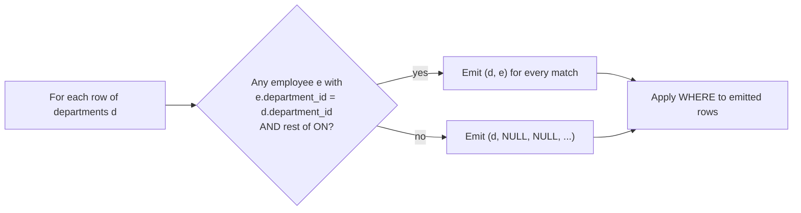

## Introduction

An inner join answers "show me the pairs that match". Many real questions, however, are about **everything on one side, whether or not it has a match**:

- "List **every** department with its head count — including departments that have nobody yet."
- "Which customers have **never** placed an order?"
- "Show all employees and their department name; employees not assigned to a department should still appear."
- "Reconcile two systems: which records exist in one but not the other?"

An inner join silently drops the rows these questions care about most. **Outer joins** keep them. A `LEFT JOIN` returns every row of the left table; where a row has no partner, the right table's columns are filled with `NULL` — a **NULL-extended row**. `RIGHT JOIN` does the same for the right table, and a `FULL OUTER JOIN` keeps unmatched rows from both sides (MySQL does not implement it; you will emulate it).

The hard part of outer joins is not the syntax. It is that **where you put a condition changes the answer**: a filter in `ON` and the same filter in `WHERE` produce different results, and the most common outer-join bug is a `WHERE` clause that quietly turns a `LEFT JOIN` back into an inner join. This lesson shows that with real output, then shows that the MySQL optimizer *detects* the situation and rewrites the join itself.

:::note[Dataset]
The examples use the **hr** dataset. It contains exactly the irregularities outer joins exist for: department **Research (70) has no employees**, and employee **124 (Samuel Adeyemi) has a NULL `department_id`**. Exercises also use the **shop** dataset, where five customers never ordered.
:::

## DBMS Theory

:::theory[Outer joins in relational algebra]
Let R ⋈<sub>θ</sub> S be the inner join. The outer joins add back unmatched tuples, padded with NULLs (written ω or ⊥ in some textbooks) for the attributes of the other relation:

- **Left outer join** R ⟕<sub>θ</sub> S = (R ⋈<sub>θ</sub> S) ∪ ((R − π<sub>R</sub>(R ⋈<sub>θ</sub> S)) × {(NULL, …, NULL)})
- **Right outer join** R ⟖<sub>θ</sub> S — symmetric: every tuple of S is preserved.
- **Full outer join** R ⟗<sub>θ</sub> S = (R ⟕<sub>θ</sub> S) ∪ (R ⟖<sub>θ</sub> S).

R is the **preserved** (row-preserving) table of a left join; S is the **NULL-supplying** table.
:::

Consequences of the definition:

1. **Cardinality.** |R ⟕ S| ≥ |R|. Each R row appears once per partner, or exactly once (NULL-extended) if it has none. Row multiplication from inner joins still applies to matched rows.
2. **The predicate θ decides matching, not survival.** In an inner join, a pair that fails θ disappears. In a left join, a **left row cannot disappear** because of θ — at worst it loses its partners and becomes NULL-extended. This is the theoretical root of the ON-vs-WHERE difference.
3. **Outer joins are not commutative and only partially associative.** R ⟕ S ≠ S ⟕ R, and (R ⟕ S) ⋈ T is generally not R ⟕ (S ⋈ T). The optimizer therefore has **less freedom to reorder** outer joins than inner joins.
4. **NULL padding is indistinguishable from stored NULL** unless you test a column that cannot be NULL in a real row — typically the NULL-supplying table's primary key or join column. That is why anti-join tests use `WHERE s.pk IS NULL`.

:::standard[Standard SQL vs MySQL]
`LEFT [OUTER] JOIN`, `RIGHT [OUTER] JOIN` and `FULL [OUTER] JOIN` are all standard SQL-92. MySQL supports LEFT and RIGHT but **not FULL OUTER JOIN** — in MySQL, `FULL` is not a reserved word, so `t1 FULL JOIN t2` is parsed as table `t1` with the **alias** `FULL`, followed by a plain (inner) `JOIN t2`. Depending on the rest of the statement this is a syntax error, an "unknown column" error (because `t1` is now called `FULL`), or — worst of all — a query that runs and silently returns an inner join (demonstrated in Common Mistakes). The keyword `OUTER` is optional everywhere.
:::

## Why It Exists

Without outer joins, "show every department with its head count" needs two queries glued together in the application — the departments with employees (inner join + GROUP BY) and the departments without (a separate `NOT EXISTS` query) — and the developer must remember the second half. Forgetting it is not an error; the report is just quietly incomplete. Research, with a budget of 500,000 and zero staff, is precisely the row a CFO wants to see.

Outer joins make **completeness** expressible in one declarative statement:

- **Reporting over a dimension.** Every month, every product, every region must appear even with zero activity; otherwise charts have gaps and totals cannot be reconciled.
- **Optional relationships.** Employee → department is optional (NULL allowed). Showing employees with an inner join to departments hides employee 124.
- **Finding missing data.** "Which customers never ordered?", "Which invoices have no payment?" — anti-joins are a central data-quality and business tool.
- **Reconciliation.** Comparing two datasets needs rows present only on the left, only on the right, and on both: a full outer join.

## Internal Working

:::internals[How MySQL executes an outer join]
MySQL executes `LEFT JOIN` with the same two physical algorithms as inner joins, adapted for NULL extension:

- **Nested loop left join.** For each row of the preserved (outer) table, search the NULL-supplying (inner) table. If at least one inner row satisfies the `ON` condition, emit each matching pair. If **none** does, emit one row with the inner columns set to NULL. A per-outer-row "found a match" flag implements this.
- **Left hash join** (8.0.20+). The NULL-supplying table becomes the hash table's **build** input; the preserved table is the **probe** input. A probe row with no hash match is emitted NULL-extended.

In both cases the preserved table must be the **outer** side, so `LEFT JOIN` restricts the join orders the optimizer may consider.
:::

Three optimizer behaviours matter in practice and you will see each one in a real plan below:

1. **RIGHT JOIN is converted to LEFT JOIN.** `A RIGHT JOIN B ON …` is rewritten as `B LEFT JOIN A ON …` during parsing. There is no separate right-join executor.
2. **Outer join simplification.** If the `WHERE` clause contains a condition that is false or unknown whenever the NULL-supplying table's columns are NULL (a *null-rejecting* condition, e.g. `e.salary >= 170000`), NULL-extended rows could never survive, so the optimizer converts the outer join into an **inner join** — which also frees it to reorder the tables.
3. **Anti-join conversion.** `LEFT JOIN … WHERE inner.not_null_col IS NULL` keeps exactly the preserved rows with no match. Since MySQL 8.0.17 the optimizer can recognize this and execute it as an **antijoin**, which stops searching at the first match instead of producing all matches and discarding them.



The diagram is the key to everything that follows: **`ON` is evaluated while matching**, so it can only turn a match into a non-match. **`WHERE` is evaluated afterwards** on the emitted rows — including the NULL-extended ones — so it can remove preserved rows entirely.

## MySQL Implementation

```sql
SELECT ...
FROM preserved_table AS p
LEFT [OUTER] JOIN null_supplying_table AS n
       ON  n.join_col = p.join_col [AND other match conditions]
[WHERE row_filter];

-- RIGHT JOIN preserves the table on the right instead
FROM n RIGHT [OUTER] JOIN p ON n.join_col = p.join_col
```

Start with small demo tables taken from the hr data: four departments (Data Platform will also have an employee, Research none) and five employees (one with a NULL department, two in Engineering — a duplicate key):

```sql run
CREATE TABLE j_depts (
  department_id INT PRIMARY KEY,
  name          VARCHAR(30) NOT NULL
);
CREATE TABLE j_emps (
  employee_id   INT PRIMARY KEY,
  first_name    VARCHAR(20) NOT NULL,
  department_id INT NULL
);
INSERT INTO j_depts VALUES (10, 'Executive'), (20, 'Engineering'), (30, 'Data Platform'), (70, 'Research');
INSERT INTO j_emps VALUES (100, 'Kofi', 10), (101, 'Diego', 20), (104, 'Mei', 20), (110, 'Diego', 30), (124, 'Samuel', NULL);
SELECT * FROM j_emps ORDER BY employee_id;
```

Switch between join types in the visualization and watch which rows are NULL-extended:

```viz
type: join
left:
  name: j_depts
  columns: [department_id, name]
  rows: [[10, Executive], [20, Engineering], [30, Data Platform], [70, Research]]
right:
  name: j_emps
  columns: [employee_id, first_name, department_id]
  rows: [[100, Kofi, 10], [101, Diego, 20], [104, Mei, 20], [110, Diego, 30], [124, Samuel, null]]
leftKey: department_id
rightKey: department_id
types: [inner, left, right, full]
```

The left join keeps every department:

```sql run
SELECT d.department_id, d.name, e.employee_id, e.first_name
FROM j_depts AS d
LEFT JOIN j_emps AS e ON e.department_id = d.department_id
ORDER BY d.department_id, e.employee_id;
```

Five rows: the four matched pairs (Engineering twice) plus Research, NULL-extended. Samuel is absent — he is in the *right* table and has no matching department, and a left join only preserves the left table. To preserve employees instead, swap the roles:

```sql run
SELECT e.employee_id, e.first_name, d.name AS department
FROM j_depts AS d
RIGHT JOIN j_emps AS e ON e.department_id = d.department_id
ORDER BY e.employee_id;
```

Now Samuel appears with a NULL department and Research is gone. The same result, written the conventional way with the preserved table first:

```sql run
SELECT e.employee_id, e.first_name, d.name AS department
FROM j_emps AS e
LEFT JOIN j_depts AS d ON d.department_id = e.department_id
ORDER BY e.employee_id;
```

On the full hr data, the head count per department must count employees, not rows — the NULL-extended Research row is one row but zero employees:

```sql run
SELECT d.department_id, d.name,
       COUNT(*)             AS rows_in_group,
       COUNT(e.employee_id) AS employees
FROM departments AS d
LEFT JOIN employees AS e ON e.department_id = d.department_id
GROUP BY d.department_id, d.name
ORDER BY d.department_id;
```

`COUNT(*)` reports 1 for Research because the group contains one (NULL-extended) row; `COUNT(e.employee_id)` correctly reports 0 because aggregate functions skip NULLs.

## Syntax Breakdown

| Component | Meaning |
|---|---|
| `LEFT [OUTER] JOIN` | Preserve every row of the table on the **left**; NULL-extend the right side when there is no match. |
| `RIGHT [OUTER] JOIN` | Preserve the table on the **right**. MySQL converts it to an equivalent `LEFT JOIN`; prefer writing `LEFT JOIN` for readability and portability. |
| `ON condition` | The **matching** condition. Conditions on the NULL-supplying table here restrict *which rows match*; they never remove preserved rows. Required for outer joins (or `USING`). |
| `USING (col)` | Same-named join columns, shown once. In a left join the coalesced column takes the **left** table's value. |
| `WHERE` | Filters the joined rows **after** NULL extension. A condition on the NULL-supplying table here removes NULL-extended rows unless it explicitly allows NULL. |
| `WHERE n.pk IS NULL` | Keeps only preserved rows that found **no** match — the anti-join idiom. Test a column that can never be NULL in a real row (PK or the join column). |
| `COALESCE(n.col, default)` | Replaces padding NULLs for display (`COALESCE(e.first_name, '(none)')`). |
| `FULL OUTER JOIN` | **Not supported** in MySQL. Emulate with `LEFT JOIN … UNION ALL … RIGHT JOIN … WHERE left.key IS NULL`. |

## Practical Examples

### ON versus WHERE — the central difference

Task: "List every department with its employees earning at least 170,000." Write the salary condition in `ON`:

```sql run
SELECT d.name AS department, e.employee_id, e.salary
FROM departments AS d
LEFT JOIN employees AS e
       ON e.department_id = d.department_id
      AND e.salary >= 170000
ORDER BY d.department_id, e.employee_id;
```

Every department appears. Marketing and Research have no employee earning that much, so they are NULL-extended — the condition decided *which employees count as matches*. Now move the same condition to `WHERE`:

```sql run
SELECT d.name AS department, e.employee_id, e.salary
FROM departments AS d
LEFT JOIN employees AS e
       ON e.department_id = d.department_id
WHERE e.salary >= 170000
ORDER BY d.department_id, e.employee_id;
```

Marketing and Research are gone. The join first produced every department's employees (Research NULL-extended); then `WHERE e.salary >= 170000` was evaluated on each row, and for the NULL-extended rows `NULL >= 170000` is UNKNOWN, so they were discarded — and so were Marketing's three matched rows, because all their salaries fail the filter. The result is exactly what an **inner** join would return. Ten rows versus eight rows, from "the same" condition.

**Rule:** conditions that define *what counts as a match* go in `ON`. Conditions that decide *which result rows you want* go in `WHERE`. A `WHERE` condition on the NULL-supplying table is almost always a bug unless it is `IS NULL` (anti-join) or explicitly NULL-tolerant (`e.salary >= 170000 OR e.employee_id IS NULL`).

Conditions on the **preserved** table behave the other way around: in `WHERE` they filter preserved rows as you would expect; in `ON` they do **not** filter anything — a department failing the condition is still returned, just with no matches:

```sql run
SELECT d.name, COUNT(e.employee_id) AS employees
FROM departments AS d
LEFT JOIN employees AS e
       ON e.department_id = d.department_id
      AND d.location_id = 1          -- condition on the PRESERVED table inside ON
GROUP BY d.department_id, d.name
ORDER BY d.department_id;
```

All seven departments come back; only those in location 1 found any matches. If you meant "departments in location 1", that condition belongs in `WHERE`.

### Finding missing rows (anti-join)

Departments without employees:

```sql run
SELECT d.department_id, d.name, d.budget
FROM departments AS d
LEFT JOIN employees AS e ON e.department_id = d.department_id
WHERE e.employee_id IS NULL;
```

Employees without a department — test the primary key of the NULL-supplying table, never a nullable attribute:

```sql run
SELECT e.employee_id, e.first_name, e.last_name
FROM employees AS e
LEFT JOIN departments AS d ON d.department_id = e.department_id
WHERE d.department_id IS NULL;
```

### Several outer joins in a chain

Every department, its location, and its employees' job titles. Once a table is reached through a left join, every later join **from** it must also be a left join, or the NULL-extended rows are eliminated (see Common Mistakes):

```sql run
SELECT d.name AS department, l.city, e.first_name, j.title
FROM departments AS d
JOIN      locations AS l ON l.location_id   = d.location_id      -- every department has a location
LEFT JOIN employees AS e ON e.department_id = d.department_id
LEFT JOIN jobs      AS j ON j.job_id        = e.job_id
WHERE d.department_id IN (50, 70)
ORDER BY d.department_id, e.employee_id;
```

### FULL OUTER JOIN emulation with UNION

MySQL has no `FULL OUTER JOIN`. The standard emulation takes the left join (all departments, matched or not) and appends the rows that **only** the right join contributes — employees with no matching department:

```sql run
SELECT d.department_id, d.name, e.employee_id, e.first_name
FROM j_depts AS d
LEFT JOIN j_emps AS e ON e.department_id = d.department_id
UNION ALL
SELECT d.department_id, d.name, e.employee_id, e.first_name
FROM j_depts AS d
RIGHT JOIN j_emps AS e ON e.department_id = d.department_id
WHERE d.department_id IS NULL
ORDER BY department_id IS NULL, department_id, employee_id;
```

Six rows: four matched pairs, Research with no employee, Samuel with no department. The `WHERE d.department_id IS NULL` on the second branch is essential: without it the matched pairs would appear twice.

A widely copied variant uses `UNION` (distinct) instead and drops that `WHERE`, relying on duplicate elimination to remove the matched pairs that both branches produce. It is **wrong whenever the result legitimately contains duplicate rows**, because `UNION` removes those too. In hr, Sales has two employees named Diego:

```sql run
SELECT
  (SELECT COUNT(*) FROM (
      SELECT d.name, e.first_name FROM departments d LEFT  JOIN employees e ON e.department_id = d.department_id
      UNION
      SELECT d.name, e.first_name FROM departments d RIGHT JOIN employees e ON e.department_id = d.department_id
   ) AS u) AS union_variant_rows,
  (SELECT COUNT(*) FROM (
      SELECT d.name, e.first_name FROM departments d LEFT  JOIN employees e ON e.department_id = d.department_id
      UNION ALL
      SELECT d.name, e.first_name FROM departments d RIGHT JOIN employees e ON e.department_id = d.department_id
      WHERE d.department_id IS NULL
   ) AS a) AS union_all_variant_rows;
```

The correct answer is 31 rows (29 matched employees + Research + employee 124); the `UNION` variant returns 30 because it merged the two ("Sales", "Diego") rows into one. It also pays for a deduplication step it does not need. Use `UNION ALL` with the anti-join filter.

## Execution Walkthrough

Trace the difference between `ON` and `WHERE` on the demo tables, with the filter "employee name is Diego".

```walkthrough
title: j_depts LEFT JOIN j_emps — filter in ON versus filter in WHERE
steps:
  - title: "1. Preserved table — j_depts"
    explain: Every one of these four rows is guaranteed to appear at least once in a LEFT JOIN result, whatever the ON condition says.
    sql: SELECT * FROM j_depts ORDER BY department_id;
  - title: "2. Matching with only the key in ON"
    explain: >-
      For each department, the executor looks for employees with the same department_id. Engineering finds two
      (row multiplication), Research finds none and is NULL-extended. Samuel (NULL department) matches nothing
      and, being on the NULL-supplying side, is not preserved.
    sql: |
      SELECT d.department_id, d.name, e.employee_id, e.first_name
      FROM j_depts d LEFT JOIN j_emps e ON e.department_id = d.department_id
      ORDER BY d.department_id, e.employee_id;
  - title: "3. Extra condition in ON — it changes what matches"
    explain: >-
      With AND e.first_name = 'Diego' inside ON, Kofi and Mei no longer count as matches. Executive therefore has no
      match left and is NULL-extended; Engineering keeps only Diego (101). All four departments are still present.
    sql: |
      SELECT d.department_id, d.name, e.employee_id, e.first_name
      FROM j_depts d LEFT JOIN j_emps e ON e.department_id = d.department_id AND e.first_name = 'Diego'
      ORDER BY d.department_id, e.employee_id;
  - title: "4. Same condition in WHERE — it removes rows after the join"
    explain: >-
      The join of step 2 is computed first; WHERE then tests every emitted row. NULL-extended Research has
      first_name NULL, so NULL = 'Diego' is UNKNOWN and the row is discarded; Kofi and Mei rows fail as well.
      Only two rows remain — the departments without a Diego vanished entirely, as with an inner join.
    sql: |
      SELECT d.department_id, d.name, e.employee_id, e.first_name
      FROM j_depts d LEFT JOIN j_emps e ON e.department_id = d.department_id
      WHERE e.first_name = 'Diego'
      ORDER BY d.department_id, e.employee_id;
```

### What the optimizer does with each form

The plain left join is executed as a nested loop left join, driving from the preserved table and using the index on `employees.department_id` for the inner lookups:

```sql run
EXPLAIN FORMAT=TREE
SELECT d.name, e.employee_id
FROM departments d LEFT JOIN employees e ON e.department_id = d.department_id;
```

With the salary filter in `WHERE`, look at the first line of the plan:

```sql run
EXPLAIN FORMAT=TREE
SELECT d.name, e.employee_id
FROM departments d LEFT JOIN employees e ON e.department_id = d.department_id
WHERE e.salary >= 170000;
```

The plan says `Nested loop inner join` — and the join order has **flipped**: the optimizer now scans `employees`, applies `e.salary >= 170000` (plus an implied `e.department_id is not null`) as an early filter, and looks up each surviving employee's department by primary key. It noticed that `e.salary >= 170000` is **null-rejecting** — it can never be true for a NULL-extended row — and simplified the outer join to an inner join, which in turn freed it to drive from the filtered `employees` table, something a left join with `departments` preserved would never allow. That is not an optimizer bug; it is a proof that your `LEFT` keyword has no effect. When you see an inner join in the plan of a query you wrote as a left join, re-check your `WHERE` clause.

The anti-join idiom is recognized too:

```sql run
EXPLAIN FORMAT=TREE
SELECT d.name
FROM departments d LEFT JOIN employees e ON e.department_id = d.department_id
WHERE e.employee_id IS NULL;
```

`Nested loop antijoin`: for each department, the lookup in `idx_employees_department` can stop at the first employee found, because one match is enough to reject the department. The `Filter: (e.employee_id is null)` above it is retained for correctness.

A `RIGHT JOIN` produces the very same plan as the equivalent `LEFT JOIN` — evidence of the parse-time conversion:

```sql run
EXPLAIN FORMAT=TREE
SELECT d.name, e.employee_id
FROM employees e RIGHT JOIN departments d ON e.department_id = d.department_id;
```

Without a usable index on the NULL-supplying table, MySQL uses a **left hash join**. The index hint simulates the missing index:

```sql run
EXPLAIN FORMAT=TREE
SELECT d.name, e.employee_id
FROM departments d
LEFT JOIN employees e IGNORE INDEX (idx_employees_department)
       ON e.department_id = d.department_id;
```

The employees table is under `Hash` (the build input, i.e. the NULL-supplying side); departments is the probe input. A department whose key finds nothing in the hash table is emitted NULL-extended.

## Output

Compare the final row counts of the two salary queries: **10 rows** with the condition in `ON` (all 7 departments, Marketing and Research NULL-extended) and **8 rows** with the condition in `WHERE` (only departments that have at least one high earner). Neither is "wrong" in SQL terms — they answer different questions:

| Placement | Question answered |
|---|---|
| `ON … AND e.salary >= 170000` | "For **every** department, which of its employees earn ≥ 170k (if any)?" |
| `WHERE e.salary >= 170000` | "Which employees earn ≥ 170k, and what department are they in?" (an inner join) |

When reading any outer-join result, identify the **NULL-extended rows** (NULLs in columns that are `NOT NULL` in the schema, such as `e.employee_id`), and distinguish them from real NULLs (employee 124's `department_id`). A compact way to make the distinction explicit in output:

```sql run
SELECT d.name,
       CASE WHEN e.employee_id IS NULL THEN 'no match' ELSE 'matched' END AS match_status,
       COUNT(e.employee_id) AS employees
FROM departments d
LEFT JOIN employees e ON e.department_id = d.department_id
GROUP BY d.department_id, d.name, match_status
ORDER BY d.department_id;
```

## Alternative Approaches

"Departments with no employees" can be written three ways:

```sql run
-- A: LEFT JOIN anti-join
SELECT d.name FROM departments d
LEFT JOIN employees e ON e.department_id = d.department_id
WHERE e.employee_id IS NULL;
```

```sql run
-- B: NOT EXISTS (correlated subquery)
SELECT d.name FROM departments d
WHERE NOT EXISTS (SELECT 1 FROM employees e WHERE e.department_id = d.department_id);
```

```sql run
-- C: NOT IN — correct here only because the subquery filters out NULLs
SELECT d.name FROM departments d
WHERE d.department_id NOT IN (SELECT e.department_id FROM employees e WHERE e.department_id IS NOT NULL);
```

| Approach | Strengths | Pitfalls |
|---|---|---|
| A — `LEFT JOIN … IS NULL` | Familiar; can also show columns from both sides when used for other purposes | Must test a never-NULL column; easy to break by adding WHERE conditions |
| B — `NOT EXISTS` | States intent directly; NULL-safe; optimized as an antijoin | Cannot show columns of the inner table (there are none to show) |
| C — `NOT IN` | Reads naturally | Returns **no rows at all** if the subquery yields a NULL — employee 124's NULL department would do exactly that without the `IS NOT NULL` filter. Covered in [EXISTS, NOT EXISTS, IN and NOT IN](/lessons/m04-exists-in) |

For "every department with a count", alternatives to `LEFT JOIN … GROUP BY` include a correlated scalar subquery `(SELECT COUNT(*) FROM employees e WHERE e.department_id = d.department_id)` — which returns 0 rather than NULL for empty departments — or pre-aggregating employees in a derived table and left-joining that (see [Multi-Table Joins](/lessons/m04-multi-table-joins)).

For a full outer join, an alternative to `UNION ALL` is to build the complete key set first (`SELECT department_id FROM departments UNION SELECT department_id FROM employees`) and left-join both tables to it. It is useful when there are more than two sources to reconcile.

## Performance Analysis

| Pattern | Plan shape | Cost driver |
|---|---|---|
| `LEFT JOIN` with an index on the inner join column | `Nested loop left join` + index lookup | Preserved rows × one index lookup each |
| `LEFT JOIN` without a usable index | `Left hash join`, NULL-supplying table as build input | One scan of each table + hash memory |
| `LEFT JOIN … WHERE inner.pk IS NULL` | `Nested loop antijoin` (8.0.17+) or hash antijoin | Can stop at the first match per preserved row |
| `LEFT JOIN` + null-rejecting `WHERE` | Simplified to an inner join | The optimizer may now reorder tables |
| FULL emulation with `UNION ALL` | Two joins appended | Each branch costs a join; `UNION` (distinct) adds a temporary table for deduplication |

Points worth knowing:

- **Join order is constrained.** For `A LEFT JOIN B`, the nested-loop executor must read A before B. If A is huge and B tiny, an inner join could have driven from B; the left join cannot. Outer joins written "just in case" therefore can cost performance as well as clarity. Use them when you need preserved rows.
- **Filters on the preserved table belong in WHERE.** They reduce the number of outer rows *before* the lookups. In `ON` they do not reduce anything — every preserved row is still emitted.
- **UNION versus UNION ALL** in FULL emulation: `UNION` materializes and deduplicates the combined result in a temporary table. `UNION ALL` streams both branches. The `UNION ALL` form is both correct and cheaper.

:::performance[Theory vs measurement]
These statements describe plan shapes, which you can verify with `EXPLAIN FORMAT=TREE` on any data size. On the 30-row hr tables, timings are meaningless. Module 7 measures join strategies with `EXPLAIN ANALYZE` on generated tables large enough to make differences visible.
:::

## Best Practices

:::best-practice[Outer joins in production SQL]
1. **Write LEFT JOIN, not RIGHT JOIN.** Put the preserved table first; readers then know at a glance which table drives the result. MySQL converts RIGHT to LEFT anyway.
2. **Conditions on the NULL-supplying table go in ON** if they restrict what counts as a match. In WHERE they turn the outer join into an inner join.
3. **Conditions on the preserved table go in WHERE.** In ON they do nothing to the row count.
4. **Test a non-nullable column for "no match"** — the NULL-supplying table's primary key or join column.
5. **Count with `COUNT(inner.pk)`**, not `COUNT(*)`, so unmatched groups report 0.
6. **Keep the chain left** — once you reach a table through a LEFT JOIN, later joins from it must also be LEFT JOINs.
7. **Emulate FULL OUTER JOIN with `UNION ALL` + an anti-join branch**, never with plain `UNION`.
8. **Check the plan:** an inner join in `EXPLAIN` for a query you wrote as LEFT JOIN means a WHERE condition made the outer join pointless.
:::

## Common Mistakes

**Mistake 1 — a WHERE filter on the NULL-supplying table.** "Every department with its number of employees hired since 2020":

```sql run
-- Wrong: Research and any department without recent hires disappear
SELECT d.name, COUNT(e.employee_id) AS hired_since_2020
FROM departments d
LEFT JOIN employees e ON e.department_id = d.department_id
WHERE e.hire_date >= '2020-01-01'
GROUP BY d.department_id, d.name
ORDER BY d.department_id;
```

```sql run
-- Correct: the date restricts what counts as a match
SELECT d.name, COUNT(e.employee_id) AS hired_since_2020
FROM departments d
LEFT JOIN employees e ON e.department_id = d.department_id
                     AND e.hire_date >= '2020-01-01'
GROUP BY d.department_id, d.name
ORDER BY d.department_id;
```

The wrong version returns only departments that have at least one recent hire; the correct version returns all seven, with 0 where appropriate.

**Mistake 2 — `COUNT(*)` after a LEFT JOIN.** It counts the NULL-extended row as 1 (Research showed `rows_in_group = 1` earlier). Use `COUNT(e.employee_id)`.

**Mistake 3 — an inner join after a left join cancels it.** Joining `jobs` with an inner join *from* the NULL-supplying table requires `e.job_id` to match, which NULL never does:

```sql run
SELECT d.name, e.first_name, j.title
FROM departments d
LEFT JOIN employees e ON e.department_id = d.department_id
JOIN jobs j           ON j.job_id = e.job_id
WHERE d.department_id IN (50, 70)
ORDER BY d.department_id, e.employee_id;
```

Research (70) is missing. Make the second join a `LEFT JOIN` too (as in the chained example above).

**Mistake 4 — testing a nullable column for "no match".** `WHERE e.commission_pct IS NULL` is true both for NULL-extended rows and for every non-sales employee who really has no commission. Test `e.employee_id IS NULL`.

**Mistake 5 — trying to use FULL OUTER JOIN.** MySQL does not support it:

```sql run error
SELECT d.name, e.first_name
FROM j_depts d FULL OUTER JOIN j_emps e ON e.department_id = d.department_id;
```

Error 1064 at `FULL OUTER JOIN`: MySQL has no `FULL` join type. Without the word `OUTER` it is worse — `FULL` is not a reserved word, so MySQL reads it as an **alias** for `j_depts` and the statement silently runs as an inner join:

```sql run
SELECT department_id, first_name
FROM j_depts FULL JOIN j_emps USING (department_id)
ORDER BY department_id, employee_id;
```

Four rows, no error, no Research and no Samuel: this is the inner join, with `FULL` acting as a table alias for `j_depts`. Always use the `UNION ALL` emulation.

## Industry Application

- **Dimension-complete reporting.** BI reports start from a calendar or product dimension and left-join facts to it so that days with zero sales show 0 rather than vanishing. Dashboards that skip missing days draw misleading lines.
- **Churn and engagement.** "Customers with no order in the last 90 days" is a left join (or `NOT EXISTS`) from customers to recent orders — the input to win-back campaigns.
- **Data quality monitoring.** Pipelines run anti-joins to detect orphans (order items whose product no longer exists), unpaid invoices, or employees missing a department, and alert when counts are non-zero.
- **Reconciliation and migration.** When migrating a table between systems, engineers full-outer-join old and new copies on the key (emulated with `UNION ALL` in MySQL) to list rows missing on either side and rows whose values differ.
- **Optional attributes in OLTP.** Profile pages left-join optional tables (an address, a profile picture) so that users without them still render. ORMs generate `LEFT OUTER JOIN` for optional relationships when eager loading.

## Practice Exercises

```exercise
id: ex1
title: Every department with its head count
difficulty: easy
concepts: [left-join, null-extended-rows]
prompt: |
  Return every department with columns `name` and `employees` (number of employees in it). Departments with no
  employees must appear with 0.
hints:
  - "departments must be the preserved (left) table."
  - "COUNT(*) would report 1 for an empty department; count a column of employees instead."
solution: |
  SELECT d.name, COUNT(e.employee_id) AS employees
  FROM departments AS d
  LEFT JOIN employees AS e ON e.department_id = d.department_id
  GROUP BY d.department_id, d.name;
explanation: |
  The LEFT JOIN preserves Research, NULL-extended; `COUNT(e.employee_id)` skips the NULL and returns 0. An inner
  join would drop Research, and `COUNT(*)` would show 1 for it.
```

```exercise
id: ex2
title: Customers who never ordered
difficulty: easy
dataset: shop
concepts: [anti-join, left-join]
prompt: |
  Using the shop dataset, list customers who have never placed an order: columns `customer_id`, `first_name`,
  `last_name`.
hints:
  - "LEFT JOIN orders to customers on customer_id."
  - "Keep only the rows where the order's primary key is NULL."
solution: |
  SELECT c.customer_id, c.first_name, c.last_name
  FROM customers AS c
  LEFT JOIN orders AS o ON o.customer_id = c.customer_id
  WHERE o.order_id IS NULL;
explanation: |
  `o.order_id` is the primary key of orders, so it is NULL only in NULL-extended rows. `NOT EXISTS
  (SELECT 1 FROM orders o WHERE o.customer_id = c.customer_id)` is an equally good (and often clearer) answer;
  MySQL executes both as an antijoin.
```

```exercise
id: ex3
title: Departments and their high earners (ON vs WHERE)
difficulty: medium
concepts: [on-vs-where, left-join]
prompt: |
  For **every** department, return `name` and `high_earners`: the number of its employees whose salary is at
  least 150,000. Departments with none must show 0.
hints:
  - "This is the classic ON-vs-WHERE trap: if the salary condition is in WHERE, departments without high earners vanish."
  - "Put AND e.salary >= 150000 into the ON clause and count e.employee_id."
solution: |
  SELECT d.name, COUNT(e.employee_id) AS high_earners
  FROM departments AS d
  LEFT JOIN employees AS e
         ON e.department_id = d.department_id
        AND e.salary >= 150000
  GROUP BY d.department_id, d.name;
explanation: |
  The salary condition defines which employees count as matches, so it belongs in ON. With the condition in
  WHERE, the NULL-extended rows (and departments whose employees all earn less) would be removed and the outer
  join would be simplified to an inner join. An alternative is conditional aggregation:
  `SUM(e.salary >= 150000)` with only the key in ON — but it returns NULL instead of 0 for Research unless wrapped
  in COALESCE.
```

```exercise
id: ex4
title: Products that never sold, with their category
difficulty: medium
dataset: shop
concepts: [anti-join, left-join]
prompt: |
  List products that appear in no order item. Return `product_id`, `name` and `category` (the category name, or
  NULL if the product has no category).
hints:
  - "You need two LEFT JOINs from products: one to categories (optional relationship) and one to order_items (the anti-join)."
  - "Filter with WHERE oi.order_id IS NULL. The categories join must be LEFT so an uncategorized product would not be lost."
solution: |
  SELECT p.product_id, p.name, c.name AS category
  FROM products AS p
  LEFT JOIN categories  AS c  ON c.category_id = p.category_id
  LEFT JOIN order_items AS oi ON oi.product_id = p.product_id
  WHERE oi.order_id IS NULL;
explanation: |
  `order_items` has a composite primary key, and `oi.order_id` is part of it, so it is never NULL in a real row.
  Using an inner join to categories would silently drop an unsold product with no category.
```

```exercise
id: ex5
title: Full reconciliation of departments and employees
difficulty: challenge
concepts: [full-outer-join, anti-join]
prompt: |
  Emulate a FULL OUTER JOIN between `departments` and `employees` on `department_id`. Return columns
  `department` (department name), `employee_id`, and `status`, where status is `'matched'` for a matched pair,
  `'department without employees'` for an unmatched department and `'employee without department'` for an
  unmatched employee. Every matched pair must appear exactly once.
hints:
  - "Branch 1: departments LEFT JOIN employees gives matched pairs and empty departments."
  - "Branch 2: employees LEFT JOIN departments WHERE d.department_id IS NULL gives only unassigned employees."
  - "Combine with UNION ALL (not UNION). Compute status with CASE in each branch."
solution: |
  SELECT d.name AS department, e.employee_id,
         CASE WHEN e.employee_id IS NULL THEN 'department without employees' ELSE 'matched' END AS status
  FROM departments AS d
  LEFT JOIN employees AS e ON e.department_id = d.department_id
  UNION ALL
  SELECT d.name, e.employee_id, 'employee without department'
  FROM employees AS e
  LEFT JOIN departments AS d ON d.department_id = e.department_id
  WHERE d.department_id IS NULL;
explanation: |
  The result has 31 rows: 29 matched pairs, Research, and employee 124. `UNION` instead of `UNION ALL` would be
  slower and could merge legitimately identical rows; omitting the IS NULL filter in the second branch would
  duplicate every matched pair.
```

```exercise
id: ex6
title: Why did my LEFT JOIN become an inner join?
difficulty: medium
kind: open
concepts: [on-vs-where, outer-join]
prompt: |
  A developer writes `SELECT c.name, o.total FROM customers c LEFT JOIN orders o ON o.customer_id = c.id
  WHERE o.status <> 'cancelled'` to list all customers and their non-cancelled orders. Customers with no orders
  are missing, and `EXPLAIN` shows an inner join. Explain both observations and give two correct rewrites with
  their different meanings.
solution: |
  For customers without orders, the LEFT JOIN emits NULL-extended rows where `o.status` is NULL. The WHERE clause
  is evaluated after the join; `NULL <> 'cancelled'` is UNKNOWN, so those rows are removed. Because the condition
  is null-rejecting, no NULL-extended row could ever survive, and MySQL's outer join simplification converts the
  LEFT JOIN to an inner join — hence the plan.

  Rewrite 1 (all customers, each with only their non-cancelled orders, NULL if none):
  `… LEFT JOIN orders o ON o.customer_id = c.id AND o.status <> 'cancelled'`.

  Rewrite 2 (keep customers whose orders are all cancelled or who have none, but drop cancelled order rows):
  `… WHERE o.status <> 'cancelled' OR o.order_id IS NULL` — this keeps customers with no orders at all, but
  customers whose only orders are cancelled disappear, which is a different question. Rewrite 1 is almost always
  what "all customers" means.
```

## Knowledge Assessment

```quiz
- id: q1
  question: "`departments` has 7 rows; one department (Research) has no employees. Employee 124 has a NULL department_id. How many rows does `departments LEFT JOIN employees ON e.department_id = d.department_id` return if the 6 other departments have 29 employees in total?"
  options: ["29", "30", "31", "7"]
  answer: 1
  explanation: "29 matched pairs plus one NULL-extended row for Research = 30. Employee 124 is on the NULL-supplying side and is not preserved (that would make 31, the full outer join). 7 confuses the result with one row per department."
  concepts: [left-join, null-extended-rows]
- id: q2
  question: "Which query lists ALL departments, each with its employees earning more than 200,000 (NULL if none)?"
  options:
    - "… LEFT JOIN employees e ON e.department_id = d.department_id WHERE e.salary > 200000"
    - "… LEFT JOIN employees e ON e.department_id = d.department_id AND e.salary > 200000"
    - "… JOIN employees e ON e.department_id = d.department_id AND e.salary > 200000"
    - "… RIGHT JOIN employees e ON e.department_id = d.department_id AND e.salary > 200000"
  answer: 1
  explanation: "The salary condition must restrict matching (ON), not filter rows afterwards (WHERE), or NULL-extended departments are removed. The inner join drops departments without such employees, and the RIGHT JOIN preserves employees, not departments."
  concepts: [on-vs-where]
- id: q3
  question: "EXPLAIN FORMAT=TREE for a query written with LEFT JOIN shows `Nested loop inner join`. What is the most likely explanation?"
  options:
    - "MySQL does not support LEFT JOIN with indexes"
    - "The WHERE clause has a null-rejecting condition on the NULL-supplying table, so the optimizer simplified the outer join"
    - "The tables are too small for an outer join"
    - "RIGHT JOIN was converted to LEFT JOIN"
  answer: 1
  explanation: "Outer join simplification converts an outer join into an inner join when a WHERE condition can never be true for NULL-extended rows. Index availability and table size do not change join semantics; RIGHT→LEFT conversion still produces a left join."
  concepts: [outer-join, on-vs-where]
- id: q4
  question: "Which statements about FULL OUTER JOIN in MySQL 8.4 are true? (Select all that apply.)"
  type: multi
  options:
    - "It is not supported; it must be emulated"
    - "LEFT JOIN … UNION ALL RIGHT JOIN … WHERE left.key IS NULL emulates it correctly"
    - "LEFT JOIN … UNION RIGHT JOIN … is always equivalent to a full outer join"
    - "FULL OUTER JOIN is supported since 8.0.31 together with INTERSECT and EXCEPT"
  answer: [0, 1]
  explanation: "MySQL has no FULL OUTER JOIN. The UNION ALL form with an anti-join branch is correct. The plain UNION form removes legitimately duplicate result rows (e.g. two employees named Diego in Sales). 8.0.31 added INTERSECT and EXCEPT, not FULL OUTER JOIN."
  concepts: [full-outer-join]
- id: q5
  question: "To find departments without employees using `LEFT JOIN employees e`, which WHERE condition is safest?"
  options: ["WHERE e.commission_pct IS NULL", "WHERE e.employee_id IS NULL", "WHERE e.salary = 0", "WHERE e.department_id <> d.department_id"]
  answer: 1
  explanation: "employee_id is the primary key and can only be NULL in a NULL-extended row. commission_pct is NULL for many real employees. salary = 0 and the inequality are UNKNOWN for NULL-extended rows and remove them."
  concepts: [anti-join]
- id: q6
  question: "A left join report shows Research with `COUNT(*) = 1` employees. Why?"
  options:
    - "Research has one employee with a NULL id"
    - "COUNT(*) counts the NULL-extended row; COUNT(e.employee_id) would return 0"
    - "The LEFT JOIN duplicated the Research row"
    - "COUNT(*) treats NULL as 1 in MySQL only"
  answer: 1
  explanation: "The group for Research contains exactly one row — the NULL-extended one. COUNT(*) counts rows; COUNT(column) skips NULLs. This is standard SQL behaviour, not MySQL-specific."
  concepts: [null-extended-rows]
- id: q7
  question: "`SELECT … FROM departments d LEFT JOIN employees e ON … AND d.location_id = 1` — what does the condition on d do?"
  options:
    - "Returns only departments in location 1"
    - "Returns all departments; only those in location 1 can have matches, the others are NULL-extended"
    - "Raises an error: ON may only reference the right table"
    - "Turns the join into an inner join"
  answer: 1
  explanation: "A condition on the preserved table inside ON cannot remove preserved rows; it only prevents them from matching. To restrict departments, put the condition in WHERE."
  concepts: [on-vs-where]
- id: q8
  question: "Why might `A LEFT JOIN B` be slower than `A JOIN B` when A is large and B is small?"
  options:
    - "Outer joins always use hash joins"
    - "The preserved table A must be the outer (driving) table, so the optimizer cannot start from the smaller B"
    - "LEFT JOIN disables indexes"
    - "LEFT JOIN materializes both tables"
  answer: 1
  explanation: "Outer joins constrain join order: the preserved side is read first. Indexes are still used for inner lookups, and nested-loop left joins are common; nothing is materialized by default."
  concepts: [outer-join]
```
