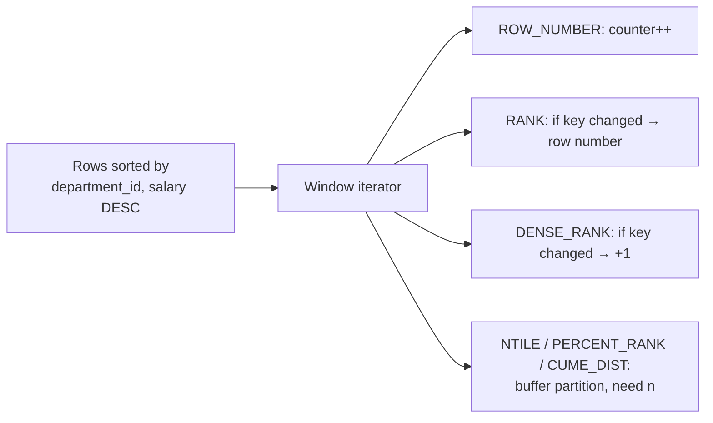

## Introduction

"Who are the three best-paid people in each department?" "Which is the most recent address for each customer?" "Which salespeople are in the top 10 %?" "Split customers into four equal-sized spending tiers." All of these are **ranking** questions: they need a position number for each row relative to other rows.

SQL's ranking window functions compute exactly that. They take no argument; the `ORDER BY` inside `OVER` defines what "better" means and `PARTITION BY` defines the groups within which positions are counted:

```sql
SELECT employee_id, department_id, salary,
       RANK() OVER (PARTITION BY department_id ORDER BY salary DESC) AS salary_rank
FROM employees;
```

There are six of them, and their differences are all about one thing: **ties**. When two rows have the same sort key — like employees 107 and 108 in the hr dataset, who both earn 150,000 — `ROW_NUMBER` gives them different numbers (arbitrarily!), `RANK` gives them the same number and skips the next, `DENSE_RANK` gives them the same number without skipping. Choosing the wrong one silently changes the answer to "top 3".

This lesson explains each function precisely, shows the classic patterns built on them — **top-N per group**, **deduplication**, **percentiles** and **bucketing** — and compares them with the pre-window alternatives (correlated subqueries, self joins, `LATERAL`). It assumes the window foundations from [Window Functions — OVER, PARTITION BY and Frames](/lessons/m04-window-functions).

:::note[Dataset]
The examples use the **hr** dataset: 30 employees, 7 departments. In Engineering (department 20), employees **107 and 108 earn exactly 150,000** — the tie that makes the ranking functions disagree. Every output shown was captured from a real MySQL server.
:::

## DBMS Theory

:::theory[Ranking as a function of order and peers]
Let a partition P be ordered by key k, and let *r* be a row of P. Define:

- *n* = |P|, the number of rows in the partition,
- *less(r)* = number of rows whose key sorts strictly **before** *r*'s key,
- *peers(r)* = number of rows with the **same** key as *r* (including *r*),
- *distinct_before(r)* = number of **distinct** keys that sort before *r*'s key.

Then:

| Function | Definition | Range |
|---|---|---|
| `ROW_NUMBER()` | 1, 2, 3, … in sort order; peers get distinct numbers in **unspecified** order | 1 … n |
| `RANK()` | less(r) + 1 — ties share a rank, and gaps follow ties ("Olympic ranking") | 1 … n |
| `DENSE_RANK()` | distinct_before(r) + 1 — ties share a rank, no gaps | 1 … number of distinct keys |
| `PERCENT_RANK()` | (RANK − 1) / (n − 1); 0 if n = 1 | 0 … 1 |
| `CUME_DIST()` | (less(r) + peers(r)) / n — fraction of rows sorting at or before r | 1/n … 1 |
| `NTILE(b)` | splits the ordered partition into b buckets whose sizes differ by at most 1; larger buckets first | 1 … b |
:::

Important theoretical consequences:

- **Determinism.** `RANK`, `DENSE_RANK`, `PERCENT_RANK` and `CUME_DIST` depend only on the sort keys, so they are deterministic even with ties. `ROW_NUMBER` and `NTILE` must break ties to assign distinct numbers or buckets, and the standard leaves that order **implementation-dependent**: two executions, or two plans, may number tied rows differently. Make the `ORDER BY` unique (add a key column as tie-breaker) whenever `ROW_NUMBER` or `NTILE` drives a business decision.
- **Frames do not apply.** Ranking functions are defined over the whole ordered partition. A frame clause is ignored for them (MySQL accepts it syntactically for these functions and ignores it, per the manual).
- **Ranking needs an order.** Without `ORDER BY` every row is a peer of every other: `RANK()` is 1 for all rows, and `ROW_NUMBER()` numbers rows in arbitrary order.

:::standard[Standard SQL vs MySQL]
All six functions are standard SQL:2003 and supported since MySQL 8.0.2. Some systems offer shortcuts MySQL lacks: the `QUALIFY` clause (filter on window results directly; Snowflake, BigQuery, Teradata, DuckDB), Oracle's `FETCH FIRST … WITH TIES` in more contexts, and PostgreSQL's `DISTINCT ON`. In MySQL, filter ranking results in an **outer query** (CTE or derived table). `NTILE`'s argument must be a positive integer that is constant for the query — a literal, a user variable or a prepared-statement parameter; column expressions are rejected.
:::

## Why It Exists

Before window functions, ranking in MySQL was notoriously painful:

- **"Top N per group"** needed a correlated subquery counting how many rows beat the current one — `WHERE (SELECT COUNT(*) FROM t x WHERE x.grp = t.grp AND x.v > t.v) < N` — which does O(n²) work per group in the worst case, or a self join with `GROUP BY … HAVING COUNT(*) < N`, which multiplies rows before collapsing them.
- **"Latest row per key"** (the most recent address, the last status) needed `WHERE (key, ts) IN (SELECT key, MAX(ts) … GROUP BY key)` — which breaks when two rows share the maximum timestamp — or a `LEFT JOIN` anti-join on "no newer row exists".
- **Row numbering** used user variables (`@rn := IF(@grp = grp, @rn + 1, 1)`), whose evaluation order MySQL never guaranteed and which 8.0 deprecated.
- **Percentiles and buckets** required counting the rows below each row with yet more correlated subqueries.

Ranking functions make each of these a single sort plus a linear scan, expressed declaratively, with **explicit tie semantics**. The tie semantics are the real gift: a business rule such as "the top 3 salaries, but if two people tie for third, include both" maps directly to `RANK() <= 3`, while "exactly one row per customer" maps to `ROW_NUMBER() = 1`.

## Internal Working

:::internals[How MySQL computes ranking functions]
Ranking functions use the window machinery from the previous lesson: rows are sorted by `PARTITION BY` keys and then `ORDER BY` keys, and a window iterator scans the sorted stream.

- **`ROW_NUMBER`** keeps a counter, reset to 0 at each partition boundary and incremented per row — a pure streaming computation with no buffering.
- **`RANK` / `DENSE_RANK`** keep the previous row's order-key values and counters. When the key changes, `RANK` jumps to the current row number; `DENSE_RANK` increments by one. Peers are detected by comparing order keys — also streaming.
- **`PERCENT_RANK`, `CUME_DIST`, `NTILE`** need the **partition size** *n* (and `CUME_DIST` needs the number of peers that follow the current row). MySQL therefore buffers the partition in the window's frame buffer before emitting rows — `EXPLAIN FORMAT=TREE` labels such iterators *"Window aggregate with buffering"*.

Because all ranking functions of one query that share the same window specification are computed in the same pass over the same sort, computing `ROW_NUMBER`, `RANK` and `DENSE_RANK` side by side costs barely more than computing one of them.
:::



**Ties and comparison.** "Same key" means equal under the sort's comparison rules: numeric equality for numbers, the column **collation** for strings (so `'Smith'` and `'SMITH'` are peers under a case-insensitive collation), and NULLs are peers of each other (they sort first in ascending order in MySQL, last in descending order).

## MySQL Implementation

```sql
ROW_NUMBER()   OVER (window_spec)
RANK()         OVER (window_spec)
DENSE_RANK()   OVER (window_spec)
PERCENT_RANK() OVER (window_spec)
CUME_DIST()    OVER (window_spec)
NTILE(n)       OVER (window_spec)        -- n: positive integer
```

**All three tie behaviours side by side** for Engineering, ordered by salary descending. A named window keeps the three specifications identical:

```sql run
SELECT employee_id, first_name, salary,
       ROW_NUMBER() OVER w AS row_num,
       RANK()       OVER w AS rnk,
       DENSE_RANK() OVER w AS dense_rnk
FROM employees
WHERE department_id = 20
WINDOW w AS (ORDER BY salary DESC)
ORDER BY salary DESC, employee_id;
```

Find the rows for 107 and 108 (salary 150,000). `RANK` gives both the same rank and then **skips** a number for the next employee; `DENSE_RANK` gives both the same rank and continues with the next integer; `ROW_NUMBER` gives them two different numbers — but which of the two gets the smaller one is **not defined** by this query, because nothing in `ORDER BY salary DESC` distinguishes them.

Make `ROW_NUMBER` deterministic by adding a unique tie-breaker:

```sql run
SELECT employee_id, salary,
       ROW_NUMBER() OVER (ORDER BY salary DESC, employee_id) AS row_num
FROM employees
WHERE department_id = 20
ORDER BY row_num;
```

Now 107 always precedes 108. The tie-breaker should be meaningful when possible (e.g. earliest hire date first), and must be unique in the end (the primary key is the last resort).

**Ranking within groups.** `PARTITION BY` restarts the numbering for each department:

```sql run
SELECT department_id, employee_id, salary,
       RANK() OVER (PARTITION BY department_id ORDER BY salary DESC) AS rank_in_dept
FROM employees
WHERE department_id IN (40, 60)
ORDER BY department_id, rank_in_dept, employee_id;
```

## Syntax Breakdown

| Element | Meaning and rules |
|---|---|
| `ROW_NUMBER()` | Sequential number per partition. Use for "exactly one row" logic (dedup, pagination, latest-per-key). Needs a unique `ORDER BY` to be deterministic. |
| `RANK()` | Competition ranking with gaps (1, 2, 2, 4). "Top N with ties": `RANK() <= N` may return more than N rows. |
| `DENSE_RANK()` | Ranking without gaps (1, 2, 2, 3). "Top N distinct values": `DENSE_RANK() <= N`. |
| `PERCENT_RANK()` | Relative rank (RANK − 1)/(n − 1), a `DOUBLE` in [0, 1]. "Better than x % of the others." |
| `CUME_DIST()` | Cumulative distribution: fraction of the partition at or before this row (peers included), in (0, 1]. |
| `NTILE(n)` | Bucket number 1…n of nearly equal size. If rows don't divide evenly, the first buckets get one extra row. Ties can be split across buckets. |
| `OVER (PARTITION BY …)` | Ranking restarts per partition. |
| `OVER (ORDER BY … [ASC\|DESC])` | Defines "first". `DESC` for "highest first". NULLs sort first in ASC, last in DESC. |
| Frame clause | Ignored by ranking functions. |
| Filtering | Ranking results can only be filtered in an outer query (CTE / derived table): `WHERE rn <= 3`. |

## Practical Examples

**1. Top-N per group — and why the function choice changes the answer.** The two best-paid employees in each department, three ways:

```sql run
WITH ranked AS (
  SELECT department_id, employee_id, salary,
         ROW_NUMBER() OVER w AS rn,
         RANK()       OVER w AS rnk,
         DENSE_RANK() OVER w AS drnk
  FROM employees
  WHERE department_id IS NOT NULL
  WINDOW w AS (PARTITION BY department_id ORDER BY salary DESC, employee_id)
)
SELECT department_id, employee_id, salary, rn, rnk, drnk
FROM ranked
WHERE drnk <= 4 AND department_id = 20
ORDER BY rn;
```

In this window the order key is `(salary DESC, employee_id)` — unique — so all three functions agree. Remove the tie-breaker and the tie on 150,000 reappears:

```sql run
WITH ranked AS (
  SELECT department_id, employee_id, salary,
         RANK()       OVER w AS rnk,
         DENSE_RANK() OVER w AS drnk
  FROM employees
  WHERE department_id = 20
  WINDOW w AS (ORDER BY salary DESC)
)
SELECT
  (SELECT COUNT(*) FROM ranked WHERE rnk  <= 6) AS top6_by_rank,
  (SELECT COUNT(*) FROM ranked WHERE drnk <= 6) AS top6_by_dense_rank;
```

"Top 6 salaries" means different things. The tie on 150,000 sits exactly at positions 6 and 7, so `RANK() <= 6` returns **seven** rows (both tied employees share rank 6), and so does `DENSE_RANK() <= 6` here. `ROW_NUMBER() <= 6` would return exactly six rows and drop one of the two tied people arbitrarily. Ask for the top 7 instead and the functions diverge further: `RANK() <= 7` still returns 7 rows (the next rank after the tie is 8), while `DENSE_RANK() <= 7` returns 8, because it counts the seven highest *distinct* salaries. Decide which rule the business means, and write it down.

**2. The complete top-N-per-group query.** Highest-paid employee(s) per department, keeping ties:

```sql run
WITH ranked AS (
  SELECT e.department_id, d.name AS department, e.employee_id,
         e.first_name, e.last_name, e.salary,
         RANK() OVER (PARTITION BY e.department_id ORDER BY e.salary DESC) AS rnk
  FROM employees e
  JOIN departments d ON d.department_id = e.department_id
)
SELECT department, employee_id, first_name, last_name, salary
FROM ranked
WHERE rnk = 1
ORDER BY salary DESC;
```

**3. Deduplication — keep the latest row per key.** Real tables accumulate duplicates: a CRM import loads the same person several times. Create a staging table with duplicate emails (note the differently-cased `GRACE.SATO@…`):

```sql run
CREATE TABLE staging_contacts (
  staging_id INT PRIMARY KEY,
  email      VARCHAR(100) NOT NULL,
  full_name  VARCHAR(100) NOT NULL,
  loaded_at  DATETIME NOT NULL
);
INSERT INTO staging_contacts VALUES
  (1, 'grace.sato@example.com', 'Grace Sato',   '2024-01-10 09:00:00'),
  (2, 'lucas.martin@example.com','Lucas Martin', '2024-01-10 09:00:00'),
  (3, 'grace.sato@example.com', 'Grace M. Sato','2024-03-02 14:30:00'),
  (4, 'mei.berg@example.com',   'Mei Berg',     '2024-02-01 08:15:00'),
  (5, 'GRACE.SATO@example.com', 'Grace Sato',   '2024-05-20 11:00:00'),
  (6, 'lucas.martin@example.com','Lucas Martin', '2024-01-10 09:00:00');

SELECT staging_id, email, loaded_at,
       ROW_NUMBER() OVER (PARTITION BY email ORDER BY loaded_at DESC, staging_id DESC) AS rn
FROM staging_contacts
ORDER BY email, rn;
```

Rows with `rn = 1` are the survivors: the latest load per email, with `staging_id` breaking the exact tie between rows 2 and 6. Because the column uses a case-insensitive collation, `GRACE.SATO@…` and `grace.sato@…` are the **same partition** — usually what you want for emails; use a case-sensitive collation in the `PARTITION BY` if not. To actually delete the duplicates, MySQL's multiple-table `DELETE` joins the table to the ranked derived table:

```sql run
DELETE sc
FROM staging_contacts sc
JOIN (SELECT staging_id,
             ROW_NUMBER() OVER (PARTITION BY email ORDER BY loaded_at DESC, staging_id DESC) AS rn
      FROM staging_contacts) ranked
  ON ranked.staging_id = sc.staging_id
WHERE ranked.rn > 1;

SELECT staging_id, email, full_name, loaded_at FROM staging_contacts ORDER BY staging_id;
```

The derived table is materialized before any row is deleted, so the ranking is computed on the original data.

**4. Percentiles and cumulative distribution.** Where does each Engineering salary sit within the department?

```sql run
SELECT employee_id, salary,
       RANK()                           OVER w AS rnk,
       ROUND(PERCENT_RANK() OVER w, 3)  AS pct_rank,
       ROUND(CUME_DIST()    OVER w, 3)  AS cum_dist
FROM employees
WHERE department_id = 20
WINDOW w AS (ORDER BY salary)
ORDER BY salary, employee_id;
```

There are 9 employees, so `PERCENT_RANK` = (rank − 1)/8: the lowest salary is 0 and the highest 1. `CUME_DIST` counts peers *inclusively*: for the tied 150,000 rows it is 4/9 (four of nine employees earn ≤ 150,000) for **both** rows. `PERCENT_RANK` answers "what fraction of the *others* rank below me"; `CUME_DIST` answers "what fraction of everyone is at or below my value" — the empirical cumulative distribution function used for percentiles.

**5. Bucketing with NTILE — quartiles of the company payroll.**

```sql run
WITH q AS (
  SELECT employee_id, salary,
         NTILE(4) OVER (ORDER BY salary DESC, employee_id) AS quartile
  FROM employees
)
SELECT quartile, COUNT(*) AS employees, MIN(salary) AS lowest, MAX(salary) AS highest
FROM q
GROUP BY quartile
ORDER BY quartile;
```

30 rows do not divide evenly into 4, so the first two buckets get 8 rows and the last two get 7. `NTILE` cuts by **row count**, not by value: tied salaries can land in different buckets, and the bucket boundaries move when rows are added. For value-based bands ("salaries above the 75th percentile value"), use `CUME_DIST` or `PERCENT_RANK` thresholds instead.

**6. Counting distinct values with a window — the DENSE_RANK trick.** `COUNT(DISTINCT …) OVER` is not supported in MySQL (see the previous lesson). The number of distinct job titles per department can still be attached to every row: the highest `DENSE_RANK` over the job id *is* the number of distinct job ids:

```sql run
WITH d AS (
  SELECT employee_id, department_id, job_id,
         DENSE_RANK() OVER (PARTITION BY department_id ORDER BY job_id) AS job_seq
  FROM employees
  WHERE department_id IS NOT NULL
)
SELECT employee_id, department_id, job_id,
       MAX(job_seq) OVER (PARTITION BY department_id) AS distinct_jobs_in_dept
FROM d
WHERE department_id IN (20, 40)
ORDER BY department_id, employee_id;
```

## Execution Walkthrough

Trace "top 2 salaries per department, ties included" (`RANK() <= 2`) for Engineering and Data Platform.

```walkthrough
title: WITH ranked AS (SELECT …, RANK() OVER (PARTITION BY department_id ORDER BY salary DESC) AS rnk FROM employees) SELECT … WHERE rnk <= 2
steps:
  - title: "1. Input rows after WHERE"
    explain: The CTE's WHERE restricts the input to two departments before any window is computed.
    sql: SELECT department_id, employee_id, salary FROM employees WHERE department_id IN (20, 30) ORDER BY employee_id;
  - title: "2. Sort by partition key, then order key"
    explain: The window iterator sorts rows by department_id, then salary descending. Each department becomes a contiguous run; the ties at 150,000 in department 20 are adjacent.
    sql: |
      SELECT department_id, employee_id, salary
      FROM employees WHERE department_id IN (20, 30)
      ORDER BY department_id, salary DESC, employee_id;
  - title: "3. Assign ranks while scanning"
    explain: >-
      RANK resets to 1 at each new department. When the salary changes it jumps to the current position in the
      partition; when it does not (peers), it repeats. DENSE_RANK is shown for comparison.
    sql: |
      SELECT department_id, employee_id, salary,
             RANK()       OVER (PARTITION BY department_id ORDER BY salary DESC) AS rnk,
             DENSE_RANK() OVER (PARTITION BY department_id ORDER BY salary DESC) AS drnk
      FROM employees WHERE department_id IN (20, 30)
      ORDER BY department_id, salary DESC, employee_id;
  - title: "4. Filter in the outer query"
    explain: Only now — after the window has been computed in the CTE — can the outer WHERE keep ranks 1 and 2.
    sql: |
      WITH ranked AS (
        SELECT department_id, employee_id, salary,
               RANK() OVER (PARTITION BY department_id ORDER BY salary DESC) AS rnk
        FROM employees WHERE department_id IN (20, 30))
      SELECT department_id, employee_id, salary, rnk
      FROM ranked WHERE rnk <= 2
      ORDER BY department_id, rnk, employee_id;
  - title: "5. The plan"
    explain: The CTE contains a window function, so it cannot be merged. Read the plan bottom-up — scan, filter on department_id, sort, window aggregate, materialize — and only then the outer Filter rnk <= 2 over a scan of the materialized rows. Every row of the two departments was ranked before the filter discarded most of them.
    sql: |
      EXPLAIN FORMAT=TREE
      WITH ranked AS (
        SELECT department_id, employee_id, salary,
               RANK() OVER (PARTITION BY department_id ORDER BY salary DESC) AS rnk
        FROM employees WHERE department_id IN (20, 30))
      SELECT department_id, employee_id, salary, rnk
      FROM ranked WHERE rnk <= 2;
```

## Output

The final output contains, for each department, the employees whose salary rank is 1 or 2. Because there are no ties among the top two salaries of these departments, the result has exactly two rows per department; if two people tied for second place, `RANK() <= 2` would return both, and the result would have three rows for that department. That is the property to remember when reading any top-N report: **the number of rows per group is fixed only with `ROW_NUMBER`**, and then the tie is resolved by whatever tie-breaker you supplied.

## Alternative Approaches

"The top 2 earners in each department" can be written at least four ways. The window version is usually clearest; the others matter for older servers, for portability, and because their plans differ.

```sql run
-- A: window function
WITH ranked AS (
  SELECT department_id, employee_id, salary,
         ROW_NUMBER() OVER (PARTITION BY department_id ORDER BY salary DESC, employee_id) AS rn
  FROM employees WHERE department_id IS NOT NULL)
SELECT department_id, employee_id, salary FROM ranked WHERE rn <= 2
ORDER BY department_id, salary DESC, employee_id;
```

```sql run
-- B: correlated subquery — count how many colleagues beat me
SELECT e.department_id, e.employee_id, e.salary
FROM employees e
WHERE e.department_id IS NOT NULL
  AND (SELECT COUNT(*) FROM employees x
       WHERE x.department_id = e.department_id
         AND (x.salary > e.salary OR (x.salary = e.salary AND x.employee_id < e.employee_id))) < 2
ORDER BY e.department_id, e.salary DESC, e.employee_id;
```

```sql run
-- C: LATERAL derived table (8.0.14+) — for each department, take its top 2
SELECT d.department_id, t.employee_id, t.salary
FROM departments d
JOIN LATERAL (
  SELECT employee_id, salary FROM employees e
  WHERE e.department_id = d.department_id
  ORDER BY salary DESC, employee_id
  LIMIT 2) AS t ON TRUE
ORDER BY d.department_id, t.salary DESC, t.employee_id;
```

All three return the same rows. Compare their plans:

```sql run
EXPLAIN FORMAT=TREE
WITH ranked AS (
  SELECT department_id, employee_id, salary,
         ROW_NUMBER() OVER (PARTITION BY department_id ORDER BY salary DESC, employee_id) AS rn
  FROM employees WHERE department_id IS NOT NULL)
SELECT department_id, employee_id, salary FROM ranked WHERE rn <= 2;
```

```sql run
EXPLAIN FORMAT=TREE
SELECT e.department_id, e.employee_id, e.salary
FROM employees e
WHERE e.department_id IS NOT NULL
  AND (SELECT COUNT(*) FROM employees x
       WHERE x.department_id = e.department_id
         AND (x.salary > e.salary OR (x.salary = e.salary AND x.employee_id < e.employee_id))) < 2;
```

```sql run
EXPLAIN FORMAT=TREE
SELECT d.department_id, t.employee_id, t.salary
FROM departments d
JOIN LATERAL (
  SELECT employee_id, salary FROM employees e
  WHERE e.department_id = d.department_id
  ORDER BY salary DESC, employee_id
  LIMIT 2) AS t ON TRUE;
```

| Approach | Plan shape (from the captures above) | Cost grows with | Best when |
|---|---|---|---|
| A — `ROW_NUMBER` in CTE | One scan, one sort, window iterator, materialized CTE, filter | n log n (one sort of all rows) | General case; N is large or varies; you need several ranks at once |
| B — correlated `COUNT` | For every outer row, a dependent subquery probing the department's rows (via `idx_employees_department`) | Σ (group size²) | Old MySQL versions; tiny groups |
| C — `LATERAL … LIMIT N` | For every department, an index lookup plus a small sort with `LIMIT` | groups × (group size log N) — or groups × N with an index on `(department_id, salary)` | Few groups, large groups, small N, and a supporting index |

A self join with `GROUP BY … HAVING COUNT(*) < N` is a fifth variant with the same quadratic behaviour as B. For **latest row per key**, the anti-join `LEFT JOIN t newer ON newer.key = t.key AND newer.ts > t.ts WHERE newer.key IS NULL` is a classic alternative to `ROW_NUMBER() = 1` — but it returns *all* rows that tie for the latest timestamp, while `ROW_NUMBER` returns exactly one. [Advanced Analytical Queries](/lessons/m04-analytical-queries) measures these strategies on a large generated table with `EXPLAIN ANALYZE`.

## Performance Analysis

Ranking functions cost what window functions cost: **producing the input rows + one sort per distinct window specification + one linear pass**. Some specifics:

- **Share the window.** `ROW_NUMBER`, `RANK` and `DENSE_RANK` over the same named window share a single sort. Different `ORDER BY`s (e.g. by salary and by hire date) need separate sorts and a temporary table between window iterators.
- **Filtering happens after the full ranking.** `WHERE rn <= 3` in the outer query does not stop MySQL from sorting and ranking every row of the CTE — the CTE is materialized first. On a 100-million-row table, "top 3 per customer" ranks all 100 million rows. The `LATERAL … LIMIT` form, with an index on `(customer_id, ts)`, can instead read just 3 index entries per customer — dramatically less work when there are few groups relative to rows.
- **Push filters into the CTE.** Conditions that don't depend on the rank (`department_id IN (…)`, date ranges) belong *inside* the CTE so fewer rows are sorted. MySQL can also push some outer conditions on partition columns into a materialized derived table with window functions (derived condition pushdown applies to conditions on `PARTITION BY` columns), but write them inside when in doubt.
- **Buffering functions.** `NTILE`, `PERCENT_RANK` and `CUME_DIST` need the partition size, so the partition is buffered; very large partitions (e.g. `NTILE(100) OVER (ORDER BY amount)` over the whole table) need a large frame buffer that can spill to disk.

The plan for a buffering function shows the difference:

```sql run
EXPLAIN FORMAT=TREE
SELECT employee_id,
       ROW_NUMBER() OVER w AS rn,
       NTILE(4)     OVER w AS quartile
FROM employees
WINDOW w AS (ORDER BY salary DESC, employee_id);
```

:::performance[Theory vs measurement]
On the 30-row hr table every plan above runs in microseconds; only the **shape** of each plan is informative here. The theory predicts that the window approach scales as n log n regardless of group sizes, the correlated count as the sum of squared group sizes, and `LATERAL … LIMIT` as (number of groups) × (cost of reading N rows from an index). Which wins on your data depends on the number and size of groups and on available indexes — measure with `EXPLAIN ANALYZE` (as the analytical-queries lesson does) before choosing.
:::

## Best Practices

:::best-practice[Ranking professionally]
1. **Choose the function from the business rule**: exactly N rows → `ROW_NUMBER`; top N with ties → `RANK`; top N distinct values → `DENSE_RANK`. Write the rule in a comment.
2. **Always add a unique tie-breaker** to `ROW_NUMBER` and `NTILE` windows (`ORDER BY score DESC, id`) so results are reproducible across runs and plans.
3. **Make the tie-breaker meaningful** where possible (earliest hire, latest update) — arbitrary tie-breaking is a hidden business decision.
4. **Filter ranks in an outer query** (CTE), and push rank-independent filters into the CTE.
5. **Use `LATERAL … LIMIT N` with a supporting index** for top-N on very large tables with relatively few groups; use window functions otherwise.
6. **For deduplication, rank first and inspect**, then delete with a multiple-table `DELETE … JOIN (ranked)`, in a transaction, and verify the counts.
7. **Prefer `CUME_DIST`/`PERCENT_RANK` thresholds over `NTILE`** when the bands must be defined by value rather than by equal counts.
8. **Mind collations in `PARTITION BY`**: case-insensitive collations make `'A@x'` and `'a@x'` the same key.
:::

## Common Mistakes

**Mistake 1 — filtering on a ranking function in `WHERE`.**

```sql run error
SELECT employee_id, salary
FROM employees
WHERE ROW_NUMBER() OVER (ORDER BY salary DESC) <= 3;
```

Error 3593. Ranking happens after `WHERE`; wrap it in a CTE and filter outside.

**Mistake 2 — using an alias of a window function in `HAVING`.** MySQL allows `HAVING` to reference select-list aliases, but not those of window functions, because windows are evaluated after `HAVING`:

```sql run error
SELECT department_id, COUNT(*) AS n,
       RANK() OVER (ORDER BY COUNT(*) DESC) AS size_rank
FROM employees
GROUP BY department_id
HAVING size_rank = 1;
```

Error 3594. Again: CTE, then filter.

**Mistake 3 — `ROW_NUMBER` with ties and no tie-breaker.** "Keep the top earner per department" written with `ROW_NUMBER() OVER (PARTITION BY department_id ORDER BY salary DESC) = 1` silently drops one of two equally top-paid people — and *which one* may change from run to run. If both should appear, use `RANK`; if exactly one should, state the tie-breaker.

**Mistake 4 — the `MAX` + `IN` "latest row" pattern with duplicate timestamps.** `WHERE (email, loaded_at) IN (SELECT email, MAX(loaded_at) … GROUP BY email)` returns **both** rows 2 and 6 for `lucas.martin@…` in the staging table above (same timestamp), so a "dedup" leaves duplicates. Use `ROW_NUMBER` with a tie-breaker.

**Mistake 5 — expecting `NTILE` buckets to respect values.** Two employees with the same salary can land in different quartiles, because `NTILE` splits by row count. If equal values must share a band, use thresholds on `CUME_DIST()`.

**Mistake 6 — passing an expression to `NTILE`.**

```sql run error
SELECT employee_id, NTILE(department_id) OVER (ORDER BY salary) AS b
FROM employees;
```

`NTILE` requires a positive integer that is constant for the query (a literal, a user variable or a `?` parameter), not a column expression. Note the confusing error text: MySQL parses the argument as a variable name and reports error 1327, *Undeclared variable*.

## Industry Application

- **Leaderboards and rankings.** Games, sales dashboards and app stores show positions with explicit tie rules — `RANK` for "Olympic" positions, `DENSE_RANK` for level tiers — computed per region or category partition.
- **"Current record" views.** Slowly-changing data (addresses, prices, statuses) is stored as history; analysts select the current row per key with `ROW_NUMBER() OVER (PARTITION BY key ORDER BY valid_from DESC) = 1`. This is one of the most common queries in data warehouses.
- **Deduplication in ETL.** Ingestion pipelines receive at-least-once deliveries; a ranking step keeps the latest version of each event id before loading. Change-data-capture streams are compacted the same way.
- **Pagination of grouped results.** "Show the 5 newest posts per forum" is top-N per group; at scale it is done with `LATERAL … LIMIT` or per-group indexed queries rather than ranking everything.
- **Percentiles for SLAs and compensation.** `CUME_DIST`/`PERCENT_RANK` place a request latency or a salary in its distribution ("p95 latency", "75th percentile of the pay band"). MySQL has no `PERCENTILE_CONT`; a value at a given percentile is selected with `CUME_DIST() >= 0.95` and `MIN`.
- **Segmentation.** Marketing splits customers into deciles of spend with `NTILE(10)` for campaign targeting and A/B test stratification.

## Practice Exercises

```exercise
id: ex1
title: Number employees by hire date
difficulty: easy
concepts: [row-number, ties]
prompt: |
  Return `employee_id`, `hire_date` and `seniority_no` for all employees, where `seniority_no` numbers employees
  1, 2, 3, … from the earliest hire date, breaking ties by `employee_id`.
hints:
  - "ROW_NUMBER() OVER (ORDER BY …)."
  - "Add employee_id as the second ORDER BY key so the numbering is deterministic."
solution: |
  SELECT employee_id, hire_date,
         ROW_NUMBER() OVER (ORDER BY hire_date, employee_id) AS seniority_no
  FROM employees;
explanation: |
  Without the tie-breaker, employees hired on the same day could be numbered in either order. Even if the
  current data has no such ties, the query must not depend on that.
```

```exercise
id: ex2
title: Top two earners per department, ties included
difficulty: medium
concepts: [rank, top-n-per-group]
prompt: |
  For each department (ignore employees without a department), return every employee whose salary rank within
  the department is 1 or 2, where tied salaries share a rank and the rank after a tie is skipped.
  Columns: `department_id`, `employee_id`, `salary`, `salary_rank`.
hints:
  - "This is RANK(), not ROW_NUMBER() or DENSE_RANK()."
  - "Compute RANK() OVER (PARTITION BY department_id ORDER BY salary DESC) in a CTE, filter salary_rank <= 2 outside."
solution: |
  WITH ranked AS (
    SELECT department_id, employee_id, salary,
           RANK() OVER (PARTITION BY department_id ORDER BY salary DESC) AS salary_rank
    FROM employees
    WHERE department_id IS NOT NULL
  )
  SELECT department_id, employee_id, salary, salary_rank
  FROM ranked
  WHERE salary_rank <= 2;
explanation: |
  The filter must be in the outer query because window functions are computed after WHERE. If two employees
  tied for second, both would be returned; with ROW_NUMBER one would be dropped arbitrarily.
```

```exercise
id: ex3
title: The fourth-highest distinct salary in Engineering
difficulty: medium
concepts: [dense-rank, ties]
prompt: |
  Return the employees of department 20 who hold the **fourth-highest distinct salary value** in that department.
  Columns: `employee_id`, `salary`.
hints:
  - "Distinct salary values → DENSE_RANK, which does not skip after ties."
  - "DENSE_RANK() OVER (ORDER BY salary DESC) = 4 in an outer query."
solution: |
  WITH d AS (
    SELECT employee_id, salary,
           DENSE_RANK() OVER (ORDER BY salary DESC) AS drnk
    FROM employees
    WHERE department_id = 20
  )
  SELECT employee_id, salary FROM d WHERE drnk = 4;
explanation: |
  The Engineering salaries in descending order are 242,500, 214,500, 170,000, 165,500, 153,500, 150,000,
  150,000, 146,500, 125,500, so the fourth distinct value is 165,500. `RANK() = 4` happens to find it too,
  because no tie occurs above it. Ask for the **seventh** distinct value (146,500), though, and `RANK() = 7`
  returns nothing: the two 150,000 earners share rank 6 and the next rank is 8. Only DENSE_RANK numbers
  distinct values without gaps.
```

```exercise
id: ex4
title: Remove duplicate contacts
difficulty: hard
kind: dml
concepts: [deduplication, row-number]
dataset: empty
setup: |
  CREATE TABLE contacts (contact_id INT PRIMARY KEY, email VARCHAR(100) NOT NULL, loaded_at DATETIME NOT NULL);
  INSERT INTO contacts VALUES
    (1, 'a@example.com', '2024-01-01 10:00:00'),
    (2, 'b@example.com', '2024-01-02 10:00:00'),
    (3, 'a@example.com', '2024-02-01 10:00:00'),
    (4, 'c@example.com', '2024-01-05 10:00:00'),
    (5, 'b@example.com', '2024-01-02 10:00:00'),
    (6, 'a@example.com', '2024-01-15 10:00:00');
prompt: |
  Delete duplicate rows from `contacts` so that exactly one row per `email` remains: the one with the latest
  `loaded_at`, and among rows with the same latest `loaded_at`, the one with the **highest** `contact_id`.
hints:
  - "Rank rows per email: ROW_NUMBER() OVER (PARTITION BY email ORDER BY loaded_at DESC, contact_id DESC)."
  - "MySQL's multiple-table DELETE can join the table to a derived table containing the ranks: DELETE c FROM contacts c JOIN (…) r ON … WHERE r.rn > 1."
solution: |
  DELETE c
  FROM contacts c
  JOIN (SELECT contact_id,
               ROW_NUMBER() OVER (PARTITION BY email ORDER BY loaded_at DESC, contact_id DESC) AS rn
        FROM contacts) r
    ON r.contact_id = c.contact_id
  WHERE r.rn > 1;
check: |
  SELECT contact_id, email, loaded_at FROM contacts ORDER BY contact_id;
explanation: |
  Rows 3 (latest for a@), 5 (ties with 2 on time, higher id) and 4 remain. The derived table is materialized
  before deletion, so the ranking is not affected by rows being removed. The `(email, MAX(loaded_at))` approach
  would keep both rows 2 and 5 because they share the maximum timestamp.
```

```exercise
id: ex5
title: Salary percentile bands
difficulty: challenge
concepts: [cume-dist, percent-rank, ntile]
prompt: |
  Classify every employee by company-wide salary using the **cumulative distribution** (fraction of employees
  earning at most their salary): `'top 10%'` when that fraction is greater than 0.9, `'upper quartile'` when it is
  greater than 0.75, `'middle'` when it is greater than 0.25, otherwise `'bottom quartile'`.
  Return `band` and `employees` (how many employees in the band), one row per band that has employees.
hints:
  - "CUME_DIST() OVER (ORDER BY salary) gives the fraction of employees with salary ≤ the current one."
  - "Compute it in a CTE, map it to a band with CASE (most restrictive condition first), then GROUP BY band."
solution: |
  WITH dist AS (
    SELECT employee_id, CUME_DIST() OVER (ORDER BY salary) AS cd
    FROM employees
  ),
  banded AS (
    SELECT CASE WHEN cd > 0.9  THEN 'top 10%'
                WHEN cd > 0.75 THEN 'upper quartile'
                WHEN cd > 0.25 THEN 'middle'
                ELSE 'bottom quartile' END AS band
    FROM dist
  )
  SELECT band, COUNT(*) AS employees
  FROM banded
  GROUP BY band;
explanation: |
  CUME_DIST is value-based: tied salaries always share a fraction and therefore a band, unlike NTILE(4), which
  splits by row count and could put the two 150,000 earners in different quartiles. CASE conditions are checked
  top-down, so the most selective band must come first.
```

## Knowledge Assessment

```quiz
- id: q1
  question: "Salaries in descending order are 300, 200, 200, 100. What do RANK() and DENSE_RANK() return for the 100 row?"
  options: ["RANK 3, DENSE_RANK 3", "RANK 4, DENSE_RANK 3", "RANK 4, DENSE_RANK 4", "RANK 3, DENSE_RANK 4"]
  answer: 1
  explanation: "RANK = (rows strictly ahead) + 1 = 3 + 1 = 4, leaving a gap after the tie. DENSE_RANK counts distinct values ahead (300, 200) + 1 = 3."
  concepts: [rank, dense-rank, ties]
- id: q2
  question: "Employees 107 and 108 both earn 150,000. With `ROW_NUMBER() OVER (ORDER BY salary DESC)`, which one gets the smaller number?"
  options:
    - "107, because its id is smaller"
    - "108, because it was hired earlier"
    - "It is not defined; it depends on the execution and can differ between runs or plans"
    - "Both get the same number"
  answer: 2
  explanation: "ROW_NUMBER must assign distinct numbers to peers, and the order among peers is implementation-dependent. Add a tie-breaker such as employee_id to make it deterministic. Sharing a number is RANK/DENSE_RANK behaviour."
  concepts: [row-number, ties]
- id: q3
  question: "A product manager asks for 'the 3 best-selling products per category; if products tie, show all of them'. Which filter implements this?"
  options: ["ROW_NUMBER() <= 3", "RANK() <= 3", "NTILE(3) = 1", "PERCENT_RANK() <= 0.3"]
  answer: 1
  explanation: "RANK keeps all peers that fall within the top 3 positions. ROW_NUMBER returns exactly 3 and drops tied products arbitrarily; NTILE splits by row counts; PERCENT_RANK is relative, not a count."
  concepts: [top-n-per-group, rank]
- id: q4
  question: "In a partition of 9 rows, a value is shared by rows ranked 3 and 4 (both RANK 3). What are PERCENT_RANK and CUME_DIST for those rows?"
  options: ["0.25 and 0.444…", "0.333… and 0.444…", "0.25 and 0.333…", "0.222… and 0.444…"]
  answer: 0
  explanation: "PERCENT_RANK = (RANK − 1)/(n − 1) = 2/8 = 0.25. CUME_DIST = rows at or before the value / n = 4/9 ≈ 0.444, the same for both peers."
  concepts: [percent-rank, cume-dist]
- id: q5
  question: "Which statements are true? (Select all that apply.)"
  type: multi
  options:
    - "NTILE(4) over 30 rows produces buckets of 8, 8, 7 and 7 rows"
    - "RANK and DENSE_RANK results do not depend on how ties are broken"
    - "A frame clause such as ROWS 2 PRECEDING changes the result of ROW_NUMBER"
    - "Filtering `WHERE rn <= 3` in an outer query stops MySQL from ranking the remaining rows"
    - "Tied rows can be placed in different NTILE buckets"
  answer: [0, 1, 4]
  explanation: "NTILE gives the remainder rows to the first buckets; RANK/DENSE_RANK depend only on the sort keys; NTILE splits by row count so peers can be separated. Ranking functions ignore frames, and the CTE is fully computed before the outer filter is applied."
  concepts: [ntile, ranking-functions]
- id: q6
  question: "A staging table contains rows (email, loaded_at) with two identical rows for one email at the maximum timestamp. A 'dedup' keeps rows matching `(email, loaded_at) IN (SELECT email, MAX(loaded_at) … GROUP BY email)`. What happens?"
  options:
    - "Exactly one row per email remains"
    - "Both rows at the maximum timestamp remain, so duplicates survive"
    - "The query fails with an error"
    - "All rows for that email are removed"
  answer: 1
  explanation: "Both rows match the (email, MAX) pair. ROW_NUMBER() OVER (PARTITION BY email ORDER BY loaded_at DESC, id DESC) = 1 keeps exactly one row."
  concepts: [deduplication]
- id: q7
  question: "You need the top 3 orders per customer from a 200-million-row orders table with an index on (customer_id, order_total). There are 50,000 customers. Which approach is likely to read the fewest rows?"
  options:
    - "ROW_NUMBER() in a CTE with WHERE rn <= 3"
    - "A LATERAL derived table: for each customer, ORDER BY order_total DESC LIMIT 3 using the index"
    - "A correlated COUNT(*) subquery per order"
    - "NTILE(3) per customer"
  answer: 1
  explanation: "The window approach sorts and ranks all 200 M rows before filtering. LATERAL … LIMIT 3 with the composite index reads about 3 index entries per customer (≈150,000 entries). The correlated count is quadratic per customer; NTILE does not express top-N."
  concepts: [top-n-per-group]
- id: q8
  question: "Why does `HAVING size_rank = 1` fail when size_rank is an alias for `RANK() OVER (ORDER BY COUNT(*) DESC)`, even though MySQL normally allows aliases in HAVING?"
  options:
    - "RANK cannot be combined with GROUP BY"
    - "Window functions are evaluated after HAVING, so their results do not exist yet when HAVING runs"
    - "HAVING never accepts aliases in MySQL"
    - "COUNT(*) cannot be used inside OVER"
  answer: 1
  explanation: "MySQL extends HAVING to see select-list aliases, but window results are computed later in the logical order; error 3594 results. Window functions over aggregates (ORDER BY COUNT(*)) are legal — filter them in an outer query."
  concepts: [ranking-functions]
```
