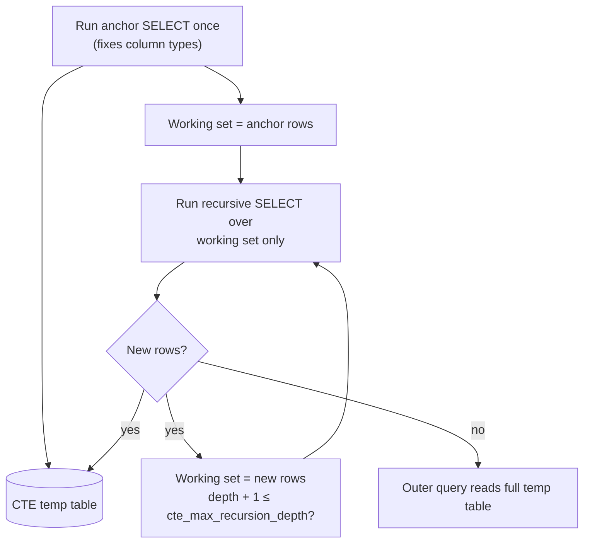

## Introduction

Some data is naturally **recursive**: an employee reports to a manager who reports to another manager; a product category sits inside a parent category inside a root category; a course requires another course that requires a third. Relational schemas store these structures as an **adjacency list** — each row points to its parent (`employees.manager_id`, `categories.parent_id`) or each edge is a row (`course_prereqs(course_id, prereq_id)`).

Storing such data is easy. *Querying* it is not, with ordinary SQL. A [self join](/lessons/m04-cross-self-join) climbs exactly one level; two self joins climb two levels. But "everyone in Diego's organisation, however deep", "the full path from the root category to Laptops" or "every course I must pass before CS-157B" need **an unknown number of joins**. The answer depends on the data, not on the query text.

A **recursive common table expression** solves this. It is a CTE (see [Common Table Expressions](/lessons/m04-ctes)) that refers to itself:

```sql
WITH RECURSIVE reports AS (
  SELECT employee_id FROM employees WHERE employee_id = 101        -- start here
  UNION ALL
  SELECT e.employee_id FROM employees e
  JOIN reports r ON e.manager_id = r.employee_id                    -- then repeat
)
SELECT * FROM reports;
```

MySQL evaluates the first part once, then keeps applying the second part to the rows found in the previous round until a round finds nothing new. In this lesson you will learn the theory behind that loop, how MySQL executes it, how to traverse hierarchies top-down and bottom-up, how to build readable paths **without silently truncating them**, how to generate number and date series, and how to protect yourself against runaway recursion and cycles.

:::note[Dataset]
The lesson runs on the **hr** dataset: 30 employees in a management hierarchy rooted at CEO 100 (`manager_id` NULL). To traverse the shop category tree and the university prerequisite graph in the same lab, we create small copies of those two tables below; the exercises also use the original shop and university datasets.
:::

## DBMS Theory

:::theory[Recursion as a fixpoint — transitive closure]
Given a binary relation E (edges: *child → parent*, or *course → prerequisite*), its **transitive closure** E⁺ contains a pair (a, c) whenever c is reachable from a by following one or more edges. Classical relational algebra **cannot** express transitive closure for graphs of arbitrary depth — every algebra expression joins a fixed number of relations. This limitation (proved by Aho and Ullman in 1979) is why SQL:1999 added recursion.

A recursive CTE defines a relation R by an equation R = A ∪ f(R), where **A** is the *anchor* (non-recursive) query and **f** is the *recursive* query that references R. Its meaning is the **least fixpoint** of that equation, computed iteratively:

- R₀ = A
- Rᵢ₊₁ = f(Rᵢ) — evaluated only over the rows **new** in the previous step (semi-naive evaluation)
- Stop when Rᵢ₊₁ is empty; the result is R₀ ∪ R₁ ∪ … ∪ Rₙ.

Termination is guaranteed when the recursive step can only produce rows from a finite set *and* never re-produces rows already seen (for example on an acyclic graph, or with set semantics). It is **not** guaranteed when the recursive member computes new values (n + 1, longer strings) or follows a cycle with bag semantics.
:::

The SQL standard restricts recursive queries to **linear recursion**: the recursive member references the CTE **once**. This keeps the iteration well defined — each new row is derived from exactly one row of the previous step. It also forbids operations whose result depends on *all* rows of the recursive relation at once (aggregation, `DISTINCT`, window functions), because those are not monotonic: adding rows later could change an earlier result.

| Term | Meaning |
|---|---|
| **Anchor member** | The non-recursive `SELECT`(s) before the first `UNION`; evaluated once; seeds R₀. |
| **Recursive member** | `SELECT`(s) after the `UNION` that reference the CTE; evaluated repeatedly. |
| **Iteration / step** | One evaluation of the recursive member over the rows produced by the previous step. |
| **Fixpoint** | The state in which a step produces no new rows; recursion ends. |
| **Depth** | Number of steps taken; in a hierarchy, the level of a node below the root. |
| **Cycle** | A path that returns to a node already visited (a → b → c → a); with `UNION ALL` it never ends. |

## Why It Exists

Before recursive CTEs (MySQL 8.0), MySQL developers had three unpleasant options for hierarchies:

1. **A fixed number of self joins** — `LEFT JOIN employees m1 … LEFT JOIN employees m2 …` up to some maximum depth. The query silently gives wrong answers the day the organisation grows one level deeper than the query assumes.
2. **Application-side loops** — query the children of a node, then the children of each child, and so on. A tree of depth d and n nodes costs up to n round trips (the "N+1 query" problem), each with network latency, and the result is not read from one consistent snapshot unless the loop runs inside a transaction.
3. **Stored procedures with loops and temporary tables** — workable but verbose, hard to test and hard to optimize.

Or they changed the data model to something query-friendly (nested sets, materialized paths, closure tables — discussed under *Alternative Approaches*), paying with more complex writes.

Recursive CTEs let you keep the simplest, most normalized model — the adjacency list, where a move in the hierarchy is a single-row `UPDATE` — and still answer arbitrary-depth questions in one declarative statement evaluated by the server. They also double as a general **row generator** (number and date series) that MySQL otherwise lacks.

## Internal Working

:::internals[How MySQL evaluates WITH RECURSIVE]
MySQL always **materializes** a recursive CTE; it can never be merged. Execution proceeds as follows:

1. **Anchor.** All anchor `SELECT`s are executed once. Their rows are written to the CTE's internal temporary table. The **column types of the CTE are fixed here**, from the anchor's select list — the recursive member cannot widen them.
2. **Iterate.** The recursive member is executed. Its reference to the CTE does **not** read the whole temporary table; it reads only the rows added by the **previous** iteration (in `EXPLAIN FORMAT=TREE` this appears as *"Scan new records on …"*). The rows it produces are appended to the temporary table (and, for `UNION DISTINCT`, rows already present are discarded).
3. **Converge.** When an iteration produces no new rows, recursion stops (*"Repeat until convergence"* in the plan). The outer query then reads the full temporary table.

Safety limits checked during iteration:

- **`cte_max_recursion_depth`** (default **1000**): if the recursive member runs for more than that many iterations, the statement fails with error **3636**. It is a session variable, so `SET SESSION cte_max_recursion_depth = …` raises it for your session.
- **`max_execution_time`** (milliseconds, for `SELECT`): a time limit, which the sandbox sets to protect the server.
- **`LIMIT`** in the recursive CTE (8.0.19+): caps the total number of rows the CTE produces and stops iterating once reached.

Syntax restrictions on the recursive member (checked at parse time): no aggregate functions, no window functions, no `GROUP BY`, no `ORDER BY`, no `DISTINCT`; the CTE may be referenced **only once**, **only in the `FROM` clause** (not in a subquery), and not as the inner (NULL-supplying) side of a `LEFT JOIN`.
:::



Two consequences follow directly from this design and cause most real bugs:

- **Column width is decided by the anchor.** If the anchor produces `path` as a 10-character string, every longer path built by the recursive member must fit into 10 characters. In strict SQL mode (the default) the statement fails with error 1406; in non-strict mode the path is **silently truncated**. You will see both.
- **Each iteration sees only the previous iteration's rows.** That is what makes semi-naive evaluation efficient, but it also means a condition like "stop when the node was visited earlier" cannot look at the temporary table — it must be carried *in the row itself*, typically as a path string.

## MySQL Implementation

```sql
WITH RECURSIVE cte_name [(col1, col2, ...)] AS (
    anchor_select                       -- does not reference cte_name
  UNION [ALL | DISTINCT]
    recursive_select                    -- references cte_name exactly once, in FROM
    [WHERE termination_condition]
)
SELECT ... FROM cte_name ...;
```

**The simplest recursion — a number series.** The anchor produces 1; each iteration adds one row with n + 1 until the `WHERE` condition fails:

```sql run
WITH RECURSIVE seq (n) AS (
  SELECT 1
  UNION ALL
  SELECT n + 1 FROM seq WHERE n < 10
)
SELECT n FROM seq;
```

**Top-down hierarchy — everyone below a manager.** Start from the employees who report directly to VP 101 (Diego Mensah) and repeatedly add their reports. Carry a `depth` column so you know how far each person is from the VP:

```sql run
WITH RECURSIVE org AS (
  SELECT employee_id, first_name, last_name, manager_id, 1 AS depth
  FROM employees
  WHERE manager_id = 101
  UNION ALL
  SELECT e.employee_id, e.first_name, e.last_name, e.manager_id, o.depth + 1
  FROM employees e
  JOIN org o ON e.manager_id = o.employee_id
)
SELECT employee_id, first_name, last_name, manager_id, depth
FROM org
ORDER BY depth, employee_id;
```

The join `e.manager_id = o.employee_id` reads "find employees whose manager is someone found in the previous step". The recursion stops when the last people found manage nobody.

**Bottom-up — the management chain of one employee.** Reverse the direction of the join: start from an employee and repeatedly fetch the *manager* of the row found in the previous step:

```sql run
WITH RECURSIVE chain AS (
  SELECT employee_id, first_name, manager_id, 0 AS steps_up
  FROM employees
  WHERE employee_id = 120
  UNION ALL
  SELECT m.employee_id, m.first_name, m.manager_id, c.steps_up + 1
  FROM employees m
  JOIN chain c ON m.employee_id = c.manager_id
)
SELECT employee_id, first_name, manager_id, steps_up
FROM chain
ORDER BY steps_up;
```

Bottom-up traversal of a tree is a simple chain (each node has one parent), so each iteration produces at most one row; it ends at the CEO, whose `manager_id` is NULL and joins nothing.

## Syntax Breakdown

| Element | Meaning and rules |
|---|---|
| `WITH RECURSIVE` | `RECURSIVE` is mandatory if any CTE in the list references itself; without it the self-reference is looked up as a base table (error 1146). |
| Column list `(n, …)` | Optional; names the columns. Types still come from the anchor. |
| Anchor member | One or more `SELECT`s that do not reference the CTE, combined with `UNION [ALL\|DISTINCT]`. Determines column count, names and **types**. |
| `UNION ALL` | Keeps every derived row — fastest; requires the recursion to terminate by itself (acyclic data or an explicit stop condition). |
| `UNION DISTINCT` | Discards rows already in the result — guarantees termination on cyclic graphs **if** the rows contain only node identifiers (no depth or path columns that keep changing). |
| Recursive member | References the CTE once, in `FROM` (or a join in `FROM`). No aggregates, window functions, `GROUP BY`, `ORDER BY`, `DISTINCT`. |
| Termination condition | A `WHERE` predicate in the recursive member (`n < 10`, `depth < 20`) or the natural end of the data (no more children). |
| `LIMIT n` | Allowed (8.0.19+) after the recursive member; caps the total rows produced. |
| `cte_max_recursion_depth` | Session variable (default 1000): maximum iterations before error 3636. |
| `CAST(expr AS CHAR(n))` | Use in the **anchor** to give string columns enough width for values built later. |

## Practical Examples

**1. Full org chart with a readable path.** Start at the root (the CEO) and build a path of names. The anchor casts the path to `CHAR(500)` so that the longest chain fits — the reason is shown in *Common Mistakes*:

```sql run
WITH RECURSIVE org_chart AS (
  SELECT employee_id, manager_id, 0 AS lvl,
         CAST(CONCAT(first_name, ' ', last_name) AS CHAR(500)) AS path
  FROM employees
  WHERE manager_id IS NULL
  UNION ALL
  SELECT e.employee_id, e.manager_id, oc.lvl + 1,
         CONCAT(oc.path, ' > ', e.first_name, ' ', e.last_name)
  FROM employees e
  JOIN org_chart oc ON e.manager_id = oc.employee_id
)
SELECT employee_id, lvl, path
FROM org_chart
ORDER BY path
LIMIT 15;
```

Sorting by the path groups each subtree under its manager — a depth-first listing that reads like an indented org chart. (Sorting by name strings is good enough for display; for a stable sibling order, build a sort key from zero-padded IDs, e.g. `LPAD(employee_id, 6, '0')`.)

**2. Subtree aggregates — headcount and payroll per VP.** Carry the *top* of each subtree through the recursion, then aggregate in the outer query (aggregation is not allowed inside the recursive member, but it is fine outside):

```sql run
WITH RECURSIVE under_vp AS (
  SELECT employee_id AS vp_id, employee_id, salary
  FROM employees
  WHERE manager_id = 100
  UNION ALL
  SELECT u.vp_id, e.employee_id, e.salary
  FROM employees e
  JOIN under_vp u ON e.manager_id = u.employee_id
)
SELECT u.vp_id, v.first_name, v.last_name,
       COUNT(*) - 1     AS reports_total,
       SUM(u.salary)    AS payroll_incl_vp
FROM under_vp u
JOIN employees v ON v.employee_id = u.vp_id
GROUP BY u.vp_id, v.first_name, v.last_name
ORDER BY reports_total DESC;
```

**3. A category tree with depth and full path.** Create a copy of the shop's `categories` table in this lab and walk it from the roots:

```sql run
CREATE TABLE categories (
  category_id INT PRIMARY KEY,
  name        VARCHAR(60) NOT NULL,
  parent_id   INT NULL,
  KEY idx_parent (parent_id)
);
INSERT INTO categories VALUES
  (1, 'Electronics', NULL), (2, 'Computers', 1), (3, 'Laptops', 2), (4, 'Accessories', 2),
  (5, 'Audio', 1), (6, 'Home & Kitchen', NULL), (7, 'Coffee', 6), (8, 'Books', NULL),
  (9, 'Databases', 8), (10, 'Fitness', NULL);

WITH RECURSIVE tree AS (
  SELECT category_id, name, parent_id, 0 AS depth,
         CAST(name AS CHAR(300)) AS path
  FROM categories
  WHERE parent_id IS NULL
  UNION ALL
  SELECT c.category_id, c.name, c.parent_id, t.depth + 1,
         CONCAT(t.path, ' > ', c.name)
  FROM categories c
  JOIN tree t ON c.parent_id = t.category_id
)
SELECT category_id, depth, CONCAT(REPEAT('    ', depth), name) AS indented, path
FROM tree
ORDER BY path;
```

`REPEAT('    ', depth)` indents each name by its depth — a cheap tree rendering for reports. A common follow-up is "all descendants of Electronics" (filter the anchor to `category_id = 1`), used to show every product in a category *including its subcategories*.

**4. A prerequisite graph — transitive closure on a DAG.** Prerequisites are a graph, not a tree: CS-146 requires both CS-046 and MATH-042, and one course may be a prerequisite of several others. Copy the university `course_prereqs` edges and find everything a student must complete before CS-157B:

```sql run
CREATE TABLE course_prereqs (
  course_id VARCHAR(10) NOT NULL,
  prereq_id VARCHAR(10) NOT NULL,
  PRIMARY KEY (course_id, prereq_id)
);
INSERT INTO course_prereqs VALUES
  ('CS-146', 'CS-046'), ('CS-149', 'CS-146'), ('CS-157A', 'CS-146'), ('CS-160', 'CS-146'),
  ('CS-157B', 'CS-157A'), ('DATA-225', 'DATA-200'), ('DATA-245', 'DATA-200'),
  ('DATA-226', 'DATA-225'), ('CS-146', 'MATH-042'), ('DATA-245', 'MATH-161A');

WITH RECURSIVE required AS (
  SELECT prereq_id, 1 AS distance
  FROM course_prereqs
  WHERE course_id = 'CS-157B'
  UNION ALL
  SELECT p.prereq_id, r.distance + 1
  FROM course_prereqs p
  JOIN required r ON p.course_id = r.prereq_id
)
SELECT prereq_id, MIN(distance) AS distance
FROM required
GROUP BY prereq_id
ORDER BY distance, prereq_id;
```

In a DAG the same node can be reached along several paths, so `UNION ALL` may produce it more than once; the outer `GROUP BY` collapses duplicates and keeps the shortest distance. The reverse question — "which courses does CS-146 unlock, directly or indirectly?" — swaps the join direction (`p.prereq_id = r.course_id`).

**5. Series generation — filling gaps in a report.** "Hires per year, 2014–2024" with a plain `GROUP BY` omits years without hires. Generate every year with a recursive CTE and `LEFT JOIN` the facts to it:

```sql run
WITH RECURSIVE years (y) AS (
  SELECT 2014
  UNION ALL
  SELECT y + 1 FROM years WHERE y < 2024
)
SELECT y AS hire_year, COUNT(e.employee_id) AS hires
FROM years
LEFT JOIN employees e ON YEAR(e.hire_date) = y
GROUP BY y
ORDER BY y;
```

The same technique generates calendars (`SELECT d + INTERVAL 1 DAY … WHERE d < '2024-12-31'`) for daily dashboards and test data at scale (the performance section below generates 50,000 rows this way).

**6. Cycle detection.** Real graphs can contain cycles — through bad data entry, or because the domain allows them (social networks, routes). Build a small dependency graph with a cycle B → C → D → B:

```sql run
CREATE TABLE task_deps (task CHAR(1) NOT NULL, depends_on CHAR(1) NOT NULL, PRIMARY KEY (task, depends_on));
INSERT INTO task_deps VALUES ('A','B'), ('B','C'), ('C','D'), ('D','B'), ('C','E');

WITH RECURSIVE walk AS (
  SELECT task, depends_on,
         CAST(CONCAT(task, ',', depends_on) AS CHAR(200)) AS path,
         0 AS is_cycle
  FROM task_deps
  WHERE task = 'A'
  UNION ALL
  SELECT d.task, d.depends_on,
         CONCAT(w.path, ',', d.depends_on),
         FIND_IN_SET(d.depends_on, w.path) > 0
  FROM task_deps d
  JOIN walk w ON d.task = w.depends_on
  WHERE w.is_cycle = 0
)
SELECT path, is_cycle FROM walk ORDER BY path;
```

Each row carries the **path visited so far**. When the next node is already in the path (`FIND_IN_SET(...) > 0`), the row is emitted with `is_cycle = 1` — so you can *report* the cycle — and the `WHERE w.is_cycle = 0` condition stops extending it. Without this guard the `UNION ALL` recursion would loop B → C → D → B … until error 3636.

When you only need the set of reachable **nodes** (not paths or depths), `UNION DISTINCT` is a simpler cycle guard: a node already in the result is not added again, so the iteration runs out of new rows:

```sql run
WITH RECURSIVE reachable (node) AS (
  SELECT CAST('A' AS CHAR(1))
  UNION DISTINCT
  SELECT d.depends_on
  FROM task_deps d
  JOIN reachable r ON d.task = r.node
)
SELECT node FROM reachable ORDER BY node;
```

This works only because each row is just the node id. Add a `depth` column and every revisit becomes a "new" row with a larger depth — the `DISTINCT` no longer stops the cycle.

## Execution Walkthrough

Watch the iterations of the org-chart recursion one at a time. Each step reproduces exactly the rows that one iteration adds, by limiting the recursion with a depth condition — the same rows MySQL appends to the temporary table in that iteration.

```walkthrough
title: WITH RECURSIVE org AS (anchor = CEO; recursive = reports of previous step) SELECT ...
steps:
  - title: "1. Anchor — R₀"
    explain: The anchor runs once and finds the root of the hierarchy, the only employee without a manager. Its select list fixes the column types for the whole CTE.
    sql: SELECT employee_id, first_name, manager_id, 0 AS lvl FROM employees WHERE manager_id IS NULL;
  - title: "2. Iteration 1 — R₁"
    explain: The recursive member joins employees to the rows of R₀ only (the CEO). It finds the CEO's direct reports — the VPs. These rows are appended to the temporary table.
    sql: |
      WITH RECURSIVE org AS (
        SELECT employee_id, first_name, manager_id, 0 AS lvl FROM employees WHERE manager_id IS NULL
        UNION ALL
        SELECT e.employee_id, e.first_name, e.manager_id, o.lvl + 1
        FROM employees e JOIN org o ON e.manager_id = o.employee_id
        WHERE o.lvl < 1)
      SELECT * FROM org WHERE lvl = 1 ORDER BY employee_id;
  - title: "3. Iteration 2 — R₂"
    explain: The next iteration reads only the rows added in iteration 1 (the VPs), not the CEO again. It finds the people who report to the VPs.
    sql: |
      WITH RECURSIVE org AS (
        SELECT employee_id, first_name, manager_id, 0 AS lvl FROM employees WHERE manager_id IS NULL
        UNION ALL
        SELECT e.employee_id, e.first_name, e.manager_id, o.lvl + 1
        FROM employees e JOIN org o ON e.manager_id = o.employee_id
        WHERE o.lvl < 2)
      SELECT * FROM org WHERE lvl = 2 ORDER BY employee_id;
  - title: "4. Iterations 3 and beyond"
    explain: The process repeats. Counting rows per level shows how many rows each iteration added. The last level is where the iteration that follows finds nothing.
    sql: |
      WITH RECURSIVE org AS (
        SELECT employee_id, manager_id, 0 AS lvl FROM employees WHERE manager_id IS NULL
        UNION ALL
        SELECT e.employee_id, e.manager_id, o.lvl + 1
        FROM employees e JOIN org o ON e.manager_id = o.employee_id)
      SELECT lvl, COUNT(*) AS rows_added FROM org GROUP BY lvl ORDER BY lvl;
  - title: "5. Fixpoint and the plan"
    explain: >-
      After the deepest level, one more iteration runs, joins no rows, and recursion stops. The plan shows the
      mechanics — Materialize recursive CTE, the anchor executed once, and Repeat until convergence around a
      join that scans only the new records of the previous iteration and probes employees through the
      idx_employees_manager index.
    sql: |
      EXPLAIN FORMAT=TREE
      WITH RECURSIVE org AS (
        SELECT employee_id, manager_id, 0 AS lvl FROM employees WHERE manager_id IS NULL
        UNION ALL
        SELECT e.employee_id, e.manager_id, o.lvl + 1
        FROM employees e JOIN org o ON e.manager_id = o.employee_id)
      SELECT * FROM org;
```

## Output

The final result of the recursion is the union of all iterations: every employee exactly once (a tree has one path from the root to each node), each with the level at which it was discovered. Step 4's counts must add up to the 30 employees — if a recursive query over a tree returns *more* rows than nodes, the data contains a cycle or a node with two parents; if it returns fewer, some rows are not connected to the anchor (for example, an employee whose `manager_id` points at a non-existent employee).

That consistency check is worth automating:

```sql run
WITH RECURSIVE org AS (
  SELECT employee_id FROM employees WHERE manager_id IS NULL
  UNION ALL
  SELECT e.employee_id FROM employees e JOIN org o ON e.manager_id = o.employee_id
)
SELECT (SELECT COUNT(*) FROM org)       AS reachable_from_root,
       (SELECT COUNT(*) FROM employees) AS employees;
```

## Alternative Approaches

Recursive CTEs query an **adjacency list**. Several other *data models* exist precisely to make hierarchy queries cheaper; they trade query simplicity for write complexity.

| Approach | How hierarchy is stored | Reads | Writes / moves | Fits |
|---|---|---|---|---|
| **Adjacency list + recursive CTE** | `parent_id` per row | One recursive query; cost ∝ nodes visited | Trivial: update one `parent_id` | Most OLTP hierarchies; frequently changing trees |
| **Fixed self joins** | `parent_id` | One query per known depth | Trivial | Hierarchies with a hard, guaranteed maximum depth (e.g. country > state > city) |
| **Materialized path** | `path = '/1/2/3/'` column | Subtree = `path LIKE '/1/2/%'` (index range scan) | Moving a subtree rewrites every descendant's path | Read-heavy trees: categories, file systems, threaded comments |
| **Nested sets** | `lft`, `rgt` interval per node | Subtree = `lft BETWEEN …` | Inserts shift half the tree | Rarely-changing trees with heavy subtree reads |
| **Closure table** | One row per (ancestor, descendant, depth) pair | Subtree/ancestors = one indexed join | Insert adds depth+1 rows; storage O(n·depth) | Graph-like data, frequent ancestor/descendant queries |
| **Application loop** | `parent_id` | n round trips | Trivial | Avoid — latency and consistency problems |

The fixed self-join version of "Diego's organisation" works only up to the depth you write:

```sql run
SELECT COALESCE(l3.employee_id, l2.employee_id, l1.employee_id) AS deepest_found,
       l1.employee_id AS lvl1, l2.employee_id AS lvl2, l3.employee_id AS lvl3
FROM employees l1
LEFT JOIN employees l2 ON l2.manager_id = l1.employee_id
LEFT JOIN employees l3 ON l3.manager_id = l2.employee_id
WHERE l1.manager_id = 101
ORDER BY lvl1, lvl2, lvl3
LIMIT 8;
```

It returns one row per *path*, needs a new `LEFT JOIN` for every possible level, and gives no warning when a deeper level exists. A recursive CTE has none of these problems. A recursive CTE is also the standard way to **build** a closure table or materialized paths from an adjacency list — for instance `INSERT INTO category_paths WITH RECURSIVE …`.

## Performance Analysis

A recursive CTE costs roughly **(number of iterations) × (cost of one recursive step)**. Each step joins the previous iteration's new rows to the base table, so its cost depends on whether that join can use an **index on the join column** (`manager_id`, `parent_id`). Without one, every iteration scans the whole table (or builds a hash table from it).

To measure, generate a 50,000-node tree: node *n*'s parent is *n DIV 2*, so the tree is a balanced binary tree of depth about 15.

```sql run
SET SESSION cte_max_recursion_depth = 60000;
CREATE TABLE big_tree (id INT PRIMARY KEY, parent_id INT NULL, payload INT NOT NULL);
INSERT INTO big_tree
WITH RECURSIVE seq (n) AS (SELECT 1 UNION ALL SELECT n + 1 FROM seq WHERE n < 50000)
SELECT n, NULLIF(n DIV 2, 0), n % 97 FROM seq;
ANALYZE TABLE big_tree;
```

Count the subtree under node 2 (32,767 of the 50,000 nodes) **without** an index on `parent_id`:

```sql run measured
EXPLAIN ANALYZE
WITH RECURSIVE sub AS (
  SELECT id FROM big_tree WHERE id = 2
  UNION ALL
  SELECT t.id FROM big_tree t JOIN sub s ON t.parent_id = s.id
)
SELECT COUNT(*) FROM sub;
```

Now add the index and repeat:

```sql run
CREATE INDEX idx_big_tree_parent ON big_tree (parent_id);
ANALYZE TABLE big_tree;
SET SESSION cte_max_recursion_depth = DEFAULT;
```

```sql run measured
EXPLAIN ANALYZE
WITH RECURSIVE sub AS (
  SELECT id FROM big_tree WHERE id = 2
  UNION ALL
  SELECT t.id FROM big_tree t JOIN sub s ON t.parent_id = s.id
)
SELECT COUNT(*) FROM sub;
```

Compare the two trees. In the first, the recursive step has no index to use, so the optimizer builds a hash table from each iteration's new rows and probes it with a **full scan of `big_tree`**: the table scan shows `rows=50000 loops=15` — 15 iterations × 50,000 rows = 750,000 rows read to find 32,766 descendants. In the second, the step is a *covering index lookup* on `idx_big_tree_parent`, executed once per node found (`loops=32767`, about one row each), so the work is proportional to the size of the subtree, not to the size of the table. (The `loops` figure of the join itself is not the tree depth in this plan; the per-lookup figures are what to read.) Compare the `actual time` of the top `Aggregate` line in each tree: the indexed version is faster even on this small table, but the absolute milliseconds come from the build machine and will differ on yours; the difference in **rows examined** is the transferable lesson, and it grows with table size: on a 5-million-row table the unindexed version would read 5 million rows per level.

:::performance[Theory vs measurement]
- **Iterations** = depth of the traversal (≈ log₂ n for a balanced binary tree, but a "linked list" hierarchy of n nodes needs n iterations — watch `cte_max_recursion_depth`).
- **Per-iteration cost** with an index on the join column ≈ (new rows) × (index lookup); without it ≈ a full scan or hash build per iteration.
- **Rows materialized** = total result size (every row of every iteration). Wide path strings make each row larger; `CHAR(500)` paths on millions of rows can push the temporary table to disk.
- **`UNION DISTINCT`** adds a deduplication probe per row; use it only when you need it.
The model tells you *what* to look for; `EXPLAIN ANALYZE` on realistic data tells you *how much* it costs.
:::

## Best Practices

:::best-practice[Recursive CTEs in production]
1. **Index the parent/edge column** used in the recursive join (`manager_id`, `parent_id`, `course_prereqs(course_id)`). It is the difference between index lookups and a table scan per level.
2. **Size string columns in the anchor**: `CAST(… AS CHAR(n))` with an `n` large enough for the deepest realistic path. Strict SQL mode turns overflow into an error — keep it on.
3. **Always have a termination guarantee**: a natural end (acyclic data), an explicit `WHERE depth < k`, a cycle guard in the row, or `UNION DISTINCT` over node ids.
4. **Keep `cte_max_recursion_depth` as a safety net**, raising it per session only for intentional deep recursions (series generation), never globally to "make the error go away".
5. **Aggregate outside the recursion**: carry the keys you need (`vp_id`, `depth`) through the recursion and `GROUP BY` in the outer query.
6. **Validate the structure**: compare reachable rows with total rows; detect cycles and orphans with a scheduled data-quality query.
7. **Prevent cycles at write time** when the domain forbids them (e.g. check with a recursive query in the application or a trigger before re-parenting a node).
:::

## Common Mistakes

**Mistake 1 — the anchor fixes a too-narrow column type.** `CAST(employee_id AS CHAR)` is only as wide as the longest employee id, so the first concatenated path (`100/101`) does not fit. In strict mode (the default) MySQL refuses:

```sql run error
WITH RECURSIVE chain AS (
  SELECT employee_id, CAST(employee_id AS CHAR) AS path
  FROM employees WHERE manager_id IS NULL
  UNION ALL
  SELECT e.employee_id, CONCAT(c.path, '/', e.employee_id)
  FROM employees e JOIN chain c ON e.manager_id = c.employee_id
)
SELECT * FROM chain;
```

Error 1406 *Data too long for column 'path'*. Worse, in a session **without** strict mode the same query "works" and silently truncates every path to the anchor's width:

```sql run
SET SESSION sql_mode = '';
WITH RECURSIVE chain AS (
  SELECT employee_id, CAST(employee_id AS CHAR) AS path
  FROM employees WHERE manager_id IS NULL
  UNION ALL
  SELECT e.employee_id, CONCAT(c.path, '/', e.employee_id)
  FROM employees e JOIN chain c ON e.manager_id = c.employee_id
)
SELECT employee_id, path FROM chain WHERE employee_id IN (104, 106, 110) ORDER BY employee_id;
```

```sql run
SET SESSION sql_mode = DEFAULT;
SELECT @@SESSION.sql_mode;
```

The paths for employees deep in the hierarchy are cut off — a report built on them would group people under the wrong managers. The fix is to give the anchor column enough room: `CAST(employee_id AS CHAR(200))`.

**Mistake 2 — recursion that never ends.** Forgetting the termination condition of a series:

```sql run error
WITH RECURSIVE seq (n) AS (
  SELECT 1
  UNION ALL
  SELECT n + 1 FROM seq
)
SELECT COUNT(*) FROM seq;
```

Error 3636 after 1001 iterations, thanks to `cte_max_recursion_depth = 1000`. The same error is what a cycle produces with `UNION ALL`. Fix the termination condition — don't just raise the limit.

**Mistake 3 — forgetting `RECURSIVE`.**

```sql run error
WITH seq (n) AS (
  SELECT 1 UNION ALL SELECT n + 1 FROM seq WHERE n < 5
)
SELECT * FROM seq;
```

Without `RECURSIVE`, the reference to `seq` inside its own definition is resolved as a base table, which does not exist (error 1146).

**Mistake 4 — aggregating inside the recursive member.**

```sql run error
WITH RECURSIVE s AS (
  SELECT 1 AS n
  UNION ALL
  SELECT MAX(n) + 1 FROM s WHERE n < 5
)
SELECT * FROM s;
```

Error 3575: aggregation and window functions are not allowed in the recursive query block. Aggregate in the outer query instead.

**Mistake 5 — trying to sort the recursion.** `ORDER BY` inside the recursive member is rejected (error 1235, *not yet supported*). Order is a property of the final result: put `ORDER BY` (by path, depth, …) in the outer query.

**Mistake 6 — `UNION DISTINCT` with a depth column on a cyclic graph.** As shown in Practical Example 6, rows that include an ever-increasing depth are never duplicates, so `DISTINCT` does not stop the cycle. Guard with a path or remove the changing columns.

## Industry Application

- **Org charts and permissions.** HR systems compute "all reports of manager X" for approval workflows and access control (a manager may see the salaries of their whole subtree). Recursive CTEs over `manager_id` are the standard implementation; results are often cached per manager because the hierarchy changes rarely.
- **E-commerce category trees.** "Show all products in Electronics" must include Laptops and Accessories. Shops either query recursively or maintain a closure table / materialized path refreshed by a recursive CTE whenever the tree changes.
- **Bills of materials (BOM).** Manufacturing ERPs explode a product into components, sub-components and raw materials, multiplying quantities along each path — a recursive CTE whose recursive member carries `qty * parent_qty`.
- **Dependency graphs.** Build systems, course-planning tools (prerequisite chains like the university example) and data-pipeline orchestrators compute upstream/downstream dependencies and must detect cycles before scheduling.
- **Threaded comments and file systems.** Forums and document stores render nested replies or folder trees, usually with a path-based sort key built in the recursion.
- **Calendars and test data.** Analysts generate date spines to zero-fill dashboards; engineers generate millions of synthetic rows for load tests — exactly the pattern used in this lesson's performance section.

## Practice Exercises

```exercise
id: ex1
title: Generate the months of 2024
difficulty: easy
concepts: [recursive-cte, series-generation]
dataset: empty
prompt: |
  Using a recursive CTE, return the first day of every month of 2024, from `2024-01-01` to `2024-12-01`.
  Return one column, `month_start`, of type DATE (12 rows).
hints:
  - "Anchor: SELECT DATE '2024-01-01'. Recursive member: add INTERVAL 1 MONTH."
  - "Stop with WHERE month_start < '2024-12-01'."
solution: |
  WITH RECURSIVE months (month_start) AS (
    SELECT DATE '2024-01-01'
    UNION ALL
    SELECT month_start + INTERVAL 1 MONTH
    FROM months
    WHERE month_start < '2024-12-01'
  )
  SELECT month_start FROM months;
explanation: |
  The condition is checked on the *previous* row: the row for 2024-11-01 passes and produces 2024-12-01; the
  row for 2024-12-01 fails, so no 2025-01-01 row is generated. A common off-by-one mistake is
  `WHERE month_start <= '2024-12-01'`, which produces 13 rows.
```

```exercise
id: ex2
title: Everyone in Chloe Ahmed's team
difficulty: medium
concepts: [recursive-cte, hierarchies]
prompt: |
  Return every employee who reports to employee **105** (Chloe Ahmed), directly or indirectly, with their
  distance from her. Columns: `employee_id`, `first_name`, `last_name`, `depth` (1 = direct report).
  Do not include employee 105 herself.
hints:
  - "Anchor: employees WHERE manager_id = 105, with depth 1."
  - "Recursive member: join employees e to the CTE on e.manager_id = cte.employee_id and add 1 to depth."
solution: |
  WITH RECURSIVE team AS (
    SELECT employee_id, first_name, last_name, 1 AS depth
    FROM employees
    WHERE manager_id = 105
    UNION ALL
    SELECT e.employee_id, e.first_name, e.last_name, t.depth + 1
    FROM employees e
    JOIN team t ON e.manager_id = t.employee_id
  )
  SELECT employee_id, first_name, last_name, depth FROM team;
explanation: |
  Starting the anchor at the direct reports (rather than at employee 105 with depth 0) excludes the manager
  without an extra filter. If you start at 105, add `WHERE depth > 0` in the outer query.
```

```exercise
id: ex3
title: Path from the root to every category
difficulty: medium
concepts: [recursive-cte, path-enumeration]
dataset: shop
prompt: |
  In the shop dataset, return every category with its full path from the root, segments separated by `' > '`
  (for example `Electronics > Computers > Laptops`). Columns: `category_id`, `path`.
hints:
  - "Anchor: categories WHERE parent_id IS NULL, with path = name."
  - "CAST the anchor path to a wide CHAR (e.g. CHAR(300)) so longer paths fit."
  - "Recursive member: CONCAT(parent_path, ' > ', c.name), joining c.parent_id = cte.category_id."
solution: |
  WITH RECURSIVE tree AS (
    SELECT category_id, CAST(name AS CHAR(300)) AS path
    FROM categories
    WHERE parent_id IS NULL
    UNION ALL
    SELECT c.category_id, CONCAT(t.path, ' > ', c.name)
    FROM categories c
    JOIN tree t ON c.parent_id = t.category_id
  )
  SELECT category_id, path FROM tree;
explanation: |
  Without the CAST, `path` would take the type of `name` (VARCHAR(60)). In this small tree the longest path
  happens to fit, but a deeper or longer-named tree would fail with error 1406 in strict mode — or be silently
  truncated without it. Always size the anchor for the deepest realistic path.
```

```exercise
id: ex4
title: All prerequisites of Data Warehousing
difficulty: hard
concepts: [recursive-cte, transitive-closure]
dataset: university
prompt: |
  In the university dataset, list every course a student must complete (directly or indirectly) before taking
  `DATA-226`, with the course title and the **shortest** number of prerequisite steps from DATA-226.
  Columns: `course_id`, `title`, `steps`.
hints:
  - "Anchor: SELECT prereq_id, 1 FROM course_prereqs WHERE course_id = 'DATA-226'."
  - "Recursive member: join course_prereqs p ON p.course_id = cte.prereq_id."
  - "A course can be reached along several paths in a DAG: GROUP BY the course and take MIN(steps), then join courses for the title."
solution: |
  WITH RECURSIVE req AS (
    SELECT prereq_id AS course_id, 1 AS steps
    FROM course_prereqs
    WHERE course_id = 'DATA-226'
    UNION ALL
    SELECT p.prereq_id, r.steps + 1
    FROM course_prereqs p
    JOIN req r ON p.course_id = r.course_id
  )
  SELECT r.course_id, c.title, MIN(r.steps) AS steps
  FROM req r
  JOIN courses c ON c.course_id = r.course_id
  GROUP BY r.course_id, c.title;
explanation: |
  The recursion computes the transitive closure of the prerequisite relation starting at DATA-226. Because
  aggregation is not allowed inside the recursive member, the shortest distance is computed in the outer
  query. The graph is acyclic, so `UNION ALL` terminates without a guard.
```

```exercise
id: ex5
title: Find the cycle
difficulty: challenge
concepts: [recursive-cte, cycle-detection]
dataset: empty
setup: |
  CREATE TABLE flights (origin CHAR(3) NOT NULL, dest CHAR(3) NOT NULL, PRIMARY KEY (origin, dest));
  INSERT INTO flights VALUES ('SJC','LAX'), ('LAX','SEA'), ('SEA','DEN'), ('DEN','LAX'), ('SEA','JFK'), ('JFK','BOS');
prompt: |
  The table `flights(origin, dest)` contains a cycle. Starting from `SJC`, follow flights and return every
  route that **returns to an airport already visited**, as a comma-separated path that ends with the repeated
  airport (for example `SJC,LAX,SEA,DEN,LAX`). Return one column, `path`.
hints:
  - "Carry the path visited so far in each row; CAST the anchor path to CHAR(200)."
  - "FIND_IN_SET(next_airport, path) > 0 tells you the next airport was already visited."
  - "Add an is_cycle flag computed in the recursive member, stop extending rows whose flag is 1 (WHERE cte.is_cycle = 0), and return only flagged rows."
solution: |
  WITH RECURSIVE route AS (
    SELECT dest,
           CAST(CONCAT(origin, ',', dest) AS CHAR(200)) AS path,
           0 AS is_cycle
    FROM flights
    WHERE origin = 'SJC'
    UNION ALL
    SELECT f.dest,
           CONCAT(r.path, ',', f.dest),
           FIND_IN_SET(f.dest, r.path) > 0
    FROM flights f
    JOIN route r ON f.origin = r.dest
    WHERE r.is_cycle = 0
  )
  SELECT path FROM route WHERE is_cycle = 1;
explanation: |
  The flag row is still produced (so it can be reported) but never extended, so the recursion terminates.
  Without the guard the query loops LAX → SEA → DEN → LAX until error 3636. `UNION DISTINCT` would not help
  here, because every row contains a different, ever-longer path.
```

```exercise
id: ex6
title: Choosing a hierarchy model
difficulty: medium
kind: open
concepts: [hierarchies, recursive-cte]
prompt: |
  A marketplace has a category tree of ~5,000 categories, up to 8 levels deep. Category pages ("all products in
  this category and its subcategories") are requested thousands of times per second; the tree changes a few
  times per week. Compare an adjacency list queried with a recursive CTE against a closure table, and recommend
  a design.
solution: |
  **Adjacency list + recursive CTE**: simplest writes (re-parenting is one UPDATE) and always consistent, but
  every page view runs a recursion of up to 8 iterations plus a join to products. Indexed on `parent_id`, each
  step is cheap, yet at thousands of requests per second the repeated work adds up.

  **Closure table** `(ancestor_id, descendant_id, depth)`: a category page is one indexed join
  (`WHERE ancestor_id = ?` joined to products by category). Storage is O(n × depth) — at most ~40,000 rows here,
  trivial. Writes are more complex: moving a subtree deletes and re-inserts its paths.

  **Recommendation**: keep the adjacency list as the source of truth (simple, normalized) and maintain a closure
  table derived from it with a recursive CTE (`INSERT INTO category_closure WITH RECURSIVE …`) inside the same
  transaction that changes the tree, or rebuild it on each (rare) change. Reads hit the closure table; the
  recursive CTE runs only on writes. An application-level cache of subtree id lists is a further option.
```

## Knowledge Assessment

```quiz
- id: q1
  question: "In MySQL, which rows does the recursive member read from the CTE in each iteration?"
  options:
    - "All rows produced so far"
    - "Only the rows produced by the previous iteration"
    - "Only the anchor rows"
    - "A random sample of rows"
  answer: 1
  explanation: "MySQL uses semi-naive evaluation: the reference to the CTE in the recursive member scans only the new records of the previous iteration (EXPLAIN shows 'Scan new records on …'). Reading all rows each time would redo work and duplicate results."
  concepts: [recursive-cte]
- id: q2
  question: "The anchor selects `CAST(employee_id AS CHAR) AS path`; the recursive member appends `'/' || id` with CONCAT. Under the default sql_mode, what happens?"
  options:
    - "Paths are automatically widened"
    - "Error 1406 'Data too long for column path' as soon as a path exceeds the anchor's width"
    - "Paths are silently truncated with no error"
    - "Error 3636 recursion depth exceeded"
  answer: 1
  explanation: "Column types of a recursive CTE are fixed by the anchor. Strict mode (part of the default sql_mode) rejects the overflow; only in non-strict mode is the value silently truncated. Error 3636 concerns iteration count, not width."
  concepts: [path-enumeration, recursive-cte]
- id: q3
  question: "A recursive CTE fails with error 3636 after 1001 iterations. What is the most likely cause, and the right fix?"
  options:
    - "The server is overloaded; retry later"
    - "The recursion has no effective termination condition or follows a cycle; fix the condition or add a cycle guard"
    - "The anchor returned too many rows; add LIMIT to the anchor"
    - "The CTE needs an index; run ANALYZE TABLE"
  answer: 1
  explanation: "Error 3636 means more iterations than cte_max_recursion_depth (default 1000). Raising the limit is only correct when deep recursion is intended (e.g. generating a long series); for runaway recursion it just delays the failure."
  concepts: [cte-max-recursion-depth, cycle-detection]
- id: q4
  question: "Which of these are NOT allowed in the recursive member of a MySQL recursive CTE? (Select all that apply.)"
  type: multi
  options:
    - "An aggregate function such as MAX(n)"
    - "A JOIN between a base table and the CTE"
    - "ORDER BY"
    - "A WHERE condition such as n < 10"
    - "A window function such as ROW_NUMBER()"
  answer: [0, 2, 4]
  explanation: "Aggregates, window functions, GROUP BY, ORDER BY and DISTINCT are prohibited in the recursive block. Joining the CTE (referenced once, in FROM) and filtering with WHERE are the normal building blocks."
  concepts: [recursive-cte]
- id: q5
  question: "On a cyclic graph, when does `UNION DISTINCT` (instead of UNION ALL) guarantee termination?"
  options:
    - "Always"
    - "Only when each row contains just values from a finite set, such as node ids — no ever-growing depth or path column"
    - "Never; only cte_max_recursion_depth stops it"
    - "Only when the anchor returns one row"
  answer: 1
  explanation: "DISTINCT discards rows already produced. With only node ids, revisiting a node produces a duplicate, so iteration runs out of new rows. A depth or path column makes each revisit a new distinct row."
  concepts: [cycle-detection]
- id: q6
  question: "Why do recursive CTEs exist at all — why can't a fixed set of self joins answer 'all descendants of X'?"
  options:
    - "Self joins are slower than recursion"
    - "Relational algebra expressions join a fixed number of relations, so they cannot express transitive closure of arbitrary depth"
    - "MySQL does not support self joins"
    - "Self joins cannot use indexes"
  answer: 1
  explanation: "Transitive closure is not expressible in classical relational algebra; each extra level needs another join written in the query. Recursion iterates until a fixpoint, whatever the depth."
  concepts: [transitive-closure]
- id: q7
  question: "`EXPLAIN ANALYZE` of a recursive subtree query shows a full scan of a 50,000-row table inside 'Repeat until convergence' with loops = 16. What change will most reduce the work?"
  options:
    - "Increase cte_max_recursion_depth"
    - "Add an index on the parent column used in the recursive join"
    - "Switch UNION ALL to UNION DISTINCT"
    - "Add ORDER BY to the recursive member"
  answer: 1
  explanation: "Each of the 16 iterations scans the table to find children of the previous level. An index on parent_id turns each iteration into index lookups for only the relevant children. The other options do not reduce per-iteration work (and ORDER BY is not allowed)."
  concepts: [recursive-cte, hierarchies]
- id: q8
  question: "A hires-per-year report must list every year from 2014 to 2024, including years with zero hires. Which approach is correct?"
  options:
    - "GROUP BY YEAR(hire_date) — empty years appear automatically with 0"
    - "Generate the years with a recursive CTE and LEFT JOIN employees to it, counting employee_id"
    - "Use COUNT(*) with a RIGHT JOIN to employees"
    - "Use UNION ALL of eleven SELECTs"
  answer: 1
  explanation: "GROUP BY only produces groups that have rows. A generated series supplies every year; LEFT JOIN keeps years without matches, and COUNT(e.employee_id) counts 0 for them (COUNT(*) would count 1). Eleven hand-written SELECTs work but don't scale or adapt."
  concepts: [series-generation]
```
