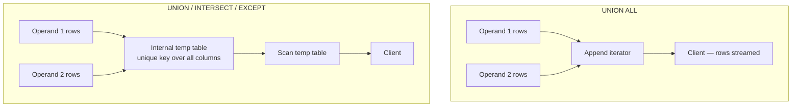

## Introduction

A join combines tables **horizontally**: it glues columns of one row to columns of another row that matches it. A **set operation** combines query results **vertically**: it takes the rows produced by one `SELECT` and the rows produced by another `SELECT` and treats them as two collections to be merged, intersected or subtracted. The output has the *same columns* as each input — just a different set of rows.

That vertical view answers a family of questions that joins express awkwardly:

- "Give me one timeline of everything that happened to an order — the order itself, its payments and its reviews." (**UNION ALL** of three differently shaped tables, projected to a common shape.)
- "Which products have been both ordered and reviewed?" (**INTERSECT**.)
- "Which customers have an account but have never placed an order?" (**EXCEPT**.)
- "Do the order totals computed by the application agree with the payments recorded by the payment provider?" (**EXCEPT** in both directions — a reconciliation.)

MySQL supported `UNION` and `UNION ALL` for decades. `INTERSECT` and `EXCEPT` arrived only in **MySQL 8.0.31**, so a lot of MySQL code you will meet in the wild still emulates them with `EXISTS`, `IN` or anti-joins. In this lesson you will learn what each operator means formally, what MySQL does internally to compute it (and why plain `UNION` costs more than `UNION ALL`), the rules that decide the result's column names and data types, where `ORDER BY` and `LIMIT` are allowed, and one subtle point that makes `EXCEPT` safer than `NOT IN`: set operators treat two NULLs as duplicates of each other.

:::note[Dataset]
The examples use the **shop** dataset: 25 customers (five of whom — customers 2, 13, 23, 24 and 25 — have never ordered), 30 products, 80 orders in 2024, 182 order lines, 76 payments and 45 reviews. Every output below was captured from a real MySQL server; run any block in your own lab to reproduce it.
:::

## DBMS Theory

:::theory[Set operators in relational algebra]
Relational algebra borrows three operators directly from set theory:

- **Union** R ∪ S — tuples in R, in S, or in both.
- **Intersection** R ∩ S — tuples in both R and S.
- **Difference** R − S — tuples in R that are not in S.

They are only defined for **union-compatible** relations: R and S must have the same **degree** (number of attributes), and corresponding attributes must have compatible **domains**. The operators pair attributes **by position**, not by name. Intersection is not primitive — R ∩ S = R − (R − S) — but it is so useful that every SQL dialect offers it directly.
:::

Classical relational algebra works on **sets**: a relation never contains the same tuple twice. SQL, however, works on **bags** (multisets) — a query result can contain duplicate rows — so the SQL standard defines two flavours of each operator. If a row *r* appears *m* times in the left input and *n* times in the right input:

| Operator | Times *r* appears in the result | Semantics |
|---|---|---|
| `UNION` (= `UNION DISTINCT`) | 1 if m + n > 0 | set union |
| `UNION ALL` | m + n | bag union (concatenation) |
| `INTERSECT` (= `INTERSECT DISTINCT`) | 1 if m > 0 and n > 0 | set intersection |
| `INTERSECT ALL` | min(m, n) | bag intersection |
| `EXCEPT` (= `EXCEPT DISTINCT`) | 1 if m > 0 and n = 0 | set difference |
| `EXCEPT ALL` | max(m − n, 0) | bag difference |

Three algebraic properties matter when you read and write compound queries:

1. **Union and intersection are commutative and associative** (as sets): A ∪ B = B ∪ A and (A ∪ B) ∪ C = A ∪ (B ∪ C). Difference is neither: A − B ≠ B − A.
2. **Precedence.** The SQL standard gives `INTERSECT` higher precedence than `UNION` and `EXCEPT`, just as multiplication binds tighter than addition. `A UNION B INTERSECT C` means `A UNION (B INTERSECT C)`. `UNION` and `EXCEPT` have equal precedence and are evaluated left to right.
3. **Duplicate comparison uses "is not distinct from", not "=".** When a set operator decides whether two rows are duplicates, two NULLs in the same column count as *the same*. This is different from a `WHERE a = b` predicate, where NULL = NULL is UNKNOWN. The difference has real consequences — compare [EXISTS, NOT EXISTS, IN and NOT IN](/lessons/m04-exists-in) with `EXCEPT` later in this lesson.

:::standard[Standard SQL vs MySQL]
`UNION [ALL | DISTINCT]`, `INTERSECT [ALL | DISTINCT]` and `EXCEPT [ALL | DISTINCT]` are all standard SQL and all supported by MySQL 8.0.31+ and 8.4. Oracle Database calls `EXCEPT` **`MINUS`** (Oracle 21c accepts both); MySQL does not accept `MINUS`. MySQL also lets the `TABLE t` and `VALUES ROW(...)` statements appear as operands, which is a convenient (8.0.19+) extension of the usual `SELECT` operands.
:::

## Why It Exists

Without set operators, three everyday tasks become clumsy or wrong:

**Combining data that lives in differently structured tables.** A support agent wants one chronological feed of "order placed", "payment received" and "review written" events. These come from three tables with different columns. No join produces this — a join would multiply rows (each order × each payment × each review) instead of listing them one after the other. A set operation projects each table onto a common shape `(event_time, event_type, order_id, detail)` and stacks the results.

**Partitioned or archived data.** Many systems keep `orders_2023` and `orders_2024`, or `orders` and `orders_archive`, as separate tables. A report across years is a `UNION ALL` of the partitions. (MySQL's native partitioning, covered in Module 12, does this transparently — but application-level "sharding by table" is still very common.)

**Comparing two result sets.** Data engineers constantly ask "what is in A but not in B?": rows in the staging table that did not reach production, customer IDs in the CRM that are missing from the billing system, products in the catalogue that never sold. `EXCEPT` states this directly and handles NULLs and multi-column rows correctly. The alternatives (`NOT IN`, `NOT EXISTS`, `LEFT JOIN … IS NULL`) work too, but each has traps you must know — especially `NOT IN` with a NULL in the subquery, which silently returns *nothing*.

There is also a historical reason that still shapes MySQL code today: MySQL has **no `FULL OUTER JOIN`**. The standard emulation is `LEFT JOIN … UNION … RIGHT JOIN`, covered in [Outer Joins](/lessons/m04-outer-joins). Understanding exactly what `UNION` removes is what makes that emulation correct.

## Internal Working

:::internals[How MySQL executes a set operation]
Each operand (`SELECT`, `TABLE` or `VALUES`) is optimized and executed as its own **query block**. What happens to the rows they produce depends on whether duplicates must be handled:

- **`UNION ALL`** needs no memory of earlier rows. Since MySQL 8.0 the executor uses an **Append** iterator that simply reads the first operand to exhaustion, then the second, and *streams* each row to the client. No temporary table is created (unless an outer `ORDER BY` needs one for sorting).
- **`UNION` (DISTINCT)** must know whether a row has been seen before. MySQL creates an **internal temporary table** whose rows are the union's columns, with a **unique index (or hash) over all columns**. Each operand's rows are inserted; inserts that would violate uniqueness are dropped. Finally the temporary table is scanned to produce the result. `EXPLAIN FORMAT=TREE` shows this as *"Union materialize with deduplication"* followed by *"Table scan on &lt;union temporary&gt;"*; traditional `EXPLAIN` shows an extra `UNION RESULT` row with *"Using temporary"*.
- **`INTERSECT` and `EXCEPT`** (8.0.31+) also materialize into a temporary table (*"Intersect materialize with deduplication"*, *"Except materialize with deduplication"*). The left operand fills the table; rows from the right operand are then looked up in it to mark matches (INTERSECT keeps marked rows, EXCEPT removes them). The `ALL` variants need to remember **how many** copies of each row were seen, so the temporary table also tracks per-row counts.
:::



**Where the temporary table lives.** Internal temporary tables start in memory using the **TempTable** storage engine (the default `internal_tmp_mem_storage_engine` in 8.0 and 8.4). When an in-memory table grows beyond `tmp_table_size` (per table) or TempTable's global memory budget is exhausted, it overflows to disk (memory-mapped files or InnoDB on-disk temporary tables). So the cost of deduplication grows with the **number and width of distinct rows**: every row is hashed or compared on *all* of its columns, including long `VARCHAR`s.

**Comparison uses collations and type conversion.** Because duplicates are found through an index or hash on the result columns, the comparison follows the result column's **collation**. Under MySQL's default `utf8mb4_0900_ai_ci` collation, `'Amara'` and `'AMARA'` are duplicates and `UNION` keeps only one of them — you will see that below.

**Result column types are computed before execution.** MySQL determines each result column's type by *aggregating* the types of the corresponding columns of all operands (e.g. `INT` and `DECIMAL(10,2)` → `DECIMAL`; a number and a string → a string type wide enough for both). The names come from the **first** operand only.

## MySQL Implementation

The general shape is a list of query blocks separated by set operators, with an optional `ORDER BY` and `LIMIT` that apply to the **whole** result:

```sql
query_block
{UNION | INTERSECT | EXCEPT} [ALL | DISTINCT]
query_block
[{UNION | INTERSECT | EXCEPT} [ALL | DISTINCT] query_block ...]
[ORDER BY column_or_position [ASC | DESC], ...]
[LIMIT n [OFFSET m]];

-- query_block is SELECT ..., TABLE tbl, VALUES ROW(...), or a (parenthesized) query expression
```

**UNION ALL — stacking compatible rows.** Who are the people we can contact? Customers and the shop's own product categories have nothing in common, but customers' first names and cities can be listed alongside each other as a single column of "place names" — useful to see the mechanics:

```sql run
SELECT city AS place FROM customers WHERE state = 'WA'
UNION ALL
SELECT city FROM customers WHERE state = 'MA';
```

Every row of both operands is kept, including the repeated cities. Now remove duplicates with plain `UNION`:

```sql run
SELECT city AS place FROM customers WHERE state = 'WA'
UNION
SELECT city FROM customers WHERE state = 'MA';
```

**EXCEPT — rows in the first result but not the second.** Customers who have never placed an order:

```sql run
SELECT customer_id FROM customers
EXCEPT
SELECT customer_id FROM orders
ORDER BY customer_id;
```

**INTERSECT — rows in both results.** Products that were both ordered *and* reviewed:

```sql run
SELECT product_id FROM order_items
INTERSECT
SELECT product_id FROM reviews
ORDER BY product_id;
```

Note that `order_items` contains each product many times and `INTERSECT` (DISTINCT) still returns each product once. Since both operands are just lists of IDs, the result answers "which products" — to get *names*, join the result to `products` (a derived table or CTE does that cleanly; see [Common Table Expressions](/lessons/m04-ctes)).

**Column names come from the first operand.** The alias `AS place` above named the result column; aliases in later operands are ignored:

```sql run
SELECT 'order' AS source, COUNT(*) AS n FROM orders
UNION ALL
SELECT 'payment' AS kind, COUNT(*) AS how_many FROM payments
UNION ALL
SELECT 'review', COUNT(*) FROM reviews;
```

## Syntax Breakdown

| Component | Meaning and rules |
|---|---|
| `UNION` / `UNION DISTINCT` | Rows from either operand, duplicates removed. `DISTINCT` is the default and may be written explicitly. |
| `UNION ALL` | Concatenation; duplicates kept. No temporary table needed. |
| `INTERSECT [DISTINCT]` | Rows present in both operands, each once. 8.0.31+. |
| `INTERSECT ALL` | A row appearing m and n times appears min(m, n) times. |
| `EXCEPT [DISTINCT]` | Rows of the left operand absent from the right, each once. 8.0.31+. |
| `EXCEPT ALL` | A row appearing m and n times appears max(m − n, 0) times. |
| Operand | `SELECT …`, `TABLE t` (all rows and columns of t), `VALUES ROW(…), ROW(…)` (columns named `column_0`, `column_1`, …), or a parenthesized query expression. |
| Column count | Every operand must return the same number of columns, otherwise **error 1222**. Columns are matched **by position**. |
| Column names | Taken from the **first** operand. Use aliases there. |
| Column types | Aggregated across all operands (e.g. `INT` + `DECIMAL` → `DECIMAL`; number + string → string). Strings are compared with the result's collation. |
| Precedence | `INTERSECT` binds tighter than `UNION` and `EXCEPT`; `UNION`/`EXCEPT` evaluate left to right. Parentheses override. |
| Trailing `ORDER BY` / `LIMIT` | Apply to the **whole** compound result. Refer to columns by the first operand's names (or position). Table-qualified names (`customers.city`) are not allowed here. |
| `(SELECT … ORDER BY … LIMIT n)` | Per-operand ordering and limiting require parentheses around that operand. `ORDER BY` inside a parenthesized operand **without** `LIMIT` is meaningless and may be optimized away. |

:::warning[Mixing DISTINCT and ALL]
In a chain such as `A UNION ALL B UNION C`, a `UNION DISTINCT` removes duplicates from everything to its **left** as well — the result has no duplicates at all, even those produced by the earlier `UNION ALL`. If you mix the two, put the `DISTINCT` operators first or use parentheses so the intent is obvious.
:::

## Practical Examples

**1. One activity timeline from three tables.** Project orders, payments and reviews onto the common shape `(event_time, event, order_or_product, detail)` and sort the combined result. Different tables, different columns — the projection is what makes them union-compatible:

```sql run
SELECT order_date AS event_time, 'order placed' AS event,
       order_id AS ref, CAST(status AS CHAR) AS detail
FROM orders WHERE customer_id = 1
UNION ALL
SELECT p.paid_at, 'payment', p.order_id, CONCAT(p.method, ' ', p.status, ' ', p.amount)
FROM payments p JOIN orders o ON o.order_id = p.order_id
WHERE o.customer_id = 1
UNION ALL
SELECT r.created_at, 'review', r.product_id, CONCAT(r.rating, ' stars')
FROM reviews r WHERE r.customer_id = 1
ORDER BY event_time, event;
```

`UNION ALL` is the correct choice: an order event and a payment event are never "duplicates" of each other, and dedup would only cost time. The final `ORDER BY` names `event_time`, the alias from the **first** operand.

**2. Per-operand ORDER BY and LIMIT — the two cheapest and two most expensive products.** Each operand needs its own sort and limit, so each goes in parentheses; the outer `ORDER BY` then sorts the four rows:

```sql run
(SELECT name, price FROM products ORDER BY price ASC  LIMIT 2)
UNION ALL
(SELECT name, price FROM products ORDER BY price DESC LIMIT 2)
ORDER BY price;
```

**3. Bag semantics with INTERSECT ALL and EXCEPT ALL.** Which states do our gold-tier customers live in, *counted with multiplicity*? The left operand lists every customer's state (California appears many times); the right lists the states of gold customers:

```sql run
SELECT state FROM customers WHERE loyalty_tier = 'gold' ORDER BY state;
```

```sql run
SELECT state FROM customers
INTERSECT ALL
SELECT state FROM customers WHERE loyalty_tier = 'gold'
ORDER BY state;
```

`INTERSECT ALL` keeps min(m, n) copies: California appears in both operands, and the right operand has it twice, so the result has two `CA` rows. With plain `INTERSECT` each state would appear once. `EXCEPT ALL` subtracts counts: how many *non-gold* customer rows remain per state once we cancel one row for every gold customer?

```sql run
SELECT state, COUNT(*) AS n
FROM (SELECT state FROM customers
      EXCEPT ALL
      SELECT state FROM customers WHERE loyalty_tier = 'gold') AS remaining
GROUP BY state
ORDER BY n DESC, state;
```

**4. Reconciliation — order totals vs. successful payments.** For each paid order, the sum of its line items should equal the sum of its succeeded payments. `EXCEPT` in both directions lists every disagreement, comparing *both* columns at once:

```sql run
SELECT order_id, SUM(quantity * unit_price) AS amount
FROM order_items GROUP BY order_id
EXCEPT
SELECT order_id, SUM(amount) FROM payments WHERE status = 'succeeded' GROUP BY order_id
ORDER BY order_id
LIMIT 10;
```

Any row here is an order whose item total has no exactly matching succeeded-payment total — either it was never paid (pending, cancelled, failed or refunded) or the amounts differ. The reverse direction finds payments that do not correspond to an item total:

```sql run
SELECT order_id, SUM(amount) AS amount FROM payments WHERE status = 'succeeded' GROUP BY order_id
EXCEPT
SELECT order_id, SUM(quantity * unit_price) FROM order_items GROUP BY order_id
ORDER BY order_id;
```

The reverse direction is empty: every succeeded payment matches its order's item total exactly. The forward direction (the first 10 rows are shown) therefore lists only orders without a matching successful payment — unpaid, cancelled, failed or refunded orders. This two-sided `EXCEPT` is the standard way data teams compare two systems that should agree.

**5. Precedence.** `INTERSECT` binds tighter than `UNION`:

```sql run
SELECT 1 AS v UNION SELECT 2 INTERSECT SELECT 2;
```

```sql run
(SELECT 1 AS v UNION SELECT 2) INTERSECT SELECT 2;
```

The first query is `1 ∪ (2 ∩ 2)` = {1, 2}; the parenthesized version is `{1, 2} ∩ {2}` = {2}. When in doubt, parenthesize.

**6. `VALUES` and `TABLE` as operands (MySQL 8.0.19+).** Add hand-written rows to a query result — handy for "other" buckets in reports or test fixtures:

```sql run
SELECT category_id, name FROM categories WHERE parent_id IS NULL
UNION ALL
VALUES ROW(0, 'Uncategorised')
ORDER BY category_id;
```

## Execution Walkthrough

Trace a `UNION` of two operands step by step: the cities of customers in California and the cities of customers with a gold tier. The two operands overlap, so the walkthrough shows exactly what deduplication removes.

```walkthrough
title: SELECT city FROM customers WHERE state = 'CA' UNION SELECT city FROM customers WHERE loyalty_tier = 'gold' ORDER BY city
steps:
  - title: "1. Operand 1 — California customers"
    explain: The first query block runs on its own, exactly as if it were a standalone SELECT. Its result includes repeated cities, because several Californian customers live in the same city.
    sql: SELECT city FROM customers WHERE state = 'CA' ORDER BY city;
  - title: "2. Operand 2 — gold customers"
    explain: The second query block runs independently. Some of its rows (gold customers who live in California) duplicate rows of operand 1.
    sql: SELECT city FROM customers WHERE loyalty_tier = 'gold' ORDER BY city;
  - title: "3. UNION ALL would simply append"
    explain: Counting the appended rows shows the size of the input to the deduplication step — the sum of both operands' row counts.
    sql: |
      SELECT COUNT(*) AS appended_rows FROM (
        SELECT city FROM customers WHERE state = 'CA'
        UNION ALL
        SELECT city FROM customers WHERE loyalty_tier = 'gold') AS u;
  - title: "4. Deduplicate in the temporary table"
    explain: >-
      For UNION (DISTINCT), every row is inserted into an internal temporary table with a unique key over all
      columns; duplicate inserts are silently discarded. The remaining row count is the number of distinct cities.
    sql: |
      SELECT COUNT(*) AS distinct_rows FROM (
        SELECT city FROM customers WHERE state = 'CA'
        UNION
        SELECT city FROM customers WHERE loyalty_tier = 'gold') AS u;
  - title: "5. ORDER BY on the whole result"
    explain: The trailing ORDER BY applies to the deduplicated result, using the column name from the first operand. The plan below shows the dedup step and the temporary table scan.
    sql: |
      SELECT city FROM customers WHERE state = 'CA'
      UNION
      SELECT city FROM customers WHERE loyalty_tier = 'gold'
      ORDER BY city;
```

The physical plan confirms the internal steps. `UNION` materializes with deduplication:

```sql run
EXPLAIN FORMAT=TREE
SELECT city FROM customers WHERE state = 'CA'
UNION
SELECT city FROM customers WHERE loyalty_tier = 'gold';
```

`UNION ALL` just appends and streams:

```sql run
EXPLAIN FORMAT=TREE
SELECT city FROM customers WHERE state = 'CA'
UNION ALL
SELECT city FROM customers WHERE loyalty_tier = 'gold';
```

The traditional tabular `EXPLAIN` shows the same difference as an extra `UNION RESULT` row (*Using temporary*) that is present for `UNION` and absent for `UNION ALL`:

```sql run
EXPLAIN
SELECT city FROM customers WHERE state = 'CA'
UNION
SELECT city FROM customers WHERE loyalty_tier = 'gold';
```

## Output

The final result of the walkthrough is one column named `city` (the first operand's name), sorted alphabetically, with each city exactly once. Comparing step 3 with step 4 tells you how many rows the deduplication discarded — and the plan tells you what that cost: an internal temporary table with a unique key over the result columns.

Two details of the output are easy to miss:

- **Case-insensitive duplicates disappear.** Deduplication compares with the column collation:

```sql run
SELECT first_name FROM customers WHERE customer_id IN (1, 2)
UNION
SELECT UPPER(first_name) FROM customers WHERE customer_id IN (1, 2);
```

Under `utf8mb4_0900_ai_ci`, `'AMARA'` equals `'Amara'`, so the uppercase rows were treated as duplicates and dropped — only the rows from the first operand survive. If case matters, compare with a binary or case-sensitive collation (`COLLATE utf8mb4_0900_as_cs`) in the operands.

- **The result type is the aggregate of the operand types.** A temporary table created from a union shows the computed type:

```sql run
CREATE TABLE union_type_demo AS
SELECT price AS v FROM products WHERE product_id = 1
UNION ALL
SELECT stock_qty FROM products WHERE product_id = 1;
SHOW CREATE TABLE union_type_demo;
```

The `DECIMAL(10,2)` price and the `INT` stock quantity combine into `DECIMAL(12,2)`: two decimal places for the price, and enough integer digits for both an 8-digit price and a 10-digit integer.

## Alternative Approaches

Every `INTERSECT` and `EXCEPT` can be rewritten with the tools from [Subqueries](/lessons/m04-subqueries) and [EXISTS, NOT EXISTS, IN and NOT IN](/lessons/m04-exists-in). The rewrites are not always equivalent — the differences are in **duplicates** and **NULLs**.

| Goal | Set operator | Alternatives | Semantic differences |
|---|---|---|---|
| A ∩ B | `INTERSECT` | `WHERE EXISTS (…)`, `WHERE x IN (…)`, `JOIN` + `DISTINCT` | `EXISTS`/`IN` keep the left side's duplicates; `JOIN` can multiply rows; `IN`/`=` do not match NULL to NULL |
| A − B | `EXCEPT` | `WHERE NOT EXISTS (…)`, `LEFT JOIN … WHERE b.key IS NULL`, `WHERE x NOT IN (…)` | `NOT IN` returns **nothing** if the subquery yields a NULL; `NOT EXISTS`/anti-join keep left duplicates and treat NULL keys as non-matching |
| A ∪ B | `UNION` | `SELECT DISTINCT` over a `UNION ALL` | identical result; `UNION` is the clearer form |
| Full outer join | — | `LEFT JOIN … UNION … RIGHT JOIN` (see [Outer Joins](/lessons/m04-outer-joins)) | needs `UNION` (or `UNION ALL` + anti-join filter) |

**The NULL difference, demonstrated.** Which categories have no product assigned *directly* to them? `products.category_id` is NULL for the gift card. The `NOT IN` version returns nothing at all:

```sql run
SELECT category_id FROM categories
WHERE category_id NOT IN (SELECT category_id FROM products)
ORDER BY category_id;
```

For category 1, the predicate `1 NOT IN (3, 4, …, NULL)` expands to `1 <> 3 AND … AND 1 <> NULL`; the last comparison is UNKNOWN, so the whole predicate is UNKNOWN and the row is filtered out — for *every* category. `EXCEPT` does not have this trap:

```sql run
SELECT category_id FROM categories
EXCEPT
SELECT category_id FROM products
ORDER BY category_id;
```

`NOT EXISTS` also gives the right answer here, because it asks "is there a matching row?" rather than evaluating a chain of `<>` comparisons:

```sql run
SELECT c.category_id FROM categories c
WHERE NOT EXISTS (SELECT 1 FROM products p WHERE p.category_id = c.category_id)
ORDER BY c.category_id;
```

The other direction shows NULL matching NULL. Which `category_id` values in `products` do not exist in `categories`?

```sql run
SELECT category_id FROM products
EXCEPT
SELECT category_id FROM categories;
```

`EXCEPT` reports the NULL (the gift card's missing category) as a value that has no counterpart — it compares NULL "not distinct from" every value on the right and finds no NULL there. Whether that is what you want depends on the question; the point is to *know* which semantics you are using.

**When to prefer which:**

- Use `EXCEPT`/`INTERSECT` when you compare **whole rows** (several columns) and want set semantics — reconciliations, regression tests ("old query result EXCEPT new query result must be empty").
- Use `EXISTS`/`NOT EXISTS` when you want to return **other columns** of the left table (names, prices) and keep its rows as they are; the optimizer turns them into semi-joins and anti-joins that can use indexes on the right side.
- Avoid `NOT IN (subquery)` unless the subquery column is declared `NOT NULL`.

## Performance Analysis

The dominant cost difference is the **temporary table**. `UNION ALL` reads each operand once and streams; `UNION`, `INTERSECT` and `EXCEPT` additionally insert every row into a temporary table and probe its unique key. To make the difference measurable, build two "event" tables of 60,000 rows each, generated with a recursive CTE (see [Recursive CTEs](/lessons/m04-recursive-ctes)):

```sql run
SET SESSION cte_max_recursion_depth = 100000;
CREATE TABLE events_2023 (id INT PRIMARY KEY, user_id INT NOT NULL, kind VARCHAR(12) NOT NULL);
CREATE TABLE events_2024 LIKE events_2023;
INSERT INTO events_2023
WITH RECURSIVE seq(n) AS (SELECT 1 UNION ALL SELECT n + 1 FROM seq WHERE n < 60000)
SELECT n, n % 5000, ELT(1 + n % 3, 'view', 'cart', 'buy') FROM seq;
INSERT INTO events_2024
WITH RECURSIVE seq(n) AS (SELECT 1 UNION ALL SELECT n + 1 FROM seq WHERE n < 60000)
SELECT n, (n * 7) % 6000, ELT(1 + n % 3, 'view', 'cart', 'buy') FROM seq;
ANALYZE TABLE events_2023, events_2024;
```

How many rows does each form produce?

```sql run
SELECT
  (SELECT COUNT(*) FROM (SELECT user_id, kind FROM events_2023
                         UNION ALL SELECT user_id, kind FROM events_2024) a) AS union_all_rows,
  (SELECT COUNT(*) FROM (SELECT user_id, kind FROM events_2023
                         UNION SELECT user_id, kind FROM events_2024) d)     AS union_rows;
```

Now look at the measured plans. `EXPLAIN ANALYZE` executes the query and reports actual time and rows per iterator:

```sql run measured
EXPLAIN ANALYZE
SELECT user_id, kind FROM events_2023
UNION ALL
SELECT user_id, kind FROM events_2024;
```

```sql run measured
EXPLAIN ANALYZE
SELECT user_id, kind FROM events_2023
UNION
SELECT user_id, kind FROM events_2024;
```

Read the two trees side by side. The `UNION ALL` tree is an `Append` of two `Stream results` iterators; the `UNION` tree has a `Union materialize with deduplication` iterator whose actual time includes inserting all 120,000 input rows into the temporary table, followed by a scan of the (smaller) deduplicated table. The absolute milliseconds are from the build machine and will differ on yours; the **shape** — an extra materialization over all input rows — is what carries over to production sizes.

:::performance[Theory vs measurement]
Expected costs, from how the executor works:

| Form | Extra work beyond reading the operands | Memory |
|---|---|---|
| `UNION ALL` | none (streamed) | constant |
| `UNION` | insert every row into a temp table with a unique key, then scan it | grows with distinct rows × row width |
| `INTERSECT` / `EXCEPT` | materialize the left operand, probe it with every right row, scan it | grows with distinct left rows |
| `… ALL` variants | as above plus per-row counters | as above |

Wide rows (long strings, many columns) make dedup more expensive because the unique key covers *all* columns. When the temp table exceeds `tmp_table_size` or TempTable's memory budget, it spills to disk, and the cost jumps. Measure with `EXPLAIN ANALYZE` on realistic data before deciding that a dedup is "free".
:::

Practical consequences:

- **Default to `UNION ALL`** whenever the operands cannot overlap (different event types, disjoint partitions, different literal tags) or duplicates are meaningful (summing amounts). Write `UNION` only when you genuinely need deduplication, and say so in a comment.
- **Push filters into each operand.** A `WHERE` on the outer query over a derived union may or may not be pushed into the operands (MySQL 8.0.22+ can push conditions into derived tables, including unions, in many cases). Writing the filter inside each operand guarantees each one reads only what it needs, through its own indexes.
- **`OR` across different columns → `UNION`.** `WHERE customer_id = 7 OR order_date >= '2024-12-01'` cannot use a single index for both conditions; the optimizer may choose *index merge*, or you can rewrite it as two indexed queries combined with `UNION` (which also removes the rows matching both). This is a classic optimization covered in Module 7.
- **`INTERSECT`/`EXCEPT` vs semi/anti-joins.** For "rows of a large table with no match in another indexed table", `NOT EXISTS` lets the optimizer use an antijoin with index lookups on the right table, while `EXCEPT` materializes the left operand first. On large inputs compare both with `EXPLAIN ANALYZE`.

## Best Practices

:::best-practice[Professional habits for set operations]
1. **Choose `UNION ALL` by default; justify every `UNION`.** Silent deduplication both costs a temporary table and can delete legitimate rows (two orders with the same amount).
2. **Alias every column in the first operand** — those names are the result's names and what `ORDER BY` refers to.
3. **Make operands explicitly union-compatible.** Same column order, same meaning, and `CAST` when types differ (e.g. `CAST(status AS CHAR)` for an ENUM, `CAST(NULL AS DECIMAL(10,2))` for a placeholder) so the result type is what you intend.
4. **Add a source/tag column** (`'order' AS event`) when stacking different entities, so consumers can tell rows apart — and so rows from different sources can never be accidentally deduplicated.
5. **Put per-operand `ORDER BY … LIMIT` in parentheses**, and the global `ORDER BY` at the very end. Never rely on the order of a union without a final `ORDER BY`.
6. **Parenthesize mixed operators** (`UNION` with `INTERSECT`, `DISTINCT` with `ALL`). Correct precedence that nobody can read is a maintenance bug waiting to happen.
7. **Prefer `EXCEPT` or `NOT EXISTS` over `NOT IN (subquery)`** for differences, because of NULL handling.
8. **Remember the 8.0.31 floor.** If code must also run on MySQL 5.7 or early 8.0 (or on MariaDB versions without these operators), use `EXISTS`/`NOT EXISTS` instead of `INTERSECT`/`EXCEPT`.
:::

## Common Mistakes

**Mistake 1 — different number of columns.**

```sql run error
SELECT customer_id, city FROM customers
UNION
SELECT customer_id FROM orders;
```

Error 1222. Pad the shorter operand with typed placeholders (`NULL`, `CAST(NULL AS CHAR(60))`) or reconsider whether a join is what you need.

**Mistake 2 — columns in the wrong order.** Set operators pair columns by **position**; names are irrelevant. Swapping two columns of the same type produces no error, just garbage:

```sql run
SELECT first_name, last_name FROM customers WHERE customer_id = 1
UNION ALL
SELECT last_name, first_name FROM customers WHERE customer_id = 2;
```

The second row has the last name under `first_name`. Nothing warns you — only careful projection prevents this.

**Mistake 3 — ORDER BY / LIMIT on an operand without parentheses.**

```sql run error
SELECT name FROM products ORDER BY price DESC LIMIT 2
UNION ALL
SELECT name FROM categories;
```

The parser treats an unparenthesized `ORDER BY`/`LIMIT` as belonging to the whole statement, so it cannot appear before `UNION`. Wrap the operand: `(SELECT name FROM products ORDER BY price DESC LIMIT 2) UNION ALL …`.

**Mistake 4 — mixing numbers and strings and getting a string sort.** If one operand supplies a number and another a string for the same column, the result column becomes a string type, and `ORDER BY` sorts lexicographically:

```sql run
SELECT 9 AS v
UNION ALL
SELECT '10'
ORDER BY v;
```

`'10'` sorts before `'9'` because the comparison is character by character. Cast every operand to the intended type.

**Mistake 5 — `UNION` silently removing real data.** "Total revenue from all line items of orders 1 and 2" summed over a `UNION` drops line items that happen to have identical `(quantity × unit_price)` values. Here the question needs a bag, not a set:

```sql run
SELECT
  (SELECT SUM(v) FROM (SELECT quantity * unit_price AS v FROM order_items WHERE order_id <= 20
                       UNION
                       SELECT quantity * unit_price FROM order_items WHERE order_id > 20) d) AS sum_over_union,
  (SELECT SUM(v) FROM (SELECT quantity * unit_price AS v FROM order_items WHERE order_id <= 20
                       UNION ALL
                       SELECT quantity * unit_price FROM order_items WHERE order_id > 20) a) AS sum_over_union_all,
  (SELECT SUM(quantity * unit_price) FROM order_items) AS true_total;
```

Only the `UNION ALL` version matches the true total; the `UNION` version lost every line item whose value duplicated another's.

**Mistake 6 — using `NOT IN` where `EXCEPT` (or `NOT EXISTS`) was meant.** Shown in *Alternative Approaches*: one NULL in the subquery turns the whole result empty.

## Industry Application

- **Event feeds and audit timelines.** Customer-support tools, admin dashboards and "account activity" pages stack heterogeneous events with `UNION ALL`, each operand tagged with an event type and ordered by timestamp. Each operand uses its own `(customer_id, created_at)` index; the final sort is over a small result.
- **Data reconciliation and pipeline testing.** Analytics engineers compare a new version of a transformation with the old one using `(old EXCEPT new) UNION ALL (new EXCEPT old)` — an empty result proves the refactor is behaviour-preserving. Finance teams reconcile ledgers against payment-provider exports the same way. Tools such as dbt's "audit" helpers generate exactly these queries.
- **Partitioned history.** Systems that rotate tables (`logs_2024_10`, `logs_2024_11`) query across them with `UNION ALL`, often behind a view. The rule "never `UNION` when partitions are disjoint" saves a temporary table per query on very large data.
- **Full outer joins in MySQL.** Every MySQL codebase that needs a full outer join — "all products and all categories, matched where possible" — uses the `LEFT JOIN … UNION … RIGHT JOIN` pattern, or the faster `LEFT JOIN … UNION ALL … RIGHT JOIN … WHERE left.key IS NULL` variant that avoids deduplication.
- **Search across entity types.** A global search box that finds customers, orders and products returns `UNION ALL` of three ranked queries with a common `(entity_type, id, label, score)` shape, each limited in parentheses before the global sort.
- **Portability.** Teams migrating from Oracle replace `MINUS` with `EXCEPT` (8.0.31+); teams supporting older MySQL versions keep the `NOT EXISTS` form.

## Practice Exercises

```exercise
id: ex1
title: Customers who never ordered
difficulty: easy
concepts: [except, set-operations]
prompt: |
  Using a set operator, return the `customer_id` of every customer who has **never placed an order**.
  Return one column, `customer_id`.
hints:
  - "Start from all customer IDs and remove those that appear in orders."
  - "SELECT customer_id FROM customers EXCEPT SELECT customer_id FROM orders"
solution: |
  SELECT customer_id FROM customers
  EXCEPT
  SELECT customer_id FROM orders;
explanation: |
  `EXCEPT` removes every ID that appears in `orders` (however many times) and returns each remaining ID once.
  `NOT EXISTS` or a `LEFT JOIN … WHERE o.order_id IS NULL` give the same result here. `NOT IN` also works in
  this case only because `orders.customer_id` is declared `NOT NULL`.
```

```exercise
id: ex2
title: A combined contact list
difficulty: medium
concepts: [union, union-all, union-compatibility]
prompt: |
  Build a contact list with columns `kind`, `full_name`, `city`, in this order:

  - one row per **customer**, with `kind = 'customer'`, `full_name` = first name, a space, last name, and their city;
  - one row per **top-level product category** (no parent), with `kind = 'department'` (each top-level
    category is run by a store department), `full_name` = the category name and `city = 'HQ'`.

  Keep every row (no deduplication).
hints:
  - "Both operands need exactly three columns in the same order."
  - "Use CONCAT(first_name, ' ', last_name) for customers and literal strings for the category rows."
  - "UNION ALL keeps every row and avoids an unnecessary temporary table."
solution: |
  SELECT 'customer' AS kind, CONCAT(first_name, ' ', last_name) AS full_name, city
  FROM customers
  UNION ALL
  SELECT 'department', name, 'HQ'
  FROM categories
  WHERE parent_id IS NULL;
explanation: |
  The literal tag column guarantees that rows from the two sources can never be duplicates of each other, so
  `UNION ALL` is both correct and cheaper. The column names come from the first operand; the second operand's
  expressions only need to line up by position.
```

```exercise
id: ex3
title: Products sold but never reviewed
difficulty: medium
concepts: [except, intersect]
prompt: |
  Return the `product_id` and `name` of every product that appears in at least one order line but has
  **no review**. Columns: `product_id`, `name`.
hints:
  - "First find the IDs with EXCEPT: product IDs from order_items EXCEPT product IDs from reviews."
  - "Then join that result (as a derived table) to products to get the names."
solution: |
  SELECT p.product_id, p.name
  FROM (SELECT product_id FROM order_items
        EXCEPT
        SELECT product_id FROM reviews) AS unreviewed
  JOIN products p ON p.product_id = unreviewed.product_id;
explanation: |
  Set operators return only the columns of their operands, so a typical pattern is "compute the set of keys
  with a set operator, then join for the descriptive columns". An equivalent single-level query is
  `SELECT … FROM products p WHERE EXISTS (… order_items …) AND NOT EXISTS (… reviews …)`.
```

```exercise
id: ex4
title: The NOT IN trap
difficulty: hard
concepts: [except, null-handling, set-operations]
prompt: |
  A colleague wrote `SELECT category_id FROM categories WHERE category_id NOT IN (SELECT category_id FROM products)`
  to find categories with no directly assigned product, and got an empty result. Write a correct query using a
  **set operator**. Return one column, `category_id`.
hints:
  - "One product (the gift card) has a NULL category_id. What does `x NOT IN (…, NULL)` evaluate to?"
  - "EXCEPT compares rows with 'is not distinct from' semantics and is not affected by the NULL in the right operand."
solution: |
  SELECT category_id FROM categories
  EXCEPT
  SELECT category_id FROM products;
explanation: |
  `x NOT IN (a, b, NULL)` means `x <> a AND x <> b AND x <> NULL`; the last term is UNKNOWN, so the predicate
  can never be TRUE and every row is filtered out. `EXCEPT` removes only the values that actually appear on the
  right, so category 1 (Electronics, which has only subcategories) is returned. Adding
  `WHERE category_id IS NOT NULL` to the subquery would also fix the `NOT IN` version.
```

```exercise
id: ex5
title: Loyal across both halves of the year
difficulty: challenge
concepts: [intersect, except, union-all]
prompt: |
  Classify customers by when they ordered in 2024. Return `customer_id` and `segment`, where segment is:

  - `'both halves'` — ordered in January–June **and** in July–December;
  - `'H1 only'` — ordered only in January–June;
  - `'H2 only'` — ordered only in July–December.

  Customers who never ordered are not listed. Use set operators to build the three groups.
hints:
  - "Define H1 as SELECT customer_id FROM orders WHERE order_date < '2024-07-01', and H2 with >=."
  - "'both halves' is H1 INTERSECT H2; 'H1 only' is H1 EXCEPT H2; 'H2 only' is H2 EXCEPT H1."
  - "Wrap each set operation in a derived table so you can add the literal segment column, then UNION ALL the three."
solution: |
  SELECT customer_id, 'both halves' AS segment FROM (
    SELECT customer_id FROM orders WHERE order_date < '2024-07-01'
    INTERSECT
    SELECT customer_id FROM orders WHERE order_date >= '2024-07-01') AS b
  UNION ALL
  SELECT customer_id, 'H1 only' FROM (
    SELECT customer_id FROM orders WHERE order_date < '2024-07-01'
    EXCEPT
    SELECT customer_id FROM orders WHERE order_date >= '2024-07-01') AS h1
  UNION ALL
  SELECT customer_id, 'H2 only' FROM (
    SELECT customer_id FROM orders WHERE order_date >= '2024-07-01'
    EXCEPT
    SELECT customer_id FROM orders WHERE order_date < '2024-07-01') AS h2;
explanation: |
  The three groups are disjoint by construction, so `UNION ALL` is correct and avoids a dedup step. A
  conditional-aggregation alternative is shorter: `GROUP BY customer_id` with
  `MAX(order_date < '2024-07-01')` and `MAX(order_date >= '2024-07-01')` flags, then a `CASE`. It reads
  `orders` once instead of six times — on large tables that matters; the set-operator version makes the
  logic of each segment explicit.
```

## Knowledge Assessment

```quiz
- id: q1
  question: "Operand A returns the row ('CA') 3 times; operand B returns it 2 times. How many times does ('CA') appear in `A INTERSECT ALL B` and in `A EXCEPT ALL B`?"
  options: ["2 and 1", "1 and 0", "3 and 1", "2 and 0"]
  answer: 0
  explanation: "INTERSECT ALL keeps min(3, 2) = 2 copies; EXCEPT ALL keeps max(3 − 2, 0) = 1 copy. The DISTINCT forms would give 1 and 0. '3 and 1' confuses INTERSECT ALL with the left count."
  concepts: [intersect, except]
- id: q2
  question: "Why is `UNION` typically more expensive than `UNION ALL` in MySQL?"
  options:
    - "UNION executes each operand twice"
    - "UNION inserts every row into an internal temporary table with a unique key over all columns to remove duplicates; UNION ALL streams rows through an Append iterator"
    - "UNION ALL can use indexes and UNION cannot"
    - "UNION sorts the result by the first column"
  answer: 1
  explanation: "Deduplication needs memory of rows already seen. Both forms read each operand once and both can use indexes inside the operands. UNION does not guarantee any order — only a final ORDER BY does."
  concepts: [union, duplicate-elimination]
- id: q3
  question: "`SELECT 'x' AS a, 1 AS b UNION ALL SELECT 'y' AS c, 2 AS d;` — what are the result column names?"
  options: ["a, b", "c, d", "a, d", "column_0, column_1"]
  answer: 0
  explanation: "Result column names come from the first operand only. column_0, column_1 are the names VALUES ROW(...) gives its columns when it is the first operand."
  concepts: [union-compatibility]
- id: q4
  question: "`categories.category_id` has values 1–10; `products.category_id` contains a NULL. What does `SELECT category_id FROM categories WHERE category_id NOT IN (SELECT category_id FROM products)` return?"
  options:
    - "The categories without products"
    - "An empty result, because each NOT IN predicate evaluates to UNKNOWN once a NULL is in the list"
    - "An error"
    - "All 10 categories"
  answer: 1
  explanation: "x NOT IN (…, NULL) is x <> … AND x <> NULL, which can never be TRUE. EXCEPT and NOT EXISTS do not have this problem."
  concepts: [except, null-handling]
- id: q5
  question: "Which statements are true in MySQL 8.4? (Select all that apply.)"
  type: multi
  options:
    - "INTERSECT has higher precedence than UNION"
    - "Set operators match columns by name"
    - "An ORDER BY with LIMIT inside a parenthesized operand limits that operand only"
    - "MINUS is accepted as a synonym of EXCEPT"
    - "When deciding duplicates, two NULLs in the same column are treated as equal"
  answer: [0, 2, 4]
  explanation: "INTERSECT binds tighter; per-operand ORDER BY … LIMIT works inside parentheses; duplicate detection treats NULLs as not distinct. Columns are matched by position, and MySQL does not accept Oracle's MINUS."
  concepts: [set-operations]
- id: q6
  question: "What does `SELECT 1 AS v UNION SELECT 2 INTERSECT SELECT 2` return?"
  options: ["2 only", "1 and 2", "1 only", "Nothing"]
  answer: 1
  explanation: "INTERSECT is evaluated first: 1 ∪ (2 ∩ 2) = {1, 2}. Evaluating left to right would give {2} — that is what the parenthesized (SELECT 1 UNION SELECT 2) INTERSECT SELECT 2 returns."
  concepts: [intersect, union]
- id: q7
  question: "A report stacks `orders_2023` and `orders_2024` (disjoint order IDs) and sums the amounts. A developer used UNION. What is the risk?"
  options:
    - "None — the tables are disjoint so UNION and UNION ALL are the same"
    - "If the projected columns don't include the unique order_id, rows with identical values are collapsed and the sum is too low; even when correct, UNION pays for a pointless temporary table"
    - "UNION cannot be used inside a derived table"
    - "UNION changes DECIMAL amounts into DOUBLE"
  answer: 1
  explanation: "Dedup works on the projected columns, not on the source rows. Projecting only (customer_id, amount) can merge two different orders. Use UNION ALL for disjoint data. Type aggregation of two DECIMAL columns stays DECIMAL."
  concepts: [union-all, duplicate-elimination]
- id: q8
  question: "`SELECT 9 AS v UNION ALL SELECT '10' ORDER BY v;` returns rows in which order, and why?"
  options:
    - "9, 10 — numeric sort"
    - "'10', '9' — the result column is a string type, so ORDER BY compares characters"
    - "An error — types must match exactly"
    - "Undefined order"
  answer: 1
  explanation: "The result type is aggregated from all operands; a number and a string give a string column, sorted lexicographically ('1' < '9'). MySQL does not require identical types; it converts them."
  concepts: [union-compatibility]
```
